# 🏥 AI+X医学实战教程：第1节：基于PBL的MCP教程设计与编写

在本节课中，我们将一起学习如何为专业人员编写一份好用的AI教程。具体来说，我们将围绕MCP这个工具，讨论为什么教程不应该从抽象概念开始，而应该从真实问题出发。我们会看一个医学场景中的实际案例，了解传统解决方法的不足，再学习如何安装和配置MCP，最后通过流程复盘揭示MCP的作用。此外，我们还会聊聊教程编写的基本方法，以及接下来的两个发展方向。

---

## 📖 1. 课程概述：我们在这一节要学什么

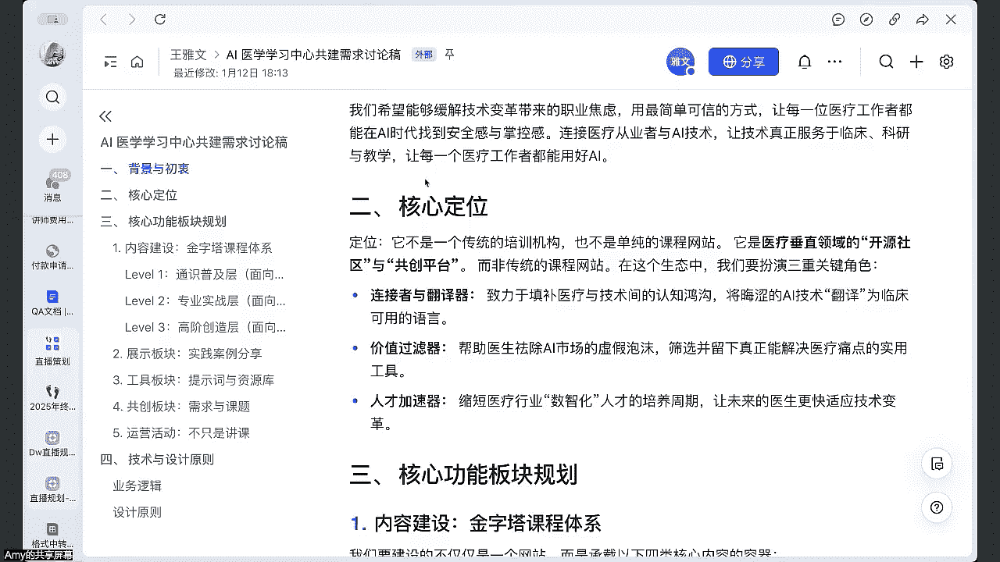

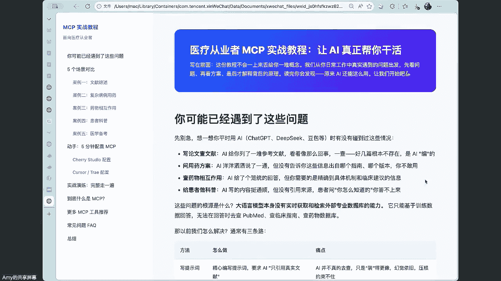

最近我一直在制作MCP相关的课程。说实话，之前我本人并没有实际使用过MCP，只是要求其他同事使用过。最近我亲自试用了一下，发现上手比想象中容易很多，而且确实很好用。目前MCP的应用程序也在不断发展，使用变得更加简单。虽然某些平台还没有完全兼容，但我相信兼容工作会很快完成。

基于这段时间的体验，我编写了一份MCP教程，希望可以给大家做个示范。我们期待的课程体系，不是传统意义上一上来就讲概念的那种，而是实操性和应用性都非常强的课程。这种教学方法有一个专业名称，叫做PBL，即基于问题的学习。

以下是PBL教学法的核心步骤：

- 先向学习者抛出一个具体问题。
- 引导学习者尝试解决问题。
- 在解决完成后进行复盘。
- 最后再揭示其中使用的核心概念。

公式化表示如下：

```
PBL流程 = 问题 → 尝试解决 → 复盘总结 → 得出概念
```

---

## 🩺 2. 从真实问题出发：医学场景中的AI痛点

在实际教学中，我不会直接告诉大家MCP是什么，也不会一开始就讲MCP怎么用。相反，我会先抛出一个问题，让大家感受到痛点所在。

以下是常见的医学AI使用痛点：

- 医生使用AI工具写用药方案时，找不到可靠的文献依据。
- 给患者做科普时，AI生成的内容没有标注信息来源。
- 大模型本身能力看起来很强，但在专业领域仍然达不到要求，无法查询指南库或权威数据库。

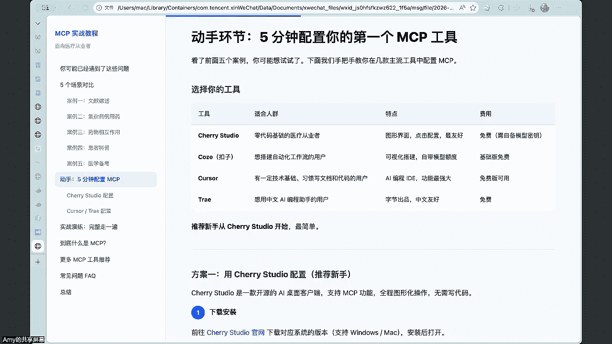

换句话说，模型可能很强大，但如果它不能提供可追溯的专业证据，在医疗场景中就很难直接使用。

---

## 🛠️ 3. 传统方法的局限性：提示词与知识库

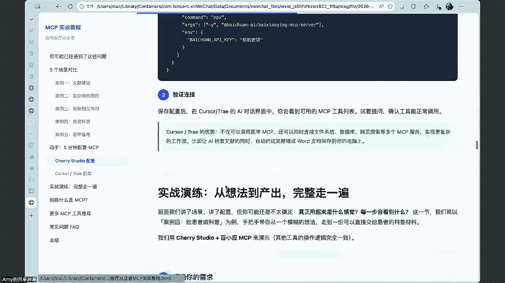

过去我们面对这些问题，通常只有两种办法。以下是传统解决方案及其痛点：

- 自己编写提示词：每遇到一个痛点，就要重新调整提示词，效率较低。
- 自建知识库：搭建知识库需要大量工作，而且自建的知识库容量有限，很难覆盖所有专业场景。

这两种方法都有明显的不足，所以我们需要一种更好的工具。

---

## 💡 4. 为什么现在仍然值得关注MCP

有些人说MCP已经过时，应该改用skills或者其他方式。但实际上，MCP依然很热，因为相关平台已经在推广MCP，使用人数也在增加。我打算在教程后续加入MCP应用程序模式，好处是工具已经封装好，使用更省事，而且全流程都可以查看。

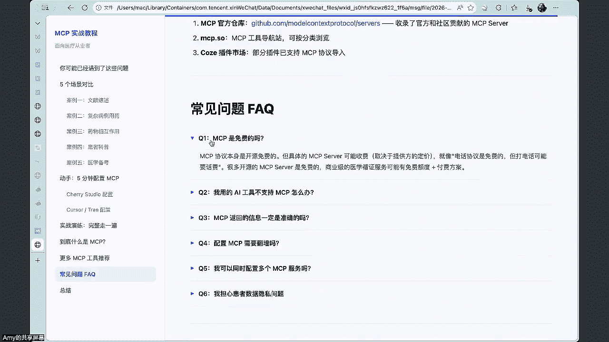

在教程中，有些地方使用公式来引用内容，有些地方则没有特殊要求，只需告诉AI“帮我查文献”即可。之所以在医学场景中仍然需要MCP，是因为医学有一个基本要求：不能胡说八道，不能产生幻觉，输出内容必须有据可依。大多数人的第一反应是自己建知识库，但自建的知识库能有多大呢？为什么不直接使用别人已经建好的资源呢？

MCP在医学场景中的作用可以用公式表示：

```
AI模型 + MCP外部工具 = 可追溯的专业能力
```

---

## 🔌 5. 引入MCP：先体验变化，再理解工具

现在有一个更好的选择，就是安装一个叫做MCP的东西。在这里，我还不急着解释MCP的具体定义，而是先举一个例子，让你先感受一下MCP能带来什么变化。

以下是对比示例的思路：

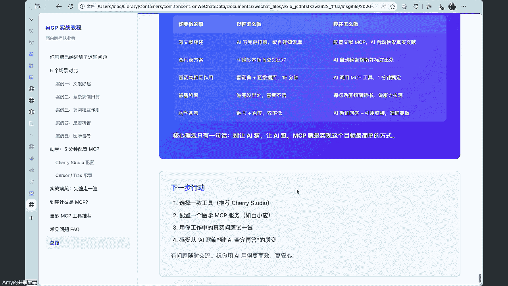

- 使用同一个提示词，分别交给普通大模型和支持MCP的模型。
- 以文献综述为例，观察两者在查找文献和标注来源方面的差异。

通过这个直观对比，你可以先体会到MCP带来的变化，然后再继续往下学习。

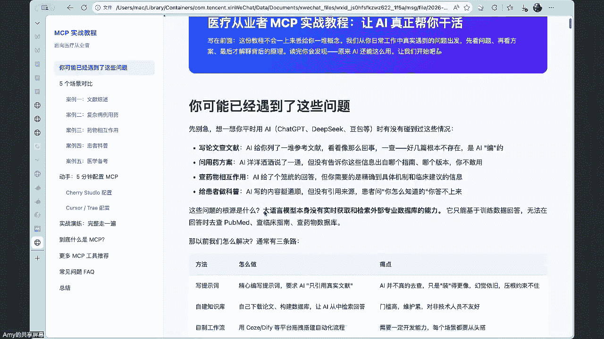

---

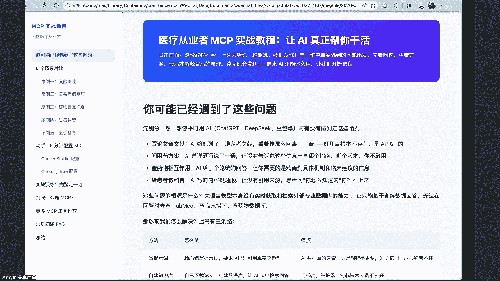

## 🧪 6. 动手实践：Cherry Studio 配置与操作步骤

感受完变化之后，我们进入动手实践环节。这部分的感觉有点像产品小组在开发功能：首先明确痛点，然后明确需求，再决定具体怎么做。

以下是配置和操作的大致步骤：

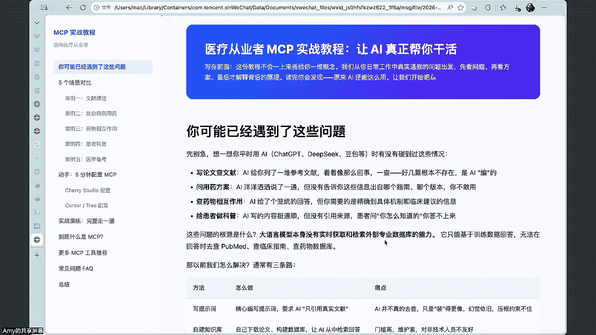

- 打开Cherry Studio工具，这是我平时也在使用的平台。
- 按照详细说明完成MCP的配置。
- 打开工具，开始实战演练。
- 每一步操作都像是在教用户如何完成这件事情，确保跟随指引即可完成配置。

配置完成后，我们就可以进入实际应用环节。

---

## 🔍 7. 流程复盘：MCP在实战中起到了什么作用

实战演练结束之后，我们需要进行复盘。复盘的目的是让大家明白，在整个过程中，MCP到底起到了什么作用。

复盘后的总结如下：

- 教程一开始并没有直接讲MCP的概念、使用方法或能力。
- 而是先告诉你一个具体问题，再帮你解决这个问题。
- 问题解决之后，复盘我们是如何解决的。
- 最后告诉你，这个方法好用吧，这时候再解释MCP到底是什么。

---

## ✍️ 8. 教程编写方法：结构优先，内容落地

通过上面的例子，我想表达的意思是，未来的实战课程应该采取更加偏实用主义的风格。我找了几个朋友测试了这个教程，他们反馈上手比较容易，而且不那么晦涩难懂。与市面上其他MCP课程相比，这种写法更舒适一些。

所以，后续我们编写AI课程时，可以参考这种方式。教程应当具备强实践性，让AI真正帮助用户在具体场景中解决问题。我选择的案例也都是与医学相关的场景。

以下是编写教程时的关键建议：

- 先把教程结构写好，不要一开始就关注好看的排版。
- 使用Markdown格式先把所有文字内容梳理清楚。
- 文字内容搞定之后，再花时间做好看的可视化和交互效果。
- 好的排版确实能提升体验，但结构和内容才是基础。

---

## 🚀 9. 未来展望与本节总结

最后，我想分享一下我今年可能要推进的两件大事。第一是希望带着大家用AI做产品，培养更多的产品化思维。第二是想把AI医学学习中心建立起来，推广到更多的医疗从业者，让他们能快速接触AI的发展。

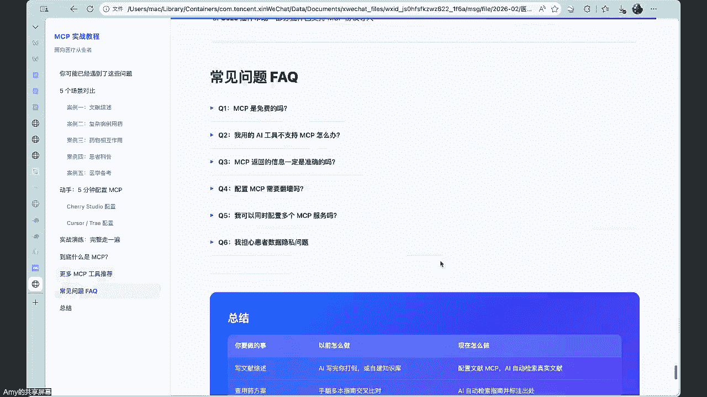

关于教程制作的一些细节，比如图片都是我亲手截图的，链接还没有发布。AI辅助写作的感觉比较扎实，因为我在开始时已经做好了约束。至于模型选择，使用的是可所平台中最聪明的模型。

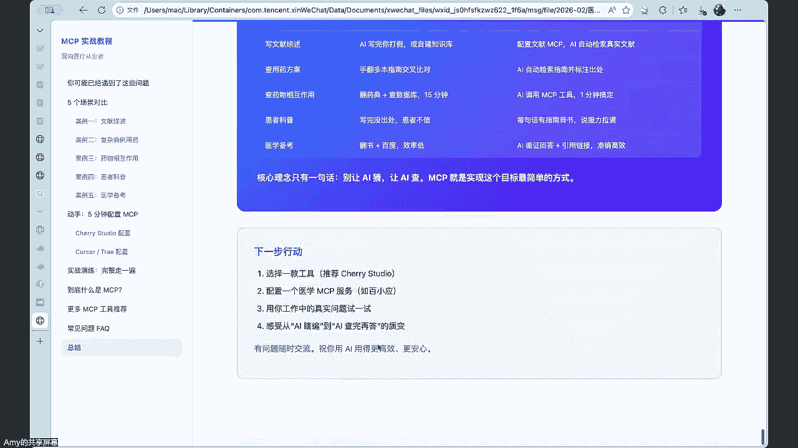

在本节课中，我们一起学习了以下内容：

- 为什么AI教程适合采用PBL以问题为导向的风格。
- 医学AI使用中的常见痛点以及传统方法的局限。
- 为什么现在仍然值得关注MCP，以及MCP应用程序模式的优势。
- 如何引入MCP，并通过实战体验感受它的变化。
- Cherry Studio的配置与实战操作步骤。
- 流程复盘的方法以及MCP的核心作用。
- 教程编写的基本方法与未来发展方向。

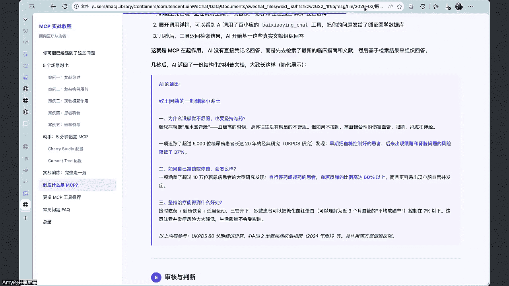

希望这篇教程能对你有所帮助。

