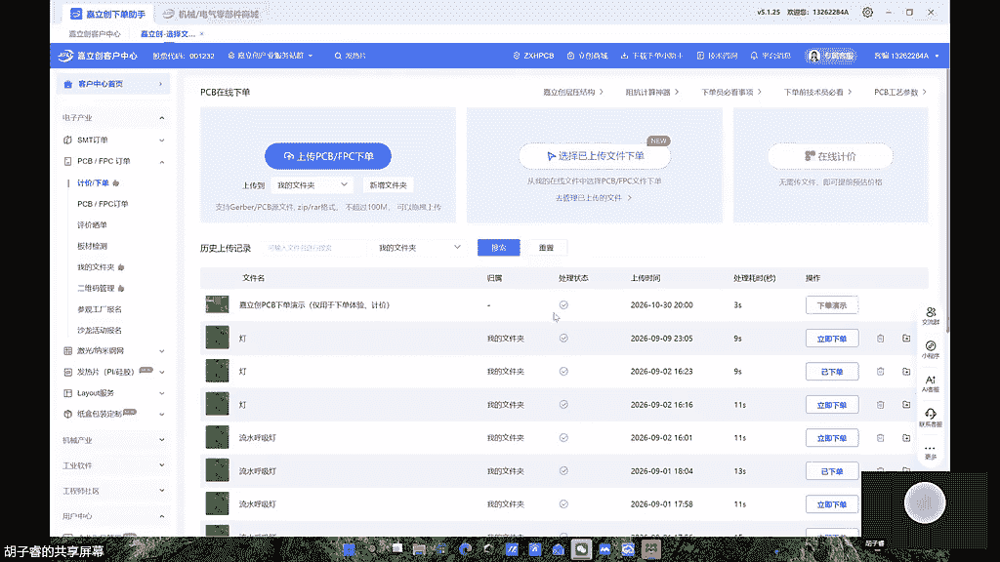
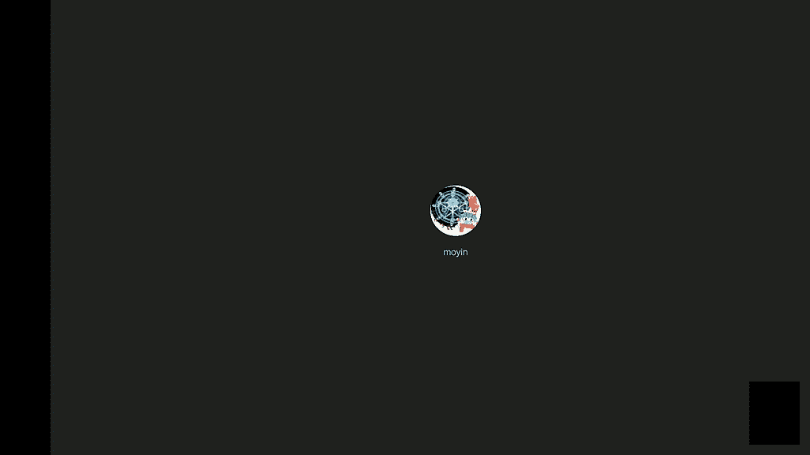
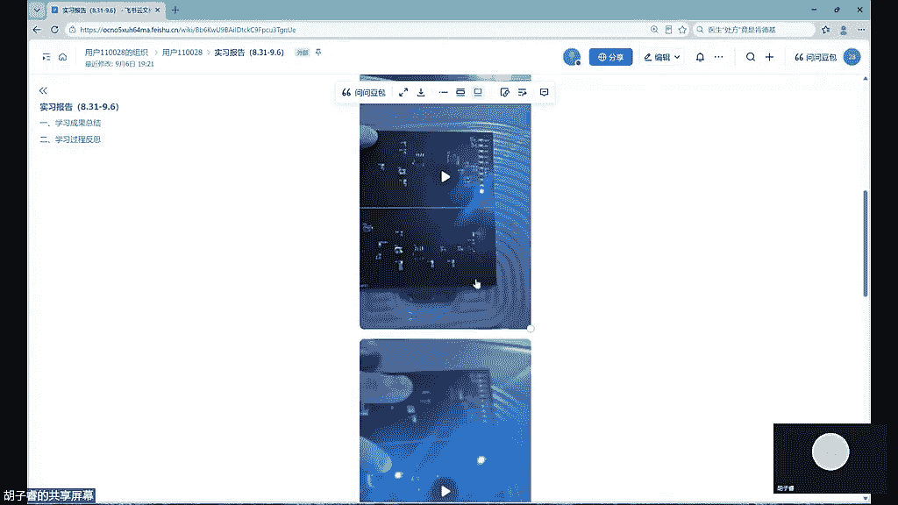

# 大学电路知识串联走通：01：从原理图到焊接的PCB全流程实践🔧

在本节课中，我们将学习如何把一个电子项目从纸上的原理图变成可以拿在手里的实体电路板。本项目由呼吸灯和流水灯两部分组成，适合刚接触电路知识的同学作为入门实践。我们会一起了解原理图绘制、PCB布局布线、设计规则检查、出板下单以及元件焊接的每一个环节，并结合真实的呼吸灯和流水灯项目，把分散的大学电路知识串联成一条完整的工程线。


## 一、项目介绍与选题原因

上一节我们做了整体课程的概述，本节中我们来看看这个小项目具体是做什么的，以及为什么选择呼吸灯和流水灯作为练习对象。

以下是项目的主要构成和功能说明：

- 该项目是一个结合呼吸灯和流水灯功能的小电路板。
- 呼吸灯常见于电子设备的指示灯，亮度可以慢慢变亮，再慢慢变暗，看起来就像设备在呼吸。
- 在本设计中，呼吸灯主要由NE555定时器及其周围电路组成，产生相应的控制信号，实现LED亮度的周期性变化。
- 流水灯则是利用NE555和CD4017配合，让多个LED按一定顺序点亮，形成流水般的效果。
- 这个项目选用的原因在于，一方面它涉及的知识比较基础，非常适合入门；另一方面它不只是一个简单电路，还可以完整实践原理设计、PCB布局布线、设计检查、下单打板和元件焊接等全部环节。


## 二、准备工作与基础概念

在刚才介绍完项目之后，本节我们先要准备好工具，并理清几个核心概念，这样后续的设计过程会少走很多弯路。

以下是需要完成的准备工作：

- 注册并登录佳立创EDA。本教程主要使用加了专业版的佳立创EDA，相比网页版标准功能更加完善。
- 对于初次接触PCB设计的同学，先完成账号注册和登录，再熟悉一下软件的基本界面，不需要进行特别复杂的操作。

接下来我们要弄清楚两个最基础的概念，即原理图和PCB的区别，以及封装的含义。

- 原理图：用来表达电路中各个元件之间的电气连接关系，回答“电路怎么连接”的问题。
- PCB：把原理图中的连接落实到实际电路板上，回答“元件在板子上怎么放、线路怎么走”的问题。
- 从视觉上看，原理图是逻辑连接图，而PCB是你最后打板拿到手的实体板子外形。

封装是指元件在PCB上的焊盘位置和尺寸，可以用下面的对应关系来理解：

```
原理图元件 --> 选择对应的PCB封装 --> 决定焊盘位置和尺寸
```

如果封装选错，即使原理图连接正确，进入PCB阶段后也可能出现元件放置不准或焊盘不匹配的情况，导致无法焊接。


## 三、原理图设计

有了基础概念之后，本节我们来看看如何具体绘制这个项目的原理图，确保电路逻辑正确。

以下是原理图设计的主要步骤：

- 将整个项目分成两个模块，上面是流水灯部分，下面是呼吸灯部分，采用模块化设计，上下各自拥有独立功能。
- 确定需要使用的元件，包括芯片、电阻、电容、LED和供电接口。
- 在这个阶段不仅要考虑元件数量是否足够，还要确定每个元件是如何连接的。
- 例如NE555的不同引脚功能各不相同，必须根据具体电路正确连接，常见引脚对应关系如下：

```
NE555引脚：电源 / 触发 / 阈值 / 放电 / 输出
功能：为芯片供电 / 触发定时 / 比较阈值电压 / 放电输出 / 输出控制信号
```

- 流水灯部分需要确认NE555输出的信号如何输入到CD4017，而CD4017又如何控制各个LED灯，让它们像流水一样一个点亮、一个熄灭。
- 本项目采用5V供电，并考虑使用面包板电源进行供电，因此在设计时需要确定电源接口的引脚定义和连接关系。
- 电源接口的电气关系可以简单表示为：

```
VCC = 5V
GND = 0V
```

- 电源接口就是板子上下方的两个接口，可以连接面包板电源，给整个设备供电。

简单来说，原理图是整个项目的基础。原理图画完之后，建议再检查一遍，这往往比后期返工更省时间。


## 四、从原理图转到PCB

完成原理图并检查无误之后，本节我们将进入PCB设计阶段，进行元件布局和走线操作。

以下是具体操作流程：

- 在软件右上角点击“转PCB”，更新之后即可进入PCB界面。
- 在PCB界面中，我们会看到各个元件的封装，以及尚未完成的电气连接。

接下来说明为什么要这样设计板子，以及布局时需要注意的事项。

- 使用的板子尺寸为10乘10厘米，尽量控制在这个范围内。
- 主要使用贴片元件，电阻和电容尽量采用0603封装，LED也尽量让元件集中在顶层，采用单面走线。
- 单面走线意味着所有走线都只在板子的一面上，不需要通过过孔从背面走线。
- 这样设计一方面是因为贴片元件能让电路板更紧凑，另一方面也是希望通过项目练习布局能力。
- 单面走线需要控制各个导线之间不相互短路，因此要先考虑整体布局，比如芯片放在哪里，LED如何排列更直观，供电接口是否方便连接。
- 接着再进一步调整电容和电阻的位置。

这里分享一个在布局布线过程中的小技巧。

- 如果走线无法避免需要相交，可以利用电阻中间的缝隙进行布线。
- 这样既能满足线宽和间距的制造规则，又不会因为节省空间把线路挤得太紧。
- 线宽和间距需要满足制造规则，可以用下面的不等式表示：

```
线宽 >= 制造最小线宽
走线间距 >= 制造最小间距
```

最后说明铜皮的设计。

- 图中红色的区域称为铜皮，用来形成较大面积的电源或接地区域。
- 根据电路连接和设计要求决定怎么铺，简单来说能铺的地方尽量多铺。
- 对于分开的电路区域，铺通后需要注意不要产生不符合预期的连接。
- 如果全部区域都变成红色，黑色地方可能会产生浮通，也就是死铜，没有实际作用，且无法确定其电位定位。


## 五、DRC检查与人工自检



PCB布局布线完成之后，本节我们来讲解如何检查设计是否符合制造规则，以及还需要人工核对哪些内容。

以下是检查的关键步骤：

- 下载并运行DRC检测。DRC检测是重要步骤，如果不进行，无法进入下一步打板。
- DRC主要检查常见的制造和布线问题，比如项目之间的间距是否不足，走线是否符合规范，板框设计之间是否存在位置问题。
- DRC通过之后，基本上可以确定电路是可以行得通的，有可能把灯点亮，但这还不够。

除了软件自动检查，我们还需要自己再仔细核对一遍。

- 检查电器连接是否与原理图一致，可以打开原理图和PCB界面进行对比。
- 确认芯片的电源和接地引脚、输入输出引脚是否正确。
- 检查元件封装，例如电容大小不同，常用0603封装比较方便焊接。
- 确认电源切口问题，即5V和GND电路是否对应，上面的接口接5V，下面的接口接地，不能接反。
- 如果电源接反，电容可能会发生危险，甚至炸掉。
- 最后检查板子的制造条件，包括板子层数、尺寸、边框和间距等。


## 六、出板文件与下单打板

检查全部完成并且通过DRC之后，本节我们将导出生产文件，并进行下单打板。

以下是出板和下单的步骤：

- 将文件导出并保存为PCB制版文件，也就是G开头的Gerber文件，用于打板过程。
- 在佳立创下单助手上下单，在此之前可以在佳立创上领取每月的免费券。
- 这是佳立创给用户的福利，打板完成后只需要支付运费就能拿到板子。
- 点击PCB订单，上传PCB文件，例如上传暑假做好的项目文件。
- 上传通过之后即可进行打版下单，根据自己的需求选择相关选项，点击确认即可。


## 七、总结与反思

整个流程走完之后，本节我们来总结一下从这个项目中可以学到什么，以及还需要在哪些方面继续提升。

以下是主要的收获与思考：

- 最大的收获是把之前凌乱的电路知识串联了起来。
- 很多同学在大学阶段学过电路知识，但如果没有实际操作，可能不知道具体应用到底怎么样，落实到实际反而更容易迷惑。
- 原理图要保证电气连接正确，PCB考虑元件的布局和走线，检查阶段要关注软件规则和实际器件，最后面对打板、焊接和测试。
- 只有真正上手测试的时候，才能真正掌握并融会贯通。
- 目前还需要继续学习的地方包括更合理的布局布线、系统的电路排查思路，以及更高效的焊接方法。

欢迎大家分享自己的经验，比如如果设计一个电路板，最想做出什么东西。


## 八、实物展示与硬件设计延伸

除了PCB设计本身，本节我们还简要提一下拿到板子之后的后续操作，以及如何将项目扩展到更复杂的嵌入式硬件设计。

以下是相关内容说明：



- 拿到板子之后需要购买原件，焊接完成后就可以真正发现灯怎么点亮，呼吸灯效果如何。
- 如果有现成的效果图或视频，可以展示PCB在真实世界里的实际效果。
- 对于嵌入式开发，如果想要设计硬件相关的东西，可以尝试自己制作PCB。
- 可以把ESP32等主控和其他外设焊接在PCB板上，这样会更整洁。
- 相比使用多根杜邦线连接，PCB能避免接线混乱、连错以及难以排查bug等问题。
- 可以画一个简单的底层板，把ESP32和其他外设全部装进去，让项目看起来更像成品，更精致。
- 无论是给孩子玩，还是自己尝试做产品，都非常适合。




本节课中我们一起学习了从原理图到焊接的完整PCB制作流程。我们先介绍了呼吸灯和流水灯项目的组成与选题原因，接着讲解了准备工作、原理图与PCB的概念差异，然后详细演示了原理图设计、转PCB布局布线、DRC检查与人工自检，最后介绍了出板文件生成、下单打板以及总结反思和硬件设计延伸。希望通过这篇教程，初学者能够建立起从电路图到实体板子的直观认识，并动手完成属于自己的第一个PCB项目。

