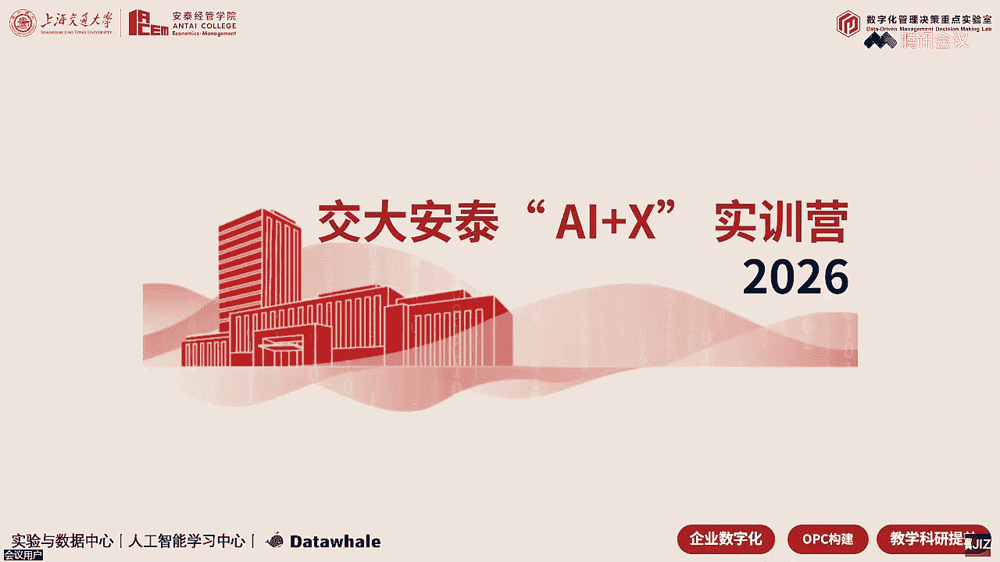
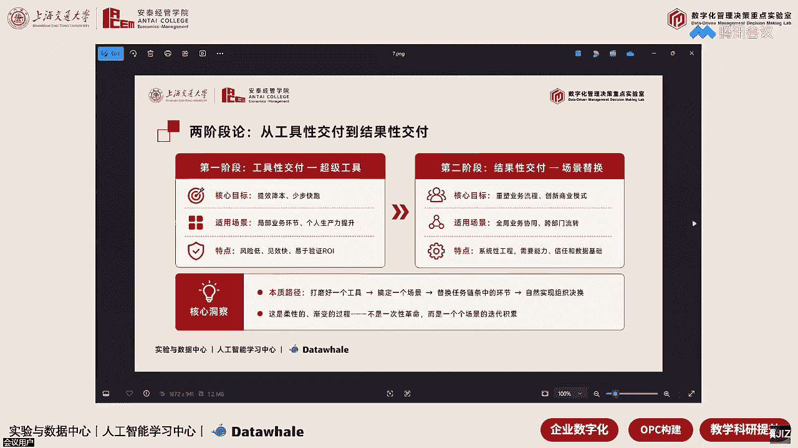
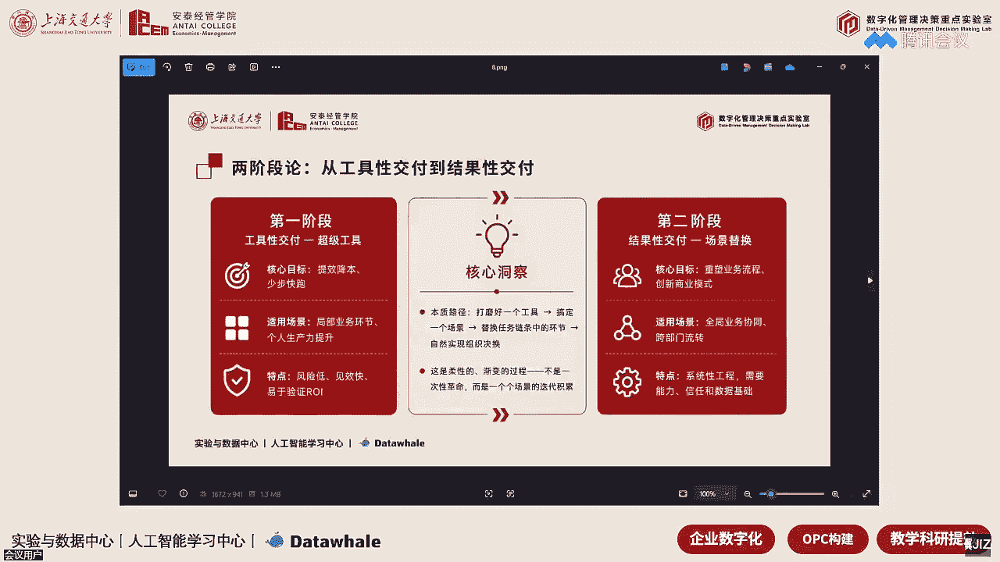
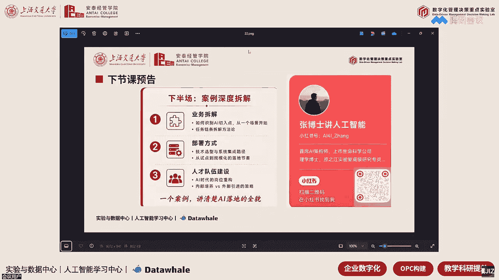
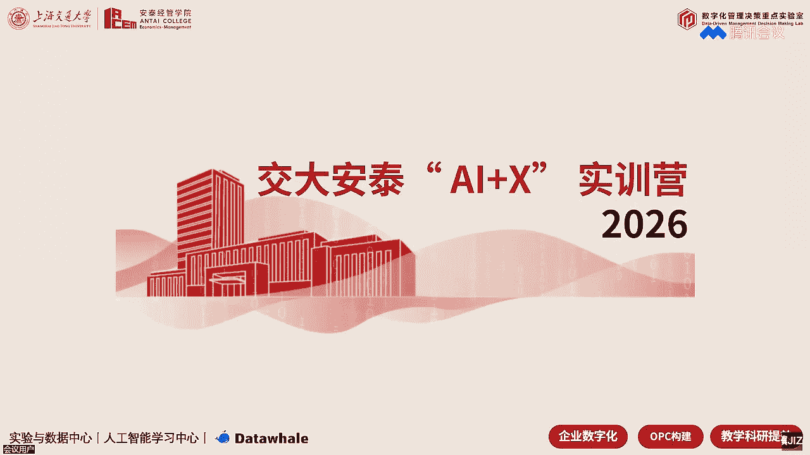

# 企业AI转型全流程：从0到1实战：01：课程概述与核心思维 🚀

在本节课中我们将要学习企业如何落地人工智能转型。内容来源于一次企业AI分享会，演讲者最初从事理论物理和统计物理研究，后来转入人工智能赛道，进入企业工作，尝试将所学知识应用于解决企业实际面临的挑战。课程将围绕迭代思维、真实案例、AI技术边界、渐进式落地路径、组织与系统边界、数据流动、智能体架构等核心话题展开。我们会用大白话解释复杂概念，帮助初学者理解企业AI转型的全过程。每一部分前后都会有过渡说明，列表前会有简短介绍，核心概念会以公式或代码形式呈现。

## 第一部分：为什么说企业AI转型是一场迭代 🔄

上一节我们介绍了课程的总体目标，本节中我们来看看为什么企业AI转型应该被理解为迭代过程，而不是一次性的革命。

### 1.1 演讲者背景与任务缘起

演讲者最初从事理论物理和统计物理研究，后来进入人工智能赛道，并在企业中工作。他的任务是讲解企业如何实现AI转型落地。这个任务非常具有挑战性，因为企业老板每天都在追问如何转型，如何把传统制造型企业变成智能制造或智慧制造企业。这件事情本身很难，今天的分享只是演讲者部分阶段性的心得。

### 1.2 核心关键词：迭代而非革命

在确定演讲主题时，演讲者考虑过使用“革命”这个词，但觉得这个词太大了；又考虑“变革”，觉得这个词太锋利。最终选择了“迭代”。迭代意味着一步一步，渐进式地推进。

公式:

企业AI转型 = ∑(小步验证 + 持续优化)

代码:

# 错误理解
AI转型 = 一次性革命 + 立即见效

# 正确理解
AI转型 = 迭代循环(规划 → 执行 → 反馈 → 调整)

## 第二部分：三个真实案例与行业教训 📊

上一节我们介绍了迭代思维的核心含义，本节中我们来看看三个真实案例，它们分别来自科技巨头、制造企业和服务企业，揭示了AI转型中常见的误区与正面经验。

以下是三个典型案例及其背景介绍：

- Meta案例：Meta在AI上投入资金后股价两次大跌。当它宣布投入数百亿美元购买显卡和人才时，市场反应负面；当它表示暂停投入时，股价又下跌。这显示市场对AI投入的敏感与焦虑。24年资本开支上调50亿，股价蒸发超2000亿。7月内部会议承认因智能体发展未达预期而放缓裁员，股价再跌5%。
- AI客服案例：某企业声称AI客服可处理大量对话，预计全年节省4000万美元。一年后发现，维护AI系统的成本不划算，且AI效果不如真人。类似于我们接到的甜美声音广告电话，一听就是AI合成，用户会挂断。
- 福特案例：福特在24年左右大规模裁掉工程师。工程师是与物理世界打交道的人，后来发现损失更大，于是将这些岗位全部重新雇佣回来。这说明与物理世界打交道的岗位不能简单裁掉。
- 保洁正面案例：保洁、宁德时代、麦当劳、可口可乐等企业，真正打通数据的第一件事都是先做数仓，把数据底层拉通。

代码:

# 案例对比表
案例 | 类型 | 教训
Meta | 科技巨头 | AI投入需谨慎，市场反应剧烈
AI客服 | 服务企业 | 维护成本可能超过节省，效果不如人工
福特 | 制造企业 | 物理世界岗位不可轻易替代
保洁/宁德时代等 | 服务/制造 | 首先构建数仓，拉通数据底层

## 第三部分：AI的本质边界：仅操作数字世界 💻

上一节我们回顾了三个真实案例，了解了企业在AI转型中遇到的实际问题。本节中我们来看看AI到底能做什么，不能做什么，以及它的本质边界在哪里。

AI本质上只能操作电脑上的0和1，即二进制数字。无论AI表现出什么形式，其底层都是在处理数字世界的编码。如果一个任务的全链条不能用电脑里的0和1来表达，也就是必须与物理世界打交道，那么让AI来做这件事就会变得非常痛苦，成本极高，并且不断延期，需求频繁修改，最终项目可能无法推进。

公式:

AI可执行任务 ⟺ 全链条可用二进制(0和1)在计算机中表达

代码:

def can_ai_handle(task):
    if task.entire_chain_is_digital():
        return True
    else:
        return False  # 涉及物理世界，需极度谨慎

因此，在启动任何AI项目之前，第一件要问的问题是：从头到尾，整个链条里的所有内容，本质上能不能在电脑里以0和1的数字世界编码形式表达出来？如果能，就可以继续往下走。如果不能，且必须与物理世界打交道，那么这件事就要非常慎重，难度会立即大幅增加。

## 第四部分：渐进式落地路径：从工具到结果交付 🛠️

上一节我们明确了AI只能操作数字世界的边界，知道了在启动项目前需要判断任务是否全数字化。本节中我们来看看企业应该如何一步一步把AI落地，从做工具开始，最终实现结果交付。

在真实工作中，还是人在使用AI。第一步必须符合大家的使用习惯。就像使用Office或PPT一样，AI的第一步应该是做一个更高效率、更超级的工具，让工具性的能力先提升起来。针对AI转型比较成功的经验是：首先做一个工具，让内部员工在当前的SOP岗位上把它用起来。这是非常重要的，因为必须有一个工具。

这个工具会交出一个结果。一个稳定的工具交付一个稳定的结果。有了工具，有了稳定的交付结构，就把这个结构嵌入到流程里面。在SOP里面，某个流程上的结果就被这个工具所替代。它从一个工具性的事物变成了结果交付。我们今天讲的人工智能，本质上是在讲链条上的替换，也就是在替换结果交付。整个过程中，一定要让打磨好的工具去交付结果。

以下是落地的三个步骤：

1. 做超级工具：让AI先作为高效率工具，提升员工使用习惯。
2. 嵌入流程：将稳定的工具交付结构嵌入SOP，替代原有人工环节。
3. 结果交付：由结果考核部门（如HR）对工具产出进行考核，而不仅仅是技术部门。

代码:

# 落地阶段判断
阶段 = "工具" if 工具被员工使用且效率提升 else "流程" if 结构嵌入SOP else "结果" if 由HR或结果部门考核 else "未开始"

## 第五部分：人、系统与AI的边界划定 🧩

上一节我们介绍了从工具到结果交付的三个落地步骤，理解了如何把AI嵌入SOP。本节中我们来看看在流程跑起来之后，如何划清楚人、现有系统和AI各自的边界。

当流程开始塑造，就像在Excel表格里把东西输出一样，我们需要把流程全部梳理出来，重新梳理一遍。要把人、系统和AI的边界重新梳理清楚。这件事的难度非常大，因为需要和业务负责人、部门经理、一线人员都沟通，甚至需要带着学生坐在现场干一天，或者让学生干一个星期，真刀真枪地实践，才能真正理解业务是什么。

以下是三类主体的职责划分：

- 人：负责与物理世界打交道的工作，比如现场设备操作、实地检查等。
- 现有系统：比如人力资源的EHR系统、财务的ERP系统、工业控制系统。这些成熟系统已有算法功能，不应该被AI取代，而应该被AI利用和调用。
- AI：负责在数字世界中处理数据、生成指令、辅助决策。

代码:

# 边界划分示例
主体 | 职责范围 | 示例
人 | 物理世界交互 | 设备巡检、现场签收
系统 | 既有业务逻辑 | ERP财务结算、EHR考勤
AI | 数字世界处理 | 数据分析、报告生成、指令下发

这个边界划清之后，AI执行层的工作才会变得较为容易。最难的环节是把流程全部拉出来，重新梳理一遍，把三个环节的边界理清楚。

## 第六部分：信息化、无纸化与数据流动 📁

上一节我们讨论了人、系统与AI的边界划分，明确了各自的职责范围。本节中我们来看看为什么信息化和无纸化是智能化的前提，以及数据如何产生价值。

过去的信息化可能只是做个看板、BI大屏，把数据实时投在屏幕上。但今天的智能化倒逼所有企业去做信息化。无纸化非常重要，因为所有业务都有上下文。如果不做无纸化，只凭当场的一些信息，没有上下文，很多事情就无法正确判断。

举个虚构的例子：采购部门买了一台100万的设备，财务看到合同、发票、单据，都符合制度，签字也完整，按流程看没有问题。但是少了一个点：为什么业务方需要发起这个采购？这些上下文知识藏在每个人的脑子里，可能在季度会上讨论过，财务负责人心里知道，但AI脑子里面不会有这些东西。如果不做无纸化，企业所有碎片化信息不放在一起，AI就不知道这台设备是否真的必要。

无纸化的关键点就是把所有信息放到系统上面，把上下文补全。信息化的作用就是把数据拉通。

数据有一个特点：锁在柜子里面的钞票不是钱，流动起来的才是钱。数据也是一样，锁在硬盘里的0和1没有价值，只有在流动的时候才会产生价值。如果有800个数据库，数据锁在每个数据库里，就跟锁在柜子里的金条差不多。

第一件事解决的是“有无”的问题，一定得有数据。第二件事解决的是能不能拿得到、留得起来、到不到得了的问题，即数据要能流动。

以下是数据流动的三个关键环节：

1. 存取：把数据存到电脑上，AI能读得到。
2. 读取：AI可以读取并分析数据。
3. 使用：基于数据进行业务决策。

数据脏不要紧，AI会来洗。在油田项目中，我们管理了数百TB的数据，用了百万核CPU进行压缩和清洗。数据脏不紧，但假数据很危险，尤其是人为填写的表单数据，一定要下功夫弄干净。

## 第七部分：智能体的工作原理与架构 🤖

上一节我们讲解了数据流动的重要性以及无纸化对上下文补全的作用。本节中我们来看看智能体到底是如何工作的，它的输入、处理和输出是什么。

智能体本身没有操作物理世界的能力，它只有下达指令的能力。真正的执行一定是通过工具完成的，这些工具就是我们已有的传统系统。智能体向上处理数据，向下下达指令，中间通过工具与外部系统交互。

举个例子：小龙虾可以在飞书上帮你写文档，但小龙虾本身没有这个能力，它是调用飞书的接口（CLI）来完成的。小龙虾下达指令给工具，工具拿到指令后真正干活。在飞书上接过文档的是那个工具，这些工具一定是用传统方法编辑好的。

智能体的工作可以概括为：向上走数据流，向下走指令，真正的执行由工具完成。

公式:

智能体输出 = 工具(智能体下达的指令, 系统接口)

代码:

class Agent:
    def __init__(self, tools):
        self.tools = tools
    
    def work(self, data):
        instruction = self.think(data)  # 产生指令
        result = self.tools.execute(instruction)  # 工具执行
        return result

智能体的四个核心要素是：skill（技能）、workflow（工作流）、environment（环境）、loop（执行循环）。必须在具体场景中进行，并且该场景的ROI可验证。如果做艺术海报设计或OCR，验证路径不明确且困难，这类事就比较难。

## 第八部分：模型训练与智能体的选型 ⚖️

上一节我们介绍了智能体的工作原理和四个核心要素，知道了智能体主要依赖工具执行。本节中我们来看看企业什么时候应该训练大模型，什么时候应该使用智能体。

作为一个企业，AI只是手段，不是目的。做AI的目的是让企业适应下一个浪潮，长青。企业本质上做两件事：一件是战术级别的当下事务，保证经营利润，降本增效；另一件是战略层面的事情，比如拥有自己的科学研究和护城河。

降本增效这件事，本质上是看投入产出比是否划算，一定是用智能体小规模试做。智能体就是干活的。

而要做今天世界上没有的，或者成本巨大无比的颠覆式事情，一定是训练模型。这是第二个论断：训练模型这件事只做原始突破和创新的活。如果是今天已有的业务用训练模型的做法，要么账算不过，要么成本不可控最后崩炸，要么结果和预期有差距。

第一个论断是：AI只做数字世界的活，严格只做数字世界的活。但凡跟物理世界打交道，就要很慎重。

互联网时代软件分发成本约等于零，同一件事情的规模化成本很低。但AI不一样。通用人工智能模型在一类典型场景里表现优秀，比如在万个评价标准中有98%都高于普通人。已有的模型就是体系型的强大。如果要有突破，就要准备足够大的投入，至少是9个零往上走，甚至10个零，这才是企业战略。如果控制在6到7个零的领域，一定是在智能体的范围内打造价值最大化的链子。

模型：从零到一，原始突破和创新。
智能体：终极降本增强。

以下是选型建议：

- 若目标是降本增效，且在现有业务流程中：选择智能体。
- 若目标是颠覆性创新，且有战略级投入：考虑训练模型。
- 若任务涉及物理世界：无论哪种都要非常慎重。

## 第九部分：企业AI技术蓝图：从硬件到PaaS 🏗️

上一节我们讨论了模型训练与智能体的选型，明确了不同场景下的技术路径。本节中我们来看看如何绘制企业AI的技术蓝图，从底层硬件到PaaS层如何规划。

如果要做一个智能体，首先要明确目标、数据和要做的过程，然后开始搭建架构。第一件事是硬件。硬件就像写字楼的钢筋混凝土结构，楼的大体规划必须在前期想明白。投入的规模数量级也要在前期确定。

通常建议首先明确目标，然后根据显卡规模选择方案。有三个档：云上显卡、本地100卡以内、本地1000卡，以及本地1万卡或10万卡。去年中国万卡集群不多，今年开始有10万卡集群。对于小规模，一定要先谈清楚要做多大的规模，多大的事情。这件事一定在早期规划，一旦做完以后想改基本不可能，成本巨高。

硬件规划涉及以下几个问题：

1. 选云上还是云下：就像把钱放在床底下还是放在支付宝，各有安全考虑。
2. 规模多大：白卡还是签卡。
3. 自建机房还是托管机房：自建需要从风光水电冷热全盘考虑，周期长；托管可以在内蒙古大草原上找便宜机房，标准化托管，拉一条线到园区即可。

如果建机房，首先要面临正式审批，其次是供电投入，机房用电远超过去。能否从政府手中获取电力配额是一个要考虑的因素。第二个因素是显卡的供货周期和账期，千万到上亿的买卖具有金融属性，什么时候买、怎么样买都要考虑。包括网络。

网络建设建议画三个图：

1. 必选项：核心交换机和主网络基建，一次性到位，没有改的机会。
2. 可插拔项：比如100张显卡和配套服务器，可以分批进去，每个月30张，分3个月或10个月进去。
3. 自研项：作为企业内部支持部门或核心部门，提出需求时一定包含自研成分，这部分要考虑清楚。

以下是网络规划三个要素的总结：

- 核心基建：一次性到位，不可更改。
- 分期部署：按业务规模逐步增加服务器和显卡。
- 自研需求：明确内部支持部门还是核心部门，控制自研成分。

网络安全通常和网络一起考虑。

往上是虚拟化层和云层，就像装房子时的软装，墙的粉刷、企业界面等。软装水平决定了体验。硬件层只算服务器价格，不含空调和土地。只算硬件价格和软件价格时，比值一般是花100块钱硬件，软件至少要50到60块钱。有些20块钱的方案，最后成本反而更高。

为什么建议选择稍贵的方案？首先不带货，也不做代理。核心原因是AI进步速度太快。如果买的是套件成品装房就走，与服务商深度绑定，半年以后会发现所有新的AI最佳技术上不去了。技术更新迭代速度过快，这一层必须是开放式、动态式的，必须有高投入。

第二个原因是人才要求高。比如K8s云管平台，虽然免费下载安装，但国内能做AI运维的人才非常稀缺，很贵。一个人差不多100万。花在系统、服务上还是人上，成本差不多。这层的运维对人要求很高，花在软件和人上面的钱是省不掉的。

PaaS层这一层迭代进步速度太快，能把这件事玩转的人今天确实稍微贵了一点。

## 第十部分：应用层、中间件与数据流向 🔄

上一节我们梳理了从硬件到PaaS层的技术蓝图，了解了基础设施的规划要点。本节中我们来看看应用层、中间件以及数据在系统中的具体流向。

再往上是PaaS层，提供标准化的办公环境。就像全季酒店，全国的大床房长得都一样，早餐也是标准化的。PaaS层给智能体提供标准化可靠的运行环境。不管谁来了，都提供这么一个办公环境。人用笔记本，标准化可靠品质。这一层给智能体提供的是办公环境。

环境层对要求非常高。如果停电或网络中断，所有人都会停工。这一层看不到，但一旦塌了，整个系统就瘫痪。投入非常大，而且是隐性投入。要重视起来。

应用层是绝大多数我们今天讲的事情发生的地方。它分智能体、数据、模型。所有工作都以模型为基础，通用模型提供通用智能。在这个基础上，我们的数据来自系统。

绘制AI蓝图非常简单：从上往下把每一层到底要什么东西、要多少事，判断清楚，事情基本就结束了。从用户需求倒排能力，倒排中间件，倒排云基础设施，应用驱动，一条龙排下来。

中间件完成什么事情？过去人是从前端去操作系统。今天AI来接管系统时，有三个选择：

1. 模拟人类点击前端操作系统：效率受限，只在极端场景使用。
2. 模拟前端界面直接向后端发指令：可以做到，大部分供应商愿意开放接口。
3. 直接操作API或数据库：效率最高。

为什么不直接做前端界面操作，而是直接进入后端操作？第一，给人类看的界面需要视觉美感，对AI来说成本太高。人可能一个系统同时开1000次，AI可以有100万个智能体同时负载，这种无谓开销砍掉不创造价值。AI不需要美，不需要方便，只需要降本增效。第二，给人看的系统对AI是低效率的。

所以建议直接砍掉前端界面，改为给AI使用的操作界面，通常叫做CLI（命令行界面）。做CLI不会特别贵，如果供应商配合。一次性情况下甚至不需要做CLI，直接做调用就可以。把过去给人看的前端变成给机器看的前端，这是第一件事。第二件事是操纵API，然后向数据库或下达指令。这就是数据流向的链条。

数据流向包括结构化数据、非结构化数据和记忆。过去系统只有结构化和非结构化两类。智能体独有的数据叫记忆，可以放到非结构化，但建议单独建立一个属于智能体的数据管理系统，通常叫memory、上下文或context。这一层要把三个系统拉通。

数据库向数据图转化的核心过程里，要把这三件事拉通。拉通后，整个智能体在调用数据做处理的过程叫workflow。比如财务拿到报账单，有8个操作：验证发票、核对差旅金额、检查票据一致性等。把给人的SOP变成给智能体的workflow，一次写好，可以用很久。早期可能是人写，后面AI会自动生成workflow。

整体顺序：先把数据灌进去，然后把给人的SOP变成给智能体的workflow，一条条码出来。处理完后，通过不通过，下一步怎么报销，是不是银行打款，就有指令下去。指令下去以后，通过中间键回到系统里面。模型只做指令下发，不做工具调用，真正的调用是传统系统完成的。

一次循环就是从这里到那里再转一圈回来。最后一个事是什么？就是loop。财务每天做800个报销单，前台有2000个接待在等。不断循环干。每个智能体替代了每一个具体任务系列的岗位，就盯死那个活，不停地干。

四件事：skill把事情上传下来，workflow完成工作串联，loop不停地干，environment是基础设施。画蓝图时，脑子里把这四件事情谈清楚就结束了。

## 第十一部分：持续更新、人才培养与总结 🎓

上一节我们详细拆解了应用层、中间件与数据流向，明白了智能体如何在系统中循环工作。本节中我们来看看在系统建设中如何保持持续更新，以及为什么人才培养比短期成果更重要。

在建设中更新。除了硬件层，上面的层越靠近用户，更新频率越高，就像手机微信每周更新，安卓小程序也是。因为技术站没有收敛，而且偏向上层的技术站在没有收敛的情况下来应用，后面总会有很多很好的系统。有朋友开玩笑说，学AI的方式就是等再等一个月，下个月上个月的东西就不要学了。

既然下个月一定会有更好的版本，为什么今天还要做这件事？核心原因不是在最常规层面。回到技术方：我们在做图的时候，完成了两件事。第一是对标准工具性的梳理，能够有一部分结构交付，影响SOP，尽快改变SOP，让整个体系结构更快适应AI原生驱动的架构，为体系做准备。更重要的是做人才培养。也许做的事情最终没弄起来，但人培养起来了。企业里面有一波能够真正熟练理解应用AI、把AI原生思维培养起来的人，他们的生产力比什么事都重要。

阶段性成果一方面不要只算ROI或OKR，至少不能说是负的，不能太离谱。但是更重要的是，即使是一个阶段性的步骤，对于组织的教育、对人的教育，都是非常有帮助的。

以下是本节课的核心要点：

- 企业AI转型应采用迭代思维，而非一次性革命。
- AI本质上只操作数字世界的0和1，涉及物理世界需极度谨慎。
- 落地路径是：先做超级工具，再嵌入流程，最后实现结果交付。
- 要清晰划分人、现有系统和AI的边界，人负责物理世界，系统负责既有业务逻辑，AI负责数字世界处理。
- 无纸化和信息化是智能化前提，目的是补全上下文，让数据流动。
- 智能体本身无执行能力，只有下达指令能力，真正执行由传统工具完成。
- 降本增效用智能体，颠覆性创新用模型训练。
- 技术蓝图从硬件、网络、PaaS到应用层，需自上而下规划。
- 持续更新和人才培养比单一项目成果更有长期价值。

本节课中我们一起学习了企业AI转型的全流程：从迭代思维出发，通过真实案例理解误区，明确AI的数字边界，掌握从工具到结果交付的渐进路径，划清人系统AI边界，认识数据流动与无纸化价值，理解智能体架构与工作流，学会模型与智能体的选型，并梳理了从硬件到应用层的技术蓝图。希望这些内容能帮助你更好地在企业中落地AI。
