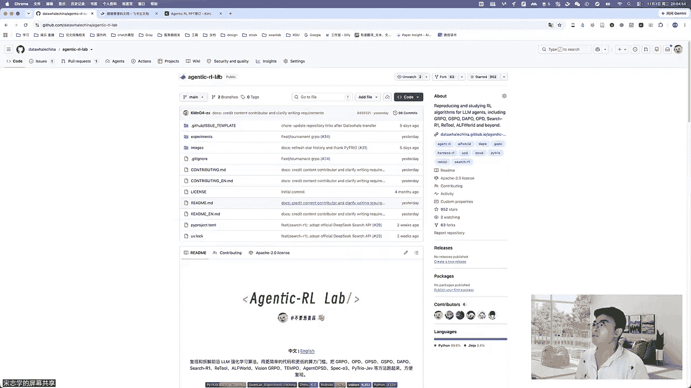
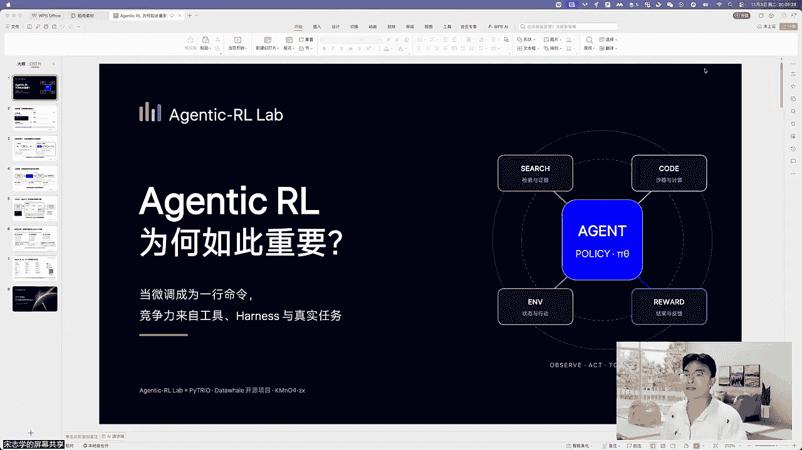
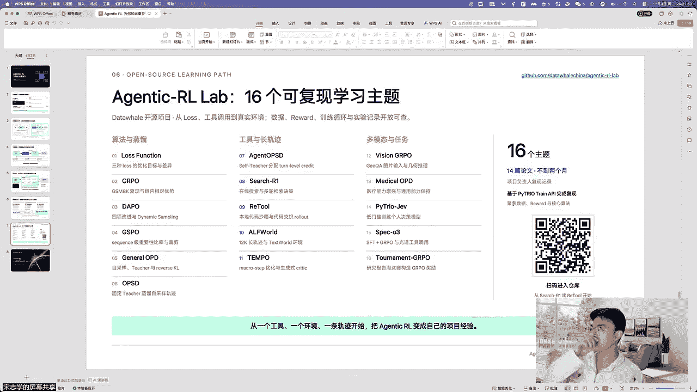

🤖 Datawhale AI+X：01：别只训练模型：训练能完成任务的Agent



## 开篇概述

在本节课中，我们将学习为什么单纯训练大模型已经不再足够，以及如何训练一台能够真正完成任务的 Agent。内容会从大模型微调的现状出发，解释为什么实验设计比训练执行更重要，接着介绍 Agent 强化学习的核心思想，再对比监督微调与 Agent 训练的区别，最后说明工具调用、奖励机制以及 Harness 对模型效果的影响。我们还会聊聊掌握 Agent 训练经验对科研和求职的实际帮助，并简要介绍开源项目里可以学习的内容。希望通过这节课，你能明白只会跑一行微调命令已经不够，真正的竞争力在于设计实验、理解奖励信号和构建可训练的 Agent 系统。




## 第一节：为什么只训练模型已经不够了

现在很多同学都已经接触过大模型微调，比如大模型训练，或者是 REG 之类的技术。之前也有一些框架，像 LLaMA-Factory，或者是 Swift 这样的工具，它们把微调过程封装得非常好。这意味着微调已经变成了一行命令就能完成的事情。

以下是目前微调的典型操作流程：

- 准备好训练数据
- 准备好配置文件
- 运行一行训练命令，把数据和配置放进去，训练就开始了

因为训练入口已经被完全封装化了。以 LLaMA-Factory 的命令为例，只要写一行 train，把数据丢进去，把配置丢进去，事情就完成了。你可能只需要会英语，会打几行命令就可以了。这说明单纯会训练模型，已经变成了大街边随处可见的技能，不再具备竞争力。

无论你是想做科研，还是想找工作，只会微调都不足以脱颖而出。因为训练执行这一步已经被工具高度封装，门槛极低。


## 第二节：真正拉开差距的是实验设计

上一节我们介绍了微调已经变得太简单，本节中我们来看看为什么实验设计才是真正的门槛。

既然训练执行已经很简单，那么什么才是难的？难的地方在于实验设计。你需要自己设计实验，比如构造对照组，去除数据噪声，解释实验结果，提出好的研究问题。这才是决定你能否在科研或工作中脱颖而出的关键。

以下是实验设计中需要考虑的核心要素：

- 构造合理的对照实验
- 分析并去除数据中的噪声
- 准确解释模型输出结果
- 能够提出有价值的研究问题

做好这些需要你具备独立的研究品味，对研究有较高的认知，并且要有自己的判断力。只有具备这些能力，你才能在模型训练中真正产生差异化的竞争力。


## 第三节：什么是 Agent 强化学习

接下来我们进入 Agent 强化学习的部分。什么叫 Agent 强化学习？从广义上讲，只要训练过程中涉及工具调用，只要有工具资源参与，都可以算作 Agent 强化学习。但现在更多时候，它特指在训练中加入 Harness 机制的方法。

例如，大家常用的 Cursor 或者 Code X，以及某些工作台工具，都涉及 Agent 强化学习的思想。有个模型在发布 1017 版本时，专门提到加入了 Workbench Harness 的支持。这句话的意思是，模型在训练时已经把 Workbench 当作 Agent 训练的必要部分，这样模型在 Workbench 上的表现才会更好。

目前不管是大厂还是后训练团队，都在使用 Agent 强化学习。之前有朋友提到，他们内部有很多工具，但通用模型做不到很好，所以想对 20B 左右的小模型做后训练。这说明 Agent 训练已经成为主流需求。

以下是 Agent 强化学习与普通训练的主要区别：

- 普通训练：只生成文本，不与外部工具交互
- Agent 强化学习：模型可以调用工具，根据工具返回结果决定下一步行动

核心公式可以简单表示为：

```python
Agent 行为 = 观察当前状态 + 选择工具 + 执行工具 + 接收反馈 + 更新策略
```


## 第四节：监督微调与 Agent 训练的目标不同

我们再来看看从 SFT 到 Agent RL 的变化。在做监督微调的时候，目标很简单，只要有问答对就行了。也就是有问题和答案，或者有指令和输出，就可以直接训练。它本质上是文本对文本的学习。

监督微调的损失函数可以用公式表示为：

```python
Loss = -log P(答案 | 指令)
```

模型输入一个 X，经过策略网络，然后学习输出答案，使用的是交叉熵损失。反馈就是参考答案，提供 token 级别的监督，模型学到的只是贴近参考文本的文本分布，非常容易过拟合。

但是 Agent 强化学习不一样。现在的 Agent 训练主要基于 DeepSeek Math 那篇论文提出的 GRPO 方法，核心思想是组内相对优势。


## 第五节：稀疏奖励与组内相对优势

奖励函数在 Agent RL 中非常关键，而且目前的奖励大多是稀疏的。这意味着模型不容易直接得到反馈，研究人员正在努力让奖励变得不那么稀疏，或者把收益变成可以分配的信用状态。

以下是稀疏奖励下的学习逻辑：

- 对一条问题采样 8 次回答
- 如果全错，所有 rollout 的奖励都是 0，模型没有相对优势，放弃该样本
- 如果有一次答对了，就有相对优势，模型可以进行策略更新

损失函数其实就是基于刚才说的相对优势。公式虽然看起来简单，但核心思想是让模型学习哪些行为在组内表现更好。

在 Agent RL 里，数据就是模型采样的 rollout 轨迹。反馈来自环境，或者奖励函数对任务结果的判断。模型学到了什么？学到了成功，学到了提高角色成功的概率。

相比之下，监督微调的数据比较便宜。短文本问答可以用 AI 生成，不需要购买。但 Agent RL 的数据很贵。一条代码领域的数据大约 300 到 600 元，如果是 3D 领域或者医疗领域，一条数据可能要 2000 到 3000 元。


## 第六节：工具调用是 Agent 训练的关键

接下来讲一下 Agent RL 里面的工具调用。现在很多人都在使用 Cursor 或者 Code X，这已经变得非常流行。工具调用其实就是把推理真正变成可训练的动作序列的关键因素。

模型可以决定什么时候调用工具，调用什么工具，什么时候停止工具调用，或者什么时候停止思考。这是一个简单的循环。

以下是 Agent 工具调用的最小循环步骤：

1. 模型观察上下文
2. 选择一个动作，也就是从众多工具或技能里选一个
3. 在沙箱或虚拟环境中执行该工具
4. 工具执行结果返回给模型，作为观察

沙箱怎么理解？你可以把它想象成一个受控的环境。比如使用 Code X 时，前面有三种权限模式：一种是请求批准，所有动作都需要有人审核；一种是帮我审核一些动作，只有高危动作才需要批准；另一种是完全访问权限，相当于直接在沙盒里操作，各种危险操作都由自己承担责任。

Observation 的意思是，工具调用执行的结果会返回回来，再返回给大模型，供模型继续思考。

很多论文也是这么做的。比如 Search + 1，把搜索变成一个工具，可以多轮搜索，决定查询词或者停止时机，让搜索从固定的预处理变成模型反复选择的动作。还有 RA，让模型学会写代码去调用工具，或者把代码本身当作工具调用，在思维链中交织使用 Python 代码。

还有一个例子是 Spect O3，这是天文领域应用的方法，给了模型一个可以分割光谱、查看光谱的工具，让模型在理解光谱的同时思考和调用工具，把科学任务中的工具策略写进模型能力里面。

总结起来就是一句话：工具返回的结果会改变后续的轨迹，也会改变模型最终接收到的训练信号。

因为奖励是稀疏的，所以每一次工具调用，不管是多调用还是少调用，只要最终结果正确，奖励占比就会比较高。现在也有关于工具调用时信用分配的研究，比如相同状态下可以认为是一个节点，这是 DIGPO 的理念，可以计算不同的优势分数，这里就不展开讲了。


## 第七节：数据生成层与 Harness 的控制

Agent 状态和 RL 的控制来自数据生成层，这决定了模型能够看见什么，能够做什么，轨迹如何被记录，奖励如何计算。

下面是一个简单的结构说明：

- Policy：就是你的大模型，但没有加 Harness，只是单纯的大模型，只能吐出文本
- Harness：包含上下文提示词、工具调用协议、解析工具、沙箱、轨迹记录、奖励计算等模块
- 外部系统：在外部系统里执行工具，执行完后把观察结果返回给 Harness，再和模型交互

这是一个大的循环。模型选择动作，经过 Harness 的上下文、提示词、工具协议、解析工具、沙箱，最后选择一个工具执行。执行完的结果返回到模型，再进行交互。

Harness 的本意就是马具，骑马的时候要带的马鞍。它本身是用来让模型变得更好的工具。如果 Harness 出错，训练就会学错东西。

市面上有很多个人开发者做的 Coding Harness，但大家最常用、最认可的还是 Cursor 或者 Code X。另外，同一个模型换不同的 Harness，上下文和轨迹分布会变化，最终成绩也会改变。模型在发布技术报告时，会用不同的 Harness 做 SWE 或终端任务，选择得分最高的一个写进报告。


## 第八节：为什么 Agent 经验对科研和求职都重要

现在不管是搞科研还是找工作，都需要 Agent 强化学习的经验。如果你去面试，跟老板或 HR 说你会训练模型，对方可能会问你：Agent 训练过程中的工具调用是怎么决策的？沙箱是怎么构造的？端到端的沙箱如何验证模型返回的结果是否正确？

这些问题已经不会再问你怎么做大模型微调了，因为那些只需要一行代码，或者直接把数据给 AI 就能完成。

在科研方面，你可以用 Agent RL 做一些有趣的任务，比如多轮任务分配、奖励优化、工具策略、环境泛化、鲁棒性、从单一模型拟合拓展到交互式策略。

在工程方面，一些国企朋友也在研究 Agent 训练，因为他们内部有一些不方便暴露的工具，是保密或加密的，不能给外部通用模型使用，所以他们在自己的模型上表现会很差，这也是可以做的方向。

在求职方面，如果你有这样的经验，面试时会很有优势。比如有个 UCL 数学博士，想给开源项目提交 PR，申请科研项目和合作项目。还有用户在小红书评论区说，实习面试时写了项目里的 Agent OPSD 博客，最终找到了工作。

需要注意的是，你不能直接说仓库里的东西是你做的。你需要自己做一遍实验，或者稍微修改之后，再写进项目里，或者提交一个 PR 来复现另一篇论文，然后再放到简历上。如果直接说是你做的，一旦被发现可能会被拉黑。


## 第九节：项目内容与学习建议

最后介绍一下项目里已经有 16 个可复现的学习主题。比如从损失函数到最简单的 GRPO，左边是比较简单的内容，比如通过算法或者蒸馏。现在比较火的是 OPD，也就是 On-Policy Distillation，还有 OPSD，即 On-Policy Self-Distillation，自我整流，自己做自己的老师。

还有工具、长轨迹记忆、多模态任务等内容，都可以去看看。如果你感兴趣，可以来这个项目里学习。预计 10 月份会参加 Datawhale 的组队学习，大家可以关注一下。


## 总结



本节课中我们一起学习了为什么只训练模型已经不够了，什么是 Agent 强化学习，监督微调与 Agent 训练的区别，稀疏奖励和组内相对优势，工具调用的训练循环，Harness 的作用，以及 Agent 经验对科研和求职的重要性。希望你能从中明白，不要只训练模型，要训练能够完成任务的 Agent。
