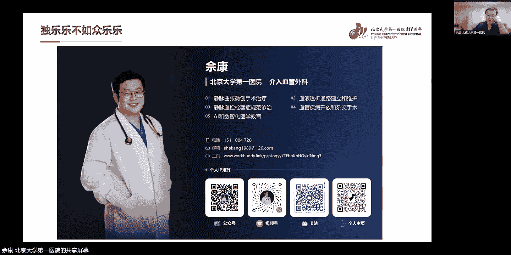

AI赋能医教研：00：课程概述与学习目标🎯

在本节课中，我们将学习一名外科医生如何利用人工智能工具，从零开始构建医学知识库，再进一步开发智能体，最终实现临床、教学和科研工作的全流程赋能。内容涵盖AI办公软件的日常布局、专科知识库的搭建方法、编程智能体作为执行引擎的应用，以及在真实医疗场景中的落地案例。无论你是医院医生、医学生，还是对医疗AI感兴趣的初学者，都能从中获得可直接复用的实践经验。


AI赋能医教研：01：临床医生的AI起步与工具布局💻

上一节我们简单介绍了本课程的整体目标。本节中，我们来看看一名外科医生是如何开始接触大模型，并逐步搭建起个人AI工作环境的。

作为一名血管外科医生，日常工作既包括手术和带教，也涉及大量的教学行政事务。2024年底开始接触大模型以来，作者发现AI能够显著提升文档处理、课件制作和信息检索的效率。例如，以前一周只能完成一两个PPT，现在在AI辅助下可以产出五个左右，基本上保持一天一个的节奏。

以下是作者日常使用的主要AI办公工具清单：

- GPT：用于处理较为复杂的科研任务和技术研究
- Work body：作为代码级智能体，用于自动化任务和多端协作
- IMA：腾讯推出的知识库工具，支持多端同步和云端存储
- 密塔与白小一：垂直领域的医学AI工具，适合文献调研和综述生成
- 京东与玛雅虎：互联网医疗平台，自带大模型入口

在硬件布局方面，作者采用了一台手机配合四台电脑的组合。家中的台式机保持24小时运行，用于部署长期运行的AI程序。主力笔记本电脑随身携带，Surface平板用于绘制手术示意图，文件通过坚果云在不同设备间同步。文献管理资料则在各台电脑间流动，确保随时随地都能调取。

核心工具组合可以用简单的伪代码表示：

```python
AI_办公环境 = {
    "语言模型": ["GPT", "Work body"],
    "知识库": ["IMA"],
    "垂直医学AI": ["密塔", "白小一"],
    "硬件": ["手机 x 1", "笔记本电脑 x 1", "台式机 x 1", "Surface平板 x 1"],
    "同步方式": ["坚果云", "云端知识库"]
}
```

通过这个基础布局，医生可以在不同场景下快速切换工具，为后续构建知识库和智能体打下基础。


AI赋能医教研：02：从零搭建专科医学知识库📚

上一节我们介绍了临床医生常用的AI工具和硬件布局。本节中，我们来看看如何构建一个可靠的专科医学知识库，并将其应用到教学和临床会诊中。

血管外科的日常会诊中，静脉血栓栓塞症是一个高频且危急的病种。相关指南数量庞大，例如美国胸科医师协会的ACCP指南原文就有800多页英文内容，学生和普通医生很难在短时间内学完。为了解决这个问题，作者决定建立一个以循证医学为核心的AI知识库。

以下是知识库的核心结构组成：

- 临床指南：纳入多个版本的静脉血栓栓塞症系列指南，共计800余条
- 高级别文献：包括荟萃分析、系统综述等可靠证据
- 病例库：脱敏处理后的典型病例，用于教学参考
- 人类专家思维链：以文档形式记录，供AI参考和调用

知识库的建立遵循以下逻辑：

```text
知识库内容 = 指南文献 + 病例库 + 人类专家思维链
文献处理 = 全量AI处理 + 人工校验
```

所有加入知识库的文献都会先经过AI结构化报告处理，再由人工进行校验，以确保信息的准确性。目前该知识库包含2300余份文档，已有2300多人加入使用。在临床工作中，医生可以通过扫码进入知识库，针对静脉血栓栓塞症相关问题快速检索，获得带有循证医学建议的输出结果。

值得注意的一点是，病例库涉及患者隐私和伦理保护问题。即使数据已经脱敏，去标识化后仍需遵循相关规定，因此未来可能会将病例库单独迁移，以符合医疗数据合规要求。

构建好知识库后，作者在此基础上开发了不同级别的静脉血栓栓塞症诊疗助手。轻量级助手适合常规咨询，专家级助手则能处理复杂的出血合并血栓等矛盾病例。以一位曾有出血史、术前超声未见血栓但凝血指标异常的患者为例，智能体不仅给出了是否放置下腔静脉滤器的建议，还提供了详细的理由和流程图，其输出内容甚至比人类专家会诊意见更为详尽。


AI赋能医教研：03：教学知识库与个性化学习应用🎓

上一节我们介绍了专科临床知识库的搭建与静脉血栓栓塞症诊疗助手的应用。本节中，我们来看看如何将知识库延伸到医学教育场景，实现教学资源的沉淀与个性化学习。

作者同时负责本科生和规培生的教学工作。外科轮转时间短，学生离开科室后如果遇到问题，往往难以及时找到可靠的参考来源。为此，作者建立了专门的AI教学知识库，将原本的电子版培训手册转化为可查阅的数字化版本。

以下是教学知识库中包含的常见资源类型：

- 规范化培训手册（电子版及AI交互版）
- 讲课PPT与教案
- 考题与教学计划
- 项目活动记录与教学论文
- 教材PDF及相关文献笔记

有了知识库作为底座，教学工作可以开展多种形式的创新。例如，在个性化学习方面，教师可以将课件上传到IMA，让其自动生成测验题或播客音频。作者本人也曾在骑车回家的路上，让AI将基础医学文献转化为播客，边听边学习。这种方式把原本晦涩的内容变成了易于接受的音频形式。

写作教案时，文字内容可以直接由AI协助生成。制作PPT时，虽然AI生成的PPT可能不够精美，但适合快速分享和初稿输出。播客和博客内容也可以通过AI工具快速产出，极大地丰富了教学资源的形态。

在会议记录管理方面，教学活动和学术会议的录音、照片及PPT可以全部存入知识库文件夹。后续需要时，可以基于这些材料输出会议纪要或教学总结。这种模式已被其他科室老师学习，例如在年会期间派人全程拍照录音，汇总后形成共享知识库，使未参会的老师也能及时获取会议信息。

课题组协作也是知识库的重要应用场景。一个包含四人的课题组可以将文献、项目周报、进度时间点、研究数据、技术文档及伦理标书全部沉淀在知识库中。学生毕业后不会带走所有资料，新成员也能快速上手。例如，四名学生各读500篇文献，汇总后形成2000篇可靠文献集，基于此即可产出高质量的科研或教学内容。

此外，微信公众号可以与知识库链接，设定好链接后，已建好的知识库内容即可同步到公众号，读者可直接调用。IMA作为云端工具，支持多端同步，存储与问答一体化，轻量化且易于使用。


AI赋能医教研：04：编程智能体作为执行引擎🤖

上一节我们介绍了教学知识库的建设与个性化学习应用。本节中，我们来看看编程智能体如何充当执行引擎，帮助医生完成从内容生成到任务自动化的工作。

在早期阶段，作者尝试过多种编程辅助工具，后来主要使用代码解释器和Work body作为核心的编程智能体。这些工具不仅能生成代码，还能直接操作文件、制作图表、调整PPT布局，实现从0到最终交付的闭环。

以下是编程智能体在临床教学中的典型应用场景：

- 快速生成PPT：从文献PDF直接生成文献汇报PPT，并自动裁剪原文图表插入模板
- 海报制作：会议海报可通过工作流直接输出，无需外包给设计公司
- 医学统计与可视化：输入原始数据表格，自动生成图表和统计分析结果
- 批量作业批改：对学生提交的AI协作PPT及互动记录进行评分，并生成班级汇总表
- 病例脱敏：将门诊或住院病例拍照后，自动去除患者隐私信息，批量生成脱敏病例

以病例脱敏为例，传统方式需要医生在电脑前对照系统逐条录入，效率低且存在合规风险。使用AI后，可以拍照提取病例信息，批量生成格式化病例，再输出Excel表格进行统计分析。曾有学生花费三个月时间从3000份病历中筛选数据，若采用AI拍照转写方式，速度将大幅提升。

多智能体并行工作也是作者的常见操作模式。在一次文献研讨会中，五个智能体同时运行：云端IMA读取文献，Work body改造科研工作台，家中的Work body整理硬盘，单位中的Work body编辑个人网站，GPT进行技术研究和文献方案撰写。各智能体独立汇报，使作者体验到高效协作的感觉。

自动化任务方面，家中的程序每天推送AI与医疗相关的文献和新闻，每周生成个性化文献简报，包含摘要、标题、评论、链接及文献分区。系统会根据用户的喜好反馈自动学习，逐渐推送越来越精准的内容。


AI赋能医教研：05：临床场景实战：静脉血栓栓塞症诊疗助手与数据处理🏥

上一节我们介绍了编程智能体作为执行引擎的作用。本节中，我们来看看AI如何在具体的临床诊疗场景中落地，特别是静脉血栓栓塞症诊疗助手的构建与应用。

静脉血栓栓塞症诊疗助手经过多个版本迭代，已形成较为复杂的架构。其核心目标是通过自学习系统、自我推荐系统和自我评价模块，让智能体在每次完成会诊后不断优化自身。架构设计经历了一年的持续迭代，从最初的提示词优化，逐步加入脱敏模块、循证医学模块、知识库调用、记忆层、学习层和评估层。

以下是静脉血栓栓塞症诊疗助手处理复杂病例的示例逻辑：

```text
输入：复杂住院病例（出血合并血栓、多次手术史等）
处理：
    1. 文本提取与脱敏处理
    2. 知识库检索（匹配相关指南与文献）
    3. 智能体推理（生成会诊意见与治疗方案）
输出：专家级会诊意见（包含理由、流程图、药物选择等）
```

在实际应用中，该助手能够处理出血合并血栓等矛盾病例，也能考虑医院实际可用的药物种类，输出符合现实环境的治疗决策，而非死板的理论方案。作者目前在该领域尚未发现助手的明显错误。

病例采集与脱敏是临床研究中耗时的环节。利用AI技术，可以将门诊或住院病例拍照后自动脱敏，提取结构化数据，生成Markdown格式的临床表格，再转换为Excel进行统计分析。对于住过十几次院、拥有几十张影像图片的复杂患者，传统统计可能需要半小时以上，而AI辅助下可快速完成数十份乃至上百份病例的处理。

需要注意的是，临床数据的质量往往参差不齐，学生毕业后可能带走原始表格，系统更新后旧数据可能丢失。因此，建立规范的数据沉淀机制，避免数据质量混乱，对科研至关重要。


AI赋能医教研：06：数字分身与互动教学平台👨‍🏫

上一节我们介绍了静脉血栓栓塞症诊疗助手的临床应用与数据处理方法。本节中，我们来看看如何利用AI构建数字分身与互动教学平台，提升课件的互动性与评估效率。

作者基于自身的专家团队，构建了数字化医学教育专家团。将传统的PPT课件转化为互动网页后，学生可以在线阅读，系统会自动生成题目和答案，提供即时反馈。相比传统PPT，这种互动课件增强了学生的参与感和学习反馈。

以下是数字分身与互动课件的工作流程：

```text
传统PPT课件 → AI转化 → 互动网页课件 → 自动生成题目与答案 → 学生在线学习与即时反馈
```

在医学教育课件的外部评审环节，作者开发了一个独立评审平台。外部专家在评审前先接受线上培训，学习如何评估课件成品与人机协作记录。平台包含五道配合及时解析的小题，用于检查掌握程度。专家完成个人评分并提交后，系统才开放人工智能评分对照，聚焦差异条目，回看证据，补充评价，从而减少重复评审，保留初评与复评记录。

评分总分与操作记录可以导出为数据表格，方便后续分析。管理员可以实时查看培训进度、评分数量和待处理问题。整个流程实现了先培训再正式评审，先统一标准再独立判断，最后聚焦差异的目标。


AI赋能医教研：07：AI课程建设与教学实验营📖

上一节我们介绍了数字分身与互动教学平台的设计。本节中，我们来看看如何将AI应用经验转化为结构化的课程，通过教学实验营培养未来的AI协作医生。

作者团队设计了中等医学AI实验营，采用场景驱动的模块化课程。课程内容包括如何建立AI知识库、如何用AI制作PPT、如何构建智慧课程、如何利用AI开展科研活动，以及智能体和个人知识智能体的搭建。课程在不断的任务实践中循环迭代内容，引导学员完成从使用工具到人机协作，再到认知迁移与创新的工作。

线下工作坊的最后一次作业，要求每位学员设计自己的个人知识智能体。在企业协作过程中，学员通过不断实践提升能力。课程主要采用国产平台，组合IMA与Work body进行教学。

根据学员对象的不同，课程内容会进行针对性改造。例如针对护理场景，专门讲解AI赋能护理场景的实践案例。无论面向哪类人群，患者伦理、隐私保护、责任边界等内容都是必讲部分。传统课程在改造后，知识点讲解减少，重点转向与AI的协作方式。



通过教学研究，课程不断改进，并积累教学研究成果。目前已有学员在课程结束后回校复课，也有老师参加医院教学比赛并获得一等奖。从输入到输出，能够讲课被视为最高等级的学习效果，这种正向循环表明课程设计具有实际价值。


AI赋能医教研：08：商业化思考与医院落地挑战💡

上一节我们介绍了AI课程建设与教学实验营的运行情况。本节中，我们来看看AI在医疗领域的商业化可能性，以及医院落地过程中面临的挑战。

从商业化角度看，AI辅助科研的课程市场已经比较成熟，但许多产品本质上是论文工厂，利用医生晋升职称的焦虑进行获客，并不能真正为医生创造可持续收入。真正缺失的是一款能让医生和医学生实际赚钱、可落地商业化的AI产品。

作者的静脉血栓栓塞症诊疗助手离真实临床落地已经非常近，但需要以医院级系统的形式插入。主要挑战在于：许多医院的电子病历系统无法提供结构化数据，导致关键信息难以提取。此外，数据不出院的规定限制了云端部署，所有处理必须在医院内部完成，患者隐私必须脱敏。


以下是医院落地AI产品需要考虑的关键因素：

- 数据合规：必须满足数据不出院、患者隐私脱敏等要求
- 算力与硬件：基层医院算力有限，产品应尽量轻量化，运行速度慢会导致医生弃用
- 系统对接：需与医院现有的电子病历、影像存档与通信系统兼容
- 审核机制：知识库中纳入的文献需要经过人工审核，避免加入已撤稿的低质量文献

在商业模式方面，作者的AI重症实践营属于公益性教育项目，未进行商业化收费，仅获得医院协会的有限资金支持。讲课费按照医院合规标准执行，主治医师最多1000元，主任医师约2500元。

如果以智能体服务商身份进行商业化，可以考虑分润模式。例如，一个用户每月消耗200元模型调用费用，100名用户即产生2万元月收入，代理商可分得其中一部分作为被动收入。这表明面向特定垂直领域，将专家标准写入智能体并进行市场推广，是具有商业潜力的方向。


AI赋能医教研：09：课程总结与未来展望🏁

上一节我们介绍了AI医疗商业化思考与医院落地的挑战。本节是最后一节，我们将回顾全课程的核心内容，并展望未来发展方向。

在本课程中，我们一起学习了如何将真实临床问题作为出发点，以实际需求为起点，在解决问题的过程中与AI和大模型共同进步。知识库作为基础底座，使知识变得可追溯、可复用、可持续积累；智能体作为执行端，串联工具与工作流程，将知识转化为医教研的实际成果。

整个过程中始终需要人类主导与人际协同。目标判断、核查、审美及学术品位等环节，都是AI无法替代的关键能力。培养未来医生应以终身学习拥抱变化，以人文关怀守护医学初心。


以下是本课程的核心知识点总结：

- 知识库构建：专科指南 + 高级别文献 + 病例库 + 专家思维链
- 工具布局：GPT + Work body + IMA + 垂直医学AI + 多端硬件同步
- 智能体应用：PPT生成、海报制作、统计分析、病例脱敏、文献推送
- 教学创新：互动课件、个性化学习、作业批改、外部评审平台
- 临床落地：静脉血栓栓塞症诊疗助手、数据脱敏、医院系统对接、合规审核

AI只是工具，真正的价值取决于使用者的经验与判断。在有经验的人手中，AI可以放大十倍甚至百倍的临床与教学价值。希望每位学习者都能在这条道路上，从使用工具走向人机协作，最终成为能够独立驱动AI的数字化医生。

