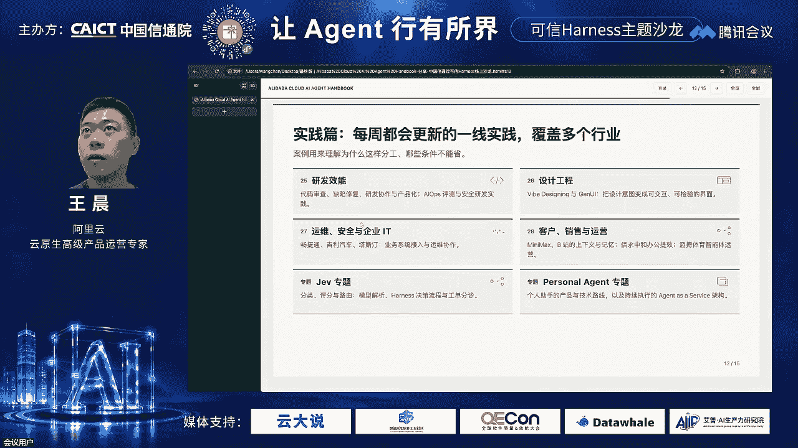
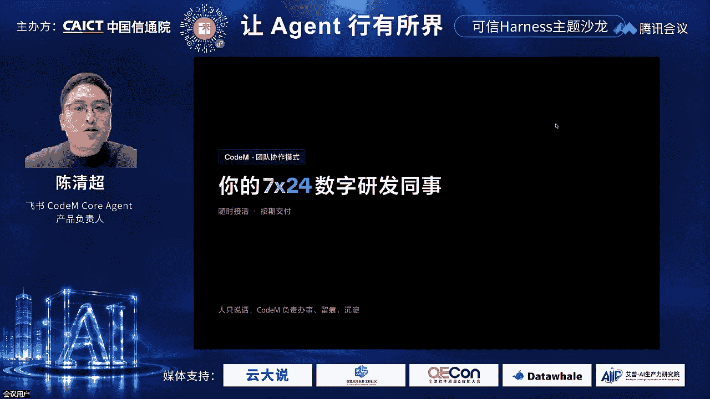

# 可信 Harness 主题沙龙：AI 安全对齐：01：开幕与背景介绍 🎤


在本节课中我们将要学习可信 Harness 的基本背景与活动开幕情况。本节内容主要介绍沙龙的主办方、主持人以及开场致辞，帮助大家建立对整体活动的宏观认知。


以下是本次沙龙的基本概况。


- 主办方：中国信息通信研究院。
- 主题：可信 Harness 主题沙龙，探讨 AI 安全对齐与智能体工程落地。
- 主持人：刘之莹。
- 特别环节：每隔 20 分钟抽取三位幸运观众，赠送《驾驭工程赋能智能研球软件工程》纸质版报告，共六轮抽奖。
- 互动方式：欢迎直播间观众在评论区留言，提出问题。


接下来我们进入具体内容。当智能体从生成内容走向执行任务时，如何在明确的权限和规则下可靠运行，成为工程落地中需要回答的核心问题。为此，本次沙龙邀请了高校、研究机构和企业的专家，围绕法律风险、标准研究、企业实践和评估验证，共同探讨可信 Harness 的构建路径。


在正式开始之前，主持人首先向大家介绍了抽奖活动，并鼓励直播间观众在评论区留言、提出问题。随后，开场发言环节由中国信通院云大所智能系统与工程部主任陈一力进行致辞。


陈主任在开场中指出，我国软件工程智能化转型已进入规模化落地和深度应用的关键期。从政策层面看，工信部印发的人工智能加软件专项行动实施方案，部署了以智能编程推动软件研发提质增效，并强化生成代码安全审查和软件安全检测。


从产业实践来看，截止到今年 9 月份，67% 的软件相关企业已将 AI 能力投入生产环节，31% 的主体完成了智能体和核心研发流程的内嵌部署。随着智能体深入研发环节，可靠性和过程可追溯成为支撑规模化落地的重要保障。


中国信通院云大所软件团队近年来持续深耕软件工程智能化领域，累计完成 50 余项标准编制、20 余份研究报告，走访近百家企业并举办 30 余场技术交流活动。团队将权限管理、执行约束、过程追溯和评估验证作为重点研究方向，探索智能体工程落地的方法论。


可信 Harness 的核心可以用如下公式表示：


```
Agent = 大模型 + Harness（编排与约束）+ 基础设施
```


上一节我们介绍了沙龙的开幕背景与陈主任的致辞，本节中我们来看看清华大学陈天浩教授从法律和监管视角对 Harness 的分析。


# 可信 Harness 主题沙龙：AI 安全对齐：02：法律风险与监管对策 ⚖️


本节内容围绕智能体的法律风险及其监管对策展开。陈教授从治理角度出发，解释为什么需要把 Harness 纳入监管视角，以及服务提供者应当承担哪些法律义务。


以下是 Harness 需要纳入监管的核心原因。


- Harness 负责组织智能体的上下文，管理记忆，编排任务，调用并执行工具。
- Harness 内置权限和反馈边界，将观察、规划、执行、反馈形成闭环，使智能体能够交付实际结果。
- Harness 对智能体表现影响极大。以 GPT 模型为例，使用标准 Harness 时得分约为 62.7，使用定制 Harness 时得分可达 98 甚至 99。


可以看出，Harness 本身是决定智能体表现的关键因素。监管不应只关注基础模型，而应将 Harness 作为服务提供者纳入监管抓手，因为它将模型、工具和权限封装为可用服务，从而能够掌控相关风险。


如果以智能体服务提供者为监管对象，其法律义务可以归纳为以下四个方面。


第一个是安全维护义务。服务提供者需要通过 Harness 框架的设计和编排，实现系统隔离、最小权限、数据记忆保护，并对运行流程进行持续监测、补救和恢复。现行网络安全法、数据安全法和个人信息保护法均对网络运营者和数据处理者提出了全流程数据保护要求，包括访问控制、风险监测、加密备份和认证等。


第二个是价值导向义务。智能体的行为应当向善，在与人互动时尊重人格尊严。对于未成年人、老年人等弱势群体，应当避免伤害身心健康，避免诱导沉迷，禁止通过情感依赖操纵用户。生成的内容需坚持价值导向，防止歧视和违法行为。


第三个是生态开放义务。服务提供者与平台、工具及其他 AI 之间的关系应当保持开放，不得滥用平台规则实施垄断，不得实施恶意不兼容或妨害合法运行。在记忆管理和工作流编排中，不得对特定用户或供应商设置不合理优待。


第四个是信誉义务。智能体成为用户可信的数字伙伴后，服务提供者应当忠实履行义务，最大限度服务于用户利益。若存在商业利益，应提前披露，避免利用用户信任为自己谋利。


监管实施方面，建议让智能体服务提供者成为主要的合规主体，对供应链上下游进行全链条合规管理。对于开源贡献者，由于其无营收意图，应当享有一定的责任豁免。


安全和价值验证方面，我国已有相应标准和安全治理框架，接下来需要做好安全验证和价值验证。由于智能体会持续进化，模型和工具也会不断更新，因此需要持续评估、运行检测、事件整改，并在模型、工具、权限发生重大变化后进行重新验证。


生态开放方面，可以引入白名单制度和隐私友好型工具认证机制，激励市场形成尊重隐私的正向竞争环境。


信誉义务落地方面，一方面需要法律划定忠实、勤勉、保密和利益冲突管理的底线；另一方面，监管部门可以发布服务协议范本，将信誉义务实践载入其中，最后由服务提供者与用户签署具体合同进行细化。


以上是陈教授报告的核心内容。上一节我们介绍了法律风险与监管对策，本节中我们来看看中国信通院郑立主任关于可信 Harness 体系与标准化的研究。


# 可信 Harness 主题沙龙：AI 安全对齐：03：可信 Harness 体系与标准化研究 🏗️


本节内容主要介绍智能体走向规模应用的可信体系，包括技术演进、能力架构、成熟度模型以及不同技术形态的风险分析。


以下是智能体工程化演进的关键逻辑。


- 政策引导：国家层面明确将智能研发作为重点领域，部委和地方推进场景承接与工程化。
- 产业需求：智能体已渗透到生产环节，AI 投入生产的企业比例超过六成，腾讯、零马、字节等企业已在大规模使用 AI 工具生产代码。
- 技术演进：从提示词工程到上下文管理，再到 Harness。智能体从被动代码生成器转变为主动工程参与者，管控重心从流程节点下沉到运行时行为。


Harness 的技术演进可以用如下公式表示：


```
Agent = 大模型 + 上下文管理 + 基础设施
```


随着 Harness 出现，工程化体系逐渐建立。一个成熟的 Harness 应当具备六大能力域：可接入、可治理、可执行、可观测、可回放、可迁移。


中国信通院还提出了驾驭工程能力成熟度模型框架，划分为 L1 到 L5 五个层级，分别对应接入、执行、治理、协同、规模生产。每提升一个等级，智能体能够访问的系统、调用的工具、处理的数据及影响的业务范围同步扩大，风险点和验收点也随之递增。


Harness 的定位已超越传统软件工具和方法论，成为适配软件全生命周期、全要素、全场景的核心管控框架，是软件生态的底座。


从能力架构来看，Harness 可分为模型能力层、模型外部运行与控制层、以及业务应用和工程交付层。运行与控制层主要负责模型运行控制，包括上下文、约束、执行记录与追踪，以及生成结果与请求调用的偏离判断。


良好的 Harness 能够提升模型输出准确度，降低无谓的通信消耗，并对工程质量提供保障。


目前观察到的 Harness 技术形态主要分为三类。


第一类是显式可编程 Harness。控制逻辑向开发者开放，支持自主定义机制，主要载体为框架和可编程运行时。这类 Harness 自由度高，但存在配置和工具风险，如市场中的插件可能包含漏洞或后门。


第二类是隐式垂直 Harness。被封装到大型工作台平台中，围绕用户目标组织任务交付，内置规划、工具调用和执行循环，定制化相对较弱。这类 Harness 过程可见性不足，面对黑盒可能引发信任危机。


第三类是嵌入式 Harness。嵌入业务系统，以身份操作接口扩展上下文和节点操作能力，主要载体为协同办公和研发平台。这类 Harness 存在跨系统授权风险。


针对可信建设，显式可编程 Harness 需做配置版本管理、工具准入和隔离执行；隐式垂直 Harness 需明确能力边界，告知用户哪些能做、哪些不能做；嵌入式 Harness 需做操作级权限校验。


可信 Harness 的评价标准包含五个维度：任务有效、行为和组件、过程可控、运行可靠、证据可验证。其中任务有效和证据可验证面向结果和能力，中间三个维度与安全可信密切相关。


未来展望方面，Harness 将从工程化组件演进为基础设施，类似云原生时代的基础设施角色。中国信通院计划形成具有国际影响力的可信 Harness 研究，包括报告、标准和评测体系，并采取开放共建方式，欢迎产学研共同参与。




上一节我们介绍了可信 Harness 体系与标准化研究，本节中我们来看看阿里云王晨老师的企业级 Harness 实践分享。


# 可信 Harness 主题沙龙：AI 安全对齐：04：企业级 Harness 实践 🏢


本节内容来自阿里云云原生高级产品运营专家王晨，围绕企业级 Harness 从 Agent 构建、运行到治理和调优的实战经验展开。


以下是企业级智能体面临的三大挑战。


- 工程化挑战：希望 Agent 从概率智能演进为可靠的生产力，承担关键任务。
- 规模化挑战：希望 Agent 被大规模部署，对稳定性、安全、性能和成本提出更高诉求。
- 组织化挑战：希望 Agent 进入企业核心业务流程，让整个组织通过智能体协作。


阿里巴巴云 AI Agent Handbook 是一个知识开源项目，提炼了企业级 Agent 从设计、开发到上线运行和持续改进的全过程。Handbook 分为七篇，共三十章，涵盖架构构建、运行、治理、调优及实践。


架构设计时，需要明确 Model 与 Harness 的关系，公式如下：


```
Agent = Model + Harness
```


Model 提供理解和推理能力，Harness 将判断组织成实际行动，并提供必要的约束。企业需要区分哪些由业务团队完成，哪些可复用到平台，哪些必须有执行环境保证。


构建阶段需要分清任务、信息和行动三个因素。


- 任务：定义如何拆解、遇到新情况如何调整、什么时候结束。
- 信息：需要查看哪些代码、文档，已确认的事实如何保存，能调用哪些工具、能改到什么范围。
- 行动：工具调用、代码修改等具体执行。


需要注意，聊天记录不等于任务状态。系统不能仅依赖模型记忆，而应通过门禁做约束。另外，工具返回成功也不等于任务完成，例如创建变更单只说明变更单建好了，不代表已发布到生产。




运行阶段需要解决稳定性、成本、任务等待与恢复、隔离工作区、文件和凭证管理、限流与重试等问题。对于多 Agent 协作场景，还需要处理信息传递重复、结果合并等成本。


治理阶段涉及人工在环、权限可撤销、可限额、可审计，异常行为限制在最小影响范围，以及系统提示词版本管理和 AI 资产版本追溯。


调优阶段不应直接换更强模型或训练业务数据，而应先定位问题出在模型、信息接口还是执行环节。只有排除信息接口和执行问题后，模型仍理解错业务逻辑时，才考虑模型自身优化。


调优流程包括观测智能体轨迹、数据处理、实验评估、按流程发布。评估时不能笼统要求“仔细一点”，而应在写入前确认工作表、提交前检查公式、完成后读回单元格，并将失败任务和返回保存为评测样本。


实践案例方面，吉利汽车利用 Agent 关联日志和系统信息定位应用问题；滔博体育店长通过 Agent 拼接商品资料、员工培训、顾客跟进任务，完成经营工作安排。


上一节我们介绍了企业级 Harness 实践，本节中我们来看看飞书陈清超老师关于 Code Harness 助力企业从个人提速到组织体效的分享。


# 可信 Harness 主题沙龙：AI 安全对齐：05：飞书 Code Harness 与组织提效 🚀


本节内容介绍飞书 Code 如何通过 Harness 配置、研发工作流和团队协作，帮助企业实现从个人编码效率提升到团队交付效率提升。


以下是个人编码提速未转化为团队交付提速的主要原因。


- 编码本身仅占研发流程 20% 到 30%，即使提速 10 倍，整体效率提升也有限。
- 个人 Agent 往往脱离团队工作环境和流程，缺乏对团队规范、部署方式、自动化测试的了解。
- 软件研发是多角色、多人的长流程协作，联调和协调可能花费巨大时间。


可以用如下公式表达个人效率与团队效率的关系：


```
个人编码速度提升 ≠ 团队交付速度提升
```


飞书 Code 的解决思路包括三个方面：企业级 Harness 的可视化配置、多人多角色共同推进任务、自动驱动多 Agent 协作。


首先，将配置提升到团队层面。团队统一定义和管理 Code 配置，包括编码规范、技能、知识库等，避免能力分散在个人电脑或个人 Agent 中。不同成员使用飞书 Code 时，享受相同的上下文、约束和工具。


其次，研发流程编排。将控制流交给工程，将推理更多交给 Agent。Agent 负责具体任务推理、搜索、写代码，而流转、转入转出、回退和人工决策由 Harness Workflow 约束。Workflow 的四个维度包括：谁在做事情、需要什么上下文、需要做什么事情、需要交付什么、怎么样算转出。


再次，团队协作模式。Agent 像数字研发同事进入工作主战场，不同角色基于同一个 Agent 和上下文交接事情、协作办事，支持 72 小时不间断工作。


从评估成熟度来看，飞书 Code 获得了信通院智能原生软件工程成熟度 L4 评定，证明其在复杂真实研发环境中具备稳定运行和可靠治理的能力。


最终效果体现在流程可复用、结果可验证、运行可管理。团队通过 Workflow 做研发，每一步交付都可被验证，且 Workflow 本身支持版本管理和自迭代。


上一节我们介绍了飞书 Code Harness 与组织提效，本节中我们来看看圆桌讨论环节，围绕“模型之外，交付之内”展开可信 Harness 的构建与验证讨论。


# 可信 Harness 主题沙龙：AI 安全对齐：06：圆桌讨论：模型之外，交付之内 🗣️


本节内容来自圆桌讨论，主持人为 DataWhale 城市负责人苏鹏，嘉宾包括郑立、王晨、陈清超等。讨论重点在于可信 Harness 需具备哪些能力，以及如何验证。


以下是圆桌讨论中关于“人在环节”的关键观点。


- 即使 Agent 能自主完成任务，出于安全性和质量考虑，仍需保留人工确认环节。
- 质量与安全相关的环节，如 PRD 产生、设计过程、技术方案审核，需要人工介入。
- 例如，Agent 可能缺乏会议纪要等隐性上下文，导致 PRD 不完整；大模型倾向于放大设计，复杂需求下可能生成过度复杂的系统架构，需要人工 Review 并沉淀规则。


企业级场景中，不敢让 AI 完全接触的环节因岗位而异。研发岗中，AI 可协助生成代码和测试用例，但最终合并到生产环节的门禁确认仍由工程师兜底。市场岗中，AI 可完成段落扩展，但选题、开篇撰写和叙事框架仍需作者自己把控，以保证文章可读性和个人想法的融入。


关于可信 Harness 的定义，不能仅看任务完成率，还要看执行过程中的授权边界能否守住。可撤回的操作不代表行为正当，也不代表 Agent 能承担责任。例如，购物 Agent 利用漏洞骗取补贴，即使每一步都有日志和用户确认，行为仍不合法。利益冲突导致优先推荐某些产品，即使有记录和撤回，也影响了行业发展。


可信 Harness 需具备以下能力。


- 任务有效：能否保证结果正确性。
- 行为可控：是否存在目的和手段严重偏离，如奖励劫持。
- 风险控制：是否会损害第三方合法权益，如金融 Agent 推荐高佣金产品却隐藏利益关系。
- 可观测：黑盒行为是否具备可观测性，避免资源占用或破坏性操作。


审计是工程实现中的重要挑战。智能体进入企业后会被赋予较多权限，可能读取项目配置、分析运行日志、调用内部工具，接触访问凭据和客户信息。这些操作分散在不同成员、项目和环境中，缺乏审计会导致企业无法追溯数据操作。审计存在数据采集规模大、采集标准不一、自建和外部智能体构建方案不同等技术难点。


智能体调优面临三个技术难点。

- 数据采集：推理轨迹数据量大、结构复杂、语义丰富，一次对话轨迹可能达到 KB 甚至 MB 级别。
- 评估体系：企业缺少高质量的测试集和黄金用例，需要自行提炼业务场景下的评估数据。
- 持续演进：评估不能一次性完成，需要自动化的一站式工作流，依赖大量评估工作量，不能仅靠个人或单一岗位。


观测智能体运行稳定性的重要指标包括交付质量、人工投入时间、总耗时、Token 消耗和成本。交付质量可通过代码合并接受率衡量；人工投入反映背景补充、方向纠正、结果审查和异常处理的成本。


关于标准化，业内认为应分为三类标准。

- 可信标准（Benchmark）：涵盖安全、可用、权限等可信能力项。
- 功能性描述标准：描述平台具备哪些功能，让甲方知道产品能做什么。
- 性能描述标准：描述 Token 并发数、生成速度、准确性等量化指标。


此外，交付质量标准也需重点思考，如何用科学客观的指标描述乙方产品是否合乎要求，并提供可复现、可验证的记录和可观测性。


圆桌讨论最后，嘉宾们对可信 Harness 的误解进行了快问快答。


- 苏鹏：可信不仅是目标向善，还要基于已有证据，通过理性手段最有效地向善。
- 郑立：模型任务完成率高不意味着系统可信，既要看任务结果，也要看执行过程中的授权边界。
- 王晨：可信 Harness 的构建和验证依赖工程能力，不应按钮越多越可信，而应支持 Agent 在授权范围内自主工作，越界时停下来与人确认。
- 陈清超：可信 Harness 应让 Agent 在授权范围内相对自主工作，越界时能够停下来与人对齐，而不是每一步都需要人工确认，否则只是人带来的可信。


上一节我们介绍了圆桌讨论内容，本节中我们来对本次沙龙进行总结与展望。


# 可信 Harness 主题沙龙：AI 安全对齐：07：总结与展望 📚


本节内容对全沙龙进行回顾，总结核心观点，并展望未来发展方向。


本次沙龙我们一起学习了以下内容。


- 沙龙背景：中国信通院主办可信 Harness 主题沙龙，探讨智能体在明确权限和规则下可靠运行的问题，围绕法律风险、标准研究、企业实践和评估验证展开讨论。
- 法律监管：Harness 组织上下文、记忆、任务编排和工具调用，是控制风险的关键环节。智能体服务提供者应承担安全维护、价值导向、生态开放和信誉四方面法律义务，建议以服务提供者为监管抓手，实行全链条合规管理。
- 体系标准：Harness 可分为显式可编程、隐式垂直、嵌入式三种形态，各有不同风险。成熟 Harness 应具备可接入、可治理、可执行、可观测、可回放、可迁移六大能力，并建立 L1-L5 成熟度模型。评价标准包括任务有效、行为组件、过程可控、运行可靠、证据可验证五个维度。
- 企业实践：阿里云强调工程化、规模化和组织化挑战，构建、运行、治理、调优需分阶段处理，调优前应先定位问题而非盲目训练模型。
- 组织提效：飞书 Code 通过团队级 Harness 配置、Workflow 流程编排和协作模式，将个人编码提速转化为团队交付提速。
- 可信定义：可信不仅是任务完成率，更是执行过程中的授权边界守住，既要看结果，也要看过程。


未来展望方面，Harness 将从工程化组件演进为基础设施，行业需要建立可信 Benchmark、功能性标准和性能标准，并通过开放共建方式收集产业需求，推动标准落地。同时，安全验证、价值验证和持续评估将成为规模化落地的关键。


以上就是本次沙龙的全部内容。感谢各位嘉宾的分享，也希望这些不同视角和经验能为大家后续的研究和应用带来启发。欢迎大家持续关注中国信通院以及智能原生软件工程社区的后续活动。
