# AI+X 夜话：AI 硬件与软件前沿实践：01：从 AI 编码到多模态应用的全景指南

在本节课中，我们将一起学习 AI 编码底层架构、REA 逆向工程项目的行业影响、JEV 决策模型在语音聊天中的落地实践，以及使用 Opus 5.5 模型制作视频的完整流程。内容将由多位分享者的经验进行梳理，适合对 AI 工程落地感兴趣的初学者阅读。

## 一、AI 编码与系统架构实践

上一节我们概述了本课的主要内容，本节中我们来看看如何让 AI 更好地编写长代码和大型工程。很多开发者在使用 AI 写代码时，容易陷入“氛围编程”或“想象编程”的误区。也就是直接告诉 AI “帮我做一个什么项目”，然后 AI 写完一个模块就忘了之前写过什么，或者不知道哪些模块可以复用。这会导致项目越做越乱，后期维护困难。

要解决这个问题，核心思路是给 AI 设定明确的边界和红线，并建立一套结构化的开发文档体系。在实际项目中，作者总结了十一道防线，并且编写了六十九份开发文档。其中部分文档属于 Markdown 格式的交接文档。未来防线数量可能会增加到十二道或十三道，这是一个持续维护的过程。

以下是 AI 编码架构中的关键防线和机制列表。

- 第一道防线：意图解析。接收到任务时，自然语言往往模棱两可，必须先解析用户真实意图。例如“在某个页面去做一件什么事情”，需要明确具体是哪个页面、做什么事情。
- 第二道防线：关键词映射表。行业内常用的俗语或专用语言，AI 可能不认识，需要将其固化到映射表中。AI 会根据关键词找到核心路径、相关数据表和事件。如果表达过于口语化，AI 可能会误以为是新事物，因此需要定期维护，甚至让 AI 自我维护并与用户确认。
- 第三道防线：按需读取文件。通过常用命令检查被更改的文件，这些命令可以写入项目级 ANMD 文件中，并随上下文携带。
- 第四道防线：全局方法论。在全局配置中加入更底层的方法论，包括自修流等内容，一旦命中就会记在上下文中，直到被压缩。
- 第五道防线：地图维护。编写升维和降维 Skill，类似于红警或星际争霸游戏中的探地图迷雾。从起点到终点双向推导中间链路，输出简洁的开发顺序，并精确到文件的行号。
- 第六道防线：路由树。用于确定模块之间的调用关系和执行顺序。
- 第七道防线：增量维护规则。写完一部分代码后暂时不修改，过段时间再写时，文档和更新内容必须归回原位，不能新建独立文件。修改一个模块如果发现十几个同类型文件，需要 AI 把所有文件读一遍并归类。
- 第八道防线：系统档案。记录每个模块的作用、类型、接口、日常量、启动方式、出入站规则等。包括技术栈、结构、依赖图、架构总览和模块参考。
- 第九道防线：数据契约与一致性。同一笔账只允许有一个真源，命名方法、订阅方法和生命周期必须显式列出。避免出现两个看似独立成立但实际上会导致 Bug 的数据源。
- 第十道防线：隔离与安全门禁。针对多租户系统，不同企业用户的数据不能串，角色权限必须区分，租户字段必须带上，数据库或表的隔离策略需要与 AI 确定。
- 第十一道防线：AI 边界与沙箱。明确 AI 允许使用什么、如何使用、调用脚本如何抓手，数据只能写入沙箱，由人工点击确认，不同场景下如何复用同一个沙箱。

此外，还需要记录可复用模式的素长。很多开发者写完模块后不知道哪些可以复用，新项目时也找不到，导致重复造轮子，代码量越来越多。必须让 AI 记住哪些东西可用、用在什么场景、调用方法和边界是什么。

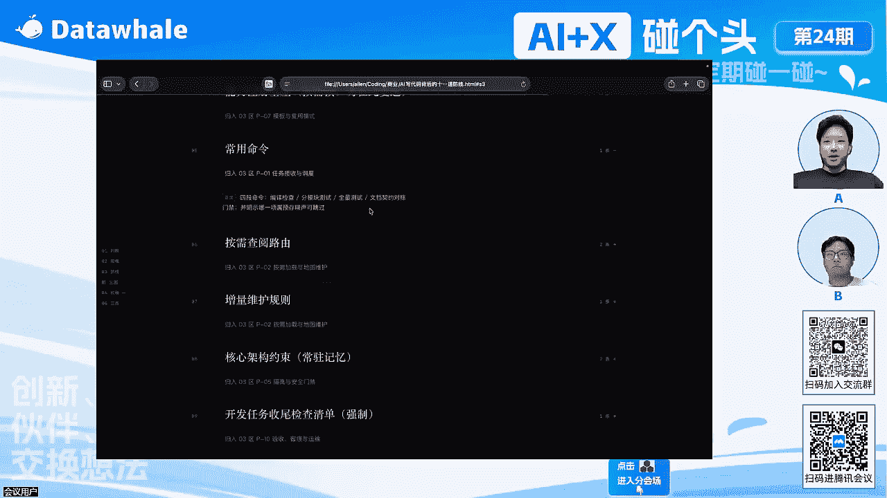

在迁移与运维约定方面，需要明确部署到云端或客户端时的要求，包括必做清单、自动建表、与现有东西对比。版本迭代后可能加了新表导致读不了，需要自检机制。

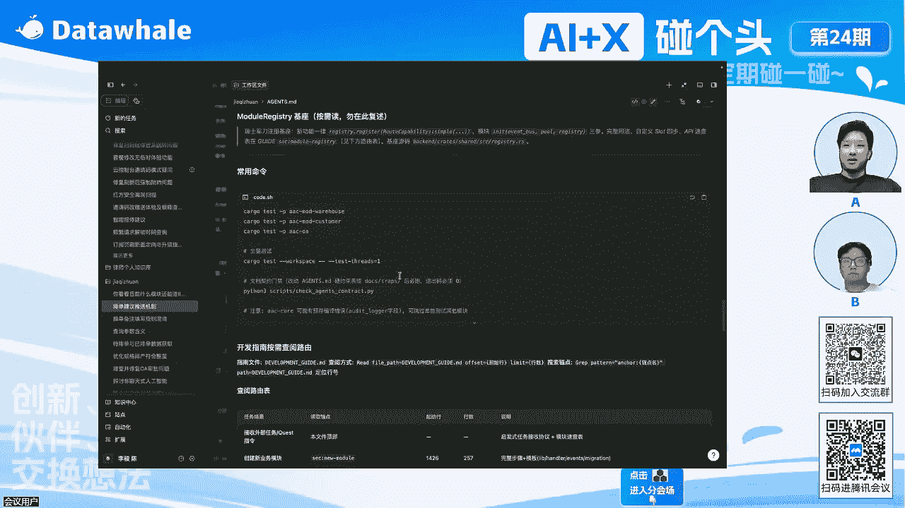

跨人员交接方面，AI 理论上没有记忆，记忆依赖上下文。每次交接都要重新找一遍会浪费 Token。因此需要编写 Handoff Skill，记录哪些东西可以直接用、完成某件事的最短实施路径、所在文件和行号，以及上下游出入站位置。同时必须写好完工标准和审计标准。

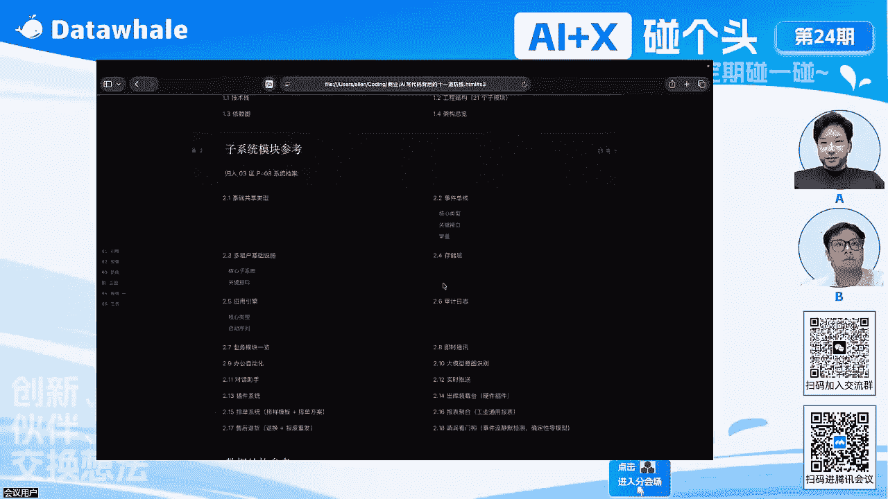

验收与运维检查清单方面，每个步骤做完后需要归纳避坑经验到 Memory 中，下次遇到类似问题主动绕过。

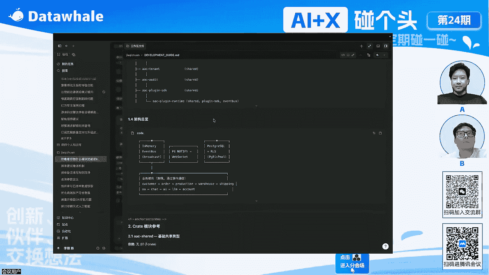

对抗审查方面，新模块开发或优化时必须进行对抗审查。作者曾查出一个模块有二十多个坑，直接写下去会导致崩盘。可以编写 AA 经开表（杠精审查）Skill，已经在模道开源。同时要考虑 Spec 忠诚度，即设计思路是否与最初想法一致，避免聊着聊着就偏了话题。

对于大型项目或企业中台，需要分析每个场景的上下游链路。如果使用事件总线，要检查是否有人发送没人监听，有人监听没人发送，异常情况下监听没收到是否会阻塞或造成不可逆情况。部署到远程内网后出问题，甲方打电话过来就要赶过去，非常麻烦。

隔离与降级方面，必须有多道防线。例如多租户情况下，不同的人可能看到其他人的数据，虽然听起来很傻，但在实际开发中很常见。需要显式带查询条件或数据隔离开关，否则可能不报错但切账号后数据乱跳。

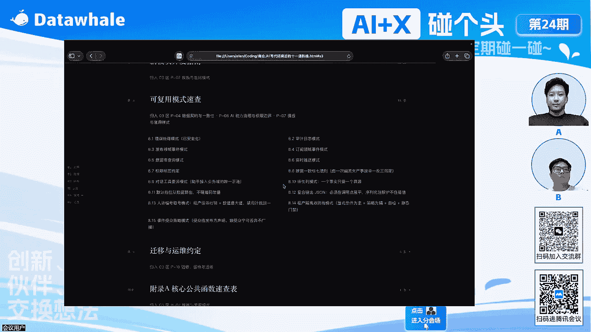

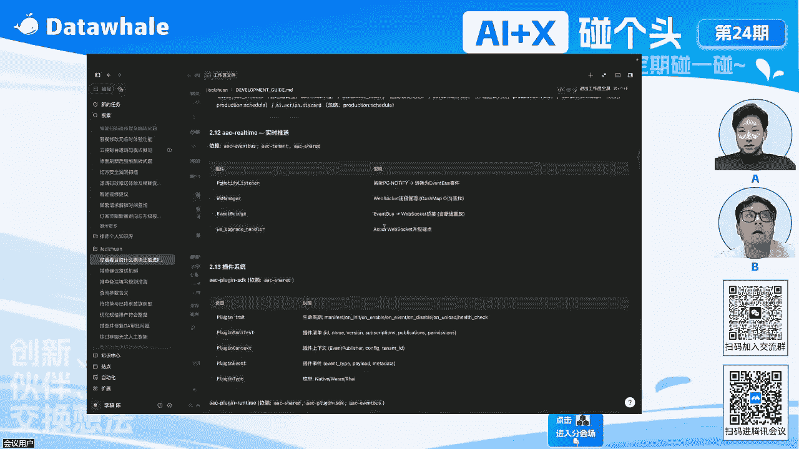

升维与降维思路：站在上帝视角看整个开发链路，从起点到终点必须完成哪些链路，中间有没有没预见的东西。让 AI 站在更高维度看现有基础设施完成新任务还差什么，把缺少的东西列出来，并说明如何加入现有场景、出入站规则。起点到终点连成线后，进行收拢，让 AI 从现有基础措施逐步往目标做。

降维具体指：要完成十步或十五步，哪些可以抽象成一种类型，哪些不同模块用的方法一样可以写在一起。开发前就能算出来。作者以多租户为例，找到了好几块可以分块做的项目，代码量大大减少。

关于在项目中加入 AI 的原则：模型只当路由，事实交给脚本，每件事情都要落盘。AI 写的动作先写到沙盒，再由人类点击确认或撤回。AI 不可能帮人背锅。可以把这写进合同，明确 AI 可能犯错，但犯错需要人工兜底，这样告知义务就完成了，风险可控。

唯一增援（单一真源）原则：两只表理论。手上戴两只表不知道哪个准，因此只能确定一个增源，并展示如何复现、来龙去脉，包括投毒测试。如果中间链路去掉，争员无法复现。

红绿灯原则：默认全红，逐个测试。绿灯必须有能力变回红灯才能变绿，因为可能有假绿或退出。多次测试以证伪，证明代码正确。可以用红方对抗 Skill 进行端到端测试，通读所有代码并用黑客攻击形式打对抗，虽然烧 Token 且耗时，但对远程内网部署很有意义。

交付前最好跑一遍红方，因为红方能测出交付自测测不出的问题，比如多租户串数据。

为什么要讲这些？因为 Token 很贵，时间也宝贵。虽然前面做这些事情会烧 Token，但总比做完后擦屁股好。否则可能数据库字段乱了，需要重新倒回去，甚至全盘推翻重写。

作者还分享了“三博资产”概念：每隔十轮对话蒸馏一次人员画像，把优点缺点和方法论保存，并注入到全局 AI 的 MD 中。例如之前遇到 113 个数据，AI 第一遍说 0-113 数据太干净，重跑后发现三个问题。这说明 AI 越来越像人了。正文量太多时可以压缩，只留优点缺点和方法论。

## 二、REA 项目与软件行业影响

在介绍完 AI 编码架构之后，本节中我们来看看 REA 项目登顶后对软件行业的影响。REA 是一个近期非常火的逆向工程项目，由研究强化学习和数学推理的开发者推出。

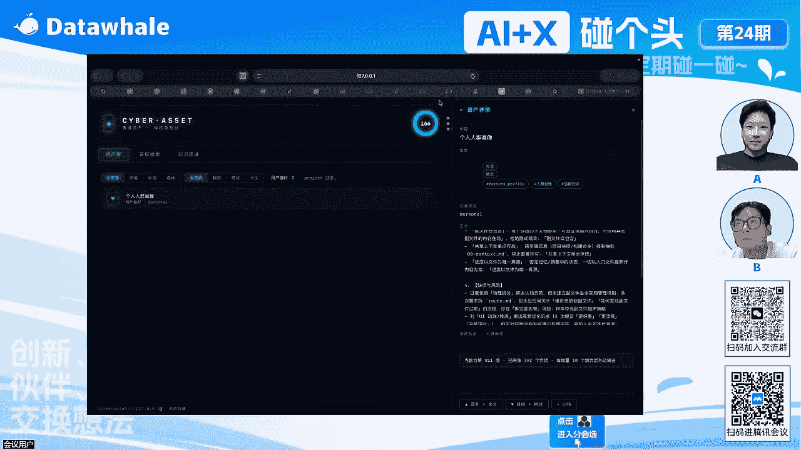

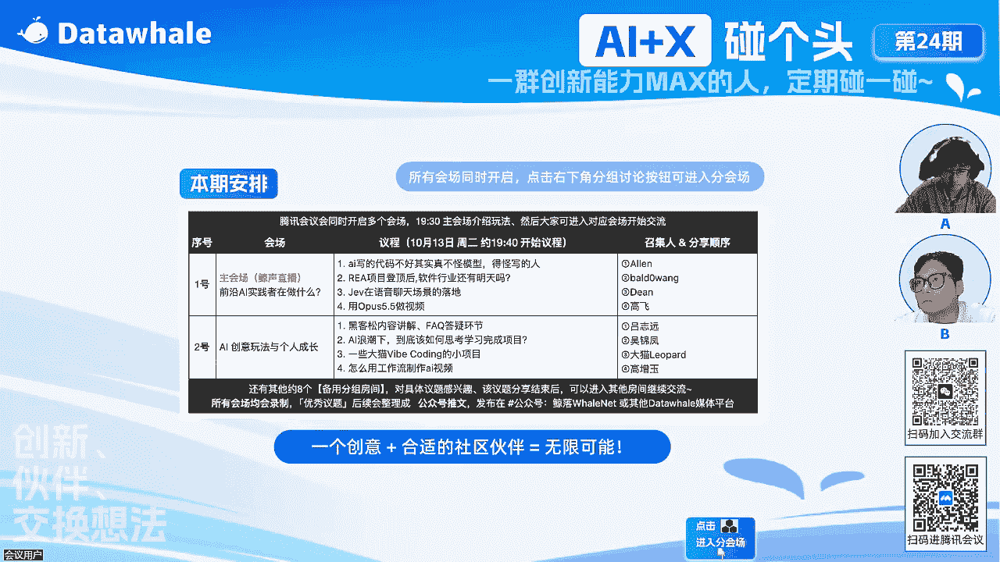

REA 的测试体验结果如下。基础的密码校验，REA 一分钟就能搞定。升级的加密密码需要两分钟。需要深度加密并使用机器码加密的，三分钟能搞定。UPX 加壳需要九分钟。VMP 加壳这种复杂加密模式没有搞定。换换密码加 VMP 模式可以在五十分钟内搞定。在 D Harness 环境下，使用 Dep 模型可以攻破基本的加密模式和方法。这对软件数据获取的壁垒影响很大。

从使用场景来看，UPX 这种带壳模式在百分之七十五的软件中都能用。也就是说大规模产品基本上都可以被攻破。如果有一个工具可以快速逆向软件并拿到核心数据或复刻核心功能，长期来看未来会变成什么样？用户是否都会用这种工具快速搞定功能？创造者是否还有必要投入精力研发、打磨和维护？如果大家都想拿来用，谁还做软件？

作者以 2000 年左右的游戏行业作为参照背景。当时盗版盛行，PC 机在国内活跃，软件市场从中国行页开始发展到 2000 年左右。那时候软件基本随便用，QQ 号盗号等司空见惯，游戏也基本没有版权说法。放到今天来看，背景非常相像，就像互联网回到了过去的某些时刻。从有秩序的点突然由于 AI 到来，退回到荒诞的时代。那时候由于版权意识淡薄，大家玩外国游戏，对国内游戏行业影响很大，基本没有人做独立游戏。

如果是良性循环，大家愿意看到市场有人努力有人买账，比如 Steam 平台，大家都能得到良好回报，那就愿意这样做。但如果回到之前时代，拿来就用，吃完老本，一段时间内可能再也看不到好软件。如果善用 REA 技术，以学习角度，不滥用，强化意识，还是愿意看到技术进步带来更好的作品，比如《黑神话：悟空》这样的作品。作者想和大家讨论如何用这个工具，心里要有一杆秤，先把工程伦理对齐。

REA 的具体原理如下。它通过 MCP 或 CUI 调用本地能力，写了一套框架。大家根据框架操作，把软件拿过来让它分析，经过一套分析后，就是逆向任务。把测试结果反馈给 Coding Agent，Agent 把内容复原回来。内核架构可以抓取数据和能力，通过数据分析包和抓包，再复原过来。

REA 项目影响力很大。从 1111 开始就非常火，短短几天涨到十八万六千六，第一天就快到八万。涨粉速度比 Cloud Code 和 Open Call 还快。开发者喜爱程度和受益程度很大。作者背景是做强化学习和数学推理，在 GitHub 上推了很多项目，喜欢拆解项目并深入挖掘，在此基础上做了这套工具，没想到影响这么大。

对于网络安全或拆包的同学来说，REA 的工具、理论、思路、方法并不陌生，都是比较基础的。换个角度讲，还是受益于大模型，Agent 策驱动这套框架。Agent 能跑，框架能受用，是因为 Agent 能力强，不是框架多强。大家要理性看待。有人吐槽这是数字泔水，不值得浪费时间，不是新的逆向技术。逆向工程案例不一定是大家看到的牛项目，不一定完全使用或一定使用。Star 数可能有问题，比例不正常。但既然火就有火的原因，不用过激批判，确实值得思考。

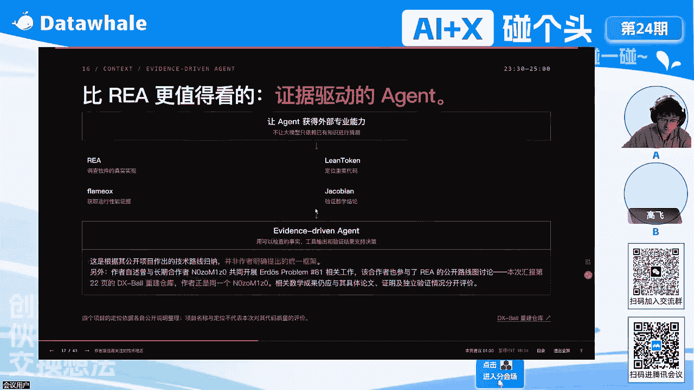

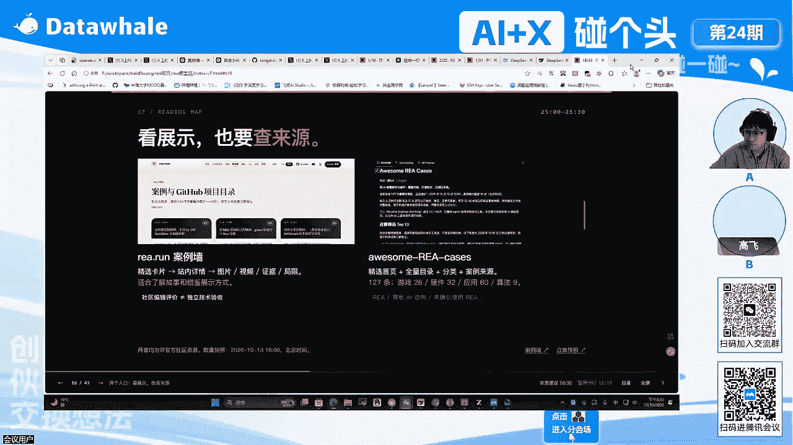

以下是 REA 的具体实践项目案例。

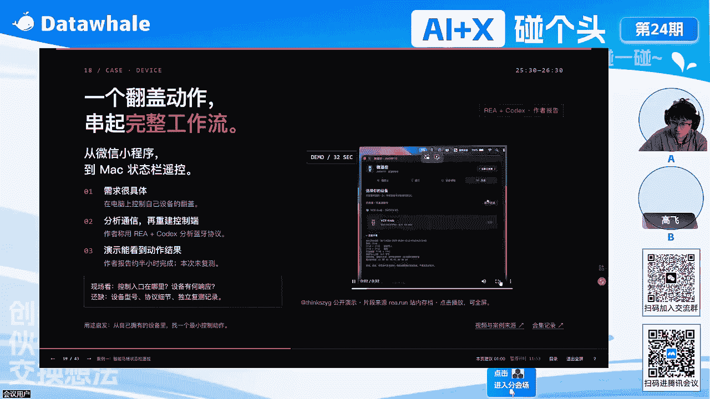

- 案例一：利用 REA 逆向一个遥控器，可以控制远程马桶，做参数和控制，包括灯光。物理设备控制通常有对应软件，工业软件相对封闭，不对外给接口。换个角度，设想为任意物联网设备，比如声控灯光、手机可控设备。
- 案例二：小米电子秤。脱离小米设备和 APP，通过 REA 可以直接搞定控制，把设备数据读进自己的看板。
- 案例三：宝玉老师把 Cloud Design 的模块化编辑功能复刻过来，实现效果不错。
- 案例四：复现打砖块游戏。如果砖块位置不好，有校验机制，校验完全合适才交付。即使复现了相同内容，位置或内容不对也会校验，得到相近结果。

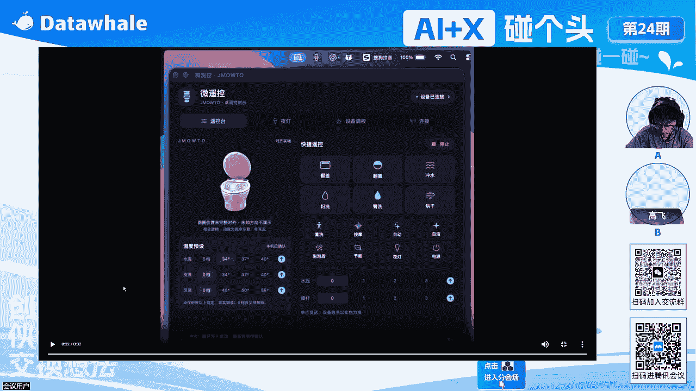

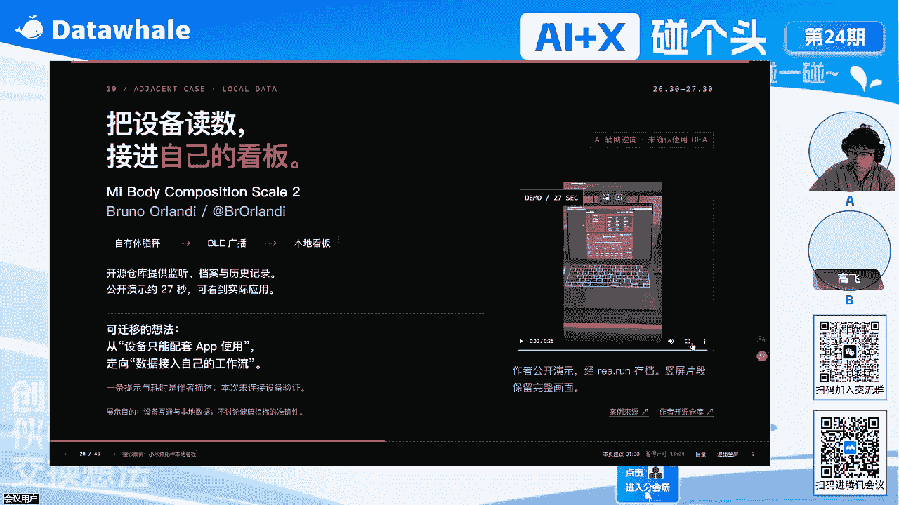

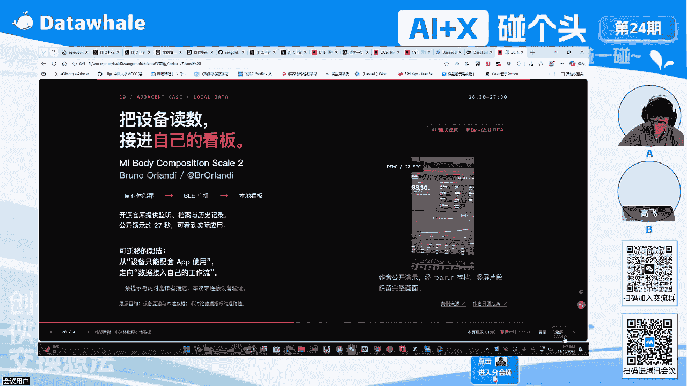

如果一键就能搞定这些东西，比如随便搞两下就能用 Adobe 全家桶或 Office 全家桶，复制成了捷径，原创是否还会有回报？站在开发者角度肯定不愿意看到，站在用户角度愿意看到。放到宏观视角，如果滥用，不建议直接把项目随便复刻。头部两家 Open AI 和 Cloud 已经有实力用 REA 做逆向，很多账号已被封号。大家要保持理智。

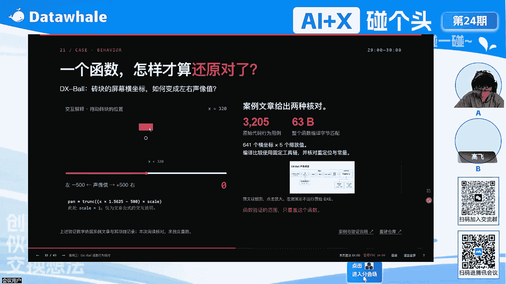

作者还看到有人用 REA 逆向了任天堂游戏，在麦克上可以玩。这不是 REA 才能带来的结果，随着大模型增强这一天迟早会到来。作者只是想讨论，作为开发者要有自己的操守和底线，不要因为这种项目砸了自己的饭碗。不要因为大家都用，就觉得不用会比别人慢或做得差。REA 也有短板，最难的托客做不到，复刻的项目也不是百分百还原。

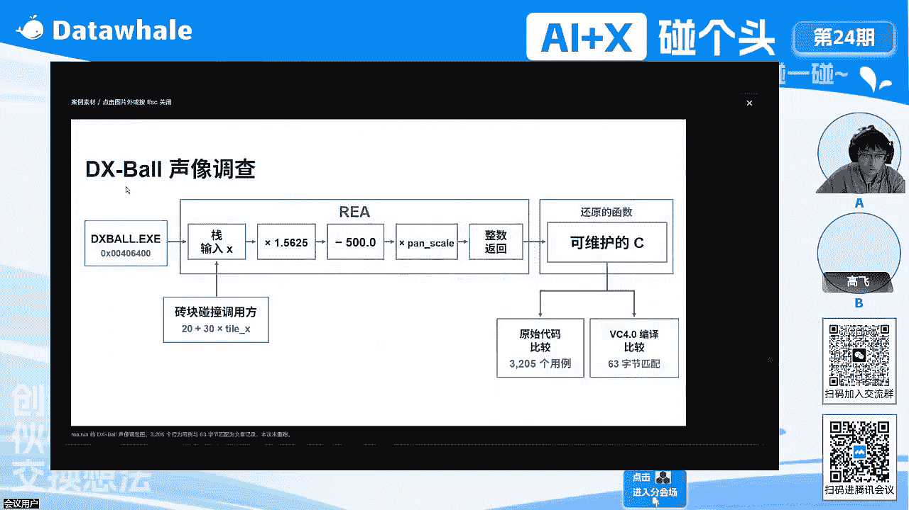

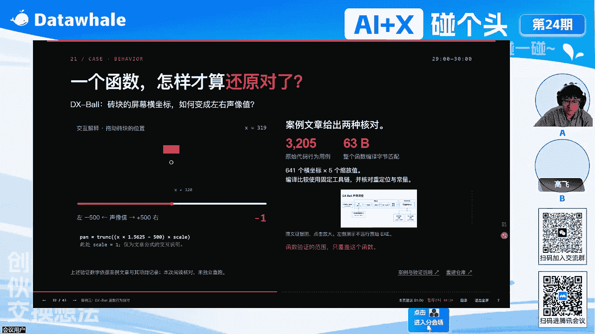

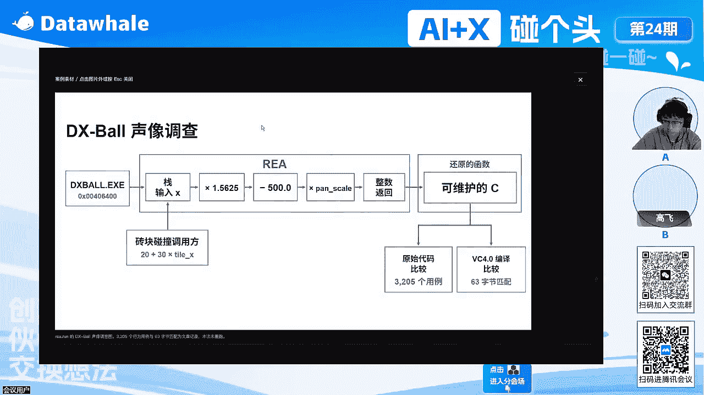

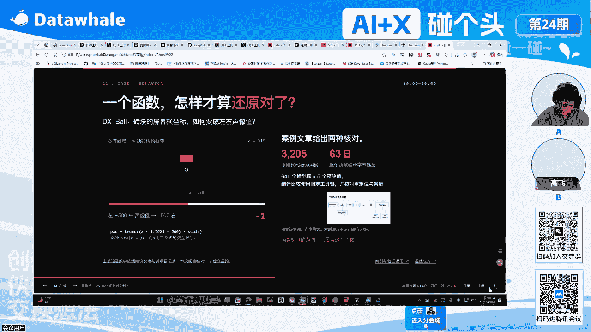

从法律角度看，本身做逆向并不违法。但以下几类是违法的：直接侵权损失、合法竞争带来的收入压力、安全事件和商业秘密损失。直接侵权可能吃官司或受法律制裁。安全问题方面，国内同学攻击韩国银行搞数据，下场很惨。大家在做不理智行为之前，希望听一句劝。

中国和美国对逆向的法律看法有对照。兼容性开展逆向有要求。直接复制源码可能侵犯著作权。绕过保护措施有法律风险。逆向问题不是一天两天，前两年案例已经造成损失并受法律制裁。

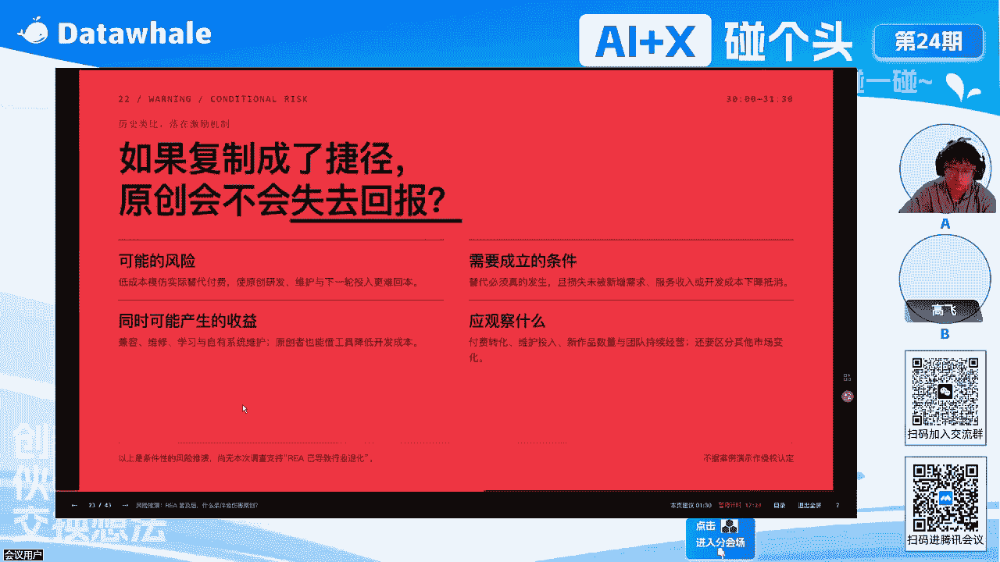

作为开发者，如果项目被逆向，大约亏多少钱？举例：1000 个用户，每人付费 100 元，年度收益基数 10 万。流失比例 5% 到 30%，全部归因于竞品替代，损失 3 万。对小作坊来说打击很大。

容易踩红线的行为需要提高警惕。以 REA 作为学习，可以自己开发软件并开源。购买了商业软件来做分析，需要核查。较高风险是做商业软件高度相似的替代品，且要收费。破解软件，包括游戏破解，风险很大。GTA 有被破解和被侵权告诉法庭的。REA 辅助访问未授权系统，比如政府网站数据被删，会造成不良社会影响或数据安全风险。做开发时可以检查这些，仅供建议。

REA 带来的不是逆向，而是逆向的工业化可能。之前也有逆向项目，但 REA 这么火是因为和 Agent 绑定，小白也能快速搞定逆向工作。每个人都拿到了不匹配的力量，要做好准备。

哪些软件最容易被开盒？单功能工具软件、浏览器插件、垂直桌面软件、游戏、设计创意软件和办公生产力软件，风险较高。相对不容易的是云端 SaaS、需要数据的服务、企业核心业务系统，比如贷记账软件或银行支付服务，不可替代，压力较小，也不敢搞。

如果未来要做软件，尽量做不可替代的数据，或者做非常复杂的系统性过程，比如 OA。企业够大重构 OA 非常麻烦，一般没人做。如果公司团队能力强，市场上有成熟且价格很高的东西，可以尝试自己做。对于企业来说，对生产方是坏事，对消费方是好事。

剧型软件一般不会被整体复刻。比如飞书，企业可能只用一部分功能，可以慢慢做一套小飞书，数据不想给飞书看，自己部署。这对飞书是流失，对企业是切入点。

数据冲击方面，实际展示的数据都是之前的评估数据。做产品时需要考虑基本防护。防逆向需要多加防护，即使能逆向也要费很大功夫，把逆向成本提起来，一般人就不会做。或者提供云服务，比如云电脑，不提供 API 或成品软件，直接提供云电脑让用户在里面用软件，可以避免一些问题。或者把内容做得开放一点，如果是公益性质就不要有私心，因为想办法肯定有办法。或者做防御复杂、通用性强的大软件，有一定市场，但系统会慢慢被稀释。

对于使用者，如果要做软件，朝两个方向尝试：一是把数据做成 MCP 或类似东西，不全部放给对方，比如论文网站按量买、有量上限；二是做复杂工程，做好防护。或者把模型能力开放出来，方便大家用。作者现在做项目都会把它 CIMCP 化、Scale 化，三个都做出来。如果想二次开发，把每个模块的 MD 写清楚，怎么往上加。作者分享的哔哩哔哩视频案例，用 Vi 解析出来，为了方便使用也做了 Scale，还有 MCP，这样大家接起来用都很舒服。就是尽可能让大家想用好软件，现在只能做到这样。

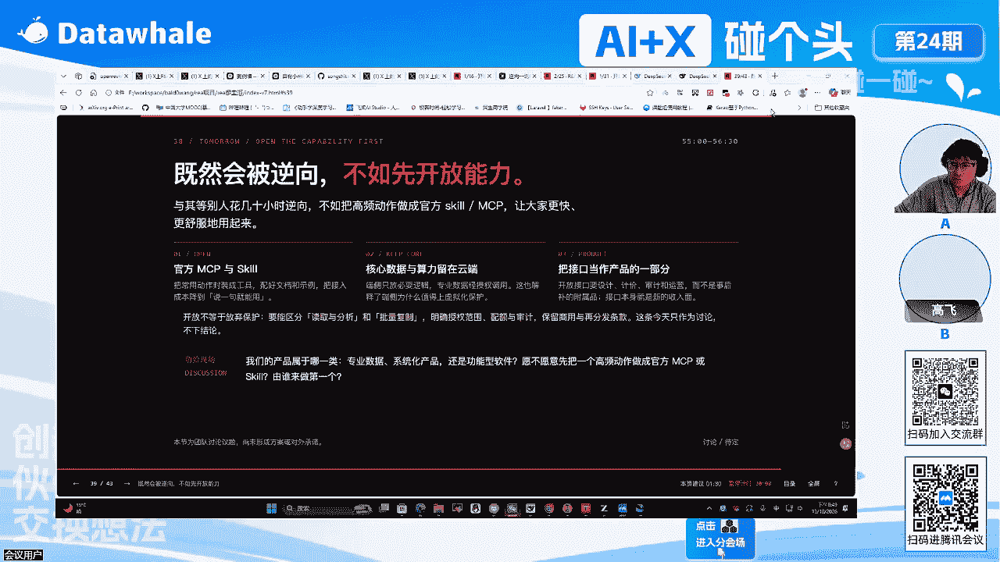

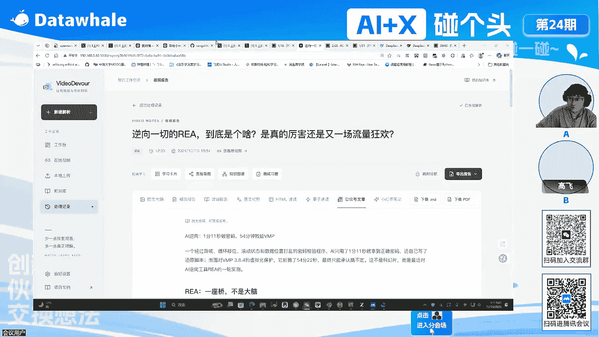

整体来讲，软件行业要做下去未来可能会更难，但不是完全被吃干净，有活的机会，只是日子会过得比较艰难。

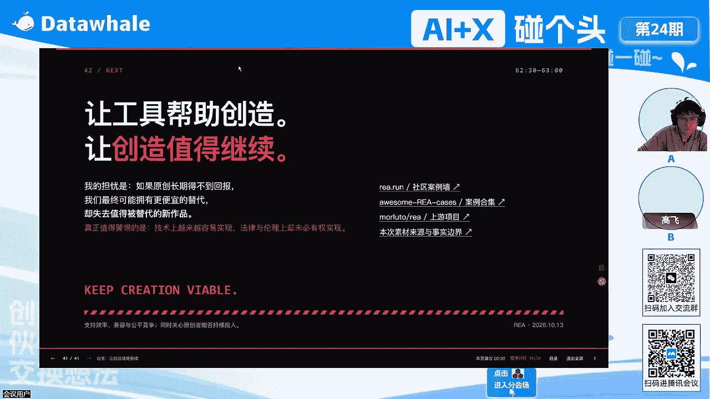

## 三、JEV 模型在语音聊天场景落地

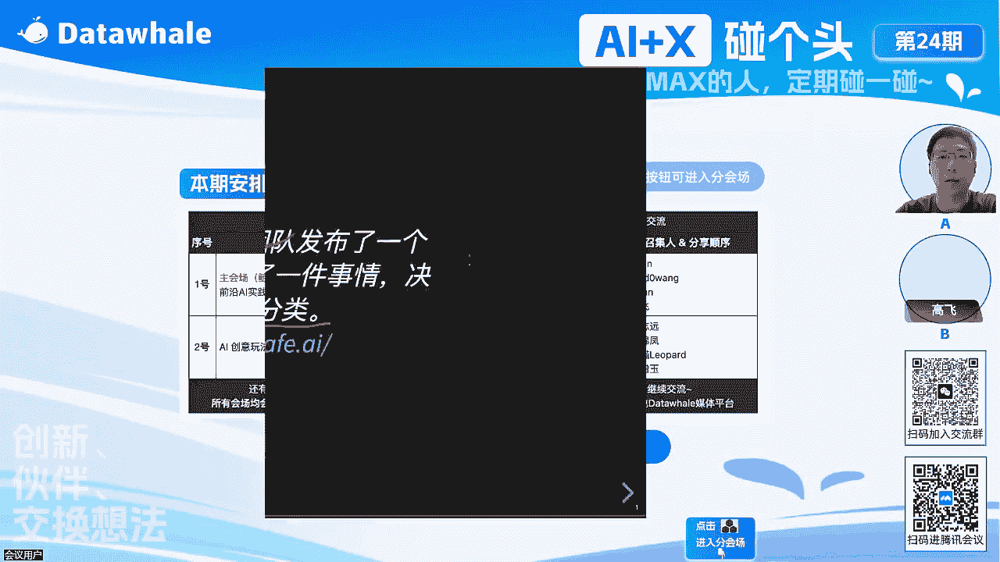

在讨论完 REA 项目之后，本节中我们来看看 JEV 决策模型在语音聊天场景的落地。分享者是一家做智能陪伴玩偶的 AI 工程师，主要聚焦模型训练、背条和落地，涉及智能体，特别是智能聊天和语音聊天。

公司主要做智能聊天陪伴，属于实时语音聊天类。自 9 月 15 日 JEV 模型出来后，进展很快，知名度打起来。这是 Type Safe 发的模型，比较简单。相比以前的模型，主打“快思考”模式。成本在每百万 Token 0.042 美元，换算人民币每百万 Token 两毛到三毛左右。速度基本在 100 毫秒以内，考虑网络延迟可能到 200 毫秒。因为做语音，对延迟比较敏感。

JEV 提供了三种输出格式：选择类、评分类（零到一或性评分）、是非判断。企业用得更多的是 Choice 选项，主要用来做意图分类。官网很简单，但 Type Z 的 API 已经把中国大陆列为不可访问区，想使用可能要找代理或其他方案。

智能语音聊天场景现在是混战，大企业小企业都想占领市场。这个场景可能还有两到三年发展期，长成几个巨头。智能语音聊天不管是陪伴、教育还是工具，更多是入口，大家想抢占入口。入口里涉及语音聊天，说一句话对方回一句话，要求响应延迟快。现在做得比较好的，基本在两秒以内，甚至压到 1.5 秒或 1 秒。ChatGPT 有 Life 功能，全双工，边说话他有时候会打断。国内更多智能语音聊天因为现实考量和功能丰富，延迟更长，基本在两秒左右。业内海威、负载等延迟在两秒甚至两点五秒左右，相对人体感可以接受但不是理想区间。理想区间基本要达到 1.8 秒以下。

语音聊天场景有两种模式。一种是实时语音，背后接语音模型，Response 也是语音。这种模式没法做很多深度思考，只能泛泛而聊，比如查天气很难做到。因为语音模型训练时就是为了聊天。业内 80% 甚至 90% 厂家使用三段式。三段式：你说话到达后台服务器，先走语音识别 ASR，ASR 走完后得到文字，匹配意图识别等，构建提示词给大模型。大模型采用流式输出方式输出文字。文字又给到 TTS 语音合成，合成语音再推送回来。如果不细心调优，延迟很难压到两秒以内。

举个例子：VAD 模型判断是否说完，一般用 500 毫秒延迟，已经不太友好。有些厂家用 700 毫秒。这段时间对个人来说话音已经结束，但接收方不知道是短暂停顿还是真的结束，所以等 500 毫秒静音，超过就认为说完，ISR 才结束。ISR 一般用流式方案，从最后语音到拿到文字，基本在 200 毫秒，火山、阿里、Eleven Lab 都在 200 毫秒甚至高一些。500 毫秒加 200 毫秒已经是 700 毫秒。后边大模型很多都有思考模式，思考模式一加，拿到真正有效输出基本在一秒以后，所以基本不用思考模式。再加上 TTS 延迟，即使流式也在三四百毫秒。整体加起来基本在两秒，理想情况下已经在两秒左右。所以智能聊天场景要求延迟低、响应快，这是红线。工具调用准确率要求高，不能查天气半天没响应或胡说八道。话题切换要顺丝滑，讲故事切讲笑话不要还讲故事，中间穿插查天气或播放歌曲，也要能响应真实意图。真正难点在于意图识别。

现在聊天模型基本用 Flash，关闭思考模式，千问系列、豆包 Light 或 Colacter 等用得多。意图识别基本走 NLP 或 NLU 方式，加上其他过滤，比较死板但速度快，20 毫秒以内返回结果。话题切换更多用工程手段，计算各个情况下的状态低，累积加上算法，决定这句话到达后是否切换状态。这是业内通用实践。

但里面有一个难题：上下文。现在的上下文基本是大一统的。即使做了一些处理，多轮、知识检索系统等方案，上下文还是特别多。对非四套模式来说，最理想是只有一句提示词或两三句。提示词短，没有 To 误掺合，才能保证大模型不注意力涣散，不会理解错或被以前对话影响。

如果没有意图识别或分类，即使有 NLP 和层级过滤，像 ISA 框架，也不能覆盖人真正各种表达情况。大人、小孩、地域特征，四川话、湖南话，表达方式不同，同样的词汇意思也不同。传统方式很难做到意图分类准确。分类错误会有很大问题，用户会反感，觉得你不聪明。NLP 和层级过滤速度快，但工具调用准确率相对死板，面对泛化场景准确率降很多。话题切换的状态机又很复杂，实现时基本有十几个状态机，有时候会出现误判或异常，要有兜底，比如不管问什么默认闲聊。

9 月 15 日 JEV 出现后，决策类模型相对简单，用来做意图路由，也可以认为是意图分类。用决策模型加配合后边大模型，准确率和低延迟基本达到了想要的效果。同时基于状态低和置信度，能很好解决话题切换。比如要讲故事，可以根据置信度累积，低于 0.7 或 0.8 就不立刻切换，等下一句置信度再决定，还可以摸鱼。

作者在论坛上分享过 JEV 路由 Demo，偏重企业实践，怎么落地到产品上。有兴趣可以找作者获取。

当前还有问题。决策模型出来后，整体流程和系统架构会有重构，质的飞跃。延迟方面，以前用三个模型甚至两个模型串联，各种 NLP 手段和模型托底，延迟上来，达到三秒左右。加入决策模型后，压缩到两秒以内。但因为是海外模型，真正产品上使用可能偷偷用，或找替代方案，或等国内厂商。要保证产品服务稳定，接口不能三天两头宕机。也考虑过部署方案，找开源方案。拉雅拉雅方案评分还可以，但用 500 条样本测试准确率只有 50% 左右。千问在月初跟进决策模型，协议和 JEV 一样，但现实场景测试准确率只有 67% 左右，低于 70%，无法落地。有些模型单轮单轮语句可行，但现实场景要累积多轮。比如用户说声音调大，又说太大了，没有前一轮上下文就无法理解想调小。单轮准确性在现实使用中基本不可落地。

这里有几个偷偷放给大家的数据，是企业数据测试准确率。更多看 F1 值。JEV 涉及上下文，可以把用户一轮、五轮甚至十轮对话作为上下文，也可以把 AI 回答放进去。不同情况下 JEV 准确率基本在 98% 以上。用千万模型测的话，准确率在 70% 到 80% 之间。这还是因为针对面的模型，Instruct 指令做了很多样例，才达到这个点。最有意思的是，有一个意图，“拜白的英文怎么说”或“再见的英文怎么说”，但 JEV 决策模型总是把它分配到离开意图或再见意图的路由上，而这明明是闲聊意图或英语老师 Agent 路由下。测了很多开源模型，只要基于前面 3.5 或 4B 以下模型，基本都有这个问题。27B 或 9B 模型基本没有这个问题。基于谷歌 G 码 4B 训练下的模型也没有这个问题。所以在某些场景下，选择模型时要基于企业或场景真实数据集来训练、微调或测试，不要只听网上评分或测试集打分。

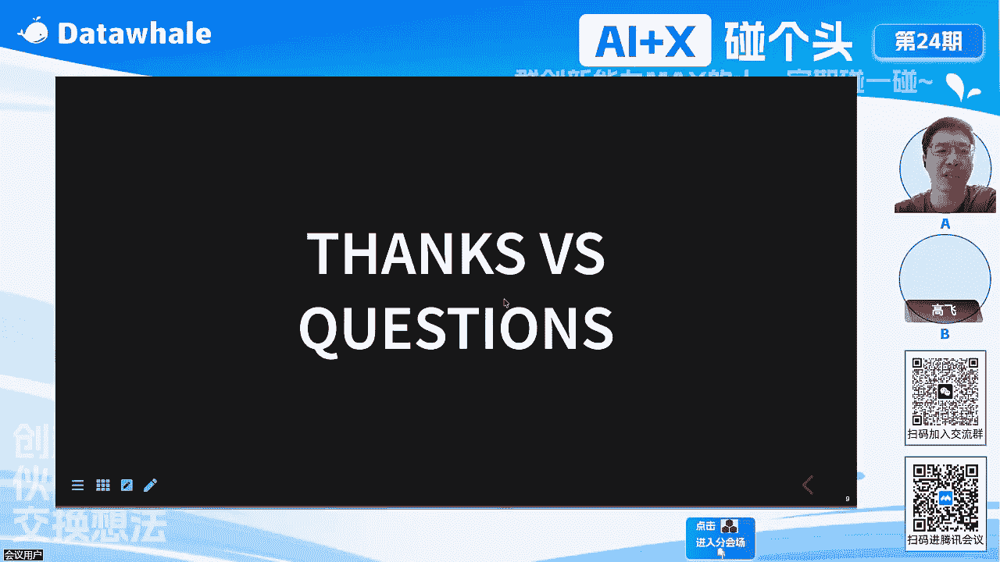

关于 Voice Agent 测评，有一个仿真环境，用录音或 GPT Life 去测语音全流程端到端测试。复杂点在于每次测试输入一样，但 AI 回答每次不一样，排查问题要根据经验判断是提示词问题还是工具描述问题。JEV 准确性要看不同场景，对某些场景分数高可能只是在十几类意图里分类做得好，泛化到其他场景不一定那么高。千万决策模型在你的场景可能效果比较好，需要自己用场景数据集测试。

## 四、Opus 5.5 制作视频

在介绍完 JEV 模型之后，本节中我们来看看如何使用 Opus 5.5 制作视频。分享者高飞在家做传统工程公司研发，主要涉及工程领域硬件和软硬件开发，个人关注 AI 领域发展，有公众号自媒体。

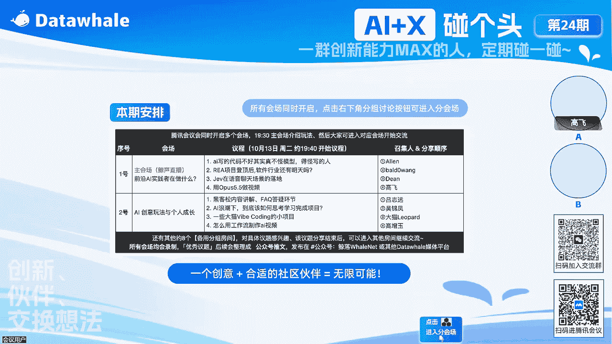

好奇心驱使尝试。当时周围朋友和推特上很多人做这种视频，效果很好，所以尝试了一个热门提示词。基于 Cloud Opus 5.5，订阅了最基础的二十刀会员，做了十二个短片，用了两三个小时，两三个五小时限制。

视频制作流程如下。

第一步：给 AI 一句话，“在我眼里我是谁？”，让它根据 Cloud 里的记录和聊天记录了解自己。
第二步：让 AI 读取聊天记录和笔记。如果没有记录，就准备好聊天记录和笔记。如果有，就让它直接读取过去的聊天记录、项目和头像。头像可以发一张图片给它，或者之前发过它也会记录。
第三步：时长、画面、声音、配乐、音效都让 AI 自己决定，技术也完全让 AI 自己决定。可以列一些技术，比如 Shader、Remotion 等，需要什么让它自己装，完全给它自由度。模型能力现在越强，需要的约束越少。以前可能做了很多 H5 工程、Scale 等限制模型，现在觉得有些要去掉。大白话跟 AI 讲，要什么需求让它自己去做。现在使用的模型基本是 Cloud Opus 5.5 和 GPT-6A 这种顶级模型，不需要限制那么多。第一版基本能达到六七十分，速度非常快。但后面想调细节，不管开发项目还是做别的，想达到高质量，要跟它沟通，修改次数会比较多。

第四步：先做几秒钟的样片，一般 3 到 8 秒。看风格是否喜欢。可以同时做 4 个 3 到 8 秒的样片。喜欢的话，让它接着做完整版本，3 到 5 分钟。这样做视频不会浪费时间，不用把整个视频完整做出来，Token 消耗更少。做完整个片子后，如果不满意，可以让它修改。

第五步：建立故事线，先生成文字。第一版做成之后，后面剧本文字基本一样的风格，只是换了不同的人，不同人声读的节奏和效果不一样，配乐不同。配音调用的模型是视频模型平台的声音，开通会员有一万积分，每次通过 API 调用收藏的人声。积分可能用完。里面有很多音色，有自己的音色，以后可以克隆创建自己的音色分享给别人。可以在里面找很多音雄，有国外国内的，查中文的。这个网站配音挺好用。用这个句子离配音。

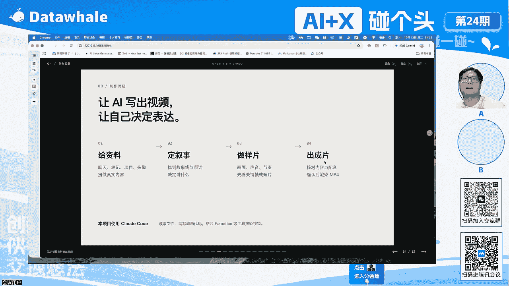

第六步：风格可以每次让 AI 自己决定。如果看到网上有风格，可以把参考图发给它。没有参考图，可以让 AI 自己想参考图。比如水墨风是 AI 自己做的。之前做过一个水墨风格的武汉前端展示网站，所以想让它做类似风格。其他风格，什么字、RPG、手账、漫画，可能是 AI 自己做的。点线面风格也是 AI 自己想象构思的。

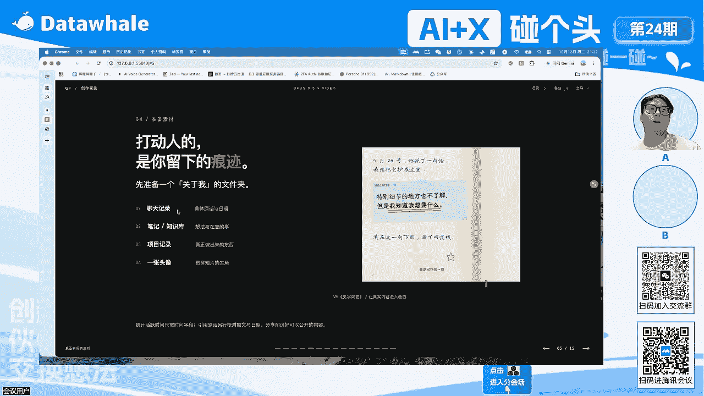

第七步：通过调用 API 尝试配音效果。这里面有些截图，提示词可以看到，基本上就是这个提示词。前面已经给了一些基础提示词，后面的风格只是给 AI 说的大体风格。比如让它找字的构成风格，跟它沟通。最后 AI 反向输出的提示词，觉得不一定有用，最主要还是第一个模板的提示词，第一次发给它那个提词。后面的提示词可能是根据它跟你反推出来的，不太适应。

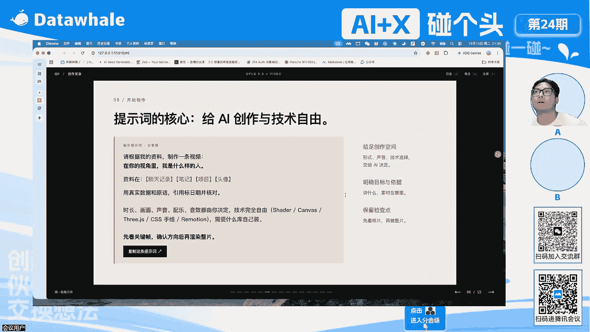

第八步：如果不知道要创建什么风格，可以让 AI 同时输出四种或几种风格让它做。比如当时它给出了四种风格，最后选了水墨长江风格。还有快闪风格，节拍变电调风格。

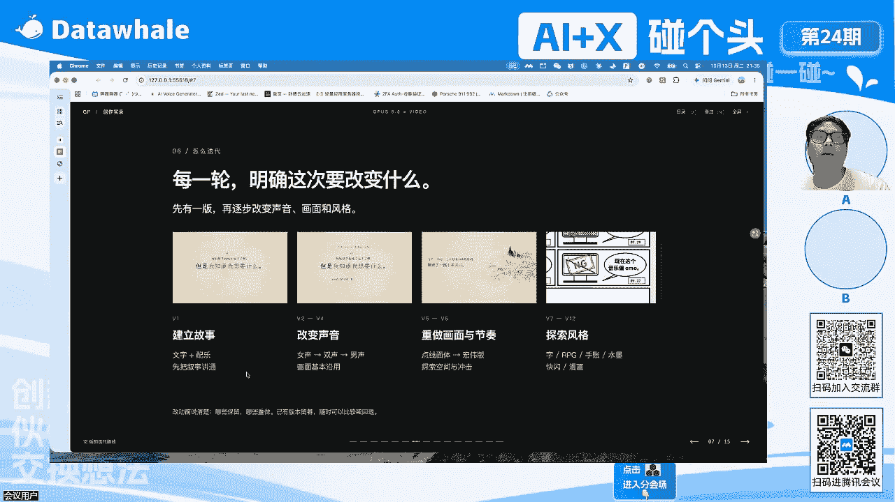

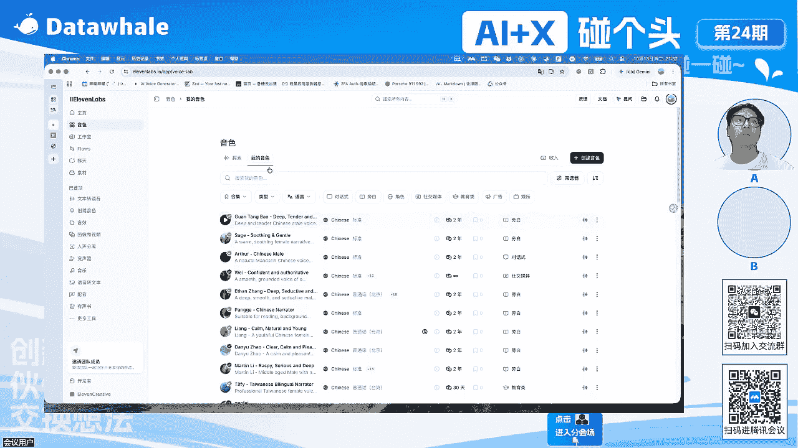

第九步：如果效果不满意，可以直接跟 AI 说。大白话沟通，觉得效果差，画面感觉不够，很难分辨出来。四个小学生都能分辨出来。这考验你对想要画面的需求能否描述出来。觉得不好，让它再往别的方向尝试，或者有些具体的需求。

第十步：具节风格变换，前面都是一样的，核心一样。具体风格可以直接切换。用 Office 生成视频，把模板加入这里再结合风格，基本上能创建跟作者类似的风格。这其实比较简洁，应该有用。如果用特别细节细节的约束，效果可能不太好，除非特别想要那种风格。稍微把题目不要写那么详细，可能展现的效果更好。

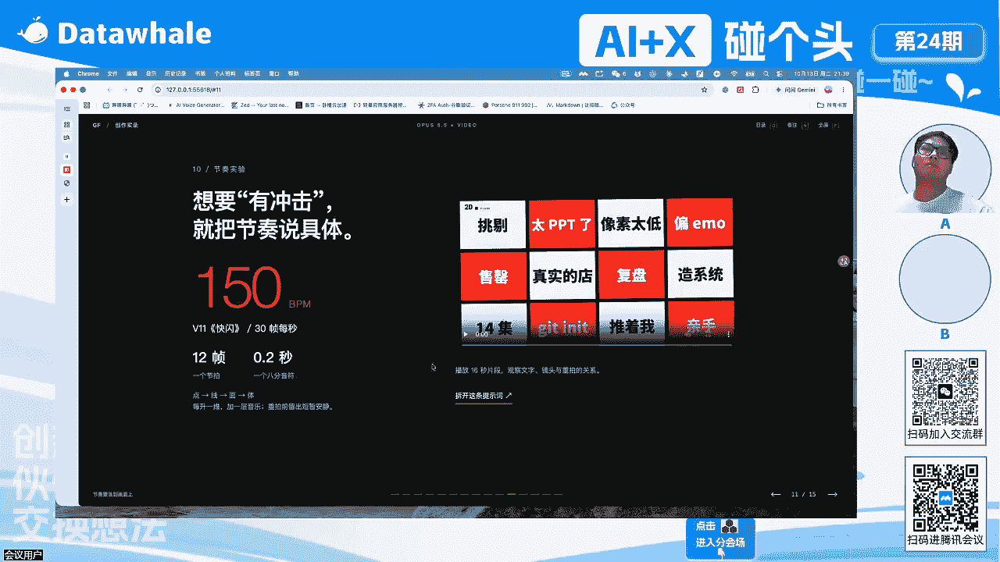

作者用同样的提示词，GPT-6A 也尝试过，效果不特别满意。比如最近要做科普视觉算法视频，让 AI 做科普视频。GPT-6A 做的效果不太好，但可以看 Cloud 做的视频。同样的类型，讲解视觉识别，一口气让它做了 12 集。第一集给出了三种风格：机器眼、手绘风格、明亮风格。选了第三种。第一次做的过程在思考，然后在做。图几乎不用写就知道是猫，可在电脑眼里只是一张表格，表格里每一格叫一个像素，也就是图上的一个点，每个像素用红绿蓝三个数记下颜色，每个数从零到 255。这张图加起来一共 40 万个数字。从这 40 万个数字走到猫这一个字，就是视觉识别要做的事。猫换个姿势，暗一点，被沙发挡住一半，这 40 万个数字几乎全变，可答案还得是同一个字。猫，那能不能写规则？两只尖耳朵有。这个小方块之就这样手工设计各种特。这里可不放了。这种效果肯定比 GPT-6A 说的效果好。后来把规划之后，把所有视频都升了，直接升了很多级，把所有视频都说出来。

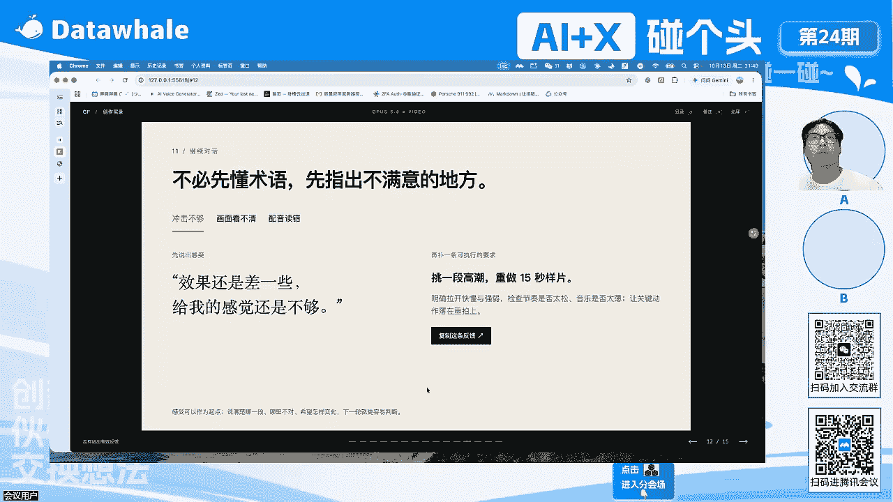

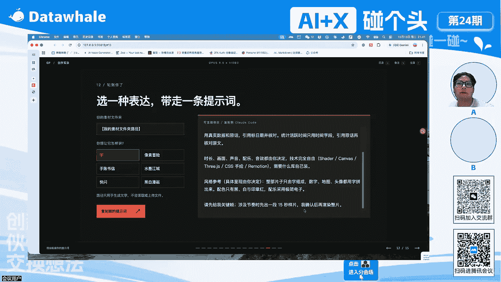

之前也看过别人分享，这种做视频的方式，让 AI 直接写代码做视频。调用的是 Remotion、Shadow、3GS 等，用代码形式做视频。适合抽象一点的东西，动效、点线面动画。和像素级生成图的模型不一样，两个方向不一样。像素级写实生成模型，比如即梦、豆包 C 大等，两个方向各有用处。用代码形式生成视频，基于底层视觉绘制能力，成本低一些，调速能力更强，每一帧根据模型识别然后做动向，用代码形式生成，每一帧做每一帧，把每一帧拼接起来做成视频。用生成模型的话，一次性基于像素级别生成，每一次可能十五秒三四秒，未来可能生成一分钟，再把像素级别生成，每一个视频成本大一些，时间也长一些。类似于抽卡，抽卡能力成本高，时间慢。这是两种不同方式，看要做什么视频。如果做短剧、慢剧，可能用像素级别生成模型效果更好，真人实景这种效果可能更好。这种代码方式可以作为科普视频、教育方向，比如视觉讲解、视觉识别，类似 PPT 教育，比较好用，成本低、非常可控。

作者今天分享就是这些。大家有什么想问的吗？视频太长，以后上传到 B 站，B 站有的，时间都是四分钟以上，有 12 个视频，有四分钟、三分钟、五分钟的。现场不便于放这么多视频，感兴趣可以去 B 站看，链接发到评论区或群里。

## 五、总结与课程信息

在学习完以上所有内容之后，本节我们来总结本次课程的核心要点。我们一起学习了 AI 编码底层架构的十一道防线和文档体系、REA 逆向工程项目的原理与行业影响、JEV 决策模型在语音聊天中的低延迟应用，以及 Opus 5.5 制作代码视频的完整流程。

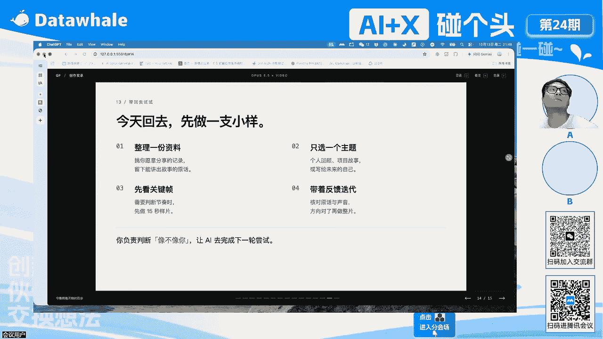

AI+X 碰个头是 Datawhale 社区发起的组织大家一起线上交流的活动。今天是第 24 期。现在是每周二每周五晚上 19 点 30 分开始交流。每次会有多个议题分享。如果大家有自己想分享的议题，欢迎报名参与。我们会进行相应分组，大家一起探讨和交流。

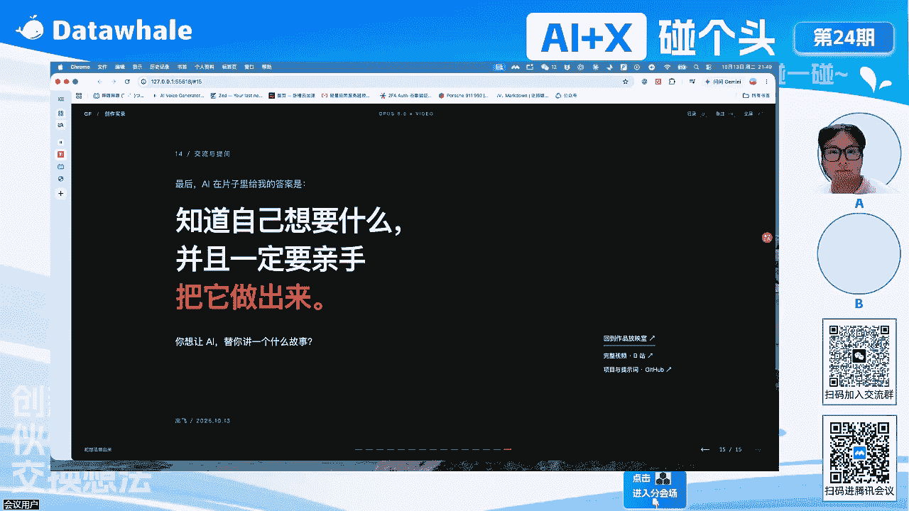

今天晚上的交流就到此告一段落。下一次交流将在 10 月 16 日周五晚上 19 点 30 分开始。在此之前大家都可以报名参与分享。可以扫描右下角二维码加入交流群。后续所有回放、公众号推文、线上线下碰头机会都会在群里分享。想要报名参与分享的，可以查看群公告里的入口链接。

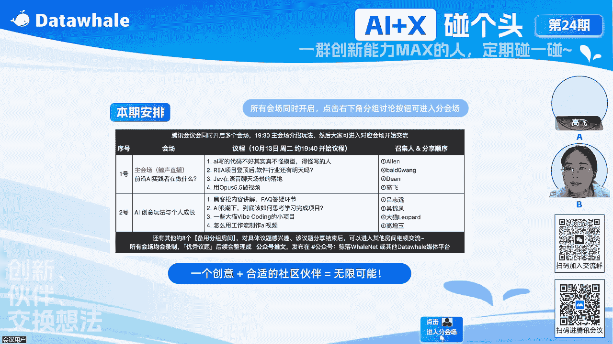

感谢大家的参与，期待下次再会。有任何想法或想听到的分享，欢迎在群里反馈。大家晚安。

