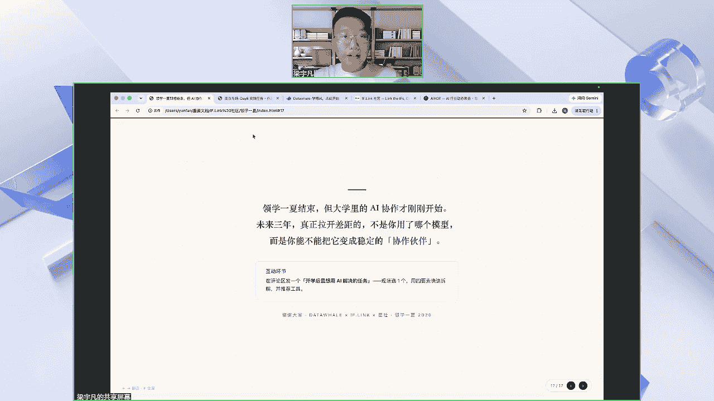
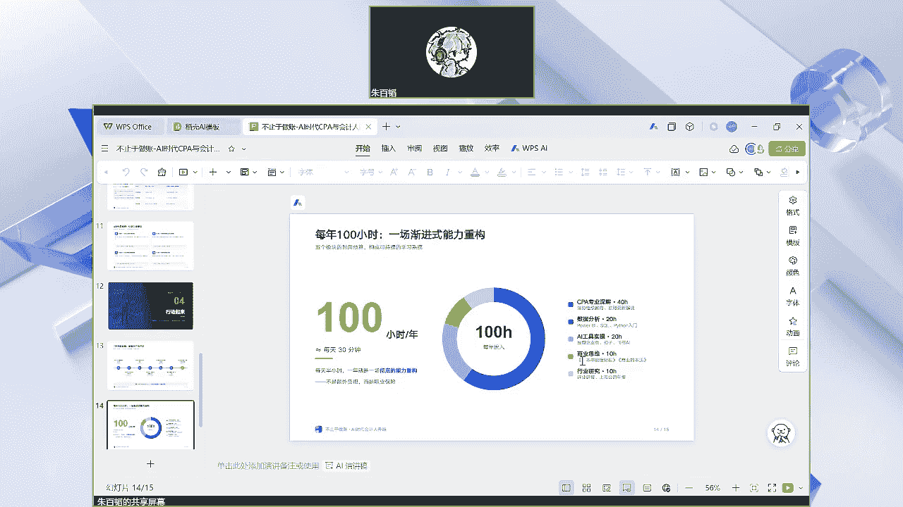

# 🎓【Datawhale AI+X】大学AI协作时代才刚刚开始：01：课程回顾、模型拆解与场景应用指南


## 一、本节课概述

在本节课中，我们将一起学习如何把AI当作日常办公和学习中的可靠伙伴。首先回顾课程整体设计，理解与AI交互的核心心法；接着拆解国内外主流大模型及各类专用模型的能力差异；然后根据不同使用场景推荐适合的AI产品；最后分享如何在AI快速迭代的时代中持续学习，避免不必要的焦虑。通过本节内容，初学者可以建立起从认知到行动的完整AI使用框架。


## 二、课程六步走与AI交互心法

上一节我们介绍了AI协作的整体背景，本节中我们先来看看课程的六步主线。这条主线的设计逻辑是从认知到行动，帮助大家逐步掌握AI的使用方法。

以下是六步课程的具体内容。

- 步骤零：会说话。核心心法是目标、背景、边界、交付。在脑海中先构建好这四个要素，再编写提示词交给大模型，让模型充分理解你的需求。
- 步骤一：具体任务执行。相比只说一句话，提供详细信息能让AI生成更直接、更可执行的方案，更贴合实际场景。
- 步骤二到步骤四：使用Agent完成具体办公任务。Agent相当于给AI装上了眼睛、手和脚，能够操作电脑、获取网络信息、运行代码、制作PPT和海报。
- 步骤五：构建可复用的工作流。将经验沉淀为规范手册，AI可以重复使用，避免每次重复说明。
- 步骤六：连接器与知识库。通过连接器让AI读取飞书、浏览器、腾讯文档等真实应用中的数据。

大模型并非全知全能，这是我们必须理解的边界。核心概念可以用下面这个公式来描述。

```
提示词 = 目标 + 背景 + 边界 + 交付
```

AI的能力边界包括以下几点。首先，它的知识有截止日期，无法获取最新信息。其次，它是概率模型，天生容易编造内容，即产生幻觉。第三，上下文长度有限，可能只有256K或更少，相当于人的眼睛看到的范围有限。针对这些问题，我们需要采取相应应对策略。

以下是应对AI局限的方法。

- 有时效性的信息需要打开上下文和搜索功能，并要求AI核验纠错。
- 使用强提示词防止AI编造。
- 主动组织AI能看到的范围内的信息，避免交互几轮后AI“遗忘”前面内容。
- 通过内容压缩或将前面内容固化为文档，再在新对话窗口中提供给AI，既保留历史了解，又拥有充分上下文。

站在承前启后的时间点，我们作为学习者要意识到，AI协作能力将成为大学生活中重要的基础技能。


## 三、大模型与专用模型全景拆解

刚才我们梳理了课程的六步走，本节中我们来看看大模型的具体版图。大模型不仅仅是对话模型，它是一个非常丰富且复杂的能力体系。

首先看国内主要玩家，目前大概有八家。

- DeepSeek：最早因推理和深度思考爆火，逻辑能力强，适合需要梳理思维的任务；中文写作较自然，长文本写作有优势，开源且性价比较高，最近补齐了视觉模型短板。
- 豆包：日常使用最多的模型之一，多模态能力突出，图片和视频通话表现稳妥，搜索效果较好，APP产品设计优秀。
- Kimi：编程能力和Agent能力强，审美出色，适合网页和设计类任务，搜索信息源不错，但稳定使用需要付费。
- GLM：编程能力非常好，最新版本在网络和安全能力方面表现优异。
- 千问：开源小尺寸模型受开发者欢迎，适合开发小型应用，不需要非常大的模型时效果好。
- 混元：能力中规中矩，主要优势是内置Workbody且目前免费。
- MiniMax：性价比高，长上下文能力不错。
- StepFun（阶梯星辰）：速度快，性价比高，能力尚可。

再看国外主要模型系列，目前大概有四个。

- GPT：大模型爆火的起点，综合能力好，最近价格也比较便宜。
- Claude：代码能力极强，写作风格自然，受人话模型欢迎。
- Gemini：多模态能力好，输入输出都表现优异，审美好且速度快。
- Grok：马斯克旗下SAI研发，拥有实时推特信源，速度快，模型能力突飞猛进。

不同模型有不同的性格，没有哪一个模型在所有任务中都最好。同一个任务，不同模型的表现和答案可能不同，因此不要绑死在少数几个模型上，建议多试多比较，再决定使用或付费哪一个。

除了大语言模型，还有许多专用模型，核心概念可以这样概括。

```
现代AI产品 = 多模态模型组合
```

以下是常见专用模型及其作用。

- VOM模型：图像加文字输入，文字输出。
- 图像生成模型：如GPT image two、Google Imagen、即梦、Flex等，用文字或参考图生成图片。
- 视频生成模型：如C dance 2.5、MiniMax H3等，通过文字和图片生成视频，目前短剧行业95%已经是AI生成。
- ASR模型：语音识别，从音频到文字。
- TTS模型：语音合成，从文字到音频。
- 音乐生成模型：如MiniMax Music、GPT Solo等，用提示词生成短句配乐或视频配乐。
- Embedding嵌入模型：把文字变成向量，用于知识库检索。
- 重排序模型：对检索回来的文章做相关性分析和排序。
- OCR模型：识别图片和PDF中的文字，代表有百度OCR和Unlimit OCR。
- 端到端实时语音模型：如豆包打电话功能，支持语音和视频通话，交互最接近人类日常沟通，信息带宽高。

这些模型看起来很多且复杂，但现代AI产品通常是多模型组合。举个例子，课堂笔记或腾讯会议AI纪要，就是先用ASR模型把语音转成文字，再用大模型生成摘要，中间可能还用到Embedding等模型，最终组合成一种能力。


## 四、九大场景AI产品推荐

前面我们拆解了模型体系，本节中我们来看看不同场景下具体该用哪些AI产品。这些建议可以帮助大家快速上手，不必在海量工具中迷失方向。

以下是九大场景的产品推荐。

- 日常问答：推荐豆包、DeepSeek和Kimi，适合搜索、写作和改稿。
- 信息检索：专门产品有密塔AI搜索、国外Perplexity，以及各家的深度调研功能。其中微信AI搜索值得特别推荐，因为它能接入微信公众号知识库，抓取高质量文章，很多学校信息只在公众号发布，且该功能全免费。搜索时注意限定来源和时间范围。
- 长文和视觉处理：Agent产品如Work Party、千问办公、TraWork等可供体验。Work Party部分功能做得不错，但存在专家投票机制缺失、内置模型一般等问题；千问办公和TraWork也值得尝试。
- 视觉设计：推荐新流和Love Art，这是同一产品的国内外版本，以Agent形式帮助非设计师补全提示词，适合使用高性价比图生模型，但可能涉及付费。
- PPT和编程：PPT方面推荐Kimi PPT，可以直接根据大纲生成设计感好、逻辑清晰的PPT；编程方面国内有腾讯代码助手等工具，目前部分版本免费。
- 课堂录音与学习：推荐元宝语音纪要（纯免费）、飞书AI妙记、阿里通义听悟。
- 语言学习：推荐使用豆包的打电话功能，进行口语练习。
- 个人知识库：Obsidian和Logseq表现不错。
- 办公与团队协作：飞书妙记加上飞书多维表格非常好用，AI可以通过命令行工具直接查询文档和聊天记录。多包和飞书最近也合并了，可以在飞书内使用豆包。

如果你发现很难向AI说清楚要做什么，可以使用一个实用技巧。先大致说明想做的事情，然后让AI用苏格拉底式提问，也就是一个一个问题地问你。你被动回答问题，比主动组织语言更容易也更自然。当AI问完大概五到十个问题，你觉得它已经充分了解需求后，让它整合上下文并输出一份完整文档。以这份文档作为新上下文，再开一个对话窗口继续沟通，这样避免每次重复打字或口述，既不容易漏掉信息，也不累。


## 五、如何在AI时代持续学习并避免焦虑

刚才我们看过了各类场景的产品推荐，本节中我们来看看如何应对AI飞速迭代带来的信息焦虑。AI模型和应用更新非常快，半年前的热门模型可能已经被新玩家取代，因此主动学习比被动刷信息更重要。

以下是建立稳定信息输入系统的方法。

- 让AI每天盯着你关注的信息源，比如高质量RSS、商业资讯、学校政策等，你不需要自己去找。
- AI进行搜索加信息源订阅，输出后自动去重，根据你的兴趣方向和内容质量打分。
- 做摘要并生成结构化日报，推送到手机或邮箱，每天扫一眼十来条消息就能跟上节奏。
- 推荐一个网站：AIhot，由博主卡斯克运营，每天精选五六篇文章，涵盖最新模型、应用发布和学术研究成果。

光看内容不足以内化知识，建议借助AI作为学习伙伴。举个例子，学习高数时不要只让AI直接给出完整解答，而要一步步引导。你可以告诉AI自己的水平，甚至使用夸张提示词，比如“我是一个10岁的小孩”或“我是一个80岁的老奶奶”，迫使AI用形象生动、简单的话语讲清楚知识，先建立大致架构，再深入专业细节。

以下是两个具体的AI学习方法。

- 费迈AI学习法：把教材、PPT、老师重点语音转文字等所有输入丢给AI，让它用类比和图示解释；之后让AI提问，你回答，通过输出深化印象，避免只问不答的低效使用方式。
- 1211方法：十个核心概念，让AI规划两周学习路径，提供一份高质量资料清单，并设计一个实践项目，让AI陪你完成，比如量化分析或投资判断。




对于个人知识库，国外大神卡巴西提出了LVM Wiki思路，可以用下面这个公式理解。

```
个人知识库 = 原始材料摄入 + AI主题整理 + 矛盾修复与过时淘汰 + Agent接入
```

具体做法是：把随笔、笔记、文章新闻等原始材料丢进Source文件夹；让大模型将原始材料整理成话题页或目录页；定期修复笔记中的矛盾，淘汰过时内容；最后将结构化知识库接入Codex或Work Body等工具，让AI基于你的过往产出生成更适合你的内容。

把AI当作合伙人或伙伴来对待，是使用好AI的核心思路。你跟人怎么交流、怎么协作，就跟AI怎么交流、怎么协作，模型越强，协作价值越大。


## 六、学生作品展示




前面我们分享了方法论和产品推荐，本节中我们来看看学员们的实际作品。这些作品展示了AI在不同专业场景中的应用效果。

以下是几个代表性作品。

- 会计专业作品：主题是AI时代下财会人员的身份转变。作者从现状、能力、实操、行动四个维度分析财务转型路径。AI可以替代机械劳作，如发票处理、凭证录入、银行对账，但不能承担法律责任，也无法处理特殊账簿和税务筹划。高端财务人员守住的是判断与决策权，建议构建T型能力，纵向夯实专业知识，横向拓展数字化业务统筹能力。短期行动包括七天试水、熟练1到2款财务AI、学会排查漏洞、输出分析报告；长期每年投入一百小时学习新规和数字化工具。
- 调研报告：共有十二份，覆盖大学选拔、考研、专业领域和兴趣方向，调研深度和PPT质量都超出预期。
- 海报：使用元宝AI生成，风格为扁平青春插画，效果优秀。
- PPT主题分享：去年用AI做PPT往往套模板，背景图占大部分空间且文字很小；今年AI通常先做网页再转PPT，排版控制力更强。
- AI日报：一位同学将内容分为信号、噪声和待验证三个层次，体现了信息筛选和整合能力。
- 会议纪要：法律专业同学在法院实习，需要特定格式的纪要，通用AI纪要不适用，此时可以自定义提示词技能解决问题。
- Steam优惠整理和统计软件作品也值得关注。

这些作品证明，从只会搜索到能完整做一个软件或网页，甚至获得投资、实现商业闭环，是一条可行的成长路径。


## 七、本节课总结


本节课中我们一起学习了课程六步走与AI交互心法，掌握了目标、背景、边界、交付的提示词构建方法；拆解了国内外八大模型玩家和四大模型系列的特点，了解了图像、视频、语音、音乐、嵌入、重排序、OCR等专用模型；梳理了九大场景的AI产品推荐，包括日常问答、信息检索、视觉设计、PPT编程、课堂录音、个人知识库、办公协作等；学习了如何建立AI日报系统、使用费迈学习法和1211方法、维护个人知识库；最后欣赏了学员在财会、调研、海报、PPT、会议纪要等方面的作品。希望大家把AI当作伙伴，带着这些方法进入大学生活，持续探索AI协作的可能性。

