# 大模型安全与主动学习：01：从监督学习到主动学习 🏁

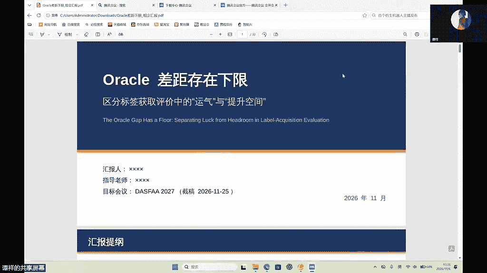

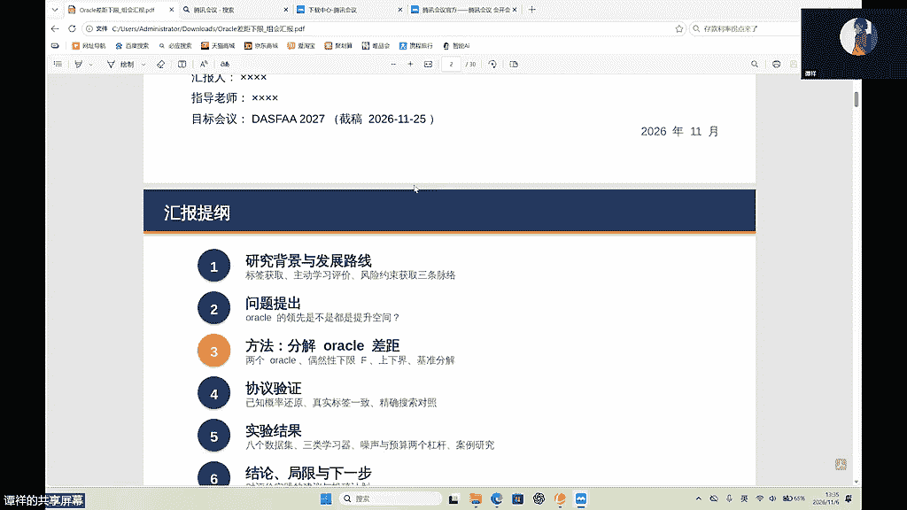

在本节课中我们将要学习主动学习的基本思想，理解为什么标签获取既昂贵又有风险，并初步认识 Oracle 预言家在主动学习中的作用。内容会尽量用大白话解释，适合完全没有相关背景的初学者阅读，后面的章节会在今日打下的基础上逐步深入。

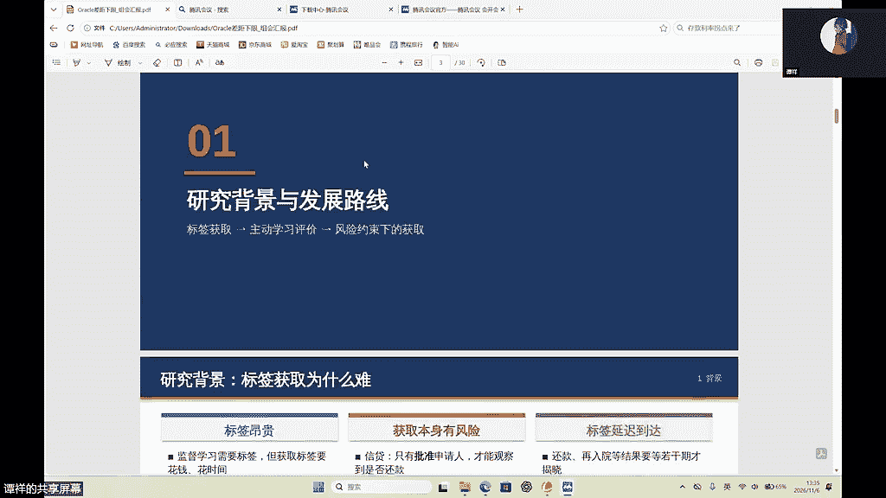

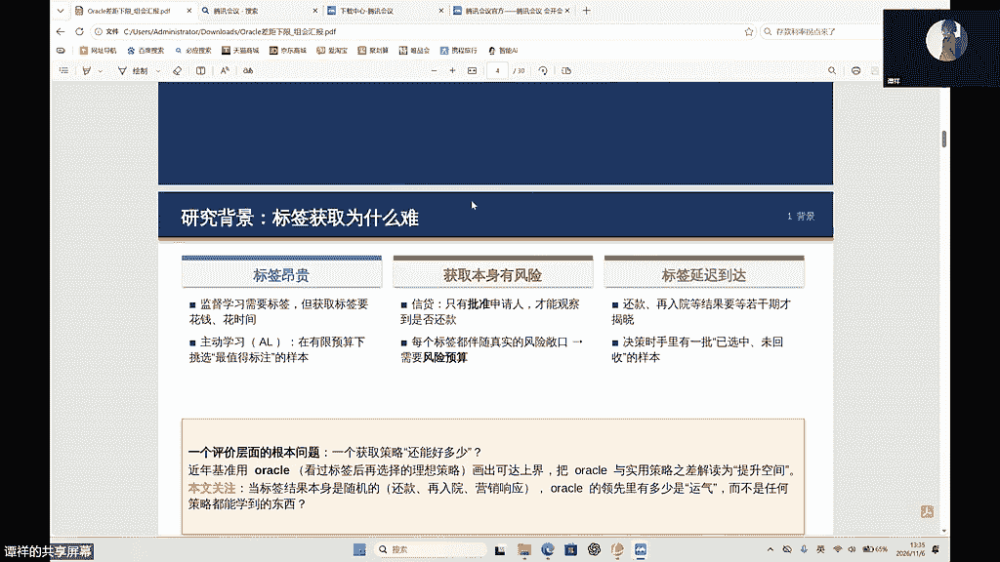

监督学习是机器学习中最常见的范式。它的核心做法是给每个数据样本打上正确的标签，然后让模型从这些带标签的数据中学习规律。比如我们要训练一个识别汽车的模型，就需要人工去查看大量图片，把每一张图片里的汽车用方框框出来，或者标注出图片中到底是什么车型。这个过程不仅需要花费大量时间，还需要支付人工标注的费用，在实际项目中往往是最大的成本之一，尤其是当数据量达到百万级甚至千万级时，人工标注的开支会变得非常惊人。

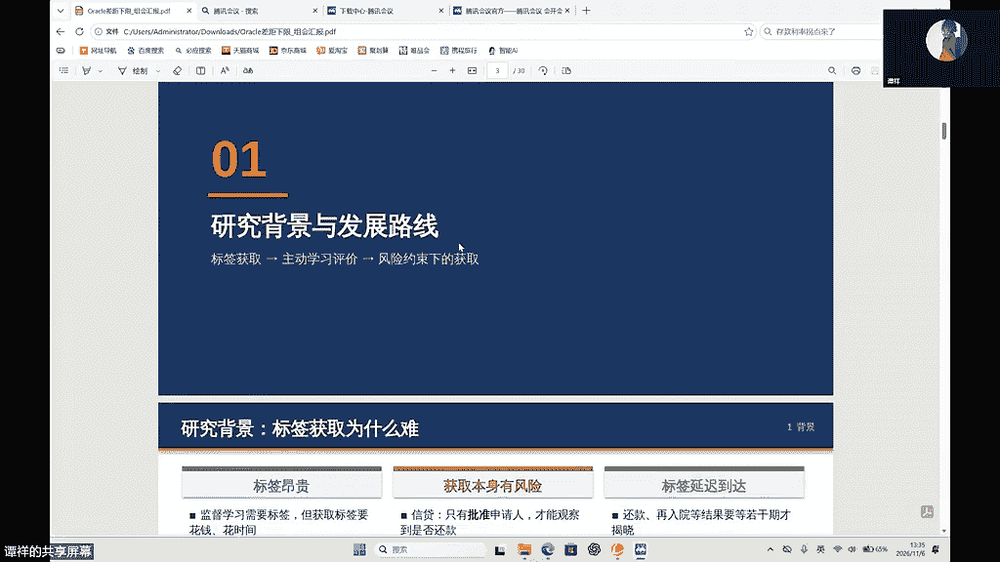

为了节省标注成本，提出了主动学习的概念。主动学习的核心思想是：在预算有限的情况下，不再盲目地标注所有样本，而是主动挑选出一小批最值得标注、对模型帮助最大的样本进行标注。用公式表示，可以把这个过程理解为在未标注样本集 $U$ 中，在预算 $b$ 的限制下选出最有价值的子集 $S$：

$$S^* = \arg\max_{S \subseteq U, |S| \le b} \text{Value}(S)$$

也就是说，我们希望用有限的钱去买最有价值的信息，让模型用更少的标注数据达到更好的效果，而不是浪费预算去标注那些模型已经很清楚的样本。

不过，标签获取本身也伴随着风险。以银行放贷为例，如果银行无法提前知道借款人是否会违约，就相当于在不了解标签的情况下做决定。贷款出去可能会损失钱，不贷款又可能少赚钱，这说明标签本身就是有价值的。更麻烦的是，很多场景下标签是延迟的，比如贷款的还款日期，或者病人出院后的复查结果，往往要过很久才能知道真实情况。这给模型评估带来了困难，我们很难立刻知道当前的选样策略到底好不好，也难以及时调整后续的决策。

为了克服这些困难，研究者引入了 Oracle 的概念，可以把它想象成一个“预言家”。假设银行里有一个预言家，他能提前知道把钱借给某个人之后会产生什么影响。我们就可以根据这个提前知道的信息，来评估不同的放贷策略，并判断当前工作还有多大的改进空间。不过，预言家并不是万能的，因为标签的结构本身是随机的。比如借钱给某个人，他不一定百分百还款；给病人开药后，他也不一定会按时复查。这意味着 Oracle 的领先优势中包含一定的运气成分，并不是每种策略都能从中学到有用的东西，评估时需要格外谨慎。

以下是本节的核心要点总结：

- 监督学习需要人工标注大量数据，成本高且耗时。
- 主动学习在有限预算内挑选最值得标注的样本，用公式 $S^* = \arg\max_{S \subseteq U, |S| \le b} \text{Value}(S)$ 描述。
- 标签获取存在风险且往往是延迟的，例如贷款违约和医疗复查。
- Oracle 可以看作提前知道标签的预言家，但其优势也带有随机性，不能完全依赖。

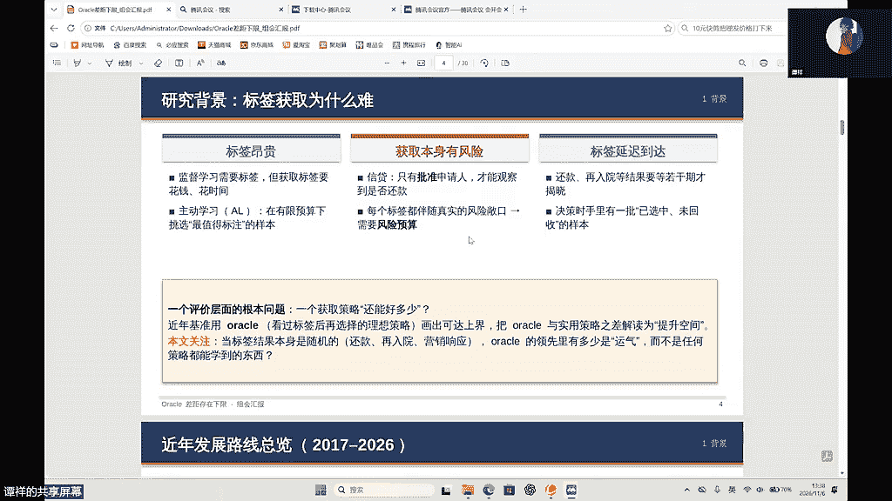

本节我们初步认识了主动学习与监督学习的区别，以及标签成本、风险和 Oracle 的基本概念。下一节我们将继续探讨 Oracle 预言家与具体的标签获取策略，看看如何在实际中把这些思想落地。

# 大模型安全与主动学习：02：Oracle 预言家与标签获取策略 🔮

上一节我们介绍了主动学习的基本思想和标签获取的风险，本节中我们来看看 Oracle 预言家是如何帮助选择理想策略，以及近年来主动学习的发展路线是怎样的，希望能让你对主动学习的研究脉络有更清晰的认识。

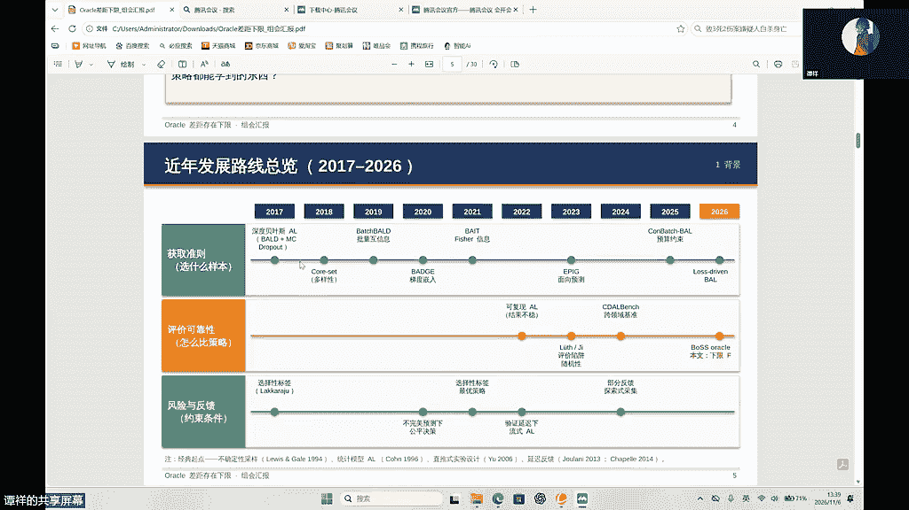

Oracle 的核心作用是提供一种理想情况下的参考标准。想象一下，如果我们在做放贷决策之前就知道每个客户的真实还款行为，那么我们就可以直接根据这些信息挑选出最优的策略，避免掉进风险陷阱。在实际中，Oracle 并不真实存在，但我们可以把它当作一个上限，用来衡量当前策略距离理想状态还有多少差距。不过需要注意，Oracle 的标签并非完全确定，因为现实世界中的结果本身就带有随机性，即使 Oracle 给出了预测，实际结果也可能因为运气因素发生变化，这正是主动学习研究中需要处理的核心难点之一。

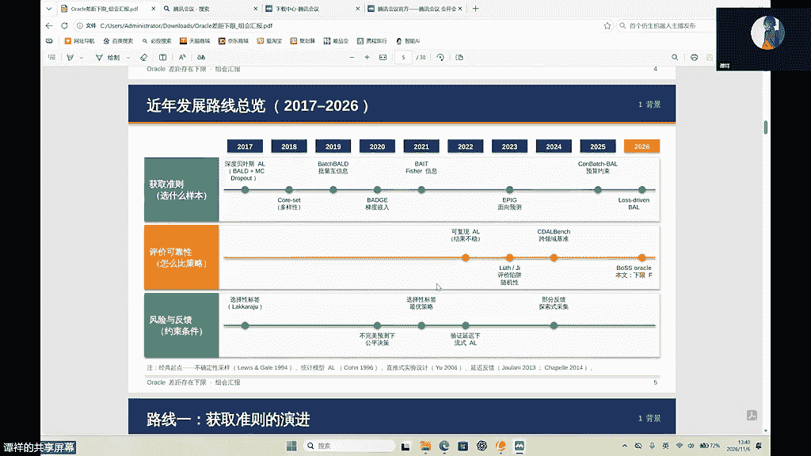

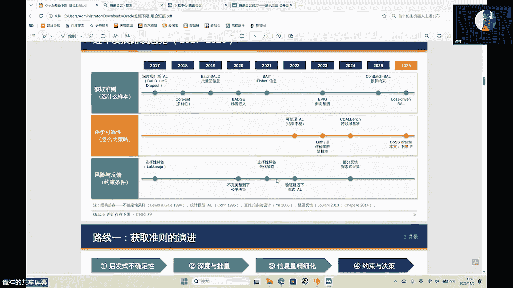

近年来，主动学习的研究经历了几个重要阶段。2017 年左右，研究者提出了基于深度学习的样本选择方法，并开始关注样本的多样性，不再只盯着单个样本的不确定性。随后，相关工作引入了 Benchmark 故障信息，并对不同领域的评估可靠性进行了讨论，试图找出哪些评估指标是可信的，哪些是容易误导的。到了近几年，研究重点转向如何决定获取哪些信息，以及如何保证所获信息的可靠性。一个常见的思路是先在一个领域（例如信贷场景）验证策略，再将其迁移到其他领域（例如医疗场景），观察策略是否依然有效。本文中提出的“over 下限 AF”方法，就是在这一背景下试图给出更具体的解释，后面章节会详细展开。

除了基本的选择性标签，研究还涉及风险约束和反馈机制。例如，在批量发放贷款时，我们可以先给一部分人贷款，观察他们的反馈情况，再决定后续采取什么样的策略。这种部分反馈的设置更贴近真实业务，但也带来了新的挑战，比如只有被批准的样本才有标签，而被拒绝的样本则失去了观察其真实价值的机会，这会导致数据偏差，进而影响模型的公平性和准确性。

以下是本节涉及的关键概念列表：

- Oracle 预言家：提供理想情况下的标签参考，用于衡量策略与最优策略的差距。
- 标签随机性：现实结果存在不确定性，Oracle 的优势包含一定运气成分，不能视为绝对真理。
- 跨领域迁移：在信贷场景验证后，尝试将策略迁移到医疗等其他场景，检验策略的通用性。
- 部分反馈：先对部分样本进行干预，根据反馈再调整批量决策策略，降低一次性决策的风险。

本节我们梳理了 Oracle 预言家的作用、标签的随机性，以及主动学习从早期到近年的发展脉络。下一节我们将重点讨论不确定性采样和样本多样性等具体的标签获取准则，看看如何在实际操作中挑选样本。

# 大模型安全与主动学习：03：不确定性采样与样本多样性 🎯

上一节我们介绍了 Oracle 预言家与标签获取策略，本节中我们来看看如何在实际中挑选具体的样本进行标注，以及为什么不能只关注模型的不确定性，而需要同时考虑样本之间的多样性。

最早的标签获取准则之一是不确定性采样。它的直觉很像老师在批改作文时，会特别关注自己拿不准的那篇文章。在机器学习中，如果模型对某个样本的预测概率接近 0.5，就说明模型非常犹豫，这个样本被认为是最不确定的。用公式表示，二分类情况下的不确定性可以用熵来衡量：

$$H(y|x) = -\sum_{y} p(y|x) \log p(y|x)$$

当 $p(y|x) = 0.5$ 时，熵取得最大值，模型最不确定。不过，不确定并不一定等于有价值。有些样本虽然不确定，但可能本身就带有很强的随机性，标注它们未必能帮助模型学到普遍规律。例如在贷款场景中，一个违约概率接近 0.5 的客户，确实充满随机性，但如果我们完全放弃这类样本，就可能丢失重要的决策边界信息。因此，我们既不能盲目标注所有不确定样本，也不能随意忽略它们，需要更细致的判断。

为了区分“模型参数的不确定性”和“标签本身的随机性”，研究者提出了 BLAD 方法。BLAD 的核心思想是，只关注那些能够消除不同模型或不同策略之间分歧的标签。也就是说，如果两个模型对同一个样本的预测已经一致，那么标注这个样本的价值就不大；如果它们意见分歧很大，标注这个样本就能帮助我们找到更正确的方向，减少模型之间的歧义，提升整体决策质量。

在实际应用中，我们通常一次需要标注一批样本，而不是只标注一个。如果选出来的样本彼此非常相似，就会浪费标注预算，因为这些样本提供的信息高度重复。为了避免这种情况，研究者扩展了相关思路，提出了如 Ba Bell 和 Coreset 等方法。Coreset 的核心是考虑梯度空间中的样本覆盖范围，既要保证不确定性，又要保证样本多样性，避免一次性选出大量标签相似的人。它希望挑选出尽可能不同的样本，让我们从每一轮标注中获取更多有用的信息，提高预算的利用率。

除了以上方法，还有一个名为 EPIG 的准则。EPIG 只关心目标分布，也就是说，它关注获取某个标签后，是否能更准确地预测我们真正关心的目标分布。如果一个标签对最终目标没有帮助，那么即使模型很不确定，EPIG 也不会优先选择它，从而避免浪费标注预算在无关紧要的样本上。

以下是本节介绍的主要标签获取准则：

- 不确定性采样：优先选择模型预测概率接近 0.5、最犹豫的样本，用熵 $H(y|x)$ 衡量不确定性。
- BLAD：区分模型参数不确定性与标签本身随机性，关注能消除模型分歧的标签。
- Coreset / Ba Bell：在梯度空间中兼顾不确定性与多样性，避免选取过于相似的样本批次。
- EPIG：只关注标签对最终目标分布预测的帮助，而非单纯的模型不确定性。

本节我们学习了不确定性采样、BLAD、Coreset 和 EPIG 等具体准则，理解了如何在不确定性和多样性之间取得平衡。下一节我们将讨论主动学习评估中的陷阱，以及部分反馈和延迟反馈的问题，这些是实际落地时必须面对的挑战。

# 大模型安全与主动学习：04：评估陷阱与部分反馈 ⚠️

上一节我们介绍了不确定性采样与样本多样性，本节中我们来看看主动学习评估中常见的陷阱，以及部分反馈和延迟反馈带来的挑战，帮助你避免在实际项目中走弯路。

主动学习的评估并不像想象中那么简单。近年来的研究指出，主动学习其实非常脆弱，我们挑选的那些“最有意思”的样本，并不一定能让预测变得更加准确。有研究甚至提出“随机性是万恶之源”，指出不受控的随机性会颠倒不同策略的排名。例如，有人构造了一个贪心的在线学习算法，结果发现它在测试集上过拟合，无法迁移到其他场景中。这说明，在一个领域表现很好的策略，放到另一个领域可能就失效了，评估结果如果不够严谨，很容易得出错误结论。

造成这种困难的一个原因是标签组合的数量呈指数级增长。比如有四个人、四种标签，可能的组合就有 $4^4$ 种。当样本量变大时，我们不可能对所有组合都进行穷举求解，只能采用贪心策略，从局部最优出发试图逼近全局最优。但贪心策略往往容易在测试集上过拟合，导致评估结果不可信，不能反映模型在真实场景中的表现。

为了更客观地比较不同策略，研究者提出了跨领域基准，比如 ca bench。它用来衡量标注可达性，结果表明，在信贷场景下有效的策略，可能在医疗场景下完全不适用。此外，Boss 等工作还指出，在对比策略时，我们到底应该和什么比较，以及看不见的标签该如何处理，都是悬而未决的问题，需要更严谨的实验设计来回答。

另一个重要问题是理想收益与现实收益之间的差距。我们不能仅仅根据理想情况下的最高收益，来决定下一阶段的选样策略。因为初始化随机性、训练协议等细节，都会改变不同算法的排名，导致评估结果不稳定，甚至让表现平平的算法看起来像是最优选择。

在实际业务中，往往还存在部分反馈和延迟反馈。部分反馈意味着只有被批准的样本才有标签，被拒绝的样本就失去了观察其真实价值的机会，这会导致选择性偏差。延迟反馈则是指，贷款还款或医疗复查结果可能要隔几个月才能出来，这使得算法难以及时获得反馈并进行优化，反馈周期越长，模型调整越困难。早期的研究（如 2004 年到 2024 年间的 SCMSIM 工作）就关注过被拒绝样本中的结构缺失偏差，试图从这些被我们拒绝的人身上挖掘潜在价值，避免因为数据缺失而做出错误决策。

以下是本节涉及的主要评估挑战：

- 主动学习脆弱性：挑选“最有意思”的样本不一定提升预测准确率，评估需谨慎。
- 随机性干扰：不受控随机性可能颠倒策略排名，导致评估不可靠。
- 指数级标签组合：样本量大时无法穷举，贪心策略容易过拟合测试集。
- 跨领域差异：信贷场景的策略不能直接迁移到医疗场景，需分别验证。
- 部分反馈与延迟反馈：只有批准样本有标签，且真实结果往往滞后数月。

本节我们梳理了主动学习评估中的常见陷阱，以及部分反馈和延迟反馈的实际困难。下一节我们将介绍期望价值的概念，并给出本工作的方法总览，帮助你从理论角度理解主动学习的收益来源。

# 大模型安全与主动学习：05：期望价值与方法总览 📊

上一节我们讨论了评估陷阱与部分反馈，本节中我们来看看期望价值如何帮助决策，以及本工作的整体方法框架，把前面提到的各个概念串联起来。

在决策之前，一个经典的概念是“完全信息的期望价值”。简单来说，就是如果我们在做决定之前就知道所有未来的标签和信息，那么平均能获得多少收益。这就好比在买彩票之前突然知道了开奖号码，虽然这在现实中不可能，但可以作为一个理论上的上限，帮助我们衡量当前决策与理想决策之间的差距。不过，这个概念已经比较老旧，本工作将其改造为更贴合实际的形式：不是要求完全一致的信息，而是通过提前预知部分情况，来估算决策的潜在收益，使其更符合实际业务场景。

这里需要区分“事前”和“事后”的标签信息。如果我们事先决定买哪个标签，然后才能看到结果；或者先看完所有结果，再回头去选标签，这两者的期望收益会有显著差异。事后挑选的最好集合往往包含运气成分，因此事前与事后的差异会造成较大的期望损失。本工作的一个创新点，就是把“偶然性下线”定义为所护标签的完全信息价值，并给出了不依赖于特定分布的上下界，用于说明基准方法的领先优势到底来自哪里，而不是盲目相信实验结果。

为了验证这些理论，研究者采用了特定的测量协议：在不相交的数据基础上拟合结果模型，生成标签副本，构建半合成数据。在半合成数据上还原一致的概率，并在真实标签上验证结果是否一致。当标签数量很少、样本规模较小时，可以通过穷举搜索和启发式搜索得到相同的分解结果。实验发现，将逻辑回归数据与三类学习器结合后，下游任务几乎可以达到实质性的最优水平，而其占比会随着标签噪声和预算的增加而上升。这说明，谁能赢得剩余差距，最终取决于所使用的学习器，而不是单纯依赖某个标签获取准则。

本工作采用的“3D 学习器”组合包括逻辑回归、XGBoost 和一个小型的多层感知神经网络（MLP）。方法的总览可以分为四个步骤。第一步，学习者在有限的风险预算内批准一批候选人，并获得后续的标签。第二步，构建两两对比的 Ocel，一个基于期望进行选择，另一个是在看见所有标签后再进行选择。第三步，将报告差距拆解为三种来源：一是测试集随机结果带来的偶然性优势，二是当前信息条件下可以争取的部分，三是其他剩余因素。第四步，利用上下级结果模型的敏感性分析和精确搜索，验证获得的期望收益是否可信，避免被偶然因素误导。

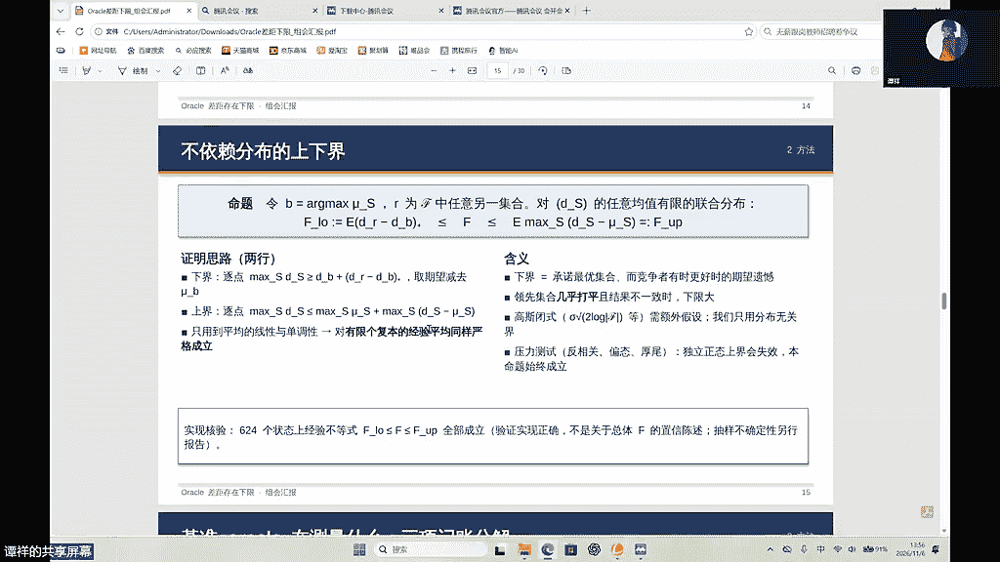

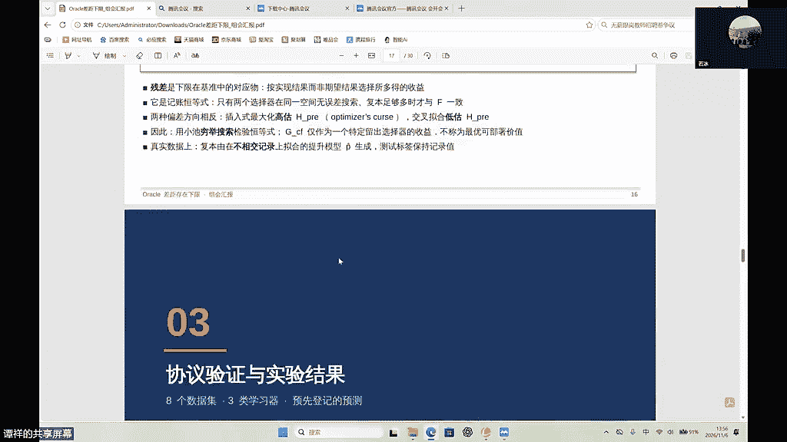

具体的问题设定可以用下述符号说明：学习者已经拥有已标注的数据集 $D$，但标签尚未到达；候选集为 $O$，候选车辆或样本集为 $C$，目标协变量为 $Q$。在选择某个样本后，才能观察到结果 $YA$ 和相关风险。最终效果通过在 $DOC$ 数据集上拟合后的分数来衡量，这个分数反映了模型在当前策略下的实际表现。

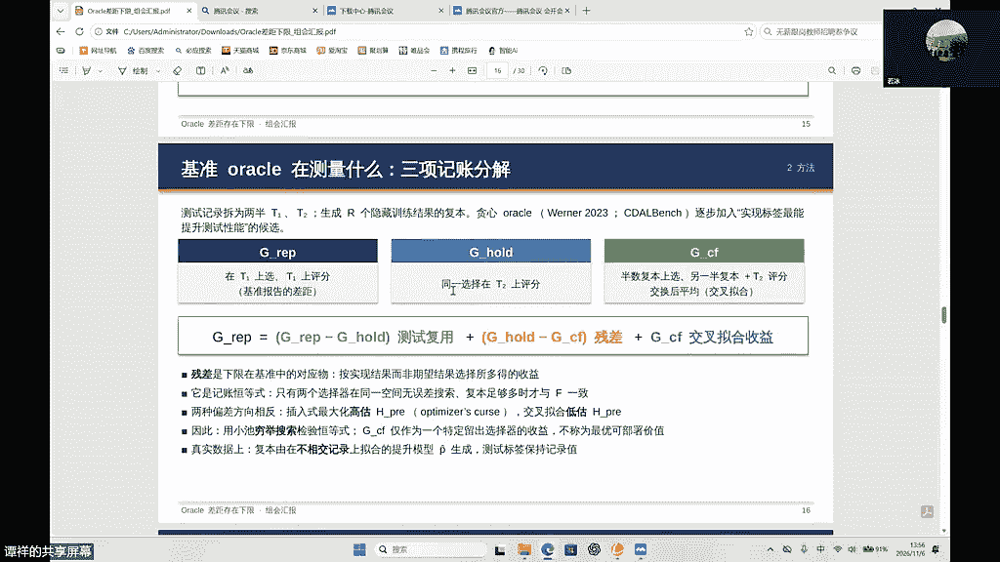

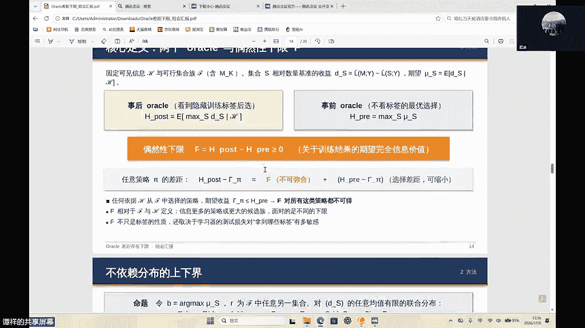

以下是本节的核心内容总结：

- 完全信息期望价值：假设提前知道所有标签，估算理论上的最大收益。
- 偶然性下线：定义所护标签的完全信息价值，给出不依赖分布的上下界。
- 测量协议：基于不相交数据拟合模型，构建半合成数据进行验证。
- 3D 学习器：逻辑回归 + XGBoost + 小型 MLP 神经网络。
- 四步方法：风险预算内批准候选人、构建双向 Ocel 对比、拆解报告差距、敏感性验证期望收益。

本节我们介绍了期望价值的核心思想，并给出了本工作的完整方法框架。下一节我们将转向大模型安全，讨论数据投毒和对抗性扰动等实际安全问题，这些与主动学习一样，都涉及数据和模型的可信度。

# 大模型安全与主动学习：06：大模型安全与数据投毒 🛡️

上一节我们介绍了期望价值与方法总览，本节中我们来看看大模型安全领域的常见威胁，特别是数据投毒和对抗性扰动是如何影响模型训练的，帮助你理解模型安全与数据质量之间的关系。

大模型安全通常涉及越狱、后门攻击和对抗式训练等方向。目前来看，这方面的研究有时让人感觉像“自娱自乐”，因为似乎很少有人会专门去攻击模型训练过程。不过，模型安全确实非常重要，因为它直接关系到模型训练的最终结果。以云服务商或大型 AI 公司为例，它们在内部训练模型时，外部黑客很难直接进入系统投毒，但这并不意味着数据投毒不存在。目前已知的唯一公开投毒案例，就是字节跳动通过数据投毒的方式影响模型训练，这提醒我们数据来源的可信度至关重要。

要理解数据投毒，首先要了解机器学习最常用的优化方法——梯度下降。梯度下降的目标是找到损失函数下降最快的方向，从而使模型达到损失最小的状态。用公式表示，参数更新规则如下：

$$w_{t+1} = w_t - \eta \nabla L(w_t)$$

如果攻击者能够向训练数据中注入一批投毒数据，就可能让梯度下降的过程偏离原本的方向。模型不再朝着损失最小的期望方向更新，而是朝着偏差最大的方向更新，从而导致预测结果出错，甚至模型学到完全错误的规律，这在安全敏感场景中后果非常严重。

举一个直观的例子。假设我们在训练一个天气预报模型，输入历史气温、湿度等参数，期望模型输出今天是阴天还是晴天。如果攻击者对训练数据进行投毒，模型学到的参数方向就会发生改变。原本应该预测阴天的结果，可能被改为输出大晴天。用户看到天气预报说是晴天，出门没带伞，结果却下雨了，这就是数据投毒带来的实际后果，看似是小问题，实际可能造成不便甚至损失。

另一个更可怕的例子出现在计算机视觉领域。当我们用卷积神经网络训练视觉模型时，如果对训练数据施加极其微小的扰动，就可能导致模型产生巨大的偏差。这主要是因为模型参数量非常大，微小扰动在累积后会被放大。例如，如果某个参数原本是 1，我们给它加上 0.1 的扰动，并在所有参数上都做同样的操作，计算后可能会发现累积误差达到了好几百，这说明小的数据污染可能被模型放大成巨大的预测偏差。

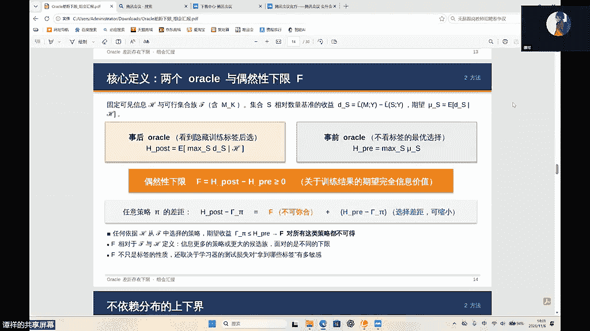

在自动驾驶场景中，这种后果尤为危险。原本模型能正确识别行人是行人，但如果攻击者在行人图片中加入一点点恶意的微小扰动，比如几个不易察觉的黄点，模型可能就会把行人误判为凳子、猪、鸡、狗、鸭，甚至是飞机。如果自动驾驶系统无法正确识别行人，可能会引发严重的交通事故，危及生命安全，这不再是简单的模型错误，而是真正的安全威胁。

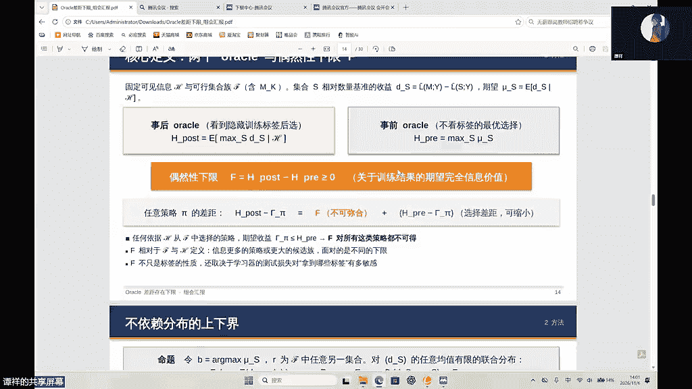

以下是本节介绍的主要安全威胁：

- 数据投毒：向训练数据注入恶意样本，使梯度下降偏离正确方向，用 $w_{t+1} = w_t - \eta \nabla L(w_t)$ 描述正常更新。
- 对抗性扰动：在输入数据中添加微小扰动，导致模型产生巨大预测偏差。
- 天气预报案例：投毒后模型把阴天预测为晴天，导致用户决策失误。
- 自动驾驶案例：微小扰动使模型把行人误判为无机物或动物，带来安全风险。

本节我们介绍了大模型安全中的数据投毒和对抗性扰动，并用天气预报和自动驾驶的例子说明了其潜在危害。本教程的所有内容到此结束，希望这些知识能帮助你建立起对主动学习和大模型安全的初步认知。

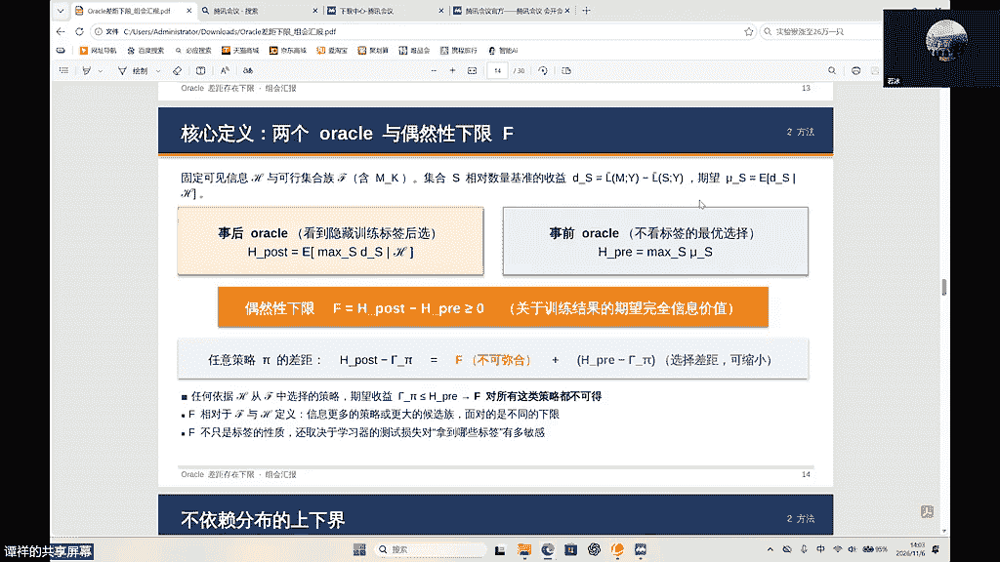

本节课中我们一起学习了主动学习的基本思想、Oracle 预言家与标签获取策略、不确定性采样与样本多样性、评估陷阱与部分反馈、期望价值与方法总览，以及大模型安全与数据投毒。希望这些内容能帮助你建立起对相关领域的初步认识。如果你后续要分享 PPT，建议对具体的实验结果和模型框架进行打码处理，只讲解核心思想，以保护科研隐私。欢迎大家继续交流探讨，也可以尝试一起进行相关的投稿和合作，把今天学到的内容应用到实际研究中去。

