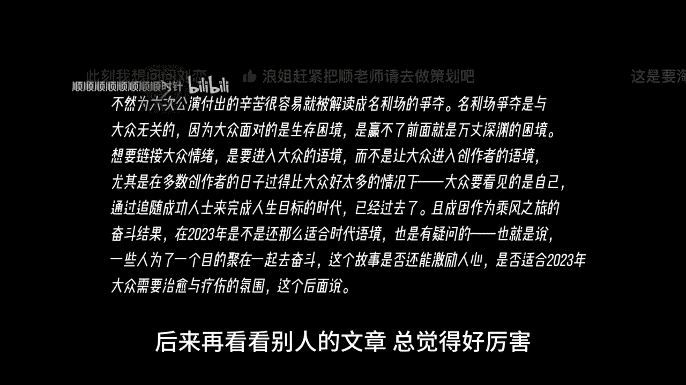
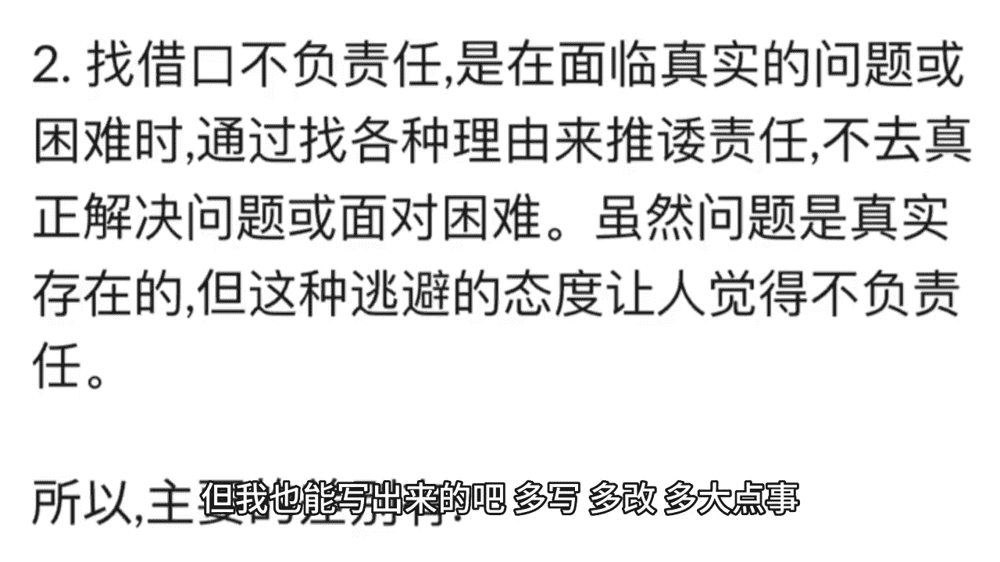

【Datawhale AI+X】差点断卡打卡：找回对自己的掌控感：01：找回掌控感的第一步 📝

在本节课中，我们将学习如何在感到想要放弃的时候，重新找回对自己的掌控感，以及如何面对焦虑、备考和写作中的挫败情绪。

---

### 不加班的晚上与健身房的抵触心理

上一节我们介绍了课程的整体目标，本节我们先来看看不加班的晚上容易遇到的问题。

很多时候，晚上不需要加班，原本可以利用这段时间去健身房锻炼。但是因为已经很久没有去，心里会产生抵触情绪，觉得不太愿意动身。可一旦真的鼓起勇气去了，会发现并没有想象中那么困难。尤其是在快要放弃的时候，如果能咬牙坚持下来，看到一点点进步，心里就会涌现出满足感。不过最近的情况是，越来越难以坚持下去了。

$掌控感 = \frac{坚持完成的次数}{计划尝试的次数}$

---

### 焦虑、内耗与自我否定的应对

了解了健身房的心理建设之后，我们再来看看焦虑和内耗是如何影响我们的。

焦虑往往会让我们产生一种错觉，觉得自己能力很差，或者开始陷入自我内耗。这种感觉通常源于节奏感的丢失，或者觉得自己无法攀登更高的目标，从而导致自我否定和害怕。面对这些情绪，我们需要提醒自己慢慢来，就像吃饭一样，一口一口地解决，而不是试图一次性吞下所有困难。

```python
def 应对焦虑():
    接受节奏感暂时丢失
    拒绝自我否定
    分解目标为小步骤
    一口一口吃完当前任务
```

---

### 生活碎片中的情感连接

调整好心态后，我们也要关注生活中的小瞬间，它们能给我们带来力量。

从健身房走回家的路上，可能会遇到一些温暖的画面。比如看到一位女生抱着一只又冷又机灵的小奶猫，或者听到路边热闹的人声，也会经过只有几个人安静行走的路段。回到家之后，跟家人视频通话，这些平凡的时刻会让人忽然觉得生活还是有温度的。

以下是生活中容易被忽略的温暖瞬间：

- 街头抱着小奶猫的女生
- 跟父母的视频通话
- 热闹与安静交替的回家路上

---

### 备考刷题与专注力的建立

生活碎片能给我们情绪价值，但备考和刷题仍然需要我们正面直面。

有时候并不想刷题，但既然在备考，就必须鼓起劲头。关键在于如何让自己更专注，而不是只是浮在表面。哪怕文章被退稿，也不要觉得是大事，更不要让这件事情打乱自己的节奏。

$专注度 = \frac{真正投入刷题的时间}{备考总时间}$

---

### 写作退稿与表达清晰的方法

专注力解决了一部分问题，但写作时的表达清晰同样重要。

写作的时候，如果一开始就没有想清楚想要表达什么，文章容易显得散乱。后来看别人的文章觉得写得很好，其实自己也能写出来。方法很简单，就是多写多改，不要把退稿看得太重。哪怕一天里加过班、看过明星大侦探、吃过螺蛳粉，时间也会一天一天过去，关键是要坚持写作练习。

```text
写作流程：
1. 明确想要表达的核心观点
2. 先写初稿，不要求完美
3. 多次修改，删除冗余表达
4. 接受退稿反馈，继续改进
```

---



### 碎片时间与周日专项计划

平时的碎片时间虽然有限，但周日可以拿出来集中精力处理重要任务。

平时可能因为各种事情比较忙碌，只能利用碎片时间。但是周日可以专门拿出一天，好好安排来刷题。不要总是说加油，而是要把加油变成实际的行动计划。



以下是周日刷题计划的简单安排：

- 早晨固定时间开始刷题
- 中途适当休息，避免疲劳
- 下午检查错题并总结
- 晚上复盘当天的学习成果

---

本节课中，我们一起学习了如何在不加班的晚上重新去健身房，如何面对焦虑和内耗，如何从生活小瞬间中获得力量，如何提升备考时的专注力，如何处理写作退稿，以及如何利用周日集中精力刷题。希望这些内容能帮助你找回对自己的掌控感。

