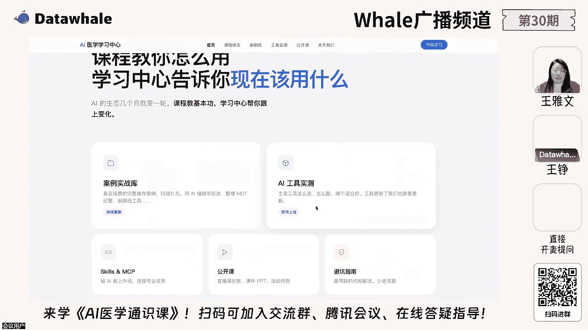
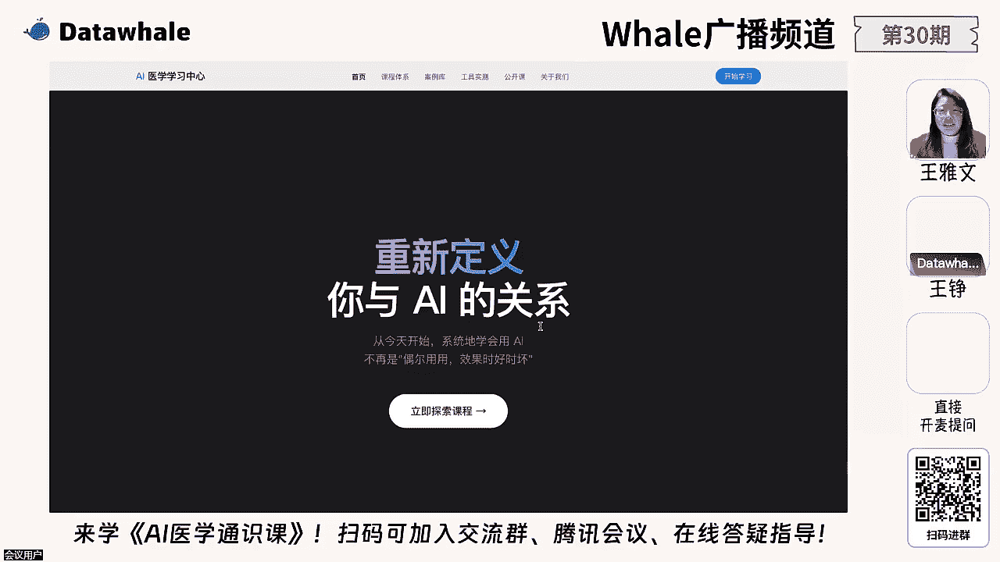
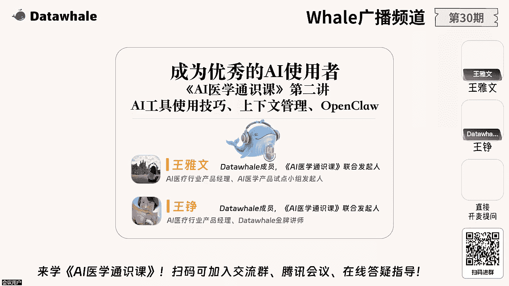
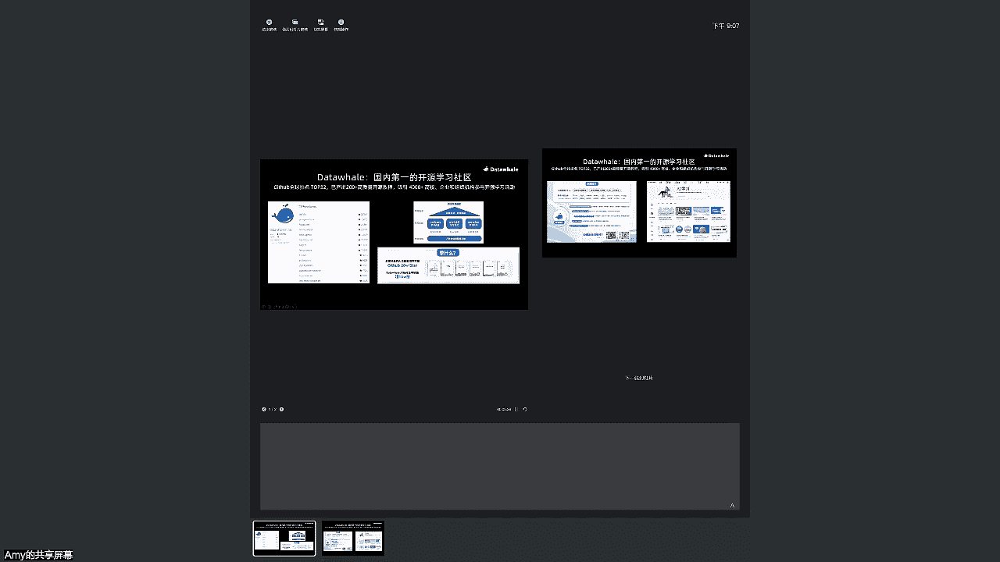
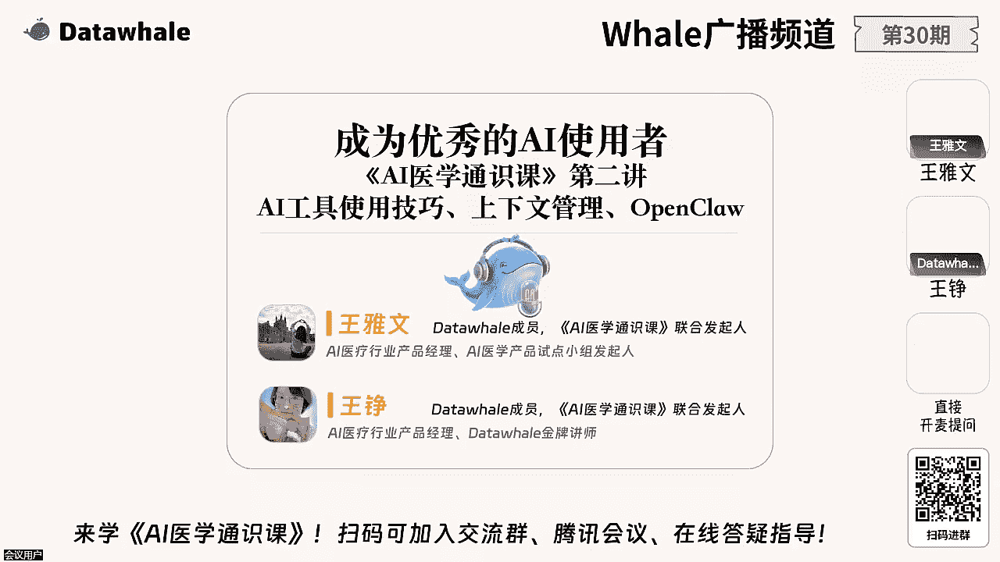

# 成为优秀AI使用者：通识课：01：你与AI的关系 🤖

在本节课中我们将要学习如何建立正确的人机协作观念，以及AI在医疗工作中能够扮演的不同角色。

这场直播是vivo广播的第三期，也是AI医学通识课的第二讲。今天特别邀请到了亚文老师和王真老师，他们都是AI医疗行业的一线产品经理，拥有丰富的医学实际场景经验，能够给大家分享很多实用的内容。如果大家对这个课程感兴趣，可以扫描右下角的二维码加入课程交流群。如果想要犀利地批判或者评价课程，可以加入瑞屏群。如果希望帮助大家一起更好地共创共建AI医学通识课，可以加入共建群。大家可以根据自己的意愿和想法选择进入对应的群组。

在课程开始前，我们先做一个简单的用户调研。如果是上一次看过我们直播的老观众，可以在直播间或者聊天记录里打一个一。上一期的直播是面向医学生和医疗从业人员的人工智能原理课。第二个调研是想了解大家现在的身份。如果是完全没有技术背景的正式医生或医学生，可以在评论区或直播间打一个111。如果是和亚文老师一样的同行，从事AI产品开发研发，或者是正在学校就读未来想往这个方向发展的开发者，可以打一个22。剩下的只是围观的朋友，可以打666。这个反馈有助于我们后续聚焦内容。

我们为什么要做这个课程和学习中心呢？其实我的初衷很简单。现在已经是2026年了，大家肯定都听过AI，也肯定都用过AI，但很多人会停留在只是体验一下，觉得效果时好时坏。我看过一些课程，要么教得太深，上来就是机器学习、高数、先行代数，太难了；要么教得太浅，只告诉你AI是什么，停留在科普阶段，不够实用，拿来急用不知道能解决什么问题。因为我本身是医疗行业的产品经理，我觉得有一些结合工作场景的例子，会更容易被大家听懂。所以我希望我们的课程例子都跟医疗相关。我们要做的课程体系只是基础，只让大家先知道有这么个事儿，然后觉得还挺好的。

我们的教学方法是PPL，也就是以问题为导向。我们讲的每一节课都是以一个问题为驱动，为什么会这样，怎么就这样了，然后你了解了有这么个事儿，最后可以带走一个能够直接用的东西。后面会有关于流程设计的内容，稍微难一点，但是提效性很好，再到后面可以有一些与编程相关的内容。

我们为什么要做这个学习中心，也是希望能够帮助大家跟上AI的变化。也许两年前我们还教大家怎么写提示词，今天可能只需要提一下大概怎么写就好了。因为有更多好用的工具和应用出现了，AI本身的能力和技术也在发展。所以现在你可以用哪些东西，我们可以在这里看到。

我们希望大家感受到的是，你和AI关系的重新定义，而不是从今天开始偶尔用用，觉得它效果是好是坏，而是系统性地去使用AI。所以今天第一节的内容，就是关于你与AI的关系。

当前在人机写作的过程中，你到底要把AI当成一个什么？大家最常用的就是搜索引擎，用豆包或DeepSeek，问一个问题，比如这个菜怎么做，或者去哪儿帮忙规划路线，这都是把它当成搜索引擎，当成一个小助手。想象到现在，AI真正发展到什么程度了，它能够跟我们协作到什么程度呢？

我给大家举一个场景。比如说你要给科室做一个汇报。第一种用法，你打开了一个AI工具，但是写得很泛，只让它帮你写个汇报，它会给你一个非常泛泛的模板，但你觉得好像用不了，跟你的实际情况不太一样。第二种用法，你把你本周的一些工作记录扔给它，然后写了一些要求，你会发现它会给你一个还不错的初稿，你改改就可以用了。第三种用法，你告诉AI这个科室的一个情况，让它帮你分析原因，以及在汇报中怎么呈现这个数据。AI给了你不同的分析角度，你选了一个合适的。这是三种用法，大家可以看到，不同的用法效果是不一样的。

从这件事上来看，我们发现这是同一件事情，其实给AI的信息越具体，它的产出就越有效。这多在于把你想提的方向提清楚了。比如给的工作记录比较详细，方向也很清楚，希望它给出的是一个有洞察力的汇报，而不是泛泛的工作汇报，那么AI就可以给到你不同的分析角度。在第一种模式下，我们只是想让它给我们干活。第二种模式是给了它一个具体的工作内容，把它当成一个大脑，然后人来继续执行。现在比较好的模式，是把它当成一个共同协作的模式。有时候你也没想好，但可以问问它，看看它有没有更好的想法，然后跟你一起去协作这件事情。

下面有一些常见的例子，就是大家在工作中可能用到的。

- 最简单的用法，让它帮你润色、做会议纪要、整理表格，这些简单的任务，AI定一个方向就能干了，现在执行效果也都很好。
- 第二种是AI当大脑，就是你知道要做什么，但不太确定怎么做。比如写一个国自然基金申请，你不太知道，但AI知道，你要给它一个任务，让它去发挥，你要相信现在很多AI已经很聪明了，不要逐一地把一些要求写得很详细，你就告诉它，有这么一件事，你看看你想怎么干，给我一些方向。
- 第三种是把它当成一个外挂，也就是把它当成一个很好用的大脑。在这种模式下，很多时候AI就变成一个导师，好像在指挥你，你是学生。

AI使用效果 = 输入信息的具体程度 × 任务拆解深度

无论采用哪种方式，核心原则都相同。你给AI的信息越具体，它产出的结果就越有效。你需要清楚地告诉它你想要什么方向，而不是模糊地要求它写一个汇报。同时，使用AI时不能过度依赖而停止思考。当你觉得AI无所不能时，容易忘记自己真正想要的是什么。只有先确定好目标方向，AI才能帮你出更多方案，或者以你意想不到的路线更快达到目标。最危险的不是AI给出了错误答案，而是你被它牵着走，失去了独立思考的能力。

有一个非常简单的方式，就是当你知道要做什么，你又知道怎么做，这个就非常简单了。但是如果你知道要做，你不知道要做什么，这个时候AI其实是帮不了你的。无论有哪种模式，上来最重要的是你要知道你要做什么，这件事情是非常重要的。虽然AI变得很聪明，但我们不能只把AI当成一个外挂之后，自己不再思考了，而是更多地想一想AI到底应该怎么帮你，变得更加的重要。

这里有一个提醒，就是我自己平时的感悟。不要过度依赖它而停止真正的思考。当你觉得AI无所不能的时候，你就会过于依赖它，而忘记你自己想要的到底是什么？只有你确定好我想要的方向是哪里，AI是给我出更多的方案，然后让我以更快的速度，或者说是以我没有想到的路线达到我的目标，就可以了。所以我觉得用AI最危险的，不是他给了你一个错的答案，而是让你觉得你再思考，其实你已经被他牵着走了，这个是我觉得非常危险的一件事情。

后面我们会从提示词工程、上下文工程，还有任务拆解等环节，给大家演示一下。以后有机会可以线下带着大家去实操。另外会有一个今天的番外篇，讲一讲关于养龙虾的事情。这个养龙虾的事情，我会把前面这三两个先讲完，因为它们都是有关联性的。

---

# 成为优秀AI使用者：通识课：02：提示词工程 📝

上一节我们介绍了你与AI的关系，本节中我们来看看如何通过提示词让AI更好地理解你的需求。

提示词的本质是把你脑子里的信息转移给AI。很多时候我们写不出来，跟AI脑爆也脑爆不出来，很大情况下是因为我们对这个领域的认知不够。当你对这个领域认知不够的时候，你就抄那些已经在这个领域有认知、沉淀下来的人写的知识就可以了。所以你去专门学怎么写好提示词，那都是一些方法论，其实没有必要。你只需要知道你要把你想要的东西传达出来，或者你跟AI一起讨论出你想要的东西就可以了。这就叫提示词。你能够把这个问题提出来就可以了。

在写提示词的时候，要写得比较详细，要明确自己的需求，给到AI的指令更加准确，这件事就能干的更好。两年前我讲提示词的时候，就是这么讲的。但今天我有一些不一样的讲法，就是我们在跟AI沟通的时候，可以尽量用一些疑问性的提示词，而不是确定性的提示词。

确定性的提示词，就是把角色、背景、任务都讲得很清楚，然后告诉它要怎么写。现在有一个比较好用的技巧叫疑问性的提示词，就是我想做一个什么事情，你看看你要怎么做，你有没有什么好的方法去做。比如说我要给科室主任汇报本周的患者情况，然后我手里有什么什么东西，我不知道应该怎么汇报。然后你有没有什么好的方案，然后能不能把这些方法给我沉淀下来，下一次下周汇报的时候，你依然用这种方法帮我做就可以了。你会发现，再去提这样的提示词的时候，是一个带着疑问性的提示词，疑问性的要求再跟他说。当你说这些的时候，他就会自然内化成一个技能的东西了。然后后续他就会帮你自动去调用这件事情。

当然，不是说不让你用任务。就是你要很明确的时候，我还是希望大家有这种非常规范的格式，因为它能更稳定。就你希望他更稳定的输入的时候，大家有很规范的格式。但还有很多种情况的时候，是你不知道的时候，或者你不确定的时候，就多用疑问性提示词。

如果你知道AI不知道某些背景信息，你就需要给到他更多的背景信息，这也是我们希望AI变得更懂我们或者更聪明的一个关键。就是你要把那些他肯定不知道的细节要给到他。比如说今天的一个什么情况，最最新的一些事实的情况，就比如说你们比较个性化的一些要求，什么格式，什么模板。然后你这个东西到底是给什么人用，什么时候干嘛用的，就是非常具体的东西，你要把这些事情给到他，而不是一些泛泛的。越具体，他会越细。

如果你不会写规范的提示词，没关系，你可以先给他脑爆。我要写一个什么东西，比如说像这个吧，这是比较好，比较常见的，我要写一个患者的科普材料。然后我想写一个规范的提示词，然后我面向的是什么什么基层的或者是社区医院的老年人的一个情况。然后你帮我写一个按这个角色背景任务，规范格式的提示词也可以。大家在用这些东西的时候，一定要让他灵活的去用起来。

---

# 成为优秀AI使用者：通识课：03：上下文工程 🧠

上一节我们介绍了提示词工程，本节中我们来看看为什么AI有时会像金鱼一样记忆力很差，以及如何管理上下文。

为什么AI有的就像一个金鱼记一样，记忆力这么差？前面聊着聊着，前面说就忘了。很多人就会有这种问题，就是我已经跟他说了，你要记住我刚才说的，你怎么就记不住？明明刚才刚跟你说过，你怎么又忘了？其实AI的记忆力比较差，就是因为这个上下文工程。因为你可以理解为他给了他大量的东西，你给了他一本红楼梦，他很难把一本红楼梦里边所有东西都能理解的好。所以当我们想开启一个新任务的时候，或者说不需要他上海文的时候，我们就要及时开启一个新的对话。这是我们在用平时不管是豆包、DeepSeek这些通用工具的时候，要考虑的点。

之前我们有讲到token的概念。token就是字节嘛，你就可以理解为就是文字这些东西。当AI能看，也就是说这个模型能够同时看到的token的总量是有限的。那个总量就叫上下文的窗口，就可以理解为AI的上下文窗口就是一张工作的桌面。你跟他说的每一句话，他回复的每一段字，然后你扔进去的东西都在这张桌子上。当这个桌子的面积是有限的，当这个桌子上被堆满了之后，最早放上去的就会被挤下去。

上下文窗口 ≈ 工作桌面面积

下面我画了一个图，就是这个所谓的上下文窗口，就是把你的所有的对话过程中的上下文的内容以及资料都扔到上面了。但是你越堆越多，堆的多就被挤下去了。所以就导致他就会忘记你前面说的什么内容，AI他就看不见了，他看不见，可不就忘了嘛？就会有这样的问题。

我们用不同的模型，它的这个桌面的大小，也就是说它上下文的这个窗口其实是不一样的。目前比较号称比较多的国内的就是Kimi，它是上下文的长度是比较长的。我举了几个例子，大家不用记得数，就可以理解为我们用不同的模型的时候，它在理解上下文长度的时候是有区别的。如果你扔了一本教材，什么内科学的教材扔进去的话，它就是太长了。肯定是超过10万字的情况下，那它就很难去理解里面的一些内容。

什么时候应该开启一个新的对话呢？其实这是最简单。我们用通用工具的情况下去解决上下文管理的方式，就是当我需要一个连续性任务去做的时候，我就继续当前的窗口，我继续当前的对话。比如我需要前面的东西，我需要继续的修改完善。但是当我开启一个新的任务的时候，你就要一般点击右上角那个对话，新建对话的地方。比如说我们在DeepSeek里面，这里有一个新开启新对话。比如说我这里问了一个甲减相关的，那如果我想问糖尿病相关的，其实跟甲减是没关系了。那这个时候你就需要开启一个新的对话。这就相当于有了一个新的桌面，然后你就可以跟他再继续说了。核心就是有新的任务就要开新的对话。要在一个对话里面什么都干，你什么都干，就会导致你这个桌面的东西越堆越多，他就哪个都干不好。

以下是管理上下文的常见方法：

- 当开始新任务时，新建对话，相当于换一张新桌面。
- 如果需要长对话，先让AI把前面的内容总结成摘要，把摘要复制到新对话中继续聊。
- 把重要信息放在开头和结尾。一开始就定义角色，结尾放格式要求，中间放具体约束。

如果我们想要做这种需要长对话的任务，那我们用通用的工具，后面还会给大家讲一些别的方式。那么我们怎么样让他能够接上呢？比较简单的一个方式，就是先让AI把前面的给我总结一下。我看一看，差不多，我把这个总结摘要拿出来，跟我的新对话继续去聊。这样的话，他就能够在原来的基础上有一定的理解。但是你说有一些细节，那肯定不行了。比如说你要写有些财报里边的某些数值，那肯定是记不住了。那只能是有一些其他的方法来记这些具体的细节的东西。那你如果只是一些总结概要的话，我们可以用这样的小方法。比如说像这种我们整理了一些对比，但是要继续对话的情况下，又怕前面丢失，你可以把这种对比总结成一个表格。然后你再把这个表格复制到一个新的里面，然后再继续聊。

还有一些模型的通病，也是一个小技巧。原理就不给大家讲了。大概的意思就是你要把一些很重要的东西放在开头。就为什么我们上来要定一个角色呢？不是最后再总结一个，或者中间提到呢，就一开始的定义角色，你就把一些很重要的东西放到开头，你把开头我们会放角色，然后结尾呢可能会放一些要求的格式之类的。可以把很重要的信息放到开头和结尾的部分。然后中间做一些要求和约束，就可以了。

还有一些追问的小技巧。在我们用通用模型的时候，很多时候它是不太具备非常全的医学相关的知识的。那我们可能会让它基于某一些的指南或者文献去回答某一篇论文或者某一份脱敏的病例。那么这种情况下，我就需要让AI扔进去一些资料，然后让他基于这样的资料去进行回答。我们在用的时候需要在里面加一句说明，这是一个小技巧。就是你可以扔进去，比如说这里我们经常会有这种上传文件。文件之后，要在这里加一个说明。比如说以下是基于什么什么指南，关于这个章节，我再回答这个时候，他就会更好的去抓到你，识别到你。比如说我们可以直接贴文本扔进去，也可以去上传图，同样要上传之后要说清楚，要说清楚这件事情。就是很多大家会说为什么上传了文献之后，他有时候没理解，我要让他回答要基于这个文献呢？因为你没说这句话，其实就把这句话加上来就很简单，就你要让他基于这个文献，基于这个论文来回答信息就可以了。

大家会遇到的情况，就是我经常会遇到资料太长了。怎么办？其实你全扔进去的时候，会不会被稀释重点。就是说它会有选择性的，在我们看之会有选择性的，有选择性的遗忘，就有些记得，有些我就找不到那关键的信息了。那这种时候基本上你需要把这个长篇大论的指南里边挑有跟你相关的章节扔进去就行了。那这个是为什么会出现这样呢，就是因为我们模型现在还没有那么聪明，他如果那么聪明，然后上下文的能力又特别强，他就能帮你get到这些信息了。那如果我们在用的时候发现他还没有那么聪明，那我们只能先迁就一下他，把他最需要的东西给他搂出来，然后再扔给他。还有我们上传多份资料的时候，可以加一下标签，能够让他更好的识别到你要从哪一份资料里边去回答。

还有我们可以去设置一些自定义的，像DeepSeek、豆包、Kimi，它们都会有这些自定义的东西。其实我们可以给到他一些偏好的设置，比如说你的职业，或者使用偏好，或者你希望它的输出风格。这也是一个小技巧。其实跟上下文工程没啥关系。只是说我们希望它在输出内容的时候，让我们更好的去理解。比如说，如果你是一个内分泌科的医生，你想问的东西是这个，然后你可以让他以后的回答更符合你的使用习惯。

这一节大家能够get到的点就是，AI虽然很容易忘事情，但它不是他的错，也是现在技术发展还是有一定的局限性。但不代表它不能被解决。所以当我们还在用通用的工具的时候，不管是DeepSeek还是豆包，还是像一些医学专业，像百小应这些产品，他们都会受这样的局限。就是模型本身会受这样的上下文的局限。那我们要稍微迁就一下。现在AI的能力，就帮它打开一个新的窗口，然后把资料拆一拆放在位，然后告诉它明确的一些指令，让它能够更好的理解。

---

# 成为优秀AI使用者：通识课：04：任务拆解与输出控制 🧩

上一节我们介绍了上下文工程，本节中我们来看看如何处理复杂任务，以及如何控制AI的输出格式。

就好比把大象塞进冰箱需要多少步。当你一个任务是比较复杂的情况下，你要让他做一些拆分。目前有一些工具是比较聪明的，它能自动拆分。比如说我经常会用Cursor去写，我会跟他交流，我要写一个什么东西，他会给我一个plan一个计划。其实它背后的本质就是它在把一个大的任务，要做一个网站，这个网站很大，拆分成一些小的可执行的任务。这就是要解决的问题。就是为什么我们总觉得提一句话的需求效果很差，对吧？那就是因为你没有把大象一步一步的搬到冰箱里，你试图一步就把它塞到冰箱里。所以确实是很难。

任务拆解：大任务 → 步骤1 → 步骤2 → ... → 步骤N

尤其是我们经常会遇到，我能不能让AI给我写一个综述？你不是一句话就能把这个综述写完的。这件事情是很困难的。市面上有一些课程，他们会教你说，哎，我一句话，然后AI我后面搭了一个多agent的智能体的框架，一句话就可以帮你写一份综述，不要信，这就都是骗人的。这种还卖的挺贵，这种很难。当你没有自己去review的时候，想想其实也是一件很可怕的事情。如果我真的一句话可以把综述写完，我中间每一个环节我都不自己看一遍的话，这个组书写了，还有什么意思？你没有参与任何事情，你中间你一点参与感都没有。你真的是AI帮你把这个事干了。

所以绕回来，我们希望当我们有一个比较大的任务的时候，其实任务拆解就变得非常的重要，因为任务越大，那么AI它发挥的空间也就越大。它就很有可能给出的结果是你离你的想象会更远的。因为AI它是一个不会说no的，他什么都yes，我行我行，我可厉害了，你说啥我都能干。但是他真的干的是你想要的吗？那大概率不是你想要的。所以我们需要有一个让他做任务拆解的过程，你可以直接告诉AI你要怎么拆。如果你自己会拆，大家也更好。要把任务拆成多步。像编程工具，他们在做的时候也会把任务拆成多步去做。还是那句话，你在跟AI沟通的时候，不要想着一句话或者一次的输入就能拿到你非常满意的效果，我们都是在不断对它进行调整优化，以及把我们的任务进行多轮或多次拆解，才能拿到最后想要的一个结果。而且更重要的是这个过程它是可控的，而且质量也是更可控的。你一句话扔进去，他最后的结果要做好久，做出来还不是你想要的。你想改也很麻烦，也不知道从哪改起。但是你如果拆成很多步的话，每一步拆的过程，你都能很好的去把控。

我给大家举个例子。其实这些例子都比较简单。大家可以直接把这些内容扔到任何一个AI工具里面去试一试。包括包括像这种需要文献检索支持的话，可以用像百小应这种的，有检索支持的，或者说大家可以后面用MCP去接部分卖的MCP去查，也会更可信，来源更可信。

我们可以看到，其实AI在用的过程中，其实你可以问自己三个很关键的问题，就是这里，我一开始的起点是什么，终点是什么？也就是我中间需要几个步骤？这个也是我自己用的时候的一些比较常用的方法，就是我做任务拆解，包括我们做产品的时候，做数据流，都是你的输入是什么，你的输出是什么，你中间要做什么处理。其实就这三个步骤。比如说我输入我的脱敏的病例还是我的数据，我最后想要一个什么结果，然后我中间的处理过程什么。所谓的处理过程就是你希望应该帮你干啥，然后每一步让它逐步去干。包括你可以让他做PPT之类的东西，都可以说我们先出一个大纲，我们先写一个框架，然后逐一完善，然后先完善第一节，第一节完善了，还不错。好，那你记住这个结构，记住这个逻辑，第二节第三节还按这个结构来做。以它是一步步去确认，然后在每一步的时候，你可以稍加一些自动化的过程，你就既可以提高效率，又可以保证你的结果，或者说你给他的指令要求能够更加的可控。

后面我给大家讲一个比较常用的，就是我们的一个输出的格式控制。其实这也是之前提示词里面会给大家讲的。其实我们会让AI生成东西的时候，有时候会自己复制，或者再重新做表格。其实我之前发现，大家也是会喜欢直接那个，再复制到excel表里吧。其实你可以让要求他去输出，直接输出excel表，你不需要再自己去做了。包括对一些字数的控制啊，还有我们常用的这种markdown的结构。虽然markdown是一个不太好理解的词，可能但是你可以理解为它就是一种格式。这种格式是一种可以让计算机更好理解的格式。

# 一级标题
## 二级标题
> 引用内容

就是当我们想让它更符合我们的要求，不管是一级标题二级标题，我们的结构要求的时候，有一步就有一个方法，就是你往它那边迈一步，让它更好理解一点。所以markdown是什么，也不用记住。只需要知道我在后面可以加一句，让它以markdown格式输出，它就会更好理解这件事情，然后给你输入的内容也会更加的好看。比如说我这个文档就是以markdown的格式写的，它就能很好的理解什么一级标题二级标题还有中间的引用。这样的话它就比较能够呈现出来。我们当发什么公众号推文的时候，也可以直接用这样的东西。

包括我们还有一些迭代的优化的过程，有一个也是一个小技巧，可以给大家分享一下。就是我在用AI的时候，如果第一次不满意，怎么去做优化的过程是非常简单，就是朴实无华的重复。你只需要跟他说，你再检查一遍，你再想想，你看看还有没有漏下的。对，就是让他自检，就是朴实无华。当你问你再让他提一个问题的时候，你再问他一遍，你把同样的问题复制一遍，再给他，然后让他确定一下，你再想想。其实他就会给你更多的想法。然后会告诉，我忘了我刚才漏掉了，我没有考虑到什么什么原因。是的，你说的很对，就非常常见。没有什么很难的技巧，最简单的就是重复再次要求，朴实无华。大家在用的过程中，不要轻易的放弃他，不要觉得他一次不满意，你就淘汰他，你就哎呀，他不行，他不懂我。对，给他一次机会，再给他一次机会，就让他再想想，他就会想了。这个里面如果从技术的角度来说，他可能就是一个概率性的问题。有可能有些人很聪明，他没有办法一口气把所有的小秘密都告诉你，但是你再要求他一次，你再要求他第三次，他就会告诉你了。所以其实核心就是你要优化，要迭代。不要觉得一次不完美，就对AI放弃了，继续在原有的过程中对他进行不断的要求就可以了。

你看就是我之前经常用的，就是用一些非常朴素的话就跟他这么说就行。太简单了，就补充下什么什么东西。这个太啰嗦了，加点什么什么东西，语气太正式了，怎么就是朴实无华，朴实无华就可以了。还有这种就是你可以让他当你不确定的时候，你让他你要给我三个版本，或者说你三个版本，你自己想不出来都没关系。你就跟他说，你就给我出三个不同的版本，让我来评估一下。还有这种就是这也是我经常常用的，你再想想，你自己看看，其实就是这么朴实无华。

后面这个就是写了一个小例子，就大家可以用这种任务拆解的方式，把一个做PPT的过程那个要来试一下。其实也挺简单。我也不展开讲了。对，所以这一点的核心就是要让大家知道，不要让AI一次性就指望AI一次性把你的活干好，要让他拆步骤，而且要让他控制它的输出的要求。就这个是你可以控制的。因为你有一个任务，要么是领导给你的任务，要么就是你自己有一个预期的任务。你总是会能给到一个结果的约束。我想要多少字儿，我想要一个什么格式，对于一个输出的控制，比就说你对于结果的约束。只要你把这个东西给它拆开，然后每一个过程去review，然后去想一想，要不要再迭代，要不要再优化，多跟他聊一聊，就用最朴实无华的，你不懂没关系，你就问他，你要他自己想想也可以。

其实这一节想跟大家讲，对于AI使用的过程当中，不要给自己设很高的门槛，就没有大家想的那么难。

---

# 成为优秀AI使用者：通识课：05：智能体与“养龙虾” 🦞

上一节我们介绍了任务拆解与输出控制，本节中我们来看看一种新型的AI协作模式，也就是所谓的“养小龙虾”。

小龙虾是一个开源的智能体系统，之前我们讲过智能体这个概念。在GitHub上就在一个开源的市场里面，它是非常非常火的。然后因为它的logo是一只小龙虾，所以大家管它叫养龙虾。为什么是养？对吧？那养一会儿我给大家讲一下，为什么大家用这个字叫用这个词叫养。

其实这句话刚才也讲了一遍了，就很简单，它就变成了一个能够聊天的工具，变成了一个能够具体干活的事。小龙虾做到了三件传统的就是我们通用的对话式的AI工具做不到的事情。第一个就是它住在了你的电脑上。传统的AI工具，我们如果不本地化部署的话，它一般会要用在云端，也就是说你需要打开网站，打开APP，它才能用，那关了就没了。那么小龙虾呢，它相当于住在你的电脑上，它可以一直开着，只要你电脑不关机，它就一直开着24小时待命，你随时就可以跟它聊。比如说你可以切入到你的微信，飞书，这些常用的聊天软件里面跟它对话，它就会一直在。

第二个就是长记忆。这个我们刚才讲过，就是AI最大的问题，就是它会忘事，因为上下文窗口有限，你前面说了就忘了。那么小龙虾就用比较巧妙的方式解决了这个问题，它把它的记忆存放在你的电脑上。它注在你电脑上了，它是不是可以用一些方式来存呢。它还存了一些什么呢？它不仅存了记忆，还存了他的人格。就是很多网上比较好玩的人，他就会改这个，就是人格，改成一些暴躁大叔，还有改的一些小可爱，就是还有一些二次元，可以改这个。还有用户画像，就是你是一个什么样的人，他为什么越来越懂你呢？因为你的画像住到了他的身体里面去。然后再一个就是他会有长记忆，就是你的过程中你的经验教训，为什么我上次跟他说了这个事情，他这次就又忘了。因为他没有长记忆。他可以帮助你记下你之前觉得他做的好的事情，你觉得他做的不好的事情，他也记下来，下次就以此为教训了。就是一个非常非常聪明的实习生，这个实习生简直太聪明了，就是说一遍就记住了，下一次就可以按照你的要求去来了。所以他会有一套记忆系统，他能给我有自己的人格，然后也会能记住你的画像，同时他还会在你跟他对话的过程中去把整个过程给记下来，就会让大家觉得我越用它他就越懂我。之前的时候我们只是讲过，他先放一个简单的自定义的指令。那这个不仅是记住你的指令，还会在你日常的交往过程中去自己更新。AI自己更新，对你这个人类的一个了解。所以你越用的越久，它就变得越懂你。

第三个点就是它能动手做事，这就是最大的区别，就是全网火的一个原因。传统的，他只能说，给你打文字，给你发图，给你发个链接，也就给你发点东西了。那这个小龙虾，它最重要它能做，它能打开你的浏览器，它能读你的文件，它能帮你发邮件，他能帮你设置，然后甚至能自己写代码调用各种服务。我之前还看网上，他觉得自己的内存不够了，自己从网上下单了一台新的电脑，然后定了，点了个快递送到了家里，所以他能自己做很多事情。但是前提是你要给他做那种授权，你给他许可，允许他去办这些事情。比如说你要管理文档，那首先你要把文件夹的权限给到他，邮件、邮箱这些东西你要把账号给到他。所以他最厉害的就是他能够主动的帮你去处理一些事情。

养龙虾 = 持续关系 + 长期陪伴 + 个性化塑造

我给大家举一个例子。传统的就像一个门诊医生，每天都有不同的病人来，那他本来也是一个云端，放在云端的，大家谁用都行。但是小龙虾就是一个住家医生，就是你专属的，你最懂你的身体情况，你的所有情况，他是最懂你的。而且你花了大价钱。所以他对你的服务是极其好，一对一的个性化服务。对他能做的事情，你看除了能帮你回答问题，变成了能帮你去干具体的活。那么他的记忆性也越来越强。还有更重要的就是主动性。你像这种住家医生的话，你都是一个个性化的医生了，对吧？他一定是能够发挥他的主观能动性来告诉你，你要干嘛，干嘛了，会主动来联系你去干一些事情。

前面这些就概括一下。然后后面就是除了个性化以外，还有一些使用门槛。就是现在通用的这个大家都用过了，就零门槛。那现在呢，这个小龙虾是需要被部署的。尽管目前网上已经有非常多的部署的方法，不管是部署到本地电脑，还是部署到云端，还有一些零代码教程，也就是说你不需要有计算机背景，就可以去部署。也非常普及了。大家可以看一下，包括公众号有很多的推文，动手能力比较强的，就可以直接根据这个教程，一鸣昨天刚写了一个教程，可以根据这个教程，直接跟着做就可以了。也也比较简单。

比较关键的就是这里，还有一些数据的隐私性。就是其实大家在调用像这种通用的DeepSeek、豆包这些工具的时候，你发的所有的话都会发到对方的云服务器上来处理。那么有一些比较个人隐私的东西就不太方便。那像小龙虾的话，它就在你的电脑上，数据也存在你的电脑上，尽管它的一些能力是可能要调用云端的模型。但是至少你这些文档数据不会被传上去，就会还好，安全性会还好。

这个给大家解释一下，就是有没有人好奇，就是这个养，就是我之前的时候我听养小龙虾，养就大家都在说养小龙虾了吗？养小龙虾了吗？除了对龙虾这两个字比较好感兴趣之外，那对于养也会感兴趣。为什么叫养呢，养的意思就是它是真的住在你这里，你可以去塑造它，而且它跟你是一个长期的关系。传统的AI是用一次就一次就关掉了。但是养龙虾所谓的就是我需要跟它有一个持续的关系。我要每天跟它说话，对吧？我要每天给他下指令，我要让他越来越懂我，我要给他在他身上去花时间，花算力。他住在你这里，你给他提供了一个场所，场所就是你这台电脑。那你要给他提供一些私料。这些饲料就是所谓的我们的算力，就是token的支持，以及你给他的指令，你要跟他说。每天可我现在身边的朋友每天要花好几个小时，就是比女朋友男朋友还要花更多的时间，你要跟他多做多的交流，只有他随着越来越了解你对你的积累，越来越多才能真正像一个专属你的助手，而不是一个通用的客服。所以在这个越养越熟的过程中，你需要投入更多的时间占比，就是一个养成系，完全的养成系。所以这个养就是代表着持续和长期陪伴，这就是这个养字的非常关键的点。当你想把这个东西用的很好的过程中，你是需要花时间以及花token的。然后还有一个很重要的，就是你既然把它养成了，那它就变成你的专属了。为什么说每一个人都要养一个小龙虾，你从来没听说每一个人都要养一个豆包养一个DeepSeek。因为每一个人养出来的，它的个性化程度就最符合你了，你用就顺手，别人用就没那么顺手，它就围绕着你一个人。所以就是养，就是每一个人只能养一个自己的，你用别人的那些规则，就不像你那个通用那种东西，他今天不懂你了，明天听不懂你的话了。所以这个就是一个关键词，就是养。所以大家要不要养，取决于你现在有没有时间养孩子，养小猫，养小狗，你要有时间养，你也可以养个小龙虾，它确实很花时间。我实话说，我现在只不了，我真的没有好好养。就是太累了，就是你真的要花很多的时间去陪他，这种所谓的陪伴，就是你要跟他不停的事情。大家还记不得前面，我在讲他的这个记忆体系的时候，他是一个什么样的性格，你希望他，你就想你在养一个孩子的时候，对吧？他要长成一个什么样的性格，什么样的风格，你你的现在的情况，你要怎么去影响他，你要讲很多的事情要给到他，包括你平时的工作生活的一些过程，决策的经验，你要给到他，所以需要有这个过程的。

为什么就突然火了呢？其实它也不是凭空就冒出来的。关于智能体这个概念，我们之前有讲过了，那为什么偏偏到了2026年初就火了，其实有几个很关键的原因。第一个是我们底层的模型能力非常强了。可能23年、24年那会儿还没有那么强，它的推理能力没有那么强。那现在模型的能力有了质的飞跃之后，它能够承担起这种复杂任务、多任务并行的能力了。第二个就是效果看得见了。之前的时候大家讲AI真的是很抽象，老说哎，我多任务执行，看不见摸不着的，到底怎么执行了。但是小龙虾就非常具象了，它在浏览你的文件，他在帮你直接写文件，他在帮你把邮件写完了又发出去了，这种能力的具象化，对他把这个能力具象化之后，是真正传播的核心驱动力。第三个就是一些开源和社区的效应了。因为Open Core是完全开源的，所以大家都可以用，谁都可以用，谁都可以改，谁都可以去扩展，去可以把它的可塑性变得很强，让它的技能包scale越来越多，能干越来越多的事情。而且社区里边大家也都在分享，分享的人越来越多之后，你就产生了好奇。哎呀，我也想用用，我也想看看他们怎么用这个东西管理的这么好玩，我也想试试，所以又有了这种社区的效应，让大家变得更加看得见这个小龙虾火出圈了。

那么既然到这里了，既然他这么厉害，那我前面学的这些东西是不是白学了？我刚才前面讲了那半个多小时，是不是白讲了啊，已经有了小龙虾这么强的东西了，我干嘛还要学提示词呢？我干嘛还要学这种所谓的上下文管理呢？不。恰恰相反。恰恰恰恰恰恰相反。可可在前面学的这些东西变得非常重要了。因为提示词的能力是一个底层的能力。小龙虾本身很强，它其实核心还是调用的所谓的语言模型。我们现在大语言模型，同时讲的是大语言模型，所以你跟他说的每一句话，它本质上还是提示词。你跟他描述的需求越强，它的执行效果依然很好。跟你平时用GPT、用DeepSeek，它的逻辑是一样的，没有改变。这个不是一个新东西，它是一个组合出来的东西，所以提示词的能力依然很重要。再一个就是上下文管理。虽然你不用自己新开窗口了，它变成了一个自己的这种记忆的系统了。这里面的能力就变成了你需要自己去决定哪些信息值得他长期记住，以及我如何组合这些信息，能够让AI最高效的去使用它，就变成了一个升级版。比如说我平时的一些用药建议，对吧？我要让他每天10点给我总结AI医疗相关的这个论文发给我，对吧？像这些就是一个定时任务，它可以长期记住。包括我的语言表达习惯，我可能是一个产品经理的风格，那他给我写东西的时候，要符合我的这个语言表达风格等等的。你变成了一个更高级的管理角色，是一个更高级的上下文管理的角色。你并不是说简单的去点一个新开窗口，这么简单的执行了，而是告诉他我什么时候该新开了。你要你要跟我讨论一个新的东西了，你要把原来我们讨论的东西拿出来跟我继续讨论。他是要要求人类有更高的这种意识了。

然后到这里，我拆解任务这件事情呢，依然变得非常重要，尤其是在这种自动化场景下，它是可以自己执行。但是你要要求他，你你你咋执行的？就越是给他授权权限越多的时候，你会发现我都黑盒啊，他咋干的，我也不知道，别到时候把我文件全删了，就大家会有这种顾虑嘛。你你你需要把这个东西都给他拆的比较细了，他才能下低他的这种犯错的概率。

那现在就要考虑我们要不要去养呢？因为现在技术已经不是门槛了，大家不要觉得我哎呀我不懂技术，不会写代码，我不要养。这个东西不是门槛啊，这个东西已经很简单了。但是适不适合养，需要问这几个问题。第一个就是，我是偶尔去想问几个问题，还是说我日常的工作当中就有非常多的任务是需要自动化完成的。这个事情要想一想。第二个就是要你的时间有耐心。这个养就意味着你要去跟上它的变化，你要花时间去跟他沟通，但他出错的时候，你要有时间去跟他维护，告诉他怎么改，要有没有这样的时间和耐心。然后成本的预期。虽然现在本地部署成本很便宜，但是token也要花钱啊。token现在比较便宜的，有包月的，199包月，但是便宜的效果可能没有贵的那么好，所以你如果想用更好的话，那就得一个月花几百块钱，这个肯定是要花点钱的。再一个就是你对于安全性的合规性。比如说你要让他干事情，还是要给他这么多的操作的权限，我要不要让他有这么多的权限，需要大家去考虑。所以如果你刚开始的时候，你可以先把我们日常的一些工具去用好。当你后续希望去做一些自动化执行的东西的话，可以试一试养一个，而且你可以用有一些很有很多保姆级的教程，可以先匀养云，先试通过云养虾。不用本地部署来看一看，愿不愿意花时间去养这些东西。所谓云养虾是什么，就现在包括前段时间比较火，腾讯云楼底下，大家去云养虾，就你不需要挂在自己的电脑上。因为你可能担心自己电脑上一些保密的安全的东西，你要放到云上，那就会有这种轻量的云服务器的成本，你要放在家里的话，你自己家电脑，就自己加电费了。然后你只需要付模型的钱就行了。但你如果放到云端的话，那你就不仅要花这个token的钱，还要花服务费的钱。然后再一个就是你的数据隐私，还有这个部署的点，其实也也挺简单的，现在这两种部署都挺简单的。那如果想省钱，数据安全就留在本地。但是你如果想多端访问，就是你要放到云上的话，你随时在哪不局限于你自己的电脑，什么时候关机了，什么时候没电了，你在云上你不用考虑这个问题，随时都可以调用。

我们现在有一些课程，大家可以去在GitHub上去有些这个课可以跟着去学一下，这个实操性会比较强。因为我们这种通识课，就不给大家讲这种稍微有点难度的了。

其实到这里就是，如果大家觉得现在没有时间去养它也没有关系，但是了解它是非常重要的，它代表了现在AI应用的一个演化的方向，我们不仅停留在一个搜索引擎的工具，又回到我前面说的人机协作的这种模式上了。他已经不仅能够成为一个工具，还能够成为你的个人助理，帮你具体执行一些东西。所以我们现在正在迈向的就是，从被动的回答到主动执行的这个过程了。

还有一个给大家讲的就是，在AI快速发展的过程中，大家一定会有一些不管是好奇还是恐惧，怕我自己跟不上，每天都有新的东西出来，我要怎么学不过来呀，怎么办呀。都没有，都没啥事。反正AI你学不过来也没关系，过了几个月又有新的东西出现了，你再去学新的呗。所以其实理解它的发展方向，去积极的拥抱它，比追逐单纯的一个工具，或者是产品要重要的很多。我们现在看到它在这个小龙虾火，就意味着AI已经慢慢的走向了从这种单次对话回答走向它能够持续跟人类进行协作的这么一个趋势了。所以能够看到这样的趋势，并积极拥抱它，变得更加的重要。

有没有人好奇，就是像这种本地部署的小龙虾，它对于电脑，比如说电脑系统还有电脑的一些硬件，有没有什么要求？系统上这个看大家的需要，就是本地也可以用云服务器，也可以，Windows也可以，Linux、Mac OS都可以。比如说我们最简单的用那个Cursor Studio装的话，就是随便一个电脑都可以。然后就是看你的使用程度。如果你使用程度安全性比较低，就是你经常执行什么删除修改，这些操作尽量放在安全的子系统里或者是Docker里。就大概就这样，你就是对电脑性能没有太大要求。用那个云服务器的话，一核两G都可以跑。就是随便，大家但凡家庭常用电脑都能跑起来，因为它在Docker里面。

防止他篡改文件。就可能就是这个用户，他电脑里面可能有一些文件什么的。然后在他的眼里，好像就是像AI他可以深入到系统无所不能。然后他说怎么去防止他去篡改，或者是自己去处理一些文件。那不是任务拆解，任务拆解不是刚讲了吗？你让他把他要干的活先给你说。还有还有一个，你做这个的时候，它其实有权限管理的，你可以把它的某些权限先关了。就比如说那个写文件权限在那个Web UI里面，它有一个看一下。就是他在里面有一个配置，在那里叫什么管理。218。稍等，我找一下这个端口。哦5哦189。哎呦，890。我把那个小龙虾给关了。那就是你在配置的时候，在那个啥，把它的权限操作给他关了。然后如果他需要的话，你感觉这个有必要，然后再把那个权限操作打开。然后同时呢，你在电脑上再做备份。如果你怕的话，你这样子做有备无患吧。

---

# 成为优秀AI使用者：通识课：06：课程体系与社区介绍 👋

上一节我们介绍了智能体与养龙虾，本节中我们来看看整个课程体系以及如何参与社区共创。

后面亚文老师和王真老师对后面的课程的规划，方便跟大家讲一讲。我还想听听大家的意见想法，看看我们讲的是深了还是浅了。我们想着是因为我面向的主要也是这种通识课，就想着尽可能给大家讲的浅显易懂，加了一些比喻类比，可能有一些车轱辘话来回说。我一开始自己觉得哎呀，该不会该不会讲那么多遍会有人烦嘛。后来我想想明白，我说这个有的时候就教学就重复的。我教AI的时候，我都让他重复想好几遍，那我这个教材里面，如果重要的内容不多说几遍，不来回车轱辘话，又加图又加字说两遍的话，那怎么让大家知道它很重要呢？所以我就想着想没删，所以大家可能看教材的时候，后续会觉得有的东西有些重复。就不要介意，那是我故意留的，不是我没删，就是我觉得有的东西它很重要，想让大家在又举例子，然后又总结又怎样去强调了一下。

后面几节会有这种流程设计和创造决策，其实我这块为什么要拆开呢？一开始的时候我也不太想拆，我觉得现在可以一步到位，就是你直接可以外包了一个东西。后来我们想了一下，还是拆开吧。这个因为有的时候大家并不是说我直接去做一个产品，我直接做一个工具，我直接做一个系统出来。其实有点重，有点重，所以我们把这个，我们能够为用AI直接做一个产品。我说这个产品不管是自己本地用的一个小工具，一个像我这样的小网页，还是说你发到云的部署可以发出去的这种东西，那这都属于一个创造者，就是L4最高的这个级别可以去做。那这里面要求的能力，或者说你用工具使用这些IDE的工具要求会比较高。所以我们把它拆成2块。那么像L3，我们要求就是提到的，就是我们会用一些低代码或零代码的工具，像Cherry Studio啊，可以直接布这种MCP或者说有秒搭、扣子这一类的工具啊，这种智能体平台的工具。然后还有去建自己的知识库，这样的话会让大家更就有一个过渡吧。所以我们后面的课程会偏向于实操一点，所以我们也在想，就是如果是直播课的话，带着大家实操会稍微有点重，所以会把会举一些例子吧。在这种L3的课程里面也是会给大家讲一些简单的知识的概念，然后会加上一些实操的过程，就是怎么怎么搭建这么一个平台。

就像我这个课学习中心里面写的一样。我觉得教程是教你怎么用，但是我觉得学习中心告诉你现在该用什么。因为教程，我希望呢是一个基本功，就是大家在学东西，我做东西的时候，是要知器而知其所以然。就是我在用，呃，但是我也要知道他为什么可以这么用，以及别人怎么都能用的好，我哪里因为什么导致的用不好。所以叫知其然，知其所以然。后面我们还会去丰富一下这个案例库，包括怎么会让他能够写一些初稿，就是能把前面的知识能够用到一个实例过程当中，包括一些好用的工具测评。包括国产模型，其实虽然有一些国外的模型，大家可能需要一些方式才能去获取到，但是还是非常推荐大家一去能够能获取到的话，还是去尝试一下国外的模型。确实是有些方面很强，能够帮助大家更好的理解现在AI能发展到什么程度。

如果大家是在群里面的话，也欢迎大家就是在右下角扫码进群。然后今天我们会做一个就是关于大家使用的需求和场景的这样一个调研。然后大家也可以欢迎给我们的课程提出一个不论是你们自己的需求啊，还是你们遇到的问题啊，以及一些建议啊。然后这个的话就是大家可以我们一起共创，然后共建把我们这个课程，然后把它做到，真的是对我们自己的工作，以及对我们自己的同事或者是我们自己的学生等等的各种各样的人群，都有收获。

我们其实还是比较希望就是说，真的是在AI识这块的一些事情，能够帮助到更多的人去无门槛的、无心理负担的去真的掌握AI的技能。因为现在确实AI是一个肯定是没有办法去逃避的这样的一个趋势的。我们还是希望说更多的人不要被卡在一些基础的一个入门的门槛的认知上。所以我们其实还是希望能为更广泛的人群去提供这样的一个介绍和这样的一门课程。

我们还希望能跟大家更多的共创起来。就像我们刚刚说到的，慢慢走到下面的一些L4的时候，我们其实是可以去开放更多的一些共创以及资源，去跟大家一起去就更真实的场景去做一些落地的一些尝试的。我相信其实有很多的小伙伴可能现在已经到了后面的场景，那我们也可以期待一下后面就是有更多更多开放的一些机会。

那非常感谢大家，今天听到这里。我们其实每一场的这种直播的话，都会给大家去开放这个腾讯会议，大家可以随时扫描我们刚才那个右下角的二维码，就可以打开我们这个帖子。那其实就可以去进入到我们的腾讯会议，包括说进入到你可能感兴趣的各个群里面。比方说我们的AI通识课的一个交流群啊，那任何的一些课程的资料啊，然后课程的一些通知啊，我们都会在这个群里面去给大家去进行介绍。另外的话，如果大家就是想要去参与到我们的就是对课程的一些反馈，包括瑞平，包括说想要给到更多的一些建议，那也期待大家能够加入到这样的一个群。我们是希望能够听到大家更多真实的声音，以及更多的精彩的一些建议。我们一起来把这个AI医学通识课打磨的更好，做的更好。那另外的话就是如果大家有一些共建的一些能力，然后也希望说给到这个AI医学同时的一些建就是共建的一些贡献的话，那也非常希望就是希望大家能够去加入到我们这样的一个共建群。那我们会在里面去一起共建一些知识库，一些案例，以及未来更多的一些参考的一些demo或者说样板间，以及更多可能去对接到真实需求的这样的一些场景，这个肯定是会优先给到我们贡献者的。

另外的话就是如果大家还不是很了解，就是因为我们其实这个直播以及今生其实是Datawhale的一个社区的一个广播站。那如果大家想了解想了解Datawhale是什么以及想了解能够在Datawhale学什么以及想许愿说想在Datawhale学什么的话，也可以欢迎加入我想在Datawhale学什么东西的这样一个群。另外的话就是我们的AI产品分析的这样一个群，我们会去就现在的一些线上型的产品，以及可能大家觉得有意思的一些产品和项目去做一些基础的一些分析，看看他的一些产品的调研方向，以及他究竟满足了什么样的人群，怎么样去满足他们的相关的一些需求。这都是我们非常丰富的一些交流群，希望能够给大家带来更多更多精彩的一些分享和精彩的一些思考。另外的话就是如果说你已经比较了解，然后你想再做更多的一些贡献甚至发起项目，啊也欢迎你来到我想在做什么的这样一个群。另外其实我们今天还拉了一个还很有意思的群，就是啊想去一起回应和思考一个问题，就是我会被AI取代嘛。这个尤其是当那个小龙虾来了之后，其实大家都很觉得说AI小龙虾，它可能会是一个自己未来的一个AI员工，或者是一些非常呃一句话就能解决很多很具体的问题，这样的一个AI的线象性的产品。那可能大家就也会越来越焦虑，说我到底会不会被AI取代。那我们也希望在这个群里面能跟大家一起来探讨这个话题。

Datawhale实际上是全国第一的这样的一个开源的学习社区。然后呃其实是希望在AI的时代能给大家带来更多更多精彩的、有帮助的AI的一些学习内容和学习的活动，能够帮助大家一起在AI的时代掌握更多的AI技能。然后我们会有非常多开源的一些教程，然后开源的一些交流的活动。比方说今天下午其实我们有一个专门的就是跟大家一起在线上一起去安装Open安装小龙虾的这样一个交流活动。然后今天晚上的话也是开源的这样一个AI医学通识课这样的一个教程的一个交流以及分享。那其实我们也会给大家带来越来越多的这样的一些交流，然后分享的活动，能够帮助大家更好的在AI的时代，在这样一个平权的开放的这样的一个环境里面去跟优质的前沿的以及经典的有必要性的这样的一些知识去建立连接，然后与更多跟自己志同道合的小伙伴们去产生一些连接，去一起交流，产生更多的思考，甚至共创出更多有意思的内容，以及更多有价值的事情，后也能够跟真实的一些场景去做连接，能够帮助到大家去面对真实的场景去解决问题，去更好的变成一个成为更好的自己，以及在AI的时代，能够抓住趋势，走的更远更好更长久。

那我们其实也给大家准备了非常非常多的一些开源的教程，我们也出版了这样相关的一些初级，这些还是偏技术上的。我们后面也会再去开放和出版更多通识课相关的内容。我也很期待说我们这一节这个AI医学通识课，也能够去做一个出版。这个是希望我们的王真老师和亚文老师更争气一点。

然后我们在Datawhale也就是有GitHub的一个开源的项目，各仓库，以及我们的官网都开放了非常非常多的一些开源的一些教程和内容。大家可以按照自己的想学要，想学的，可以去学习。包括如果不知道怎么学的话，其实我们刚才也有一个就是你想在Datawhale学什么的一个群。对，大家也可以在那面去进行交流。然后我们也会持续的去组织更多更多的一些交流活动。感谢大家今天晚上的一个参与，以及给出这样的一个时间。那我们今天晚上就到这里，看看王真老师和亚文老师还有什么想跟大家说的吗？没有了，早点休息。明天，好好休息，让大家。辛苦王真老师和亚文老师在周末的时候还来跟我们讲课。好好，感谢大家，感谢老师，拜拜。晚安，晚安。好，各位拜拜。然后我们期待下一期的直播课程。下次再见，拜拜。

在本节课中我们一起学习了如何建立正确的人机协作关系、如何编写提示词、如何管理上下文、如何拆解任务与控制输出、什么是智能体与养龙虾、如何判断是否适合养小龙虾，以及课程体系和社区参与方式。希望这些内容能帮助你更好地使用AI，成为一名优秀的AI使用者。

