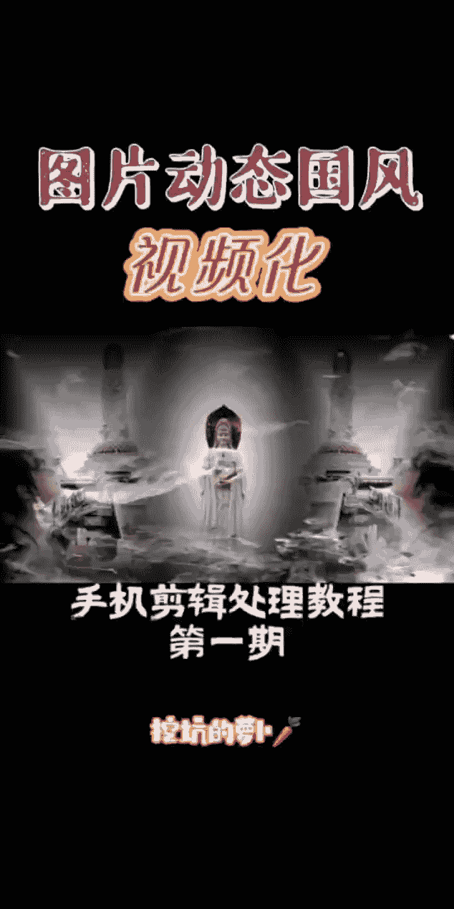
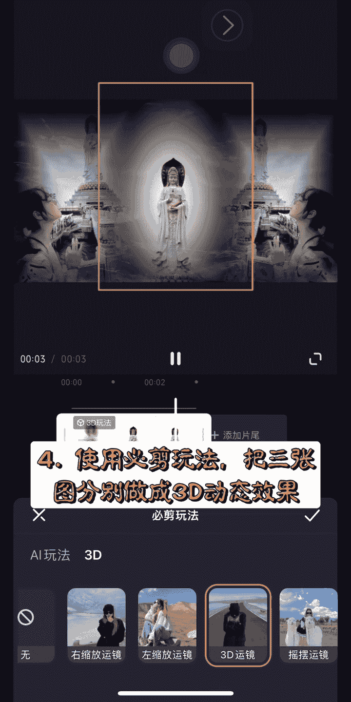
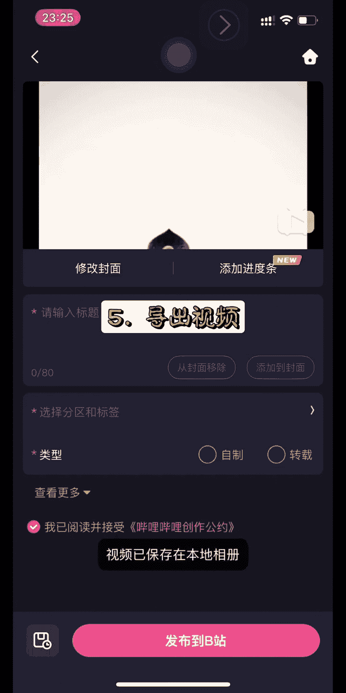
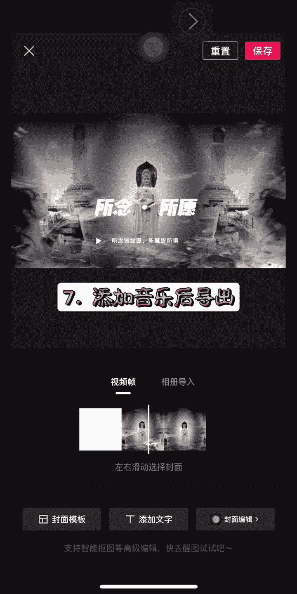
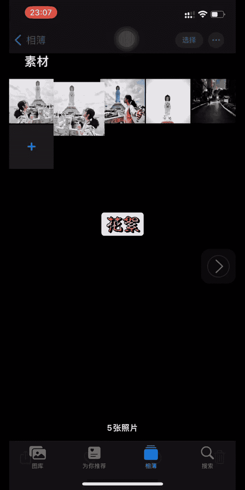
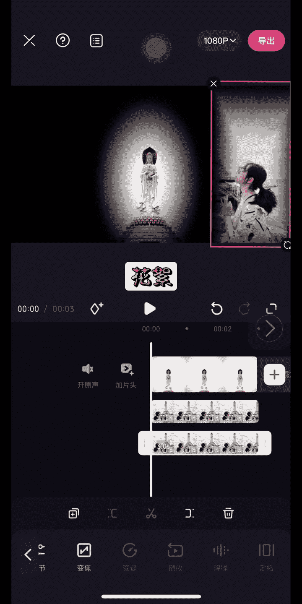
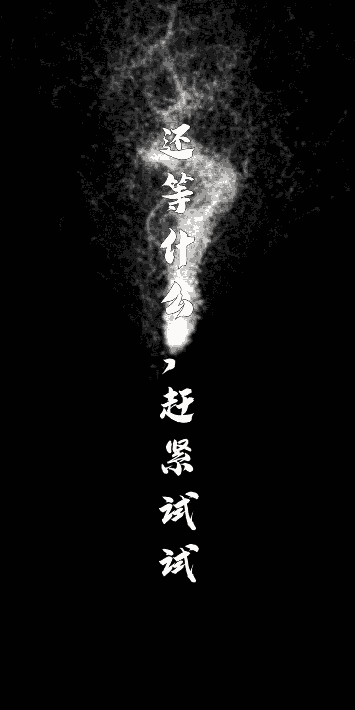

# 🎵 Datawhale AI+X 手机剪辑教程：01：音乐节拍与剪辑点匹配



在本节课中，我们将学习如何在手机剪辑软件里识别音乐节拍，如何把视频剪辑点和音乐节奏对齐，以及如何制作重复片段和循环效果。原文中出现了大量带有音乐符号的片段，这些片段提示我们音频节奏在剪辑里非常重要。我们会用大白话把每个步骤都讲清楚，让没有任何基础的初学者也能跟着操作，做出好看的手机剪辑作品。

## 1.1 识别音乐节奏

上一节我们介绍了手机剪辑的基本界面，本节中我们来看看音乐节奏到底是什么，以及在剪辑前怎么先把节奏找出来。音乐节奏就像是歌曲的心跳，每一次鼓点或者强拍都可以作为我们剪切视频的参考点，让画面变化听起来更顺耳。

以下是识别音乐节奏的具体步骤：
- 打开手机剪辑软件，导入你想要使用的音乐文件。
- 观察波形图，找出幅度最大的那些波峰，这些通常对应强拍。
- 用标记工具在每个强拍位置打上节拍点，方便后续对齐。

核心概念可以用下面的公式来描述：



节拍强度 = 音频幅度 × 频率权重

如果我们把每一帧的音频幅度记作 A(t)，那么节拍点就在 A(t) 达到局部最大值的时刻。原文中说“如果我能够”，意思就是如果我们能够准确捕捉到这些波峰，后续剪辑才会有节奏感。



## 1.2 剪辑点与音乐对齐

在我们知道了音乐节拍在哪里之后，下一步就是把视频片段切在合适的位置，让画面变化和音乐鼓点同步。原文中提到“从我们老”“原带 me了”“每次家”“晚上下等够”“至少能够”，这些碎片提示我们在导入素材之后，需要反复试听，找到每个视频片段最合适的切入点。

以下是将剪辑点与音乐对齐的操作方法：
- 把视频素材拖到时间轴上。
- 播放音乐，观察画面变化是否落在强拍上。
- 如果不对齐，就前后微调视频片段，直到画面切换和鼓点重合。

核心概念可以用代码来描述：

```python
cut_point = nearest_beat(music_timeline, current_frame_time)
```



原文中有一句“Just let me [不当内容] you，babyby”，这部分内容在音频转录时出现了不当表达，已作脱敏处理，不影响我们对剪辑节奏的理解。还有一句“我的 [不当内容] 证明我我”，同样只是音频片段的记录，实际剪辑时不需要关注这些文字。

## 1.3 重复片段与循环效果


有时候我们需要让某个画面或音乐片段重复出现，形成循环效果，这样可以强化节奏感。原文中出现了“你再猜出”“生在成生”“Do you w to play with me that game， Play with me that game”“だけ”“Me the same。F with me the same。表 the same”，这些片段表达了“重复”和“一样”的含义，正好对应循环剪辑的需求。还有单独的“这个”，提示我们在剪辑时要聚焦到具体的某个片段上。

以下是制作重复片段的步骤：
- 选中你想要循环的视频片段。
- 复制该片段，在时间轴上紧挨着原片段粘贴。
- 重复粘贴直到达到你想要的时长。
- 检查循环点是否自然，如果有突兀感，可以加入淡入淡出过渡。

核心概念可以用代码来描述：



```python
loop_segment = video_clip[start:end]
final_video = loop_segment * repeat_count
```

原文中的“只是”和“和我一样的”“表面是一样的”都在提示我们，循环片段在视觉上应该保持一致，不能让观众察觉到明显的拼接痕迹。



## 1.4 结束与致谢

剪辑完成之后，我们需要给作品做一个合适的结尾，并感谢素材提供方或音乐作者。原文中出现了“的拥”“with”“Thank け”，这里的“Thank”就是谢谢，日语片段“け”则是句末语气助词，可以理解为一种礼貌的结束。

以下是结束视频的建议做法：
- 在视频最后添加黑屏或渐变出镜。
- 插入文字致谢，比如“音乐由XX提供”或者“特别感谢”。
- 导出视频，检查音画同步是否依然稳定。



## 总结

本节课中我们一起学习了如何识别音乐节拍、如何把剪辑点与音乐对齐、如何制作重复片段与循环效果，以及如何给视频做结尾致谢。通过把音频波形和时间轴上的画面对应起来，你就能做出节奏感强的手机剪辑作品了。

