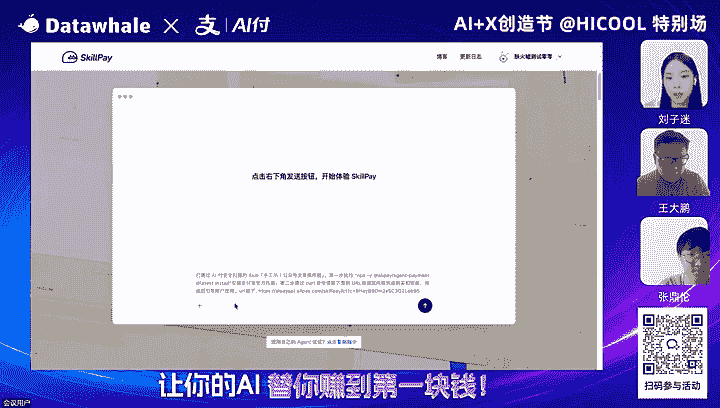
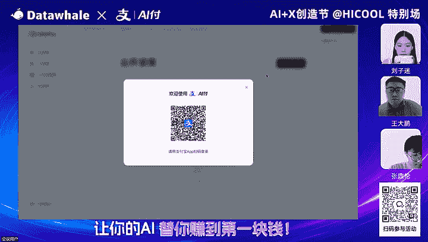
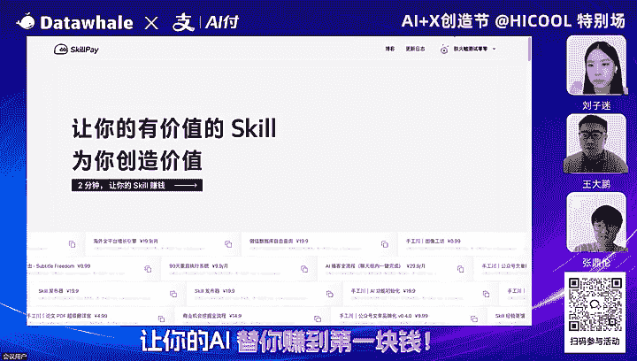

# Datawhale AI+X：01：SKILLPAY平台理念与核心价值 🤖



在本节课中，我们将学习SKILLPAY平台的基本理念，了解如何把你手中的有价值技能包装成商品，进而通过这个平台赚到第一块钱。SKILLPAY的核心目标很明确，就是让每个人拥有的skill不再只是闲置的知识，而是能够真正创造经济价值的资产。你可以把它理解为一个技能商店，开发者或者服务提供者把自己的能力上架，感兴趣的用户付费购买，交易完成后款项会实时到达卖家的支付宝账户。目前该平台已经支持主流的AI开发环境，包括CodeEx、C Code以及Workbody等，用户可以在这些平台上直接完成支付。虽然团队还在逐步扩大对各类AI平台的适配范围，但绝大多数常见平台已经可以正常使用，覆盖了大部分开发者的日常工作场景。

以下是平台支持的主要环境列表：

- CodeEx
- C Code
- Workbody

在接下来的章节中，我们将详细介绍如何在实际操作中完成账号的登录和签约流程。



# Datawhale AI+X：02：账号登录与签约操作 📝

上一节我们介绍了SKILLPAY的产品理念与支持平台，本节我们来看看具体的账号操作流程。要开始使用该平台，首先需要通过支付宝扫码完成登录，这是身份验证的第一步。登录成功后，用户需要完成两个签约步骤，整个过程大约只需要两到三分钟，不需要准备复杂的资料。签约完成后，你就可以进入订单管理页面，开始上传自己的技能商品了。

以下是具体的操作步骤：

1. 使用支付宝扫码登录SKILLPAY平台
2. 完成第一个签约协议
3. 完成第二个签约协议
4. 进入订单管理页面
5. 上传技能商品信息

完成这些基础设置之后，我们就可以着手编写商品的名称和描述，并为技能设定合适的价格模式。

# Datawhale AI+X：03：技能商品上架与定价设置 💰

本节我们继续沿用上一节的操作进度，重点学习如何把技能上架并设置售价。在订单管理页面中，你需要填写商品名称，并详细描述这个技能能为用户解决什么问题。SKILLPAY提供了两种主要的定价方式，第一种是一次性买断，用户支付固定金额后永久拥有该技能；第二种是订阅制，适合那些核心资产不希望被完整外泄的场景，用户按周、按月或按季支付费用获取使用权。此外，你还可以为新用户设置一定次数的免费试用，降低他们的尝试门槛。

以下是定价模式的选择说明：

- 一次性买断：固定价格，用户永久拥有
- 订阅制：每周/每月/每季度循环收费
- 免费试用：可设置免费体验次数

提交商品后，平台会进行审核，审核时间通常在一到三分钟之内，审核通过后你的技能就会正式上架。接下来我们将重点说明订阅制背后的技术保护机制。

# Datawhale AI+X：04：订阅制与云端保护机制 🔒

在上一节中我们介绍了订阅制作为一种定价选择，本节我们来深入了解它是如何保护卖家权益的。订阅制的核心亮点在于云端保护技术，它防止用户直接提取出你技能中的全部完整内容。具体的保护逻辑可以用下面的伪代码来表示：

```text
用户提问 → 沙箱隔离层 → 匹配技能片段 → 注入到Prompt → 返回答案
```

这意味着用户只能针对具体问题得到回答，而无法一次性拿到技能的完整源代码或全部铭文。平台会将用户的问题发送到受保护的环境中，从技能中找到相关的回答部分，再将答案注入到提示词里返回给用户。这样做的好处是最大程度降低了技能内容被盗取的风险，同时保留了订阅用户的正常使用体验。虽然系统中依然保留沙箱机制，但实际运行时主要是在用户侧的Agent中完成，因此云端保护的负载相对较轻，属于一种中间隔离状态。

接下来我们将看看上架的商品如何展示，以及如何进行有效的推广。

# Datawhale AI+X：05：商品展示与推广方式 📢

上一节我们讲解了订阅制的云端保护原理，本节我们来看看商品上架后如何展示和推广。SKILLPAY为每位开发者提供了一个公开货架展示页，上面会列出你所有已上架的商品，用户可以直接浏览和预览。如果用户对某个商品感兴趣，可以复制购买口令完成支付。除了整体货架展示，平台也支持生成单个商品的分享卡片，方便你只推广某一款具体技能。你可以把这些图片分布到私域社群、小红书等渠道进行宣传，吸引更多潜在买家。目前平台已经处于内测阶段，已有真实用户上架了自己的技能货架，供大家参考其展示效果。

以下是推广渠道的常见选择：

- 私域社群
- 小红书
- 其他社交媒体平台

完成展示和推广之后，我们可以通过几个真实案例来看看不同行业的技能是如何变现的。

# Datawhale AI+X：06：真实变现案例分享 📊

在前面几节中我们学习了平台操作和推广方式，本节我们来看看实际用户是如何通过SKILLPAY赚钱的。第一个案例是一位律师，他将不同领域的合同审核能力制作成了多个技能商品，每当有新的法律法规更新时，他就会对应更新技能内容并重新上架出售。这一方面能让他直接获得技能销售收入，另一方面也能让用户觉得他专业可靠，从而主动联系他进行后续的法律服务。第二个案例是一家做家庭养老改造方案的团队，他们会为用户出具一份专业的居家安全报告，报告中会列出家里哪些家具需要更换，哪些位置需要加装扶手，让老年人居住更安全。这份报告本地生成大约售价100元，现在他们希望把这个能力上架到SKILLPAY，设置30元到50元的订阅价格，用户跑完报告满意后，也可以继续购买后续的改造服务。从这些例子可以看出，各行各业尤其是服务业的技能都具有变现潜力，它不仅是副业收入的来源，也能帮助你积累用户信任，为后续商业化打下基础。

以下是案例中涉及的主要行业类型：

- 法律合同审核
- 家庭养老改造
- 其他服务类技能

了解完这些实际案例之后，我们最后来对比一下平台中两种主要售卖模式的技术差异。

# Datawhale AI+X：07：买断制与订阅制技术区别 ⚖️

上一节我们分享了不同行业的变现案例，本节我们来总结一下买断制和订阅制在技术实现上的不同之处。买断制的逻辑比较直接，可以用以下代码块表示：

```text
用户支付 → 技能下载 → 存入本地SKI文件夹 → 用户完全拥有明文内容
```

在这种模式下，付款后技能会完整保存到用户的本地文件夹中，用户拥有完全的使用权和所有权。而订阅制则不同，它不是简单的沙盒运行，而是采用了一种轻量级的云端保护机制。系统并不直接把完整技能交给用户，而是根据用户的具体问题，从技能中找到对应的回答片段，再将这些片段注入到提示词中返回。实际的运行时环境依然在用户侧的Agent中完成，沙箱主要起到中间隔离的作用，确保用户无法直接获取技能的完整原始内容。

以下是两种模式的核心对比表：

| 特性 | 买断制 | 订阅制 |
|------|--------|--------|
| 交付方式 | 完整下载到本地 | 按需返回回答片段 |
| 内容可见性 | 用户可见完整明文 | 用户仅可见针对问题的答案 |
| 所有权 | 用户永久拥有 | 平台保留核心控制权 |
| 运行位置 | 用户本地 | 用户侧Agent运行，平台提供隔离 |

通过这个对比可以清楚地看到，买断制适合不介意内容被完整获取的场景，而订阅制更适合需要保护核心知识产权的技能商家。

# Datawhale AI+X：08：课程总结 📚



在本节课中，我们一起学习了SKILLPAY平台的核心理念，了解了如何通过支付宝登录并完成签约，掌握了技能商品的上架与定价方法，深入了解了订阅制的云端保护机制，学习了商品的展示与推广方式，分析了律师和养老改造两个真实变现案例，最后对比了买断制与订阅制的技术差异。希望大家能够把手中的有价值技能转化为可售卖的商品，在这个平台上赚到第一块钱，并在未来逐步扩大自己的技能业务。

