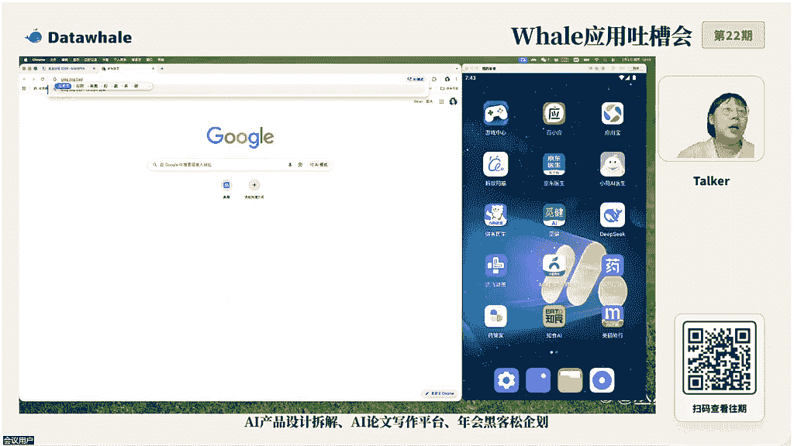
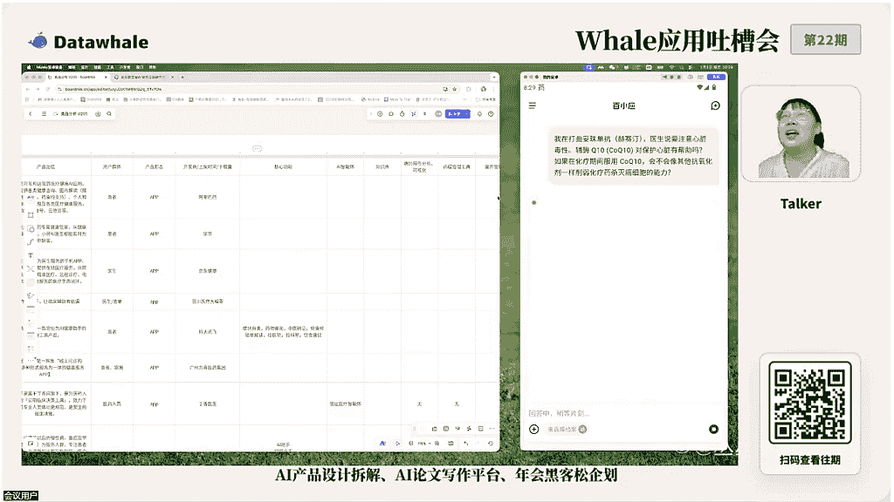
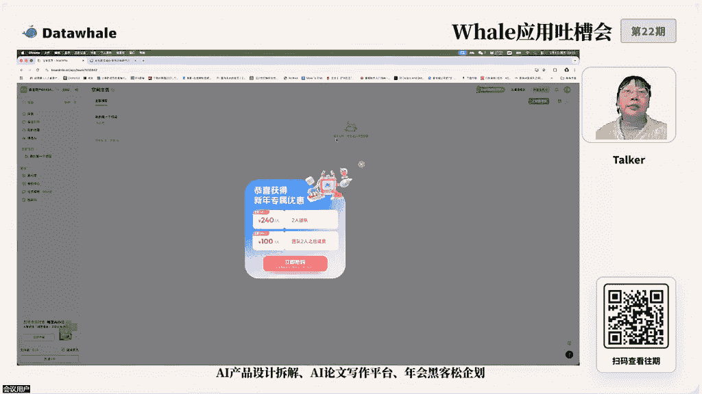
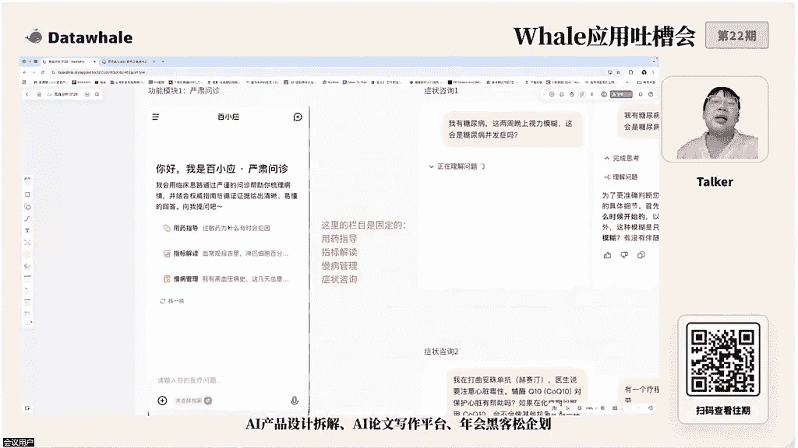

# 🏥 健康管理智能体拆解与AI产品分析：01：课程概述与讲师背景

在本节课中我们将要学习健康管理智能体的产品拆解方法，以及一名AI产品经理在实际工作中如何进行竞品调研和需求分析。我是一名商科生，也就是文科生出身，但现在从事AI产品经理工作。我的研究生背景是商科，毕业后在互联网行业做了几年C端产品经理。因此，我对C端产品及其能够解决的问题非常敏感。由于早年就在互联网行业工作，我较早地接触了AI，尤其是23年AI大模型浪潮兴起时，我正处于创业状态，并没有处于打工阶段。24年时，我与Datawhale紧密合作，一起开展了很多关于C端智能体训练营以及B端企业培训、企业智能人体培训等业务的探索。

在这之后，我发现一直只做表面的事情，仅仅教大家如何使用AI工具，让大家沉浸在学习氛围中，似乎并不能让AI产生直接的效益，也不能把算力转化为企业的直接价值。今年我因缘巧合加入了一个AI创业团队，重新成为了AI产品经理。目前我们的团队专注于健康医疗相关的应用，这让我有机会更深入地了解这个行业中AI产品的现状。在这个过程中，我发现了一些比较有趣的现象，这也就是我今天分享的初衷和动力。

今天的分享形式是谈话式的，大家不需要非要学习什么竞品分析技能、套路或框架。我会呈现一个产品经理在工作中进行竞品调研和需求分析的真实状态，采用聊天式的形式，与大家讨论我看到的一些智能体和新功能，以及在AI领域中如何进行AI转人工、人工兜底，哪些事情该用传统功能实现，哪些该用AI功能实现。我会把我的发现分享给大家，同时也欢迎同行们一起探索和交流，因为AI产品化的道路对大多数产品经理和公司来说仍然是一个相对新的体验，希望更多AI产品经理小伙伴能一起讨论和学习。

---

# 🔍 健康管理智能体拆解与AI产品分析：02：如何接近真实用户需求

上一节我们介绍了讲师的背景以及本次分享的目的。本节中我们来看看如何才能真正接近用户的真实需求。

在我们项目立项以来，无论是需求方、投资方，还是产研团队，其实对于如何做一个AI健康管理软件都感到比较懵。虽然市面上已经有很多类似产品，但我们不能完全照抄，必须要有差异化，并且要用AI去解决真实用户的需求。最初我们确实比较懵，所以会盲目地去寻找各种大厂做的AI软件，比如最近蚂蚁阿福上线了，我们就盲目地去研究各种各样的大厂AI软件。结果是，你看得越多，就越发现别人的功能做得非常好、非常全面，而且他们都有各自的生态，于是我们越看别人家的好，就越焦虑，总觉得从零开始太慢，无法追赶别人的脚步。

后来我反思了一下，我们的竞品选择和市场调研方式其实是错误的。我们应该去接近真需求。虽然AI是一个新的东西，但在没有AI之前，人们的日子照样过得下去，健康患者也并非没有任何APP可以用。因此，在这样一个新的时代进行竞品调研，仍然要贴近用户。我后来不再盲目地去应用商店找各种APP，而是开始去小红书翻阅目标用户的帖子。比如我们要做的第一个细分人群可能是肿瘤患者，我就去看肿瘤患者和家属发布的种草帖，看看里面提到了什么软件，并把他们提到的软件排个序。

后来我真实地发现，直接去找目标用户发布的种草帖或经验帖，所找到的软件往往更加贴合我们自己的应用场景。所以，在进行用户调研、竞品调研或用户分析时，我们可能仍然要把用户放在第一位。AI并不是一个全新的东西，它只是解决问题的一种新技术可能。在过去没有AI的时候，其实已经有很多产品和工具能够帮助原有用户，我们不能忽视这一类工具。这就是我关于如何挖掘真需求的一个观点。

真需求识别可以用下面这个公式来理解：

真需求 = 目标用户在社区中实际提及的工具 - 大厂产品表面功能

以下是如何通过用户内容寻找竞品的步骤：

1. 确定目标细分人群，例如肿瘤患者；
2. 在小红书等社区搜索该人群及其家属的种草帖；
3. 提取帖中提到的软件名称，并进行排序；
4. 验证这些软件是否贴合自身应用场景。

---

# 🗂️ 健康管理智能体拆解与AI产品分析：03：竞品选择与分类方法

上一节我们学习了如何通过用户生成内容接近真实需求。本节中我们来看看找到竞品之后，该如何进行分类。

在找到大概这么多竞品之后，我每一个都进去点过，也都进去试用过。找到竞品之后，我觉得也需要把竞品进行分类。比如，我把功能相似、服务相同用户的竞品分成了三栏。第一栏是科技互联网类，甚至包括一些医疗公司的生态产品，这类产品是为了补充生态中的一环而存在的。第二栏是垂类产品，或者是独立开发者、个体研发的产品，这类产品非常典型，属于小而美的范围。第三栏是模式类似的产品，虽然它们可能不服务我们的用户，但服务的用户流程、功能和架构与我们的产品差不多，比如Keep就属于这一类。

为什么要分类呢？因为我们的时间有限，注意力也有限。我在做竞品分析时，会根据产研团队的沟通情况来画重点，说明接下来我们要重点讨论什么内容，或者重点去看哪一个产品。否则，面对这么多APP，一个一个去点其实挺浪费时间的。所以，可以根据竞品分析的目标来划定重点。比如，如果你想学习交互和架构，可以重点研究第一类里面的头部产品，因为其他产品都差不多；如果你只是想研究业务和场景，我觉得可以研究一些垂类的典型代表。上面这些就是我竞品选择前面的一些前提。大家可以看到，我们的APP实际上是想解决肿瘤病人在治疗期间的健康管理需求。

以下是竞品的三类划分方式：

1. 生态类产品：由科技互联网公司或医疗公司提供，旨在补充自身生态的一环；
2. 垂类小而美产品：由垂直领域团队或独立开发者研发，功能聚焦；
3. 模式相似产品：服务不同用户群体，但功能架构和服务流程与本产品相近。

---

# 📊 健康管理智能体拆解与AI产品分析：04：竞品产品维度分析框架

上一节我们学习了竞品选择与分类方法。本节中我们来看看如何对竞品进行维度分析。

接下来到底怎么去分析呢？可能大家会想，是不是要把每一个APP都下载下来，注册后点进去看。我觉得第一步其实还不是功能层面的分析。相反，我会先看看这个APP的人群是什么样子的，它解决的问题是什么样子的。然后，我会做一个功能对比表。我可能会先去应用宝，大家知道腾讯应用宝吧，里面集合了各种各样上架的应用。我会先看应用里面的说明，然后看评论，再看官方的简介，以及里面的一些迭代信息。我先看看，这个APP在简介中，自己最重要的定位是什么，服务于谁，是为了解决什么样的问题。这些一般都会出现在应用宝的简介里面。比如，我搜一个京东医生，点进去就可以直接看到。它说京东医生是一款为医生服务的手机APP。既然是为医生服务，那么说明京东医生的用户群与我们的用户群是有偏离的，因为我们是为患者和患者家属服务的。所以，还是要从用户群体和定位这边来对比，不要看着它是一个AI医疗产品，就盲目地点进去测试。

这边其实可以去进行一个简单的市场调研。我是从这几个维度来看的。第一个是产品定位，也就是官方应用里面的简介，它是为谁服务的，解决什么样的问题。当我把产品定位全部横向排列过来之后，我会发现，不同的产品，其用户、功能以及差异点一目了然。接下来是用户群，有的是为患者服务的，有的是为医生护士服务的，有的则是一个知识库，同时为患者和医生服务。把这一列排过来之后，我也知道接下来要重点关注哪个APP，哪个APP可以不用重点关注。然后是产品形态，有的是APP，有的是小程序，这一点没有特别重要。第四个是开发商，我们知道，在真实的产品研发过程中，我们也会向头部优秀的产品厂商学习。所以我可能会重点去看第一梯队的产品，以及一些有用户评论、有一定下载量，甚至在小红书里有人自发种草的垂类APP，他们可能是大厂出来的，也可能是小厂出来的，这里可以稍微列一下。

接下来是核心功能。核心功能这一列，并不是说我点进去之后，就要去做一个老图。因为我觉得应用商店里面每一个APP或者每一个网页，关于产品的介绍，其实会提供很多信息，比如有些APP会把核心功能直接列出来。这样的话，我就可以去进行收集，然后就可以明确地看到这个APP是为了解决什么功能，有哪些核心功能，以及这些功能跟我们的业务是否相关。最后其实还有一列很重要，就是商业变现。比如蚂蚁阿福，再比如字节的小何医生，我们可以看到它们都是免费为用户服务的。这时候，你就要想一下，为什么这个APP免费为用户服务，别人不用花钱。我们可以朝它的商业KPI或者商业变现前景稍微想一下，因为产品经理其实也要考虑怎么把产品的价值进行交换和延展。这不一定只是运营、业务或PO这边要考虑的事情，产品经理也要考虑。我也会去列一下，他们到底怎么商业变现。比如，这个AI营养师产品，就是通过卖会员变现，里面有很多会员功能。再比如互联网医疗，就是通过提供互联网医疗问诊服务来进行变现。所以说，竞品研究不仅仅只是看功能，我觉得产品经理可能要有一个长期的、偏向商业的眼光，从市场角度，先把不同产品的定位摸清楚。

竞品优先级可以用下面这个公式来衡量：

竞品优先级 = 用户契合度 × 功能差异度 ÷ 调研时间成本

以下是竞品分析的六个关键维度：

1. 产品定位：官方简介中明确的服务对象与解决问题；
2. 用户群：患者、医生、护士，还是患者与医生共用的知识库；
3. 产品形态：APP、小程序或其他形式；
4. 开发商：大厂或小厂，下载量与社区种草情况；
5. 核心功能：从应用商店或官网介绍中提取的核心功能列表；
6. 商业变现：免费模式、会员制、互联网医疗问诊等变现方式。

这并不是业内惯用的唯一方法，大家仍然可以根据自己的职位，根据产品工作的主要内容来进行参考性的学习。

---

# 💬 健康管理智能体拆解与AI产品分析：05：普通大模型与健康智能体的交互对比

上一节我们学习了竞品产品维度分析框架。本节中我们来看看普通大模型与健康智能体在交互上的区别。

接下来，我再给大家分享一下，我调研的这些产品，它们的AI功能是什么样子的，它们是怎么让用户更加信任自己的，以及在交互上面，它们和通用AI（比如deepseek或豆包）有什么区别。我觉得接下来的内容应该会比较有趣。这个时候，首先我会设置一个场景。因为我们的业务用户其实是肿瘤病人，他们的痛点可能并不是说进行AI科普，比如问发烧发热了怎么办，或者胃疼怎么办，他们可能有一些非常严肃的问题需要回答。比如，我现在正在进行药物化疗，我有一些东西能不能吃，或者我去做一些事情，别人送给我的补品，我吃了之后会不会对我的疗程产生什么影响。他们都是这种很具体的问题。

假设我们深入到用户的场景中。一般来说，我会先去普通的AI，比如deepseek或豆包这边来看一下，来看看这种传统的AI是怎么进行交互的。因为我们尽可能要模仿用户的实际行为。大家一谈到AI，大部分人都会想到deepseek或豆包，对吧？所以我要先从用户的视角来看，一个还不知道有哪些工具可以用的用户，去问deepseek或豆包会得到什么样的结果。我模仿了一个用例，模仿一个真实的肿瘤病人，他在治疗过程中可能产生的疑问。这个疑问会很专业，他正在打一种专门的靶向药。在这个过程中，医生说要注意心脏毒性。有一种营养品叫辅酶Q10，对心脏有帮助吗？如果在化疗期间服用这个，能不能像其他的一样去削弱化疗药的能力？

如果让deepseek来回答，我们可以看一下。deepseek会像我们非常熟悉的那样，先去思考，里面有很多文字。我们先不管它回答的内容，我们可以看一下它回答的交互形式，其实是纯文字型的。我不知道，作为一个身体状况不太好，或者心理上比较脆弱的患者，他看到这个文字会是什么感受，我们先不去深究。我们可以看到，deepseek的语气实际上非常医生化，而且他的语气也没有进行特别的微调，包括他回答的直接问题和机制，都非常像一个医生。好，那我们现在记住deepseek这样的表现。

然后我们再来看一个国民级的软件豆包，看一下它对这个问题的回答。其实可以看到，不同的产品和模型之间，交互的方式是不一样的。同样一个问题，给到豆包的话，它默认开启了语音，刚才我把语音关了。你会发现，其实还是一个偏向于非常严肃的回答，也没有什么特别多的语气和人设。这就是患者如果去问普通大模型，他得到的一个答案。其实他只得到了一个不是特别确定的答案。那么具体能不能解决他真实的购买药品，或者是他的用药计划这个需求，其实也不知道。

那这个时候，我们来看一下最近推广很广的蚂蚁阿福。作为阿里推出的头部健康APP，它是怎么回答这个问题的。我们可以对比一下，阿福对于这个问题的回答，以及它的交互方式，是否跟前面两个有明显的不同。我们再把这个问题输入进去，你看，阿福这边做了一个小的交互。首先，他会去找参考资料。比如，在这个问题里面发现了两个专有的药品名词，然后他会去搜医学百科，同样完成深度思考。你看他的第一句，就是我理解你在治疗中关于这个问题，他有点像非暴力沟通，先肯定，对吧？然后他先肯定，接着复述一遍你的问题。接下来，他感觉像一个非常有耐心的医生，或者是一个健康专家，然后他就会从原理、证据分析、安全考量，以及具体的行动建议几个方面，详细地去解释。这个他解释的结果，我不知道阿福底层的模型可能大概率是千问，但你会发现，阿福这个智能体的表述语气和逻辑，其实非常贴合用户的感受。他跟deepseek那种平铺直叙的回答方式不一样。

下面是蚂蚁阿福的回答逻辑：

第一步：查找参考资料，搜索医学百科，完成深度思考；
第二步：采用非暴力沟通方式，先肯定用户，再复述问题；
第三步：以耐心医生或健康专家的人设，从原理、证据分析、安全考量、行动建议四个维度详细解释；
第四步：强调核心原则，先与主治医生沟通，绝对不要自行服用，给出参考剂量和用药安全建议。

我觉得阿福非常有人性。这一点会比deepseek更加专业一点。就是他提出了，比补充剂量更重要的是心脏保护措施。因为他从这个问题背后，get到了这个用户这个患者，他对自己心脏能力的担忧。然后保持健康的生活方式等等，最后总结。这里你会发现，阿福回答完这个问题之后，下面有一个小控件。因为阿福是一个健康管理工具，里面会有很多其他的功能。如果你真的需要添加这个辅酶Q10补剂，你可以点一下添加计划。那么它就可以去看，里面的数据，都已经从用户的对话上下文里面关联出来了。比如开始服用的时间、持续时间、方法用完方案，然后你每次服用的定点时间。因为像这种肿瘤患者，其实他每天需要做什么事情，每个事情之间间隔多长，其实都是有规定的，跟我们普通用户不一样。所以这边也提供了服药的时间、剂量、服用指导以及备注。他给我们提供了一个小的功能。

这就是阿福作为阿里出的头部健康工具，跟普通deepseek不一样的地方。他在人设和辅助功能里面加了很多点。

---

# 🏥 健康管理智能体拆解与AI产品分析：06：垂类健康智能体的交互设计细节

上一节我们学习了普通大模型与健康智能体的交互对比。本节中我们来看看垂类健康智能体的交互设计细节。

然后其实还有另外一个产品，是密饯。密饯是一个专门针对肿瘤患者的垂类工具，已经有十几年的历史。原来就是一个为肿瘤患者提供各种信息和社群的平台。但是，他们最近也上了一个AI助手功能。首先我看一下，它里面会有2个AI智能体。第一个是立即咨询。其实里面是一个AI回答的智能体。如果患者点击立即咨询之后，你会发现，马上感觉像被拉进了一个服务群。但实际上，这个服务群里面是三个智能体。所以，我觉得他使用多个智能体、用拉群的方式去服务患者，实际上是非常让患者放心的。你想一下，假设我们要去学习英语，进入一个智能体或者英语学习网站，你说我想学习，这时突然有一个语法专家、一个听力专家、一个口语专家全部跑到你面前，这样你会不会觉得服务非常完善？所以，我觉得他这种拉群式的交互，真的让我耳目一新。最后我发现，里面的这几个其实都是不同的智能体。当然，他也可以转人工，如果你要求转人工，他也会转到人工服务。但是最初是智能体给你服务的。

第二个是AI智能助手。这边其实挺有趣，就是他会把接入的一些大模型、一些底层模型的API摆出来，让你去选。这样的话，对于那种不太确定的患者，这种用户，其实主动权就给到用户那边。它也可以提供一些对应的小功能，其实都是其他的小功能智能体。但是它的交互方式跟我们刚才看到的蚂蚁阿福不一样。我们假设再把同一个问题给到这个智能体。你看，他这边有点像mats那样，他在自己跑一些东西，比如正在查阅药品库。你点击这个药品库，其实也会跳到一个专门的药品介绍页。所以说，在做智能体的时候，如果能够有效地关联对应的一些知识库，其实能够更好地加强这个智能体。第一个加强了回答的准确性。第二，站在用户的角度，用户会觉得，你这个东西是有据可依的，不是随随便便的回答。用户就会更加信任你。然后你会发现，他的回答使用的是千问，其实跟阿福的底层回答差不多。所以说，智能体用不同的模型，回答也会不一样。

下面是密饯的多智能体交互流程：

1. 用户点击“立即咨询”，进入虚拟服务群；
2. 群内同时出现多个垂直领域的AI智能体，分别提供专业回答；
3. 用户也可以选择转人工，但最初由智能体集体服务；
4. 系统开放多个底层模型API，让用户自行选择模型；
5. 智能体跑药品库等知识库，点击可跳转至药品介绍页。

还有一个智能体，在旁边有一个可以马上转人工的按钮。虽然我们在进行AI回复的时候，可能会在这边摆几个常用的按钮，比如重新生成、复制、更多等等。但是，我发现有一个专门的医疗智能体，他在旁边加了一个转人工按钮。因为毕竟，医疗决策还是需要专家，或者需要一个非常定制化的过程。所以，当AI的回答可能不是特别完善的时候，用户可以马上说我要转人工，或者怎么样。那么可以马上让人工客服或者真人医生来进行接管。这样的话，用户可能会觉得更有效。

怎么让智能体更加拟人化呢？我觉得这一点，蚂蚁阿福做得很好。首先，我不知道大家有没有进去过。在他的首页，在智能体这里，你会发现，他下面把各个著名的医生全部罗列出来了。比如说，你要去看这个科室的医生，他就把这个科室里面的智能体全部罗列出来。所以说，有时候在做智能体时，可能会做一些功能性的智能体，比如OCR病例整理之类的。但是，如果你在做智能体时，直接去做一个IP智能体，这就可能更加符合用户的认知。因为毕竟，我们一谈到看病，第一个想到的是去哪个医院，第二个是挂哪个科室，第三个是哪个医生有空，或者去找哪个专家。所以说，在做智能体时，不一定完全要做工具型的，我们也可以像阿福一样，把医生的智能体抽象出来。我觉得这也是产品上的一个创新。

然后，我再看一下讯飞的大模型。这个智能体里面，我觉得一个很可取的地方，他在这里面加了一个人。因为刚才展示的那几个产品，其实里面有一个很重要的假设，就是患者本人在给自己咨询。但实际上，有时候可能是子女在给父母咨询，或者是一个会用AI的人，在给其他人咨询。所以，在讯飞的这个智能体里面，他加了一个咨询人角色，设定了咨询的角色。这有点像滴滴叫车时，会问你是为本人叫，还是为他人叫。所以，讯飞把这个考虑进去了。讯飞使用的应该是自己的心火大模型。他也是这样的，首先去参考医学知识，再去思考你的问题。然后，答案展示出来之后，后面还会给进一步的引导。所以，除了AI输出之外，其实也可以在AI输出的下面，关联接下来用户可能用到的一些功能。讯飞这里，你可以看到，他在每一个下面都有这个，就是把对应的文献网站都摆出来。点击之后，可以跳到第三方网站去进行进一步的查证。讯飞的底层好像跟千问有点像。所以你会看到，他下面还可以关联你的档案等等。因为毕竟，健康型咨询，其实对家族史、过往病史、过往治疗史非常依赖。像这种的话，其实有一个很重要的点，就是怎么去让患者去输入他的一些对应数据，特别像吃药的数据、检测的数据、一些日常的行为数据，来加强AI智能体的上下文。这个可能就是行业里面关于上下文工程以及数据输入的一个通用难题。

下面是讯飞智能体的关键设计：

1. 增加“咨询人”角色选择，区分本人或他人咨询；
2. 基于心火大模型，先参考医学知识再思考问题；
3. 回答下方关联文献网站，支持跳转第三方查证；
4. 支持关联健康档案，结合家族史、病史、治疗史进行回答。

接下来，还有一个我觉得比较好的智能体回答逻辑，就是字节跳动的小何医生。小何医生的功能相对来说比较简单，其实就是豆包。首页也没有什么东西，很白。但是，我觉得他比较好的是回答的逻辑。当你把问题输入进去之后，如果用户里面有一个历史对话记录，他就会给你选择结合历史对话。因为这个场景的上下文依赖很重，你可以选择要结合之前的历史对话，他就会进行关联。所以，我觉得这个交互做得很贴心。如果我不选择的话，这时候我问他，小何医生是这样的逻辑。首先，从语气上来说，还是属于非常贴心，肯定是有过调整的，在提示词方面有过调整。所有的对话方式，感觉正在跟你面对面对话。而且，如果我们把语音打开，让他读一遍，那么在读的过程中，一直处于这种语气，就有点像专家的亲切感，场景感会更足。我觉得这是比较好的一部分。回答完之后，你会发现，他会把对应的里面提到的一些参考药品摆出来。因为有可能，当用户问到这个问题的时候，他可能更关注的是药，而不是结果。点一下，就可以马上跳到用药指南。

接下来就到这个产品的商业变现环节了。他可以去抖音商城去买对应的药品。然后，后面还有一个很重要的点，也是其他软件里面暂时没有的，就是进一步的追问。他说，除了这样的化疗药之外，是否还在使用其他的有可能的药品，比如某些化疗药或降压药之类的。如果点了降压药之后，他有点像一个医生，除了关心你现在的情况，还关心你其他的一些情况。我来从一个非常专业、非常完整、非常闭环的角度，帮助你去解决你对于心脏负担的担忧。所以，小何医生可能会从语气上，从提供的服务上，更加接近一个真实的就医环境。大家可以回顾一下，自己去就医的时候，医生是不是会经常地去问？包括你也会去关心药，从哪里来，从哪里买，怎么服用，以及医生还会问一些其他的既往史，或者其他相关的东西。你看，小何医生这边做的比较强的就是追问。当你回复了一个问题之后，他回答了之后，然后停两秒，接下来继续去问，你正在服用的药是什么名字吗？方便说说剂量吗，这样咱们可以更准确地分析。所以说，虽然小何医生的功能可能没有蚂蚁阿福那么多，因为蚂蚁阿福更多的是医生的这种智能体。但是，小何医生只是一个智能体，但是里面对于这个场景的深挖，以及对于用户更底层需求的认知，我觉得做得非常好。我可以一直跟他去进一步沟通，进行解读。目前我觉得这个体验是非常好的。

---

# 🤝 健康管理智能体拆解与AI产品分析：07：AI与医生协作的工作流设计

上一节我们学习了垂类健康智能体的交互设计细节。本节中我们来看看AI与医生协作的工作流设计。

然后我们再来看一下丁香园，大家应该都知道丁香园，就是我们医药行业医药IP最大的知识科普社区。它的智能体是怎么运作的。但是，丁香园其实更多的是为医生服务的。在这里面有一个入口，就是让AI询证解答的入口。点进去之后，可以看一下，这个叫临床决策。但实际上，有很多真实的病人患者，也会去用这样的功能，进一步了解自己所在的病情和治疗方案。如果我们把同样的问题，去交给定向医生的这个智能体，你看，他也在解析问题，但是他做的一个很有趣的一点，就是直接把文案的封面展示出来。丁香园医生的临床角色，可能跟面向患者不同，他感觉就像在做一个科研项目一样，有点像google research。他会基于某一个权威的报道来组织信息，整合信息。里面会主动去把参考的报告，也就是权威的论文列举出来，并且在后面加上参考文献。点击参考文献之后，可以看里面相关的具体内容。所以，这个就会偏严肃。当然，我觉得也会让患者更加放心。

下面是丁香园临床决策的信息整合方式：

1. 基于权威医学报道组织与整合信息；
2. 主动列举参考论文与权威报告；
3. 提供参考文献跳转，支持查看具体内容；
4. 采用科研项目式的严肃呈现风格。

然后最后，我看一下未来医生。这个也是一个AI医院的概念。稍等，我这边更新一下。你会发现，里面的名义在线，其实也是更多的。最开始来接待的，其实也是各个医生的智能体。假设我给这样的一个医生来进行选，来进行咨询。他明确告诉你，在未来医生里面，它是一个什么样的流程呢？他说，以下内容由医生在AI的协作下回复，最终结论由医生签字负责。所以，这实际上就是把AI跟医生协作的流程给出来了。里面不会直接去告诉你结果，而是会进一步去确认，有点像你正在医生面前来进行诊断一样，会进一步确认。确认回答完了之后，他会根据你提供的内容，在信息足够的情况下，再转到人工来给你诊断。我觉得未来医生这个智能体，展现了一个未来，就是我们看病的场景，AI跟患者、跟医生，我们去协作一起去解决患者问题的场景。我觉得这个流程是蛮符合现在的面向AI的工作流的。

下面是未来医生的AI医生协作流程：

1. AI与医生协作回复用户问题；
2. 最终结论由医生签字负责；
3. 诊断前进行多轮信息确认，模拟面对面就诊；
4. 信息足够后，转入人工医生进行最终诊断。

还有一个，百川的白小印。用户感兴趣，之前刷到百川医学大模型绑到白小印上了，不确定是不是听错了。白小印我没有去展示，因为怎么说呢，白小印在我看来，它就有点像只是一个大模型的C端工具。就像一个chatbo，就有点像OpenAI有GPT大模型，同时也有C端工具。我可以展示一下，白小印的询证过程。同样，我也把这个问题给到白小印，就是百川的底层医疗大模型。我们可以看一下，他是他其实跟丁香园差不多，也是一个询证医疗的。可能有点慢，我们等他思考的过程中。他过往……白小印首先会去理解问题，然后在他自己大模型里面检索对应的一些病症信息，再进行整理。接下来，其实就是跟丁香园非常接近。我不知道丁香园后面接的大模型是不是百川的大模型，你会发现，这个大模型，它是辅助医疗决策的，不是针对患者的，里面提供的一些数据和信息，其实都是让医生来做决定的。你看，对一个正确的支持，然后对于这个问题的解释，到后面总结与建议，然后给医生的具体建议，温馨提示以及后面数据引用。丁香园的询针大模型的智能体，跟白小印也是非常一致的。而且关于患者的上下文这边，其实也可以选择档案，是否结合档案，如果确定了，就可以基于健康档案里面填的东西，填的病例，不管它里面到底是RAG还是怎么样的知识上下文处理，它会结合这个去抽取对应的信息来进行回答。所以，这个就有点像一个非常具体的、非常专业的医生，面对面地给你解决医疗问题，非常详细。

但是，我们团队可能更多的是怎么解决问题，就是怎么去面对这种精神比较紧张、比较焦虑，年纪也稍微有点大，健康状况不是特别好的人群。怎么去尽量减轻他们知识获取的负担。所以，不同的产品面向人群不同。那么，对于这个智能体，它的交互，它的内容输出，或者它的语气，或者它的形态，就比如说，未来我们甚至可以考虑，把里面的一些具体流程，绘成图片，或者可视化，进行展示出来。所以，这个其实我觉得，未来可能都是可以基于不同的用户，去思考的产品设计点。

下面是寻针大模型与通用大模型的对比：

| 维度 | 通用大模型 | 寻针医学大模型 |
|------|-----------|---------------|
| 知识精准度 | 通用知识 | 医疗行业专业知识，关联最新论文 |
| 思考逻辑 | 通用推理 | 遵循专业医生/专家思考逻辑 |
| 适用人群 | 普通用户 | 医生、患者及医疗决策者 |

---

# 💰 健康管理智能体拆解与AI产品分析：08：商业变现与生态定位思考

上一节我们学习了AI与医生协作的工作流设计。本节中我们来看看商业变现与生态定位思考。

看了很多其他的产品，会发现，其实都是智能体，都是关于健康管理的智能体，他们的交互点，其实设计的都是各有巧思。嗯，okay。那这个呢，就是我今天的这种没有特别多清晰脉络的聊天式分享。然后看一下在座的有没有什么问题。大家如果对刚才的分享，哪些地方感兴趣，或者是疑惑的点，都可以开麦，或者在评论区打出来。直播间的小伙伴也可以在评论区里面发一下问题，我可以来转播一下。看大家有没有感兴趣的地方，或者是问。

其实，王老师讲之前，我因为我个人可能用不太到，我基本上也不会用到这些AI医疗产品。我就是，有时候有一些问题，我就直接搜一下，或者豆包什么的，随随便问一下，可能我还没有这方面的真实需求。对，就是我们也可以从一个旁观者的视角来看一下，同样是大模型，哪一家是怎么设计的，他是怎么考虑的，有哪些点？我觉得，今天如果观众是AI产品经理，或者是黑客松的参赛者，可能会有一点点启发。是的，我觉得从分享中，拆了这些医疗产品以后，是我觉得从两个点上学到了。一个是产品调研的方法，还有一个是产品设计的方法。就是从用户的角度来看，确实是能看出来一个设计者的巧思。我觉得，就算你不是做这个AI医疗的用户，你可能作为其他面向QC的场景，这种想法和考量也是有一些收获的。

有个直播间小伙伴问，小何哪个更偏智能体一点？他说的是对，小何那个可能更偏智能体一点。对，它的功能会更加简单。其实在我看来，小何和白小印，其实是更偏一个对话型的智能体，基于知识库的智能体。那么其他的一些，比如蚂蚁阿福，讯飞小易，它里面其实都是在智能体的基础上做了很多其他的第三方功能。有的是用药管理功能。你看，如果是讯飞，它里面有档案，还有报告解读，用药管理等等功能。所以，不同的产品，它对于用户需求的这个闭环的考虑也可能不同。这个取决于你的产品属于什么样的生命周期，或者你的产品在整个生态里面处于什么样的作用。这个可能是更深层次的，产品定位的问题。为什么我们团队内部分析了，为什么小何做得这么简单，就自己的产品。但是，小何其实是为抖音商城引流。所以，它更多的是简单、短平快，对吧？短平快的设计逻辑。最终希望通过这样的工具投放，尽可能把低频线下就诊场景，变成高频线上咨询场景。这样的话，就可以给核心的抖音电商进行引流。所以，它才会做成这样的简单形态。

商业价值可以用下面这个公式来理解：

商业价值 = 用户信任度 × 知识获取负担降低度 × 变现路径清晰度

以下是不同产品的生态定位与商业逻辑：

1. 蚂蚁阿福：头部健康APP，内置多种医生智能体与辅助功能，侧重用户信任与长期健康管理；
2. 小何医生：功能简单、短平快，主要为抖音电商引流，将低频线下就诊转化为高频线上咨询；
3. 白小印：基于百川医学大模型的C端工具，侧重专业询证与医学决策支持；
4. 讯飞小易：包含档案、报告解读、用药管理等第三方功能，侧重健康数据闭环。

所以，其实你要思考一下，这个产品，他为什么会这么做，有可能它是处于它生态链的哪一环。这样的话，我们的洞察可能就会更加有趣一点，也更加接近我们真实的价值。我觉得这个都是非常有趣的一些思考。嗯，那如果没有其他的问题的话，那我就把时间交给下一个分享者啦。哎，对了，我刚才自己下载了一下白小印，发现他有一个严肃问诊的功能，这个功能是有什么说法吗？其实，严肃问诊的话，你看他说了，他会用临床思路，相当于第一，里面的基模，底层模型肯定是百川的模型。第二，他对于这个问题的理解，其实我刚才就是……我们可以看一下。

我这边会有阅图，稍等。嗯。可能我这个文件被我删掉了。就是我之前在用白小印的时候，我还有一个经历啊，就是他把我问烦了。我看看我能不能找到，稍等。对，然后我们可以看一下，因为我这个里面的白小音，他总是有点猛。哦，是没有毛病的。你可以看它，如果点了严肃问诊之后，他在这边会有几个栏目，就是会有几个具体的指引性的功能小栏目。这些栏目是固定的，你可以点击这些栏目，可以快捷到下一步功能里面去，包括用药指导、指标慢读、慢病管理和症状咨询等等。然后，如果你去问他这样一个问题，我们就直接来看这边的截图，然后他会理解问题，然后他就开始问了。就是他并不直接回答，他就像一个医生一样，不停地去问你，然后我回答他，然后他再问，然后再回答他，然后再问，就像一个医生一样，使劲地问使劲地问，然后你最搞笑的。诶。我就他一直一直不停地问，然后感觉没完了。然后我后面就说，不要问了，直接告诉我答案吧。然后他才会乖乖地，把后面的一些答案，根据我补充的这些上下文，把最终的一个临床诊疗级别的答案告诉我。所以，其实我们要考虑一下，我们真的会把智能体当成医生用嘛，我们真的去有足够的耐心去给他补充足够的上下文嘛。我这个案例，他一直问一直问，我其实很焦急，想马上得到一个简单的、靠谱的回答。然后一直问就把我问烦了。这就是他的严肃问诊模式。这个智能体可能更多的是一个非常有责任心的，对于上下文、对于用户的上下文要求很高的医生型智能体。那还真的是挺严肃的，对对，所以也是比较有趣的。

---

# 📝 健康管理智能体拆解与AI产品分析：09：课程总结与问答

上一节我们学习了商业变现与生态定位思考，以及严肃问诊模式的交互细节。本节中我们来看看课程总结与后续交流。

感谢王老师分享的这些测评经历。对。然后，如果在座的或者观众，也有健康行业的，或者是对健康行业感兴趣的，或者是对产品经理感兴趣的，也可以在吐槽群里面，联系我加我。我们一起来继续在这个领域进行探索，然后去做出真的能够解决患者负担压力的工具。哎，我记得老师好像是有运营自媒体账号的。应该可以把二维码放出来。大家感兴趣的可以关注一下。哦，我现在临时暂时没有，我待会发到吐槽群里面去吧。大家也可以关注。好的。那我这边就结束共享。

本节课中我们一起学习了怎么接近真实用户需求，怎么进行竞品选择与分类，怎么从产品定位、用户群、产品形态、开发商、核心功能、商业变现六个维度分析竞品，普通大模型与健康智能体在交互上的区别，垂类健康智能体的多智能体拉群、模型选择、转人工按钮、IP化医生智能体、咨询人角色、档案关联等设计细节，AI与医生协作的工作流，以及基于生态定位的商业变现思考。希望这些内容能对大家在健康管理AI产品设计上有一定的启发，也欢迎大家继续交流与探索。

