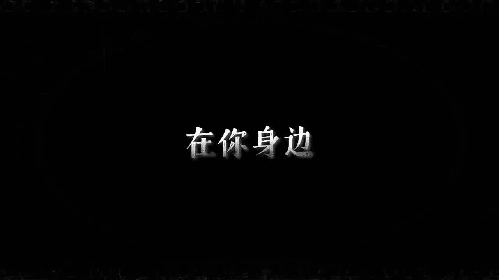

📹【Datawhale AI+X】拯救SE计划落地：01：我的vlog课程介绍


在本节课中我们将学习【Datawhale AI+X】拯救SE计划落地的基础内容，主题围绕“我的vlog”展开。这篇教程专门为初学者准备，不需要任何专业背景，所有概念都会用大白话逐一讲解。我们会从课程目标出发，聊聊理想方向，然后再谈谈路上可能遇到的困难，最后讨论如何记录情感和日常体悟。希望你在看完之后，能对整个vlog计划有一个清晰的认识，并知道接下来该怎么做。


### 1.1 课程目标与理想方向


上一节我们简单介绍了本课程的整体背景，本节中我们来看看具体的学习目标是什么，以及理想应该放在哪个方向。




以下是课程目标的详细说明：
- 在你身边路虽远。这句话表示，即使身边有人陪伴，前方的路依然很长，不能轻易觉得已经到达目的地。
- 会配给。这表示资源或者任务会被分配下去，大家各自承担一部分。
- 不能。这表示某些事情是做不到的，需要我们提前知道自己的局限。
- 愉快被爱在身边。这表示在身边被爱会让人感到愉快，是学习过程中的情感支撑。
- 目标退完让理想永远在前面。这表示当前目标完成之后，理想依然要摆在前面，指引我们继续前行。


核心公式：`理想位置 = 目标位置 + 前方偏移量`


在实际操作中，你可以把这个公式理解为：每完成一个目标，理想就会向前移动一段距离，永远保持一定的前进动力。


### 1.2 路途中的困难与心态调整


在明确了目标方向之后，我们接下来要面对的是路上的各种困难，以及如何调整心态来应对这些挑战。


以下是主要困难清单：
- 路从崎岖。道路一开始就并不平坦，充满了坎坷和不确定性。
- 分坑一段接一段。路上出现的坑洞一个接一个，需要我们逐一跨越过去。
- 如过高方另一方却又见。如果目标定得过高，另一边反而会再次出现，说明目标难度需要适当降低。
- 不怕受磨。不害怕被磨损、磨练，困难反而能让我们变得更强。
- 时疾风吹呀吹，尽管给我略考验。强风吹拂时，只是给我们带来一点点考验，不必过度恐惧。
- 小雨点放心洒早已脱失。小雨点随意洒落，有些事情早已迷失或无法挽回。
- 恨着次。对某一次特定的经历感到憎恨或不满，这是正常的情绪反应。


心态调整的核心公式：
`心理承受力 = 困难等级 × 正面思考程度`


当困难等级提高时，我们需要通过更多的正面思考来保持心理平衡。只有接受磨练，才能在崎岖的路上走得更远。


### 1.3 情感记录与日常体悟


除了克服困难，记录情感和日常体悟也是vlog创作中非常重要的一部分，本节中我们来看看如何把生活中的喜怒哀乐转化为有意义的内容。


以下是情感记录的关键点：
- 愿一生中苦痛快乐。希望人生中既有痛苦也有快乐，两者缺一不可，共同构成完整的人生体验。
- 太意。这句话说明某些事情意义深远，含义丰富，值得我们花时间去思考。
- 愿将欢笑声盖演苦痛那一年。用欢笑声去覆盖那段痛苦的岁月，让快乐成为主旋律。
- 悲也好喜也好，每天找到新发现。无论是悲伤还是喜悦，每天都能从中发现新事物，保持好奇心。
- 转又转。事情总是在不断地变化和转折，我们需要随之调整节奏。
- 风中想算无泪赏花快乐回旋无用计构快欣赏身边美丽每一天还愿确信美景良辰再家。在风中思考时不流泪，赏花感到快乐并回旋，即使是无用的计划也能构建快乐，欣赏身边每一天的美丽，还希望确信美景良辰，最终回家。
- The。这是一个英文代词，用来指代某个特定的事物，在代码或记录中经常出现。


核心代码示例：
```python
每日记录 = {
    "天气": "晴朗",
    "心情": "愉快",
    "发现": "新的拍摄角度",
    "备注": "悲也好喜也好，每天都有新发现"
}
```


通过这样的记录方式，你可以清晰地看到自己的情绪变化，以及生活中的点滴发现。


### 1.4 课程小结与后续建议


在学习即将结束时，我们需要回顾前面学过的内容，并为后续的学习打好基础。


以下是本节课的核心要点回顾：
- 目标设定要让理想永远在前面，不要在完成一个目标后就停止前进。
- 路途会崎岖，会有坑和风雨，但不怕受磨，心态决定能否走得远。
- 情感记录要包含痛苦和快乐，悲喜交织才是真实的生活。


代码示例，总结学习心态：
```python
学习心态 = {
    "目标": "理想永远在前面",
    "困难": "不怕受磨",
    "情感": "苦痛快乐共存",
    "结果": "每天找到新发现"
}
```


希望这节课能帮助你更好地理解拯救SE计划落地的意义，以及如何用vlog记录自己的成长历程。


本节课中我们一起学习了【Datawhale AI+X】拯救SE计划落地的课程介绍内容，包括课程目标与理想方向、路途中的困难与心态调整、情感记录与日常体悟，以及课程总结与后续建议。希望你能把这些概念应用到实际的vlog创作中，在未来的学习和生活中不断发现新事物，保持前进的动力。

