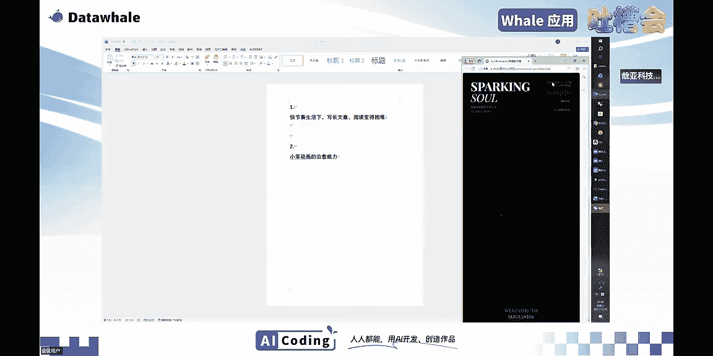
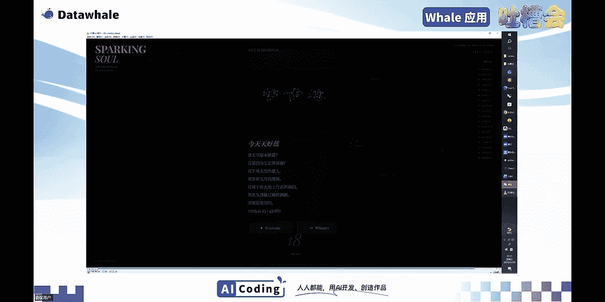
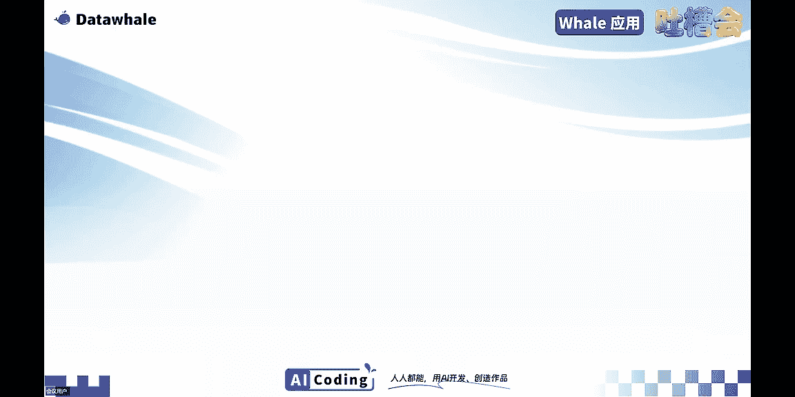
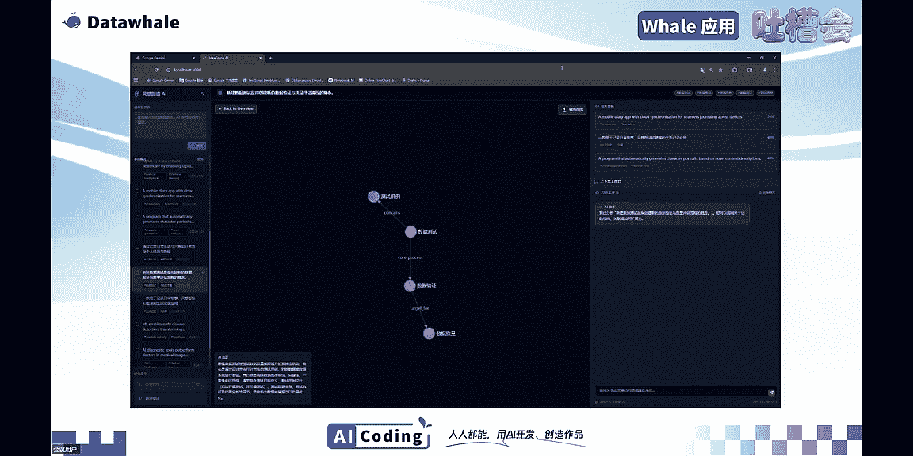
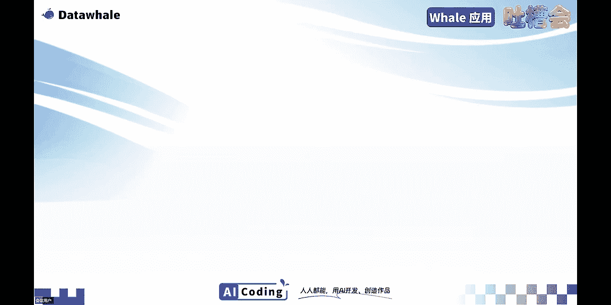
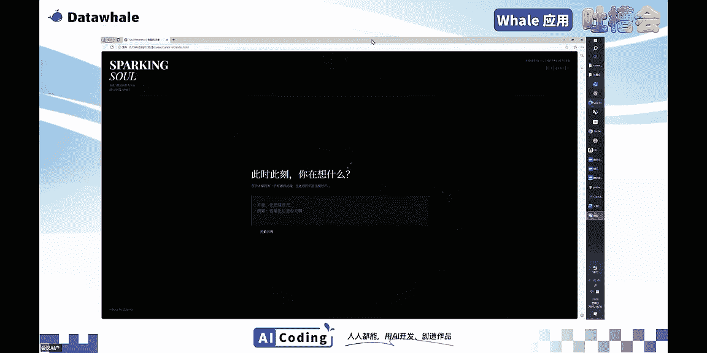
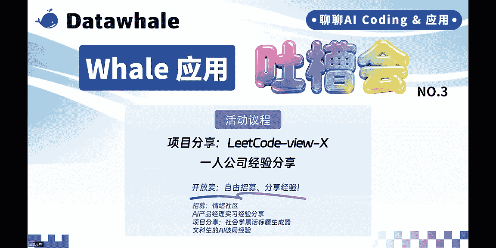

# 🌟Datawhale AI+X文字情绪社区SparkingSoul高敏感人群社交：01：项目起源与核心功能

在本节教程中，我们将一起学习文字情绪社区SparkingSoul的项目背景、核心创意、具体功能逻辑以及相关的行业产品。这个项目来自一位开发者，她平时从事建筑和首饰等实体设计工作，最近才刚刚开始接触Web编程。她之前完全不了解互联网技术和编程知识。在开始学习Web编程之后，她发现只要有想法，就可以通过代码把它实现出来。不过在独立开发的过程中，她遇到了很多问题，尤其是不明白AI开发工具生成的代码到底在表达什么逻辑。因此她希望能找到合作伙伴，一起开发项目、一起学习进步，弥补个人视角不足和专业局限性。

接下来我们来看看项目是如何产生的。

讲者最近接触到了一个名为Jaman Three的工具，发现它能够构建比较完整的项目，所以决定先分享这个作品。这个作品的核心建立在两个想法之上。

第一个想法关注快节奏生活下长信息难以摄取的问题。在短视频和自媒体高度发达的今天，人们越来越难以阅读长文章和长句子。在描述事物时，很少能说出像学生时代那样优美的句子。看到美丽的风景时，往往只能说出“好美”或“厉害”这样的简短词语。讲者注意到一些短视频抓住了这个痛点，拍摄了相关短剧并获得了很高的热度。因此她提出一个设想：能否让用户随便输入一句话，哪怕只是最朴实的语言，AI也能帮助把它扩写成一段丰富的句子。

第二个想法关注动画的治愈能力。在快节奏、高压力的社会环境中，简单的线条小图形变得非常有吸引力，比如线条小狗、小狗蛇等简笔动画。这类简单动画配合音乐制作的短视频很容易走红。讲者希望把这两个想法结合起来：用户输入一句简单的话，AI帮助扩充句子，再根据扩充后的内容生成一个非常简短的简笔动画。

以下是项目的核心处理公式：

[核心处理公式]
用户输入简单句子 → AI进行语言扩写 → 生成简笔动画 + 背景音乐 → 存入个人情绪星系 → 吸引同频用户

这个社区被命名为SparkingSoul，意思是灵魂共鸣社区。目前的Demo版本尚未接入大模型，所有的数据都是讲者提前预设好的。下面是演示流程：用户输入“今天吃了碗好好吃的面”，AI帮助扩写，界面生成对应的视频和音乐。由于尚未接入视频和音乐大模型，这部分暂时使用内置的示例特效动画。生成后的文章可以储存到用户自己的心系中。

接下来我们看看界面的表现形式。

每个用户在情绪灵感宇宙中拥有自己的坐标，并且会形成个人的心系。当发布的内容越来越多，比如从一条增加到十条、二十条，界面会出现更多与用户同频的宇宙，并向用户聚集。用户可以看到其他人发布的信息，并点击观看。目前展示的数据都是内置的虚拟数据，内容还不是很丰富。

以下是界面状态的变化逻辑：

- 未发布任何内容时：界面显示为黑色背景
- 发布两条内容后：星系开始聚集，界面逐渐变得丰富
- 发布更多内容后：出现更多同频星系，形成个人情绪星系

整个社区的设计形式是一个灵感和情绪的共鸣宇宙。除了上述功能，讲者还准备了一段小视频来演示整体效果。视频中展示：用户可以输入任何一句话，比如“大象会说话”或者“今天吃了碗超好吃的面”，AI都能帮助把语言丰满起来，生成带有音乐的动态视频，并发送到宇宙中，最终形成自己的情绪星系。随着在宇宙中活动越来越多，身边会慢慢聚集同频的星系。用户还可以进入其他人的星系参观、点赞、评论，并与同频的人交流。

以下是视频中展示的典型输入示例：

- 莫名其妙的句子：如果大象会说话
- 日常感慨：今天吃了碗超好吃的面
- 极简表达：好美、厉害、YYDS

讲者认为AI的出现，让人们更加依赖AI来快速解决问题，包括写文章、画画、创作等。既然无法跳脱出这种现象，不如顺应这个规律，把当下的感受告诉AI，让它带领我们走进更深的情绪共鸣，从结果中扩宽语言、图像和声音的想象。当心中积累了足够多的灵感，界面也会变得丰满起来。

接下来我们讨论技术现状和演示中使用的工具。

讲者提到录屏使用的是Focus C软件。这个软件在电脑上进行交互时，基本上都能自动记录下来。特别是在鼠标点击的时候，它会自动放大，所以节省了很多剪辑时间。不过这个软件是收费的。在开发过程中，讲者直接把谷歌上的参考网站喂给AI，要求AI按照这个网站的方式制作类似效果。演示时使用的浏览器左上角工具是Gemini。

以下是演示中提及的工具列表：

- Focus C：录屏软件，支持自动记录和鼠标点击放大
- Gemini：浏览器辅助工具
- Jaman Three / Jaica：用于语言共鸣和内容生成的AI工具

接下来我们看看社区运营与用户增长的设想。

目前Demo阶段尚未考虑从零到一的用户扩展，但讲者有一些初步想法。因为情感社区生成的都是内容，如果内容足够有趣，可以发布到社交媒体上面，看能不能吸引人来共同尝试使用，慢慢地建立用户群。这只是目前的一个设想，是否成功还不确定，但发布出去后的浏览量还可以。

以下是社区扩展的初步思路：

- 通过社交媒体传播有趣的简笔动画内容
- 吸引注重视觉效果的用户尝试产品
- 逐步扩大用户群体

接下来是功能细节补充与交互说明。

整体功能很简单。界面会询问用户：“你此时此刻在想什么？”用户可以输入一句很简单的话，比如“我觉得Jaman这个软件很好”，如果想把这句话表达得更丰富，或者想表达更充沛的情感，就可以要求AI来扩写。扩写出来之后，界面上的视频和音频播放区域会根据生成的内容，自动生成一个简单的简笔动画。当然，这个功能目前还没有实现，讲者都是使用内置程序。

当生成了一个简单的、治愈性的小动画之后，用户可以选择把这个动画分享到社交媒体，同时也可以把这一段记忆储存到自己的星系里面。当在宇宙的星系中发布越来越多内容时，用户会发现身边开始聚集一些与自己同频的星系。这个同频的星系，可能是根据输入句子中的关键词关联性吸引过来的，也可能是根据情绪方向吸引过来的。因为讲者在使用Jaman生成内容时，发现AI在思考时会识别其中包含的悲伤等情绪，或者关键词，然后生成同类型的语句。因此他人的心系，可能是根据关键词或者情感方向，慢慢吸引过来的。

以下是同频星系聚集的影响因素：

- 输入句子中的关键词
- 情绪或情感方向
- AI对语义的理解结果

用户可以进入其他人的心系里面去参观，然后点赞或者评论。这相当于形成了对外社交的扩充。用户也可以直接回到自己的星球，重新记录当下的敏感感受。界面上面会有一些交互，比如跟随鼠标不停移动的元素，其实是用户自己的星球，所以它和鼠标有强互动性。其他地方则会发现，当输入的内容越来越多时，界面一开始是黑色的，在没有发布任何一句话时也是黑色的，但发布了两句话之后，星系就会开始聚集，界面逐渐变得丰富。这就是整个的逻辑。

接下来讨论安慰功能与正能量生成。

有小伙伴建议是否可以增加安慰功能，也就是说，当用户输入情绪不太好的内容时，AI能生成一些安慰性的内容。讲者也有在想，未来可以扩展生成内容的功能，比如用户可以指定需要什么风格，或者输入一句很负能量的话，AI能把它改造成非常正能量、互动性很强的内容。讲者最初有这个想法，是因为在高铁上无意间刷到了一个小动画，表达“你长得很大，我长得很小”，这个动画非常有治愈能力，或者是非常正能量的小视频形式，让每种情绪都有一个存在和回应。

以下是未来内容生成的可能扩展方向：

- 指定生成风格：正能量、安慰、治愈等
- 输入负面情绪后转换为正向表达
- 增强生成内容的互动性

接下来是图片输入与反向扩写的构思。

讲者也考虑过反向逻辑：用户拍摄到美丽的夕阳或湖面照片，通过图片上传模式，让AI帮助扩写此刻的感想或句子。整体的大体逻辑框架目前保持不变。

以下是图片输入的可能流程：

[图片输入流程]
拍摄照片 → 上传图片 → AI扩写感想句子 → 生成简笔动画 → 储存至星系

接下来介绍另一位小伙伴的项目与合作可能。

另一位小伙伴分享了一个相似的项目，用于记录灵感，类似知识图谱。这个产品可以从书写的内容中提取关键词和概念。当多个想法拥有相同的关键词时，就可以碰撞、融合、拆分。讨论的时候，也可以把这些内容都丢给AI去讨论。讲者觉得这个项目和她的项目比较像，一个是星系的概念，另一个也是记录内心的想法。未来也有机会做成可以分享的社区概念。两位开发者可以交流，甚至合并项目，或者把项目做增强。

以下是两个项目的相似点：

- 都有星系或宇宙的社区概念
- 都用于记录内心想法或灵感
- 都计划引入AI进行内容处理
- 未来都希望发展成可分享的社区

接下来介绍Second Me等相关产品与行业背景。

在社交性方面，讲者提到了一个名为Second Me的产品。这个产品的社交性比较强，它会通过提问，根据用户的性格克隆一个AI分身，然后让AI分身代表用户去和其他人交朋友。讲者在Google活动摆摊的时候，旁边就是Second Me。她之前在We Alone社区里了解到Second Me，We Alone有点像Second Me的第一层，是通过聊天记录来微调大模型，然后克隆人。讲者当时就是通过We Alone又了解到了Second Me。Second Me的创始人也在2050谈会上面分享过一些思路和想法。

以下是Second Me的核心机制：

[Second Me机制]
用户回答问题 → AI根据性格克隆分身 → AI分身代表用户社交

最后，讲者表示如果有小伙伴对这个项目感兴趣，可以加入她，一起来开发。目前这个项目还处于Demo阶段，感兴趣的朋友可以联系她。她还有其他的很多项目想法，但可能其他项目比这个复杂一些，所以建议大家先把这个简单的项目做完，然后再去开发其他有趣的想法。

本节教程中我们一起学习了文字情绪社区SparkingSoul的项目背景、核心创意、功能逻辑、技术现状、社区运营设想以及相关行业产品。希望这些内容能帮助你理解这个以情绪共鸣为核心的社区项目，并为你的开发实践提供参考。

