# Datawhale AI+X 文档解析新范式：01：从恢复文字到构建关系 📄

在本节课中，我们将要学习文档解析的核心概念以及它与世界模型的关系。课程会先介绍传统的 OCR 技术，解释为什么现在的文档解析不仅仅是把图片里的文字识别出来，还需要恢复文字之间的关系和布局结构。接着我们会介绍目前市面上几款比较热门的文档解析模型，看看它们各自的特点和适用场景。最后，我们会讨论如何根据实际任务选择合适的模型，以及坐标还原在多模态任务中的作用。

### OCR 与文档解析的基本概念

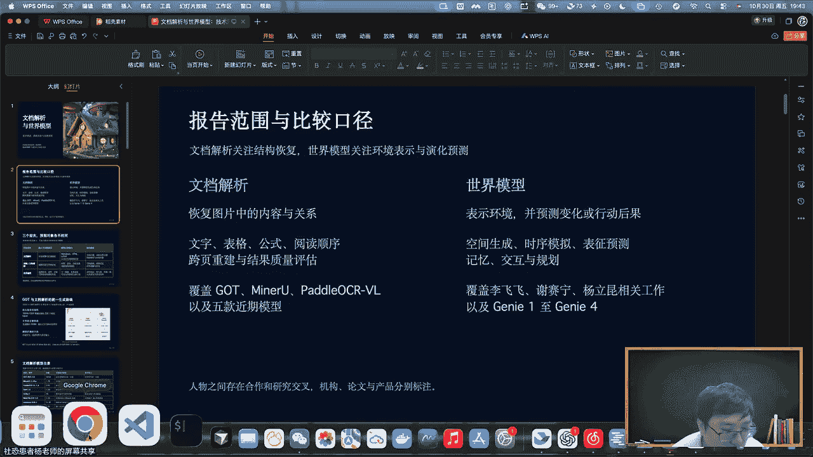

文档解析和世界模型到底是什么样的概念？我们先来看 OCR。OCR 的中文意思是光学字符识别。这是一个很老的技术，已经发展了十几二十年了。以前的 OCR 主要实现一个功能，就是把一张图片中的文字识别出来。

比如我们常用的微信里面就有这个功能，你选择一张图片，使用识别功能，就可以把图片里的文字全部提取出来。这在日常生活中非常方便，比如拍一张书本页面，就能变成可编辑的文字。不过，到了 2024 年，大家逐渐发现，我们想要的不仅仅是恢复图片中的文字内容。

`OCR(图像) → 提取的纯文本`

### 为什么需要从 OCR 进化到文档解析

我们需要知道图片中内容和内容之间的关系。比如大量的表格，大量的公式，以及它们之间的对应关系。

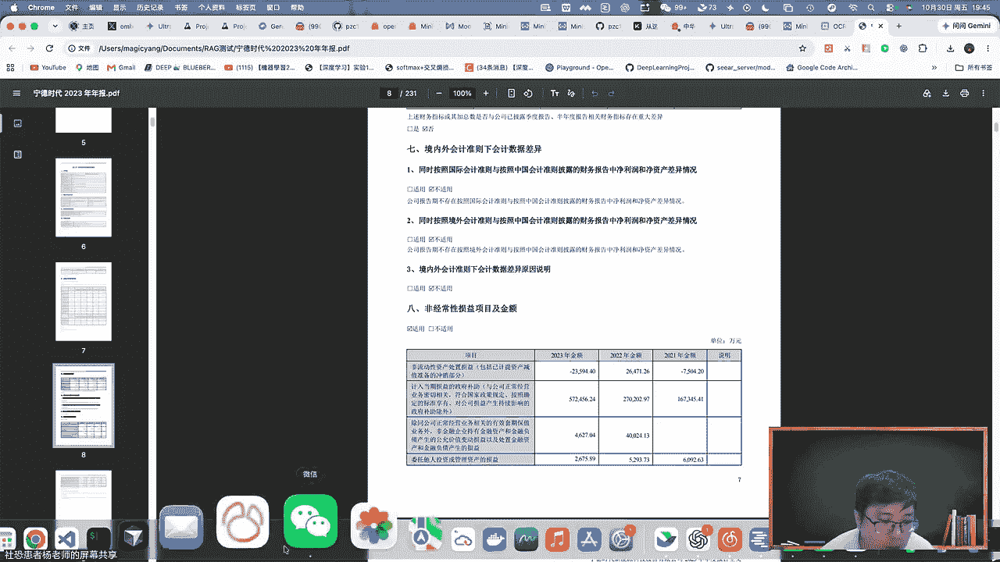

举个例子，假设我们要查看一家公司的财务报表。报表里面有很多表格，这些表格里面的数字如果单纯提取出来，虽然没问题，但如果不知道这些数字对应的是哪一年，这些数字之间的意义就完全不存在了。

比如，如果把调整前的数字看成了调整后的数字，差别就会非常大。还有，2023 年的金额和 2021 年的金额，数字可能不一样，但是如果对应的年份信息丢失了，就会产生很多错误。

从 2024 年开始，OCR 进化成了另一个词，叫做文档解析。什么意思呢？就是在做文字提取的时候，不仅要把里面的内容和文字全部识别出来，还要恢复它的布局。

比如数字和哪一年对应，列表表头有没有对应关系，对应关系有没有错位，也就是说要恢复原本的顺序和阅读顺序。比如那些打勾的信息有没有，标题的信息有没有还原出来。

为什么要这样做？因为从 2024 年开始以后，大量的 OCR 识别出来的文字不是给人看的，而是给 AI 看的。如果表头信息和表格内部的数字错位，就会出现严重的偏差，产生幻觉和错误的结论。所以，从 24 年开始，发生了一个很大的变化，就是从单纯的恢复文字内容，转换成恢复固定构件之间的关系。

`文档解析(图像) → 结构化信息(Markdown/HTML) + 布局与阅读顺序关系`

### 文档解析与世界模型的关系

那文档解析跟世界模型有什么关系呢？文档解析是要恢复图像中的这些区域以及特征，还原成 Markdown、HTML 或者其他结构化的信息。世界模型也是从视频、空间或者视觉上进行理解，然后进行结构化的输出，保证阅读顺序的内容完整。

从这个方向进行迁移，我们会发现在物理世界中，世界模型非常重要。为什么？因为如果我们只单纯提取文字或者提取代码，这种数字世界的内容，无法解决物理世界里的一些物理规律。

比如，我们要让一个机器人去拿一个东西。如果他不知道这个东西是玻璃的，是易碎的，可能会用很大的力去捏，整个物品就碎了。这种物理信息是无法单纯靠文字或者语言让模型学习到的。

所以，世界模型需要观测历史动作，记忆空间位置，感知周围环境的状态。世界模型是一整套序列的建模，包括表征，包括交互场景。它对于真实世界，特别是物理世界的影响非常重要。这也是为什么特别是巨神智能之后，发展方向从原来的 VLA（视觉-语言-动作）转移到使用世界建模的方式来做机器人。

`世界模型(视频、空间、视觉输入) → 结构化输出 + 物理状态与空间位置记忆`

### 主流文档解析模型介绍

接下来，我们来看看目前主流的文档解析模型。以下是几款比较有名的模型及其特点。

从最开始的 OCR 到后面有名的模型，包括最近刚发布的这几款模型：OCR 模型、missC 模型、limit 模型、iceR 模型等。我们发现它们的参数量都不大，只有几B 的参数量。但是性能非常强，可以打败像 300 多B 参数的大模型。这就是小参数的特定场景训练过的模型，能力并不比那些特别庞大的通用模型弱。

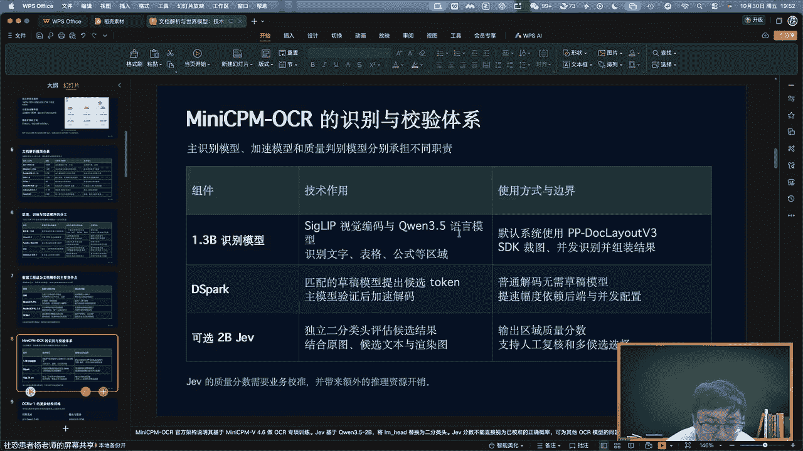

以下是主要的技术路线分类：

第一种是统一编码的思路。把所有的信息都进行编码，图片进行编码，然后统一进行识别。典型的就是像 OCR 以及后面衍生出来的 limit OCR 这样的思路。

第二种是两阶段的思路。比如像 missC 以及 R 以及像 OCR，都是两阶段的。第一阶段先去识别布局情况，先有一个模型去识别文档里面是表格、图片还是带文字的文本框，然后分类处理。带文字的，用 OCR 进行解析。如果是纯图片，就切图出来识别。

第三种是传统的 OCR 思路，不使用多模态模型做基座，只需要传统的 CPU 就可以运行。基础训练范式还是基于 CNN 卷积的思路，分人工标注。比如表格走表格解析，公章走公章解析，文本走文本解析，然后再去做布局还原。

### 具体模型能力解析

以下是几款具体模型的能力表现：

missC 模型使用了 RSI 的思路，会把失败的样本进行筛选，然后归类和归因，主要做多一致性的校验。对弯曲曲折的文档解析效果比较好。

OXR 模型对其进行了大量的 SFT 和强化学习，对稳定性和识别效果更好。

iceR 模型主要做了很多合成类的文档，面向表格和图表类，效果会更好一些。

CPMOCR 模型是前天刚刚发布的一款 1.3B 体量的模型，主要使用了千问 3.5 的语言基础模型，配备了 missBM 自演的 SLIP 这样的视觉高效编码的 ViT 视觉塔。它对于文字、表单、数学公式、文言文、繁体字都有非常强大的识别效果。

### 实际案例展示

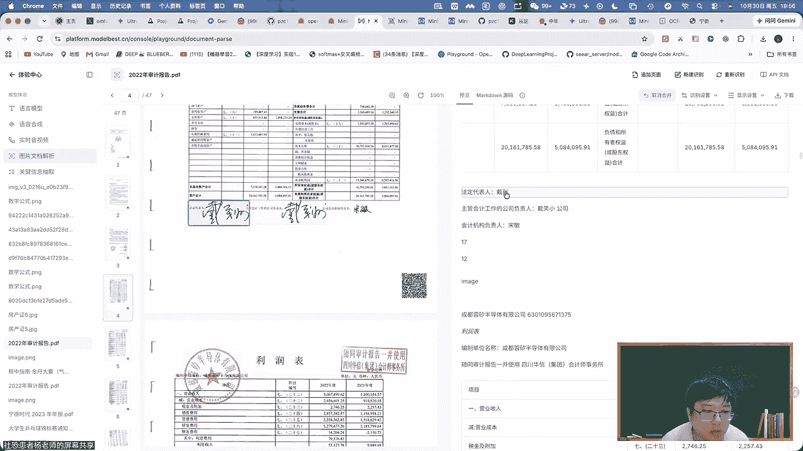

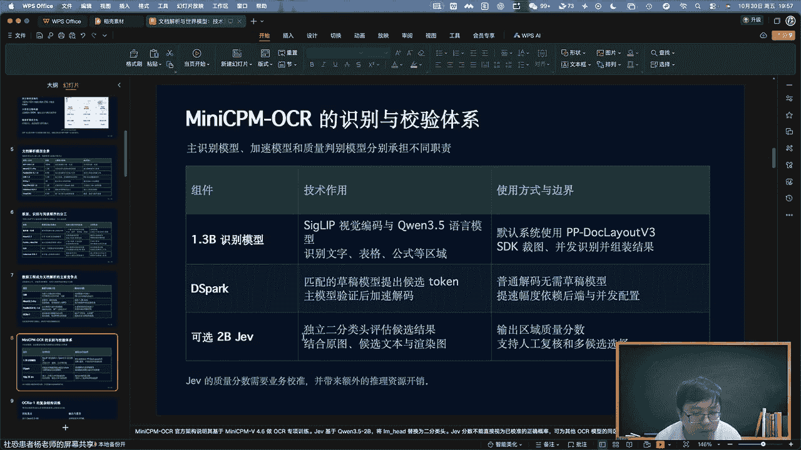

我来给大家展示一下实际上跑的一些效果。我之前跑了很多 CPMOCR 的测试文档，包括文言文、各种高难度的文档。

比如一个上海古籍出版社出版的文言文书籍，是扫描件，上面带很多印章和不清晰的地方，包括很多术语和繁体字，还是简竖排的情况，有很多模糊的部分。面对这种有很多图表、印章和繁体字的内容，OCR 的还原效果都非常不错。

再比如一个非常糊的房产证复印件，再加上拍照扫描，还带着公章，它都可以把里面绝大部分的文字还原出来。当然少部分可能会有一些误差，但是核心表格上的信息都能基本正确还原，这已经是非常强大的能力了。

还有数学公式，比如很复杂的数学公式笔记，还原效果也非常好，可以基本上把数学公式所有的细节都还原出来。带英文、带手写的数学公式也可以比较好地还原。

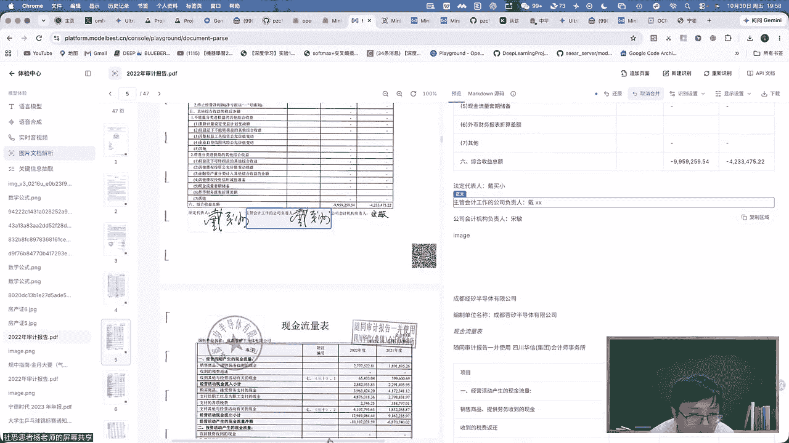

CPM 模型还有一个强大的能力，是倾斜文档的处理。比如一个倾斜了大概十几度的文档，不是笔直朝上朝下的，会有自动适应的按钮。点击以后，它可以把文档自动旋转到合适的朝向，然后再进行文档解析。这个功能在宽表的情况下特别有效。

再看一个真实的财务报表文档，里面有很多带公章的部分，也能识别出来。还有手写体，这是所有 OCR 模型特别难的一点，因为有些人写的字他自己都不认识，不能保证 AI 也能认识。比如医生手写的病历，可能全世界只有他自己能看懂。但是像这种影印件扫描件，OCR 模型基本上可以把表格的数字还原出来，效果还是不错的，并没有丢失信息。包括法定代表人这种带手写体签名的部分，当然这部分会有错误，但可以接受，因为可以人工复核。

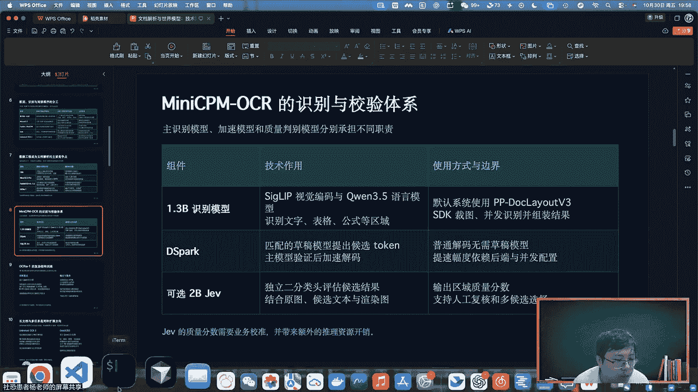

### 置信度与人工校验

CPM 模型配备了一个 2B 的模型，对所有输出的结果打分，打一个置信度。比如每一个文本框会输出一个置信度，比如说这个文本框置信度打到 60%，就是可能不是特别高的分数，我们就可以人工再去看一下是不是识别错了。

比如这个文本框识别错了，我说这个代买小是不是这个人名，包括这个曹伟也是不对的，证明显是错误的。因为这两个人是一个人，这个名字肯定是错的。这个时候我们就可以输出置信度以后，人工再去校验，然后修改，保存。

这样的话就把 OCR 里面最麻烦的一部分，就是人工审核校验的工作大大减少了。比如这种表格，它的自信度如果输出是 90% 以上，我们就可以认为是高可信度的，给人工就不用那么仔细，甚至大概看一下就可以过去了。或者是低一次置信度的，比如说只有 10% 或 20%，那么人工就多看一下，这样大大减少了人工复核的工作量。2B 模型最大的特点是，它不负责输出原因，它的只负责输出一个概率。

`置信度 = 模型输出概率 ∈ [0, 1]`

### 模型对比测试

我还做了几个武大社区的案例比较。比如比较 missC OCR 以及 limit OCR 这两个模型。上传一个随手拍的有褶皱的文本，上面是一个龙华区的公告。missC 返回的效果挺快的，标题和内容基本都可以有效还原。

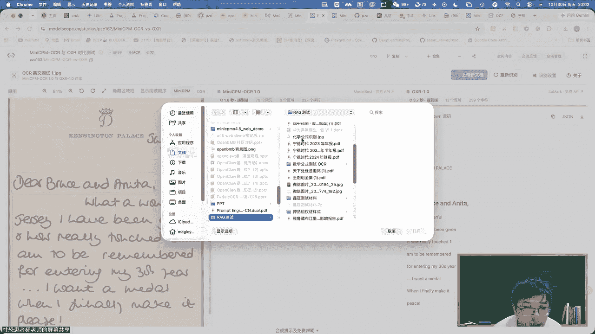

对比 limit OCR，百度团队的模型做了很大的创新，可以做到无限上下文，但是识别效果确实有一些不尽人意。比如标题部分没有说出来，文本上面最顶上的文本也丢失了。所以不同的技术路线有各自的优劣，大家可以根据实际效果选择。

再比较 missC 和 OXR。这是一个推特的截图。miss 模型把上面这部分认为是张图片，截取出来还原最顶上那个位置就可以了。但是 OXR 模型认为这是一个要处理的任务，所以这部分基本被忽略。其他部分正文的话，对于这种截图来说没有特别大的难度。

再看化学公式的一个案例。第一个它是旋转 90 度，非常糊的拍照，第三个有很多化学公式和配图。遇到低清晰度的时候，旋转比较容易出错。missC 模型会比较慢一点，还要排队。在不同的 case 里面，解析的结果还是会有差异化。miss 模型丢的信息会多一点，OXR 模型保持的会更全一些。

再看一个手写题的案例，看一个英文的比较难的。这是一个非常复杂的文档，几乎除了作者本人，可能别人都识别不出来写的到底是什么。missC 还是可以去识别出来，当然错误率比较高。但是 OXR 把它整个当成了一张图片来处理，就没有办法识别出其中的内容。这是两个模型体上的差别。

### 长文档与跨页表格处理

OCRE 模型做了很多表格处理，参数量比较大，有 4B。特别是对于复杂的跨页表格，处理会更好一些。长文档这部分是 limit OCR 2.0 擅长的方向。

因为 limit OCR 2.0 的团队源自于 DCR 魏浩然他们那一组。魏浩然从 DCR 出来以后去了百度千帆，担任了 limit OCR 模型的研发，改了注意力机制，做了稀疏注意力，做了非常高的视学编码压缩，把整个文本长度做了非常大的扩展，适合特别长的文本解析。

Office OCR 也是基于千问 3.5-8B 的语言模型，做了很多训练，特别是在 5 个 4B 的教师模型数据去蒸馏到了学生模型，然后进行混合任务的强化学习，实现了 OSOCR 3.0。

OSOCR 的跨域表格重建，分成三个部分：从逐页进行解析生成 Markdown，然后把相邻的两个页进行重建，恢复表格口尾衔接的关系，最后进行递归扩展。它对于跨表格这部分做了垂直性的训练。

### 文档解析的现状与评估边界

目前整个文档解析模型的大家会发现最近发的几个型基本上都被刷爆了。所有的 OCR 模型分数都非常高，特别是像真实拍摄的文档都刷到了 95 分以上。如果一个榜单大家都得到了 95 分以上的成绩，很难评判优劣了。

所以目前来看，顶尖模型在基础文档和简单文档的识别上，能力拉不开太本质的区别。如果你是 Word 或者 Excel 转成的，基本上都能很好还原和解析。但是手写体识别都是地域版的难度。

要看你输入的文档质量如何，拍摄是否清晰，是否很糊，有没有反光、折射、旋转。还要看手写体到底是可识别的还是不可识别的。比如刚才展示的英文手写案例，基本上就是不可识别的类型。无论哪个 OCR 模型上来，效果都不会好。只是看你对它的接受度怎么样。

包括手写体签名，这种一定会产生错误。但是 CPM 模型会返回一个置信度帮助人工复核校验，这是其他模型没有实现的，是一个比较突破性的创新，能帮你进行大量复核的时候减少时间。

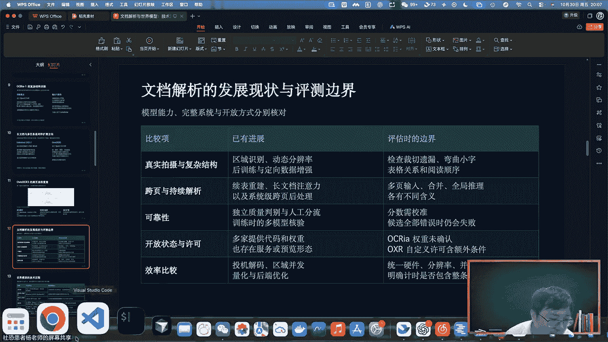

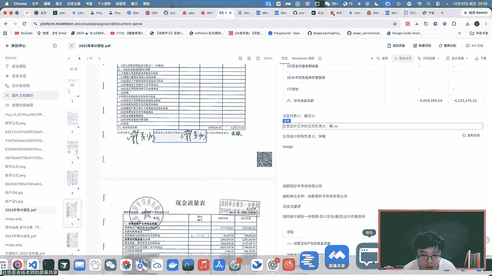

### 如何选型

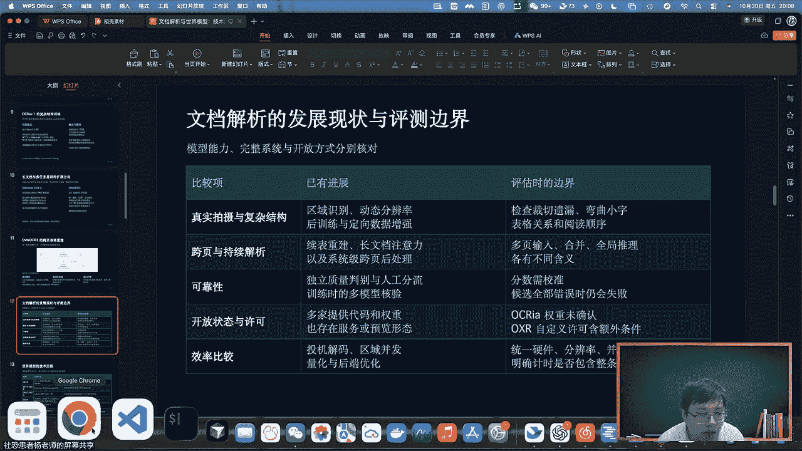

在进行选型的时候，需要根据下游任务来进行选择。因为不同的下游任务对于模型能力还是有要求的。

比如你是一个数学老师，那对于公式识别这部分要求就会比较高一些，包括各种公式的还原程度。

再比如你是在财务和企业里面工作的，那可能是对于像证照识别类的要求会更高一些，包括财务报表，这种识别的要求会高很多。特别是上市公司的财报，还有非常多的打款表。可发现这里面有非常多的大表，数据非常多，这个时候就很吃模型的解析能力。

比如这里面有合并单元格的情况，有跨越表格的情况，能不能实现跨越表格的合并以及单元格合并的呈现，就非常重要。有些模型可以完成自动跨越表格合并，也可以保留拆开来的状态。这是模型能力很重要的一点，就要看下游任务是什么去决定模型。

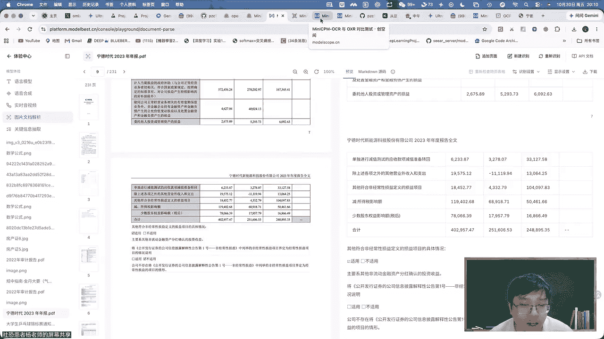

我觉得最好的方式就是去测，看 benchmark 的指导意义，真的是微乎其微了。如果大家对于模型能力认知还不太了解，还要纠结选哪个比较好，最简单的方式就是拿你的素材，你的下游文档去进行比对，像这种两个模型来互相 PK，这是对模型能力认知最快、最简单、最直接的方式。

### 坐标还原与多模态回归

接下来跟大家看一个比较好玩的事情。就是有同学会问多模态回归坐标有什么经验分享。其实是这样的，多模态回归坐标都依赖着版式识别的能力。

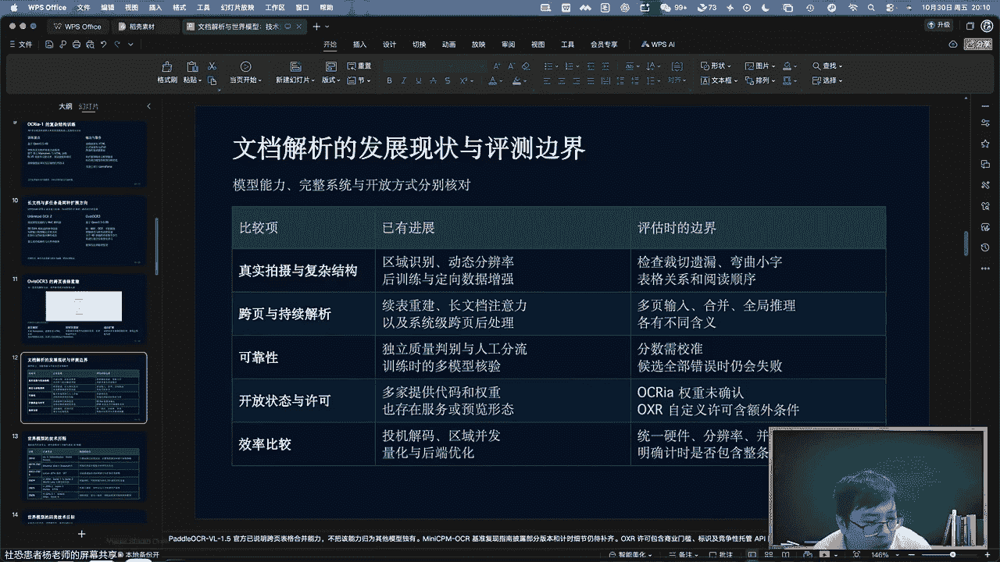

举个例子，我们要去还原表格的坐标，它一定是先有一个类 Out 的模型。比如这里面就有一个类 Out 的模型去定位，定位的话它会识别四个角，左上角、左下角、右上角、右下角四个角的一个坐标。这样的话才能给它进行定位，定完之后干嘛呢？就是还原阅读顺序。比如这里面这个坐标是最顶的，那我们会发现去还原顺序的时候，这个表格应该放到最前面。所以基本上还原坐标不是靠多模态模型，而是靠版式识别模型。

行文坐标也是类似的。也是把一个文本框来进行独立的识别，然后把文本框的左上角左下角右上角右下角坐标记下来，然后再对它进行还原。你会发现行文这部分的内容换行的逻辑不会跟文本框保持一致。比如这样，它不是保持一致的，而是把整个文本框所有内容变成识别为一行。它不是按原文的断句的，比如这里换行了，但是还原之后的文本，会把整个文本框视为一行来处理。像这种换行是因为它展示不下来，如果能展示下来会回归成一行，是展示的问题。实际上就是把它当成一行来处理。

所以这种技术路线就不会把换行作为一个需要精度到这个点的一个部分，除非调整类 Out 模型的识别精度，把一行认为是一个文本框，下面这个部分是一个文本框，这样就能精确还原文本框内的信息。但这块需要设置类 Out 模型参数来实现。

单独多模态可以直接做行坐标吗？比较难。因为多模态模型有个最大的问题，就是对于宏观的识别很好，像这种坐标这么精细的部分，反而不擅长。反而是需要布局模型来处理。布局模型才能把文本框进行精准定位。多模态模型的定位能力，相比于布局识别模型是比较差的，就是有区别的。

### 结尾总结

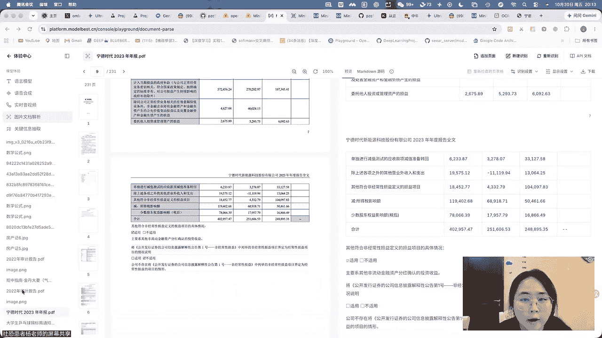

本节课中我们一起学习了文档解析的基础概念，了解了 OCR 如何从单纯恢复文字内容进化到恢复文档构件之间的关系，以及文档解析与世界模型的联系。我们介绍了目前主流的几款文档解析模型及其技术路线，通过实际案例展示了不同模型在表格、公式、手写体、倾斜文档等场景下的表现，也讨论了置信度机制如何减少人工校验工作量。最后，我们探讨了如何根据下游任务选型，以及坐标还原在多模态任务中的实现方式。希望这篇教程能帮助你更好地理解文档解析的新范式。

