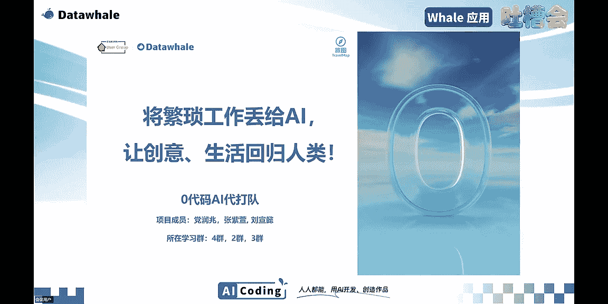

# 旅图TravelMap：AI生成个性化旅游规划：01：项目背景与团队介绍 🚀


在本节中，我们将介绍旅图TravelMap项目的基本情况，以及负责人和团队成员的背景。

大家好，我是旅图TravelMap项目的负责人党日照。在正式开始之前，我先跟大家介绍一下我们团队的基本情况。我们团队的成员除了我之外，基本上都没有代码编程基础。每个人都有自己不同的专业背景，并不是计算机专业出身。这次我们之所以决定参加这个项目，主要是想借助Datawhale这个平台来学习AI coding技术。在整个项目过程中，我们从一开始就抱着零代码编程的目标，把所有的编程工作全部交给AI来完成，想看看这个项目最终能做到什么程度。这个目标对我们来说非常有挑战，因为我们中没有人是专业的程序员，但我们非常好奇AI在编程方面能发挥多大的作用。


# 旅图TravelMap：AI生成个性化旅游规划：02：用户痛点与市场调研 📊

上一节介绍了团队背景，本节我们来看看用户在旅行规划过程中遇到的困难，以及市场有多大。

我本人是一个特别喜欢旅行的人。在实际出行过程中，我经常遇到两种典型情况。第一种是长途旅行，无论是去国内某个城市玩三到五天，还是去国外旅游，我都需要整合各个平台的各类信息。比如小红书上的路线推荐，权威公众号和官网里的政策以及需要办理的手续，还有从酒店到景点之间的路线规划。我需要把多平台的信息整合在一起，最终制定出属于自己的旅行攻略。对于这种长途旅行规划，我一般需要花费十到二十个小时才能完成。

第二种情况是短途旅行。比如周末想出去放松，在周边城市或者当地进行简单的City walk，或者出差过程中突然空出了大半天时间，想去探索一下这个城市。这时候我会发现，好不容易空出了时间，却还要花一到两个小时去规划路线，会感到特别恼火和心累。还没出门就觉得很累。比如我在高德地图上为武汉标记了密密麻麻的感兴趣点，但一旦开始规划，就会觉得一团糟，很难下手。本来只有半天时间，还要花一两个小时规划，最后可能直接选择在酒店里待一天。

除了规划耗时，还有一个更让人头疼的问题是数据时效性。我曾在小红书上看到湖北美术馆特别有意思，而且它就在湖北博物馆旁边，于是我想顺便去参观。但是那篇攻略是去年的内容，没有显示湖北美术馆这几天正在重新装修。等我到现场才发现美术馆正在装修，进不去，导致我当天的行程全部打乱，只能重新规划后续安排。基于这些经历，我开始思考，能不能有一个能实时整合多平台数据的AI旅行工具。

为了验证这个想法，我们也对定制化旅行市场进行了调研。根据国家文旅部官网数据，去年国内旅行消费超过了5.7万亿元。我们这类AI工具的首批客户应该是青年人，因为他们的接受能力更强。经过估算，18到35岁的出行人员大约占总人数的38%。其中18到26岁更倾向于独自出行，更注重自我体验，平均每个旅行团体大约1.2到1.3人。27到35岁则更愿意和朋友一起出行，平均每个团体大约1.4到1.6人。综合考虑，我们保守按1.4人来估算，结合身边朋友的消费意愿，最终得出24年18到35岁定制化旅行市场至少有291.1亿元的规模。通过调研发现，这个市场还是比较庞大的，因此我们决定进行进一步的竞品分析。

市场容量估算公式：
市场容量 = 总出行人数 × 青年人占比 × 平均团体人数
代入数据：市场容量 ≈ 总人数 × 38% × 1.4 = 291.1亿元


# 旅图TravelMap：AI生成个性化旅游规划：03：竞品分析与产品方案 🎯

上一节分析了用户痛点和市场规模，本节我们看看现有产品有哪些不足，以及我们的解决方案是什么。

在确定项目方向之前，我们团队也深入体验了市面上几乎所有的定制化旅行方案。包括传统的旅行社，携程这类平台也提供一些AI定制化服务，还有市面上的一些AI定制化工具，比如旅行AI，以及只使用大模型进行路线规划的产品，还有做得不错的AI APP，比如圆周旅记。此外，社交媒体、点评平台和地图软件也有相关功能，但每种方案都有各自的痛点。

经过仔细分析，我们发现这个行业主要集中在三个痛点。第一个是个性化差，效率低。第二个是权威信息差，数据可能不是实时的，可能是去年的或者几个月前的数据，滞后性比较高。基于这些发现，我们想能不能用AI大模型去对接各个信息平台，比如地图平台、点评平台和社交媒体，获取实时的地点、景点信息，以及最近的店铺推荐和路线推荐等信息。

综合考虑之后，我们的方案是通过大语言模型来深度理解用户需求，再对接多平台的API，进行路线定制化生成。

下面是我们针对三个痛点设计的具体优势：

- 速度优势：如果只需要简单的一日方案，AI只需要7秒就能生成；如果是完整的定制化方案，用户只需要输入几分钟就能得到结果。而传统旅行社定制需要加微信、发消息，下午至少要数小时才能给出定制化路线。

- 数据实时性优势：我们实际体验过的两款产品是圆周旅记和通用大语言模型。圆周旅记虽然对接了小红书API，但引用的数据是去年的。大模型虽然参考了很多资料，但很多信息不够权威，比如美团这类常用网站根本查不到。我们了解到，有些网站有防爬虫机制，或者内容没有公开到公网，属于私有化，大模型无法爬取。因此我们可以直接对接高德地图、点评平台和社交媒体的API，这样实时性和数据权威性会更高。

- 定制深度优势：现在百度或网页端能搜到的产品，页面很简单，只能输入目的地、出行时间、人数和旅行类型，比如拍照打卡、美食购物等，定制深度比较差。考虑到这一点和用户需求，我们的产品支持在地图上选点，也可以直接在对话框里输入需求，或者两者结合，一对一生成专属线路。这样更贴合用户的实际需求。


# 旅图TravelMap：AI生成个性化旅游规划：04：核心功能演示与应用价值 🗺️

上一节介绍了竞品分析和产品方案，本节通过实际演示来看看具体功能实现得怎么样。

接下来我们直接通过视频来简单了解一下产品功能。这是我们用AI coding搭建的网站，使用kiro进行开发。

下面是一个具体的使用示例。用户输入：我计划去武汉游玩，住在武汉大学附近的全季酒店，参观湖北美术馆、黄鹤楼、武汉博物馆，还有昙花林。我计划玩一天，早餐晚餐，更偏爱精致一点的交通方式。作为一枚吃货，我想体验湖北的特色美食。几秒钟的时间，路线就生成好了。左侧是具体的旅行线路，右侧是具象的地图。

在生成过程中，系统会自动处理一些特殊情况。比如因为湖北美术馆正在维护，地图中的湖北美术馆选点会被自动去除，生成的路线也会在下方提示说明为什么去掉这个景点，因为它最近在维护闭馆。

用户还可以选择模板上传旅行中的美照，并以文案直接导出，或者根据不同偏好生成属于自己的旅行地图。因为开发时间有限，这些功能暂时没有完全实现，目前只实现了主要功能。

这个演示想表达的是个性化定制。现在的AI产品，不管你怎么输入，生成的路线可能都差不多。但我们改变了偏好，比如同样是武汉的地点，如果偏好是美食，生成的路线和温馨提示会和偏好是摄影时有很大区别。这也从侧面印证了我们方案的可行性。

关于应用价值，我觉得对于像我这样的大众游客来说，就不用费脑细胞了。可以把想去的地点一次性输入，也可以把一些逻辑要求一并告诉AI。此外，大家也可以把看到的高质量路线，比如小红书上的经验帖，直接丢进去，然后结合自己的喜好进行二次路线生成。这样既节省了时间，又能获得不错的体验感。

从商业角度来看，这个产品的商用价值也不错。无论是对当地文旅部门，还是和一些企业自媒体合作，都可能有不错的前景。

功能处理逻辑示例：
用户输入需求 -> AI提取关键词 -> 调用多平台API -> 生成定制路线 -> 绘制地图


# 旅图TravelMap：AI生成个性化旅游规划：05：技术架构与AI编码实践 💻

上一节展示了产品功能和应用价值，本节看看背后的技术架构是如何实现的。

在技术实现方面，我虽然会一点点编程，学的是Python，但对这些前后端技术真的是一窍不通。下面这个架构图也是用kiro帮我总结的。总体上是一个三层架构，通过业务逻辑层、前端UI和后期的数据服务层API组合来实现现在的功能。

整体逻辑是这样的：通过用户输入，AI可以从用户输入的信息中提取关键词，进行路线匹配，然后调用相关API使用关键词收集信息，最后综合以上信息来生成定制化路线和绘制地图。

在这个过程中，主要的问题集中在后面两点。第一个是API获取困难。美团和小红书的防爬机制太厉害了，我根本找不到API接口，用八爪鱼等平台也不行。最后我选择直接用carroll编写一个爬虫，简单实现信息爬取功能。

下面是系统架构的简要代码表示：

```python
# 三层架构逻辑示意
class TravelSystem:
    def __init__(self):
        self.business_logic = BusinessLogicLayer()
        self.frontend_ui = FrontendUI()
        self.data_service = DataServiceAPI()
    
    def generate_route(self, user_input):
        keywords = self.business_logic.extract_keywords(user_input)
        route_data = self.data_service.fetch_data(keywords)
        final_route = self.business_logic.customize_route(route_data)
        return self.frontend_ui.render_map_and_route(final_route)
```

关于Kiro的使用体验，我觉得它做得好的有三点。首先是效率非常高。虽然我会一点点编程，但不可能一天写出几百行代码，而Kiro可能几分钟就能写出几千行代码。它最大的帮助是可以解决繁琐的工作，虽然我可能会做，但让它来做更高效。

第二点是方案分析。因为我不了解现在使用的Java等编程语言，也不了解全站开发，所以我可能有一些想法，但在方案之间拿不定主意。Kiro可以从多个维度分析方案的优缺点，给出推荐方案及相关理由。

第三点是报错帮助。比如我的英语比较差，对Java完全没学过，遇到报错时我很抓狂。如果自己去搜，可能半天找不到答案。但我可以把问题丢给Kiro，描述清楚，或者让它反向询问我，不断地问我来明确需求，然后再把明确的需求丢给它，让它针对性地修改。这样改出来的质量特别高。

不过Kiro也有一些局限性，不推荐的一点是，如果没有明确的指令，就无法发挥它的能力。

具体局限性如下：

- 安装依赖卡住：在安装一个依赖时，不管是电脑还是网络问题，它就卡住了，不会自己暂停，也不会自己想办法，除非你自己按Control C暂停，然后让它去想其他办法。有一次我整了一晚上都没整好，让它尝试自己解决，结果它连续十个小时任务还没停，直到第二天早上起来还在转圈安装。

- 修改代码不透明：修改完代码后，比如我需要一个按钮，它改完之后按钮和图标错开了，直接乱码。但我不知道它修改了哪一行代码导致了问题。希望以后能标出自己修改的代码，并说明为什么这样修改，对用户会更友好。



- 复杂问题理解有限：对于复杂问题，还需要用户一定要描述清楚，它才能处理好。我们原本希望它像钢铁侠里的贾维斯一样，一句需求就能了解意图，像贴身管家一样，但实际还需要用户详细描述。


# 旅图TravelMap：AI生成个性化旅游规划：06：Kiro工具体验与未来规划 🔮

上一节讲解了技术架构和Kiro的使用体验，本节总结项目成果，分享问答内容，并展望未来规划。

总体来说，Kiro真的远超我的想象。在本次项目过程中，Kiro完成了所有的编程内容，我们一行代码也没有写。大部分文件，包括PPT的一些材料撰写，也都是Kiro完成的。这也侧面证明了我们团队并非计算机或编程专业背景，代码编写基本为零。

Kiro帮我统计了一下使用时长。我和它的对话，也就是我输入信息的时间，只有1.5到2个小时，但Kiro却完成了10到15个小时那种成熟程序员才能完成的任务。工作量相当于提升了5到7倍。如果说电影延长了人类三倍的生命，那么我认为AI将延长人类十倍、百倍甚至更多的人生长度。最后我想倡议大家，把繁琐的工作丢给AI，让创意和生活回归人类本身。

关于未来规划，我比较佛系，身边也有自己的创业项目，所以这个产品也就随缘更新，有时间可以更新一下。如果后面把API调用和外部端部署这些问题解决了，我会第一时间在Datawhale的交流群里和大家分享，也请大家对我的项目提出批评和指正。

这是我们队友做的一些APP端界面，但由于时间原因没有实现。

下面是一些同学的提问和我的回答：

- 关于信息真实性：确实现在信息真实性不太高。
- 关于爬虫开发：我参加了Datawhale之前组织的用Carro进行开发的AI coding训练营，刚才展示的视频就是实际执行结果。但我用爬虫经常报错，所以自动化还不算太强，前期因为开发时间和个人能力，用了爬虫这些技术来实现MVP的验证，相当于取巧。后续自动化还是优化点。
- 关于热门城市：在用户选点过程中，我调用了高德地图API，会给出最近的热门城市推荐，前五名。想去热门城市的话，不用手动输入，直接点就行。
- 关于路线分享：如果你觉得方案很棒，可以像小红书这些社交媒体直接一键分享，把路线分享到我们平台。别人可以点赞，也可以直接一键使用你的路线，还可以根据点赞数量、评论等对大模型进行二次优化。
- 关于美团和小红书数据：美团的API很难获取，我打了大概二十个电话给客服都没接。大众点评的API也找不到，但数据爬取相对简单一些。最难的还是小红书的数据爬取。
- 关于产品信心：我做这个产品最初不是为了卖，就是想帮自己偷懒，偷懒是第一生产力，想要自己出去玩的时候轻松一点。因为我是个特别喜欢出去玩的人。
- 关于再来一次的建议：如果再来一次，我会先学习一下不管APP还是网站的架构，稍微系统一点或者专业一点。先知道整个架构要怎么做，再一步一步去做，而不是像我这样半路出家。我觉得应该先做各个模块再合并。顺序的话，可能也是先去做主要内容，也就是先让AI能不能生成路线，然后AI再调入数据，最后再AI调用数据生成路线，按这样的顺序来做。

本节课中，我们一起学习了旅图TravelMap的项目背景、用户痛点、市场调研、竞品分析、核心功能、技术架构以及Kiro的使用体验和未来规划。
