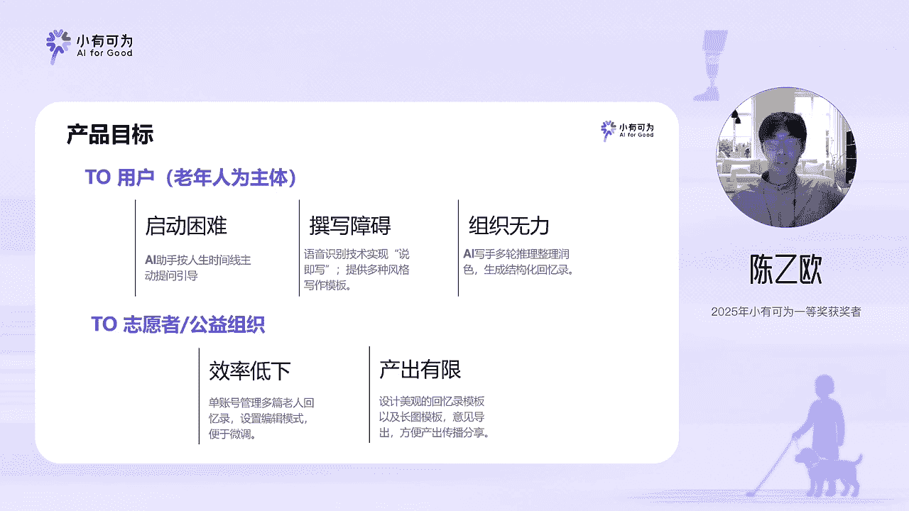
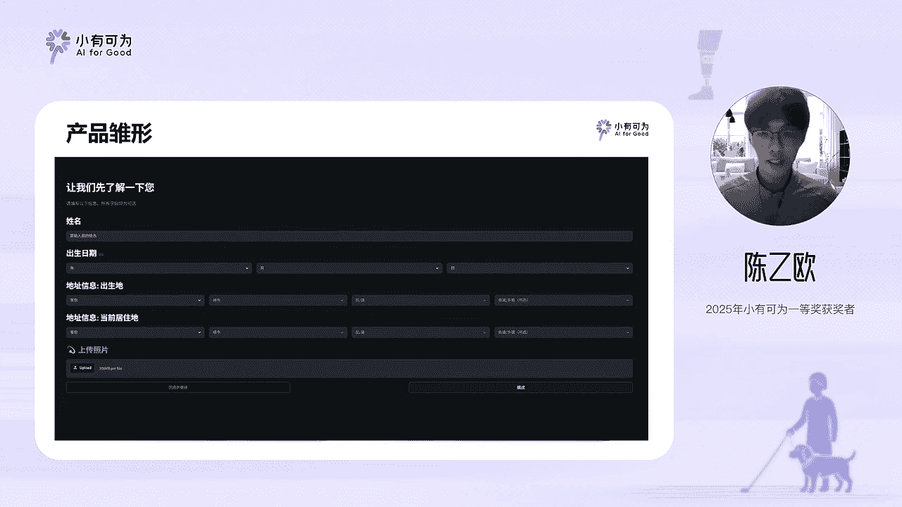
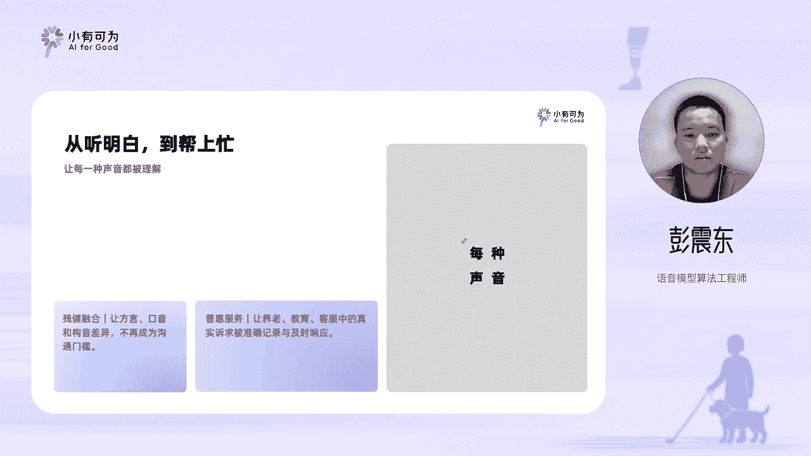

# 🤖 AI+普惠养老：00：课程概述


在本节课中我们将一起学习 AI+普惠养老这个主题。本教程主要面向初学者，用大白话把三个核心内容讲清楚。首先是普惠养老服务体系的构建与实践，介绍如何通过技术和产品能力，让老年人享受到助老餐、优惠和稳定配送。其次是 AI 驱动的老年人回忆录助手的设计与实现，讲解如何用语音识别和大模型帮助老人记录人生故事。最后是方言和噪声场景下的语音识别技术应用，说明语音模型如何突破方言、噪音和上下文限制，让 AI 听懂老年人的心意。

学完本教程，你能够了解科技助老的全景图，掌握从场景需求到产品设计，再到底层技术实现的完整思路。

# 🤖 AI+普惠养老：01：普惠养老服务体系的构建与实践

上一节我们做了课程概述，知道了本教程的三个主要部分。本节中我们来看看普惠养老服务体系是如何构建的。

在过去四年中，团队专门针对老年人真正的服务需求，以及配送骑手面临的困难，开发了一套独立于商业接单体系之外的助老餐专用系统。在这个系统中，基本实现了针对老人的熟人配送服务标准。

对于骑手来说，他在同样的单位时间内能够送更多的助老餐，同时每一单的配送费用能够降下来，而且不影响他日常的商业接单。公式可以表示为：

```
骑手收益 = 助老餐订单数 × 单单配送费 + 商业订单收益
```

其中助老餐订单数在提高，单单配送费在降低，商业订单收益保持不变。

对于政府来说，老人在系统上点单时，能够享受到和线下刷老年卡相同的优惠。对于食堂方来说，系统帮助其经营，让其更有能力面向有需要的老人提供餐品。

这一切都依赖于技术和产品能力。公益项目的核心理念可以概括为：

```
公益模式 = 公益心态 + 商业手法 + 技术力量
```

最初骑手需要关闭自己的系统，以志愿服务方式送餐。到今天，骑手可以在系统里正常接单，接到对应的熟悉老人的订单，并且有相应的作业标准和收费体系。线上点单系统支持老人、社工或子女顺畅下单，进行周期性点餐，完全适配老年人生活习惯。

在这一套体系之下，服务能力可能不断被复制并继续运行。截止目前，相关服务已经在全国 9 个城市服务了接近 150 万人次的老人，有 126 个站点的 523 位骑手在进行每天的助老送餐。所有订单在系统上可备查询、可记录，骑手可以收到相应报酬。

除了平台和骑手，很多社会力量也参与其中。例如一些品牌商家面向老年人提供特供餐品、营养餐品和特殊价格。只要通过技术手段认证老人符合标准，商家就会向他展示优惠价格。同时政府能够对这些商家进行相应补贴。

在这个过程中，鼓励更多社会力量参与。大家既可以把这当做一门生意，当做一门薄利的生意，但依然是生意，可以养活大家，可持续发展。同时又能向老人提供相对低廉且符合需求的服务。这件事情需要多方共同努力。

在支付宝上有老友会平台小程序，这是杭州市民政官方的助老餐平台，由该团队打造。如果你在杭州，应该能搜索到。团队正在尝试用小助手帮助老人简化点餐过程，提供更友好的界面和更方便的交互。

此外，希望 AI 能更好地帮助以骑手为代表的服务者提供高效准确的服务。对于整个助老公益体系，技术能够提效，改变供需方式，改变助老生态的生产方式，让资源更好地聚集，让老人享受到来自市场、政府和公益组织的更多合力。

以下是本节的核心要点总结：

- 独立系统：脱离商业接单体系，专门为助老餐开发
- 熟人配送：固定骑手服务固定老人，形成服务标准
- 多方受益：老人享受优惠，骑手提高效率，食堂稳定经营，政府发挥补贴作用
- 社会力量：品牌商家提供特供餐品，政府给予补贴
- 可持续发展：薄利但可持续的生意模式

本节我们介绍了普惠养老服务体系的构建与实践。下一节我们来看看 AI 如何帮助老年人记录人生回忆。

# 🤖 AI+普惠养老：02：AI老年人回忆录助手的设计与实现

上一节我们介绍了普惠养老服务体系，了解了助老餐配送系统如何运作。本节中我们来看看 AI 老年人回忆录助手的设计与实现。

这个项目源自一个公益活动。团队队友是杭州师范大学养老康复协会会长，一直在做采访老年人、采集语音、以访谈方式激起老人回忆的公益项目。录音后带回去转写整理，形成纸质回忆录，回访时送给老人。



在这个过程中，团队发现了双重困境。第一，老年人非常欢迎这种形式，非常渴望跟别人交流，对访谈形式表示欢迎。志愿者来的时候，老人经常说下次再来，我还有很多事情要讲。但是志愿者主要是学生，时间有限。第二，如果用传统方式做一份回忆录，可能需要 4 到 5 个小时，非常费时费力，产出不高。

同时，对杭州主城区老人做心理健康调研发现，40.8% 的老年人生命意义值处在较低水平。用流行的话说，可能比较迷茫，或者觉得人生就这样，态度比较消极。这跟他们没有及时跟别人交流、一天中交流比较少有关。

基于以上发现，团队决定做这个项目。首先给项目定了产品目标。产品主要面向两个群体：一是用户，以老年人为主，他们可能有写回忆录的需求；二是志愿者和志愿组织，起辅助作用。

团队对老年人主动使用技术持比较悲观态度，所以认为使用 AI 或新兴技术帮助老年人实现新项目、新价值，肯定需要志愿者或公益组织介入。因此把志愿者和公益组织纳入产品面向对象。

面对老年人，主要有三个痛点：

第一个是启动困难。老年人不知道从哪里说起。

第二个是撰写障碍。一篇回忆录较短可能 1500 字，长的可能 4000 到 5000 字。如果年轻人用手打出来，也非常费时费力，而且不情愿去做。所以可能会采用语音识别技术实现这种缩集写，同时提供各种多样的风格写作模板，支持各种自定义参数，实现比较特色的 AI 回忆录撰写。这样老年人既有自己的思想在里面，又能实现非常轻松的撰写。



第三个是组织无力。老年人说的话可能颠三倒四，虽然有人生经历想分享，但说出来的记忆内容非常碎片化。比如之前采访过一个老人，前一秒还在说小时候跟谁谁谁玩得很好，下一秒就开始聊佛教，说人生只是场游戏，这样跨度很大。对于写回忆录来说，不是很好的因素，因为回忆录要遵循一定逻辑，整体行文结构也需要考量。

对于志愿者和公益组织，面临的问题是效率低下和产出有限。一篇回忆录生成时间可能要 4 到 5 个小时，志愿者以学生为主体，时间有限。希望在有限时间里产出更多回忆录，服务更多老人。

基于这个初衷，团队设计了产品雏形。产品雏形非常简单，有四个模块，也是四个线性的模块：

第一个是基础信息的采集，包括姓名、出生地、现居地等。姓名很重要。因为后面采用的语音识别技术，可能没有办法捕捉到老年人的真正名字。比如个人名字举例，语音识别输入成“以欧”，是欧洲的欧，可能会被识别成海鸥的欧。如果一开始把老年人名字输入打对，再通过热词匹配，后面识别出来的姓名也是准确的。个人档案基础会构成 AI 对采访对象的最初步画像。

第二点就是回忆录的提问和回答。围绕老年人成长、家庭、工作等主题进行主动发问。最重要的是要做主动的节奏推进、节奏控制，包括话题转换，让 AI 充满情商。

这时候用户主要做的事情就是进行问答。AI 提问，老年人回答。回答的内容就是记忆碎片或记忆信息。

第三点就是回忆录的生成。按老年人自己的要求，对聊天记录进行整理，比如按时间逻辑整理，按主题逻辑归纳整理，形成一篇比较完整、文笔比较优美的回忆录。

最后一点是多形式的产出。目前支持 PDF 长图，包括线上的专属页面展出，给老年人提供多种多样的回忆录产出方案。在公益活动中，也支持志愿者将生成的回忆录打印装订，包装成小册子，回访时送给老人。

比赛结束后进行了进一步优化。最初用 Stimulate 做出来的 demo 不能真正投入使用。把它们更新成了一个小程序，支持登录和信息长期保存，就可以做到长期使用。

针对老年人使用习惯，在 UI 设计和交互设计时，都采用了卡片化大按钮以及强反馈的设计原理，降低产品使用和阅读门槛。

最关注的还是 AI 生成质量。包括回忆录生成、问题提问等。做了 Prompt engineering 和 Harness engineering 调优，使访谈过程更顺畅，内容收集更完整。

对于回忆录生成，采用了多轮思考撰写的流程，提高长篇内容连续性和稳定性。更重要的是需要降低回忆录的幻觉率。因为回忆录要尊重老年人的叙述习惯和人生经历事实，非常关注幻觉问题。

最后一个是增加功能模块。因为老年人不满足于只做一次访谈，可能还希望你过来跟他聊聊天，缓解内心孤独。所以加入了自由漫谈模式。同时为了增加产品粘性，里面采用了护理学里面经常使用的蒙台梭利三段式引导方法。希望循序渐进唤醒老年人回忆。很多论文证明，蒙台梭利三段式引导法可以有效降低老年痴呆概率。把这个教学方法融入到 AI 使用当中。

以下是产品的四个核心模块：

1. 基础信息采集：姓名、出生地、现居地等，建立老年人初步画像
2. 智能访谈问答：AI 主动提问，老年人回答，采集记忆碎片
3. 回忆录生成：按时间或主题整理聊天记录，生成完整回忆录
4. 多形式产出：PDF、线上专属页面、打印小册子等

接下来做技术拆解。第一部分是智能访谈。不能让 AI 自由提问，否则会出现各种问题。需要让 AI 聪明地提问，合适地提问。比如在老年人不想讲某个话题时，要聪明地回避，换另外的话题。而且要聪明地推进访谈过程，不能一直追着童年阶段问，后面的退休生活、工作经历也需要问。

技术主要是通过 Harness engineering 组装用户画像、历史消息和访谈状态，做对话状态管理。给 AI 定了很多 Target and Plan，主要是判断用户具体讲到哪儿了，判定是否要追问，还是继续深入话题，还是转场。同时使用 MCP 调用历史背景，使 AI 提问质量更高，更符合当时老年人的历史背景。

第二点是信息提取。主要是通过信息提取和语义分析，对老年人说出的自然语言做结构化处理，存入数据库。在后续聊天时，通过 RAG 检索增强抓取前面老年人提过的信息。最后实现 AI 像朋友一样，越聊越熟，越来越了解你。

第三个是回忆录生成。非常在乎幻觉问题。为了让生成更符合老年人心意，设计访问环节，对刚才提问环节的一些披露，让 AI 进行反思和思考，向老年人再提出一些修补的问题。同时对回忆录生成做了多节点生成设计。第一遍 AI 整体 review 上下文，列出提纲，设计每章质量限制和风格，分配每段字数。然后对每个章节按提纲分章撰写，最后整体提交给最后一个环节的 AI，做校验和润色。这样下来，回忆录幻觉率会下降，生成质量符合老年人预期。

最后一个是自由漫谈，为了提高产品粘性，同时让老年人获得情绪陪伴，缓解重复感。也是通过 RAG 去教学个人历史记忆，聊老年人成年往事，像老友一样自然聊天。同时加入了 Function Call，AI 可能在老年人语塞时，或聊到相关事情时，主动把照片拉出来给老人看，唤醒记忆，提供情绪价值。

然后是蒙台梭利三段式怀旧引导。具体而言：第一次提问提供一点线索，但不把整个事情全貌给你；第二次提问给你一个选择，A 或 B，你当时是怎么做的；如果回答对了，第三次提问就会让你去还原原来经历这些事情的一些有价值细节。这是护理学和养老院中广泛使用的话术。

以下是智能访谈的四个关键设计难点：

1. AI 如何有意识地推动人生访谈细节
2. 如何生成高质量问题，而非钻牛角尖的问题
3. 如何把握收集信息量的多少
4. 话题应该继续深入还是转换

针对这些难点，团队做了以下设计。首先是用户输入，包括打字、语音或图片。接下来对输入 AI 的信息做上下文主张，包括历史信息、用户画像、信息缺口，还有近期提的问题的去重处理，不能让前面刚提的问题再提一遍。

第三点是最关键的设计，加入了以下几个变量。一个是 Current Stage。Stage 就是预先埋定好的几个人生阶段，童年、上学、工作、家庭、退休等。Current Stage 是老年人前面几轮对话主要在讲什么阶段的内容。Target Stage 是告诉 AI 现在应该讲哪个阶段的内容。

为什么设计这一对？老年人说东西很碎片化，但需要有节奏感的叙事。现在想让老年人说童年事情，老人可能一开始说童年，很快就跳到退休时间。一开始要顺从老年人，顺着老人说的事情接着往下说。这样 Current Stage 就到了老年阶段，Target Stage 依然停留在童年阶段。聊了几轮老年阶段事情之后，告诉 AI 虽然现在聊的是老年阶段，但目标阶段应该聊童年。通过温和过渡，把老人引导回童年回忆。

还有第三个是 Topic Control，做流程判断，接下来应该是深入还是换话题。通过以上关键指令生成个性化追问。

Topic Control 是怎么实现的？Current Stage 怎么判断？加了一个轻量的附手模型。这个模型对每个老年人现在讲述的阶段做判断，同时对老年人情绪、说话信息含量做判断和分析。具体指标包括 Richs、Stuck 等。Richs 意思是老年人兴致勃勃，话题丰富。Stuck 的意思是老年人可能说了些内容，但没有那么多。Tuck 的意思是老年人彻底卡住了，说不出来了。

根据这个判断，更新谈话策略。如果是 Rich，下一阶段注入 Topic Control，告诉 AI 继续深入，老人可能还有很多。如果是连续两次都是 Stuck，就转换话题，因为两次老人说出来的话都很少。如果是 Tuck，为了避免引起更大反感，可能很快就能转换话题。

通过这些设计，实现了提出高质量问题的效果。同时最近加入了历史背景查询的 MCP，在老年人自己提出一些事情时，比如 1980 年做了什么，会查询当时那个年代发生了什么，基于 AI 更多信息提出更多符合时代背景的问题。

以下是对话状态管理的关键指标：

```
状态指标 = {Current Stage, Target Stage, Topic Control}
情绪与内容指标 = {Richs, Stuck, Tuck}
```

- Richs：老年人兴致勃勃，话题丰富，建议深入
- Stuck：老年人表达较少，建议观察
- Tuck：老年人彻底卡住，建议快速转换话题

在实践经验方面，其实没有特别多要讲，就是三点。第一，所有东西都要从需求出发，不能因为看到了很厉害的技术就围绕技术开发产品。一定要围绕生活中或活动中遇到的真实问题去开发，解决实际问题。因为这是公益挑战赛，最终目标不是为了炫技，是为了解决公益问题，提供解决方案，服务于公益。

第二，不建议一开始就做出非常完美的产品。如果有了想法，就第一时间把最小可行原型 Demo 做出来，先大胆实现再说。一开始产品核心逻辑其实很简单，就是把 AI 提问，老年人回答，再把上下文往里头一塞，再输出回忆录。在测试过程中会发现各种问题，在一次次开发测试中，产品会变得越来越完善。

第三，着力点要小。在养老里要专注于一个领域，特别是老年领域。在一个具体产品里做声做细，会使产品更有竞争力。比如产品特别需要注重老年人不会打字、语音识别偏差、方言问题、设备使用抵触这些问题。只有围绕这些具体痛点去设限制、做设计，整个产品才会更有特色，才会有与众不同的地方。

对于选题思考，三点是三位一体的，其实都一样。第一，要多从生活中寻找灵感，多跟父母、爷爷奶奶交流，你肯定会发现他们生活中不方便的地方。围绕这些不方便的地方，多思考有哪些新兴技术、AI 技术可以解决这些问题。实在找不到灵感，可以参与公益活动，接触到的老年人更广泛，调研出来的结论和痛点也会更具有普世性。这样产品做出来会更有特色，质量也会更高。

以下是选题建议的三个来源：

1. 生活观察：多关注家里老年人的不便之处
2. 公益参与：亲身参与公益活动，接触更广泛的老年人群体
3. 技术匹配：思考新兴 AI 技术如何解决具体痛点

本节我们介绍了 AI 老年人回忆录助手的设计与实现。下一节我们来看看方言和噪声场景下的语音识别技术如何应用于养老场景。

# 🤖 AI+普惠养老：03：方言噪声环境下的语音识别技术应用

上一节我们介绍了 AI 老年人回忆录助手，了解了如何用 AI 帮助老人记录人生故事。本节中我们来看看方言和噪声环境下的语音识别技术应用。

在做助老养老项目时，都会遇到需要用到语音识别的情况。今天主要给大家分享 FangSR 这个模型的细节，以及它在助老养老项目里能发挥什么用处。这部分比较偏技术。

首先，FangSR 最近重磅上线了 FinSRFresh 这个模型。它就是从听清楚走向了听明白。有时候我们听清楚说的啥，但还需要去想一想，他具体说的是什么内容。确实因为普通话有很多同音字。

FangSR 的基础能力包括高精度。在方言、唱歌时歌词识别、背景非常嘈杂的环境，比如地铁、食堂，都能非常稳定地转写，准确率非常高。

模型有流式上屏能力。语音识别分为两个场景，一个是流式，一个是非流式。流式是说在说话的时候，语音识别系统能够在说完一个字之后，一个字一个字跳出来。这就要求模型速度足够快，能够一边听一边输出字。如果速度比较慢，就跟不上说话速度。

模型支持定制行业热词。比如需要对老人名字做热词增强。通过提前把老人名字配置到热词系统里，做语音识别时，就能比较大概率把老人名字识别正确。

FangSR 模型架构如下。行业内基于大模型做语音识别，方案大差不差。首先用语音编码器对音频提取特征。提取完特征后，送给大模型做语音识别。大模型识别时没有热词信息，也不知道句子里是否涉及老人名字，所以会接一个解码器。解码器有点像大脑里的浅层理解，听到一句话后，脑海里有大概概念，不一定知道每个字是什么，但大概对发音确定。先得到一句话内容，但不确定。比如提到名字时，脑海里大概有发音，但不知道是哪个“欧”。这个模型非常小，会出来一个可以认为是应茎的字。然后根据这个结果，再去系统里查，它跟哪一些提前配置的词比较有关联性。再把这个词拿出来，一起给到大模型。大模型同时有了音频特征，还有热词里比较相关的词。结合这些信息，就能得到更加准确的结果。

以下是语音识别的处理流程：

```
音频输入 → 语音编码器提取特征 → 大模型初步识别 → 轻量级解码器 → 热词匹配 → 大模型二次确认 → 最终转写结果
```

这是 FangSR 在不同场景下的评测指标。能看出来整个 FangSR 指标非常有优势，特别是中文发言和歌词歌词识别，效果优势非常明显。

听清楚只是起点，还需要理解说话人的意图。只有结合这些信息，才能让这句话识别更加准确。因为听清楚的话，如果缺少上下文，人类也没法知道一句话再说什么信息。如果有了一些先验知识，比如在什么场景下说了这句话，还有历史聊天里说了什么内容，有了这些信息才能听明白当前这句话的意图。

最近 FangSR 做了双向比较大的升级。覆盖了更多方言区。整个模型在 16 种方言里面准确率能够达到 87.8%。确实中国有非常多方言，没有办法覆盖到所有方言，但正在努力。

第二个是会结合历史对话来对当前这句话识别做优化。比如刚才聊了很多内容，模型能结合刚才对话信息，推断出正在做助老项目分享，就会更倾向于往这个领域去靠，往这个领域优化识别结果。

还支持了 30 多种全球语言，特别是东亚和东南亚语言都支持。方言能力包括河南方言、济南话、四川话、粤语、山西话、杭州本地方言等，花了非常多精力收集和采购数据，去优化模型。

如果做老年项目，对于不同地区老人说话，用普通语音识别还是有比较大挑战。如果结合每个地区方言都能有比较好效果的语音识别引擎，就可以更得心应手。

可以听一下 FangSR 项目在不同方言上的识别效果。第一次去人民公园喝茶，才懂成都人的慢生活。阿妈煮嘅叉烧饭，我食咗两碗。拉宁波人早饭欢喜吃宁波年糕、炒咸菜，再连淮豆酱。糕也是宁波味道。

模型在 30 种语言里面，特别是东亚和东南亚，准确率表现可以。列出的是模型的错误率，百分比是多少的 WER。可以用 100 减去，这就是准确率。在每种语种里面，模型都能做到 SOTA 效果。



也可以听一下多语种识别效果。这是日语例子，还有吴语例子。

最后提一下上下文能力。举个例子，如果提听到“未来”这个词，没有上下文信息，大家脑海里蹦出来的可能是“在将来”这个词，而不是汽车品牌“未来”。模型结合这些信息之后，整体句子准确率能从 26.8% 提升到 48.2%。热词召回率也能有非常明显提升。

最近也在做输入法产品，有了上下文信息，比如结合前面打的字，或者结合屏幕里面历史聊天信息，能够优化当前语音内容，整体准确率有非常明显提升。

以下是上下文对识别准确率的影响：

```
无上下文句子准确率 = 26.8%
有上下文句子准确率 = 48.2%
提升幅度 = 48.2% - 26.8% = 21.4%
```

这里举个同义词不再靠猜的例子。用户可能说我想买个新能源车。这时有了交流场景，有了概念，就是他在讨论新能源车。提到的“未来”，同时这个“未来”大概是一个名词，可能就会想到是“未来汽车”这个品牌，而不是“在将来”这件事。

这是 FangSR 的介绍。后面是个人对于语音识别在助老养老这块能帮到的地方。

第一个是周养老时，很多老人说话有非常明显方言，口音不是普通话。如果要对说话内容做识别，首先志愿者或工作人员跟他们聊天，有些东西不一定听得懂。有了能听懂方言的语音识别模型，就不会成为沟通门槛。

还有可以把它用在养老或教育或客服中，准确地记录老人的需求或状况。

以下是语音识别在养老场景的应用价值：

- 方言理解：突破老年人方言口音障碍，志愿者能听懂老人说话
- 需求记录：准确记录老人需求和身体状况
- 多场景适用：养老、教育、客服等场景均可使用
- 情绪识别：Sensense Voice 开源模型支持输出语种信息、情绪信息和识别结果
- 多角色区分：多个人说话时，模型可以输出当前是哪个角色在说话，如主持人或嘉宾

在 QA 环节中，有几个问题值得关注。

关于 AI 推送最优方案，65 岁以上老人订餐是否可以用 AI 推送最优方案，不用让老人自己找。团队一直想达到这个效果。但首先要定义什么叫最优方案。最优方案会有非常多指标，对老人来说，从健康选择、优惠选择、配送方式、餐品品质、分量、付费习惯等等。当这些指标都能被定义出来，然后形成方案，相信会简化老人选择过程，一定是加速过程。

同时从服务规范角度，提出一个问题，难道最终可以跳过确认环节吗？在老友会平台上，已经用了 AI 小助手，依然需要老人去确认 AI 推荐的每一项东西。在商业逻辑选择上，这也是必须有的规范。不能说直接跳过老人，帮他下单了。当老人依然要面对一次次确认，或者说他需要有能力去检查 AI 推荐的方案到底是不是他要的方案时，可能中间又产生了新的数字鸿沟。所以大家可以考虑怎么剔除里面的商业化部分，怎么平衡各类指标权重，怎么让老人更快更简便地确认提供的真的是最优方案，或者识别出老人偏好，更快完成决策过程。这一定是提效。

关于空巢老人异常行为监测系统，跌倒突发疾病等关键数据很难获取。淘宝闪购在助老餐配送中有没有积累可以分享的行为数据，比如订餐类别变化、拒收异常等，能间接反映老人健康状态。

首先这是隐私和数据安全问题，可能很难完全提供这样的数据。但在助老餐整个服务方案里，不仅是配送，还有通过餐品其实可以不仅间接反映老人健康状况，其实可以直接反映到老人很多健康问题。比如他最近某种菜吃多了或少了，右边？他有可能有骨头类的，或者有需要咀嚼的，他都吃得越来越少了，其实是说明他可能在骨质方面会有一些问题。或者他某些成分摄入是否过量了等等。所以在餐食摄入上，能不能够反映老人健康，现在有很多研究机构在跟团队一起做这个方向。

另外，在跟老人服务过程中，发现和现实空间的交互和连接非常重要。老人跟年轻人不一样，他们在互联网上、在线系统里留下的线索非常少，没有那么多可以直接加工的数据或记录。怎么样能够让他们在自然状态下，在现实生活中的各种表现，能够成为系统可用的一些数据和依据？我觉得这里可以展开的空间很多。比如可穿戴设备、智能家居，还有视觉里的红外线，甚至一些遥感技术，可能有很多硬件和软件和 AI 方面的结合。如果有相关专业背景或创新思考，可以试一试，能够让老人没有负担，在正常生活状况下，能够提供更多健康数据，让我们更好地服务老人。这是可以努力的方向。

关于时光寻者项目，Agent 是从零开始搭的吗？有没有开源项目基础？队友都不是纯技术出身，个人有一点点技术功底，做的也是数据分析和数据采集相关。做这个项目确实没有基于特别多的开源项目去开发，完全是基于用户体验或收到的问卷反馈结果，对 Agent 设计做一系列更新和迭代。大部分都是自研的 Pipeline。具体使用什么模型，LM 使用的是 Qwen3-7plus 和 Qwen3.5-flash。Flash 主要起副手判断作用。副手模型在自由漫谈模式里面和主聊天、主访谈模式里面都出现了，但承担的任务、设计结构差别非常大，都做了比较精心设计。

为什么采用 Qwen3-7plus？第一是价格不是特别贵，成本可以接受。第二是有多模态。第三是指令遵循能力非常强，包括结构化输出能力。实测下来，结构化输出能力可以说是排名前二。再加上成本和多模态加持，比较吸引人。

关于时光寻者项目在实践过程中遇到的最大难点。基于共同面向的用户，就是老年人，遇到的最大难点可能都会是生成质量问题。生成质量包括节奏控制都比较难把控。相比其他 Agent 项目，输出研报、做分析、扒渠数据，可能是结构化输出。但这个项目是偏情感陪伴型的项目。既要照顾到老年人情绪，又要完成采访这个特定任务，包括自由漫谈模式中如何控制 AI 按照蒙台梭利三段式提问法去提问。因为它是有很强套路的。如果是单独输出套路性回答，对现在的 AI 发展来说很简单。但矛盾的是，面对的是不懂技术、情感依赖非常强的用户群体。如何平衡用户体验和目标达成是非常困难的事情。有点鱼和熊掌兼得的意思。要综合效果两全，设计要有一定创新，要有 Creativity。要在上面多下点小巧思。

关于项目目前有没有还在持续运营和优化，比赛后续有没有作品孵化计划。产品一直有在运营。PPT 最后一页右边二维码可以看到，现在相当于是把它优化成小程序形式。之前是网页形式。重新做了一下界面，更加便于老人或老人家人使用。因为微信使用率更高。比赛后续有没有作品孵化计划，现在考虑到做的是回忆录，做完以后会了解到很多老人故事。基于这一点和关于阿尔兹海默症老人的疗法，叫做怀旧疗法。想根据这个点去做，因为知道老人故事，也有聊天机器人，可以通过怀旧疗法帮助阿尔兹海默症患者。这个群体老人可能近期很容易遗忘，远期可能还记得。通过知道远期以前的一些回忆，来帮助恢复近期回忆，看看能不能在这方面做出一些帮助。这是现在的一些计划，也在进行。今年规划的话，还是希望产品做出来之后，不断进一步迭代优化，再真正和志愿者接触，深入线下，把这个项目推行下去。

关于语音模型，有些老师讲话或者老人讲话会比较含糊，更多是方言。Fan 系列模型有没有针对老年人生理特点，或者语速慢、发音含糊做专门优化。最近整个项目采集采购了大量老人和小孩说话的音频去对模型做优化。但确实如果老人说话人都听不太清楚，模型也不一定能听清楚。因为语音识别还是在模拟人耳特点去对不同频率声音学习，如果人类都听不太清楚和听不太懂，模型也是比较有挑战才能听懂。

第二个问题，闽南语有没有，想做阿妈的评书这种语音。目前模型在中国支持十几种地区方言。但即使是闽南语，它其实有很多种演化，不同地区同样都是闽南语，念起来也不太一样。闽南语里面有些字眼没有对应的汉字，这对语音识别也是挑战。所以如果想用模型识别阿妈的情书，认为是可以的，但可能还不能做到百分之百准确。

关于开源模型，语音模型最近有没有开源？是否可以听懂话语里的情绪？之前开源的 Sensense Voice 支持同时输出语种信息、情绪信息和识别结果。最新开源模型也是去年年底的模型，基于大模型做了 1.6B 的模型。未来可能大家可以期待一下。

多角色聊天时可以根据声音特质把发言人区分开吗？这是目前正在研究正在做的事情，已经有非常大进展。未来也可能上线。百炼的 API 上大家可以去体验一下。目前还没上线，已经有非常大进展。多个人说话时，一个音频进去模型可以输出当前是哪个角色在说话，比如 A 在说话，一会 B 在说话，或者主持人、嘉宾，会有这种信息输出。

阿里云百炼所有模型大家都可以去找到体验，搜索一下就可以了。

本节我们介绍了方言和噪声环境下的语音识别技术应用。下一节我们来做课程总结。

# 🤖 AI+普惠养老：04：课程总结与展望

本节我们来总结整个教程的内容，并对未来的学习方向做一些展望。

在本教程中，我们一起学习了三个主要部分。第一是普惠养老服务体系的构建与实践，了解了助老餐系统如何通过独立系统、熟人配送、多方补贴等方式，让老年人享受到便宜、合适的餐食服务，同时让骑手提高效率、让食堂稳定经营。第二是 AI 老年人回忆录助手的设计与实现，了解了如何通过语音识别、智能访谈、蒙台梭利三段式引导等方式，帮助老年人轻松记录人生回忆，缓解孤独感。第三是方言和噪声环境下的语音识别技术应用，了解了 FangSR 等模型如何从听清楚走向听明白，突破方言、噪音和上下文限制，让 AI 真正听懂老年人的心意。

通过这三个部分，我们拼好了一张科技助老的全景图。徐老师给了我们真实的场景，E 欧给了产品的解法，彭老师分享了底层的工具。技术不应该成为老年人理解世界的门槛，而是应该俯下身来去听懂他们的声音，这才是 AI 走向普惠的时刻。

以下是本教程的核心知识点总结：

```
科技助老全景图 = 服务体系构建 + 产品设计实现 + 底层技术支撑
```

- 服务体系：助老餐独立系统、熟人配送标准、多方补贴机制
- 产品设计：从老年人真实需求出发，MVP 先行，聚焦小切口痛点
- 底层技术：方言语音识别、上下文增强、热词匹配、RAG 检索、智能对话状态管理

未来的学习方向可以关注以下几个方面。第一，下一期直播会聊乡村助老方向，如果你感兴趣，可以锁定下一期直播。第二，可以参与开发者交流群，跟开发者做实时互动，或者组队开发。第三，所有项目都要基于真实需求，哪怕是一个很小的点，也能做出有特色的产品。

参加 QA 并且问题被回答的朋友，可以私信后台留下联系方式，会寄出定制小礼物。这是系列学练课，共有 6 期，目前进展到普惠养老的第三期，下一期是乡村教育，以及绿色发展。

感谢三位老师的分享，也希望通过本教程能给大家在科技助老赛道上带来更多启发。

本节课中我们一起学习了 AI+普惠养老的三个核心模块，包括普惠养老服务体系构建、AI 老年人回忆录助手设计，以及方言噪声环境下的语音识别技术应用。希望你能从中获得启发，将所学应用到实际的公益或产品开发中去。

