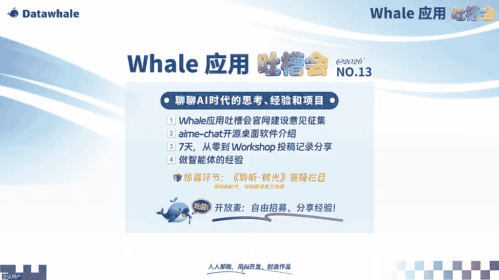
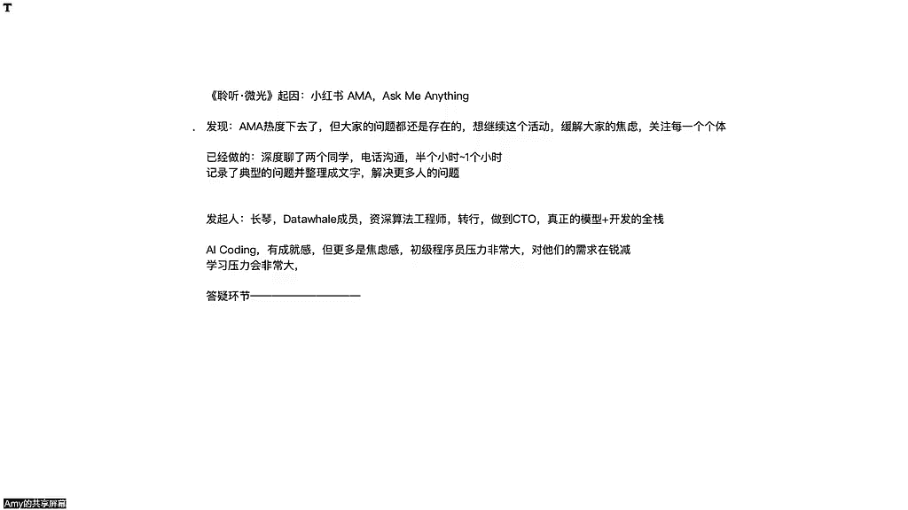

# 🎓 Datawhale AI+X：01：普通人也能做笨事：走窄路聆听微光



在本节课中，我们将学习常琴老师发起的一个特殊项目。这个项目的起点非常简单，就是通过一对一的电话沟通，帮助在人工智能时代感到焦虑的普通人。课程开始时，这是一个惊喜环节，主持人特别邀请了常琴老师作为神秘嘉宾。常琴老师先简单介绍了自己现在想做的事情，然后说明了项目的由来和具体做法。我们也会讨论为什么现在的初级程序员面临很大压力，以及常琴老师的个人经历如何为这个项目提供支持。最后，我们会看看如何参与这个项目，以及未来的计划是什么。整节课的核心思想是：技术进步固然重要，但更要落到人的角度，给每个人一点温度和信心。

## 一、项目的起源与背景

上一节我们概述了本节课的整体内容，本节中我们来看看这个项目是如何产生的。

去年年底的时候，小红书上曾经出现过一场“问我任何事”的活动。常琴老师本身并不常用小红书，只是被朋友拉着刷了一下，然后随便发了一条动态，结果居然有很多人回复，这让他自己也感到很惊讶。不过，那场活动很快就结束了，大家的热度也随之下降了。常琴老师随后发现，虽然活动没有了，但那些本来就存在的问题并没有消失，提问的人依然需要答案。于是他决定把这个活动继续下去。继续下去的意思就是，他已经在行动了，目前已经有两位他不认识的人加了他，他和这两位陌生人进行过沟通。无论对方来自哪里，他都通过电话与他们聊过了。这就是项目最初的雏形。

## 二、项目的具体做法

了解了项目的来源之后，本节中我们来看看常琴老师是如何具体执行这个项目的。

以下是项目的主要执行方式：
- 采用电话沟通的形式，每次和一位聊天者通话半小时到一小时。
- 每周大概沟通一到两位，不需要人数太多，因为太多人也聊不过来。
- 将沟通中出现的典型问题记录下来，再整理成文字。
- 整理后的文字可以让更多人阅读，从而帮助更多有相同问题的人解决困惑。

从本质上来看，这个项目就是把之前的问答活动延续下去，目前已经在稳步进行中。常琴老师最初还打算让朋友随便找几个人参与，后来觉得不需要太多人，一两位就足够了。如果有合适的机会，也可以把这个想法和更多人分享。

## 三、为什么现在需要这个项目：人工智能带来的焦虑

了解了项目做法后，我们自然会问，为什么常琴老师要在这个时间点启动这个项目？

这与最近的人工智能工具发布有关。去年年底的网页编程工具和 2022 年底的大模型发布，在某些方面有异曲同工之妙。很多人发现自己像是拿到了一把锤子，看到什么都想上去锤两下，不管需求是什么，不管应用到底是什么，先上去用一下再说。不管工具是否真实可用，大家都在尝试，都在把人工智能各种顶上去。常琴老师自己也在使用这些工具。人工智能领域确实能让人获得一点成就感，但更多时候，它带来的是焦虑感。

以下是焦虑产生的核心逻辑：
`人工智能代码质量高且成本低 → 企业不再需要大量初级程序员 → 初级程序员和想入行的人感到巨大压力`

现在有三四个人工智能同时在干活，写出的代码质量通常很好，用户只需要把需求说清楚就可以。这种变化让初中级程序员，尤其是刚入行或者还没入行的人，感到压力非常大，仿佛被直接打残了。社区里固然有很多优秀的人，但更多的是普通人，他们面对的学习压力和生存压力都非常大。常琴老师认为，正好赶上这个时机，应该把这个项目继续做下去，给这些人一点支持。

常琴老师还举了一个具体的例子。前几天，他接待了一位香港大学的同学，这位同学压力非常大，甚至一度想要轻生。不过他的条件其实还不错，已经去了一个很好的机构实习，依然感到压力巨大。常琴老师和他聊了一会儿之后，这位同学似乎想通了，觉得没关系了。这次经历让常琴老师深刻认识到，项目的意义就在于此：有时候稍微聊一下，就能给当事人带来很大的帮助。

## 四、常琴老师的个人经历与核心观点

刚才我们分析了人工智能带来的焦虑，本节中我们来看看常琴老师本人的背景，以及他为什么能够胜任这项工作。

常琴老师自己介绍，年纪比较大，是转行过来的。他从最基础的岗位做起，一步一步走到首席技术官，后来又回到一线开发，同时还参与模型训练和推理工作。也就是说，模型训练、模型推理、应用开发他都做过，算是全栈的老手了。可以用下面的代码块来概括他的技能栈：

```text
技能栈 = 模型训练 + 模型推理 + 应用开发
```

相对来说，他做的项目足够多，经历的时间也足够长，属于那种资深的从业者。常琴老师觉得，自己的经历可以给很多人一点启发，也能给大家一点信心。因为很多人其实比他基础更好，起点更高，他相信自己能传递一些有用的信息。

同时，常琴老师也有一个重要的观点，不是所有人都能成为前 1% 的人才。人才分布始终是金字塔结构，我们只能慢慢往上爬，不可能所有人都挤进那个顶端。这个金字塔分布可以用简单的公式表示：

`人才分布 = 金字塔模型（顶端 1%，底层大多数）`

基于这个理解，常琴老师不想把组织搞得太卷，不想让大家无休止地学习，而是想稍微缓冲一下行业的竞争压力。

## 五、如何参与与未来计划

了解了常琴老师的背景和观点之后，本节中我们来看看如何参与这个项目，以及未来会如何发展。

以下是参与方式和未来计划：
- 目前常琴老师主要在小红书和微信上被别人找到，如果社区里也有需要的人，也可以通过社区联系。
- 未来如果咨询的人变多，他会拉一些有丰富工作经验的人一起帮忙，而不是只依靠刚毕业的学生。
- 帮手和咨询者最好有一定的重合度，比如都是做算法的，这样才有共同话题可以聊。
- 每周聊一到两个人就足够了，不需要大规模展开，一个一个来也可以。
- 如果大家现在不方便聊天，也可以先预约时间，等方便了再沟通。

常琴老师的最初初衷很简单，就是希望在非常卷、压力很大、残酷的生活中，多放入一点稳定的、不那么卷的东西。他觉得每一个个体都是值得被关注的，哪怕一次只帮一个人，也是有意义的。未来他可能会把这个项目做成一个小组，先尝试一下，再看情况决定是否扩大。

## 六、本节课总结

最后，我们来回顾一下本节课一起学习的内容。

本节课我们学习了：
- 项目来源：常琴老师从小红书的问答活动中获得启发，决定继续帮助有问题的人。
- 执行方法：通过一对一电话沟通，每次半小时到一小时，每周聊一到两人。
- 核心原因：人工智能让初级程序员面临巨大压力，普通人需要情感支持和实际建议。
- 个人背景：常琴老师是转行的老手，模型训练、推理和开发都有经验，可以给予社区信心。
- 参与方式：优先在小红书和微信联系，未来可能会招募有经验的帮手，保持小规模运作。



总的来说，这个项目的温度在于：技术进步是一方面，但更重要的是落到人的角度，关注每一个普通人。希望通过这样的窄路，能聆听到微光，给大家带来一些不一样的力量。

