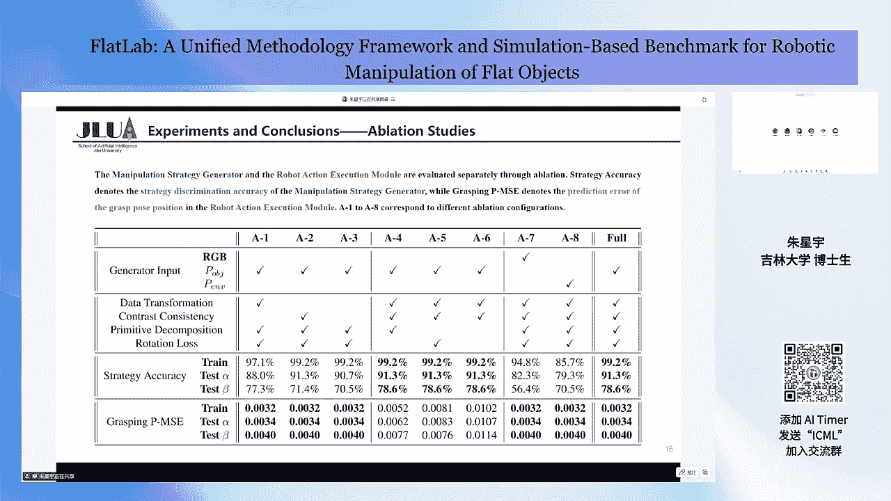
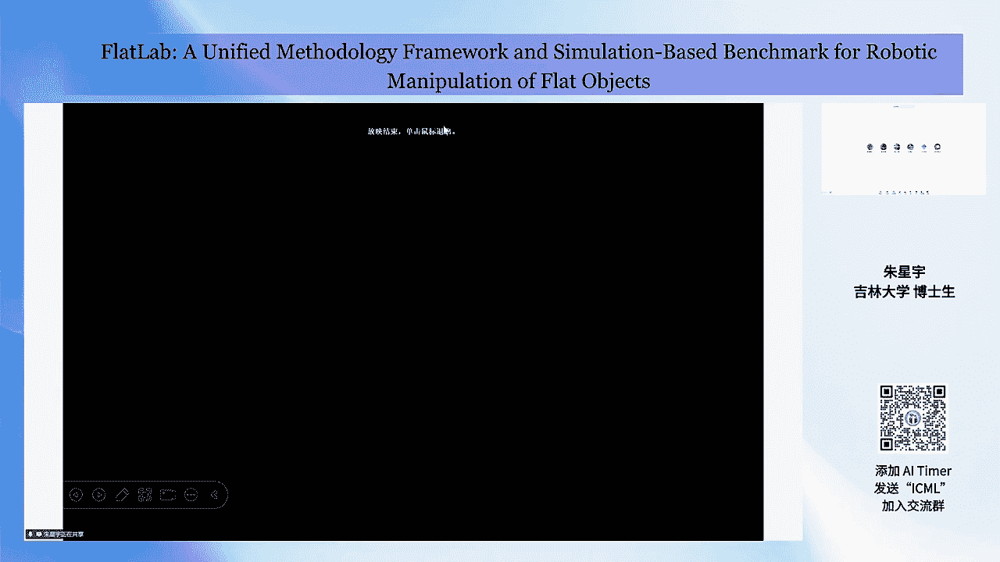
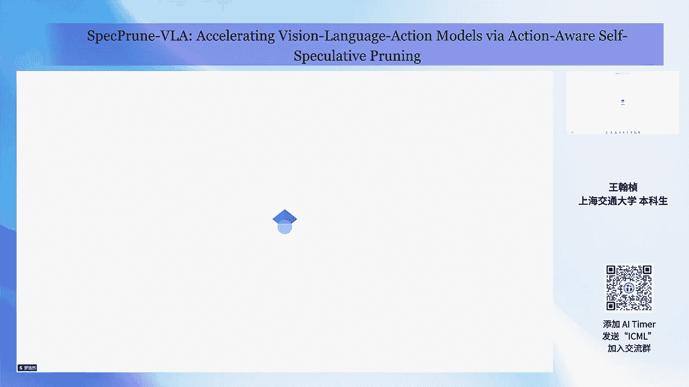

# 智能体与具身智能前沿技术教程：01：从知识蒸馏到多智能体协作与具身推理 🤖

## 课程概述

在本节课中，我们将学习智能体与具身智能领域的前沿技术。内容涵盖知识蒸馏、模型轻量化、多智能体拓扑演进、图状态推理、具身视觉语言模型推理加速、多模态地理定位评测、平面物体操作仿真、图检索增强生成以及高效视觉语言动作模型推理等多个方向。每一部分都会结合具体的研究工作，用大白话解释核心原理，帮助初学者建立系统性的认知。我们不仅会介绍每个方法的基本思想，还会分析它们在实际场景中的优势与局限，并通过公式和代码片段来说明核心概念。希望大家在学完之后，能够对当前智能体技术的发展脉络有清晰的了解。

---

## 第一部分：知识蒸馏与模型轻量化

上一节我们介绍了课程的整体内容，本节中我们来看看知识蒸馏与模型轻量化的基础知识。

随着模型规模和数据集规模的提升，模型的泛化能力会呈指数级上升趋势。理想情况下，不断增大模型规模和数据规模，一定能得到更好的模型。但是对于很多场景和下游任务，比如需要在端侧部署，或者数据很有限的任务，我们无法盲目外推这种尺度率，会带来巨大的经济算力成本，或者因为数据体量不够而无法继续扩大。因此，这时候需要另辟蹊径，对模型进行轻量化。具体做法是把大规模模型压缩成小模型来使用，模型压缩变得非常重要。

以下是模型轻量化的核心动机：
- 端侧部署对模型体积和延迟有严格限制
- 数据有限时无法通过简单扩大模型来提升性能
- 大模型的训练和推理成本过高，需要降低经济开支

知识蒸馏最早由Hinton团队在大约2015年正式提出，当时还没有大模型。它的初衷是把多个模型集成的结果压缩到一个小模型上面。当时模型集成的性能提升比较明显，这有点类似于现在大模型企业里做的集群蒸馏，把多个模型压到一个模型上。知识蒸馏的思想也比较直观，我们把传统监督学习里面的数据监督信号，替换成教师模型中大模型的某些潜在暗知识，把这个知识作为监督信号，尝试迁移到学生模型上。学生模型的体量通常会小很多，这样就实现了模型压缩。在大模型时代，知识蒸馏也是非常重要的技术手段，已经被很多大厂的大模型所使用。

以下是知识蒸馏的基本流程：
1. 准备一个教师模型，通常是参数量大的强模型
2. 准备一个学生模型，参数量较小
3. 使用教师模型的输出分布作为软标签，监督学生模型训练
4. 最小化学生输出与教师输出之间的差异

我们今天主要分享两个相关的工作，主要都是探索如何更有效地利用教师背后的隐藏知识。第一个是遵循更加传统的分布匹配路线，发表在ICML25over上面。第二个工作是DCOM two，今年SML的一个工作，尝试在监督学习的硬标签黑盒蒸馏和分布匹配的白盒蒸馏之间做一个协调或折中。

首先来介绍第一个方面的工作。教师模型和数据训练的标签不一样，它有很多参数，它的暗知识到底在哪里？首先是一个需要考虑的问题。传统来讲，一般会把教师最后一层的输出分布拿出来，作为监督信号。比如分类里面标签的分布，还有next word prediction里面，给定一个T下面的token分布。这个是模型直接输出的，我们把它拿出来和学生对应输出的分布去做对齐。这个想法很简单，但是输出分布的匹配背后并不是一个简单暴力的形式，它也有一定的理论支撑。

比如从信息处理不等式视角，模型的信息前馈链路上，教师的输出分布离最终预测最近。根据这个不等式，它保留的输出预测的互信息是最多的，损失的是最少的。所以它的压缩相对来讲较有效。第二个方面，它又是一个充分的统计量。如果把教师的输出分布固定下来，整个教师模型的参数就不会再影响最终的预测结果了。所以知道了输出分布以后，就已经某种意义上知道了所有最终预测的信息。从这两个点来说，我们完全有理由相信，在输出分布端做对齐，就会比较充分地挖掘出教师的暗知识。

分布匹配怎么做？实际上也比较容易，就是有一个大的模型是教师，有一个小的模型是学生，教师一般冻结住，然后学生去学习，然后都把输出端的分布拿出来。然后计算一下某种距离，管它叫散度，然后去最小化这个散度去学习学生的整个参数。有时候也会把学生的监督任务也拿过来做一个加权的和。这也是一个可选的选项。在这个框架之下，我们主要能够改变的就是选择的分布散度。所以第一个工作里面主要是看一看，什么样的分布匹配散度更适合于这种蒸馏框架。

传统的主流蒸馏里面使用的散度都来自于KL散度，它是在计算两个分布P和Q之间的距离。KL散度的公式为：

$$
D_{KL}(P\|Q) = \sum_{x} P(x) \log \frac{P(x)}{Q(x)}
$$

它有一个比较经典的性质，就是P和Q的这两个输入是不对称的，P对Q做KL散度和Q对P做KL散度，结果是完全不一样的。这个时候就会有两个方向。看以教师和学生的分布来作为输入，那么有一个前向KL就是教师对学生去做散度，这个可能经典的蒸馏里面用的比较多，直接是在教师的分布上面采样，相对容易一些，因为教师已经固定下来了。然后去算这个似然比。还有一种是反向的，反过来就是学生对教师的散度，我们要在学生的学习分布上面做期望，然后去算对应的对数的自然比。这个时候就可能更像是强化学习的on policy策略，我们还要关注怎么样从学生的样本里面去采样一些出来。这是两种完全不同的Q散度的分布匹配方式。

所以我们关注的就是这两种形式之间，是不是有一种普遍更优的形式。如果没有普遍更优的形式，我们怎么样找到一个更好的散度，或者怎么样去动态的在两者之间做一个折中。这里比较的一个主要依据，就是看这个散度在优化的过程中怎么样逐步重塑学生的分布，看学生分布的重新匹配的速率变化。比如分布散度可能会诱导出一个比较严格的教师，那么他就会让学生快速聚焦到教师分布遵循的一些目标类上面。那也可能是一个比较宽松的松散的教师，他鼓励学生自由探索，学生除了学习教师的风格，包括目标类的一些信息之外，还会更多样一些，生成的分布会更平滑一些。这个不同的性质完全取决于教师散度诱导出来的动力学变化规律。

在分析这两种KL散度的过程中，就发现了两种支配重新分配的两种因素，都是集中的因素，就促使学生朝某一个风、朝某一个token、朝某一个class label去聚焦分布的行为。第一种是根据学生的自信度来去聚焦，只优先考虑去匹配学生本身很自信的内容。另一个是更激进的匹配方式，就是学生优先挑难题去做，先去匹配误差更大、更难匹配的token，去向这个地方聚焦。两种聚焦趋势，我们把正向和反向的Q散度，它的匹配速率也可以写出来。那么他们分别是正比于两项之和，一部分是粉色部分，另一部分是绿色部分。粉色部分主要衡量的是质信集中的一个权重，绿色部分是匹配的两个就是教师和学生的概率质量匹配的差的损失。当然这个损失越陡，它的集中效率就会越好。

看正向的KL，它的置信集中的权重是1，也就是完全没有进行集中，是等权的进行处理的。然后它的难度匹配的差是一个线性的项。那么反向KL，它的质信集中的部分是由自身的置信度来做加权的，所以它有一个比较明显的质信集中。对于匹配的损失，它是一个对数的概率，先做一个对数，然后再去做差。注意我们现在讨论的这个问题一般都是离散的概率输出，输出的应该是概率质量，都在0到1之间。这个时候对数的损失，它的变化速率更陡一些。所以也是反向的KL，它的难度集中的效应会更好一些。综上来看，正向的KL，它诱导出来的学生学习模式更像一个比较慢速、比较自由的探索趋势，它的两种集中效应都明显比较弱。那么反向的KL它是完全相反，是一个快速遵循教师的过程，它的致性集中和难度集中的趋势都比较明显。所以我们发现传统的这两种匹配的散度，他们最后诱导的行为模式是两种极端的模式。

但是对于蒸馏而言，教师并不是一个oracle，他并不是总能输出百分之百正确的东西，它本身肯定也有偏差，或强或弱，但是都存在偏差。同时这个教师擅长的领域并不一定是学生擅长的领域。比如找一个很强的语文老师去教学生数学，也不一定能教好。这个时候学生在学习过程中，也是需要三思而后行的，应该有一个适当的学习速率的调解，让他能够自适应的有选择性的去进行学习。这就是我们主要的一个在前面理论观测上的基础上，主要的目标。

实现这个目标的主要思路就是去寻找正向和反向KL散度之间的某种动态差值。大家自然会想到的一个比较naive的方法，就是对正向反向的KL散度去做一个加权。但是我们注意到，实际上在干比较火的时候，大家已经很清楚了KL散度本身定义是有一些问题的。它有一个对数的自然比，在分子非零的情况下，分母是不可以是零的。对两个分布的知集，就是非零的class或者token的集合是有要求的。当这两个知集不重叠的时候，KL散度的定义是有问题的。所以我们还是要寻找一种更优雅的方式能够规避这种定义上的问题，同时还能够实现这样的差值。也是比较幸运的，我们也在信息几何里面找到了这样的一种比较特殊的散度，就是阿尔法贝塔散度。定义如下：

$$
D_{\alpha,\beta}(P,Q) = \frac{1}{\alpha\beta} \left( 1 - \sum_x P(x)^\alpha Q(x)^\beta \right)
$$

它有两个超参数阿尔法和贝塔，就决定了分布P和Q之间的多项式形式。当阿尔法趋于0，贝塔趋于1的时候，阿尔法贝塔散度会倾向于回归到反向的KL。反过来，如果贝塔趋于0，阿尔法趋于1，它会回归到前向的K。所以说从散度本身来看，调节阿尔法和贝塔，就可以实现前向和反向KL的差值。我们可以看一下右边的曲线，就是阿尔法贝塔，改变这两个超参数之后，形成的模型性能曲面。前向KL和反向KL正好是在这个曲面的两个端点上。阿尔法贝塔散度相当于允许我们在整个性能曲面上去寻找更优的解，它往往会比这两个端点上的解更好一些。

同时我们也更关注匹配的速率。从速率的视角上看，阿尔法贝塔散度诱导出来的速率是什么样的？它也正好可以写成这样的形式，这里面贝塔实际上控制了质性集中的强度，阿尔法控制了难度集中的强度。从速率层面正好也看出来阿尔法贝塔正好对应着两种集中的趋势。而且同样当阿尔法趋于0，贝塔趋于1的时候，速率也会回归到反向KL散度对应的速率。然后反过来，如果贝塔趋于0，阿尔法趋于1，我们会回归到正向KL对应的速率模式。这样通过控制阿尔法贝塔，就可以实现一个差值，而且它是完全多项式的形式，对数比已经从定义里面消失了，所以也不涉及到之前说的定义问题。

第一个工作实际上也是一个很直观的尝试，就是直接把阿尔法贝塔散度拿过来去替换KL散度就可以了。我们也通过一系列实验验证了方法的一些性能。首先第一个问题就是额外引入了两个参数，大家可能会问是不是有一些比较general的，选择超参数的一些模式。通过实验发现，一般选择较小的阿尔法，它影响的是匹配速率，也就是收敛速度。越小的阿尔法，难度集中的效应就越快，这样的话就更易于收敛。对于更小的贝塔，会更倾向于让学生模型关注到整个分布的多样性，生成一个更平滑的分布。我们也对两类问题看了一下最优的超参数取值范围，大概可以看出，对于图像分类来讲，相对而言取得的阿尔法比较大一些，贝塔都小一些。这个时候因为任务相对比较简单，目标可能是防止模型过拟合，需要让收敛稍微平缓一些，同时输出分布要稍微平滑一些，相当于做出了一个标签平滑，防止聚焦到一些错误的标签上造成过拟合。对于指令遵循这种比较复杂的模型，可能更关注整体收敛效果，所以阿尔法会相对小一些，贝塔相对大一些。当然这也不是一个绝对的信号，因为阿尔法和贝塔都是在0到1之间，就是一些相对的大小。

我们也对一系列任务上面做了一些对比分析。首先是传统的指令遵循任务，然后去做当时的GB two的蒸馏，从1.5B蒸馏到不同的参数量。我们的修改只是修改了损失函数，没有去用现在大家更多尝试的on policy策略。比较下来，可能仅去修改损失函数，已经有了比较可观的性能提升。有时候和on policy的一些算法，比如mini mKD、disillM，都是23年到25年比较早尝试去做on policy distillation的工作，跟他们相比，基本上能够持平或者略优于他们。所以说这样看下来，可能对损失的调整，也是可以去优化整个蒸馏性能的，不一定非得要通过对学生的rollout这种代价比较大的形式去提升性能。还有对不同散度的一些比较，同样是仅修改损失函数，也就得到了比较好的RO指标提升。有时候比带着星的加了on policy策略的算法也会好一些。后面的是类似结果，比如在推理任务上面，包括MATH任务上面也做了一些实验，发现能够得到稳步提升。同时如果进一步和on policy策略去整合，还会有一定的性能提升。

第二个工作是今年的一个工作，主要是针对更大的监督信号类别，就是黑盒蒸馏和白盒蒸馏之间是否需要做一个制衡。这要提到目前知识蒸馏使用的两种监督信号。除了刚才的分布层面细粒度的对齐信号之外，我们当然也可以直接把教师当成一个黑盒模型，直接从他的输出文本、输出预测结果作为监督信号，然后做一个类似于SFT的训练。这两种都是某种意义上对教师模型的蒸馏。直观上来看，似乎分布对齐应该提供更细粒度的信息，有了它以后似乎就不再需要硬标签了。硬标签更像是在没有办法得到模型logits的时候做的一个妥协。但实际上通过一系列实验分析发现，当把两种策略硬标签和软标签混合在一起的时候，会有非常有趣的现象。首先在训练层面，去看模仿误差，去看前向KL散度。发现加入了硬标签监督信号以后，模仿误差会变大，模仿学习能力会变弱，这也很好理解，因为硬标签不是一个分布模仿，它是更严格的标签控制。但是比较出乎意料的是在很多数据集上都发现，在推理的时候学生的回归性能会普遍变好，除了个例之外都会普遍变好，而且变好是有统计学显著性的，P值小于0.05。这个就有了一个非常有意思的现象。

那要整体弄明白，可能要去对自回归误差做一个分解，它可以分解成两部分。一部分是模仿误差，另一部分是学生自己rollout然后自己评估的推理误差和teacher forcing了以后评估的训练误差之间的gap，这个gap一般可以量化所谓的exposure bias，就是因为推理的时候由为我们必须要学生rollout，带来了额外的偏差。因为训练的时候，我们是给定了输出答案，然后让学生去模仿答案，教师才去做指导，这是一个实际上很弱的学习，而且可以可想而知会引入偏差。因为真正的做法，是需要学生去做rollout。所以一般降低exposure bias的方法，就是现在比较火的on policy形式，直接在训练的时候让学生去做rollout，让学生去答题，然后教师再去指导，这个是更合理的，但是对应开销会更大一些。

在实验数据支撑下，会发现左边这一项普遍观测到会下降，右边的第一项上升，所以右边的第二项一定要去下降。所以说混合监督形式，一定会某种程度上降低exposure bias，是一种间接的隐示的降低exposure bias的形式。说明硬标签监督一定是引入除了模仿学习之外的某些信号。所以我们也对整个语言蒸馏过程中，语境做了一个划分。我们认为会存在两种语境。第一种就像过独木桥，比如数学推理，最终结果一定是唯一正确的，只能输出这个结果，输出差一点点都是完全错的。所以散布出来的轨迹，更像一个独木桥，几乎只能从某一个固定的token过去。第二个就像花园，比较广袤，比如更丰富的上下文描述信息，交互一些不太关键的信息，或者open ended的写作。那么它会更多允许sample出来的词有一些多样性，所以是更广袤的一片天地。我们管它叫花园区域。模型如果真的想做好蒸馏，需要同时在独木桥区域和花园区域上都做好。这里面我们也从理论上给独木桥和花园做了一个量化的评判准则。我们大概找到了一个局部的风险敏感度cappa，它更像一个leave-one-out的风险敏感度，去度量从结果里面去替代掉某一个固定的token，它产生了规划的损失差值。如果这个差值很大，说明这个token对影响就比较敏感，越大就越接近独木桥区域，越小就越接近花园区域。所以对cappa做一个阈值限定，就可以把样本划分到花园在独木桥中。

然后这是一些可视化的不同词、句子里面，我们cappa值的热图。可以发现语言里面，关键信息词，还有代码里面关键的结果都是cappa值比较大的，其他的token值相对小一些。这也符合常规预判。然后理论上也给结果做了一个分析，发现把区域分成独木桥和花园之后，这两部分的损失分别由硬标签和分布匹配支配。比如独木桥区域，必须使用硬标签监督，才可以更好提升性能。那么在花园区域，会更多由分布匹配来支配。这样的话，如果求一个线性组合的监督损失，组合系数是lambda，那么总会存在这样一个lambda，让混合监督效果会比任意纯策略更好一些。这样就解释了为什么会降低exposure bias带来混合监督，可以说带来了一种额外的二元信号，这个信号会让模型更顺利地度过独木桥。如果独木桥区域学生做错了，那么后面整个累积误差会非常大，exposure bias就会显著提升。这就是我们认为解释这个看起来比较反常现象的原因。然后我们也对工作做了一些实验上的对比，大概也是可以普遍提升模型性能，并且和on policy结合以后会有进一步提升。目前工作也全面落地到了阿里安全Aila最新推出的网络安全垂直大模型上面，ABKD现在也采用的主要on policy distillation损失函数。

---

## 第二部分：基于图状态的推理智能体

上一节我们介绍了知识蒸馏与模型轻量化，本节中我们来看看基于图状态的推理智能体。

我们想要关注的一个问题是大模型agent在面向信息不完整，并且需要持续调查的真实世界长城推理任务中，如何稳定的提出假设、收集证据、修正判断，找到最后的根因。在介绍正式方法之前，我们可以看一下面向的任务类型。很多大模型推理任务，比如数学题、代码题，通常都有比较完整的规则前提和目标，模型沿着逻辑链条出发，最终可以推出一定的答案。但是真实世界有很多另外的任务，比如医疗诊断和微服务故障诊断，并不是从一个完整前提出发直接推出答案，而是在信息不完整的时候，从表层现象反推出最可能的原因，这就叫做诱导推理，也就是abductive reasoning。

以医疗诊断为例，医生一开始可能看到的只是胸痛、头热、发晕这些症状，仅凭这些症状很难直接判断真正疾病是什么。医生需要进一步看血液检查、影像报告，甚至病理切片结果。随着新证据不断进入，会调整假设空间。微服务故障诊断下面也是一样的，工程师最开始可能只看到一个告警，但是真正原因可能需要从指标、日志、调链以及输出中逐步定位。诱导推理任务，就是这样一类假设收敛性的长城推理任务，原因一开始不可见，证据要逐步获取，早期判断甚至可能被后面证据推翻，所以它是一个长期调查任务，而不是一次性解题。这也就解释了为什么这类任务对Agent更有挑战，因为模型不仅要回答问题是什么，还要决定下一步该收集什么证据。

我们将COT、TOT、GOT、FOT这些非常有名的框架应用到了医疗诊断和微服务故障诊断任务上，但是发现会有比较高的错误率。进一步分析后发现错误不是随机发生的，大致有四种很高概率的典型错误类型。第一个是伪造证据，其实就是幻觉，大模型往往会支持自己的结论，然后在推理链中编造一些不存在的事实或证据。第二个是上下文偏移，随着推理链变长，工具调用越来越多，模型会逐渐忘记初始问题，关键背景，可能提出前面已经否定过的假设，或者说调用前面已经调用过一次的工具，就偏离了核心任务。第三个是回溯失败，诱导推理是非单调性的，新证据可能反驳早期假设，但是现有框架没有显式回溯机制，即使证据反驳了当前路径，模型还是可能沿着原来方向解释。还有一类是过早停止，模型可能很早确定一个大致方向，比如说故障是内存问题，但是没有具体到可执行的细粒度根因，比如说是内存耗尽，那就扩容或者别的。直接将现有通用方案迁移到诱导推理上是不够的，因为问题不光是让模型多想几步，而是说它可能缺乏对假设、证据和推理进程的一个显式状态维护，并且也缺乏在这种长程推理中回溯、下钻以及终止控制的机制。

那么核心动机就是怎么设计这样一个面向诱导推理的、有显式状态表征和状态控制能力的推理框架。从POMDP角度来看，长城诱导推理任务其实接近一个部分可观测马尔可夫决策过程问题，真实状态是隐藏的，也就是患者真正疾病、系统真正根因。初始无法直接观测，只能得到局部观察，像症状、检查结果、指标、日志和工具返回，要根据这些信息来做。这些信息我们会去估计最可能的状态，这个所谓的估计，也就是信念状态（belief states），决定了Agent下一步该做什么，是继续验证当前假设，还是切换方向。现在很多通用推理方案并没有很好建模信念状态，只是把历史推理过程放进上下文，过长了压缩成自然语言总结，状态表示非结构化、冗余，很难稳定更新和控制，也就解释了前面的几种失败模式。由于证据没有显式约束，容易被编造，历史状态没有结构化维护，容易产生偏移，假设之间关系没有状态控制，推理深度太浅，无法回溯，都没有办法控制。

所以这就是Graph of States（GoS）的动机。我们从这个出发，把原来隐藏在上下文中的推理状态显式表征出来，然后用这种显式表征的信念状态来指导后续的调查还是回溯或下钻这些动作。GoS采用了双层框架，第一层是认知层，具体负责执行任务的一些部分，由中心Agent和多个专家Agent组成。中心Agent负责规划和协调，专家Agent负责具体领域中的工具调用和证据分析，比如医疗诊断中不同专家对应影像科、检验科、病理科，故障诊断中可能有Linux运维、网络运维、数据库运维等角色。然后是符号层，也就是最关键的一层，负责显式维护整个信念状态。信念状态现在不是混杂在上下文的自然语言历史了，而是使用因果图和状态机共同组成。因果图显式记录症状、证据、假设以及它们之间的支持、反驳和细化的因果关系。状态机控制当前推理层级，通过显式决定继续调查、回溯还是停止。我们还会有一个提出，叫reasoning focus概念，它指当前最值得验证的假设，使得下一步推理和调查有一个明确方向。

整个workflow就是一个闭环，每一轮调查都可以重新锚定到当前的信念状态上。第二个方向是说认知层调研到的东西，要返回给符号层用来更新当前对整个系统的认知。专家Agent的调查得到新观察之后，中心Agent会整合这些证据，然后来更新因果图。大概有几个动作，第一个是重新校准，假设的置信度加入新证据和新假设，建立新的支持反驳和细化关系。通过这样一个闭环，告诉把上下文中的自由生成自由推理过程，变成了一个持续的以证据驱动的信念状态更新过程。

接下来看到状态控制机制。因为因果图解决了状态如何表示，但光有一个图还不够。诱导推理很困难的地方是随着证据变化，系统必须知道什么时候该回头，什么时候该继续往下深入。GoS引入状态机概念来控制它的演化。第一个状态转换叫做back tracking，也就是回溯。早期看上去合理的假设，如果说当前这个路径上就是它的上层假设，被新的一些证据反驳了，比如左边图V2可能就被某个证据强烈反驳，然后新证据可能支持原来另外一层的假设，它就会减掉建立在这个错误前提上的后续分支，就可以看到红线下面全部减掉，回溯到新的分支上去。这样就可以避免在错误方向上固执解释。这是第一个转换，也是解决了回溯失败挑战。

第二个转换就是下钻。很多时候模型一开始只知道粗力方向，但是真实决策需要更具体、更可执行的根因。不会要求模型一找到粗力答案就停止，而是说要有比较足够的执行度优势，也就是当前的假设和假设之间有一定执行度差距，并且有超过多少条支持证据的时候，它就会进一步生成尽力度的子假设，从而缓解过早停止问题。通过这两个控制，使得信念状态可最终状态机，让整个因信念状态可以演化和状态转移。两个控制共同，就是把开放式探索任务变成了一个稳定收敛的有界搜索。

接下来看到实验结果，为了验证有效性，我们在医疗诊断和分布式系统故障诊断两个非常有真实世界代表性的场景进行了验证分析。左侧是医疗诊断任务，模型主要从患者初始症状出发，然后去辅助检查，最后得到诊断结论。总的来看，GoS在两个数据集上都有比较不错效果。值得一提的是这两个数据集都采自真实世界，像医疗诊断上面的数据集每一个case都是采自像柳叶刀以及Nature这种国际顶刊上面的真实病例，并且已经被医生专业校验过。为了保证评估可能不是很专业，还专门请了医疗方专业的人来做human as judge，在他的评估下，可能识别了一些大模型评估的一些问题，但不管在两种评估方式中，都能够达到更好的效果。第二个像右边故障诊断的case，是在联想真实场景中采集的数据，在这边可以达到非常好的提升。使用的模型是GPT-4.1，达到了这样的效果，并且可以看到整体价格其实不是那么贵，虽然可能比COT要贵一些，但是性能得到了很大提高，并且相对于其他的更加可接受。这份工作现在也加速进入了联想智能云的智能运维体系。

然后介绍了整体性能，还做了一下消融实验和参数敏感性分析。总的来说，通过参数实验，有效证明了每个都有效，比较有趣的是其实不用因果图，光用把状态变进行结构化保存，也是有一定价值，第三行有一定价值，其实比别的有一定提高，但是可能没有状态转移机制来进行显式控制，使它整个效果还没有达到跟持平。下面是一个敏感性分析，总的来说就是交互轮数和检索预算增加，整个推理可以得到调查更充分，最后准确率会有微弱提升，但是随着增加到后来提升是有限度的。下面这个就是一个阈值问题，说是否要调查更严格，才下降才得到最后答案，可以看到刚开始变得更严格之后是有提升的，但是完全正确指标先上升再下降，但是relevant相关性指标则在不同一直上升。

最后介绍GoS其实可以泛放到不同诱导推理任务上，因为GoS的推理股价共享，领域知识可以通过适配模块插进来。现在的关键机制包括因果图、状态机、reasoning focus等等，并没有绑定任何具体领域，解决的是长城诱导推理任务中的共性问题，比如如何表示状态、如何更新、如何控制推理方向。但是在不同场景中，其实有具体领域经验，在联想后面也做了一些具体实践，发现结合了很多领域知识，在专家经验支持下，用了一个32B左右模型，就可以达到和GPT-5.1类似效果，说明方法可以在不同地方适配，但是可能需要做一些领域知识注入或者模型微调。

---

## 第三部分：多智能体拓扑演进

上一节我们介绍了基于图状态的推理智能体，本节中我们来看看多智能体拓扑演进。

现在基于Cloud Code或者Open Cloud智能体来做编程已经是日常活动，智能体编程随着大模型进展越来越方便大家生活。但是像竞赛类代码，或者复杂系统代码问题，往往单一模型解决能力边界依然明显，因此可能还需要用多个智能体协作方式完成复杂任务。有一个比较经典的例子，比如Cloud Code有一个功能，它会用各种智能体组合来完成整个比较复杂的Linux开发，可见如果只有一个智能体来做这件事情，不仅速度会很低，而且也会影响整体编程效果。

但是因为这类方法往往会暴力使用各个智能体，虽然提高了效率，但是可能极大增加人为token消耗，带来成本激增。因此，如果能构建一个适用任务交互框架，可以在提高代码精度的同时，还降低成本消耗。多智能体交互拓扑优化问题已经有很多研究。首先因为多智能体可能大家暴力组合会像左图所示，会带来很多冗余边和很多冗余智能体角色，在这种情况下会带来很多通讯成本激增。这也是为什么暴力对智能体虽然能解决问题，成本问题可能现在编程越复杂，成本越多，尤其对个人开发者来说会越来越是很大问题。而且主流多智能体框架，可以看到其实有很多交互形式，从GPM开始，它是第一篇比较有代表性来做促这种智能体交互形式来去解决多智能体交互冗余性问题。到ACLpro开始，它通过多轮边肢解和角色替换来了成本降低。但是这些类型的多智能体交互优化方法都没有实现端到端，并且多轮演化可能针对一个问题，针对一个数据级问题，多轮优化后形成一个比较质简后的拓扑，但是这样的拓扑不可能适用于每一个问题，并且成本减少也不是最优方案。因此这类方法可能会有适应性下差，成本控制力度较粗的问题。

2025年MACNET工作系统性总结了多智能体交互形式，可以看到左上图有链式、心式、树状、M式状、layer状和random形式交互。这篇工作首先提出了几个代表性结论。首先合理多智能体交互会提高群体智能，提高整个任务完成效果。但是他也指出往往相同一个类型的拓扑，他会把同一个类型拓扑适用到不同数据去跑，可能在代码上跑很好，但在逻辑推理上性能很差。因此没有一个完全适用于任何任务的交互拓扑形式。此外过于密集交互拓扑可能造成信息过载问题。还有说尽管多智能体交互拓扑随着交互数量增加，可能有一定skating load规律，但是也会存在一个瓶颈，不是一直会提升性能。

M-code工作指出提出了一个相对固定多智能体框架，比单智能体方法极大提高竞赛代码准确率。但是可以看到用了很多检索智能体、planlan智能体、debuger智能体，其实如果问一个很简单问题，前面上述方块型智能这些多个智能体并行性都是可以肢简掉的。虽然暴力提升了性能，但是因为交互冗余性，导致不同问题都需要用交互形式来做，因此带来了很多成本消耗。这篇工作很简单，是在EMNLP findings 2024年工作，提出了一个很简单校验方法，把所有多智能体连接边做不同程度缩减。可以看到即使是最最大的matash边，可能相对于只简了5分之4或者5分之3多智能体交互，性能并没有降低，反而可能会提升。因此其实它虽然没有做很复杂实验，但是也简单得出结论，往往在复杂多智能体交互边形式上会造成没有必要冗余。

Pro和Pro是多轮用强化学习方法去优化多智能体交互连接矩阵，在一个数据上跑多轮，最后实现原来结构最后可能保留几个智能体和相互边，去用这个智能体交互结构对整个数据集做运行。Agent Dropout相对于他来说，对角色也同有一个质解，比如说某些角色还会不会考虑到，这一点会有一个提升。但是整体来说还是有一个问题，就是同一个数据集里面问题可能有各种各样类型，没有对同一个数据集里不同问题做拓扑调整。此外就是可能一个拓扑运行完之后，因为竞赛类代码可能需要bug去提升性能，但是这个方法呢就是bug的时候还是固定拓扑，因此拓扑适应性还是很差。

针对上述问题，我们提出了Agent Conductor框架。首先在交互拓扑上面，做了一些新尝试，用结构化文本来表证这样的拓扑，并且在这个文本里面嵌入到不同智能体角色来去引导智能体框架生成。而相对之前方法是用一个Agent Conductor智能体来端到端生成交互拓扑。好处是避免掉之前方法可能需要单独引入神经网络来做这件事情。相信随着Cloud Code或者CodeX这种智能体进化过程中，不可能在这里面单独再嵌入一个专门模块来做这件事情，还是希望端到端有一个智能体来去管控整个多智能体交互形式。此外相对其他传统交互形式，我们的top有几大优点。首先天然的是一个有向无关图，不会产生类似Mesh结构闭环边导致最后整个智能体运行不下去。此外支持跨层通信，也就是说不同层之间智能体可以随意连接。此外还有一个好处，就是说我们可以多轮之间动态演化，而且可以用语言来描述更加直观，并且可以端到端生成。相对其他拓扑优势也在这里展示出来。

具体来说就是用一个智能体来来去做这件事情。这是一个比较大的图来展示拓扑对应关系，左边展示如何用结构化文本来表示图，右边就是智能体在图形式上去表示拓扑结构。此外拓扑还是可以多轮端到端演化，一轮生成拓扑之后运行完多智能体框架，还会根据环境反馈来去动态调整拓扑结构，实现了每一轮每个问题上的细力度调整。

具体来说怎么做这件事情，其实类似于N这篇工作，作为LLM的一个思想，把整个多智能体拓扑从文本形式ken，然后把它先一个数学形式上的一个图，然后把这个图的一些数学结构，比如数据上的特征、智能体数量、图深度，精准刻画之后融入到整个优化目标里面去后作为RP奖励函数部分，后整个反向来去约束整个智能体行为。此外在这个图运行完之后的校验之后和环境反馈结果一起作为大模型训练的一部分。这样就会实现不仅可以自己自适应生成拓扑，而且还可以根据图上层信息来调整大模型，同时可以根据环境反馈来多轮调整图。整个框架如图所示。

我们经过三个阶段。首先第一阶段做SFT，来微调一个2.53B模型，实现了大概知道需要什么样结构数据。然后第二阶段通过GRPO算法，让他端到端多轮生成拓扑，并且跟环境反馈，在这个过程中让他探索到不同问题，适应什么样拓扑，以及遇到了报错该怎么调整拓扑。最后把冻结后权重作为一个智能体来管控多智能体结构来做端到端生成。

这张图展示了整个在训练过程中的逻辑框架，怎么从一个代码问题来判断，会先判断一下难度，然后根据不同难度会生成不同拓扑密度交互拓扑，然后再基于环境观测来反馈之后，再去调整第二轮拓扑形式，然后基于奖励函数来去约束整个智能体行为。

多整体框架具体怎么构建，首先构建了7个智能体，包括代码检索、网页检索、算法智能体、计划智能体、教业智能体、调试智能体和编码智能体。然后会为每个智能体构建专属prompt。此外还会为智能体构建智能记忆功能，保存上一轮每个智能体输出和完整交互拓扑来做下一轮参考。此外对代码报错类型做了系力度划分，还有一个就是拓扑图结构是否正确。还引入了难度上限问题，就是说针对不同拓扑密度，给它划分一个难度区间。因为竞赛类代码有难度label，可以利用label来引入更细力度奖励划分。具体来说对拓扑密度，会用图论形式，深入刻画节点数量、边数量以及拓扑深度来形成完整拓扑密度奖励函数，符合图论数学推导。之前一些工作往往只是简单用一下矩阵质来刻画多体交互形式。我们的奖励函数不仅可以1比1映射拓扑密度和token消耗，也可以去在物理层面刻画多整体交互有效性。这是相对于其他方法的进步。把这个东西和难度上限一起作为奖励函数一部分来优化整体trajectory，实现了整体算法效果。

整体方法在三个竞赛级代码数据集上和两个普通代码数据上实现了塔效果。此外在这几个数据集上，相对其他多智能体方法以及多智能体优化方法，最高提高了68%的token消耗降低，实现了既提升了代码性能，又降低了成本。案例分析针对不同难度代码题，给出不同交互形式以及迭代形式。这篇工作得到了国国内外广泛关注，刚挂到时就收到了国外几个博主推荐，包括被评为了top当周top，此外博主发专帖推荐，经常受到马斯克、李飞飞CEO等知名科技博主关注。

---

## 第四部分：语言模型构建三维机械结构

上一节我们介绍了多智能体拓扑演进，本节中我们来看看语言模型构建三维机械结构。

这篇文章是SML 2026重稿文章，关于BU的分享，也有在线版本二维码。演示中所有呈现的所有机械结构，包括手里拿到的小池，全都是由语言模型建造的，都是端到端建造，不需要任何人类调整。这个物任务出发点很简单，就是已经看到了语言模型在自然语言任务以及代码生成任务上有了非常好出色结果，但是在工程建造领域还没有看到好的结果。那么就提出这样一个问题，语言模型是否能够根据任务目标来建造这样具有真实功能，并且符合物理约束的结构呢。

当下一些工作也发现，对于语言模型这样一个很全面的要包含空间推理，3D建设，以及长城planning，以及涉及到物理simulator反馈，以及跟可交互建造过程的工作，还是缺乏的。所以工作是弥补上了这样子的一个缺口。为了针对性验证测试语言模型建造能力，按照goal driven construction风格去建造了三种类型，一共每个类型有三种不同难度任务。分别是运输任务，会给一个提示词作为比较模糊任务目标，比如从A点移动到B点，或者将货物从A点运送到B点，但不会直接提示造什么形状车。第二类任务是支撑任务，只会规定像视频中演示，会有这样一个val或者说一个g的跨度，会跟他讲在val中央需要有一个载荷去支撑，但具体应当建造什么形状桥梁，桥梁节奏应该什么样，完全交给语言模型在goal驱动之下去实现。第三点是lift任务，需要建造机械能够使其达到很高海拔高度。在这一点里面，主要考察语言模型对功能性原件结合。因为设定上当水泡和火炬两个原件结合在一起的时候，可以产成备推理，但具体怎么结合，哪个东西该放在哪里，以及具体需要多大推理来实现大于一的推重比，这些细节全都要语言模型自行去推理和判断。

这三类模型在文章中划分了6个不同难度维度。桥梁是很大型桥梁结构，比如手里拿到这个，可能涉及上百个模块建造，涉及长城规划以及scale难度维度会有比较高评分。火箭需要很精确去装配很多元件之间相互位置，就是对于precion以及对整个机械结构，能产生多少推力以及有多少重量，量化指标会有更高要求。

整个流程的话，做了一个可定制开放，task specification就是一篇workdown文档，可以写目标是什么，也可以写引入约束条件。用户使用开源代码时候，也可以自行添加文档作为自己的任务。拿到任务文档之后，会有一个由多智能体主导的建造过程，逐步把构去落实成具体解决构。觉得说它要生成的是一个建造序列，每个序列规定了在机械中，每个块应该放在哪里，下一个块该往该使用什么块，是这样一系列动作序列。最终动作序列会被执行成3D模型，并自动化去加载到仿真环境中，使用了一个名为bes的物理仿真游戏，它有比较好的非钢体力学模拟，然后在里面去运行，并且可以通过游戏，写好的脚本，去获取到其中一些比较关心数值，比如说车运动速度，以及桥梁最终崩溃载荷上线，以及火箭飞了多远，以及和垂直轨道偏移这些，都可以去做一个非常详尽的剂量。

再来展开聊一下非常核心贡献点，就是如何让语言模型通过语言指令能够逐步把结构建造出来。这里使用了这样一个流程，一开始输入就是纯文本，不需要任何图片或者其他数据。然后当搭建了一个作为baseline的智能体工作流，达到spec之后，就会开始规划，当前模块库里面有哪些模块可以使用，然后想要去构建怎样结构。在dft reviewviewer环节，他们会变进一步细化去设计蓝图。蓝图最终通过reviewer审核之后，就会交给builder和guidance，他们会进行讨论。guidance会进行语言模型action描述，然后builder会把它落实为一系列工具调用。我们也是给他做了一整套由自然语言交互的建造界面。对于Agent来说，它只需要去声明当前要在哪个块的哪个面上去添加什么样模块，只需要给定这些参数。然后交互界面执行之后也会给到他反馈，告诉他你是否成功添加了一个轮子，或者说如果这步操作产生物理上不合法情况，交互界面也会以自然语言方式告诉他，你这一步操作，由于引起了什么样错误，没有被执行，然后请你重试一次。

这一切检查是如何执行的呢，就是开发了一套3D计算几何计算库，在下发自然语言指令去调用工具的时候，这套计算库会实时更新此时状态机里面整个3D结构，会跟踪哪一个新模块几何位置，并且在更新位置后，在这一个几何体之内去进行一次是否有碰撞或者交错检查。如果触发了检查，它就会回退这一步错误操作，并且给出很具体反馈告诉他刚才新添加模块和现存几何中的哪些模块产生了交错。如果3D检查可以通过，那么这一步动作就会被落实，然后3D状态会更新并且后给给到他一个反馈。同时我们也有一系列工具接口，允许他实时去获取3D结构中任意一个模块当前位置，以及它的取向，以及它可以也可以去获得这样一个多模块整体机械结构summary，作为状态跟踪。

测试在9个比ier当时比的模型上进行了一系列测试，后面补充了一些开源模型。结果发现，这样一个在游戏中对于人来说很简单construction任务，其实对于语言模型来说，依然是极其具有挑战性的。transport使用一个平行的64材量，就是任意一个任务都让一个模型要平行去建造64次。然后在64上进行测试，然后看它通过一些预设指标合格率，这是主要指标。可以看到在有很多模型，成功率不大不到10%。然后在一些更加复杂的比如L3三级sport任务，它是要建造一个非常大桥梁。在这种超大型结构建造上，即使GPT-5只有刚十出头成功率。对于多数模型来说，完全没有办法成功。以及像火箭建造这种需要很精确去装配一些零件相对位置任务里面也是可以看到有相当多模型完全没有办法去实现建造。

同时物理仿真会给非常丰富数据，也可以对模拟结果进行统计。比如桥梁里面可以看到GPT-5造的桥，载荷远高于第二名，原因也是可以看到一些分析，就是说GPT-5用原件数量非常多，会在上面加大量钢筋去加固结构，所以能够有一个很好性能。就是这套可以就是有非常丰富物理反馈信息。同时每一步建造都会由计算库进行一步校验，校验结果要么是通过，要么是不通过。不通过的话，会有非常多细分错误原因。所以就可以对语言模型在建造过程中经常犯哪些错进行非常全面统计。发现黄色错误类型叫over conflict，占了绝对主流。第二就是face oc，就是在试图往一个已经被占据了面上去添加新块，但这个面已经使用，不能再去使用。over conflict情况就是可以看到三个蓝色块，摆放的时候摆在上面，旁边，这些摆放都没有问题。但当三个块摆好，想摆第四个块的时候，想往左侧右侧蓝色块内侧面上加一个新块，那这个方块其实可能会和很久以前添加过模块产生冲突。暴露出语言模型，其实在language space，只有文本描述，没有任何视觉反馈，在这个过程中，它其实在更长步骤尺度上，没有办法非常精准去capture整个3D结构当前最新状态。所以很经常会调用一些已经被占据了面，明明使用过这个面，但是呃他散炮没有开在很久之后，他忘记这个面上，其实已经有加过东西了。这是发现的两个最主要问题。

但是结果依然是很令人兴奋，就是在这一套框架测试结果中发现语言模型还是有非常强大工程创造潜力。第一点在桥梁任务描述中，只说了要一个多少跨度，甚至没有告诉他桥该怎么造。但是在相当多结构中看到了类似这样，就是在现实生活中经常能见到的钢筋横架加固结构。那么它具有横架结构装置，在这个仿真中也确实获得了比较高成绩。说明它是对于人类一些工程知识，或者说物理概念，有一些对应关系。第二点就是意识到桥这个单词或者说token，对于语言模型来说，它背后一个桥该长成什么样，然后该如何逐步去建造它，哪里应该使用什么样功能化模块。那么这个其实是有这样一个工程化概念在里面。第三点就是在transport任务中，因为提到并不会告诉他要造一个有轮子车。除了多数情况下会造有轮子车之后，也发现会使用这种完全没有轮子的结构，称其为火箭滑侨结构。就是可以看到它跑的不太稳，但是确实转移速度远超于轮载聚。认为语言模型，当前frontier model已经具备了非常充分工程建造潜力。

最后感谢作者团队。项目前期探索花了很久时间，也做了很多试错。非常感谢西湖大学吴太林实验室，以及各位同事支持。同时也要去感谢一下游戏开发商，因为他们做了整整1年，以及游戏一直有非常丰富玩家群体，还做一些开源软件贡献。项目中也是借助到了一些开源项目帮助。以上就是全部分享内容。这里是组一些微信公众号二维码，然后是本人自己的二维码，如果想要了解更多或者探讨，也可以加我们微信。然后这里是实验室主页，会更新一些招聘信息。以及这是实验室。好吧，这个。呃。这个共享刚才暂停了。anyway，最后是项目主页。大家感兴趣可以去看一下。对，可以关注一下，就是我们会在不久之后去呃，我们也打造了这个2.0版本的builder，并且会将其做成一个呃这样子你来建造自己的agent，然后让Agent建造你想建造的一些机械装置的这样一个比赛。然后到时候欢迎来玩。以上就是全部分享内容，如果大家有问题，可以弹幕中留言。

主持人问了两个问题，一个是数据集是完全自0到1做的自己的benchmark，还是说参考了某些工作。另一个是校验工具具体实现是什么。夏老师回答：mark唯一数据就是task specification文档，这是唯一测试案例，不需要任何训练或者学习，去进行建造。建造其实要生成的是一整个完整建造动作序列，这样数据不存在。关于校验，用到了图形学或者说3D模型的一些经典算法，会去追踪结构里面每一个结构自己有一个碰撞箱，可以对这个碰撞箱进行是否有交错检验。你只需要是把检验结果，然后去更容易阅读文本去告诉他有没有交错，然后哪个哪个交错了这样子就可以进行校验。当然整个交互接口里面还会有一些更细节校验，但全都是通过算法代码去执行的。所以校验非常严格，不会用一个语言模型去校验一个语言模型。一些数学上的一些原理上的，或者说相当于是有一些比较成熟的算法。是纯成熟的算法，做这个碰撞箱是否有交错的一些检查。就是游戏的一些算法。

---

## 第五部分：具身视觉语言模型推理加速

上一节我们介绍了语言模型构建三维机械结构，本节中我们来看看具身视觉语言模型推理加速。

这篇文章是SML中稿文章，针对具身智能当中视觉动力学模型的一个加速框架。核心团队包括来自上海交通大学，还有上海双职学院，还有温新琼的一些同学，还有工程师。首先介绍研究背景，就是可以看一下左面图，目前巨神模型，巨神智能模型，比如说各种拍0.5啊或者J200T，都是在这种10亿量级的一个参数嘛。他们在云测平台，比如说这种A100这个平台上可以跑到规定频定可以达到10赫兹以上。但是在端测平台，比如说orin或者索尔。它只能达到这种0.5到3赫兹，所以说两者是在端测，还有云测平台存在这种一个接近一个数量级的一个差距。而这种推理频率的慢会导致什么样问题呢，就是它会动作非常的卡顿，就是得先推理一段时间，然后再去执行。所以它真正执行的时候会非常的不丝滑。所以针对端侧平台的一个推理加速，实际上是会让我们的整体的机械域执行变得更丝滑。

然后在现在的这种巨身模型当中，实际上它是采用这种大小脑分层结构嘛。它会大脑是采用的，比如说VRM这种结构。然后小脑可能是diffusion或者flow matching的这种扩散流匹配模型。然后它会通过多步积分实现一个从噪声到动作的一个生成。然后在目前的这种主流模型当中啊，比如说拍0.5或者加00器当中，它的大小脑的一个时间嗯，占比大概是右面这个组的样子，小脑基本上占了接近50%以上的一个这种推理延迟。所以这个工作在做的就是去加速小脑的一个推理优化。

目前针对这种小脑的policy，还有flow matching的优化工作，可以分为呃目前三类吧。就一个是第一类，我们可以给它呃归求解器的一个优化优化。比如说他用了DDIM或者DDPMso这种呃去呃把原来的这个采样过程变成一个常分ODE的一个形式。然后但是它的问题是它仍需要重复调用同一个网络，就是说比如说我要积分10次的话，它不会改变这10次的一个结果。然后它的呃在相同的积分次数下，它的求解质量可能会更高一点。啊，第二类方法其实就是通过预测。你比如说这种蒸馏啊。或者是这种一致性prediction或者是preer这些工作，它是用一个轻量级的预测器去替代原来的这个迭代迭代去噪。然后呃它的问题实际上是有限的模型容量下，会导致动作质量的一个生成的一个降低。然后第三类方法其实就是我的动作复用动作复用的前提就是一个前提的假设，就是说我们机械臂在机械臂的轨迹在时间纬度上，实际上它是前一帧和后一帧实际上是相似性并不是那么大。所以我们可以把前一次用到的轨迹拿过来。作为下一次的噪声起始。但它存在问题就是状态。如果我的状态快速变化的时候，它的呃直接的这个直接效果会比较差。

所以这个工作的研究背景其实就是可以通过降低积分次积分的调用次数去成倍的降低我们小当采样时间。但是会面临的问题，就是我们如何构建一个与目标动作分布一致的这个暖启动的一个策略。然后我们可以先分析一下目前的这这三类方法，我们可以给它总结为呃大致两类。表一个是时间一致性的一个暖启动，还有就是空间一致性暖启动。什么是时间一致性暖启动呢？也就是我们在相邻的时间部上，我们的连续动作之间的差值会小于一个呃小于一个常数，这个就是时间一致性。然后在空间什么是空间一致性的空间一致一致性，就是我暖启动的这个动作的这个相当于我预测器预测的这个动作分布。我是要接近于我的目标的动作分布。这个这个其实是我们给它定义为空间一致性。然后目前的这几类方法可以看到。就包括这些求解器啊，呃这种预测啊，他们实际上呃没有没有真正去同时满足呃这种时间一致性和空间一致性。所以我们想探讨的就是如果我们设计了一种同时满足时间一致性和空间一致性的一个预测方案的话，它的效果会是怎么样？然后我们这个工作也是围绕这个呃沟东去展开的。

然后呃先介绍一下我们呃本篇文章的其实就是三个核心贡献点。一个是我们时空与一致性的一个预测机制。我们目标是探索一种更优的一个暖启动预测方法。啊，第二个其实就是我们针对暖启动策略当中存在的这种问题。就是它会在执行的时候，由于观察和预测的会有呃差距很明呃，差距呃会在某些时刻上很小，所它会卡在那里不动。所以我们去我我们是加入了一些这种速度感知的扰动的注入，去降低这个死索的概率发生。还有就是我们呃第三个点，实际上是关于理论性的一些贡献吧。就是我们会去针对暖启动的策略去预测我既然采用了这种暖启动策略。我后续主干模型的迭代次数。能降低到最少多少步数。

首先就是我们的呃贡献点，一。其实就是我们整体的一个施工一致性的预测机制。然后我们会去首先定量化去分析这种时间已致性，还有空间已致性的预测机制。他们和时空一致性的差距。我们可以先看一下最下面的表格。就是我们呃去评估了我预测器产生的动作和最终我们目标动作的一个差值。我们在初始T还有这种robo mimic的任务下面去算了一下这种相对误差，可以看到，如果只采用时时呃空间一致性，还有时间一致性的话。我们的平均误差是接近呃这个这个是小数模，也就接近11%和14%。而采用这种时空一致性，也就是我们上面右图右上图的这个时空已致性的这种预测机制。我们可以把这个平均的误差降低成小于我们核心的共线点呃第一个点实际上是比较简单的。但是它的效果确实非常好非常的好。

这个是相当于我们呃把一预测器的输入，从噪声换成了这种所谓的历史的一个输入。样我即使我的预测器的容量很小，你说它可能只有大概几十嗯，大概是几千或者是几万个参数量，其实就可以呃通过我历史动作的输入，再加上我小容量的一个预测器是产生一个高质量的一个动作预测。这个是相当于说是我们的核心的第一个贡献点。

然后我们第二个贡献点实际上是针对我们这种呃暖启动当中这种常遇到的问题，就可以看一下整个这个时间针的一个变化。就是比如说我们再去抓取物块的时候。我们一些臂的夹爪会接触到这个蓝色的块。然后我们在因为嗯因为这个动作实际上是因为我需要抓取嘛，我需要在接近它的时候，我机械臂呃变化很小。而他在这个观察下，他产他产生的这个动作。也就是产生这个下一步的预测的动作。实际上他也是跟我前一个观察差别不大。所以这就呃这就在暖启动的这种机制下面，它是呃会非常容易陷入到这种思索。也就是它就会卡在那里不动。然后我除非我我外力把这个机械臂的机械臂的电机的，比如说电机的参数给它强行。我手推一下给它改变，他才能从这个死索的状态跳出来。所以，这个就是在暖启动的这种预测的机制下面。它常就非常容易会陷入到的这种死索的一个问题。我我们是怎么做，我我们也是很简单的一个方法，就是。我既然我们之前是用的呃上一步的action，我们这里面就会去加入一些action和噪声。但是这个噪声我们不希望它去完全淹没我的这个呃产生的这个预测的action。所我们实际上是做了一个动态的一个预值判断，就是我们会缓存掉。呃，我的历史我缓存掉我前几天预测的action。然后我们去判断它一个差值。如果这个差值。相当于于说是我action的一个变化量嘛。然后我们对这个差值做了一个呃，相当于做了一个这种L2的一个参数的一个。呃，了解，然后我们去判断它如果小于一个预阈值的话。我们就判断它的它陷入一个思索状态。所以这时候我们就会加一个稍微大一点的一个噪声，让它跳出这个状态。对，然后呃这个这个方法实际上在真实世界的执行过程当中，实际上效果非常好。对。

然后其实还有一个就是第三个方法的话，第三个方法就是针对我们之前的暖启动软启动预测策略这种机制下，我们分析了我们既然采用了暖启动的这个预测。我们后面的采样模型究竟需要再修正多少次。为以满足我的一个整体端到端的一个误差的一个要求。啊，这里面需要提提前讲一下，就是呃什么是呃莱文尼斯的连续性？其实就是我们需要保证我暖启动的这个预测的误差不会被后续模型放大。所以我们首先需要证明采样模型。它实际上也采样模型也就是differ policy或者是flowmaking policy，他们实际上是呃莱文尼斯有上界的，它是收敛的。所以这个是我们在原文当中。实际上是我们会去呃把某主干模型的每一层的网络，比如线性层，它的线性层，还有激活函数，我们会给它做一个提取。就理论上去先去证明一下，我们整整体模型实际上是会收敛的。然后我们进而求进而就是通过测量。就是通过实验去测试。我的这一步去噪和下一步去噪，它的轨迹也是收敛的。而且这个收敛长数实际上是小于一的。因为因为如果这个收敛，如果这个常数是大于一，就说明我的呃一开始的误差会被后续放大。所以我们第三个贡献点是际就去探索了一下我们这种时空一致性预测之后，我们后续的采样模型，也就是呃defin policy或者flow matching它还需要修正多少就是还需要采样多少次。我们就可以达到一个误差的容忍线。

我们就可以看一下啊就是。我们这个第三贡献点实际上是我们会去。呃，首先去测量了一下我们预测器的一个预测误差，也就是前面的呃类似于和MARA的那个参数实际上是一样的。就是我预测的这个动作和我真实的ground初动作，它的一个平均误差。然后这个收缩系数指的是什么呢？收缩系数其实就是我每一步采样去噪之后，我的下我我去噪之后的动作和我。呃，输入的这个动作。它的一个比例关系。对，然后我们通过了在缘文当中也是通过了一些，比如说呃数学证明和推导，我们去建立起了呃预测器的误差和收缩叙数关系。他们在呃收缩多少次之后可以达到我的一个容忍线。可以看到我们呃这个右面这个图啊，就是虚线代表的是我预测器的误差。然后呃蓝色的实线，实际上是我。所以倾向是我去造若干就是主干模型去干若若干去造若干次之后，我能达到的1个MSE的一个容忍。我们希望的是我的实现能小于这个虚线。就是比如说我对于复ushT这个任务，我其实我在经过STC的这种预测之后，我只需要让它K等于3。从第三步开始去找，其实就够了。对，然后呃其他任务也是一样。然后呃从这得到结论，其实就是对于多大数呃大多数任务来说，K等于2到4次，其实就能保证我们的这种预测机制和后续的少部数去造可以达到一个呃收缩性的一个约束。

这个其实就是我们呃这篇文章的三个贡献点。然后我们整体的实验设置呃，包括仿真啊，包括真实世界。然后对比的方法就是目前的一些主流，比如DDPMDDM wager，还有RRTIDP啊这些任务。然后也包括一些比如说蒸馏的方法。我们去给跟他比较了一些这种呃参数效率的问题。对。然后仿真基仿真基准这边我们测了一共测了9个任务，然后包robo make mini skill，还有任务。然后呃真实数据的部署。我们是采用了呃呃SO这个ar1013101这械笔。然后我们在边缘端推理的这个计算单元，用了RTX202050。因为它只用呃它是一个笔记本的一个消费显卡的一个GPU，然后它只有呃4GB的一个存。

然后我我们可以开先看一下这个访问结果一啊，就是我们的这个在如gommic上，我们实际上是两步，其实接近了原生100步的一个性能。就是相相对于其他的任务啊。比如brierbrir应该是这样的一个sota的一个呃预测的一个方法。我们可以给它高接近呃接近大概是20%的一个精度。然后特别是在一些难的任务上，我们可以呃相对于brir的方法，实际上是可以远远超越的。对延迟的话，其实由于这个预测器的一些呃测试的误差嘛，我们跟bri实际上是在同一个量级的。然后呃如果不采用预测器的话，也就是这个DDIM的15毫秒，相对于之前的这个100步的渠道。实际上会有一个大幅度降低。然后第二个其实就是在这个min skill上，我们去测了一些呃稍微呃更难一点的任务。然后我们的step实际上也会比DDIM的两步要高很多。然后推理延迟也是大幅度去降低。然后我们做也做了一些消防实验，就是特别是针对我们第二个方法。的那个速度改知的一个输入的一个相应实验。嗯，可以看到就是可以看先看一下右面这个问题。因为右右面这个结果，就是我们在不加入这种扰动的时候。因为它会死索在那里嘛，所以真实实界的成功率它是接近零，是因为它的它就会啊在那里不动。然后我们加入这个速度感知扰动之后，我们可以解决这个问题，而且把这个整体的呃执行时间也会大幅度降低。

然后我们呃针对的这种STSC啊TCIISTC的这种预测机制。我们我们可以看到成功率，还有这种误差都会大幅度的成功率提高，然后误差降低。然后我们在真实世界也去部署了这种我们的这个模型嘛。可看到就是比如说在这种呃 place任务啊，还有这种叠块的任务上，我们都是呃在两步情况下会去优于会是优于DDIM的一个两步。然后相对于呃比较接近这种原生的100步的1个DDPM的一个优化呃这个方法。然后延迟是能在呃跑两步的这poli呢，可以降到20毫秒。这是一个20毫秒，相当于推离合兹优可可以达到50赫兹嘛。就就是动作会非常的丝滑。然后呃最后我们也是去呃探索了一下我们的方法。就是在transformer based的这种defer policy和呃CN based的这deform policy上都做了一些呃测试。然后其实我们的方法是都是可以试用的。

然后我们也是把我们的方法加入到了这种BLA当中的流匹配的模型。比如说派0。5。然后我们是一步生成的这种呃最后精度能接近原生始步的效果。然后我们呃呃跟其他的这种现有方法的一个互补啊。就是因为我们的整体是只需要训一个预测器，而且每个呃单刚这个预测器的大小也就是接近0。98兆，就相对于其他的那些重训方案，或者是一些训一个，比如说大概是十几兆的这种蒸馏的模型，我们的参数效率会比较高。而且我们不需要去训主干模型，我们是即插即用的。对，然后嗯对这这这个就是我这个我这篇文章的一些工作。对，然后我们会我这里边切了我们的论文链接，还有一个代码的链接。然后大家有问题的话，可以先提问一下。

---

## 第六部分：多模态智能体地理定位评测

上一节我们介绍了具身视觉语言模型推理加速，本节中我们来看看多模态智能体地理定位评测。

我的这项工作叫做这个ERGU benchch。然后呢，它是一个呃全面的就是让这个多态大模型，呃，能具备像人一样，然后具备这样位置感知的一个智能体的这样一个评测指标。呃，简单来说呢。我们的任务本质上做的还是一个地理呃定位任务。呃，然后那他和之前的方法有什么不一样呢？呃，那他现在呢就是能让这个多门太大模型，呃像呃人类一样可以去转头啊，然后可以去呃相当于呃走近啊，把它放大。然后看清更多的视角，然后呃最后呃推理判断出我们的位置在哪里。呃，首先呃介绍呃我的动机呃，就是。呃，之前关于第一定位的图呢，我们可以呃我我总结来说呢，就是相当于是一个呃被动的识别。然后呃我提出的方法呢是一个主动感知的这样一个行为。呃，之前的方法呢呃就是普遍是用这个single view这样的一个视角，就是呃一张图片。呃，然后大家然后通过这张图片呃。不管是通过那个呃检索的方式还是呃那个其他其他的方法呢，都是通过这个单张图片来进行这个地定位。然后后面呢有一篇工作呢，是他呃说就是单张图片信息比较少，然后他收集了这张全景图像呃来去判断这个地理定位。但是全景图像呢呃对于这个视角呢，我们发现呢它会有一些扭曲的存在。所以呢我觉得这个也不利于这个哎sorry。呃，这个也不利于这个去判断定位。然后呃看到之前的方法呢，就是我和我的呃团队的老师，还有我的师兄。然后就商量呃，为什么我们不能做一个这样的一个巨生地理定位。呃，就是我们把这个全景图呢呃渲染成这个真实世界。呃，就是让这个多文态大模型，呃呃模拟人类一样，呃可以逐步的去寻找线索。然后最后呃综合得出呃这样一个地理位置。呃，所以呢我们这个范式和之前的放式的区别就是呃模型能不能像人一样，主动决定呃，下一步看哪里，然后最终得出第一定位。

呃，首先呃我们这个龙纹呢有呃三个贡献。呃。第一个贡献呢就是第一个这样的一个居身呃地理定位的这样的一个benchmark。呃，然后他强调了三点能力呢。第一点能力呢就是呃主动获取的能力。就像我这个GIF这样一个动图一样，呃，它在不同的转。然后去获取更多的线索，然后去综合得到哎呃最后的位置在哪里。然后呢，就是还有这个空间记忆一致性的问题。就是他在这个多个视角呢，呃，他必须有一定的记忆能力。不能呃哎我看了下一个视角就忘记了呃上一个视角呃得到的信息。呃，第三呢是他能自己呢去呃迭代，就是他不能呃他可以自己去修正自己。所以呢我们我们这个评测呢就想评测大模型呃，它是否有这个呃空间记忆的能力。然后还有这个呃迭代的能力，还有这个主动获取呃线索的能力。然后紧接着呢就是呃为了评测这个多么太大模型的能力呢，就是我们相当于呃设计了一个框架，然后三个taskk就是三个siting，然后还有四项能力。然后。呃，第一项呢呃就是呃三个sing呢分别就是呃三个不同的视角，就是呃和之前的方法一样，就是一张图，我们叫single wheel。呃，然后还有这个呃全景图willil。然后以及这个巨深巨深willil。呃，我们主要想评测四个能力，第一个能力就是这个基础感知能力。呃，就是我们问一些问题呃，一些很基础的问题。就像我这个图片上举的例子。呃，他是能主动判断出来的。还有这个special，还有这个空间感知能力。呃，就说假如这个卡车在你前面，然后呃他其实卡车对面有有一个披萨店，就看他是否知道这样的一个呃位置关系能力。在他看完之后。然后以及有这个common science能力，就是这个常识问题。就是我们想让这个智能体，呃去了解这个世界呢有一些呃尝识的能力。就比如我我说我渴了呃，他可以去找到呃。在这个呃渲染的真实世界中找到哪里有商店，可以让我去买瓶买瓶水。呃后紧接着呢是呃他具备前面这些能力之后，呃，就是我们最主要的任务呢，就是他有这个地理定位推理的能力，就是他知道我们在哪呃。经过自己的去寻找发现，然后推断出呃呃可能在纽约。嗯。呃，因为品次大模型大家都知道呃很费钱。呃，所以呢我选的模型也不多，然后就大概选了有开源闭源的这四种类型的模型，然后选了GPT4O。因为GP45比较便宜，然后选了金米奶，因为这个谷歌会送300美元，然后紧紧接着呢就是这些开源的呃开源模型，然后。呃，就是在我们评测之前呢，我们呃然后我们就有一个大概的感觉，可能就是ji奶会呃呃高一点。毕竟呃这个是谷歌做的，因为我们也下的是谷歌的全景图，它可能在谷歌全景图里面，它也会训练进去。然后最后这个地理位置评测呢确实是这个呃精呃ji奶2。5pro呃这样的效果比较好。呃。

然后接下来呢我大概介绍一下我这个数据集是呃怎么收集的。呃，这呃数据集收集呢就是呃。呃，我们收集了就是呃全世界这个就是人口排名前1000名呃这样的呃城市。然后我们主要收集了这些城市的，然后全景图。本来我们收集的全景图有呃2万多张呃，但最后我们只选了呃2000多张。呃，为什么呢？主要也是为了省钱，因为2万多张评测呃太费钱了。然后我们主要呃评测了他这样的四个能力，呃。然后其中呢就是我们发现为什么亚洲的会多呢？因为我们亚洲人比较多，因为我们按照人口这样排下来，所以呢这个亚洲的这个呃呃国家和城市占比就会比较高，然后。然然后呃所以呢就是大概是这样的一个分布。呃。

然后呃就像我刚才前面也简单介绍了，就是我们可以看我们这个基础感知能力。技础感知能力呢我们就是利用GT4O去设计了一些呃MCQ问题。嗯，还有简单的回答问题。然后主要就是。呃，让他呃看这个多么泰大模型。他是否能呃发现这个地方的建筑风格呀，还有这个地形呀。然后以及这个植被呀，然后就推断出呃就是大概知道它属于什么。其实这些能力呢呃也会辅助它推理出它的地理位置。因为我们知道不同的植被代表不同的气候。然后从而不同的气候，我们能大概推断出在呃哪些州或者是哪些半球。同样呢commes能力就是我刚才介绍的，就是呃他有一些呃尝识推理问题，就是呃他知道我渴了。然后知道这些商店他内部的含义是呃呃是可以让人喝水啥的。然后最重要的是这个空间呃感知能力。因为我做的是这个具深的感知，所以呢它具备需要具备这个空间一致性，然后还有空间记忆的能力。然后从而才能辅助它更好的去推断。嗯，我们的智能体呢呃然后有三个纬度，就是它有这个水平呃水平转的这样一个纬度。然后就是这个呃样，然后还有这个P，就是呃上下抬头，就是我们观察这个世界。我们会呃左转右转也会往上看一下，往下往下看一下，还有这个room这个room的能力呢，就是放大缩小，就是呃嗯就是我们想模拟的人类，就是人类看不清东西，人类会往前走几步，然后大概放大，然后看这个地方呃。比如看这个标牌说了啥，然后大概能推断出这个街道是哪里哪里。嗯，为了让这个模型呢。呃，呃，具备这样的一个主动探索的能力呢，就是我们呃设计了一个这样的一个呃agent流，呃，让他一个这样观察的。这个设计。

首先他会呃基于呃五个方面的场景呢去观察这个世界，呃，然后去分析。呃，紧接着呢，然后我会让他就是自己去呃挑选出最前的摄像索，然后去判断。呃，然后会让他根据观察到的信息，自己去决定呃。我是否去看呃下一个视角，然后看的这个下一个视角呢，也是根据他观察到的消息自己去判断。嗯，然后最后呢他如果需要看下一个视角呢，他会他就会执行他的动作。呃，比如左转呀，右转，然后线上看线下看。然后经过收集了一系列的这样的一个线索呢，然后呃他就会最终得出呃呃在哪里，然后得出它的地定位。呃，为了评测这个东门太大模型呃，地理定位。定的准不准？然后我们提出了这个GOlocization score。就是这个JRS得分。之前的方法是怎么做的呢？之前的方法呃，他们主要是有两个指标，一个就是国家的命中率，还有这个城市的命中率。另外呢就是他们会设置不停的阈值，就是在10千米以内。呃。就是这个GPS的这个判断在10千米以内25千米以内，200千米以内。呃，750千米2500千米。呃，这样的五级划分呃来呃计算它的准确性。但是我觉得呢就是。我们应该有一个全新的视角来进行评测。就是它不仅这个语义上的这个国家也判断的准，呃，还得他的这个GPS判断重。并且呢我还希望衡量就是中国态大模型，他们这个呃误差有多少。就是呃很就是他们猜的稳不稳定，然后就把这个三个指标进行平权。然后最终得出了我们JJRS得分。然后他的这个范围呢是0到100100分呢，那就是最好。所以呢经过呃呃我们提出的这个指标呢，然后我们呃我们发现啊就是这个B源的模型呃，JB4OGB nine。他们的平均得分呢都在60分以上。呃，而对于这个开远的千问系列，还有这个interVL系列呢，然后他们的得分在60分以下。然后我们可以看出这个千问呃VL38B这个模型效果还是呃呃比较突出。我呃。

紧接着我们还评测了呃其他三种能力，就是我们刚才介绍的基础感知能力，呃，空间一致性能力，还有这个commesize能力。呃，我们发现他们的这个基础感知能力都是非常强的。因为呃这个基础感知能力就相当于问答的基础，就是我们知道呃他们呃。训练的都很强。但是对于这个空间一致性，我们发现呃大家的这样的一个呃指标呢就呃就剧烈的下降了，相当于这个基础感知能力。呃。还有这个comme sense。呃，也出现了同样的问题，就是让他们推理。然后我们发现呢就是呃基础感知能力和呃空间感知能力，还有这个commes能力呢，呃确实也一定程度上决定了他们的这样的一个地理定位。

嗯，最后总结一下，就是呃我们是想呃。我们做的这个东西是什么呢？就是我们就想让这个地理定位这样的一个传统的这个任务呢，就变成呃就是迈向和人类一样。呃，有这个地理定位感知智能体这样的一个任务。嗯。后面呢就是我们这个工作其实也是有缺陷的。就是我们这个工作呃，它主要是呃目前呢我们收集的全景图呢，是让这个智能体还是在这个单点的位置去呃旋转还是上下看，放大缩小。后面呢我们想做什么呢？后面我们想做就是呃让它可以呃跨节点的这样一个全景。呃的世界去寻找更多的证据去模拟。然后或者呢就是我们呃。我们团队打算呢就是把这个全景图呃进行渲染，渲染成真实世界。让这个智能体呃真实的在这个世界里面走起来，然后去判断它的地理位置。呃，或者再做一些其他的任务，嗯，这就是我的汇报，然后谢谢谢谢大家。然后如果大家有呃问题呢，可以通过这个邮箱呢来联系我。然后我也会给大家做出一些解答。然后我的工作做了并不是很出彩。但是呃就是也希望大家见谅，谢谢大家。

---

## 第七部分：平面物体操作仿真基准

上一节我们介绍了多模态智能体地理定位评测，本节中我们来看看平面物体操作仿真基准。

这项工作的作者分别来自吉林大学人工智能学院，还有北京大学前验计算中心，还有这个呃中科院计算所以及这个英国的伯民翰大学。呃，然后考虑到呃考虑到机器人在面临这个形态材质多样化的平面物体。是呃这种单一的策略会受到。一定的这个限制，以及在这个呃相关研究领域内大大规模的数据级和评估基准的一个缺失。呃，这些问题。然后我们去提出了这个flatlaat lab呃。面向这个机器人平面物体操作的一个统一方法框架和仿真基准。然后该项目的话主要是基于英伟达的这个SX仿真环境去进行开发。呃，首先的话是去提供了超过100种这个日常生活中比较常见的这个呃平面物体的仿真的资产。呃，比如说这个书本杂志，还有这个盒子鼠标垫垫，还有这些布料的。然后呃覆盖的话是就是各种的大小的一个形态。还有比如说从从这个刚性物体到柔性物体的一个不同材质，也是有一个覆盖。呃。呃，那么在这边。其实我们所指的这个平面物体，就呃就不仅仅呃就不仅仅仅是去指这个物体本身它是一个呃平的一个形状，就是更多的其实是指他们处于一种不可直接抓取的状态。比如说呃这个物体平放在这个桌面上，比如说这个杂志。还有这个鼠标垫。呃，那么它们是一种平铺的状态。还有比如说这个毛巾。呃，那么相比于这个去直接抓取，就是杯子或者是钢呃杯子或者是这个钢笔这一类，就是它的可抓取位置是比较显著的。呃。那么机器人去抓取这种平面物体的话，它往往是需要一些这种预操作。呃，接下来是这个研究呃研究动机。呃，现有的一些方法的话，它是通常是去针对这个特定的有限的一些数据集。呃，比如说去设计一些这种单一的操作策略。呃，呃，这个然而就是如果是在面对这个呃不同形态大小，还有这个不同材质的平面物体的时候，它其实是需要采取一些这种不同的预操作策略，如果仅仅去依赖这种单一的。定义好的操作呃。其实是不能够使这个机器人系统去具备这个泛化能力。呃，对，比如说上面这个就是让机器人去抓取这个礼物盒的话，如果是呃采取的这个是先把里物盒去推到桌面呃呃这个边缘，然后再去抓取的话。它可能会由于这个呃假爪的宽度不够，或者是这个未知识别的一个不精准，呃，导致它没有办法从去从这个侧面去抓住这个目标。那么这个时候其实它就需要呃采取另外一呃就是另外的呃这个策略。就是比如说从这个两边靠这个假爪的摩擦力，把这个物体抬起来。呃，那么相反的就是对呃对于这些呃这个光盘或者是平板这类比较薄的物体呢。那么它其实是无法通过这种双臂协同呃给它抬起来。而是需要去把这个物体推到这个桌面的边缘再去抓取。呃，因此呢就是提升这个平面物体操作。系统的这个精准性和泛化能力呃的一个关键思路就是呃使得这个模型能够去根据物体目标的这个形态和材质特征，呃。去学会自适应的去动态的选择这个操作策略。去呃去让模呃去让这个模型专注于这个策略空间呃的这个特征空间，而不是这个目标的本身。呃，然后再将这个厂序列的操作去分解成这个原子动作去进行调用。呃，然后另一方面呢。就是这个呃在当前这个方向里面呢，就是面向这种平原物体操作的大规模的数据集和评估基准，是这个缺失的啊，这个也是限制机器人系统提升的这个关键因素。呃，为了呃，那么为了应对上述挑战。我们首先是提出了这个呃面向机器人平面物体抓取的一个统一方法框架。呃，该框架的核心思想是将这个呃平面物体操作的这个整体的任务，从这个传统的一个端到端的动作预测去转化为这个策略呃。策略决策到到这个动作执行的一个两阶段问题。呃，那么对于这类操作的话，不同物体之间最大的一个差异，其实呃并不一定体现在这个具体的动作上。而是呃具体是体现在呃就是应该去采取哪一种这个预操作的一个策略。呃。因此呢如果是能够让这个机器人首先去理解这个目标物体所对应的一个最佳的操作策略。然后再去根据这个策略去呃执行具体的动作，这样的话就能够避免这个单一的呃单一的预定一好的策略呃，所带来的这个局限性。从而去提升这个系统对于未知物体的一个适应能力。呃，那么基于这一思路的话，我们首先是去设计了这个操作策略的一个生成器。呃，然后该模块的话就是呃这个上面这个生成器的话，就是以这个目标物体的三维点云呃。去作为这个输入。然后呃呃通过这个点云编码网络去提取目标物体的几何。呃，目标物体的这个几何结构特征。然后他与传统分类任务呃，就是去直接学习这个物体的这个类别的含义不同。呃。我们去呃是去让这个呃莫先去关注的是这个物体背后的一个对应的操作属性。呃，就是哪个物体应该采呃，就是去采取哪些操作操作策略。呃，然后呃然后经过特征提取之后呢，网络输出的这个目标物体对应的这个策略类别。然后这个就是为后续动作执行模块去提供一个依据。呃，然而就是如果是呃利用现有的这种呃监督训练的方法的话，其实模型是很容易去记住这个训练集中一些特定的物体的外观特征。呃。而不是去学习这个不同策略之间的一个区别。呃，因此为了呃让这个模型去学这个策略层面的一个规律的话，呃，我们首先是就是提出了一个数据变换的这个方法，就是上面这个呃transsformation。呃。那么这个方法其实它是利用就是这个仿真环境里面，就是我们可以去呃自由的去控制这个物体的它的一个物理属性。就是比如说是改变它的这个尺寸或者质量，包括它的一些材料的属性。呃，包括它的这个刚性或者柔性呃。这样的话就是我们呃可以在保持物理这个外观语义特征，它不变的时候，我们给它生成这种不同尺度的训练样本。呃，比如说把这个呃比如说把就是把一个盒子去放大或者呃就是放大或者缩小。呃，那么它在形态变化的时候。其实它对应的这个操作策略也会发生变化。呃，另外一方面呢，就是通过调整物理的这个呃物理呃去调整这个物体的这个物理属性。呃，就是比如说去改变它的一个受力特性。比如说呃呃比如说这个鼠标垫的话。它它本身它是一个柔性的状态。那么如果我们去通过调整一些参数。然后让它变成这些呃就是刚性物体。呃，首先从外观上来判别的话，呃，它这它的这个柔性物体跟这个呃刚性物体它会就是存在一些这种外观上的差异。呃。然后如果我们让模型去学习这种特点的话，呃，那么就可以做到一个训练数据的训练数据分布的一个有效扩充。这样的话就能够提升对模型的一个未对未知物体的一个泛化能力。然后在此基础之上呢。我们就是去进一步引入这个呃对比学习，然后让这个同一个物体的不同尺度。它去呃在不同的策略空间里面的这个特征是距离去拉远。然后如果是不同的物体呃呃它对应的尺呃这个不同的物体。它它它对应的这个操作策略的这个特征空间是相近的话，那么我们就把它的它它的这个呃距离去拉近。那么这样的话，就是无论他们在这个外观尺寸或者呃材质方面存在这个多大的。的这个差异。他们都能够去呃对自己所对应的这这个策略去进行一个自适应的学习。呃，那么通过这一设计，其实模型学习到的特征就不再仅仅是反映物体的本身，而是去反映它所对应的这个操作方式。呃。我们就是希望这个模型去关注的是应该如何去进行操作，而不是说这个物体它本身是什么呃，然后呃在获得了这个操作策略之后呢，就是呃系统的第二个模块，就是下边的这个模块的话，它是一个动作执行模块。呃。就跟现在这这个许多的这个端到端方法是不同的。就是呃。呃，现有的一些方法就是说我获得了这个感知信息之后，我们直接去给他预测一个长时续的轨迹。呃，但是这个平面物体操作的话。往往是会包含这个更多复杂的一个呃或者更长的一个呃常链条的这个操作。呃，因此呢就是呃呃比如说这个接触物体推动物体，呃，还有一些这个呃就更加长的一个动作。呃，所以呢呃如果是去直接去学习完整的轨迹的话。它是需要更大量的这个训练数据，呃，而且容易受到这个场景变化的影响，从而导致泛化能力的下降。啊，因此我们进一步去提出基于这个原子动作分解的一个呃动作执行模块。去将这个复杂的操作去拆解为多个可复用的技术单元。呃，然后每一个原子动作都去对应一个独立的位置预测过程。然后机器人去根据这个策略生成器输出的操作操作策略，然后去确定呃需要调用那些原子动作。然后再去进行组合。嗯，那么在这个模块里面是把当前的这个场景点云去作为输入啊，然后去这个提取的呃这个点云特征，然后去预测这个末端执行器的一个未知参数。嗯，然后呃呃在训练的时候的话，它是这个位置和旋转。它是去分别进行一个约束。嗯，然后总体而言的话，所提出的这个框架值，并不是直接去学习这个从感知到动作的一个映射关系，而是将呃这个整体的这个操作划分为这个策略的生成和动作的执行两个阶段。嗯。然后最终去实行呃实现对不同的这个形态和这个不同材质平面物体的一个统一的一个操作处理。呃，然后同时呢呃我们也提供了这个面向平面物体操作的一个仿真基准平台。呃，就是这个flatlight lab。呃。

然后这是flatlight lab的总体功能模块。呃，首先的话就是比较主要的就是这个仿真的一个资产。呃，然后呃总共是100多种这个平面物体，呃，然后我们都对它的这个颜色纹理。呃，还有这个质量摩擦系数。这些物理属性呃，去进行了一些比较精细化的调整和标注，然后同时去配备了一些比较常见的这个应用场景。呃，他可以去就是呃就是可以支持他去设计更加复杂。还有这个更加长时序的一个任务流程。然后对于数据采集的话。就是我们呃就考虑到这个动作数据，还有这个感知数据的话，它采集是非常耗时耗力的。所以我们就是去提供一些这种自动化动模态数据采集的脚本，然后他可以去实时去获取一些这个相机拍摄的3D点云数据RGB图像数据。还有这个深度图像数据，呃，包括这个机器人关节位置的一个呃数据，还有末端呃它的一个末端执行器的6D位知数据。然后后面的话第三个模块就是对于这个我们所去定义的这个单部的一个原子动作的一个评估。呃。包括怎么判定去呃成功的接触物体，推动物体呃，或者最后去抓取物体。呃，每一个原子动作的话去都去设计呃都是去设计了一些这个呃成功的判定标准。呃。然后我们使用的话就是可以单独去对这些原子动作进行一个性能的测评，呃，也可以去组合这些原子动作，然后去自定义一些这个更加复杂，或者这个呃就呃对更加复杂的这个任务流程。呃。然后这个就是呃所有的这个平面物体资产，呃，总共是21个类别，呃，104个物体呃，就是包括了日常生活中呃这些常见的类别。比如说有这个比较大的一些。比如说这个棋盘，还有这个画框，呃，还有这个对。还有一些比较厚的。比如说这个木板盒子的，然后比较薄的话，有这个硬盘，还有这个平板，呃，覆盖的话是覆盖了这个各种形态，然后也同时设计了呃这个一些比如说是毛巾衣物，这些柔线的一些物体。呃。然后场景的话是我们去呃，就是加入了进来的是6个类别，18个场景。呃，然后就是呃这个卧室场景、厨房场景、洗衣房、客厅、书房，还有这个仓库呃。呃，最后是一些就是呃在这个呃flat lab中。就是去对我们这个刚才提出的这个统一的这个方法框架进行一些评估。呃，然后呃对于这些所有的这些资产的话，是我们去划分这个训练级测试级。然后测试集的话是划分成了阿拉法和贝塔两种。呃。阿拉法的话是包含的它其实是与训练级类别相同。但是它物体本身是不一样的。呃，比如说它是有不同的这个书本和杂志，但是它们都其实都同属于同一个类别。呃，然后测试级贝塔的话其实它就是一个未知的全新的一个类别。比如说这个棋盘或者说这个呃笔记本电脑，那么它其实这个类别是在这个训练集中是没有出现过的。呃，这样设置的话，就是我们可以对这个机器人系统一个泛化能力去进行一个相对全面的评估。呃，在测试的时候。我们是把每每个物体去进行了一个5次呃去进行了这个5次的一个抓取测试。呃，就是呃呃呃。就是把呃就是当他在这个桌面上放的时候，我们让这个机器人去完成他对他的一个抓取的一个任务。然后呃。训练集上还有两个测试集上的这个抓取的一个成功率，最终分别是81。1、74。2%和69%。然后呃能够证明就是所提出的这个方法，在提升泛化能力方面是有一定作用的。呃。然后同时呃就是我们去比较了一些这个呃当前的一些基准的一些方法呃。呃，现有的这些基准方法呢就是一方面的话，他们可能会受限于这种单一的操作策略啊，一方面可能会存在呃就是对这种就是训练级的一个过瘾和问题。呃。我们提出的这个呃框架的话，它能够根据这个物体的形态和材质特征去动态的选择一个操作策。操作策略呃，从而去实现这个呃跨类别的一个泛法呃嗯。呃。那么我们这个方法的一个优势主要是来源于这个方方法的一个结耦式的框架设计。呃，系统是去首先去确定这个策略，然后去呃执行这个动作。呃，这个和直接预测动作的这个端到端方法是有区别的。然后这种模式的话。它更更加去注重于这个学习策略层面的一个标征，而不是呃学习这个物体它本身的一个呃语义的特异性特征。呃，同时呢这个呃。仿真数据这个仿真数据的这个。增强的这个设计，还有这个对比学习。也可以进一步去提升这个模型在有线数据量下的一个鲁放性和泛化能力。呃，另一方面呢就是这个平面物体操作呢，其实是需要更加一些更加精细化的动作。这些。呃，比如说呃我们在这个推动这个物体的时候。其实是既要保持这个物体，它跟桌面有一个稳定的接触。呃，那么我们又要去把它推到一个合适的位置啊，这个位置是不能呃得保证这个物体不能掉落，而且还得去呃创造出这个可抓取的一个位置。那么在这种条件下呢。就是我们所使用这个末端执行器或者假爪的一个微姿去去呃去作为这个约束的话，呃，就是往往比这个直接进行一个端到端的这个动作学习是更具有优势的。呃呃，这是一些这个销售分析呃。然后呃去验证一些就是方法中各个关键模块的一个有效性。呃，这里面的评估指标呢就是包括这个操作策略生成器它的一个。策略判别的一个准确率。还有就是这个机器人动作执行模块的一个抓取呃，位置预测的一个误差。呃。从A1到A8就是分别对应了这个不同的一个销量。嗯。呃，总体的这个结果也证明了这个我们提出的这个数据变化模块对比学习，还有这个呃原子动作分解的设计，还有这个未知损失的设计，呃，他们都是具有呃。就呃对于这个性能的提升呃，都是有一些作用的。呃，然后最后是我们是呃。

呃，进行了一些这个真机的验证。然后真实场景中呢，其实这个物理因素它其实是更加显著的。呃，比如说这个呃刚性物体的话，就是它会呃具有一些更加稳定的摩擦力。呃，但在仿真环境中，其实可能会因为这个摩擦力的不足。呃，会导致这个末端直行器去触碰物体，导致它滑落或者弹出。呃，然后呃这是真实真实环境和这个仿真环境的一些差异。呃，其实这些结果的差异也进一步证明了，就是提出的方法，其实在真实场景中是更加适用的。呃。这也证明了就是从物理特性的一个角度去设及呃机器人策略的一个优越性。嗯，我的这个汇报完毕啊，谢谢大家。

---

## 第八部分：图检索增强生成与强化学习

上一节我们介绍了平面物体操作仿真基准，本节中我们来看看图检索增强生成与强化学习。

我是来自新加坡南洋理工大学的罗浩然。呃。今年呃向大家汇报呃我们在SCML2026上的呃工作graph一。呃我们的核心问题呢是当graphIG从呃静态的一次性的检索走向呃能够自主思考，主动查询和持续优化的智能体时呃，应该如何建模和训练。呃。因此呢我们提出graph一将知识超图agentretrieval和呃端到端的强化学习呃结合是模型能够在呃图环境中进行多轮检索和推理。呃，今天汇报主要分为呃四个部分研究背景呃。主要的贡献呃方法和实验结果的分析。呃，首先是是研究背景的分析。传统的RG呢是通过检索外部文档解决大模型的幻觉问题。呃，但是呢主要依赖赖的是ch based的这种呃检索缺少显示的呃结构语义。graphIG呢进一步将呃知识组织成呃实体关系图呃，提升了这种结构化的检索能力呃，但仍然存在三个问题呃，构建成本比较高呃，检索通常是一次性的呃。并且生成呃最终生成的结果呢仍然高度依赖大模型的呃长向下文能力和呃pro的设计。呃graphE的这个目的呢主要是解决这些问题，一方面呢是构建更清量的知识超图的作为环境。呃。另一方面呢把检索问题呃变成多轮的agent的呃Environment呃呃的交互呃，并且呢通过呃端到端的强化。学会呃更有效的图推理策略。呃，右图的例子展示了一个多跳的问题。模型先查询电影导演呃。再根据呃导演再查询及配偶呃，最后给出答案。啊，这个过程呢不是一次性的检索think query retrievetrive呃rethink在answer在呃知识超图的这这个环境中动态循环的呃进行的。呃。

接下来我们先形式化graphIIG的任务。一般来说， graphIIG可以分为三个阶段。呃，第一呢是知识呃知识图的构建。呃，也就是说从原始的知识集合中抽取实体和关系，并组织成呃统一的图结构。呃。第二部分呢是图检索。呃，给定用户的问题后呃，从图中检索呃候选的路径或子图在筛选出相关的证据。呃，第三步呢是呃答案的这个生成呃，就是呃基于问题和筛选出的图证据生成最终的回答。呃。这个形式化呢呃也是说明了现有的瓜fiIG的一些关键的瓶颈。构建检索和生成往往是分离优化的。呃，检索策略呢通常不能根据最终的答案质量进行端到端的学习。呃，基于这个任务的定义呢。我们总结出当前呃瓜发G的三个主要的挑战。呃，首先呢我们认为知识构建的呃阶段的这个成本还是比较高的呃，而且容易发生语义损失。因为很多的方法依赖大模型，把自然语言转换为图结构。呃，这个过程呃比较昂贵。呃。当然呃会把原文中的复杂语义压缩成简单的三元组呃呃忽略了这种呃多元关系的这种结构。呃，第二呢就是图检索通常是固定的一次性的过程，呃，复杂的问题往往需要多跳多阶段的主动探索。呃。但是现有的方法呢通常在一次检索中，希望拿到所有的证据，呃，难以提供中间结果呃，调整其查询的方向呃，第三呢就是答案生成的阶段仍然依赖大模型的长向下文分析能力和pro的质量。当检索的结果比较长的时候。路径比较复杂的时候，小的模型就很难稳定呃的利用这种图知识呃完成推理。因此，我们希望通过智能体和强化学习，让模型能够真正学会如何用图，而不仅仅是被动接收图检索呃的结果。呃，接下来呢是我们的贡献。呃。

graphraphIE的这个核心思路呢是把graphraIG从一个静态的检索框架转换为一个可训练呃多轮交互的图推理智能体。呃，它不仅关注知识怎么去表示，也是关注知识体如何去查询知识。如何去判断知识是否能够呃就是呃通过最终回答的反馈来优化整个的推理轨迹。呃，具体来说呢，我们的呃贡献主要有3点。第一点呢，我们是提出呃轻量的呃更轻量化的呃知识超图的构建方式，呃，用超编表示这种多元关系呃。从而为智能体呃提供结构化可交互的这种知识环境。呃，第二部分呢，我们把检索过程建模成多轮的agenttic呃交互。呃，使大模型能够在知识超头作为环境，呃。作为反复呃执行think retrieve rethink generate这种呃推理的循环。而不是只进行一次固定的检索，呃，再进行RG。呃，第三部分呢我们是呃设计了这种呃端到端的强化学习目标。将答案质量呃呃格式规范和图呃图的知识，利用过程统一呃到一个呃优化框架中，呃，使得智能体能够学习泛化呃图推理策略，并更紧密的呃对齐呃结构化知识和语言和语言模型的这个呃答案生成。呃，第三部分呢是方法部分。呃，graphraIE的方法呃主要是呃概括为三个部分呃，轻量的知识呃知识超图的构建多轮的图呃图交互以及呃端到端的强化学习优化。呃，对应这样的PPT呢呃左边呢是从领域知识到知识超图的这个构建呃。上方呢是这个知识环境。下方是知呃智能体在呃问题驱动下进行思考查询检索回答。并且通过奖励进行训练的完整流程。首先在轻量级的知识图谱构建中呃，我们把领域的知识转化为知识超图呃。与普通的这种呃知识图谱中的一条边连接两个实体不同，超图中的一条呃超编可以连接多个实体，因此能够表达更完整的多元关系试实。呃。例如在医学场景中呃收缩压舒张压呃高血压心呃心血管疾病呃D然呃饮食或者说呃这种呃规律运动等多个概念可以通过超编形成的更完整的。啊，形成多元关系。呃。第二点呢，在多轮的这种图交互中。graphraR一的这个智能体呢面对用户的问题的时候，会先在think中分析当前的问题，再生成一呃一个呃knowledgeable的呃这种呃query去呃图中检索相关的多元关系事实。得到呃得到检索回来的知识后，再决定是否继续呃rethink或者输出anwer。呃，这个过程呢是检索从一次化的这种操作，变成了呃目标驱动的逐步探索。呃，第三点呢是呃在端到端的这种强化学习的优化下。我们把完整的推理轨迹作为训练对象呃，用格式化奖励呃，保证模型呃遵循think query呃knowledge answer呃，这呃四个部分的一个循环呃，用答案F一奖励，鼓励模型生成正确的答案。呃。通过这种方式模型学到的不只是生成答案，而是如何在呃知识超图环境中进行有效的呃查询并推理。啊，最后呢是我们的实验部分。呃，首先看主实验的结果。呃，我们在6个标准的RIG数据集上进行评估。呃呃表格中表呃比较了这种传统的RIG graphIG的系列方法，以及RE searchIERE search等强化学习呃，增强RIG的方法。呃，可以看到graphraIE在1。5B3B和7B3个千问2。5的呃模型规模上都取得了最优的平均F1。呃，具体来说，1。5B的模型呃达到了呃呃40左右呃，3B的模型达到了51%左右。呃，7B的模型达到了57%左右。呃。相比 searchRE和RE search graphIE的优势呃，说明仅仅让模型学会搜索唱呃可能还不够呃，把结构化的图环境和强化学习结合起来，呃，可以带来更高的推理上限。呃，同时模型规模从1。5B增加到7Bgraph rE的这个性能呃持续提升，呃，说明更强的基础模型够更好的利用呃图结构和多轮交互的这个策略。呃，然后呃是骁融实验。呃，这一页呢主要展示了呃graphraI一的三个关键模块呃。知识构建多轮交互和强化学习。呃，去掉知识构建后呃，模型缺少结构化的图环境呃，只能依赖较弱的外部知识呃进行组织，因此性能呃明显下降。呃，去掉多轮呃交互后呃，模型不呃不能根据中间的呃检索结果呃。继续调整查询。呃，在多跳的复杂问题上呃，表现也会比较下降。呃，影响最大的是呃呃最后影响最大的应该是呃去掉强化学习。呃，这个时候呃模型虽然有图的这个环境。呃，但是呢不能稳定遵循这种呃图推理的格式。也难以学到呃有效的查询策略。呃，F一直会显呃显著降低。呃，这说明graphraI一的提升呃，不仅来于单一模块，而是来自呃知识超图多轮交互和端到端强化学习三者的协同作用。呃。最后呢我们呃进行分析graph IE的构建成本检索效率和生成质量。呃，构建成本的方面呃，左上表可以看到graphra IE的是呃知识超作构建时间和成本呃低于大多数的graphraIG的 baselineline呃。同时相比 hyperpergraph IG也更加轻量。呃，说明它在保留呃结构化表达的能力的同时，呃减少了构建的开销。呃。检索效率方面呢呃下方的曲线显示呃graphraRE呃能够用更少的交呃呃交互的轮数和适中的呃response lens呃获得更高的F一值。呃，这说明呃智能体不是简单的呃检索更多内容，而是通过强化学习。学会到了呃更目标导向的呃图图探索。呃，生成质量方面呃，如呃右上雷达图所呃所示graphIE在呃faculty呃呃 relevancelevance呃craectness和呃呃 logical呃coher coherence呃等维度上都表现更好呃。说明呃图环境和多轮RL不仅能提升呃答案的准确率也提升了呃生成内容的事实一致性和逻辑连贯性。呃，因此总体来看，graphraIE在成本呃效率和质量之间取得了很好的平衡。呃，以上就是我的汇报，呃。欢迎大家关注我们的代码和论文，也欢迎会后交流，谢谢大家。

---

## 第九部分：高效视觉语言动作模型推理

上一节我们介绍了图检索增强生成与强化学习，本节中我们来看看高效视觉语言动作模型推理。

我是来自上海交通大学的本科生王安贞。然后我们先来看一下整个VIA模型的架构吧。那么首先我们在这篇文章中将现VA模型分为三个模块，一个是token。那么它主要就是会把多个模态的一些输入来转化成token来来让这个模型来进行计算。那么中间主要的模块是LM的一个backbone。那么它主要是可以用来理解多模态输入以及融合融合一些输入。然后最后是一个action head，它可以是接接受比如说LM里的 hidden set或者说一些其他的 noiseice来用MLP或者for matching的方法来生成最终的这个呃动作 token。

那么在整个的输入里，那么现有的VA模型在视觉输入中占了比较大部分，大约80%到90%。那么在以后为了提升模型能力，可能会有更多视角的输入，那么这个占比还会继续提升。OK那么我们工作主要是聚焦于LM backbone的加速。那么在VIA模型的设定下，在这个LM backbone里主要的呃两个模块是attention呃attention和FFN。那么这两个模型在呃VA的 task里都是计算首限。呃，因为这个VA模型，它基本上每次都是prefi一次，然后去得扣，然后去生成动作。那不像最初的open VA的话。他可能是会第一次prefill生成一个自由度，然后再去decode6次生成后面6个自由度。那么从这个角度来讲，可以看到呃，我们我们也profi了一下这个呃模型的入 model。那么可以看到。其实主主流模型，比如说OFT然后。一些dOFT以及派林，它应该都是位于computer bound的这边。然后O V a的 profuse呃也是computer bound。但是这个解码可能是在memory里。啊，然后那么在这个tFfiFF分里，它加速一个compcomp棒的问题。最简呃唯解方法就是我们去降低它的计算量，也就是我降低我们的输入程度。那么鉴于这个VA模型。它的图像输入是占大头的。所以我们。需要去降低他失入的to视觉token。那么如何去做这个事情呢？一个非常其实一个非常直观的方法就是呃我我去我只去让模型去关注那些重要的token。这也是现在很多不管是多模态模型，或者其他一些VA减的工作的出发的点。那么这里一个问题就是知道在LM里它每层的关注的token是不一样的。我们没有办法在算这层之前就准确的知道哪些部分是在这层你是最重要的。所以现有的方法会有会做一些预测，或者说早期层的预测，比如说VA他可能是用第二层作为一个filter来去呃拿这这层的注意力分数去减脂，然后或者有一些方法，他可能是运用了一些呃外部的知识V缘检测以及这个。呃，微生ender的呃注意的分数来进行。减制。那么这里核心。问题都是呃，他们都是只关注了模型的一些局部部分，就是中间几层，但并并没有关注，并没有从整个模型全局的方向，全局的角度来进行输入的减值。

那么我们在。那我们的key insideside就是在这个大家可以看这个动图，就是在这个VI模型中，其实它的。每次的action generation。呃。它的输入图像都是的在这个打开这个炉子的转炉子这个转这个按钮这个部部分它其实。动作每两次生动作生成之间，图像变化很小，包括他去拿这个开头。那么我们怎样去量化这个呃图像的重叠呢？那么我们又是就是用了这个呃重要性分数召回率。我们将这个两两次时间部的重要token呃交集，呃，去计算计算了一下百分比。那么它大概有70%到90%的重合。那也就是说这个标易模型是在有很高的时时空连续性的。那么也就是说，在上一步冗余的token在下一步也大概率会冗余。在上一步重要的token在下一步也大概率会重要。那么我们就可以将上一呃上一步的推移作为一个呃全局模型模型全局信息的先验。那么由此我们引入到我们第一个tenic。也就是说我们是做了一个呃自回归的tokentoken减脂。我们可以看到在上一步推理，嗯，模型呃模型每一层都进行计算。那么每我们的这个浅层深层和中层都会得到一个我们注意力的outitude。那么这个也就代表在上一次的动作中，哪些部分是重要的。那么有那么在下一步，由于这个图像不要很小。那么对应层对应深度。我们有理由去呃假设他们的呃关注的地方也是大概率是重叠的。所以我们会做一个全局信息的复用。也就是说在上一步最重要的那些token，我们在下一步强势保留。那么他可但但是这个毕竟。毕竟可以看到这两个图之间还是有些许呃微微的差距。所以这可能因为这是由于一些机械臂，它会去做一些动作，去改变了一些图像的部分。所以我们还会加上这个呃动作提取以及呃动态信息的提取以及呃基于呃。第一层和第二层重要重要信息的补充。

那么呃到第二个技术点，就是当我们在嗯浅层我们对于这个整个信息进行提取之后，我们的目标还是呃在每一层关注信息是不一样的。那么我们保留了模型全局的重要信息。那么随着模型呃层数变深。那么他们他们关注的信息会进一步的汇聚。那我们怎么样做一个渐进式的层级的减值控制。嗯，在这里我们提出两个点，呃。一个是基于一个是呃基于他在层内重要性变化以及层内商的变化来做一个token重要性分数的呃求取。那我可以看到，其实在这个。模型的每一层，它的attenion distribution。也就是它的intro distribution是变化的。可以看到，比如说在浅存它的伤比较大的，那么在中层上嗯在深层伤是比较小的。那么这个商其实就代表不确定度啊。所以我们的整个token的重要性分数会有两个部分构成。一个是它在呃某某一层的这个rank，也就是它某一层的重要性排序。然后第二个是它这层的enttropy这个enttropy就代表了这层重的执行度。那么如果分布越混乱，那么它的执行度应该是越不可信的。如果分布是比较确定的话，它我们会给他更高的权重。不。那么再我是做了一个呃动作的反馈啊，就是呃我们的如果我们把这个整个VI模型看作为系统的话。那么它其实是一个开关的系统，它并。这个。模型并不知道我这一步我这一步生成的动作对于自己产生什么，或者说对于环境产生。发成效果。那么我们怎么我们怎么去可以通过一个嗯非常小的代价去得到一个反动作反馈呢？那么其实就是一个可以我们去直接去计算一个速度。那么他每次都会生成一个action。那么这个action。就是他是包含这个YC和他。这个。反角。那么我可以把这个分成两组一个就是这。用数就是对XYZ去求。花盒。后一个是专统，那我们这里就。粗略的。直接对每个角度去求一个平方。然后嗯在一个任务的期间呢，比如说一个拿复式的任务，然后像右下角这个拿杯子。放牌个上。那么他速度就变。啊，就是。有一个。固定规律的。就如说。在接近物体时候，我的速会变小，因为我要去抓取物体。这精细的操作。啊比还有说放置点进行操作，但是。然后我去。呃，那帮我去转个你或者说。你人误解时候，那么他的速度其实变大了。这部分其实。是。呃。对我们的任务的成败是影响很小。那么我们就可以通过一个速度来。通过这个动作精细程度。来控制我们。162。呃，也就是说在一些对症状现这个影响。大的动作。他。吃完。我认没是。处力度动作呢。他对动作误差适宜主公联性是比较大的。那么我们就对。这个些等级确。呃，更多的解实经有。那进行更多的检释。加加吧这个意思。那么在一些涉及到精细精细的中国。呃可这啊，我们去请请。呃，就是。点视率就是说我们会将点视率降低，那么去保留更多信息，保留更多关键的投本。然后要让他把着这个任务去完成。对，然后那么也就是说我们会有。ction where controller来控制。前面两个。城时显显示。然后对对这个动作模式的划分，也就是说我我们用了这个。他。然后我们也同时在仿真和真机上做了实验验证。然后在这上后面在这个。被吧。酒要多做一，然后最多给以家送一点。对，然后在真实事界上面设置。这个任务。Okay。呃这个。放是一个。方块，然后刷备。这个一经。嗰方块。I。So。PDB上也是最多能加速1。7倍，并且呃。我我旅知。那么那我看一下这个。呃，整个的流程，那么其他。也是7。2河北省472。也就是在 VA中我的 speculation思想来及。听。你可以看下左边，假如我对一个VY model，我。我任务指边是。You turn and hit a cattle。他玩这动作会去。开这个名字。然后去拿。这个虎然后把湖放在。不有。那么我们关注在这个。呃，上面灰色灰灰笔的部分呢是这个。嗯对对。正在。打开不是。时刻，那么这个时刻呢。听清了。呃，这个它在这个模或者lay layer推理中。它会逐渐的去聚焦状网的部分。好了，那么。到了下一。我到那新的案是称头的是。后，那么最开始我们这个问题就是。我别睡觉。就是说这个模型我。我先去想我你应该去关注哪。好，在此刻，他是没没有信息的。所以我们将这个上一次推理的。根据信息作为一个 speculation的信息。就是说可以说当作一个专 model的吧。我还是把自己。上次的信息张过一发的信息。好，来指导告你，谢谢。并且在there brother的村理中会。将模型。2。可以执行过的层来继续当一个 model。因为这个是。啊，对于。当真实观测的一个信息就。嗯，他可能会。带来。呃，更新的信息的补充。还做一个layer layer的指导。呃，我们在其实呃并不想这其实其实 speculation最初是在这个LM里面做出。有一嘛，工作。呃，也就是说他的思想就是。想一个场景。一个问题是what is the business option。那么。我们脑子有些不手。蹦出一个鬼闸。快先报出个答案，我这个答案。可也可购物。那但是在LM里，它的最原始的de扣是。么token它会先成的，然后再生个acific，再成O。但其实这个。this其实是一个连贯词，它是一下子在脑子里蹦出来的。所以这个。后期天吧，他就会用小模型直接生成这三个。简单或者说连贯的。然后女性C验症就是模拟了人脑中的。这个先气躁后。复答案了之后过程。那么同时在这个呃deiffusion model里，在这个呃图量生成模型中，它也是。请也也有一个过程。因为图像是他是从。后来恢复到这个。这个图像吗？在最开始就看到最开始这个图片它是有很多噪声的。虽开始实验过，它是很噪声的。当然我们可以也经可以初步看到它的这个鸟的轮廓。然后随着。实间继续推进，这个造成准逐渐去道清那个清晰的讲。那么其中们可以将早期时间我看作这个对形。每一个droughft的生成。喂。咁为次。对这些。但是我想其实这也是和我们。呃。技能和人脑中想象是吻合的。呃人呃人脑中其是分为快慢系统。不是一个是直接系统。一个是推理系统。我白。让他们两互相配合。那么在。

我责人工这模型人工的。也是有独力推付两个系统，一个是小模型。他他是比较快速的去推理。他的信息可以用来知造我们的大模型。你就如说我们的真正的LOM。然后他去进推理，然后在这小模型可以去加购大毛线。同时保证质量的同时。

---

## 课程总结

本节课中我们一起学习了智能体与具身智能领域的多个前沿方向。首先，我们学习了知识蒸馏与模型轻量化，理解了教师模型与学生模型的关系，掌握了KL散度、阿尔法-贝塔散度等核心分布匹配方法，并认识到硬标签与软标签混合监督可以降低暴露偏差，提升推理性能。其次，我们学习了基于图状态的推理智能体，理解了信念状态、因果图与状态机在诱导推理中的作用，学会了通过显式状态控制来处理长城推理任务。然后，我们学习了多智能体拓扑演进，了解了如何通过结构化文本表示拓扑、端到端生成交互拓扑，以及如何平衡代码性能与token成本。接着，我们学习了语言模型构建三维机械结构，认识到语言模型在物理建造任务中仍具有巨大潜力，但面临空间推理、3D建模和长城规划等挑战。随后，我们学习了具身视觉语言模型推理加速，掌握了时空一致性预测机制、速度感知扰动注入以及收缩系数分析等方法，实现了小脑模块的推理加速。此外，我们还学习了多模态地理定位评测、平面物体操作仿真基准、图检索增强生成与强化学习，以及高效视觉语言动作模型推理等内容。希望大家能够将这些方法应用到实际的智能体和具身智能系统中，为未来的研究和开发打下坚实基础。谢谢大家。
