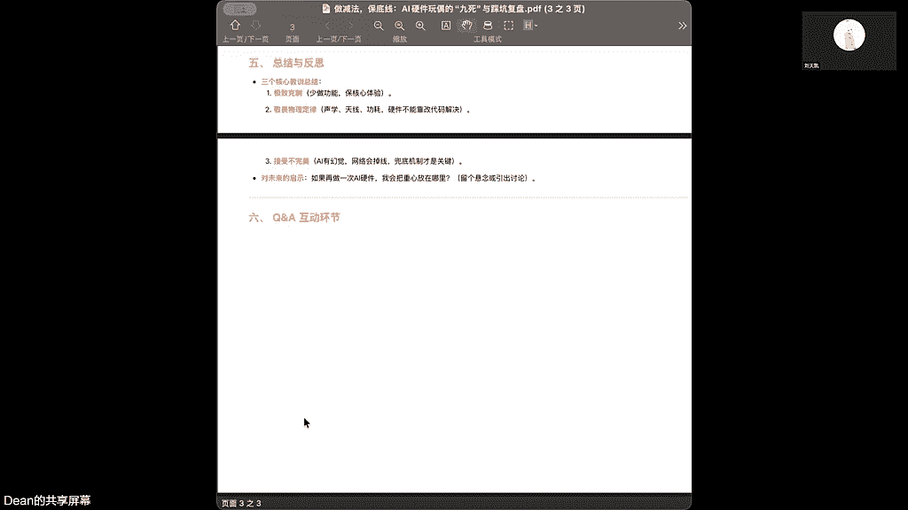

# 🧸 Datawhale AI+X：第1章：毛绒玩具供应链体系与AI硬件创业经验总结

## 开篇概述

本节课中我们将学习一段真实的AI硬件创业失败经历。分享者曾经参与给星巴克供应杯子和毛绒玩具的生产，拥有成熟的供应链体系。后来团队决定切入AI硬件赛道，开发一款AI聊天毛绒玩偶。项目从2024年12月立项开始，前后投入将近一千万资金，但最终产品销量不达预期，公司面临解散。本节课将逐条拆解导致失败的原因，包括产品功能过多、技术选型失误、团队共识缺失、用户调研不足等问题，并提炼出可供后续AI硬件创业参考的经验教训。

## 一、项目背景与市场机遇分析

上一节我们提到AI大模型正在从软件端向硬件端落地。本节中我们来看看为什么当时团队决定做AI毛绒玩具，以及当时的成本测算情况。

当时AI需要落地，而AI落地中最大的问题是回答不稳定和幻觉。但对于聊天场景而言，AI的表现已经足够好。与此同时，硬件端的芯片成本已经大幅下降。例如乐鑫的ESP32S3芯片，市场价大约在10元到20元之间。整个通信模组做下来，成本大约在五十元到八十元，如果有量的话甚至能压到五十元左右。加上毛绒玩偶本身和一些杂费，整个产品的成本大约能控制在一百元左右。

可以用下面的公式来表示产品的成本结构：

```text
产品总成本 = 芯片成本 + 模组成本 + 毛绒玩偶成本 + 杂项费用
```

以实际数值估算，大约为：

```text
产品总成本 ≈ 10～20元 + 50～80元 + 毛绒成本 + 杂项费用 ≈ 100元左右
```

而销售价格可以定在三百元到四百元，理论上可以达到三倍左右的毛利。只要有销量，前景看起来很好。

不过现实并没有按照预期发展。团队每年投入四五百万，累计将近一千万，但产品最终卖不出去，销量远未达标，后续融资也跟不上。公司现在基本上已经停止运营。

## 二、核心失败经验一：功能堆砌与缺乏克制

在上一节中我们分析了项目的成本和市场前景。本节中我们来看看产品本身出现的第一个严重问题。

团队开发了非常多功能，除了AI聊天之外，还有安睡、闹钟、讲故事、成语接龙、海龟汤等各种游戏。最后发现问题出在模式太多，导致意图识别很难准确，尤其是在连续对话过程中，用户说一会儿成语接龙，系统却切去讲古诗或讲故事，用户体验非常糟糕。用户会觉得产品又笨又傻，不如专门做一件事的设备，比如只讲故事的听筒机。

以下是功能堆砌导致的主要后果：

- 意图识别准确率下降，系统无法理解用户真正想要什么
- 连续对话中频繁切换场景，用户感到困惑
- 产品缺乏核心竞争力，不如单一功能设备受欢迎
- 开发成本增加，APP投入大量资金却换不来用户满意度

针对这个问题，分享者的第一条建议是：做产品要做减法，学会克制。当你想做AI硬件时，不要想着把所有功能都加进去。最开始可能只想做一个AI聊天功能，但后来A用户有需求，B用户也有需求，所有需求都加进来之后，产品就失去了最初聚焦的用户群体。

比如最开始想面向成年时代女性做聊天场景，后来宝妈反馈想让孩子听故事，就加了讲故事；接着又有用户要求讲古诗，又加了古诗。结果没有做任何克制和拒绝，导致功能特别多，操作复杂。

用户不会因为你有很多功能而感激你，反而会觉得这个东西很难用。用户只想听个故事，你却给他那么多选项，体验自然不好。建议学习张小龙的产品思维，做到极致克制，只为你面向的目标用户群体做产品。

## 三、核心失败经验二：APP与小程序的选型决策

在上一节中我们讨论了功能克制的重要性。本节中我们来看看团队在交付方式上做出的另一个错误决策。

当时团队在做APP还是做小程序之间做选择。他们觉得做APP可以脱离微信生态，脱离大厂限制，创建私域流量，可以做各种玩法。于是请了专门团队做APP，开发了iOS端和安卓端，还要适配各种手机型号，过程中故障频发，花费了大量资金，但最终效果并不好。

回过头来看，其实在微信上做个小程序更合适。用户不需要下载APP，不需要占用手机存储空间，只需要配网和聊天展示，几个简单的配置页面就足够了。

以下是APP方案带来的具体问题：

- 开发成本高，需要同时适配iOS和安卓多种机型
- 用户安装门槛高，很多人不想下载APP，认为占用手机空间
- 很多用户在看到要下载APP时就直接退货，还没到后续绑定和聊天环节
- 维护成本高，故障频发

产品决策时不能只考虑好的方面，也要考虑普通用户的实际情况。团队成员可能都用苹果手机，觉得装一个APP很顺畅，但大量安卓用户手机空间并不宽裕，这一决定直接导致了高退货率。

## 四、核心失败经验三：追求完美与缺乏产品亮点

在上一节中我们分析了APP与小程序的选型失误。本节中我们来看看团队在产品定位上的问题。

团队希望产品各方面都做得好，又要好玩，又要聊得顺畅，又要延迟低，又要语音合成拟人有情感。结果各方面都去打补丁，却没有核心体验。

竞争对手有明确的聚焦点。比如上海萝卻智能的福仔，聚焦在情感陪伴和智能体设计，做声纹优化和情感模型，核心很突出。嗨薇薇做了一款吊坠式聊天玩偶，目标很明确：给玩具和玩偶赋予聊天能力。用户知道买嗨薇薇是为了给玩具加聊天功能，买福仔是为了体验情感陪伴。

而团队的AI聊天毛绒玩偶没有亮点。虽然在聊天延迟上比嗨薇薇好，毛绒体验比海薇薇好，支持的功能比每家都多，但没有一个能让用户为之买单的亮点。没有产品符号，用户看到产品不知道它是做什么的，也不知道能解决什么问题。

可以用下面的逻辑来理解：

```text
产品亮点 = 用户能一眼识别的功能 + 用户愿意为此付费的理由
```

如果用户看到你的AI硬件，立刻知道它是干什么的，能解决什么问题，那么在宣传和产品设计上就已经成功了一半。

后续如果做AI硬件，必须把打造品牌或产品符号放在第一位，而不是把技术或自以为是的体验放在第一位。不要为了降低100毫秒延迟而牺牲大量时间，却没有开发出任何亮点。

## 五、核心失败经验四：配网流程设计与用户体验

在上一节中我们讨论了产品亮点的重要性。本节中我们来看看配网环节的设计问题。

团队最初选择了AP配网，也就是玩偶作为热点，用户连上热点进行配网。虽然这种方案在某些场景下体验可能更好，但对于AI硬件来说，蓝牙配网才是首选，也是最顺畅的方案。未来如果AI硬件发展，4G方案让用户拿到手开机就能玩，是最顺畅的。

配网流程中，不要让用户输入wifi名称、选择wifi、输入密码，这些步骤会劝退用户。谁能把配网流程想得最深入，打通得最顺畅，谁在退货率方面就能占据优势。

## 六、核心失败经验五：把用户当傻瓜，简化操作

在上一节中我们讨论了配网流程的优化。本节中我们来看看功能设计中关于用户操作的原则。

建议把用户当傻瓜来设计产品。即使有50%的人想要某个功能，如果让另50%的人觉得操作困难，就不应该加这个功能。加完之后，50%的人操作不顺畅不满意，另外那50%有预期的人体验之后也可能不满意。

要向大厂学习，绑定、注册等流程中，用户还不知道后面的操作，就不要让用户操作。能不操作就不操作，必须操作也尽量少操作。

比如团队为了安睡模式，设置了很多下拉框和选择框，用户要做四五个选项才能开启。虽然几十个用户有这个需求，但这不到总用户的10%。团队为此梳理了整个后端架构，APP和后端都要开发，还要代码重构优化，成本很高。最后那几十个用户仍然不满意，因为配置步骤太多。

可以用下面的公式表示功能增加的综合成本：

```text
功能总成本 = 前端开发成本 + 后端开发成本 + 代码重构成本 + 维护成本
```

未来做AI硬件，以前需要用户设置的地方，以前需要用户费心的地方，都要考虑用AI来替代掉。这才是AI硬件智能体验的体现。

## 七、核心失败经验六：实验室环境与真实场景的差距

在上一节中我们讨论了简化用户操作的重要性。本节中我们来看看产品在真实环境中的表现问题。

团队在实验室测试时，回声消除、音量、网络、弱网都测试正常。但产品到用户手中之后，退货原因各异：有噪声，用户在一个房间放玩偶，大人在另一个房间对小朋友吼着说话，导致声音乱七八糟，回答也乱七八糟，用户体验很差。

团队以为是个例，后来发现大量用户是买给小朋友的。小朋友和玩偶聊天时，大人在旁边插嘴或让小朋友去做别的事情，小朋友却想继续跟玩偶聊天。这时候玩偶已经懵了，不知道是小朋友在聊天，还是大人在聊天。尽管做了收音优化，但现实场景收上来的声音质量不好，导致ASR识别不准，大模型回答不好，TTS合成也不好，一连串问题接踵而至。

建议未来做AI硬件，产品成品之后要去现场环境测试，找目标客户群体使用，收集现场情况，进行改正和优化，再进行真正的量产。



另外，硬件过早量产会导致大量资金积压在库存中，这也是一个大问题。

## 八、核心失败经验七：技术选型与团队共识

在上一节中我们讨论了实验室与现实场景的差距。本节中我们来看看团队在技术选型和共识方面的问题。

ASR方面，团队选了火山的火山豆包模型，测试准确率能到98%，多音字、热词替代词都加上了，延迟在二三百毫秒。大模型选了火山和阿里的，延迟在五六百毫秒，甚至六七百毫秒，效果还可以，但不能开启思考模式，推理能力有所下降。

TTS方面选了mini max和豆包，合成语音情感和情绪更到位。但后来发现，没有用户因为语音合成更好而继续使用产品，也没有人因为声音机械而退货。后来总结：TTS最重要的是多音字发音准确，上下文要能辅助识别多音字。不能读古诗时多音字全读错，或者把110读成110这样的错误。

更大的问题是团队内部没有达成共识。AI有幻觉是必须承认的，但产品、销售、其他研发人员可能接受不了。团队花了大量时间成本在这件事上。

必须达成共识：接受AI有幻觉，还是不能接受？如果接受不了，就要用工程手段兜底；如果接受，就要在产品定义上考虑好，比如AI聊天会胡说八道，甚至连续重复100个字。产品必须接受这个事实，所有人都知道会有这个问题，然后想办法用工程手段兜底，而不是说既然用了AI就不能出任何问题。

共识不统一会影响产品判断和技术选型。产品说讲故事必须准确，技术团队可能就会选知识库方案，而不是让模型直接生成。技术团队和产品会陷入不停的扯皮，研发无法解决，想解决就要换方案，产品觉得AI很聪明就应该做对。

## 九、核心失败经验八：尊重物理规律

在上一节中我们讨论了团队共识的重要性。本节中我们来看看硬件开发中必须尊重的物理限制。

硬件生产出来之后，结构就没法改变了。比如做毛绒玩偶，喇叭和麦克风要塞到毛绒里面，那么收音效果肯定不如去掉毛绒。不能既想把喇叭麦克风放在里面为了美观，又想要声音清脆清晰，这是物理规律决定的，没法做到。

前期产品和研发都要接受这个事实，考虑好声学、天线、功耗等物理限制。既然决定做毛绒玩偶，就要在设计阶段权衡音质和外观，不能贪多嚼不烂。

## 十、核心失败经验九：接受不完美，做好兜底机制

在上一节中我们讨论了物理规律的限制。本节中我们来看看最后一条核心经验。

要接受不完美。AI有幻觉，网络也会掉线，服务会挂掉。要做兜底机制，但不要认为兜底之后就是百分百可靠。比如deep seek经常挂掉，可以给用户说“我这段时间有点忙，累了，要休息一会儿，你一会儿再来找我”，而不是去构建复杂的并发方案和多模型切换。

接多个模型接口虽然不会挂掉，但会增加复杂度，用户体验也不能保证。不同模型的聊天效果不同，同样的提示词，即使调整后，表达仍然有差异。豆包的character情商高，情绪价值给得到位，但说得不准。

对于AI创业公司，不建议为了那1%的完美付出10%的资金和精力。如果有精力和方案，追求这1%当然可以，但目前来看，不建议为了最后一点完美付出过多成本。

## 十一、用户调研与决策层反思

在上一节中我们总结了技术和产品方面的经验。本节中我们来看看团队在用户调研和决策机制上的不足。

团队最开始是做星巴克杯子的，有供应链体系，也做过毛绒玩具，给星巴克做过加工生产和设计。但用户调研方面，团队想当然了。觉得AI聊天爆发后，可以满足孤独陪伴，大家需要聊天搭子。于是简单找了几个人，或者在公司附近找了一些20多岁的Z世代女性询问，她说们愿意。

但问题在于，公司附近全是打工人，是一个特定群体，可能压力大需要聊天。但真正销售时发现，打工人不一定需要会聊天的毛绒玩具，可能只需要一个毛绒玩具。而且很多人不希望毛绒玩具开口说话，比如Hello Kitty和泡泡玛特都不做会聊天的玩具，这背后一定有原因。

团队只看到大厂不做，没有思考大厂为什么不做。是没有能力，还是不愿意做？团队太乐观，而且着急抢市场，几个月就要赶出来销售。前期产品需求没做好，导致中间各种返工，一直拖到今年年初才上线，结果市场已经被抢走了。

关于决策，团队最初是老板加几个技术合伙人，还有产品和营销负责人。拍板决策最好由一个人来做，可以讨论很多人，但拍板必须是一个人。如果两个人拍板，大概率说明方向可能有问题。

创业公司没有时间像大厂那样做大量数据调研，也请不起咨询公司。很多时候依赖直觉和判断。开始时没有数据，即使调研也得不到什么数据。只有真正量产卖出去之后，才能在留存优化上做调整，无法基于咨询数据直接设计产品。

不过可以向大厂学习UI设计，甚至直接参考大厂的方案，零成本让用户上手。大厂能成为大厂，肯定有做对的地方。

## 课程总结

本节课中我们一起学习了AI毛绒玩具创业的失败经验。从项目背景看，AI硬件芯片成本降低，看似有三倍毛利的机会，但实际上投入近千万最终失败。

我们梳理了九条核心经验：

1. 做减法，极致克制，聚焦目标用户，避免功能堆砌
2. 交付方式要选对，优先考虑小程序，降低用户下载门槛
3. 打造产品亮点和品牌符号，让用户一眼知道产品用途
4. 配网流程要简单，优先蓝牙配网，不要让用户输入复杂信息
5. 把用户当傻瓜设计，简化操作，少让用户做选择
6. 先在真实场景测试，再量产，避免实验室与现实的差距
7. 团队必须达成对AI幻觉的共识，统一产品和技术预期
8. 尊重物理规律，接受硬件结构带来的声学和功耗限制
9. 接受不完美，做必要的兜底，但不要为最后1%付出过多成本

同时也反思了用户调研和决策机制：调研要避免想当然，决策要由一个人拍板，创业初期依赖直觉，但可以向大厂学习成熟的UI和交互方案。


希望这些经验能帮助后续做AI硬件的团队避免踩坑，走得更远。

