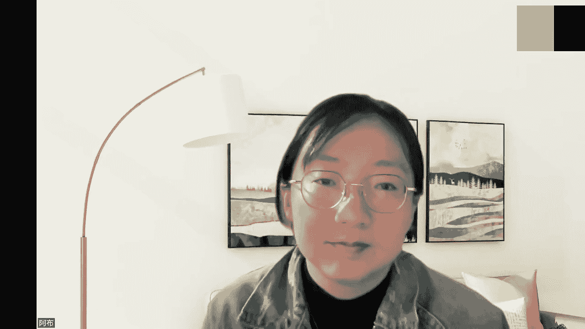
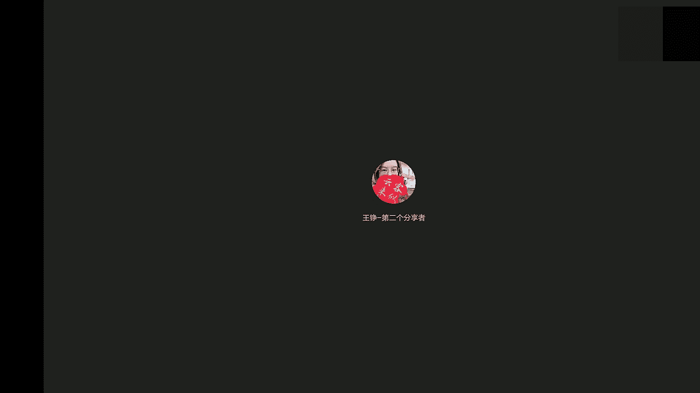
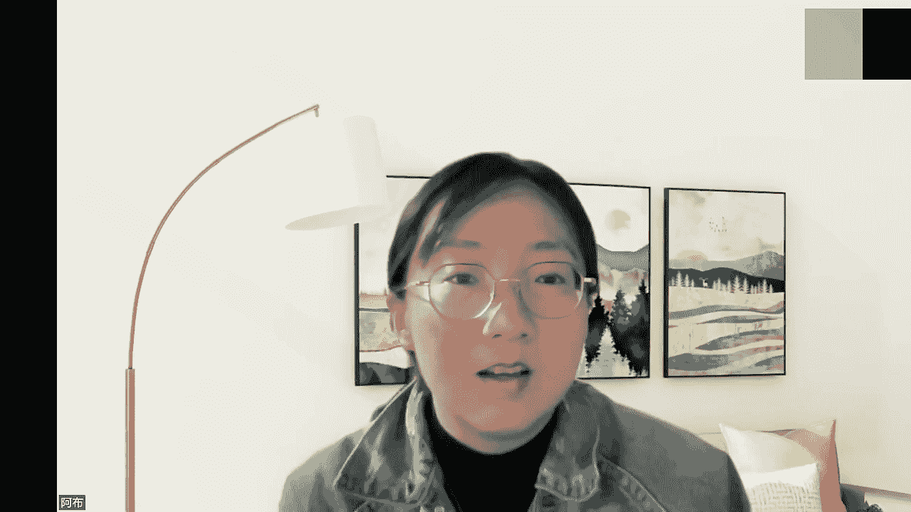
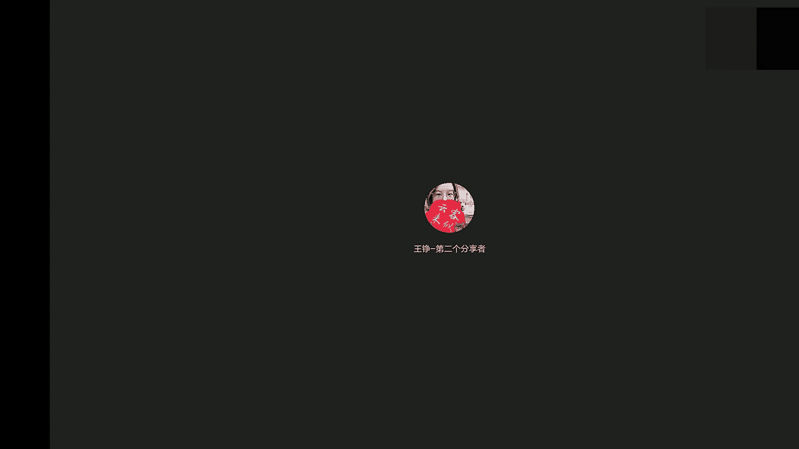
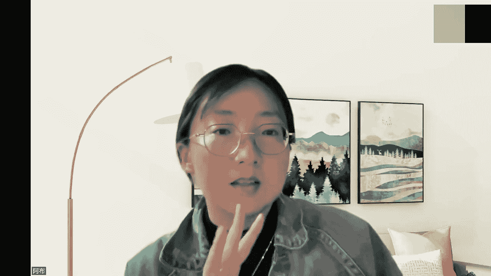

# 【Datawhale AI+X】深度睡眠：大脑清洁与阿尔茨海默症：01：睡眠的秘密与大脑清洁机制 🧠



在本节课中，我们将一起学习睡眠的基本概念，重点探讨为什么现代人，尤其是AI行业从业者，容易出现睡眠困难。我们会聊聊睡眠在大脑中到底起到了什么作用，如何帮助大脑清理垃圾，进而延缓衰老，降低阿尔茨海默症的风险。此外，我们也会讨论如何判断自己的睡眠状态，以及一些简单的改善方法，帮助你养成更健康的睡眠习惯。



## 第一节：AI从业者的睡眠现状

首先，我们来看看真实的睡眠困境是怎样的。



很多从事AI开发的朋友都有类似的感受。白天工作内容非常多，每天都需要学习新知识，压力也比较大。到了晚上，明明知道自己应该休息了，却总是放不下手中的事情，甚至觉得舍不得进入梦乡，希望能够多利用一点时间来提升自己。这种状态下，入睡变得很困难，往往需要逼自己到极限，头一碰到枕头才能勉强睡着。睡眠不再是一种放松，而变成了任务清单上的一项。



从中我们可以发现，AI行业的人通常比较重逻辑、重理性，希望尽可能地发挥自己的能力，做出一些成果。但长期这样下去，身体会发出警告。以下是几个常见的表现：

- 每天事情太多，睡前难以平静下来
- 明明想睡，却总是觉得还有事没做完
- 对睡眠持有又爱又恨的态度，既知道需要休息，又希望睡眠可以被消除

了解了这些现象之后，我们接下来探讨睡眠背后的第一个核心秘密。

## 第二节：睡眠的第一个秘密——是否真正重视睡眠

在讲具体的睡眠技巧之前，我们需要先回答一个更根本的问题。

很多人都知道睡眠重要，但这种认知往往是模糊的。我们在脑海里建立的关于睡眠的知识图谱，只停留在“睡眠似乎很重要”这个层面，却不清楚它究竟如何重要，又如何支持我们的身体和大脑。当认知停留在这么表面的程度时，改变就很难发生。

真正决定睡眠效果的，不是你买了多好的床垫，也不是你尝试了多少助眠方法，而是你是否真正把睡眠当成一件事情来对待。我们可以用下面的公式来理解：

**睡眠改善前提 = 是否把睡眠当一回事 × 是否愿意带着好奇去探索睡眠**

如果你对睡眠的定位比较低，认为它只是生命中可以被牺牲的一部分，那么再多的方法也很难坚持下去。你需要先问自己：你希望把睡眠放在生活的什么位置？你希望它调整到什么样的状态？只有先弄清楚这些问题，后续的行动才有方向。

当我们完成了对睡眠态度的判断，就可以进入下一步，看看睡眠的第二个秘密。

## 第三节：睡眠的第二个秘密——先判断，再行动

很多人在改善睡眠时，容易直接去尝试各种方法，却忽略了一个关键步骤。

如果你不知道自己睡眠问题出在哪里，也不知道现在的状态处于什么水平，盲目地去吃褪黑素、去买遮光帘，效果往往有限。就像如果你不知道生病的原因，乱吃药是不会好的。

首先，你需要评估自己的睡眠到底受到了什么影响。以下是几个可以自行思考的方面：

- 你每天实际睡多久？
- 睡前是否有提前的准备，比如放下手机、让身体进入休息状态？
- 你的头脑里是否一直装着未完成的工作？
- 你的生活是否被各种事情填满，以至于头脑无法安静？

第二，你需要明确睡眠在你生命中的定位。如果你的生活被事情填满，头脑里一直装着各种事务，换成任何人都很难睡好。这时问题不在于光线或环境，而在于你是否给自己留出了真正休息的空间。

你可以用下面的简单逻辑来进行自我判断：

```
如果 睡眠只是偶尔受干扰:
    只需小幅调整节律
如果 睡眠长期受到工作压力影响:
    需要重新审视生活方式与优先级
如果 不知道问题在哪里:
    先做一次基础的睡眠评估
```

有了判断之后，我们就可以聊聊睡眠与大脑健康之间更深层的联系了。

## 第四节：大脑清洁机制与阿尔茨海默症

除了让人感觉精神，睡眠在生理层面上还承担着一项非常重要的任务。

当你进入深度睡眠，尤其是睡得比较熟的时候，大脑里面并不是空着的，而是在进行一次大规模的清理工作。这时候，脊髓和脑脊液会流动起来，像刷东西一样，把大脑里面的代谢垃圾一路刷走。你可以把它理解为大脑的“自动清理内存”功能。

这个机制与阿尔茨海默症密切相关。医学研究发现，阿尔茨海默症（老年痴呆）患者的大脑中，某种蛋白质会过度堆积，形成垃圾，而这些垃圾没有得到有效清理。睡眠不足会直接干扰这个清理过程，让垃圾在大脑中堆积。

我们可以用下面的公式来表示：

**大脑垃圾清除量 ∝ 深度睡眠时间 × 脑脊液流动速度**

也就是说，深度睡眠越充分，大脑清理垃圾的能力就越强，患阿尔茨海默症的风险也会相对降低。

睡眠不足还会让身体过早衰老。有一个著名的例子是美国海豹突击队的队员。他们身体素质非常好，但医生研究发现，这些年纪大约30岁的队员，血液状态却相当于六七十岁的老人。原因就在于他们长期处于高强度训练和准备状态，没有得到充分休息。外表看起来很好，但内部器官已经处于衰老和虚弱的状态。这也提醒我们，看起来强壮不代表内部健康，睡眠是延缓衰老的关键点之一。

了解了睡眠对大脑和身体的重要性，最后我们来看看具体该怎么做。

## 第五节：改善睡眠的实用方法

理论固然重要，但真正有效的是落地到日常生活中的小习惯。

影响睡眠的因素有很多，其中光线是最基础也最关键的一个。我们都知道褪黑素与睡眠有关，而光照会直接影响褪黑素的分泌。光不仅和睡眠有关，还和我们的整体情绪状况有关。比如在精神病房，医生会使用光疗仪在白天给患者补充光照，光照多了之后，患者的心情也会变好。

最简单、最好用、也最重要的方法是：在醒来之后的第一时间，接收到自然光。光里面蕴含着大量信息，人每天需要补充能量，就像吃饭一样，也需要“吃光”，尤其是自然光。让身体熟悉一个节奏，回到有节奏的状态，最重要的是知道如何为身体提供光照。

你可以按照下面的步骤来做：

```
醒来后立即动作:
    1. 拉开窗帘
    2. 让阳光洒进房间
    3. 让光线照到自己的皮肤和眼睛
```

室外光线最好，如果能直接晒到太阳当然更好。但大部分人起床后很难立刻去到室外。如果有条件，当然最好；如果没有，第一步也可以先拉开窗帘，让自然光洒进来，照到你自己。这对大部分睡眠状况没有严重问题的人来说，已经是一个非常好的开始。

除了光照，还有几个细小但常见的问题需要处理。比如睡前放不下手机，或者睡前头脑里事情太多。你可以把睡眠想象成一个波形，是上下波动的。当你想入睡时，身体需要处于静息状态，但如果头脑里充满各种事情，身体还在兴奋，手还在不停地划着手机，你就不可能一下子从高点跌落到睡眠状态。那种勉强入睡，往往不是真正的睡眠，更像是“昏过去”。长期这样下去，身体得不到恢复，白天会昏昏欲睡。

为了让身体从兴奋状态平缓地过渡到睡眠状态，你可以尝试以下方法：

- 泡脚：当人兴奋时，血液容易涌向脑袋。泡脚可以帮助血液向下流动，既给身体发出“我在为睡眠做准备”的信号，也让物理环境发生改变，更容易从头部发热的状态过渡到静息状态。
- 晒月亮：人不仅需要日光，也需要月光。晚上到月光下散步，避开人造光多的地方，走着走着可能会逐渐感到困倦。
- 晚间正念或轻动作：通过一些身体动作和正面的冥想方式，让自己从对外界的工作状态，慢慢回到自身内部。

到这里，我们已经把睡眠的核心要点和实用方法都梳理了一遍。

## 总结



本节课中，我们一起学习了睡眠的基本概念与重要性。首先探讨了AI行业从业者常见的睡眠困境，然后了解了睡眠的两个核心秘密：一是是否真正重视睡眠，二是先做判断再采取行动。接着，我们学习了睡眠如何帮助大脑清理垃圾，延缓衰老，降低阿尔茨海默症风险。最后，介绍了几个简单的改善方法，包括醒来后接收自然光、泡脚、晒月亮以及晚间正念练习。希望这些内容能帮助你建立更健康的睡眠习惯，让大脑和身体都得到充分的休息。

