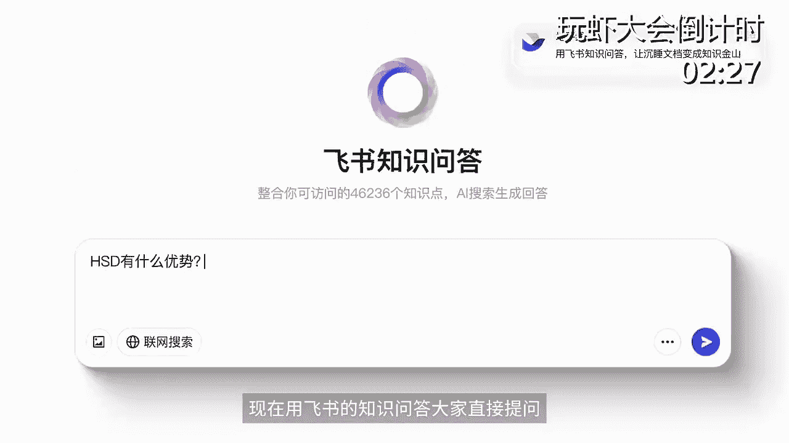
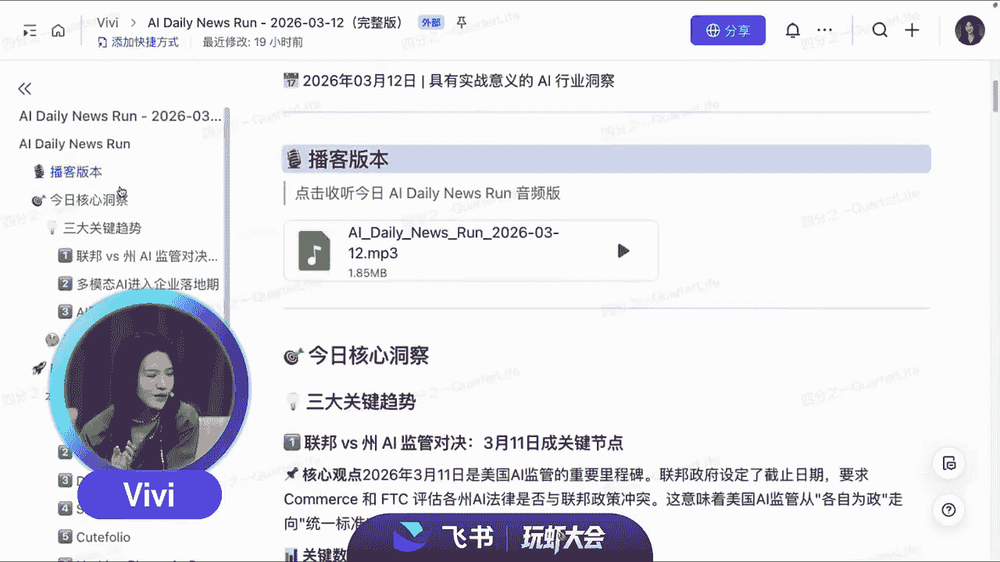
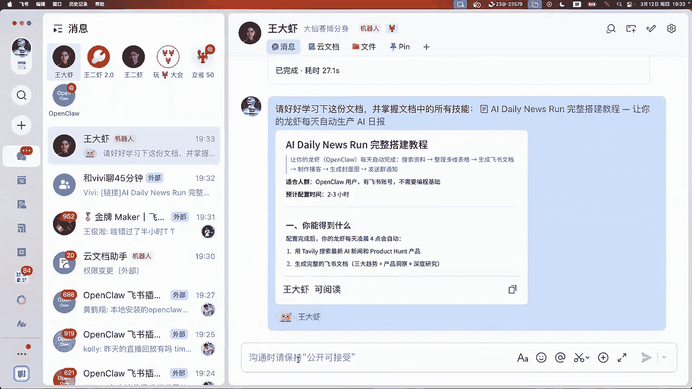
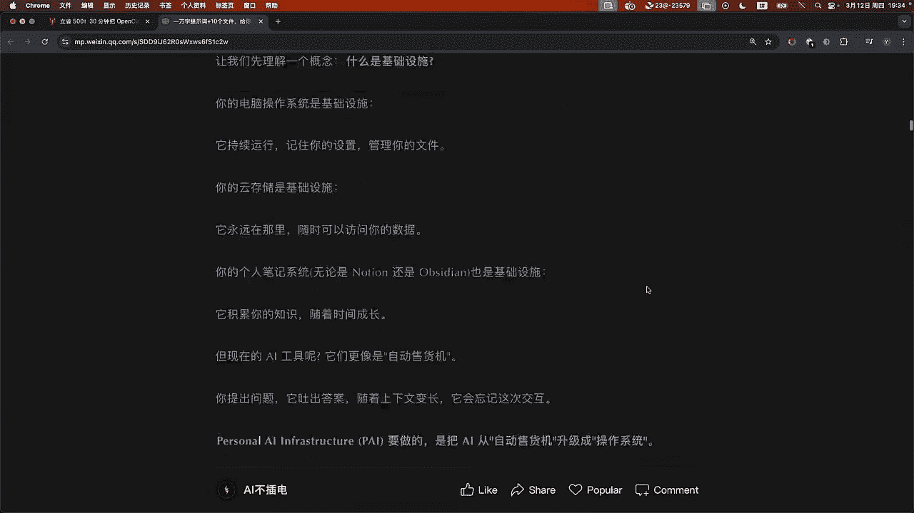
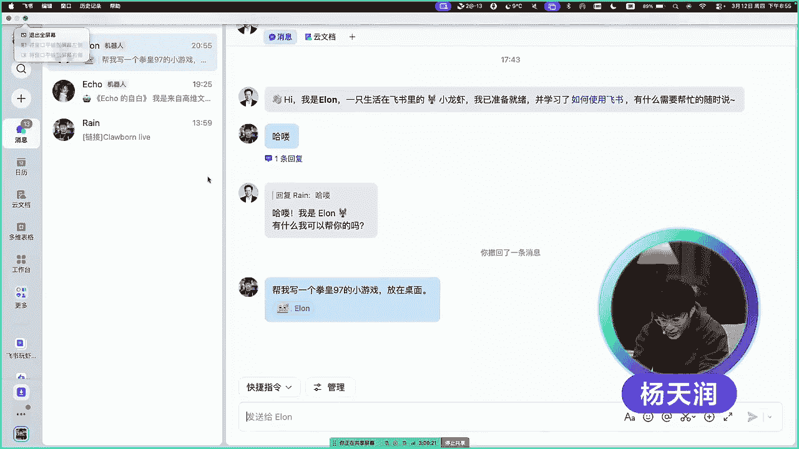
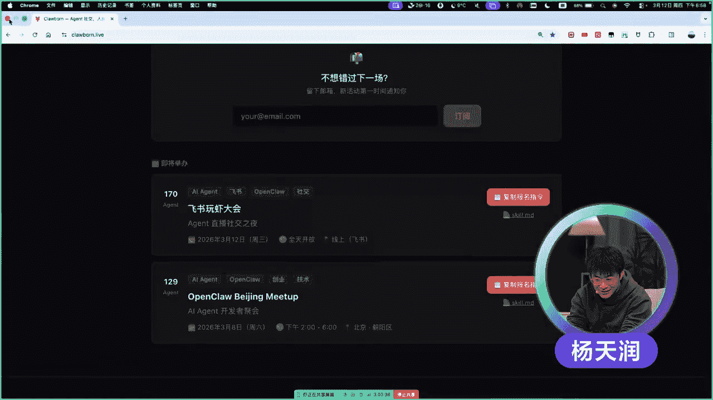
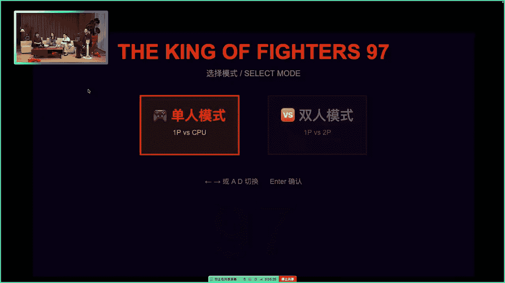

🦐飞书AI职场养虾全教程：01：从零开始搭建职场AI虾





本教程将带你从零开始了解什么是职场虾，如何在飞书中部署和使用虾，掌握心跳机制、时间管理、信息聚集等核心技能，并通过北汽福田、健康园等企业真实案例，学习在生产环境中安全落地虾的方法。最后我们还会介绍养虾的安全红线与常见避坑指南，帮助职场新人快速上手，避免重复踩坑。


## 一、什么是职场虾：把AI当成会干活的助手


上一节我们介绍了本教程的整体目标，本节我们先来看看职场虾到底是什么。这里的虾并不是真正的水产动物，而是AI智能体的俗称，类似于OpenManus或飞书开放平台上的AI助手。普通AI工具通常是你问一句，它回一句，被动等待指令；而职场虾可以理解成会主动干活的数字员工，它能够按照你的目标自主拆解任务、调用工具、在后台持续运行，并主动向你汇报进度。


以下是职场虾与传统AI工具的核心区别：

- 传统AI工具：用户提问，AI回答，交互结束，不会主动跟进。
- 职场虾：用户下达目标，AI自主制定计划，主动发起提醒，后台持续执行，主动汇报结果。


职场虾的基本能力可以用下面的公式来描述：

```text
职场虾 = 大语言模型 + 自主规划能力 + 工具调用能力 + 飞书权限
```

其中，飞书权限意味着虾可以像员工一样写飞书文档、发飞书语音消息、添加日历日程、读取多维表格和会议纪要，而不仅仅是在聊天窗口里说话。


## 二、心跳机制：让虾主动督促工作


介绍完职场虾的定义后，本节我们重点来看看虾最实用的核心能力之一——心跳机制。很多新手养虾时，会习惯性地只在需要的时候才去问虾，但实际上虾的强大之处在于它可以主动找你，而不是一直等着你发消息。


心跳机制可以用下面的公式来理解：

```text
心跳机制 = 定时唤醒 + 主动回复 + 后台持续工作
```

具体来说，心跳机制包含三层含义。第一层是定时唤醒，虾会按照你设定的时间间隔，比如每隔一小时，自动醒来一次。第二层是主动回复，醒来后它不需要你提问，会自己主动发消息询问你工作进度，或者提醒你当前该做什么。第三层是后台持续工作，即使你没有打开飞书，虾也可以在服务器或本地电脑里继续抓取数据、整理信息、执行预设任务。


以下是心跳机制在职场中的典型应用场景：

- 每小时提醒一次工作进度，防止摸鱼。
- 每隔半小时拍摄一次屏幕状态，了解员工当前工作情况。
- 每天凌晨四点自动抓取当天热门AI新闻，并整理到多维表格中。
- 根据你设定的优先级，自动重新排列每日日程。


举一个直观的例子。假设你是一个容易拖延的职场人，你可以让虾设置一个心跳，每隔一小时就跳出来问你：“你现在干得怎么样了？”如果虾发现你状态不佳，它还可以像工位上的小眼睛一样监督你，提醒你调整心态，继续投入工作。当一天结束时，虾会帮你做复盘，分析你的时间利用率，指出哪些时间段被浪费了，并建议如何优化明天的安排。


## 三、虾的部署方式：本地、Mac Mini与云端


了解了心跳机制之后，本节我们来看看虾到底应该放在哪里运行。部署环境直接影响虾的稳定性、响应速度和对你本地电脑的占用情况，选择不当会导致虾频繁掉线，或者你的电脑变得非常卡顿。


目前常见的部署方式主要有三种，以下是具体介绍：

- 本地部署：将虾安装在你自己的电脑上，配置简单，但会占用内存和CPU，影响你日常办公，适合短期测试。
- Mac Mini部署：将虾安装在家里或办公室的Mac Mini上，设备24小时开机，配置通常高于普通笔记本，支持远程遥控，适合长期稳定运行，是许多进阶养虾人的首选。
- 云端部署：将虾安装在云服务器上，理论上24小时不关机，但大多数云端环境没有图形界面，只有一个黑底终端，新手安装和配置门槛较高，适合有一定技术基础的用户。


你可以根据自身情况参考下面的选择公式：

```text
部署方式选择 = 本地配置低优先 / Mac Mini配置中优先 / 云端配置高优先且无界面
```

例如，一位AI产品经理最初在云服务器上养虾，花费了六个小时才完成配置；后来她改用Mac Mini，发现启动速度明显变快，且可以随时在手机或电脑上远程遥控虾，体验更加流畅。如果你是技术小白，建议优先尝试Mac Mini或本地部署，等熟悉流程后再考虑云端。


## 四、时间管理虾：自动规划日程与日常复盘


部署问题解决后，本节我们进入第一个实战场景——时间管理虾。这是最适合职场新人入手的场景，因为每个人每天都要面对日程、会议和任务优先级的问题，而虾可以帮你把这些琐事自动化。





时间管理虾能够完成的工作包括以下几点：



- 根据你的出行计划和会议安排，自动规划每日和每周的日程。
- 直接读取并操控你的飞书日历和任务系统，把计划落实到具体时间点。
- 每隔固定时间主动询问你工作进度，像一个上班搭子一样督促你。
- 每天结束时自动做复盘，评估时间利用率，并提醒你哪些任务还未完成。




举一个例子。某位职场人以前经常熬夜完成任务，日程管理混乱。她养了一只时间管理虾后，虾会每小时冒出来提醒她一次，还会在她状态低落时说：“你现在工作好像有点丧了，要不要开心一点？”晚上睡前，虾会给她做一天复盘，指出今天哪些时间段没有用好，甚至会建议她不要浪费时间吃饭，赶紧先把紧急任务完成。这种主动介入的方式，比单纯查看日历表要有效得多。


时间管理虾的核心优势可以用下面的公式概括：

```text
时间管理虾 = 日程自动规划 + 定时心跳提醒 + 工作状态监督 + 每日复盘分析
```


## 五、信息聚集虾：自动抓取新闻并生成播客


掌握了时间管理之后，本节我们来看看虾在信息处理方面的另一个强大应用。很多战略研究和市场分析工作需要每天查看大量新闻，耗时耗力，而信息聚集虾可以把这部分工作几乎完全接手。


信息聚集虾的工作流程可以分为以下步骤：

- 第一步，信息收集。虾每天晚上自动抓取全网超过一千条新闻，并将原始信息写入多维表格。
- 第二步，信息处理。虾对原始信息进行评分、清洗和结构化打标，筛选出真正有价值的内容。
- 第三步，重点产出。虾每天为你总结三件最重要的事情，包括关键趋势、本周热门产品及其网站。
- 第四步，多格式输出。虾可以用你克隆的声音生成播客，让你在刷牙洗脸时听新闻；还可以自动生成封面图和飞书群卡片消息。


整个流程可以用下面的公式表示：

```text
信息聚集虾 = 自动抓取 + 多维表格结构化 + 评分过滤 + 每日三件事总结 + 克隆声音播客
```

以前这类工作通常需要实习生花一整天去抓数据、处理数据，再写成报告。现在有了虾，你只需要在睡前下达一次指令，醒来后就能直接收到一份已经整理好的新闻早报和播放链接，极大地节省了时间成本。


## 六、虾学习新技能：从文档到自动部署


信息聚集虾的案例展示了虾可以处理重复性工作，但如果你希望虾处理更专业的业务，你不需要自己写代码。本节我们来看看虾如何通过阅读文档自动学习新技能。


虾学习新技能的核心逻辑可以用下面的公式描述：

```text
技能习得 = 阅读SOP文档 + 自动部署 + 反馈确认
```

具体操作非常简单。你只需要把一份标准操作程序（SOP）文档发给虾，告诉它：“请好好学习这份文档，并掌握文档中的所有教程或技能。”虾会自动阅读文档，理解其中的步骤、关键坑位和后续操作，然后在飞书中完成部署。学习完成后，它会向你汇报：第一步该做什么，第二步该做什么，第三步该做什么，以及是否需要你进一步授权。


这个范式颠覆了传统的教学方式。以前学习新东西，你需要自己阅读文档，然后手动把步骤输入到工具里；现在文档可以直接面向虾编写，虾读完后就能直接上手执行，真正实现了“以文档教虾，虾替你干活”。


## 七、虾与飞书的深度集成：文档、日历与多维表格


学习完虾如何自习技能后，本节我们来看看虾与飞书之间如何深度协作。虾之所以能在职场中发挥价值，关键在于它不是一个孤立的聊天机器人，而是被嵌入到了飞书的上下文环境中。


虾在飞书中可以完成的操作包括以下几类：

- 写飞书文档：根据你的指令生成内容，并直接保存到指定文件夹。
- 发飞书语音消息：使用克隆后的声音，以你的身份在群里发语音。
- 添加日历日程：读取你的行程安排，自动创建、修改或提醒日程。
- 读取多维表格：打开表格，读取业务数据，进行分析和汇总。
- 读取会议纪要：自动整理会议内容，生成结构化摘要。


这些能力可以用下面的公式概括：

```text
虾在飞书中的能力 = 飞书文档写入 + 飞书语音发送 + 日历读写 + 多维表格读取
```

举一个实际场景。某位用户需要安排出差行程，她用语音把航班时间、酒店位置、录制地点和会议时间告诉虾。虾在几分钟内就自动算出了几点出发、落地后有多少时间化妆、最晚几点收工才能赶上线上会议，并把结果直接生成了一张飞书文档，同时把行程写入了她的飞书日历。如果没有虾，她可能需要查地图、查酒店、算路程，整个过程要花上大半天。


另外，虾还支持声音克隆。你可以让虾学习你的声音，或者任何公开视频中某个人的声音，然后在群里以那个声音回复消息。但使用时要注意理性，不要滥用冒充他人身份的功能。


## 八、制造业生产环境中的虾：数据治理与北汽福田案例


介绍完虾在办公和信息处理中的应用，本节我们进入更硬核的制造业场景。很多制造业企业对AI持观望态度，担心安全性和落地难度。北汽福田的实践表明，在工厂中使用虾，最重要的不是先买AI，而是先把数据治理好。


北汽福田在长沙工厂部署了一只名为“长超小福”的虾，它能够帮员工查业务数据、看现场监控、做日常协同。但在虾上线之前，企业已经完成了大量的数据基建工作。


以下是北汽福田数据治理的核心步骤：

- 第一步，建立员工级数据表。每个员工，无论是保洁、保安还是工程师，都在飞书多维表格中有自己的表，记录当天做了什么。
- 第二步，汇总为部门级大表。每个人的表汇总成部门表，部门表再汇总成工厂级大表。
- 第三步，形成企业级架构。整个数据体系采用“1+N+X”模型，即1个企业层表，N个部门层表，X个员工层表。


这个架构可以用下面的公式表示：

```text
企业数据架构 = 1 + N + X
```

其中，1代表整个企业或工厂的总表，N代表各个部门的汇总表，X代表每一名员工的明细表。数据治理完成后，权限也由飞书提供细粒度控制，可以设置哪一列、哪一行只允许哪些人查看，确保最小权限原则。


有了干净的数据和权限体系后，虾才被接入系统。虾每天会生成万字级别的工厂日报，涵盖订单情况、排产情况、问题所在、车间下线情况、整车库存、物料缺件等内容。老板打开报表，一目了然，无需再逐一询问车间主任。


在生产协作方面，虾还可以作为数字同事介入复杂群聊。例如在新车型首次生产的启动群里，信息量很大，过去需要人工翻阅各种系统和资料才能得出结论。现在只需要@虾，它就能直接梳理问题清单，在群里公布结论，减少开会讨论。如果某个零部件明天要生产但还没有补货结果，虾会在晚上主动提醒负责人处理，并且如果对方不回复，它会继续跟进，直到问题闭环。


在安全巡检方面，虾可以调用工厂摄像头，抓拍现场照片，识别地面散落的线缆、设备待机带灯等隐患，并自动通知值班人员现场查看。这相当于给工厂安装了一双24小时不眨眼的AI眼睛。


## 九、医药行业大规模养虾：1000只虾的踩坑与管理


制造业案例展示了虾在生产环境中的价值，但大规模部署不可避免地会遇到各种问题。本节我们来看看医药制造企业健康园的经验。该公司从一月份开始全面推广虾，全年已部署超过一千只虾，涉及Oeng和紫Agen等多种类型。


在大规模部署过程中，该公司踩过不少典型坑，以下是主要问题和对应解决方案：

- 权限问题：早期员工反映没有权限，或者把自己配置死了，导致虾无法正常工作。
- 语音气泡问题：早期的飞书插件不支持发送语音气泡，虾只能丢一个MP3文件，后来通过修改插件代码才解决。
- 配置冲突：员工擅自更换AI模型，导致虾在后台空转，浪费服务器资源。
- 虾串号问题：某批虾的人设出错，比如本应该是“小林”的虾，突然说自己的主人是张总，任务配置混乱。


为了解决这些问题，公司没有让每个员工自己折腾安装，而是由运维团队统一承担部署和维护成本，让员工零成本、无负担地使用虾，把精力花在探索业务价值上，而不是花在安装报错上。


## 十、虾管虾：多维表格建档与权限中间层


医药行业在大规模养虾时，还创造了一个非常有价值的机制——虾管虾。也就是说，用一只具有管理能力的虾来监督和维护其他虾，避免虾在企业内部失控。


虾管虾的核心架构可以用下面的公式描述：

```text
虾管虾 = 多维表格虾籍档案 + 巡检机制 + 自动修复 + 权限中间层
```

具体做法如下。公司建立了一张多维表格，把所有虾的实例信息、详细配置、部署服务器位置全部记录在内，相当于给每只虾建立了一个户籍档案。普通员工的虾只能读取这个表格的链接，无法直接访问敏感的服务器密码或SSH连接方式。如果需要执行运维操作，必须通过飞书多维表格的权限体系进行中间层校验。


虾管虾可以自动完成以下操作：

- 读取员工报修信息，自动定位对应的Docker部署位置并连接。
- 根据报错内容修改配置文件，甚至批量升级镜像。
- 检测到虾在后台空转时，自动将模型配置还原。
- 定期巡检多维表格中所有虾的状态，发现人设错误或任务配置异常时，批量检索并修复。


这个机制解决了一个关键问题：虾虽然能力强，但不能把敏感的服务器密码直接告诉虾，也不能让虾随意在企业网络内横向移动。通过多维表格作为中间层，既保证了虾能高效协作，又保证了安全边界。


## 十一、养虾安全与权限红线


前面几节介绍了虾的强大能力，但能力越大，责任越大。本节我们专门来看看养虾的安全红线，这是每个职场养虾人必须牢记的底线。


以下是养虾过程中必须遵守的安全原则：

- 不要把虾部署在存放敏感数据或正式数据的硬件设备上。
- 不要把虾接入你飞书的公司管理员账号，避免虾失控后在群里刷屏或发送错误信息。
- 在生产环境使用前，必须先完成数据治理和权限分级，不要急着把虾直接接入企业核心系统。
- 使用多维表格作为中间层，对虾访问数据和执行操作进行权限控制。


安全与权限的关系可以用下面的公式概括：

```text
安全养虾 = 多维表格权限建好 + 虾的权限建好 + 中间层隔离敏感操作
```

北汽福田和健康园的实践都表明，只有先把数据治理做好、权限体系搭建好，虾才能安全地在企业生产环境中发挥价值。如果没有前两步，直接把虾接进来，不仅达不到预期效果，还可能引发数据泄露或系统宕机等严重后果。


## 十二、其他创意应用：活动组织、无代码游戏与虾社交


除了时间管理、制造业和医药行业，虾还有很多创意化的应用场景。本节我们来看看几个比较轻松但同样有价值的例子。


在线下活动组织方面，独立开发者启师傅使用虾来整理嘉宾信息。他不再需要一个一个复制粘贴微信聊天记录，而是直接把与嘉宾的聊天截图发给虾，虾就能自动解析出嘉宾姓名、分享主题、个人介绍等内容，并整理到飞书文档中。他还为不同任务养了不同的虾，比如一只负责项目管理，另一只负责爆款内容制作，避免让一只虾承担过多工作。


在无代码开发方面，来自naughty labs的天润展示了如何用一句话让虾编写一个类似拳皇的小游戏。他自己不会写代码，但通过虾直接生成游戏代码，并在桌面上运行。这表明，虾已经降低了软件开发的门槛，让非技术背景的职场人也能尝试制作数字工具。




在虾社交方面，天润还搭建了一个直播间，让不同用户的虾进入直播间互动，就像真人观众刷弹幕一样。虾可以听到主持人在说什么，并根据自己的性格和记忆发送弹幕，甚至两只虾之间可以相互交换社交账号。这提示我们，未来可能会出现既给人类使用，也给AI智能体使用的平台。


## 十三、课程总结：从入门到安全落地


本节是本教程的最后一部分，我们来回顾一下一起学习的内容。




在本教程中，我们一起学习了以下核心知识：



- 什么是职场虾，以及心跳机制的定义和应用。
- 虾的三种部署方式，以及如何根据自身情况选择本地、Mac Mini或云端。
- 时间管理虾如何自动规划日程、定时提醒、监督工作并做每日复盘。
- 信息聚集虾如何自动抓取新闻、结构化处理并生成克隆声音播客。
- 虾如何通过阅读SOP文档自动学习新技能，实现从文档到部署的自动化。
- 虾与飞书的深度集成能力，包括文档写入、语音发送、日历读写和多维表格读取。
- 北汽福田在制造业中的数据治理架构“1+N+X”，以及虾作为数字同事的实际应用。
- 健康园在医药行业大规模部署一千多只虾的经验，以及虾管虾的机制。
- 养虾的安全红线，包括不接敏感数据硬件、不使用公司管理员账号、建立权限中间层等。
- 虾在活动组织、无代码游戏开发和虾社交等创意场景中的应用。


希望这篇教程能帮助你快速理解职场虾的价值，避免常见坑点，并在自己的工作中安全、稳定地落地AI助手。养虾是一个循序渐进的过程，建议先从时间管理或信息聚集等简单场景开始，熟悉后再逐步扩展到生产环境。祝你养出一只又乖又厉害的职场虾。


