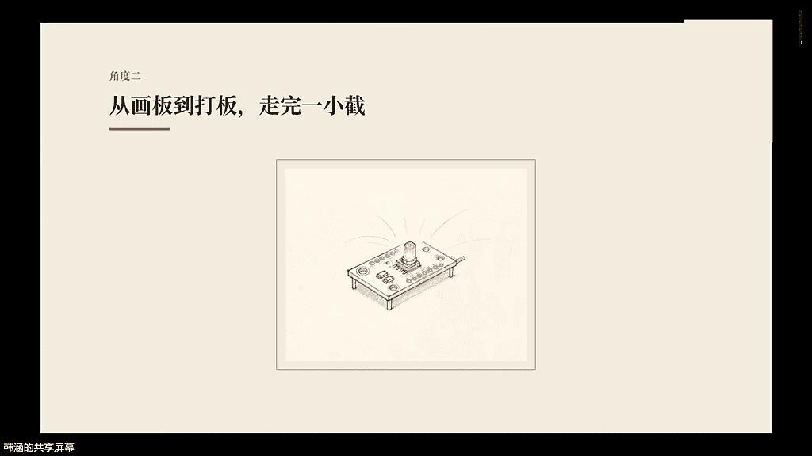
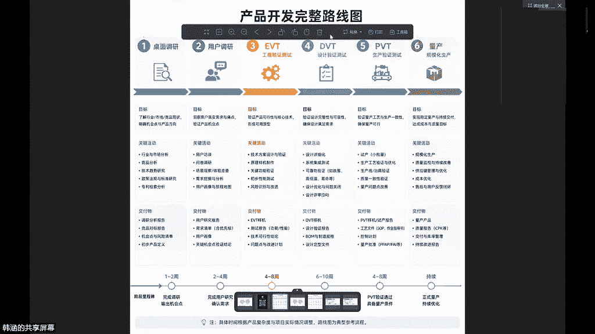
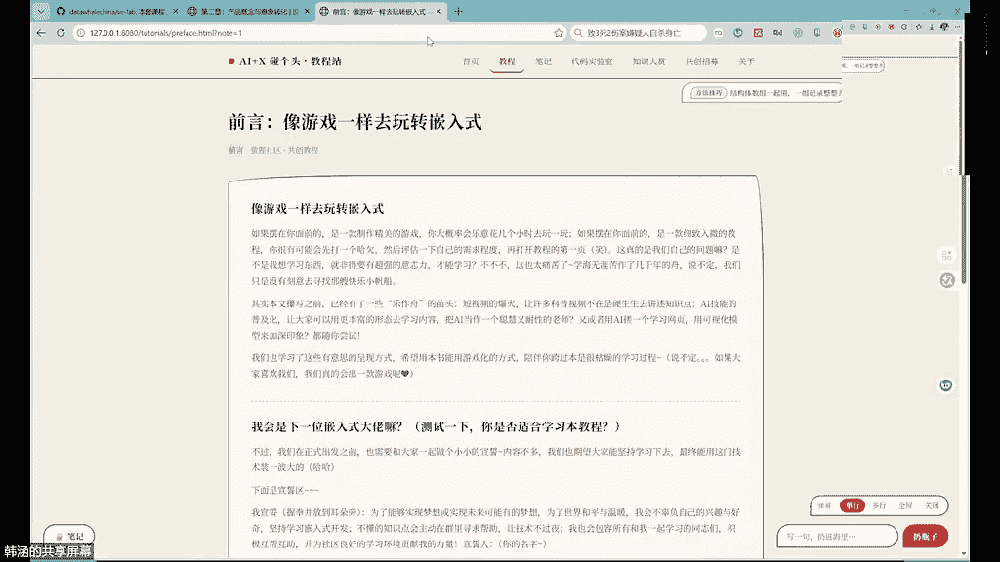

🚀 AI+硬件创业教程：01：硬件产品从想法到量产的全流程

在本节课中，我们将学习硬件产品如何从一个最初的想法，逐步发展成为可以量产的实际产品。本教程适合对 AI 硬件感兴趣的初学者，无论你是学生、开发者还是希望创业的伙伴，都可以在这里了解硬件开发的完整路径。我们会重点介绍市场调研、产品定义、原型机研发、EVT 与 DVT 测试、供应链对接以及量产前的关键验证环节。此外，我们还会分享如何利用 AI 工具降低开发成本，如何避免常见的硬件创业陷阱，以及如何通过开源教程快速上手。在接下来的内容中，我们将结合一个真实的 Web 编程键盘案例，带你走完从想法到产品的整个链路。

---

### 1. 硬件创业的核心挑战与成本认知

上一节我们介绍了本教程的整体目标，本节中我们来看看硬件创业与软件创业在成本和风险上的本质区别。

硬件产品的开发周期非常长，资金投入也远高于软件产品。软件产品可以在代码完成后迅速发布，并在用户使用过程中不断修改和更新。而硬件产品一旦制造完成，很难进行大规模的修改。如果在前期没有充分的测试和验证，产品一旦投放市场发现没有用户买单，或者市场容量较小，那么之前投入的资金和精力可能全部打水漂。

硬件创业的总成本可以用以下公式来理解：

总成本 = 研发成本 + 模具成本 + 原材料成本 + 生产测试成本 + 库存风险成本

其中，研发成本包括结构建模、电路设计、软件开发等环节；模具成本是硬件特有的支出，量产前必须开模；原材料成本受供应链议价能力影响；生产测试成本用于 EVT、DVT、PVT 阶段的验证；库存风险成本则对应良率不足导致的废品损失。

以下是硬件创业与软件创业的主要区别对比：

- 修改成本：软件可以随时更新，硬件一旦出模修改困难
- 测试环节：软件主要依赖代码测试，硬件需要经历 EVT、DVT、PVT 多阶段验证
- 分发方式：软件通过网络分发，环境变化较小；硬件受工厂精度、良率、供应链等因素影响
- 壁垒构成：软件壁垒多在技术和数据，硬件壁垒更多体现在供应链和工厂资源

在硬件创业初期，很多团队容易在调研阶段或供应链环节遇到困难。有相当多的创业者并非因为想法不好而失败，而是因为无法找到靠谱的工厂，或者产品无法顺利量产。因此，在投入大量资金之前，先完成充分的市场调研和原型机验证是降低风险的必要步骤。

---

### 2. 双钻模型与产品定义方法

本节我们接着上一节的成本认知，来看看如何科学地定义产品，避免盲目开发导致资源浪费。


双钻模型是英国设计委员会于 2004 年提出的设计思维体系。它通过两次发散与收敛的过程，帮助团队从模糊的想法中提炼出明确的产品方向。第一个钻石代表问题的发现与定义，第二个钻石代表解决方案的开发与交付。

双钻模型的核心流程可以概括为：

第一次发散：收集广泛的用户需求和市场信息
第一次收敛：聚焦核心问题，确定产品要解决的痛点
第二次发散：探索多种可能的产品形态和功能组合
第二次收敛：确定最终的产品定义，锁定功能优先级

在实际操作中，团队不应在第一个收敛点就急于定型产品。相反，需要继续发散思维，进行 AB 测试和功能优先级排序。功能并非越多越好，极简且造型美观、质量稳定的产品同样具有市场竞争力。

在产品定义过程中，可以将产品属性分为三类：社会属性、心理属性和物理属性。社会属性指产品在社交场景中的角色；心理属性指产品给用户带来的情感体验；物理属性指产品的尺寸、材质和外观等 tangible 特征。这一分类方法来自设计思维课程，能够更结构化地指导后续设计。

以我们正在开发的 Web 编程键盘为例，其硬件规格如下：

```
主控：ESP32S3
按键：7 个机械按键
编码器：1 个可按压旋转编码器
灯效：2 颗 LED 灯
麦克风：1 颗 MEMS 麦克风
接口：1 个 USB 插口
```

产品的目标用户画像包括：

- AI 极客：希望通过硬件与 AI 工具进行实时交互
- 职场办公人员：需要高效的文字输入和设备控制
- 居家办公者：追求便携式外设和舒适的使用体验

产品的核心功能包括 ESP32S3 主控、7 个机械按键、1 个可按压的旋转编码器、2 颗 LED 灯、1 颗 MEMS 麦克风以及 1 个 USB 接口。其中，LED 呼吸灯等功能虽然非核心，但能够提升产品的魅力指数和外观观感。

在功能优先级排序中，我们遵循以下原则：

必要功能 > 提升体验的功能 > 非必要的附加功能

例如，语音交互与键盘一体化是产品的差异化核心，而外接翻页器加麦克风的方案则存在成本高、胶水损坏原产品等问题，因此被排除在最终方案之外。

---

### 3. 桌面调研与用户调研

上一节我们介绍了双钻模型和产品定义方法，本节中我们来看看如何通过调研验证产品想法是否具有真实的市场需求。

产品调研分为桌面调研和用户调研两个部分。桌面调研主要基于网络声音和公开数据，用于摸清市面上是否已有同类产品，竞品的价位区间，以及竞品在解决什么问题。用户调研则需要明确谁会使用产品，用户拿到产品后要做什么，使用周期如何，以及具体的反馈是什么。

以下是桌面调研需要回答的关键问题：

- 市面上是否已有同类产品？
- 竞品的大致价位是多少？
- 竞品解决了什么样的用户问题？
- 哪些功能是真正有用的，哪些是多余的？

以下是用户调研需要明确的内容：

- 目标用户是谁？
- 用户使用产品的场景是什么？
- 用户使用产品的频率和周期如何？
- 产品是否真正解决了用户的痛点，还是仅仅是假设的痛点？

在调研阶段，不能过早地把产品形态定死。应该先进行加法，把可能的产品形态和功能全部列出来，再逐步做减法，通过问题收敛锁定最终方案。例如，Web 编程键盘的最初灵感来自于市面上的翻页器和大疆语音交互硬件，但这两者只是简单结合，并未做成一体化产品。我们的团队正是从这个缺口中发现了机会，决定将语音交互、键盘和编码器整合在一起。

通过调研，我们发现用户在实际使用中可能并不觉得现有键盘不够用，只是偶尔感到手腕酸痛或操作不便。只有当向用户展示新产品的可能性时，他们才会意识到这种工具可以提升工作流效率。这种“魅力指数”往往是在真正与用户交互之后才能发现的。

---

### 4. 原型机开发与建模

本节我们接着调研内容，来看看如何将想法转化为可触摸的原型机，并进行结构建模。

原型机开发包含硬件开发和建模两个部分。建模阶段需要从整体出发，先确定产品的大致形态，比如长方形或异形结构，然后再考虑内部如何适配电路板和电子元器件。PCB 板本身通常是正方形或长方形，如果产品外观是立体的或多维的奇形怪状结构，就需要验证硬件是否能与外壳契合，内部空间是否足够。



在结构建模中，常见的返工问题包括模块化设计下模块之间的连接问题，以及外观形态与硬件尺寸的不匹配。为了降低成本，建议采用从简单到复杂的迭代策略：

先做最简单的外形，比如长方形
打印原型机，确定内部结构并适配元器件
保证产品在使用过程中的安全性，不脱落、不进水
在基础功能稳定后，再对外形进行进一步改造

目前，AI 工具已经可以辅助建模。例如，部分开发者在建模时使用了接入 MCP 的功能，通过调用大模型生成辅助建模方案。不过，AI 建模目前仍处于探索阶段，电路原理图和 PCB 排版尚未完全实现一键生成，大部分需要开发者手动搭建和调整。

3D 打印在原型机阶段非常有用，可以快速验证外壳的大致形状和结构是否符合实际需求。但需要注意，3D 打印出来的原型机更接近玩具形态，性能和精度无法满足量产要求。真正量产时，仍需要开模并使用注塑等工艺。

---

### 5. EVT、DVT、PVT 测试阶段

上一节我们介绍了原型机开发与建模，本节中我们来看看硬件产品在量产前必须经历的三个关键测试阶段。

EVT 是工程验证测试，主要确保产品的想法真的能在硬件中落地实现。软件开发中没有完全对应的环节，因为硬件资源有限，必须在开模前验证技术可行性。

DVT 是设计验证测试，此时产品已经接近生产级别。需要考虑产品的安全性、稳定性，以及在不同温度环境下的表现。硬件产品售出后可能需要使用好几年，无法像软件那样随时更新，因此必须在设计阶段充分考虑环境适应性。

PVT 是生产验证测试，对应小批量试生产。这一阶段需要验证工厂是否真的能按要求生产出合格产品。常见的测试包括抗电磁干扰、防水性能、抗雷击等。例如，硬件产品可能会被雷击，而软件不会面临此类问题。

在 PVT 阶段，良率是一个关键指标。良率计算公式如下：

良率 = 合格品数量 / 总生产数量 × 100%

如果订了 100 套产品，只有 30 套能用，70 套成为废料，那么良率仅为 30%，这会导致严重的经济损失。因此，在大规模量产前，必须先进行小批量试生产，验证工厂的良率和交付能力。

供应链方面，BOM 表（物料清单）的拆分越细，成本可控性越强。大件的议价空间通常在 8% 左右，而小件的溢价可能高达 300% 到 800%。例如，一个几毛钱的小元器件，在工厂报价中可能变成几块钱。因此，建议团队自行渠道采购关键元器件，或参考市面上成熟产品的上游供应商进行对接。

---

### 6. 供应链与工厂对接

本节我们接着测试阶段的内容，来看看如何寻找靠谱的工厂，并进行供应链对接。

早期找到愿意打样的靠谱工厂非常困难。孵化基地或具有工厂资源的体系可以帮助团队解决这一难题。在没有此类资源的情况下，个人创业者需要碰很多坑才能找到合适的合作伙伴。

在与工厂合作时，需要注意以下几点：

合同条款是否透明，是否明确了钢管费、打板费、贴片费等所有费用
生产流程是否详细列出，避免黑箱操作
BOM 表的价格是否透明，是否存在小件溢价过高的情况
工厂的交付周期和产品质量是否符合要求

工厂的交付价格并非固定不变，供应链谈判能力本身就是企业的核心优势。大企业通常不会分享自己的供应链渠道，因为这会带来竞争对手并稀释自身资源。对于个人而言，可以接触到部分供应链，但由于量不够大，单价通常较高，厂家可能拒绝小批量订单。

3D 打印可以帮助完成小批量外壳验证，但不能替代量产的开模工艺。在量产层面，仍需要依赖传统的注塑和生产线。

---

### 7. AI 在硬件开发中的应用

上一节我们介绍了供应链与工厂对接，本节中我们来看看 AI 如何辅助硬件开发，以及它的边界在哪里。

AI 在硬件开发中的应用可以分为产品层面和研发过程层面两个方面。产品层面的 AI 赋能包括让产品更智能化、更好的决策展示效果等；研发过程层面则是利用 AI 工具辅助建模、编程和调试。

目前，AI 在软件开发中的表现已经非常强大。例如，开发上位机软件，传统嵌入式工程师可能需要一周时间，而借助 AI 工具，两天甚至一天就可以完成并开始测试。下位机开发也在逐步被 AI 辅助解决。

在建模方面，AI 已经可以生成外壳效果图，帮助团队快速得到可视化的参考图。但在电路原理图和 PCB 排版方面，AI 尚未达到直接下达指令即可完成全部设计的程度，开发者仍需手动搭建电路并进行调整。

需要注意的是，市场调研和真实的用户洞察不能完全依赖 AI。AI 只能模拟用户需求，无法替代人类与真实用户的面对面交流。桌面调研可以借助 AI 辅助收集网络信息，用户调查表可以由 AI 生成，但最终的产品决策必须由人来完成。

---

### 8. 抄袭防范与快速迭代策略

本节我们接着 AI 应用的内容，来看看硬件创业中如何防范抄袭，并通过快速迭代建立竞争优势。

对于初创团队，完全防止抄袭是做不到的。因此，建议采取以下策略：

不要随意向外界透露产品的创意细节
保持快速迭代，让市场上流通的始终是旧版本
利用两代产品优势，即使竞品抄袭当前版本，团队已经在开发下一代

具体做法是，对外售卖或宣传的产品通常是两代之前的形态。当竞争对手抄袭完成时，团队已有两代产品的技术领先优势，抄袭的意义便大大降低。

此外，硬件供应链本身就是巨大的壁垒。雷军之所以能把小米做起来，很大程度上依赖的是供应链能力，而不仅仅是产品创新。供应链谈判能力、工厂资源和成本控制，都是硬件企业的核心竞争力。

---

### 9. 开源教程与社区协作

上一节我们介绍了抄袭防范与快速迭代策略，本节中我们来看看如何通过开源教程和社区协作降低学习门槛。

我们的团队正在制作 AI 硬件开发的开源教程，从嵌入式入门开始，逐步涵盖 PCB 设计，甚至未来会涉及 FPGA 相关内容。教程不仅包含文字，还会探索使用 Web 等方式让学习过程更有趣、更轻松。

开源教程的优势在于：

学习成本低，适合新入门的伙伴
社区可以共同贡献内容，教程随时间迭代
学习者的笔记和思考可以反哺到教程本身



目前，团队已有内测版教程网站，部分内容将在 GitHub 开源。对于真实产品教程，稳定性和可靠性是关键。我们正在将 Web 编程键盘打造成高稳定性、高可靠性的产品教程，未来会与社区分享。

如果你有兴趣参与教程编写，或者对某些方面有建议，欢迎加入社区群组，与我们一起共建。


---

### 10. 总结

本节课中，我们一起学习了硬件产品从想法到量产的全流程。首先，我们认识到硬件创业的成本高昂，开发周期长，必须在前期充分调研和测试以降低风险。其次，我们学习了双钻模型，了解如何通过发散与收敛来明确产品定义和功能优先级。接着，我们介绍了桌面调研和用户调研的方法，强调不能过早定型，需要先加法后减法地锁定方案。

随后，我们详细说明了原型机开发与建模的注意事项，包括 3D 打印的局限性和从简单形态迭代的策略。然后，我们重点讲解了 EVT、DVT、PVT 三个测试阶段，特别是良率计算和小批量试生产的重要性。在供应链部分，我们强调了工厂对接的难点、BOM 表透明度以及供应链壁垒的作用。



关于 AI 的应用，我们认识到 AI 可以大幅加速软件开发和部分建模工作，但市场调研和真实用户洞察仍然需要人来完成。在抄袭防范方面，快速迭代和两代产品优势是初创团队的有效策略。最后，我们介绍了开源教程和社区协作的目标，希望降低硬件开发门槛，让更多伙伴能够参与 AI 硬件创业。


希望这篇教程能帮助你建立对硬件产品开发的整体认知。如果有任何想法或疑问，欢迎在社区群组中随时交流。
