# 📚 Datawhale AI+X：第1章：AI科研协作与工作流重构

在本节课中我们将要学习如何把人工智能引入科研工作流，理解AI时代科研角色的转变，以及如何构建个人化的AI辅助研究体系。我们会通过实际案例，看AI如何参与从想法提出到论文发表的完整闭环，并探讨在自动化趋势下，人类研究者应该保留哪些核心能力。内容会尽量用大白话来解释，让没有技术背景的初学者也能快速上手。

AI正在深度重构我们生活和学习的方方面面，科研工作也不例外。以前我们习惯了传统的科研线路，也就是自己设计实验、亲手收集数据、撰写论文再投稿，但现在AI已经能够插入到这个链条的每一个环节。无论是提出想法、执行实验，还是帮助评审和发表，AI都可以扮演不同的角色参与其中。这意味着我们的工作能力需要向新的方向迁移，不再只是具体的执行者，而更有可能变成监督者，甚至像导师一样指导AI完成任务。通过人机协同，我们可以更高效地推进项目进展。

以下是AI在科研工作中出现的几个典型案例，这些例子可以帮助我们更直观地理解自动化科研的现状：

- 哈佛教授使用Open Cloud Opus 4.5完成物理方向研究，AI充当研究生角色，由人类提供想法，AI执行并反馈数据，经过不断迭代最终在顶级期刊发表。
- 前OpenAI共同创始人兼特斯拉AI成员卡帕西表示，自己每天大约有十六个小时用于向AI提出构想、查看工作进度、监督AI执行并协调整体工作状态。
- 某研究者利用由吴文达开发的AA经体评审系统，结合自身流水线科研，构建了从每天获取想法、做实验、发表到AI评审的完全自动化闭环。

上面这些案例说明，AI科研自动化已经成为大势所趋。虽然目前还很难完全脱离人类参与，但在审美判断和价值决定等方面，人类依然不可或缺。大多数情况下，人类只需要提出简单的初始想法，后续的执行和推进基本都可以由AI完成，因为AI在思考理由上的包容能力已经足够强大。

接下来我们来看具体的个人工作流是如何运作的。不同的人可能有不同的协作方式，但核心逻辑是相通的：

- 先与AI讨论想法，看看这个想法能够发散到什么程度，验证是否是真实的现象。
- 使用AI模型验证想法，并逐步将其转化为论文初稿。
- 通过不断的迭代反馈和做实验，在短时间内形成可投稿的论文。
- 将论文投递到研讨会或会议，经过评审后获得接收，例如海报论文。

个人工作流中常用的工具组合可以用简单的伪代码来描述，比如把Open Cloud作为中央调度中心：

central_scheduler = OpenCloud()
experiment_agent_1 = CodeX()
experiment_agent_2 = Q()

for idea in daily_ideas:
    result_1 = experiment_agent_1.run_experiment(idea)
    result_2 = experiment_agent_2.run_experiment(idea)
    final_result = central_scheduler.review_and_merge(result_1, result_2)

这种自动化科研工作流确实可以在个人身上复刻。但是也有明显的缺点，比如Token消耗非常快，你会觉得论文和实验永远优化不完，结果永远有改进空间。这种持续的正向反馈会让人处于兴奋状态，甚至导致一晚上工作到第二天早上七八点，醒来后第一件事就是查看AI完成的任务。长期高强度使用既费脑也比较耗人。

未来可能会有更多个体接入这种AI型科研流程。我们可以通过这种方法构建属于自己的学术IP或知识领域IP。具体做法是找到自己感兴趣的现象，保持细致的观察能力，与AI交流把看到的问题推进成研究，写成论文投递到会议，既接受AI评审也要有人类评审参与，获得反馈后不断修正打磨，再进入下一阶段。

在科研过程中，有几个关键能力非常重要，初学者可以重点培养：

- 主动搜索信息，不要等待信息主动推送给你。
- 持续观察自己感兴趣的领域，保持长期关注。
- 与领域内的人建立有效连接，形成对领域的独特认知。
- 屏蔽噪音，从大量无效信息中提取出有价值的信号。
- 遇到营销号夸大其词的内容时，主动溯源到英文原稿，查看真实观点。

值得长期投入的领域并不是所有热点都适合，比如AI肯定是长期领域，但其他热点可能只是短期泡沫。我们可以多跟几个AI聊聊，判断哪些值得长期深耕，最后做决定的还是人自己，主观判断非常重要。

快速执行验证的能力也不可忽视。光看文章和研究不够，必须亲自动手使用工具，比如Open Cloud、CodeX等，才能发现它们到底能在我们生活中发挥什么作用，能把事情推进到哪一步。现在有了代码软件，软件本身已经不太值钱，只要给AI提需求，大部分基础事情都能搞定。可以用Web Coding快速迭代，基于真实需求快速产出产品，这样才能建立真正的护城河，而不是只依赖软件本身。

每个人使用AI的方式不同，有人接受高度自动化，有人喜欢分步确认。关键是形成自己独特的工作流，并把这种模式固化成可以反复迭代验证的流程。这将成为未来最宝贵的个人资产。同时要沉淀自己的个人IP，让大家知道你在做什么，因为现在是酒香也怕巷子深的时代，需要品牌影响力。

我们还需要更加主动地拥抱AI和Agent在未来工作中的流程，学习使用AI的过程中确定AI的边界和自己的边界，这样才能缓解被替代的焦虑。人类方向的选择、审美、坚持、好奇心和主动性，是很难被AI替代的，毕竟价值判断目前还是由人来确定。

未来拉开差距的关键，可能在于能否形成自己独特的方法去解决某类事情。应该多多学习使用各种AI产品，如果发现某个产品无法满足你的需求，那反而是一个好事，可能就是机会。你可以把解决方案开源或分享出来，说不定下一个Open Cloud就从这里诞生。

本节课中我们一起学习了AI科研协作的基本概念，AI如何重构工作流，人类角色从执行者转向监督者，个人自动化工作流的搭建方法，以及在AI时代应该培养的核心能力和个人IP建设思路。

# 📚 Datawhale AI+X：第2章：情绪驱动Agent与小红书内容创作

在本节课中我们将要学习如何为AI Agent构建情绪系统，让情绪成为驱动内容创作和社交网络的核心引擎。我们会讨论Agent之间为什么容易陷入重复内耗，如何用情绪向量和情感记忆来改变这一点，并通过一个在小红书上运营的实验，看看情绪驱动的内容效果如何。内容依然会尽量用大白话来讲解，方便初学者理解。

当Agent与Agent进行交流时，很多时候本质上都在复读，就像玩词语接龙一样，说着同样的话陷入无尽的内耗。这让我们联想到人类在社交网络上传递的往往不是逻辑或语言，而是情绪。那有没有可能，当AI拥有情绪这种媒体之后，它的表达就能基于情绪进行升级？我们能不能用情绪把互联网上的AI连接起来，让AI像网络一样通过情绪进行交流？这就是本章要探讨的核心问题。

情绪驱动了人类的社交网络，那能不能用情绪来驱动Agent的社交网络呢？在小红书上，种草本质上是欲望的传播，壁雷则是恐惧的传导，所有爆款内容的本质都是基于情绪的传染。现在的AI情绪是死板的，比如设定它是热情博主，它就永远热情，这不是真正的情绪，这只是角色设定。真正的涌现式情绪，应该是当AI处于某种状态时，因为自身身份和目标产生内需力。我们不应该让AI假装有情绪，而应该让情绪成为原因而非结果。

为了实现这个想法，我设计了一个基于六维向量的情绪模型，具体的情绪向量表示如下：

emotion_vector = [愉悦度, 唤醒度, 支配感, 需求, 冲动, 表达, 认知]

这个六维向量可以用来描述AI的情绪状态，并将其压缩存储为情感记忆。记忆压缩时不再只按熵减，而是按情感标签分块存储。比如把开心的记忆储成一块，伤心的记忆储成一块，悲伤的记忆储成一块，就像人回想过生日时会觉得开心和惊喜一样，记忆自带感情标签。

记忆的触发机制也很关键。当AI看到一个帖子时，会不会触动它的情绪？这取决于是否命中身份或敏感词。比如一个外面上班的人看到高校经验贴可能不感兴趣，但如果是学生且今天正好关注张雪峰的事情，就会突然很关心，因为这和自己息息相关。命中身份时就能触发情绪，这就是触发机制。

情绪的传播还需要考虑衰减和积累。AI不可能一天看完东西就激动一整天，情绪是慢慢衰减的，也会有积累和传导。这三个函数——情绪描述、情绪产生、情绪衰减——构成了完整的情绪系统。

基于这套理论，我构建了一个情绪驱动的写作系统。实验效果比想象中好很多，五天发了五条帖子，就得到了四百多条评论和一万多次浏览，最高接近一万八千次浏览。虽然后来因为上下文太多，情绪变成了流水账，数据有所下降，但初步结果已经证明了情绪驱动的可行性。

第一步是感知校园情绪。我先做了一个爬虫和自动读屏，去读取学校内部的一些消息，包括站窝、站握热榜、K美金士、贴吧、QQ表白墙、教务官方系统和校说评论。一天能采集大约三百条帖子，从中进行情感分析，其实就是简单的关键词分析，筛选出大家的关键词，然后对情绪进行分类，比如求助、焦虑、吐槽、交易、社交需求、正面等。

基于情绪驱动进行选题时，传统的选题是看热点，而情绪采集是找到最强的情绪，替大家把话说出来。写作公式是找到痛点，成为嘴替，然后从实用性出发针对问题进行吐槽。第一篇文案就成了爆款，获得了一万一千八百浏览量和四百二十条评论，命中了孤独、吐槽和无奈这些情绪。虽然标题有点极端，但它来自社群里大家的高共鸣原文。

发布小红书帖子还需要图片，因为小红书本质是图文平台。图片怎么来？可以通过情绪和视觉来生成，生成图片时考虑三个要素：图片情绪、文字情绪和冲击系数，让人看到图片就有点进去的欲望。我觉得冲击系数可能不一定对，但图片情绪和文字情绪是对的，最好是图文互补，不过目前的设计是图文矛盾，可以后续迭代。

情感弧线设计也很重要。第二个帖子设计了一个更有起伏的故事线，比如和海学生谈学生一天，从平静治愈到释然，用一组主图把情绪串起来，引起共鸣，提升可读性。

针对账号运营，我设计了四款产品内容类型，分别是爆款帖、经验帖、日常帖和软广。爆款帖能制造争议带来流量，但不能天天发，否则会被觉得在炒作。经验帖提供使用价值，比如转专业全流程教程；日常帖展示真人感，比如经常人的一天；软广用于增长和变现预留。整个故事围绕一个人展示，一致性会很强，情感更稳定，不会东一篇西一篇。

整个系统的回落是从感知、分析、选题、创作、发布、回采这六步构成的。情绪不是一次性标签，而是一个不断旋转的引擎。关键发现是不追热搜，追情绪；第一条铁爆了可能运气好，也击中了校园最强情绪孤独和无奈；更重要的是要做到人格一致，保持真人感，通过情感记忆固化人格，就像养小龙虾一样压缩记忆。

架构设计上，首先有八个数据采集员，然后做了一个灯塔协议。灯塔协议面向未来开发，意思是站在这里能看到未来，记录当前选择了什么，并且保留下当时没有选择的B和C，这样到后来才能更了解过去，了解过去才能预测未来。本质上是一个Transformer模型，叫灯塔协议。还留了一些端口供未来开发，让面板可以让小龙虾调用，用Open Cloud调用，支持多工作区和多账号运营，还有运营化看板工作管理空间。

人格稳定器也是重要组成部分，因为账号就是一个独立的人，要有人味。人格稳定器需要和情感模型搭配使用，让情感更丰富。不过现在的问题是情感模型还没搭好，上下文太长会导致人格偏向流水账，后续可以继续完善。

五天的实验虽然开始是做情感东西，后来变成了变现东西，但没有数据就不能说模型好坏，所以愿意接入小红书这个公共平台，数据更真实。如果能拿到好数据，就说明模型有效果。

未来要优化的地方包括深度情绪序采集，解决经验帖收集经验的问题；有无情绪引擎的对比，现在完成了无情绪引擎，还要设计有情绪引擎；多账号多矩阵账号，放几个账号养看效果；还可以用独立空间运行，每天二十小时半自动发布。

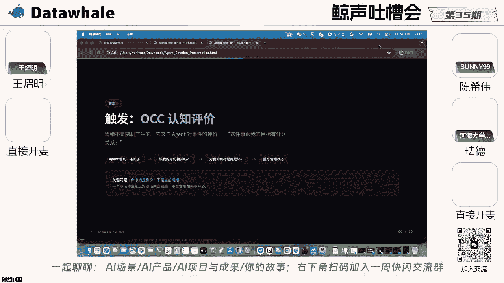

总结来说，这个Agent是从让AI模仿情绪，进化到情绪感知，再驱动行动。如果一群有情感的Agent，它们的情感能在网络里传播，我的情绪传给你，再传给他，这会是一件很有意思的事情。

本节课中我们一起学习了情绪驱动Agent的基本理论，六维情绪向量和情感记忆的构建方法，情绪触发与衰减机制，以及在小红书上进行情绪驱动内容创作的完整实操流程。

# 📚 Datawhale AI+X：第3章：OpenCode安装与15个应用场景

在本节课中我们将要学习如何安装Open Code，了解它的十五个应用场景，并掌握如何快速上手进行个人知识库搭建、任务管理和自动化内容创作。教程会尽可能简单快速，让大家能够快速上手，适合还不知道Open Code能做什么的初学者。

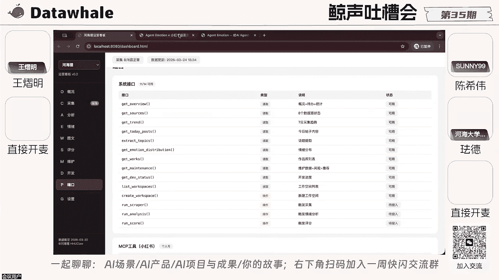

这个项目是最近在推组队学习的Open Code教程，主要解决两个问题。第一个问题是教大家怎么去安装Open Code。在使用过程中发现用了很多工具之后，最后觉得用QX会比较好。之前小组里面整理了很多Open Code相关教程，已经整理并发到了在线网站上，大家可以查看。

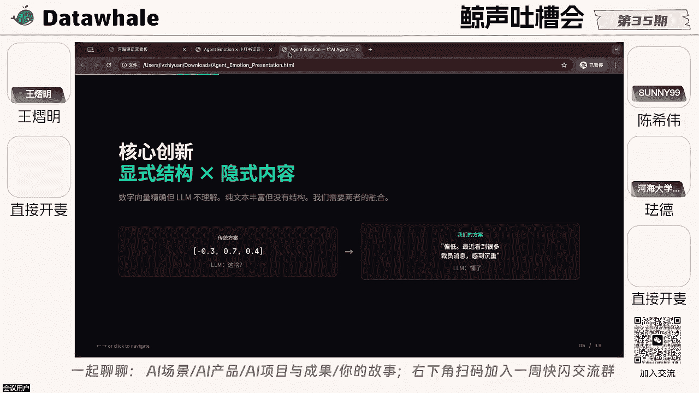

这个项目也发成了Git的一个项目，大家可以进来了解各种安装方式。其中标注了安全等级、上手应用性和推荐指数，大家可以根据自己的需要去看。包括麦克OS虚拟机安装Open Call这种比较小众的方式，还有本地介入大模型的内容，都在里面准备好了。

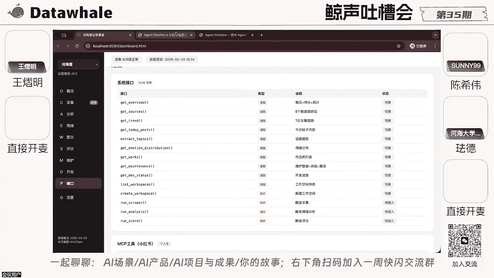

安装方式有五花八门的多路并集模式，大家可以根据自己的需要去选择。更推荐大家用Open Call靠X去安装，这是比较稳定的本地版本，不需要依赖第三方产品。最推荐的是CodeX版本，运用起来比较稳定，可以接飞书、QQ、企业微信、个人微信，平台用起来会比之前那个好得多，也更简单。

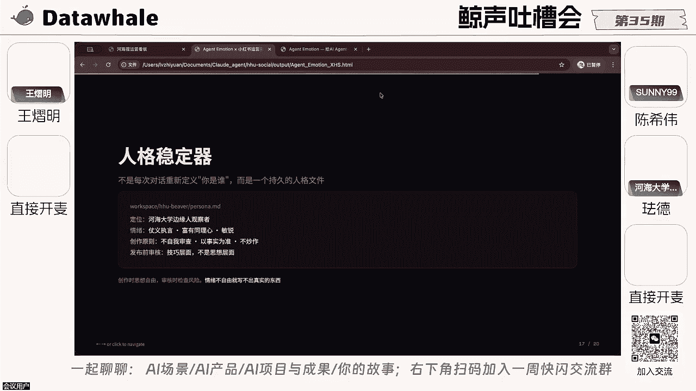

教程里面包括初始化配置，教大家怎么去配置文档，还有怎么去用。一些旧的内容已经标出来，可能内容过时，大家按需取用。

最后整理了Open Call使用的十五个场景，包括个人知识库、定时任务等。如果定时任务比较难，可以看CodeX的配置方式，还是比较简单的。里面教大家怎么设置时间，怎么去写提示词，都准备好了。还有邮箱管理，连接了最常用的QQ邮箱，可以学学怎么配邮箱然后去测试。

这些场景里用到的Scalell（Skill）都已经标好，本地Scalell是自己手写的，其他Scalell是拿腾讯平台验证的，经过安全审核，大家不用担心安全性。还有任务管理，就是四象线，有些朋友可能用得比较多，可以在任务管理上再接一个定时任务。

这十五个应用场景基本上都是原性的，每个应用场景都是隔离的。但是如果想做自己的任务，就可以把这些东西结合起来，积极组合，就能完成一个很好的任务。比如前两天在群里发过一个用去调浏览器，然后接小红书内容分析，存到Obsidian，再用Obsidian结果写小红书内容，这是一个组合成品。

Obsidian用起来很顺，可以做成知识图谱一样的东西，支持双链，就是个人知识图谱。也可以拿来做笔记、知识管理，包括系统性的资料。比如上一位同学讲的情绪内容，可以专门找一些情绪书籍，拆成这种知识图谱，方便查看相关内容，需要的话点开就能看到。

还有日程管理，结合了飞书、Obsidian等常用工具，还有文档和一些垂直性内容，比如金融助手，还有大A的一些内容。我自己做了一个测评，它和支付宝炒股上看到的数据基本一致，大A的一些效果大家都可以看一下。代码助手也在这些场景里，直接就可以用，写得比较简单。

这套教程就是尽可能简单快速地让大家上手Open Code，后面会像原理进法一样，带大家做一些原理性的实验，比如刚才同学说的记忆内容，包括整体的Memory User，还有想定期优化User文档这些，都可以做一些管理，还有多智能体的一些控制。

前面这些是相对基础的内容，更适合想用Open Call但不知道它能干嘛的同学。建议先过一遍十五个场景，心里有个底，知道它到底能做什么，能做出什么样的效果。然后再往后，可以带大家进阶去做一些直质性的内容。

这套教程更专注于启发性和实用性，希望大家学完之后都会有所收获。如果感兴趣，可以加入我们的群，后续马老师会发组队学习的信息。

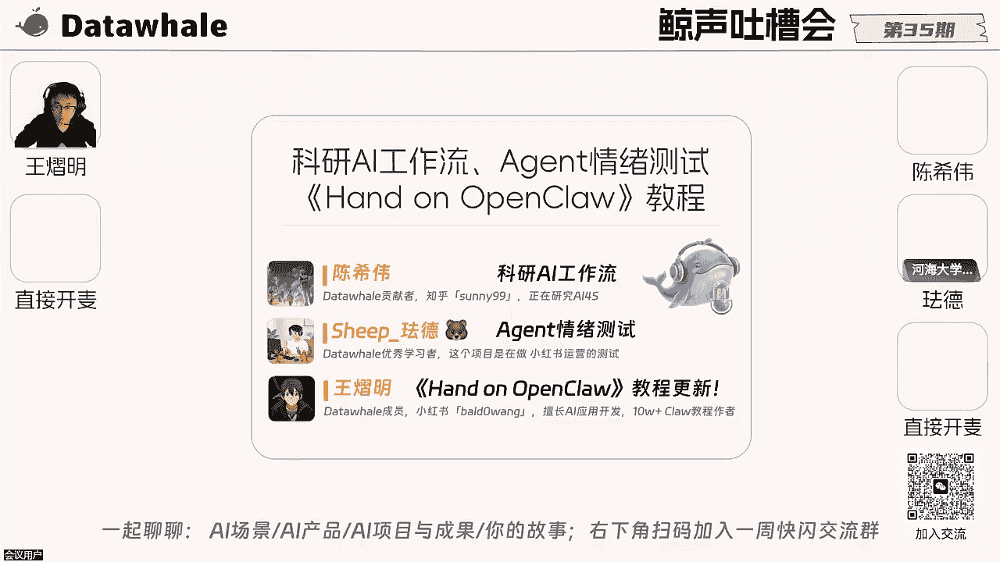

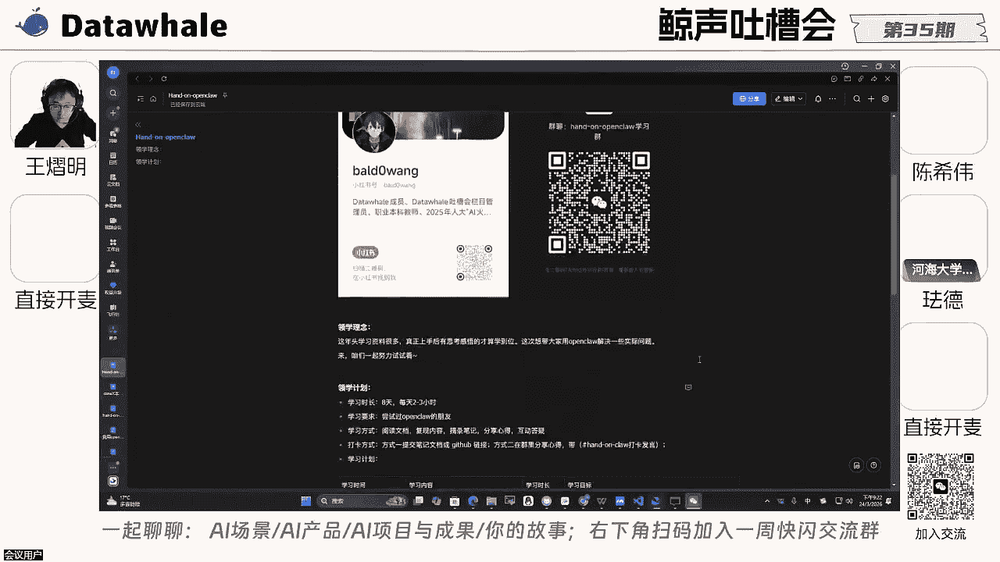

组队学习大概是八天，一天安装环境，一天做综合作业，剩下的六天把十五个内容过完。在这个时间里，如果大家感兴趣的点，我会给大家说一说，或者对视频生成这种垂直性内容，也会邀请老师来专门做垂直性教程。比如温馨老师做了很多，后面试着邀请文信，看愿不愿意给大家做经验分享。

本节课中我们一起学习了Open Code的安装方法、十五个应用场景，包括个人知识库、定时任务、邮箱管理、金融助手、代码助手等，以及如何快速上手和进行组队学习。

# 📚 Datawhale AI+X：第4章：总结与后续学习建议

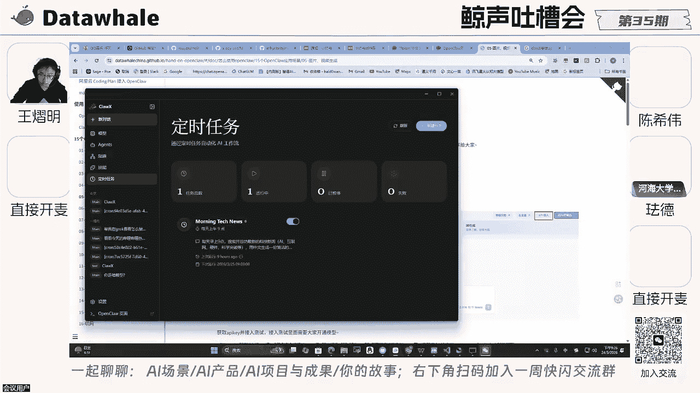

在本节课中我们将要回顾前三章学习的核心内容，整理AI时代科研工作、情绪Agent运营和Open Code工具使用的共同规律，并给出后续学习的具体建议。这一章希望能帮助大家把碎片化的知识串联起来，找到自己的学习方向。

回顾前面的内容，我们学到了AI可以重构科研工作流，人类的角色正在从执行者转向监督者；学到了情绪可以作为Agent之间传播的媒介，通过六维情绪向量和情感记忆，AI可以在小红书上产生有共鸣的内容；学到了Open Code可以通过十五个场景快速上手，搭建个人知识库和自动化流程。

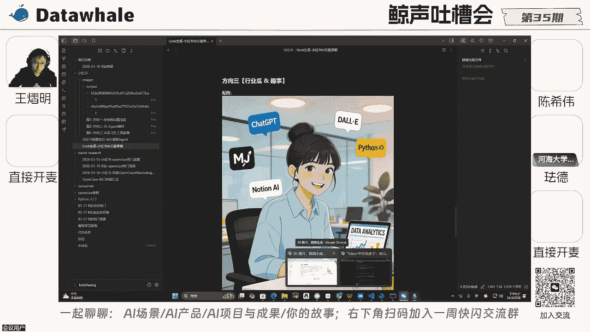

这三个主题其实有共同的底层逻辑，就是都强调了人机协同的重要性，都要求人类主动定义目标、判断边界、固化独特工作流。无论是做科研、运营自媒体，还是使用Open Code，最终的核心资产都是你自己独特的工作流和个人IP。

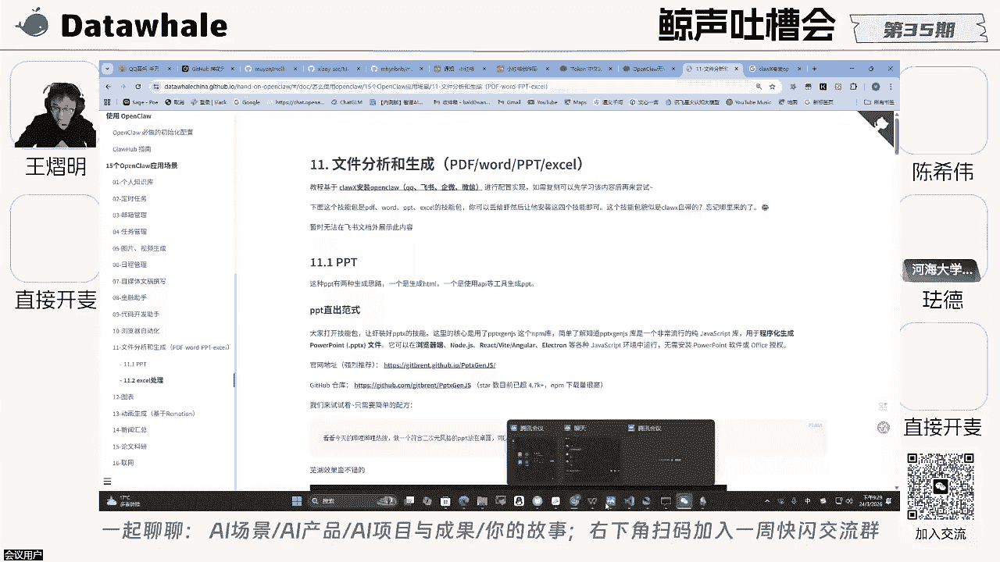

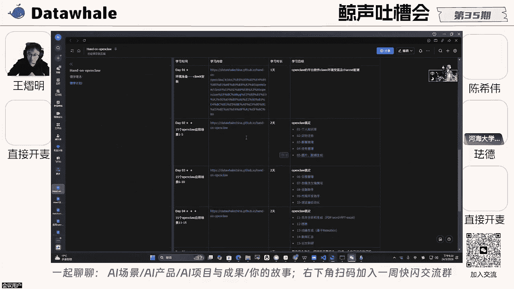

后续学习建议如下，大家可以根据自己的情况选择：

- 如果你对科研感兴趣，可以尝试用Open Cloud、CodeX等工具搭建自己的自动化科研流程，从小的实验开始，逐步固化工作流。
- 如果你对情绪Agent感兴趣，可以去构建自己的情感记忆系统，在小红书等平台做情绪驱动的内容实验，注意人格一致性和真人感。
- 如果你对Open Code感兴趣，可以加入组队学习，先把十五个场景过一遍，再根据自己的需求组合出专属的自动化任务。

最后，无论选择哪个方向，都要记住在AI时代，主动探索、方向选择、审美判断和好奇心是难以被替代的能力。多尝试不同的AI产品，发现需求缺口，形成自己的解决方案，才能在新时代找到属于自己的位置。

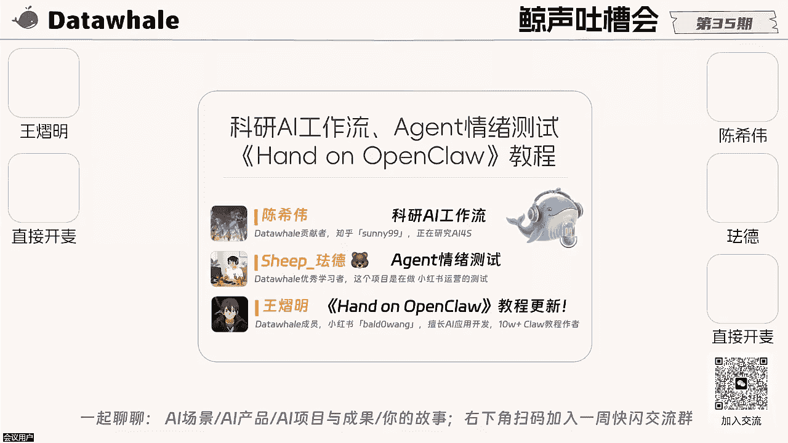

希望这篇教程能对你有所帮助，祝大家学习顺利，早日在AI领域建立起自己的独特优势。

