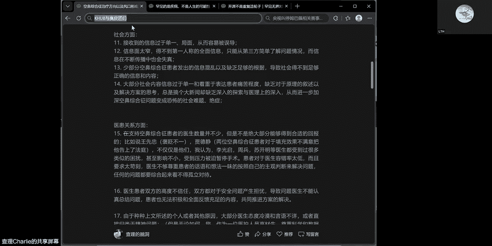
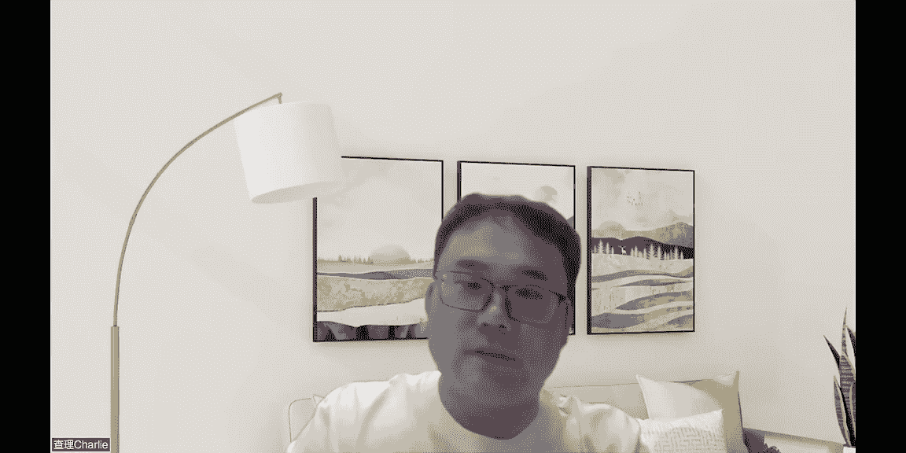
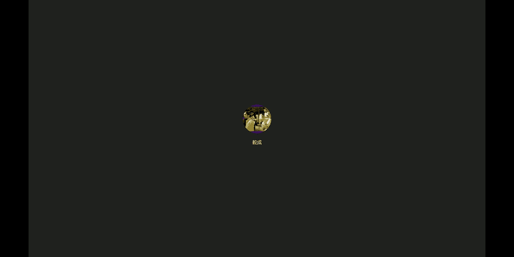
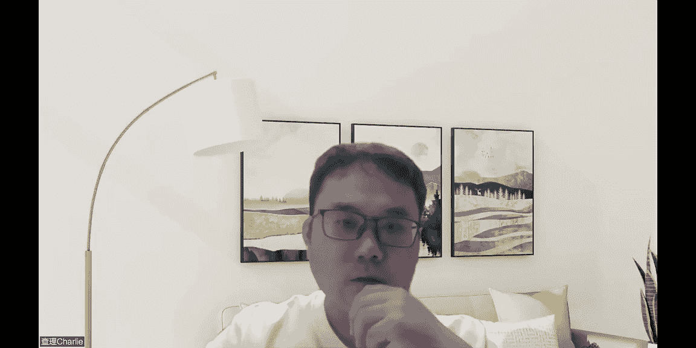
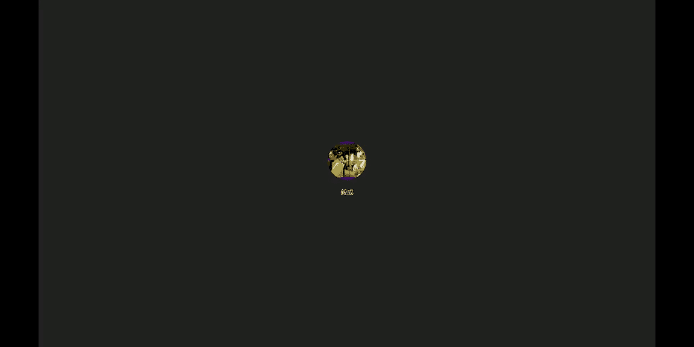

罕见病患者组织与AI赋能教程：第1章：患者从需求方变成组织者 🏥


在本节教程中，我们将学习罕见病患者如何从单纯的需求提出者，转变为项目组织者与推动者。我们会先认识分享者本人及其所在的Khub组织，再了解患者如何提出自身需求，接着看看如何通过高校合作和黑客松活动把想法落地，最后探讨患者如何利用自媒体和人工智能技术，为自己和其他患者发声。无论你是罕见病患者，还是对公益项目感兴趣的学生或老师，都能从中找到可操作的方法。


讲者自我介绍与活动背景


上一节我们概述了本节的学习目标，本节我们先来看看分享者是谁，以及他是如何接触到Khub组织的。

分享者是Khub组织的高校负责人。他大约在两小时前才收到分享邀请，因此没有准备PPT，直接用即兴演讲的方式与大家交流。他最初是在抖音上看到Khub要办黑客松，与对方聊着聊着就建立了联系。当时兔子和艾莉正在筹办黑客松，很多人都抽不开身，于是他替他们参加了一场与昆山杜克大学相关的活动。那次活动的沟通效果还不错，后来他也帮忙召集了一些志愿者，一起投入到问题解决中去。


Khub组织的核心理念


上一节我们介绍了分享者的背景和加入经过，本节我们来看看Khub组织到底主张什么样的理念。

Khub的核心思想是：让患者用自己的能力，结合组织提供的高校资源和互联网资源，自己去解决问题。具体来说，患者自身提出问题、提出需求，Khub在后台提供辅助支持。这意味着患者不再只是被动接受帮助的一方，而是成为需求方和行动方的结合体。可以用下面的公式来表示：

```text
问题解决 = 患者自身能力 + Khub提供的高校与互联网资源
```

这个公式说明，资源只是辅助，真正的推动力仍然来自患者自己。


空鼻症需求与气流模拟项目


上一节我们介绍了Khub的核心理念，本节我们来看一个具体的患者需求案例。

分享者本人也是一名黑客松的需求提出者，他患有空鼻症。空鼻症患者常常面临一个困境：自己感到非常痛苦，但周围的人，包括医生，并不理解这种痛苦。之所以不被理解，核心原因在于医生无法直观地看到气流在鼻腔内部产生了哪些变化。为了解决这个问题，分享者团队开发了一款气流模拟软件，通过计算机模拟鼻腔内的气流状况。这个项目目前已经在人工智能环境中跑通，正在推进落地阶段。可以用下面的逻辑来概述：

```text
患者不被理解的原因 = 医生无法观察鼻腔气流变化
解决方案 = 开发气流模拟软件 + 在AI环境中验证
```

以下是该项目的关键步骤：

- 第一步，确认患者的真实痛苦点，即气流变化无法被医生直观看到；
- 第二步，开发气流模拟软件，把鼻腔内的气流过程可视化；
- 第三步，在人工智能平台上运行模拟，验证软件效果；
- 第四步，推进项目落地，供医生和患者实际使用。


高校黑客松落地计划


上一节我们介绍了空鼻症气流模拟项目的由来，本节我们来看看如何把这个项目在高校里落地。

分享者向Khub组织提出了一个新想法：可以在高校里举办黑客松活动。他随后联系了母校的老师，老师表示同意，因此下一次活动计划在温州肯恩大学举行。正是因为这个推动，分享者被任命为Khub的高校对接负责人。Khub本身是一个比较松散、自由的群体组织，所有的需求和待办事项都可以由成员自己提出。因为组织当时人手不足，分享者既成为了需求提出者，又承担了执行者的角色，这种身份双重角色的情况比较特殊。


患者组织者双重身份


上一节我们介绍了高校黑客松的落地计划，本节我们来看看患者如何同时承担需求方和执行方的双重身份。

在Khub组织中，成员可以自由提出需求。当组织没有足够人手去执行某个需求时，提出者本人就可以亲自参与执行。分享者就是这样从一个单纯的患者需求提出者，变成了需求提出者兼执行者。虽然这种行为在传统组织中显得有些奇怪，但在Khub这种开放、自由的社群里，却是非常自然的事情。这也意味着，只要你有明确的需求，就可以自己推动项目前进，不需要等待别人来安排。


公众号与社群建设：khub与臭皮匠们


上一节我们介绍了患者组织者的双重身份，本节我们来看看分享者计划建设的公众号和社群。

分享者目前准备筹建一个公众号和群体，名字叫做“khub与臭皮匠们”。这个名字来源于俗话“三个臭皮匠，赛过诸葛亮”，意指普通人聚集在一起，也能产生智慧。他打算借助Khub平台，与高校学生进行沟通和交流，利用专业知识或教授的知识，给患者提供指引。合作方式是开放且互助的，不伤害任何人。

以下是公众号与社群的主要功能：

- 为患者提供专业层面的知识指导；
- 连接高校学生与患者需求，开展互助合作；
- 作为信息发布的渠道，让更多人了解罕见病相关项目。


校企合作与科研资源整合


上一节我们介绍了公众号与社群的建设计划，本节我们来看看如何整合高校的科研资源。

许多高校老师手里掌握着不少科研经费，但有时候为了维持课题运转，经费会被花在一些并不那么有意义的项目上。罕见病患者的需求一旦被明确提出，其实往往具备潜在的商业价值和学术价值。因此，分享者想通过与学生、老师合作的方式，把项目推进到实验室里，或者参加黑客松，或者自行进行软件开发。

可以用下面的代码块来表示这种三方合作关系：

```python
合作模式 = {
    "老师": "提供科研经费与研究方向",
    "学生": "提供论文选题与技术开发能力",
    "患者": "提供真实的疾病需求与使用场景"
}
```

这种合作既解决了老师没有科研方向的问题，也解决了学生写论文缺乏方向的问题，同时还能解决患者的实际困难。


解决方案的推广与跨疾病应用


上一节我们介绍了校企合作与科研资源整合，本节我们来看看如何把空鼻症的解决方案推广到其他疾病。

分享者之前已经整理了一份关于空鼻症治疗方向和形成思路的分析，梳理了空鼻症中的一些问题，以及医生与患者之间关系中的一些问题。他提出的解决方案，其实不仅能应用在空鼻症上，也可以迁移到其他疾病当中。接下来的重点工作，是跟高校和感兴趣的大学生展开对接合作。


患者自媒体赋能方案


上一节我们介绍了解决方案的跨疾病推广，本节我们来看看如何引导患者利用自媒体为自己发声。

Khub接下来的一个方向，是引导患者把自己的信息收集好、总结好，然后通过视频或其他相关信息，以比较客观的方式传播出去，告诉其他人患者的具体情况和需求。这个过程可以形成一个课题，或者一个项目。具体来说，就是教会患者如何使用自媒体平台为自己说话，这本身可以变成一个自媒体项目。


多方协作模式


上一节我们介绍了患者自媒体赋能方案，本节我们来看看患者项目如何与更多人协作。

比如空鼻症气流软件的需求，可以与研究鼻腔空气动力学的人、从事人工智能或编程工作的人，以及大学生一起合作来解决。对患者来说，最重要的只是解决问题，并不在乎合作伙伴是谁。而学生又希望探索实际问题。因此，患者、学生和教授可以形成很好的结合，这个领域也有很多市场空间可以去开发。

另外，还可以通过这种方式把患者内部的力量合并起来，共同去解决疾病带来的问题。


公众号四大目标


上一节我们介绍了多方协作模式，本节我们来看看Khub公众号的四个具体目标。

目前“khub与臭皮匠们”的微信公众号刚刚建立，还没有发布相关信息，未来几天就会开始更新。这个公众号的目标包括以下四点：

1. 组织患者搭建自己的信息发布渠道；
2. 探索罕见病问题，总结患者在日常生活、学习和工作中的困难，帮助他们活得更好、更轻松；
3. 鼓励大家建立更多的互助组织；
4. 用比较灵活、活跃的方式展示信息，让更多人了解这件事情，而不是像官方账号那样显得死板。


价值共创与收益分享


上一节我们介绍了公众号的四大目标，本节我们来看看参与者如何获得价值与收益。

这个项目不仅要给患者自己一个机会，也要给任何渴望实现自身价值的人提供机会。大家可以一起共创、共建，以后的收益也可以一起分享。这种模式下，每个人都能在参与中找到属于自己的位置。


核心愿景：利用AI解决患者问题


上一节我们介绍了价值共创与收益分享，本节我们来看看整个项目的核心愿景。

整个计划的核心在于：普通人或者患者，如何利用人工智能技术来解决自己的问题。这是一个以患者为中心、以技术为工具、以社群为支撑的开放模式。




互动与合作邀请




上一节我们介绍了核心愿景，本节我们来看看如何参与这个项目，以及分享者对合作伙伴的期待。

分享者希望对这个项目有想法的朋友，无论是合作意向还是参与意向，都可以随时来交流。他还提到，之前一个服务老年人的“最后一公里”组织，可能有一些经验可以应用到其他罕见病项目中。大家可以先把信息发布出来，再去寻找相关的使用人员。

另外，分享者的公众号刚刚注册，朋友们可以搜索“key hub与臭皮酱文”进行关注。因为账号刚刚建立，现在关注就是“老粉”，未来几天会陆续发布内容。有兴趣的朋友可以先关注了解，然后在公众号上进行后续建联。




后续资料与公众号建联


上一节我们介绍了互动与合作邀请，本节我们来看看分享者提到的其他相关内容，以及如何通过公众号保持联系。



分享者之前曾听一位嘉宾介绍关于“韩冰病”黑客松的成品和背景故事，听完后感触很深。因为罕见病的名字通常比较难记住，大家感兴趣的话，可以回头上网查找相关资料，看看是否存在合作链接。分享者也表示，以后会在公众号上发布相关信息，感兴趣的朋友可以通过公众号进行后续建联。


结尾总结




本节教程中，我们一起学习了分享者的个人背景，Khub组织让患者自己解决问题的核心理念，空鼻症气流模拟项目的案例，高校黑客松的落地计划，患者身兼需求方与执行者的双重角色，公众号与社群的建设方案，校企合作与科研资源整合的方法，解决方案的跨疾病推广，患者自媒体赋能，多方协作模式，公众号的四大目标，价值共创与收益分享，以及利用AI解决患者问题的核心愿景。希望这些内容能对你理解罕见病患者如何从需求方转变为组织者提供帮助。
