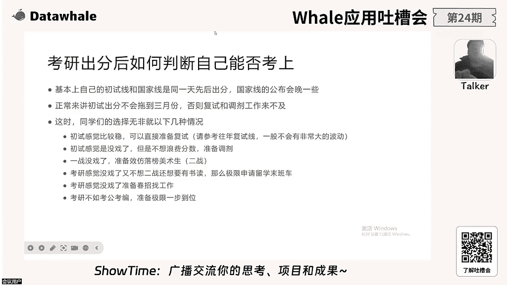
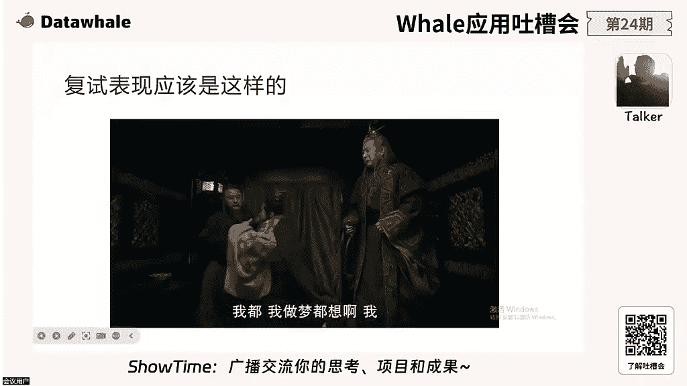
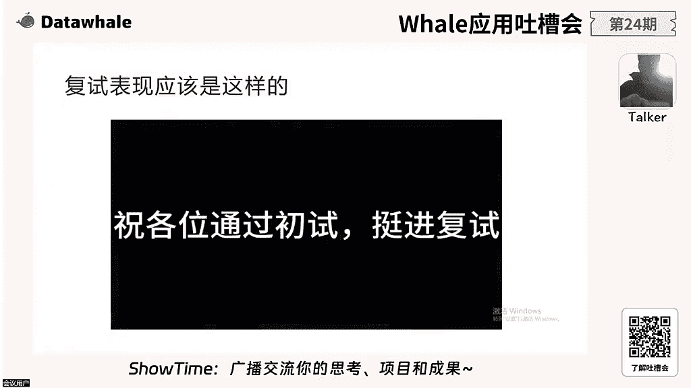
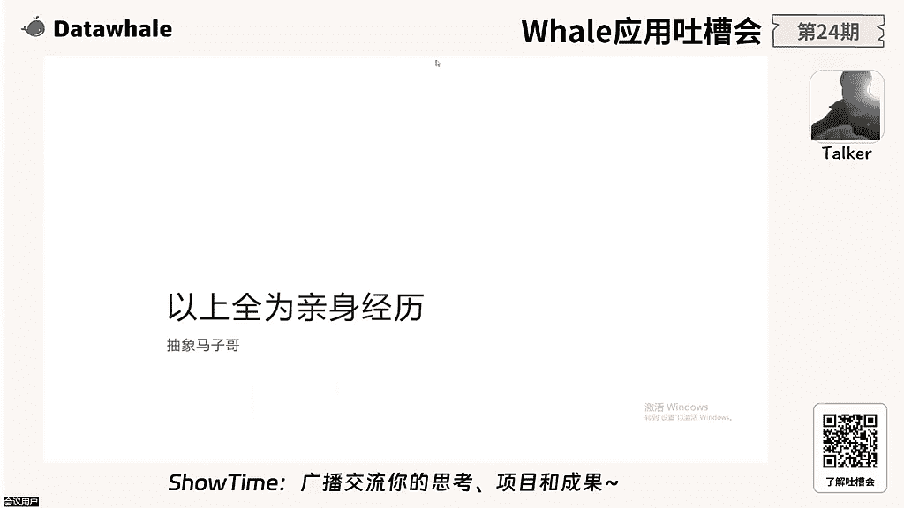

# Datawhale AI+X：01：📘考研出分后调剂复试就业全攻略

在本节课中我们将要学习考研初试成绩公布后的应对方案。内容包括查分时间、六条常见出路的选择逻辑，以及复试、调剂、二战、春招、留学和考公考编各路径的具体准备事项。这里我多啰嗦一句，大家千万不要因为分数还没出来就什么都不做，能提前了解的信息都要提前了解，这样能避免后续手忙脚乱。希望能帮助大家在成绩出来后迅速定下来，不盲目焦虑。


初试成绩通常会在出分前后几天内陆续开放查询。正常情况下，下午两点以后就可以查到自己的分数，但也有学校或省份会临时调整公布时间，出现虚晃一枪的情况。初试成绩和国家线一般是同一天先后公布，国家线预计在260到270分之间，属于均值回归的过程，即 `国家线 ≈ 260 ~ 270`。成绩不会拖到3月份，否则各院校的复试和调剂工作就会来不及。大家可以提前绑定学信网，输入身份证号，让成绩直接推送过来，这样最稳妥。


接下来我们来看看考研结束后的六条主要出路。以下是这些选择路径的简要说明。




- 如果初试成绩比较稳，直接准备复试。
- 如果初试没戏但不想浪费分数，准备调剂。
- 如果一战没戏，准备二战。
- 如果不想再考研，想去海外读书，申请留学。
- 如果想尽快就业，准备春招。
- 如果想考编制，准备考公考编。






这六种选项可以用公式简单表示为 `出路 = {复试, 调剂, 二战, 留学, 春招, 考公考编}`。这六种路径并没有高低贵贱之分，完全取决于个人的意愿和实际情况。接下来我们逐一展开，先从最常见的复试准备说起。


## 📝 路径一：准备复试

上一节我们介绍了考研结束后的六条出路，本节中我们来看看如果你决定参加复试，在接下来的15天之内应该完成哪些准备工作。大部分任务都需要在这两周内完成，可以把时间节点简单记作 `复试准备周期 = 15 天`。

复试通常包括项目、英语口语、机考、笔试和八股文这几个部分。以下是各部分的重点内容。

- 项目：以前寒假就应该开始准备，现在时间紧迫，不要强行凑项目。
- 英语口语：复试必考，很多同学的重灾区。
- 机考：部分学校要求，建议刷简单题和中档题，不必刷Hard题。
- 笔试：可以找目标院校本科生的期末真题练习。
- 八股文：操作系统、计算机网络、面向对象等经典问题要熟悉。

关于项目，我的建议是现在不要花太多时间去做一个所谓的项目。现在有了Web coding等AI工具，生成原型很快，但老师知道很多简历上的项目是AI生成的，容易在技术细节上穿帮。如果简历上项目还是空白，可以用15天快速实现一个简单系统，求稳不要求花哨，比如旅行小管家或基本的目标检测，但一定要看懂源码。这里顺便提一句，千万不要在简历上写一些你根本读不懂的AI生成代码，万一被问到技术原理就很尴尬。

英语口语方面，避免回答时带有中文的“嗯啊”习惯，翻译题要先想好语序再说，不要逐词翻译。日常交流要扩展回答，多使用逻辑连词，比如first of all、secondly、lastly。遇到生词可以通过上下文推测，不要死磕，否则容易卡壳影响后续表现。

机考准备方面，现在不要纠结Hard模式题目，把简单和中档题刷全面，覆盖数组、链表、二叉树、动态规划、贪心、排序等知识点。核心原则可以概括为 `刷题重点 = 简单题 + 中档题`，`不刷 Hard`。如果思路不会，可以看别人的解法并手敲代码，但不要使用AI编程工具，因为考场内网环境无法联网，无法使用AI，这时候只能靠自己手敲。

笔试方面，如果担心目标院校有笔试要求，可以找熟人打听期末真题，做对方院校本科生的期末考试卷，这类资源比复试笔试卷更容易获得。命题人往往是同一拨人，他们可能懒得改题，所以期末卷的参考价值很高。

八股文方面，要熟悉进程和线程的区别、TCP三次握手四次挥手、面向对象的封装继承多态等问题。必要时找人陪练模拟复试，对着墙背诵容易变成念大悲咒，对着人练习才有效，因为真人会有反应，能帮你发现问题。

除了复试内容，还有两件事需要同步处理。第一是本科毕业论文的中期答辩，建议每周抽一个下午处理毕设任务，善用Deep Research等工具做文献调研。第二是尽快联系目标院校导师，发套词邮件。邮件格式可以参考以下代码块。

```
尊敬的某某老师：

您好。

我报考贵院今年的研究生，了解到您在XX领域有很大建树，我认为自己能够胜任相关工作，并对此非常感兴趣。

我叫XX，毕业于XX大学，今年初试成绩为XX分。

如果有幸被贵单位录取，我后续的工作计划是XX。此前本科期间的竞赛和科研经历，与您的研究方向契合度较好，也培养了我的基本科研素养。

我的个人简历和成绩单已作为附件添加，恳请百忙之中查收。

祝好

XX
2026年X月X日
```

群发邮件时请注意修改对方称呼，不要全部写成Dear Professor，也要使用密送，避免让老师看出是群发。这点很重要，否则很容易显得不诚恳。

在复试现场，不要穿西装，建议穿亮色或暖色调的便服，自然自信即可。面试时不要紧张得低头抠手，语速不要太快，也不要太慢，保持正常交流状态即可。


## 🔄 路径二：准备调剂

上一节我们介绍了复试准备的具体事项，本节中我们来看看如果你决定准备调剂，需要注意哪些关键点。调剂系统可以填三个志愿，但一般按第一志愿录取，流程和正常复试类似，可能会少上机或少笔试环节。

以下是调剂准备的建议步骤。

- 给目标院校招生办打电话，询问调剂大致日期。
- 多联系几所学校，注意时间错开，避免复试日期冲突。
- 重点关注东部院校，西部地区调剂存在信息差和隐患。
- 可以关注军工研究所，比如中电科下属研究所、航天各院等。

调剂的高校大部分是双非院校，985和211开放调剂的很少，但也不排除捡漏机会。西部地区的高校调剂存在大量隐患，具体不便点名，大家自己甄别，建议多关注东部院校，这样相对更安全一些。

军工研究所是一个非常适合捡漏的选择。在里面读研相当于半工半读，每月有工资，毕业后直接转为职工，还可以解决户口。但缺点是校园社交生活减少，不太适合追求校园恋爱的同学。计算机方向可以重点关注中国传播集团701所、709所，航天二院、五院、八院，以及中电科下属研究所。这些研究所出试通常招不满，很大程度上依赖调剂，竞争中会有很多背景更好的同学，这时候就要拼信息差。

比如中电科的15所、十所、16所、三0所都招研究生，但难度不同，竞争最激烈的15所甚至能招到清华本科。如果有调剂意向，建议尽早联系起来，不要等到最后一刻才行动。


## 🔁 路径三：准备二战

上一节我们介绍了调剂的注意事项，本节中我们来看看如果你决定二战，应该如何调整状态。一战没戏之后，首先要接受事实，不完美才是常态，调整好心态再找缺点，针对性复习，通常是数学或408出现问题。

建议不要在家复习，不是因为家里学习氛围不好，而是因为家庭氛围可能过于和睦，反而容易被父母的打压或冷嘲热讽逼走。可以自己租一个小房子，保持正常作息，不必效仿衡水中学那种高强度模式，累了可以和朋友喝两杯，适当放松也是必要的。

不要过度把失败责任往自己身上推，考试和找工作确实需要一点运气。如果二战还失败，建议尽快先找一份工作，至于三战可以骑驴找马，不要让空窗期过长，否则以后很难找工作，心态也会受影响。这里我个人建议，二战失败后不要盲目继续脱产备考，先落地再做长远规划。


## 💼 路径四：准备春招

上一节我们介绍了二战的调整建议，本节中我们来看看如果你决定直接准备春招，需要掌握哪些实用技巧。春招的黄金期是3月份，尤其是3月1号到15号，属于金三银四的重要窗口。

以下是春招准备的核心要点。

- 使用Boss直聘等工具大规模投简历。
- 不要等学校招聘会，4月份黄花菜都凉了。
- 重点关注初创型企业和独角兽，尤其是行业专精龙头。
- 大厂和央国企在春招的HC较少，竞争激烈，不宜作为唯一主攻方向。
- 谈工资不要有道德羞耻，年轻人应大胆谈钱。
- 脚踩两只船时注意时间节点，学会拖延和扯小谎。
- 做好公司背景调查，避免空壳公司和电诈团伙。

春招时，大厂HR之间消息互通，面试失败的评价可能会共享到下一家。因此不要太纠结大厂，可以重点关注一些在细分领域做得很好的公司，比如语数机器人、大疆无人机等，甚至可能有机会抄底。不要有羞耻心，该投就投，海投简历是基本操作。

如果同时准备复试和春招，要注意offer下发时间冲突，比如研究生offer可能4月20日才发，而春招offer可能要求4月1日前签字，这时候可以适当拖延。谈工资时不要有道德羞耻，年轻人不跟他们谈钱谈什么，大胆一点，不要太自降身价。

最后提醒，春招时一定要做好公司背调，避免掉进伪装成初创团队的违法违纪公司，人身安全是第一位的，这一点千万不能忽视。


## 🌍 路径五：申请留学

上一节我们介绍了春招的准备方法，本节中我们来看看如果你决定申请留学，现阶段该如何操作。虽然时间比较晚，但中外合办学校的机会比纯海外更多，可以重点关注港中文、港科广、港城东莞校区，以及西交利物浦、诺丁汉宁波等。

国外硕士分为研究型和授课型两种。研究型硕士相当于学硕，授课型硕士上完课拿够学分就可以毕业。美国、香港、新加坡可能有直博计划，如果科研成绩好，比如本科期间发表了两篇ACL或CVPR，但考研分数只有200多分，那么申请直博比较合适。

申请博士或研究型硕士需要给海外老师发英文套词邮件，哪怕是香港和澳门也建议用英文。不同地区的授课制硕士学制不同，香港计算机可能是一年半，英国一年，美国和澳洲两年。授课制硕士好拿很多，但没有奖学金，学费和生活费需要自理，比如港新一年学费可能二十来万，这点要有心理准备。

申请策略因地区而异，英国看重GPA，港新看重科研成果和实习，美国要求全面发展并有特长，非常重视文书材料。不要用一套思路走遍全世界，即使是西方国家内部也存在文化差异，申请时要因校制宜。

语言考试要快点处理，雅思或托福争取一周内搞定，GRE如果不去美国可以不考。香港和英国一些院校允许英语成绩候补，澳洲悉尼和西南威尔士好像也可以先下录取信再补雅思。申请香港城市大学时，英文成绩可以用四六级兑换，这是个不错的选择，可以节省考试时间。


## 🏛️ 路径六：考公考编

上一节我们介绍了留学申请的相关经验，本节中我们来看看如果你决定考公考编，需要了解哪些基本情况。省考出分后，部分富饶省份的省考时间可能已过，但其他省份仍可报考。

公务员初试笔试基本是语文和脑筋急转弯，行测部分需要特殊思维，不要用正常思维解题。比如行测有一道题问33加33等于多少，不能写66，因为这是图形题，三和三组合成8，答案应该是88。行测120分钟做140道选择题，越快越好，重点在速度。

申论部分比行测更麻烦，需要更多准备。准备公务员时可以多读人民日报，积累时政素材。事业编比公务员类别更多，分ABCD四类，教师编属于C类。事业编不仅是教师编，工会医院、税务局、水利局、农业局等也有事业编缺额。考教师编前需要先有教师资格证，但下证时间晚，时间上容易错开，如果没有教资，建议看其他市局单位的ABD类事业编，这样选择更多。

在公务员和事业编的选择上，选择远大于努力，找个容易上岸的岗位就已经赢很多人了。不要幻想麒麟臂，老老实实先上岸，平稳落地再说，这是最务实的态度。




本节课中我们一起学习了考研出分后的六条出路，以及复试、调剂、二战、春招、留学和考公考编各路径的具体准备方法。希望大家能根据自身情况，选择最适合自己的道路，早日上岸，祝大家好运。


