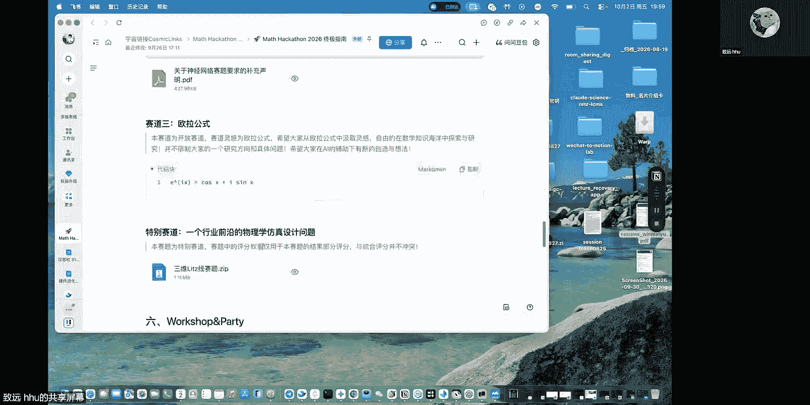
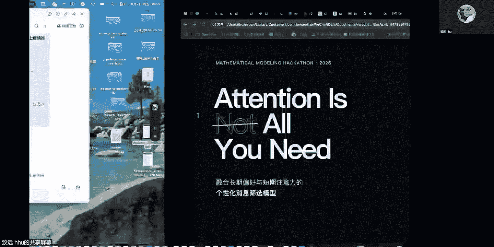
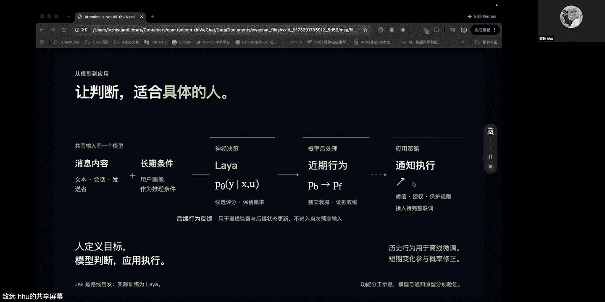
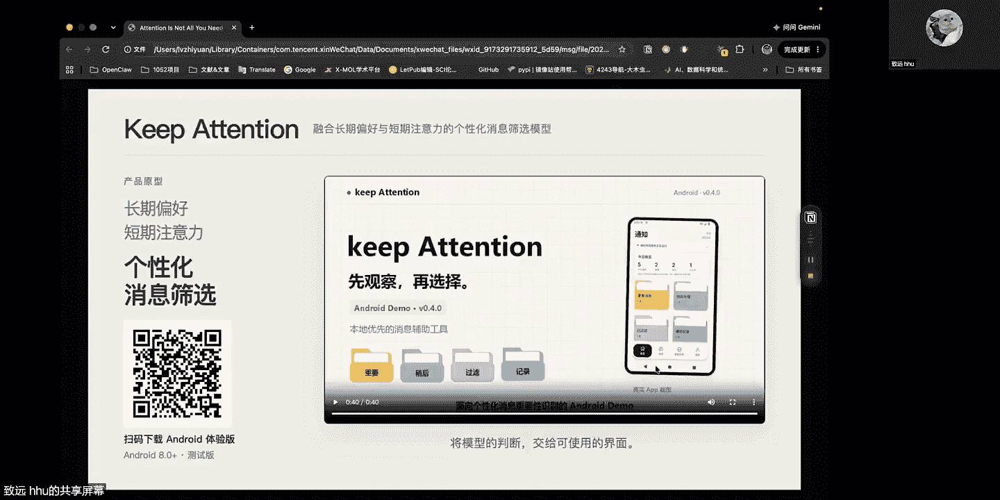
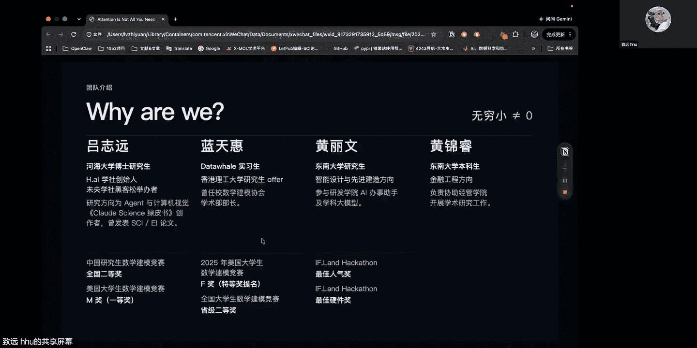
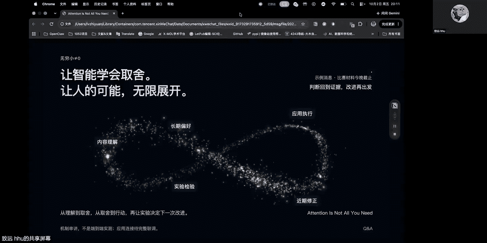
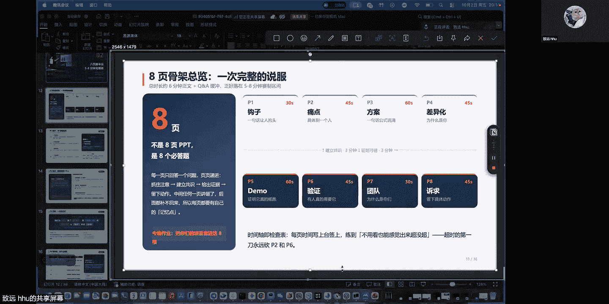
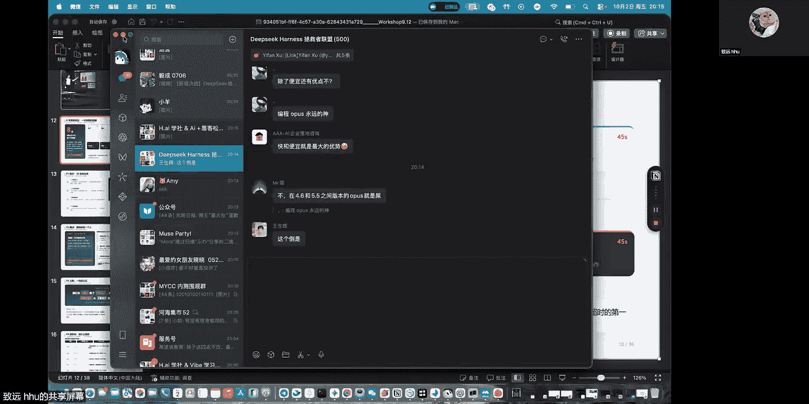
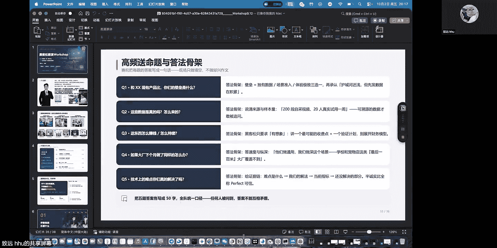

🤖 AI 管家训练教程：01：黑客松背景与产品构思



在本节课中，我们将学习如何从一个黑客松项目出发，训练一个能够筛选微信消息的 AI 管家。我们会先了解活动背景，然后说明产品要解决的实际痛点。



黑客松是一个把创意快速变成产品的活动。这个特定的活动把黑客松和数学建模结合在一起，分成四个不同的赛道。每个赛道的侧重点不一样，有的侧重教育评估，有的侧重神经网络设计，有的侧重企业应用，还有的侧重行业专业问题。我们所在的团队选择了与数学建模和神经网络相关的赛道，目标是做出一个真正可用的产品，而不仅仅是为了拿奖。

参加黑客松的初衷不应该只把获得奖项作为唯一目的。更重要的是把自己想做的产品实现出来。在活动现场，手机不断收到大量微信消息，信息量非常大。这个现象让我们想到，能否训练一个模型，部署到手机上，帮助用户避免消息轰炸，在信息洪流中找到真正有意义的内容。这就是这个 AI 管家产品的最初想法。

产品取名为 kid attention，灵感来自经典论文 "Attention Is All You Need" 的变体，意思是并不是所有消息都需要你的注意力。我们希望通过这个应用，让用户只关注真正值得看到的信息。这个应用是一个可以下载安装的手机程序，核心功能是整理微信消息，把无关信息过滤掉。

以下是产品设计的主要考虑：
- 用户在日常生活中会收到大量碎片化消息。
- 这些消息中包含很多无关或低价值的内容。
- 需要一个智能系统自动判断每条消息是否值得用户查看。

有了产品构思之后，接下来我们来看看如何训练这个模型，以及用到的数学原理是什么。

🤖 AI 管家训练教程：02：模型训练与数学原理

上一节我们介绍了黑客松背景和产品构思，本节中我们来看看模型如何训练，以及用到的数学公式是什么。

模型的核心任务是做一个二分类判断：给定一段微信文本，输出这条消息是否值得用户看到。判断结果只有两种，要么值得看，要么不值得看。为了实现这个目标，我们选择了一个 0.3B 参数的开源语言模型作为基础模型，并在本地进行微调。

微调的数据来源分为两部分。第一部分是真实数据，来自于作者本地电脑上截取的微信消息，总共大约七千条。第二部分是合成样本，通过大模型生成更多符合实际场景的数据，用来丰富训练集。

在标签生成方面，我们使用了软标签的方式。软标签不是简单的 0 或 1，而是表示保留或者删除这条消息的概率。例如，某条消息被保留的概率可能是 0.8，被删除的概率是 0.2。这种细粒度的标签能够让模型学习到更平滑的决策边界。



损失函数由两部分组成。第一部分是基于强化学习的目标函数，第二部分是交叉熵损失。两者加权组合，构成最终的训练目标。可以用如下公式表示：



```
损失 = 强化学习损失 + 交叉熵损失
```

训练是在一块 4080 Super 显卡上进行，共进行了三轮迭代。基础模型选择了语言能力较强的开源模型，例如 DeepSeek 和 Gemma。微调完成后，模型能够在很短的时间内给出判断结果，例如在一千零一十六毫秒左右完成一次推理。

以下是训练流程的关键步骤：
- 从本地提取微信消息作为真实数据。
- 使用大模型生成软标签和合成数据。
- 利用 LoRA 方法对基础模型进行参数高效微调。
- 在显卡上运行训练，监控损失函数下降情况。

模型的预测逻辑可以用伪代码表示如下：

```
如果 模型输出 == 值得查看:
    显示消息给用户
否则:
    过滤该条消息
```

模型训练完成后，我们需要把它放到实际的应用里面，下一节我们来看看前后端是如何实现的。

🤖 AI 管家训练教程：03：前后端实现与效果评估

上一节我们介绍了模型训练与数学原理，本节中我们来看看前后端如何配合，以及最终的效果如何。

产品分成前端和后端两部分。后端是部署在服务器或者本地的模型服务，通过 API 接口提供文本分类能力。前端是一个手机应用，负责捕捉用户的注意力行为，并调用后端模型对微信消息进行分类。



人的注意力可以分成短期和长期两个维度。短期注意力关注用户最近在关注什么，比如最近参加黑客松，可能对黑客松相关消息更感兴趣。长期注意力反映用户的稳定偏好，比如某个理科男平时喜欢看小说。前端通过记录手机上的消息交互，进行短期建模；后端通过之前微调好的个人化模型，捕捉长期偏好。两者结合，决定哪些消息应该展示给用户。

效果评估方面，原始大模型的准确率大约是百分之九十五。我们微调后的版本在测试集上的准确率大约是百分之七十五。虽然比原始模型略低，但仍然高于一些国内免费开源部署版本的效果。这说明通过针对性的微调方法，可以在保持较高准确率的同时，获得适合个人场景的模型。



以下是性能对比的主要指标：
- 原始大模型准确率：约百分之九十五。
- 微调后个人模型准确率：约百分之七十五。
- 单次推理耗时：约一千零一十六毫秒。

整个系统实现了从消息通知到执行动作的完整路径，把模型变成了一个真正的个人助理。


产品做出来之后，还需要向评委或用户进行展示，下一节我们来分享一下路演的技巧和常见问题准备。

🤖 AI 管家训练教程：04：路演技巧与问答准备

上一节我们介绍了前后端实现与效果评估，本节中我们来看看如何做好路演，以及面对问答时需要准备什么。

路演是向评委介绍项目的关键环节。一个完整的路演通常包含八个部分，前三个部分用来做钩子，引入痛点和解决方案。钩子的目的是打破评委对大模型的固定印象，比如大家可能觉得大模型只能用于生成文字或者翻译，我们要展示大模型还有更多可能性。





在演讲过程中，要控制好时间，建议五到八分钟讲完全部内容，如果是闪电演讲，则需要在三分钟左右完成。演讲的最后应该留下一句话，作为给评委的深刻印象。演讲风格包括表达方式、现场 Demo 演示和整体的视觉呈现，这三部分要保持一致。

以下是路演建议包含的要点：
- 明确产品解决的痛点。
- 说明与其他项目的差异化优势。
- 进行现场 Demo 演示，验证可行性。
- 介绍团队成员。
- 表达参赛诉求或未来愿景。

问答环节也非常重要，评委可能会问到以下几类问题：
- 产品的护城河是什么，竞争对手是否容易复制？
- 使用的数据是否真实，如何保证数据质量？
- 项目未来如何盈利？
- 如果别人也做了类似产品，你的技术难点如何解决？

回答这些问题时，需要提前思考清楚，不能现场编造。此外，演讲内容不需要大而全，建议找到一个小而精的切入点，结合自己的独特背景，说明为什么只有你能做这个项目，以及项目的真正价值是什么。



AI 是一个很有用的工具，但不是全部，我们应该发挥模型能力，而不是围绕模型本身打转。

最后，我们希望能够成立一个固定的组织，定期分享黑客松相关的知识，帮助更多人找到队友，参加未来的黑客松活动。相关资料已经分享到群里，感兴趣的同学可以下载查看。


本节课中我们一起学习了从黑客松背景到产品构思，模型训练与数学原理，前后端实现与效果评估，以及路演技巧和问答准备等完整流程。希望这些内容能够帮助你理解如何训练一个 AI 管家，并在实际项目中应用。
