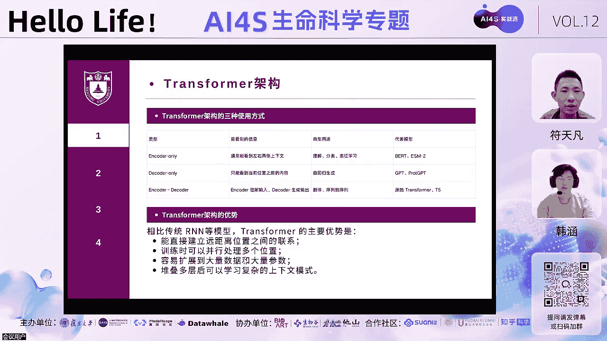
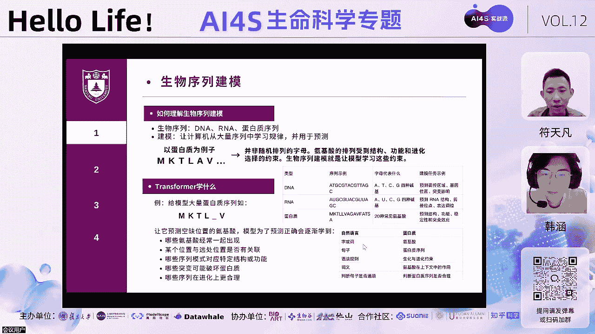
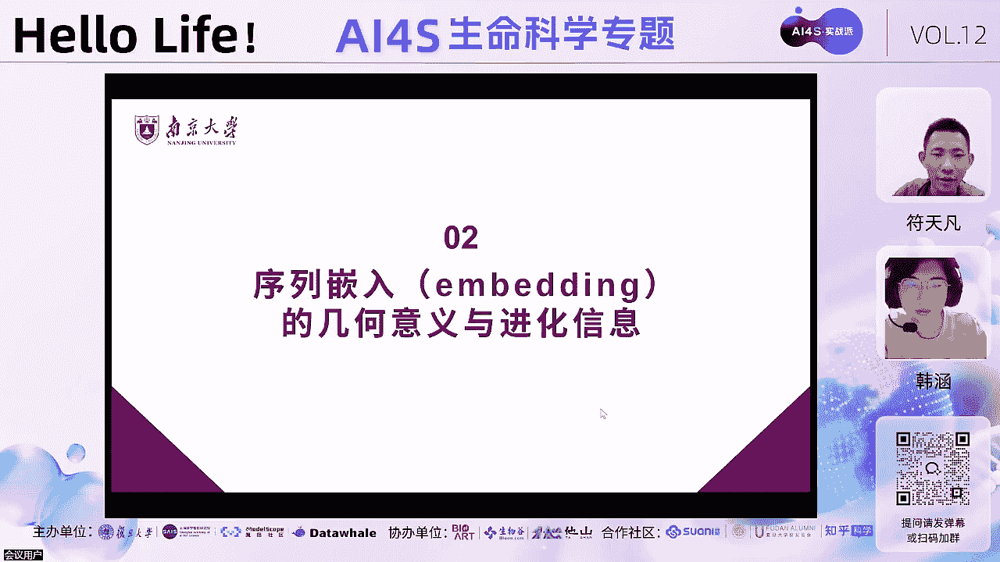
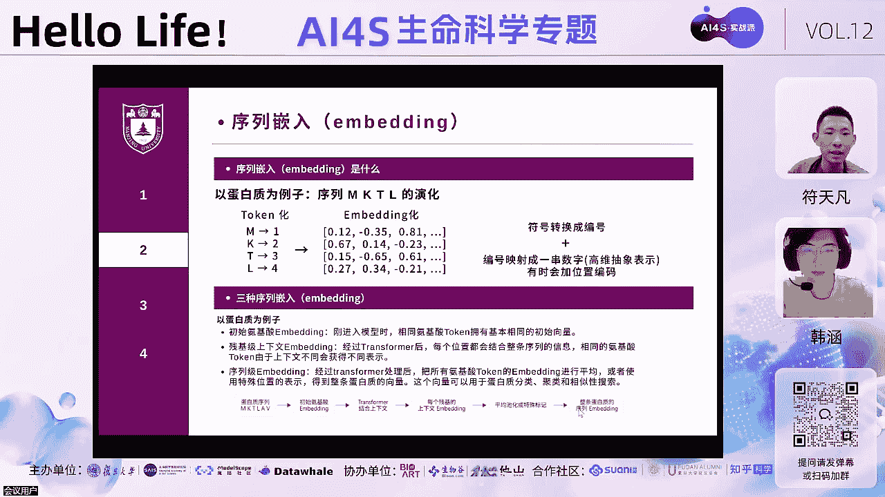
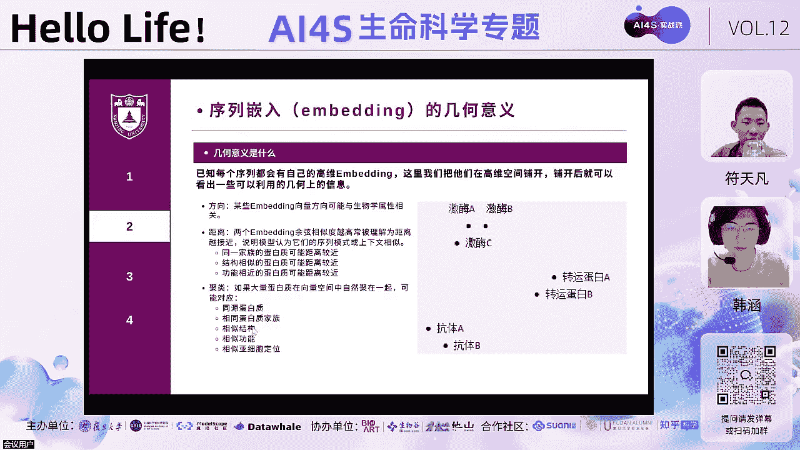
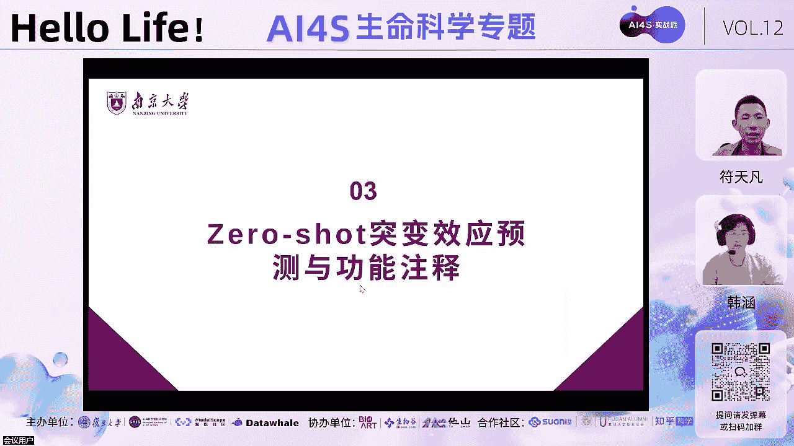
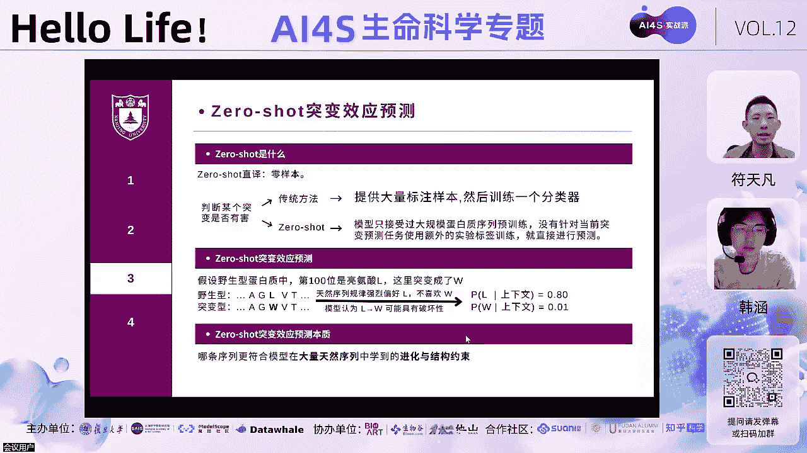
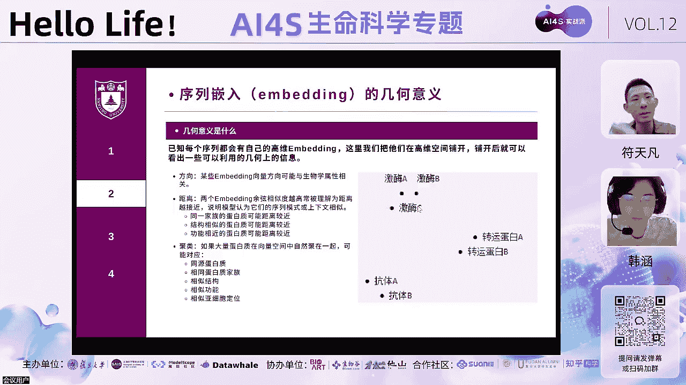
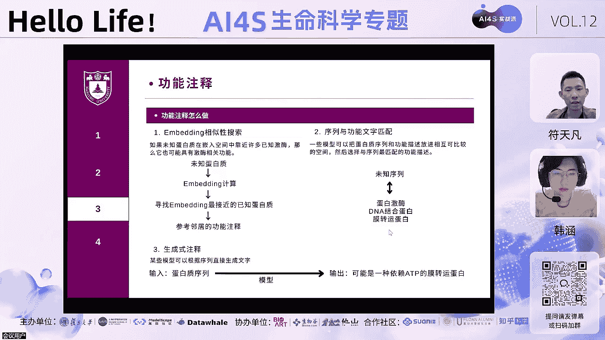
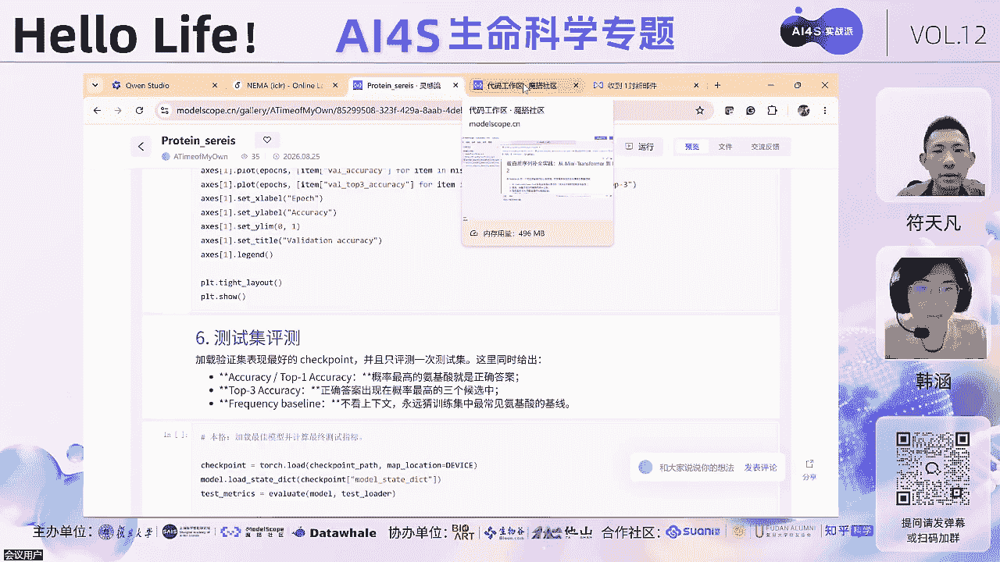

# 🧬 AI看懂蛋白质：生物信息学新范式：第一章：课程概述与背景介绍

在本节课中，我们将学习如何让人工智能理解蛋白质序列，掌握Transformer在生物信息学中的应用，并了解蛋白质语言模型的基本原理与实操方法。本课程由上海科学智能研究院、复旦大学、摩达社区和Datawhale联合推出，核心目标是把AI科学相关的前沿模型和方法推进到科研实践中，帮助更多人把复杂的模型变成能够运行、能够使用、能够创新的生产力工具。

本期是SS生命科学专题系列的第二讲，主讲人是南京大学副教授、上海人工智能实验室双聘青年科学家付天凡老师。付老师长期从事AI赋能的药物研发与生命科学研究，近年来也对大模型和智能体有一定的研究。今晚的主题是蛋白质序列大模型，英文称为Protein Language Model。

接下来我们先看看本次课程的具体安排。整个课程分为四个主要部分。第一部分是Transformer架构与生物序列建模，因为学员可能来自AI背景，也可能来自生物背景，所以我们会从头介绍清楚AI的基础知识。第二部分是序列嵌入，也就是Embedding，我们会介绍序列嵌入的几何意义和进化信息，讲解如何把生物学知识用到AI建模中，其中会涉及MSA（多序列比对）等基本概念。第三部分是零样本突变效应预测与功能注释，讲解在没有训练样本的情况下如何完成预测。最后一部分留给自由问答，大家可以提交相关问题或其他问题，进行交流探讨。

以下是本次课程要重点搞清楚的三件事情：
1. Transformer是如何理解生物序列的。
2. 序列嵌入的几何意义与进化信息。
3. 零样本学习、突变效应预测与功能注释。

如果用一句通俗的话来说，今晚听完这场直播，大家能够学到如何把通用的AI知识应用到非常关键的生命科学问题上。学完蛋白质序列大模型之后，你可以用它来做生命科学中许多有效的预测任务和生成任务，并获得一个AF for Science这样的项目经验。


# 🏗️ AI看懂蛋白质：生物信息学新范式：第二章：Transformer架构与生物序列建模

上一节我们介绍了课程的基本背景和安排，本节中我们来看看Transformer架构是如何与生物序列建模相结合的。Transformer是现代神经网络中一个非常重要的架构，也是现在许多大模型架构的基础。

首先我们要明白Transformer是什么。它是一种处理序列的神经网络。你可能会问，处理序列的神经网络架构有很多，比如递归神经网络里面的GRU和LSTM，它们和Transformer有什么区别？Transformer的好处在于可以并行处理序列，而像GRU和LSTM这样的递归神经网络，都是依次处理序列的。

Transformer的输入可以是不同类型的序列，比如自然语言的文本序列、蛋白质的氨基酸序列、RNA的核酸序列，甚至是把图片按行切出来的图像序列。输入进入模型后，会先经过一个叫做Input Embedding的步骤。Embedding的目标是把每个离散的词或者token，映射成一个低维的连续向量，使得表示更紧凑、更有信息量。

以下是Embedding的核心思想与代码示例：
```python
import torch.nn as nn

# vocab_size 是词表大小，hidden_size 是向量维度
embedding_layer = nn.Embedding(vocab_size, hidden_size)
```

假设我们有一个长度为500的序列，每个维度是100维，那么经过Embedding之后，就会得到一个500乘以100的矩阵。这个矩阵就是输入的Embedding表示。

接下来是位置编码，也就是Position Embedding。因为Transformer使用自注意力机制，是全连接的，每个token都能看到所有其他token，所以它本身不区分token的顺序。为了让模型知道每个token在序列中的位置，我们需要加入位置编码作为额外信息。

位置编码通常使用正弦和余弦函数来设计，公式如下：
PE(pos, 2i) = sin(pos / 10000^(2i/d_model))
PE(pos, 2i+1) = cos(pos / 10000^(2i/d_model))

这样设计的好处是，从位置1到位置500，位置信息可以尽可能连续地变化，相邻位置在向量空间中比较接近，并且正弦和余弦函数可以互相补充，给位置信息提供区分度和连续性。

加入位置编码后，输入会进入Multi-Head Attention层。我们先解释一下Attention是什么意思。Attention的作用是，当处理上下文关系时，往往只有少数几个词对当前语境的判断具有决定性作用。Attention就起到筛选重要信息、按照权重分配、然后把所有信息整合起来的作用。

在Self-Attention中，序列中的每个位置都可以主动判断其他位置对自己有多重要。比如一句话有10个词，就会形成一个10乘以10的矩阵，每个词只关注少数几个对它有作用的词。

Self-Attention的核心是三个矩阵：Q、K、V。
- Q（Query）：表示我想寻找什么样的信息，是主动去查询的意思。
- K（Key）：表示我具有哪些可以被匹配的特征，是用来被别人查询的。
- V（Value）：表示如果别人关注我，我实际能够提供什么样的信息。

这三个矩阵有不同的物理意义，但本质上都是可学习的参数，属于MLP的范畴。Attention的数学公式如下：
Attention(Q, K, V) = softmax(QK^T / √d_k) V

这里softmax是一个激活函数，它可以把序列的每一维相加归一为一。在实际使用中，通常选择768维的维度，Q、K、V的矩阵都是768乘以768维度的。为了学习更多特征，会将它们切分成12个头，每个头的QKV都是64维。每个头独立计算Attention，得到12个64维的输出，然后把这些输出拼接起来，重新变成768维。这样每一层不会改变维度，最终作为768维的输出。

除了Attention，Transformer还包含Feed Forward Network，也就是前馈神经网络。它其实就是最简单的全连接向前传递网络，代码中对应的是nn.Linear层，后面加上ReLU激活函数，再加一次线性层。它的作用是对交流之后的信息进行非线性加工和深层转换，因为深度网络需要每一层加一些非线性，而ReLU函数就提供了这种非线性能力。

ReLU函数的定义非常简单，当输入小于零时输出为零，当输入大于零时输出等于输入本身。

为了解决深度神经网络梯度消失的问题，Transformer引入了残差连接。残差连接的思想来源于计算机视觉领域的经典工作，其意义在于有时候网络太深，梯度在反向传播时会越来越小，导致梯度消失。残差连接会把模型原始的输入直接加到输出上，即：
输出 = 输入 + F(输入)

如果某一层的梯度已经消失，就可以把原始输入传递回去，避免信息丢失。在代码中，这对应于将feed forward层的输出与输入相加。

最后一步是Layer Normalization，也就是层归一化。它会把数值分布调整得更加稳定，避免参数增加后训练变得不稳定。具体做法是先减去该维度的均值，再除以该维度的方差。这个均值和方差是针对batch来计算的，目的是让数值上最后变得更加稳定。

到这里我们可以对Transformer的三种使用方式进行总结：
- Encoder only：可以用在左右两侧的上下文中，主要用于表示学习和理解任务，典型代表是BERT，在蛋白质领域还有ESM。
- Decoder only：只能看到当前位置之前的内容，是自回归的，一次生成一个词，每个词只能看到前面那部分，典型代表是GPT。
- Encoder-Decoder：Encoder负责理解输入，Decoder负责生成输出，典型用途是翻译和从序列到序列的任务，典型模型是T5。

相比于传统的RNN，Transformer的主要优势是能够直接建立远距离位置的联系，在训练时可以并行处理多个位置，不需要等前面处理完。它的可扩展性非常强，可以处理大量数据和大量参数，并且可以堆叠多层，用于学习复杂的上下文模式。

# 🧬 AI看懂蛋白质：生物信息学新范式：第三章：序列嵌入的几何意义与进化信息

上一节我们介绍了Transformer的架构与生物序列建模，本节中我们来看看序列嵌入的几何意义与进化信息。Embedding就是把序列向量化，把每个氨基酸token映射成一串数字，有时候还会加上位置编码。

在蛋白质里面，我们可以看到三种序列嵌入：
1. 初始的氨基酸Embedding，就是刚进入模型时，相同的氨基酸token具有相同的初始向量。
2. 残基级上下文的Embedding，指的是经过Transformer之后，每一层的Embedding都会变化，它会结合整条序列的信息，相同的氨基酸token因为处在不同位置，会获得不同的表示。
3. 最高层次的序列级Embedding，就是经过Transformer处理之后，把所有氨基酸token的Embedding进行聚合，最常见的是取平均，也可以使用特殊位置的表示，得到整条蛋白质的表示。



以下是三种嵌入的适用场景：
- 初始Embedding：适合从头学习，使用nn.Embedding。
- 残基级Embedding：适合需要位置敏感信息的任务，如每个氨基酸的性质预测。
- 序列级Embedding：适合预测整条蛋白质的性质，或者用于蛋白质分类、聚类、相似性搜索。

如果把高维的Embedding投射到二维空间，我们可以看到它具有具体的生物学意义。比如激酶的一些Embedding非常相似，会聚类到一块；转运蛋白的Embedding也会非常相似，结合到一块；抗体的Embedding也会聚集在一起。这适合于蛋白质检索等任务。同一家族的蛋白质可能比较相近，结构相似的蛋白质距离较近，功能相似的蛋白质也距离较近。结构和功能又是高度相关的，所以可以用于聚类，大量蛋白质可以在向量空间中聚在一起，对应同源蛋白质、相同蛋白质家族、相似的结构或者功能类似的亚细胞定位。





蛋白质序列不是随机产生的。因为能够保留下来的蛋白质，是经过大自然几万年甚至亿万年的进化筛选结果。基因翻译成RNA，再翻译成蛋白质，基因的突变在某些地方非常容易发生，这是自然选择的结果。蛋白质里面有一些功能经历过自然选择、功能约束、进化保留或者淘汰的全过程。模型通常使用大量天然蛋白质进行训练，相当于留下了长期进化留下的结果。

以下是蛋白质序列中的几个重要进化性质：
- 保守性：如果每个位置对功能非常重要，那么它在进化过程中通常不容易改变，模型会学习到这些位置只能接受少数变化。
- 共变关系：两个位置可能需要协同变化。比如序列的第10位发生变化后，第80位需要补偿性的变化，蛋白质才能保持结构稳定，这个可以通过Attention来学习这种依赖关系。
- 同源蛋白质和蛋白质家族：来自共同祖先的蛋白质通常保留部分相似序列模式，模型可能将它们映射到相近的Embedding序列。
- 功能Motif：执行某种功能所必须的短序列模式，也通常会在进化中得到保留，模型可以自动识别这些Motif以及上下文。

比如右图中的TLG位点，在所有物种中都是这样的，被认为是一个非常高度保守的位点，不太容易进化。这些特征都是模型在使用大量蛋白质序列学习后自动选出来的。这在进化论上也有非常重要的科学意义。



# 🔮 AI看懂蛋白质：生物信息学新范式：第四章：零样本突变效应预测与功能注释



上一节我们介绍了序列嵌入的几何意义与进化信息，本节中我们来看看零样本突变效应预测与功能注释。Zero-shot，也就是零样本，指的是一个非常简单的概念：有些任务没有训练样本，甚至连简单的微调都做不到，所以只能使用零样本。

它的本质概念还是在学习过程中自动挖掘数据中的规律。比如我们要判断一个突变是否有害，传统的方法需要大量标注的样本，训练一个分类器来区分有害和无害，这通常需要比较多的数据，即使是微调预训练好的模型，也可能需要几十到几百个数据。但是有些情况下，比如某些罕见病，根本没有这么多数据。

零样本的做法是：假设我们接受过大规模蛋白质序列的预训练，但是没有针对当前特定突变的预测，不使用额外的标签就直接进行预测。具体做法如下：假设在野生蛋白质中，第一位是氨基酸L，现在发生突变变成了W。我们可以把这个位点Mask掉，也就是隐藏起来，然后根据上下文去预测这个位置的变化。原来根据上下文预测，给定上下文时预测为L的条件概率是0.80，也就是80%。但是一共有20种自然氨基酸，突变成W的概率只有1%。这样就可以自动判断这个突变是否合理。



零样本突变预测的本质是：预测哪条序列更符合模型在大量天然序列中学到的进化与结构约束。这就好比鉴宝，你看多了真品，就能明显发现赝品与众不同。

接下来是功能注释。功能注释怎么做呢？第一步是做Embedding的相似性搜索。因为我们得到了整条蛋白质的Embedding，在Embedding空间中，如果一个新蛋白质靠近许多激酶，因为它们聚类在一起，我们就认为这个新蛋白质更有可能具有激酶功能。

对于未知的蛋白质，即使我们不知道它的结构，也可以对整条蛋白质求一个Embedding，然后寻找Embedding最接近的蛋白质，参考它的功能。比如它接近一个激酶，就可以认为它的功能是激酶，这是生物学中一个非常重要的意义。



此外还可以进行序列与功能的文字匹配。有些模型可以把蛋白质序列和功能描述放进互相可比较的空间，然后选择与序列最匹配的功能描述。还有一些模型可以直接根据序列生成文字，也就是做蛋白质描述。比如输入一个蛋白质序列，输出一个功能注释，如“这是一个依赖ATP的磷转移蛋白”。



# 💻 AI看懂蛋白质：生物信息学新范式：第五章：实操：从零训练蛋白质语言模型



上一节我们介绍了零样本突变效应预测与功能注释，本节中我们来看看如何从零训练一个蛋白质语言模型。实验设置如下：


首先从UniProt获取正式蛋白质序列，然后进行数据清洗工作，包括去重、随机选择15%的氨基酸作为预测目标。我们从零训练一个双向的Mini Transformer，这可以看作是一个BERT的简化版，然后在独立测试集上进行预测，展示Mini Transformer的Accuracy。

具体的数据设置如下：
- 使用2000到25000条真实的训练样本。
- 为了确保没有外网也可以运行，代码已经做好处理。
- 如果需要下载更大的数据集，可以把代码中的某个变量设置为True。
- 划分比例为8:1:1，严格按照服务器处理，随机划分可以确保训练集在一个蛋白质家族，测试集在另一个家族，这样更客观，避免测试数据在训练集中出现过的情况。

以下是数据处理部分的代码逻辑：
```python
# FASTA文件解析与保存
def read_fasta(path):
    pass

def write_fasta(path, records):
    pass

# 数据清洗：全部转大写，删除短序列，删除非氨基酸字符，截断长度
def clean_sequence(seq):
    seq = seq.upper()
    if len(seq) < 64:
        return None
    # 删除非氨基酸字符
    # 截取前256个氨基酸
    return seq[:256]
```

数据清洗的具体步骤包括：全部转成大写，把序列标准化归一化；删除太短的序列，比如小于64的；删除一些非氨基酸字符的序列；超过256的序列就截取前256个氨基酸，为了训练效率。对处理后的序列进行完全去重，然后固定随机种子，确保可重复性，抽取最多2万条。

因为现在是随机划分，正式的划分需要使用一些工具，比如MMseqs2和CD-HIT进行同源处理，然后按家族划分，这是后面的数据清洗步骤。还会有一些监控，查看是否数据过少，最后把日志打印出来。

数据的划分使用固定的随机种子打乱。这是一个比较常见的AI项目流程。还有些辅助代码来帮助解析序列长度的分布。

模型部分使用Mini Transformer，考虑到大家的时间情况，选了一个六层的双向Transformer，最后能够进行22类的分类。超参数设置如下：
- 隐藏层维度：256
- 注意力头数：8个
- Dropout率：10%

相比于标准配置，这些参数都降低了一些。以下是模型定义的代码结构：
```python
import torch.nn as nn

class MiniTransformer(nn.Module):
    def __init__(self, vocab_size, hidden_size=256, num_heads=8, num_layers=6):
        super().__init__()
        self.embedding = nn.Embedding(vocab_size, hidden_size)
        self.transformer = nn.TransformerEncoder(
            nn.TransformerEncoderLayer(d_model=hidden_size, nhead=num_heads),
            num_layers=num_layers
        )
        self.classifier = nn.Linear(hidden_size, 22)
```

Feed Forward层的规则是线性层加ReLU激活，再加线性层。设备选择可以使用GPU。

训练命令如下：
- 优化器使用AdamW。
- 使用GPU混合精度进行运算。
- 每个epoch后在固定的验证集上计算Accuracy和Top-3 Accuracy，自动保存验证集Accuracy最好的权重。
- 因为是分类任务，使用CrossEntropyLoss。

评估过程会关闭梯度计算，计算Loss和相关指标。训练脚本会在每个batch里完成训练，定义优化器、设备、检查点。开始训练后统计时间，打印训练过程，使用自动混合精度。

最后会查看验证集结果，把验证集上Accuracy最好的保存到检查点里面。还有一些绘图技巧，打印学习率曲线。这是一个评测，加载检查点后评测一次，评测Top-1 Accuracy、Top-3 Accuracy等指标，看一下结果。

这是一个最基础的baseline。如果允许的话，可以去加载训练好的ESM或者35M参数的小模型，对主要任务进行迁移。

# 🤝 AI看懂蛋白质：生物信息学新范式：第六章：问答与总结

上一节我们完成了从零训练蛋白质语言模型的实操，本节中我们来看看问答环节与课程总结。

在问答环节中，同学们提出了很多有趣的问题。关于硬件配置，ESM这类模型可以找一些较小的版本在普通显卡上运行，但如果追求SOTA效果，可能还是需要更大的模型和更多资源。对于生物背景的小伙伴想入门AI加生物方向，可以先了解Deep Learning的基础，重点关注Transformer等结构，以及RL、Diffusion等经典工作，就可以上手了。

关于语言模型和3D模型的对比，语言模型更多是生成模型，从已有数据中学习分布，生成与已有分布相似的内容，对已知领域的探索更好，但很难说出没人说过的话。而类似爬山搜索的算法可以向未知领域探索，目标更明确。

关于DNA序列是否可以直接作为蛋白质模型输入，直接输入DNA序列是不行的，因为模型训练的是氨基酸输入，除非是多模态大模型能够理解DNA本身。

关于蛋白质序列生成的工具，目前市面上比较流行的有基于Transformer的模型，也有基于Diffusion的模型。如果只有序列生成，传统模型都能做；如果是给定结构生成序列，叫做逆折叠问题，这也是非常经典的问题。David Baker组和Regina Barzilay组的工作比较经典。

关于AlphaFold之后蛋白质预测大模型的发展空间，专用模型已经做得足够好，误差已经小于一个碳原子的直径，大模型处理长上下文和连续输出比较困难，所以短期内专用模型仍然更有优势。

关于数据公开性，PDB上有公开数据，AlphaFold DB也有2亿个蛋白质，数据比较充裕。

对于计算机背景的学生是否建议硕士期间学习生命科学专业，没必要特地转专业，生物专业很大，研究往往只是其中很小的一个分支，遇到什么再去学什么即可，完全换专业可能浪费时间和机会。

本节课中我们一起学习了Transformer在生物序列中的应用、序列嵌入的几何意义与进化信息、零样本突变效应预测与功能注释，以及从零训练蛋白质语言模型的实操流程。希望大家能够把这些知识应用到实际的科研工作中。



最后介绍一下本次活动背后的组织方。首先是上海科学智能研究院，致力于推动人工智能与科学研究的深度融合，探索科学智能的发展路径。复旦大学在相关科研和人才培养方面有深厚的积累，也是这次课程的重要支持方。摩达社区持续推动开源模型生态建设，为开发者和研究者提供开放的模型与工具平台。Datawhale长期关注开源学习、人才培养和实践社区建设，推动更多人进入前沿技术领域。

再次感谢付天凡老师的精彩分享，也感谢今晚所有在线参与的小伙伴。今天AI4S实战派第12期直播就到这里，谢谢大家，我们下周四再会。
