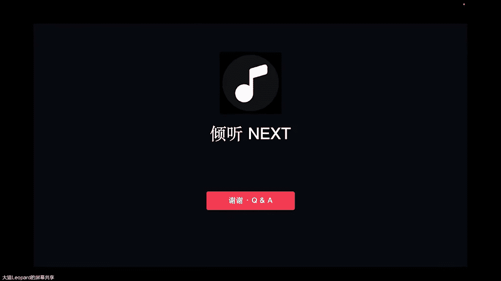
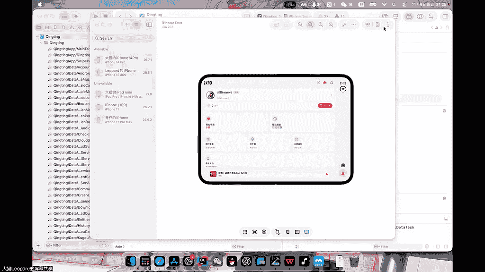

【Datawhale AI+X】软件架构：让外部变化时内部保持稳定：01：课程概述与系统分层 🏗️

在本节课中，我们将学习如何构建一个能够聚合多个音乐平台的客户端应用，并在外部接口发生变化时保持内部逻辑稳定。

本项目并不是一个简单的网页套壳，而是一个直接连接多个音乐服务的聚合客户端。大家可以先记住一个核心观点，就是这个项目最重要的能力不是请求到了多少个接口，而是能否把平台的变化控制在一个有效的范围内。后面所有的设计，包括统一模型、适配器和状态管理，都是围绕这个目标展开的。

首先定义一下产品。网页壳通常只是用浏览器打开一个现成的网站页面，结构、登录和播放逻辑主要由网站负责。而轻听Next不一样。它会直接请求不同平台的搜索目录、歌词和播放接口，然后用自己的界面展示结果。这意味着应用必须理解每个平台的数据。例如酷我可能返回musicID，网易云返回ID，酷狗则把fileHash作为歌曲的重要标识。应用还要自己维护播放队列、收藏历史、下载和系统控制。

为了控制复杂度，我们可以把系统分成四层，分别是界面层、业务层、平台适配层和基础设施层。

以下是系统四层架构的说明：

- 界面层：比如搜索页、首页、歌单、播放器和歌词页。它只关心当前的状态，不了解每个平台里面JSON字段叫什么。
- 业务层：负责播放队列、收藏和下载任务、搜索状态和用户操作。
- 平台适配层：处理酷我、网易云、酷狗、QQ等平台的请求和响应。
- 基础设施层：包括网络、数据库、图片缓存、音频引擎以及系统媒体控制。

这种分层最主要的意义是限制变化的范围。假设酷狗把封面字段从image改成onion cover，理想情况下就可以只修改酷狗的适配器。而搜索界面和播放器列表都不用改。反过来，如果直接处理一些原始数据，那么一个字段调整就可能影响搜索、歌单、播放器和下载多个界面。

架构并不是为了让代码看起来复杂，而是为了让外部变化发生的时候，内部是稳定的。

【Datawhale AI+X】软件架构：让外部变化时内部保持稳定：02：统一数据模型与平台适配 🔄

上一节我们介绍了系统分层，本节中我们来看看如何把不同平台的数据标准化。

不同平台的数据差异非常大。它不仅字段名不同，类型也有可能不同。同一个ID有时候是数字，有时候是字符串。时长有的平台用秒，有的平台用毫秒，有的平台用分钟。歌手有的时候是一段文本，有的是对象数组。封面有的是URL，有的只是相对路径，还有的甚至包含一个需要替换的size模板。如果直接让页面去处理这些差异，页面的代码会充满类似“如果是某平台就读取某字段”的判断。平台越多，组合越复杂。

因此，在这个数据进入业务层之前，必须完成一次标准化。这个标准化的过程就是统一模型。

统一模型可以理解为应用内部对一首歌的标准定义。可以用下面的代码表示：

SongRecord {
    id: string
    name: string
    artists: string[]
    album: string
    coverUrl: string
    duration: int // 单位为毫秒
    source: string // 平台标识，必须保留
    mv: bool
    quality: string
}

所有的平台客户端在聚合之后，最终都输出一个SongRecord。搜索列表只读取name、artists和coverUrl，播放器根据source选择播放解析器，数据库保存相同的结构，收藏历史、下载和云同步也是围绕这个模型在工作的。

这里要注意，统一并不代表丢掉了原始平台的特征。例如，source必须保留，因为相同的数字ID在不同的平台可能代表不同的歌曲。某些平台还需要mediaID、MV hash或audioID才能解析。统一模型的目标不是把所有平台全部压成一个最小公倍数，而是提供一个稳定的公共字段。这就是适配模式的价值，它的外部模式可以多样，然后内部保持统一。

【Datawhale AI+X】软件架构：让外部变化时内部保持稳定：03：搜索与播放流程拆解 🔍

上一节我们介绍了统一数据模型，本节中我们来看看从搜索到播放的具体流程。

沿着一首歌从被搜索到真正播放出来的过程，可以拆解为以下步骤：

第一步，用户输入关键词。
第二步，读取当前选择的音乐源。
第三步，统一的search service把source分发给对应的客户端，例如酷我或者网易云。
第四步，客户端构造该平台需要的URL。
第五步，转换成SongRecord。
第六步，更新状态，SwiftUI或者Compose根据新状态重新生成列表。

这里的search service更像是一个路由器。它并不负责理解每个平台的细节，而是把每个平台处理自己的协议交给正确的实现。这种拆分还比较方便测试。比如，我们可以给某个解析器一段固定的JSON，这样可以验证它是否产生了预期的SongRecord，而不用启动完整的页面去真正访问网络。

平台适配器里面的很多代码看起来只是一个字符串处理，但是它对稳定性非常关键。比如，入库可能只返回120或者某个路径，适配器要补全CDN路径，并把120替换成适合展示的尺寸。经常返回一些包含size的模板，客户端要替换。字段读取通常不是只看一个键，而是按照优先级选择一个。比如酷狗封面，依次尝试image、stable等字段。

稳定并不是说假设接口永远不变，而是在接口发生可预期变化的时候，仍然有退路。适配器越完整，变化就越不容易扩散到其他模块。

搜索结果一般只包含原数据，并不一定包含可以直接播放的音频。用户点击音频之后，Music Library或者播放控制器，先把歌曲放入队列，然后根据source选择解析器。解析器需要歌曲ID、hash、音质、登录状态和设备参数。

为什么不把播放的URL永久存进数据库？因为很多地址带有过期时间或者与账号、音质和地区状态有关。今天解析成功的地址，明天可能就失效。因此，数据库长期保存歌曲源数据，播放URL则按需解析。这也是为什么搜索成功不代表播放一定成功。搜索接口、播放解析接口和实际媒体CDN是三条不同的链路，每一条可能都会有独立的错误。

播放器也不只是一个简单的播放按钮，它更接近一个状态机。可以用下面的流程表示：

IDLE -> 用户点击歌曲 -> RESOLVING（正在解析播放地址）
RESOLVING -> 拿到地址 -> BUFFERING（准备数据）
BUFFERING -> 准备好了足够数据 -> PLAY
PLAY -> 用户暂停 -> PAUSE
任意状态 -> 发生错误 -> ERROR（记录错误，决定重试或者跳过）

把状态机和队列规则从界面中抽离出来有两个好处。第一个就是规则是可以单独测试的。第二个就是无论操作来自屏幕按钮、蓝牙耳机还是小组件，最终行为都保持一致。

【Datawhale AI+X】软件架构：让外部变化时内部保持稳定：04：歌词系统与性能优化 🎵

上一节我们介绍了搜索与播放流程，本节中我们来看看歌词系统和列表卡顿优化。

歌词功能的第一步就是把文本转化为一个结构化的时间轴。普通的LRC前面每一行都有时间，例如01:12.500。解析器需要把分钟、秒和小数统一转换成毫秒。而逐字歌词会更复杂，因为一行中的每个字还有自己的开始和持续时间。

界面需要根据当前的时间计算高亮比例，同时保持滚动位置稳定。性能上不能每一毫秒都重绘整页，通常播放器会以合理的频率发布进度，界面用差值和动画形成连续效果。高亮系统本质上来说，其实就是时间的解析。状态的选择和视觉动画这三部分结合起来，就可以成为一个比较好的歌词系统。

很多用户反馈列表非常卡。搜索列表中的封面只能显示为56点左右，但平台经常返回800乘800的JPG压缩文件。它可能不大，但是一旦解码成位图，按每像素四字节来算，一张图片就2.4兆了。原来的图片加载器被放在主线程上，网络下载完成之后，这一步就会触发图片解码，很容易被误判成网络慢。网络慢通常只会让图片晚出现，解码卡死会影响手指的跟随感。

定位性能问题的时候，我们需要区分下载、解码、布局和绘制分别发生在哪个线程。优化后的目标是很明确的，就是主线程只负责显示，不负责解码。

具体做法如下：

- 网络请求下载原始图片数据。
- 下载完成之后，数据会被交给后台任务。
- 后台使用ImageIO创建缩略图。
- 生成缩略图之后放入缓存，缓存键同时包含URL和目标尺寸。
- 主线程只需要接收解码好的UIImage并更新界面。

【Datawhale AI+X】软件架构：让外部变化时内部保持稳定：05：数据持久化与云同步 💾

上一节我们介绍了歌词系统与性能优化，本节中我们来看看数据如何保存和同步。

应用关闭之后，收藏、歌单、历史和下载任务是不能消失的，需要本地持久化。我们把数据大概分成了四类：

- 第一类：歌曲源数据。
- 第二类：用户行为。
- 第三类：关系数据。
- 第四类：任务状态。

数据库保存的是可以恢复业务状态的数据。应用下次启动的时候，可以重新构造歌单、收藏、播放历史和未完成任务。有的东西不适合长期保存，比如下载的临时文件路径。设计数据库的时候还要区分长期事实和临时存储的结果，否则就会出现恢复后数据看似存在，但实际上已经失效的问题。

云同步方面，假设安卓收藏了一首歌，同时在iPhone删除一个歌单，两台设备都离线，稍后它们依然会再次联网。服务端必须知道哪些记录发生了变化，哪次修改更新，以及删除是否应该覆盖旧数据。同步流程一般是先上传本地的变化，然后再拉取服务端的增量，比较版本并合并，最后清除已经确认的修改标记。

它的重点并不是让所有的设备都上传整个数据库，而是让每一次的变化都可以可靠的传播。

【Datawhale AI+X】软件架构：让外部变化时内部保持稳定：06：跨平台适配与系统集成 📱

上一节我们介绍了数据持久化与云同步，本节中我们来看看跨平台适配和系统集成。

安卓和iOS这里使用了不同的技术栈。安卓用了Kotlin，iOS上面使用了Swift。两边其实没有必要逐行去共享带界面的代码，因为平台构建生命周期和系统能力都不同。但有一点，那就是业务规则必须一致。例如source这种标识，还有歌曲的主件、封面字段和优先级、队列导航、时长单位、同步协议和错误语义。

双端一致的目标并不是代码长得一样，而是同一个用户操作在两个平台上可以得到相同的结果，同时各自遵循平台的习惯。

统一模型建立之后，我们来看一下功能全景。搜索发现歌曲，首页推荐歌曲，歌单负责整理，播放器处理队列和音质，歌词负责时间同步，MV进入视频解析，下载把在线资源转成本地文件。这些功能并不是一个独立的小岛。例如，搜索结果点击之后进入播放器，收藏后进入歌单，下载后仍需保存原始的source和songID，云同步又需要把这些关系传到另外一台设备。而SongRecord就是贯穿整个过程。因此，模型一旦设计不完整，问题会在后续的多个模块放大。反过来，一个稳定的模型就可以显著降低在新增平台和新增功能的成本。

音乐APP我认为必须走出APP自己的界面。iOS的锁屏控制中心、灵动岛，还有小组件都可以显示歌曲名称、歌手、封面、总时长和当前进度。NowPlayingSystemBridge这个东西就像它的名字一样，它是把内部播放器转换成系统NowPlaying原数据，同时把系统命令转回Music Library的一个桥梁。这样无论用户点击APP按钮、锁屏按钮还是耳机按键，都会经过统一的一套播放和导航逻辑。系统集成层负责连接，它没有重复实现业务规则，实现了一次就可以用很久。

【Datawhale AI+X】软件架构：让外部变化时内部保持稳定：07：启动流程与错误处理 🚀

上一节我们介绍了跨平台适配与系统集成，本节中我们来看看启动流程和错误处理。

启动流程其实没什么好说的，展示时间也要平衡一些品牌感和启动速度。目前短暂增加了一个淡出动画，并不阻塞真正的初始化任务，只是让这个动画可以平衡一下初始化的时间。

对于第三方的接口，失败其实是日常运行的分支。网络超时需要重试，这些都有可能发生。错误信息也是要分层的。用户需要知道的是搜索失败，可以重试，或者当前歌曲暂无可用资源。而开发者需要记录的是平台接口状态码、解析字段和原始错误。把内部的细节全部暴露给用户没有意义，完全隐瞒错误也会让问题难以定位。可靠性设计的核心是把失败建模成一种状态，并为每一种状态规定下一步的行为。

【Datawhale AI+X】软件架构：让外部变化时内部保持稳定：08：演示运行与产品功能 📺

上一节我们介绍了启动流程与错误处理，本节中我们来看看实际的演示运行和产品功能。

演示环境使用Xcode的测试版本，以新发售的iPhone为例。打开虚拟机后，可以看到应用正在运行，并且有输出的日志。界面中有原声适配的切换按钮，以及歌曲搜索和听歌识曲功能。针对新款iPhone进行了深度适配，包括横屏时的封面显示、歌词折叠、封面流切换等界面效果。手机翻转和展开后，界面会在正常播放界面和封面流界面之间切换。这些界面都做了深度的Liquid Glass适配，目的是提供赏心悦目的最新UI界面。

除此之外，还支持通过酷狗账号实时播放私人FM，通过波点音乐账号加入实时自习室。用户可以自定义UI，比如关闭快捷入口按钮。还有一个基于音乐的激励制，用户可以打卡，打卡之后用打卡次数换取音乐下载额度。目前服务器运营成本有限，用户规模大约2800人左右，日活大约在500到1000人左右。

【Datawhale AI+X】软件架构：让外部变化时内部保持稳定：09：课程总结 📋

上一节我们介绍了演示运行与产品功能，本节中我们来总结本课程的主要内容。

在本节课中，我们一起学习了如何构建一个聚合多个音乐平台的客户端应用。我们介绍了系统分层，包括界面层、业务层、平台适配层和基础设施层。我们建立了统一的数据模型SongRecord，用于屏蔽不同平台的数据差异。我们拆解了搜索与播放的完整流程，介绍了播放器状态机和队列机制。我们讲解了歌词系统的时间轴解析和列表图片性能优化。我们讨论了数据的本地持久化和云同步机制。我们介绍了跨平台适配与系统集成，包括锁屏控制中心和小组件。最后，我们说明了启动流程和分层错误处理的设计思路。

架构并不是为了让代码看起来复杂，而是为了让外部变化发生的时候，内部是稳定的。希望通过本课程，你能掌握如何控制外部变化的范围，设计稳定的内部模型，并构建可维护的音乐聚合客户端。

