Datawhale AI+X：01：非科班也能做AI视频，Opus+Claude实战 🎬

在本节课中，我们将要学习如何使用Claude Opus和AI工具，让没有计算机专业背景的同学也能制作AI视频。这节课的内容来自一次真实的实践分享，讲者通过Claude读取自己的聊天记录、笔记和项目资料，制作了12个不同风格的短视频。我们将一起了解这个制作流程，探讨如何降低视频制作的门槛，并且对比代码生成视频与像素级生成视频的区别。无论你之前有没有做过视频，都可以跟着这个思路去尝试，因为整个过程并不复杂，很多步骤可以交给AI来完成。

为什么要尝试AI视频制作 🤔

上一节我们介绍了这节课的大概内容，本节中我们来看看为什么要尝试AI视频制作。讲者之所以开始这个实验，主要是出于好奇心。他发现身边的朋友都在讨论AI视频，在社交平台上也有很多人制作这类视频，而且效果非常好。好奇心会驱使人去尝试新事物，所以他决定亲自动手做一次。他当时想，AI时代每个人都应该保持好奇心，否则很容易被新技术甩在后面。于是他就开始了自己的第一个AI视频实验，用Claude来制作一支短片。

我的12个版本实验 🎞️

接下来我们来看看讲者做过的12个版本实验。以下是这些版本的主要特点：

- 第一个版本是文字版本，只包含旁白文字。
- 第二个版本是声音版本，文字内容和第一个版本一样，只是加入了配音。
- 第三、四个版本基本上是更换了不同的声音方案。
- 后面的第5到12个版本，则是尝试了不同的视频风格，看看能达到什么效果。

讲者订阅的是最基础的20美元会员，制作12支短片大约用了两到三个小时。每个版本都有不同的风格，比如有的是水墨画风格，有的是快剪风格，有的是漫画风格。有些片段使用了他自己克隆的声音，有些则是调用API生成的配音。他认为自己的声音可能不太好听，所以文字旁白使用别人的声音，只有几句是用他自己的克隆声音。通过这种方式，他发现即使是完全的小白，也可以轻松尝试制作AI视频。

基本制作流程 🔄

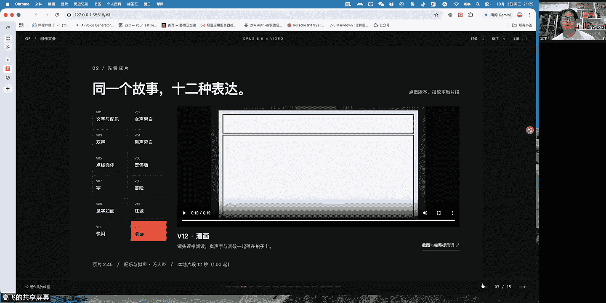

在了解了实验效果之后，本节中我们来看看制作AI视频的基本流程。讲者总结了一套四步走的方法，适合初学者直接套用。

以下是制作流程的四个步骤：

1. 先说一句话，确定大体方向。
2. 给AI提供资料，比如聊天记录、笔记和项目。
3. 让AI自己查找资料，输出你想要的叙事风格。
4. 根据AI给出的方案，确定最终的制作方向。

讲者建议，在开始的时候不要给AI太多细节，除非你一开始就有非常具体的风格要求或参考图片。如果你没有参考图，就让AI自己去发挥创意。首先定一个很大的方向，然后让AI先制作3到8秒的样片，你可以同时让它做4个样片。如果你喜欢其中的风格，就可以让它接着样片做完整版本，完整版本通常是3到5分钟长。这样做的好处是不会浪费时间直接制作完整视频，如果完整视频做出来再修改，会消耗更多的token和时间。如果觉得不满意，可以让AI进行修改，这样整个流程就很灵活，任何新手都能操作。

第一步：准备资料与初始对话 📂

上一节我们介绍了基本制作流程，本节中我们来看看第一步具体怎么做。第一步就是准备资料，并和AI进行初始对话。

以下是需要准备的资料清单：

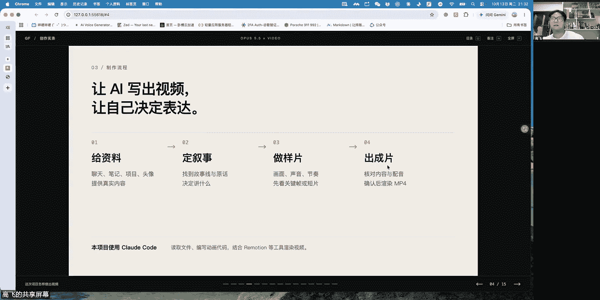

- 你和AI之前的聊天记录。
- 你的个人笔记。
- 相关的项目资料。
- 你的头像图片。

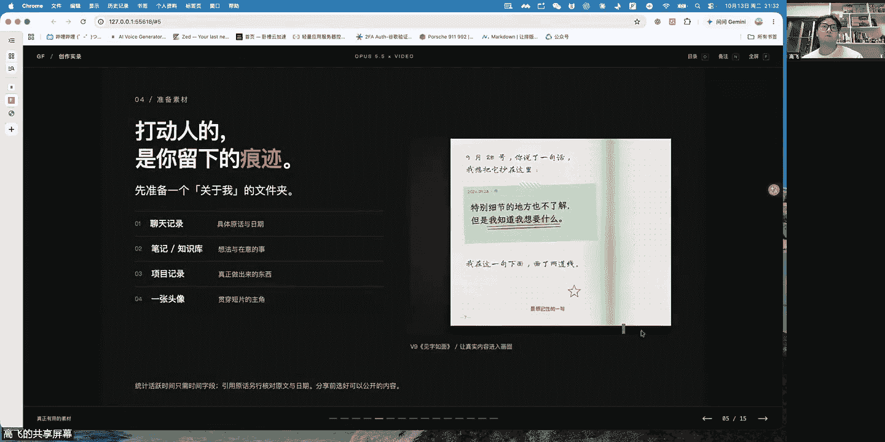

如果你已经和AI聊了很多天，比如一百多天，就可以直接让AI读取这些记录。如果没有，就需要先把聊天记录和笔记准备好。头像可以直接发一张图片给AI，或者如果之前发过，AI也会记住。在初始对话中，你只需要告诉AI你想做什么，比如“我想做一个视频”，然后让它根据你的聊天记录、项目和头像来生成内容。时长、画面、声音、配乐和音效都可以让AI自己决定，技术实现也完全交给AI。这样可以给AI更大的自由度，因为现在的模型能力很强，不需要太多限制。

第二步：确定风格与样片 🎨

上一节我们介绍了如何准备资料，本节中我们来看看如何确定风格和制作样片。风格确定是视频制作中很重要的一环。

以下是确定风格的几种方法：

- 如果你在网上看到喜欢的风格，可以把参考图片发给AI。
- 如果你没有参考图，可以让AI自己去构思一些风格。
- 你可以要求AI同时输出四种或几种不同的风格供你选择。

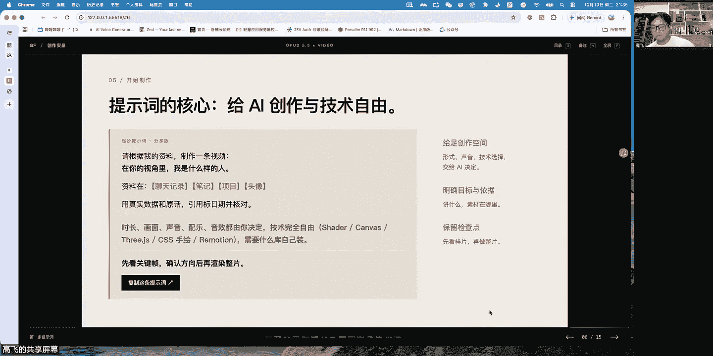

讲者曾经让AI尝试水墨风格、RPG风格、手账风格、漫画风格以及点线面风格。有些风格是他自己想象的，有些则是AI自己提出来的。比如水墨长江风格就是让AI尝试制作的。在正式制作之前，先让AI做3到8秒的样片，你可以同时生成4个样片，然后看看哪个风格是你喜欢的。如果不喜欢，可以直接告诉AI，让它换个方向再试。这个步骤很关键，因为它决定了后面整个视频的视觉基调。

第三步：技术选择与给AI自由度 ⚙️

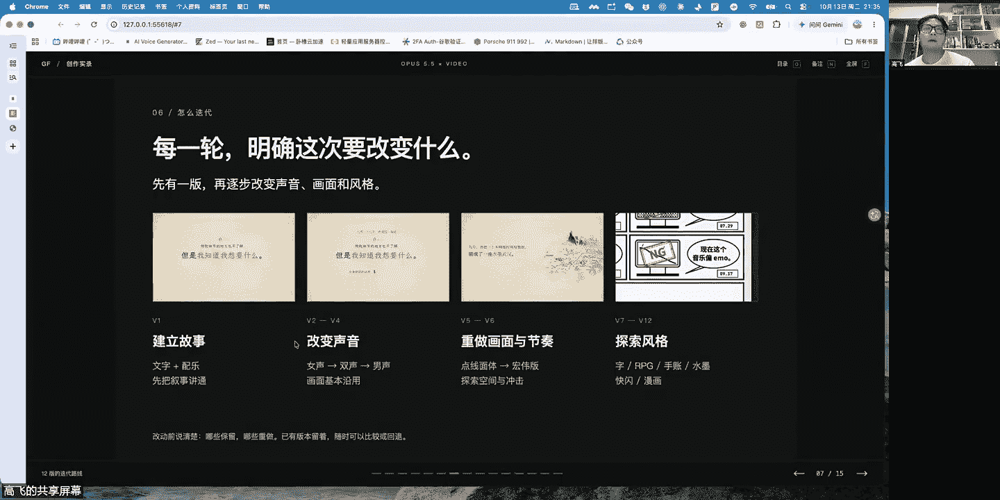

上一节我们介绍了如何确定风格，本节中我们来看看技术选择和如何给AI自由度。技术实现方面，讲者提到了几种常见的工具。

以下是涉及的技术示例：

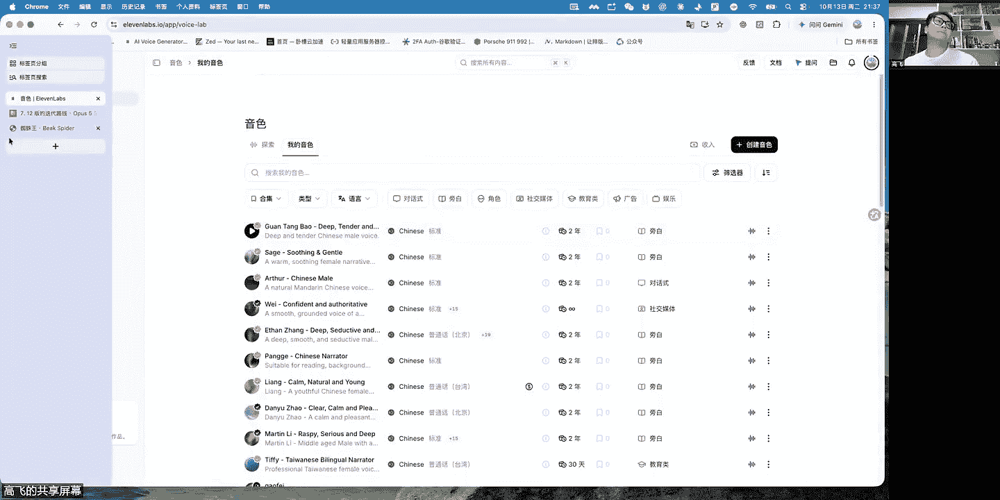

- shadcn或类似的UI组件库。
- GS（高斯溅射）用于3D风格。
- remotion用于制作动画效果。

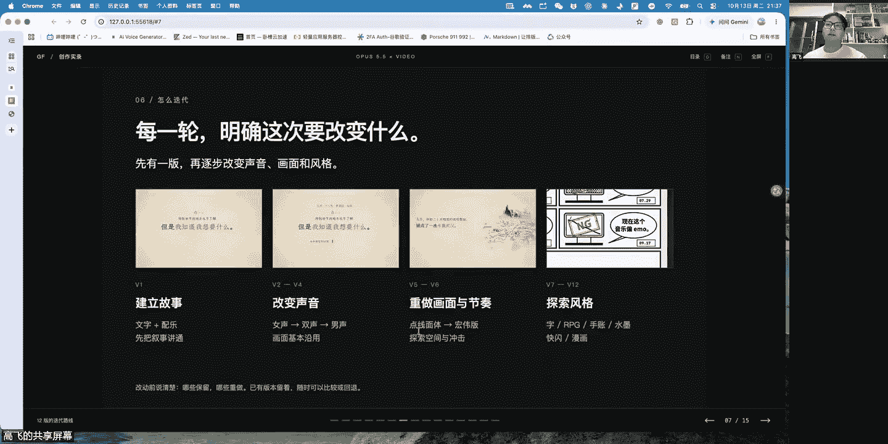

讲者建议，不需要在提示词里加太多限制，比如之前很流行的各种prompt工程技巧，现在可以去掉一些。使用顶级模型，比如Claude Opus或者GPT的高级版本，基本上不需要太多约束，直接用大白话告诉AI你想要什么，让它自己去做就行。模型生成的第一版通常能达到六七十分的质量，速度也很快。如果后面想要更高质量，再跟AI沟通修改细节。时长、画面、声音、配乐、音效全部让AI自己决定，技术栈也交给AI去选择安装，这样反而能发挥模型的最大能力。

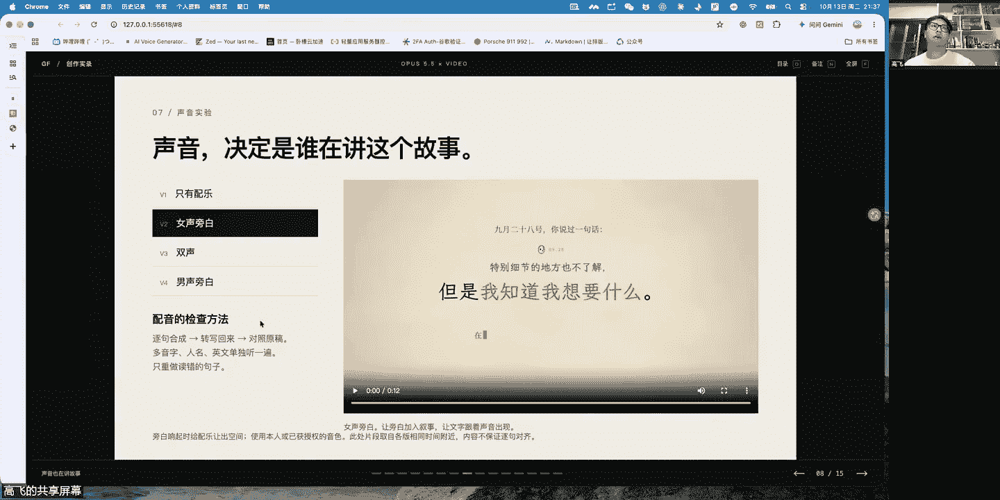

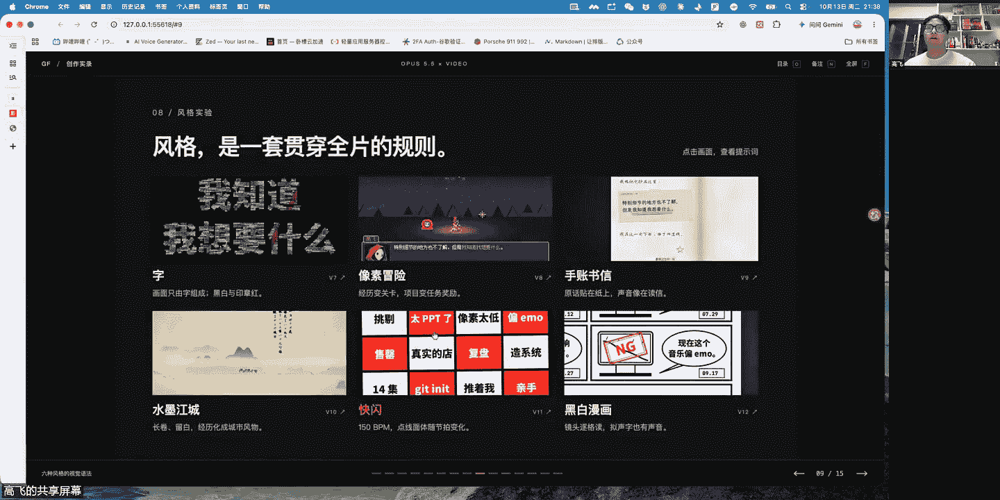

第四步：配音与风格迭代 🔊

上一节我们介绍了技术选择，本节中我们来看看配音和风格迭代。配音是视频体验的重要组成部分。

以下是配音的操作方式：

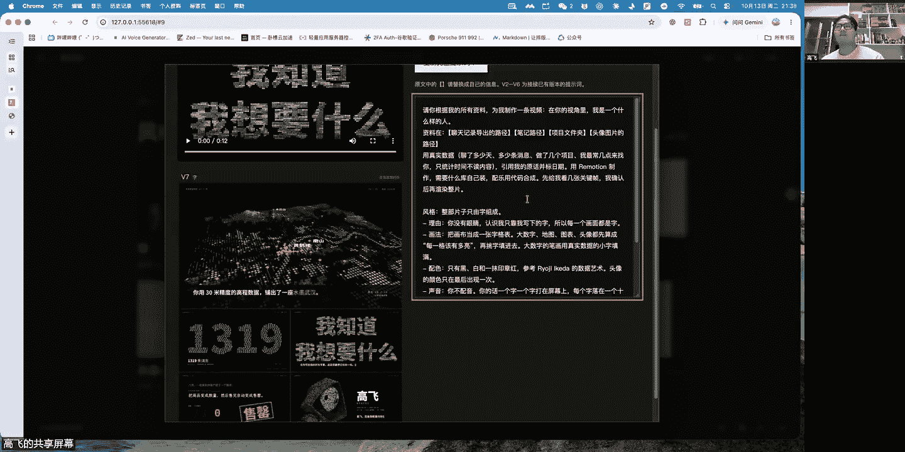

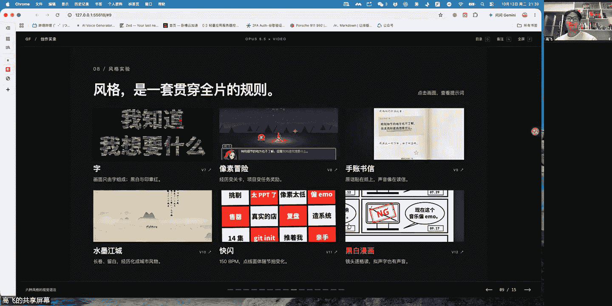

- 使用音色模型平台的API进行调用。
- 开通会员或购买积分，比如一万积分。
- 把API密钥给AI，让它自己去调用平台里的音色资源。
- 可以克隆自己的声音，也可以使用平台已有的音色，分享给别人使用。
- 平台里有国内和国外的音色，可以查找中文音色。

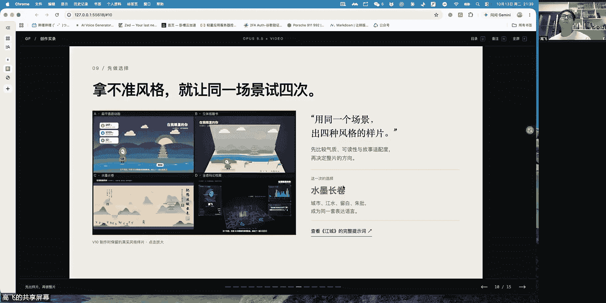

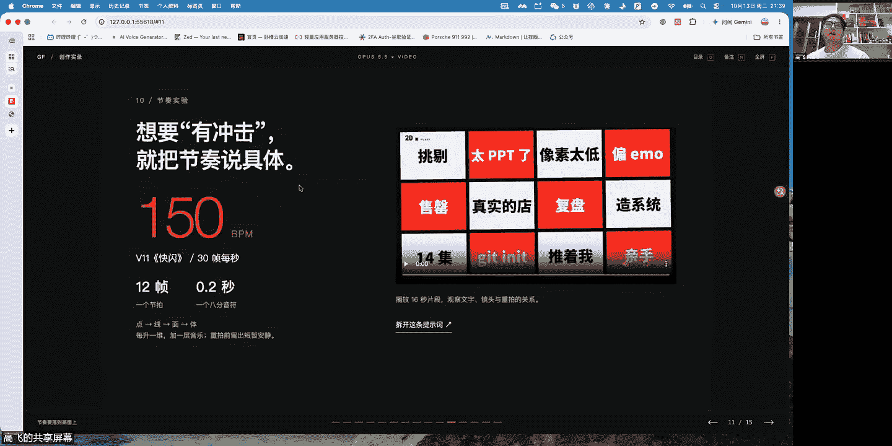

讲者提到，他的积分很快就用完了，因为频繁调用API。他还尝试了不同的音色，比如男生旁白、播音腔等，发现合成的声音听起来很舒服。在风格迭代方面，如果你看到某个版本的提示词，其实最重要的还是你第一次发给AI的那个提示词，后面的提示词可能是AI根据你的对话反推出来的，不一定有用。所以第一次沟通时，要把大体风格讲清楚，后续再根据效果做调整。

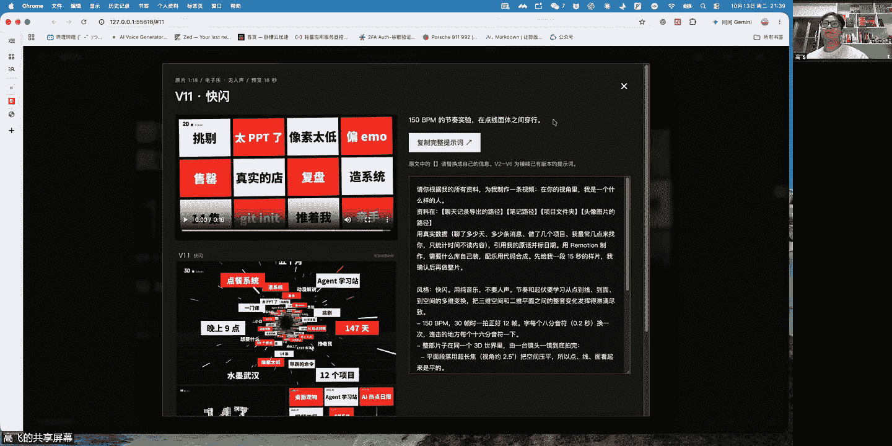

如果效果不满意，如何沟通 💬

上一节我们介绍了配音和风格迭代，本节中我们来看看如果效果不满意该怎么沟通。有时候AI生成的结果可能不符合你的预期。

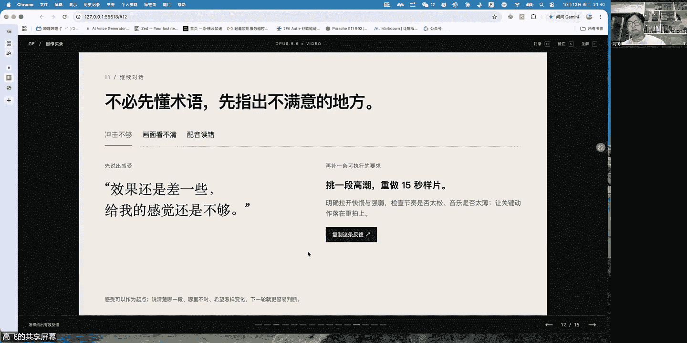

以下是沟通的建议：

- 用大白话直接告诉AI哪里不好。
- 说明画面感觉不够，或者难以分辨。
- 要求AI换一个方向重新尝试。
- 如果有具体的需求，可以提出来让AI修改。

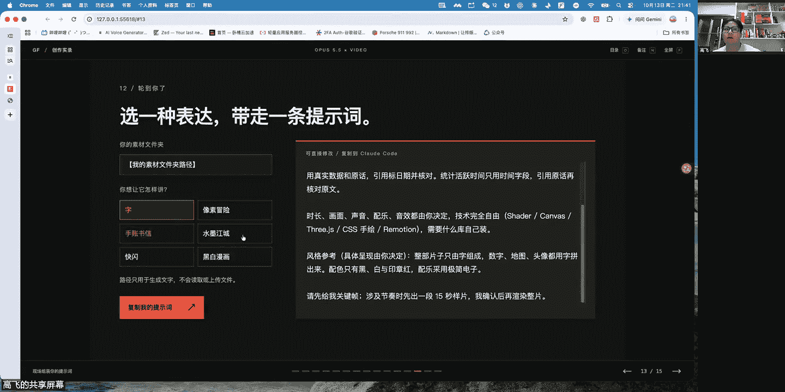

讲者认为，这四个版本即使是小学生也能分辨出好坏，关键在于你能不能把自己想要的画面描述出来。如果觉得效果不好，就让AI尝试其他方向。核心内容通常是不变的，只是风格在切换。你可以直接用Office等工具生成视频，把模板和风格结合起来。不要写得太详细，给AI一点空间，展现出来的效果可能会更好。大家如果想要类似的风格，可以去尝试。

代码生成视频与像素生成视频的区别 💻

上一节我们介绍了沟通修改，本节中我们来看看两种不同的视频生成方式。市面上主要有两种做法，一种是基于代码的生成，另一种是基于像素的生成。

每个像素的颜色可以用公式表示：

`像素颜色 = (R, G, B)`，其中 `R`、`G`、`B` 的取值范围是 `0` 到 `255`。

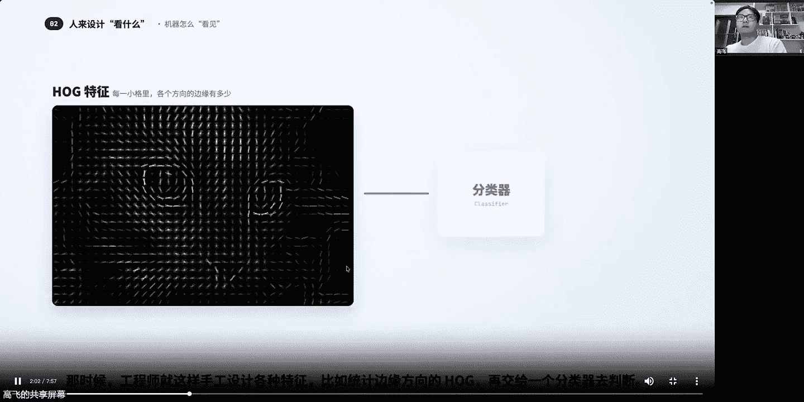

以下是两种方式的对比：

| 维度 | 代码生成视频 | 像素生成视频 |
|------|-------------|-------------|
| 代表工具 | remotion、shadcn、3GS | 即梦、豆包等像素级模型 |
| 生成原理 | 每一帧根据代码绘制，再拼接 | 一次性基于像素生成图像 |
| 成本 | 较低 | 较高 |
| 速度 | 较快 | 较慢 |
| 适用场景 | 科普视频、教育视频、PPT类视频、抽象动画 | 真人实景、短剧、慢剧 |
| 控制方式 | 代码控制每一帧 | 类似抽卡，结果不确定 |

代码生成视频是基于底层视觉绘制能力，按帧生成再拼接，成本低且可控，非常适合做教育方向的科普视频，比如刚才提到的视觉识别讲解。像素生成视频一次性生成几秒钟，未来可能生成一分钟，但每个视频成本更高，时间更长，结果具有随机性。如果你要做真人实景的短剧，像素级模型效果可能更好；如果你要做PPT风格的教育视频，代码生成方式更合适。

实战案例：视觉识别科普视频 📺

上一节我们介绍了两种生成方式的区别，本节中我们来看看一个具体的实战案例。讲者用Claude做了一套关于视觉识别的科普视频，一口气制作了12集。

在电脑看来，一张图片就是一张表格，表格里的每一格叫做一个像素。每个像素用红绿蓝三个数字记录颜色，每个数字从0到255。从这40万个数字识别出“猫”，就是视觉识别要做的事情。如果猫换个姿势，或者被沙发挡住一半，这40万个数字几乎全都变了，但答案还是“猫”。不能靠手工设计规则，比如“两只尖耳朵”，来完成识别。讲者用这个例子，让AI帮忙制作了不同风格的科普视频，包括机器眼风格、手绘风格和明亮风格。他选择了第三种明亮风格，效果比GPT做的要好一些。

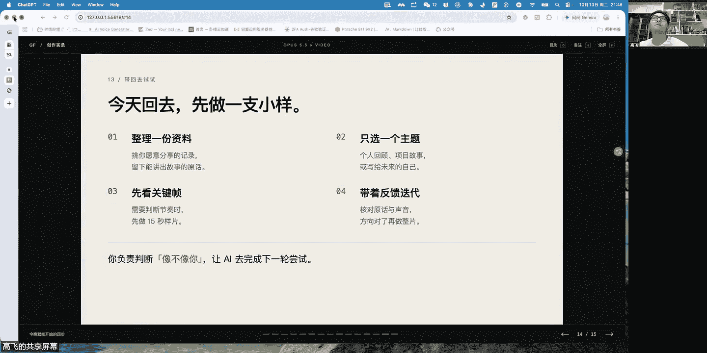

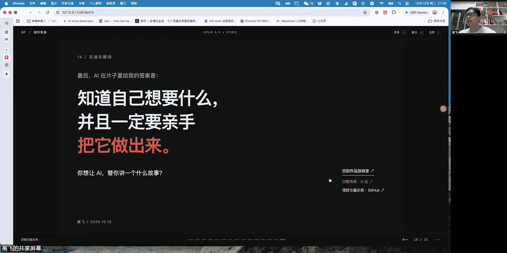

总结与建议 📚

本节课中我们一起学习了如何使用Claude Opus制作AI视频。我们了解了为什么要尝试AI视频，回顾了讲者做的12个版本实验，学习了四步制作流程，包括准备资料、确定风格、选择技术、配音迭代。我们还对比了代码生成视频与像素生成视频的区别，并且看了一个视觉识别科普视频的实战案例。希望这些内容能帮助没有编程基础的同学，也能动手制作属于自己的AI视频。如果你感兴趣，可以去讲者的B站页面查看更多完整视频，每个视频时长在三到五分钟之间，共有十二个视频可供参考。
