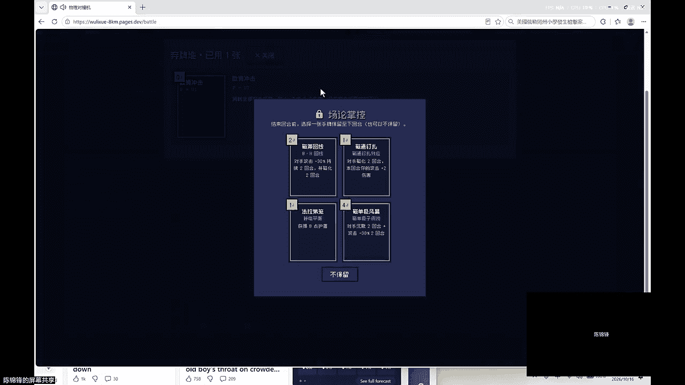
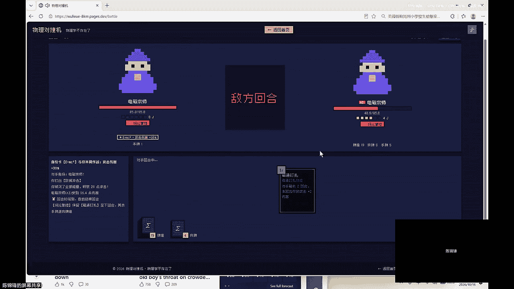
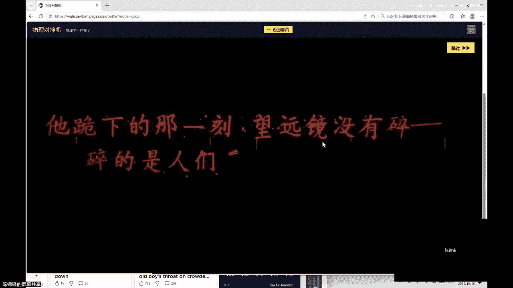
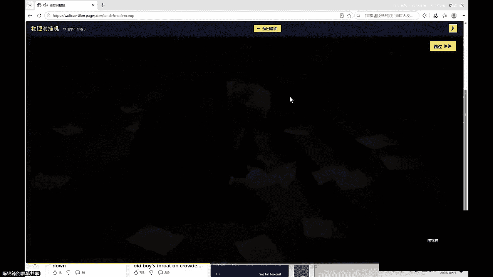
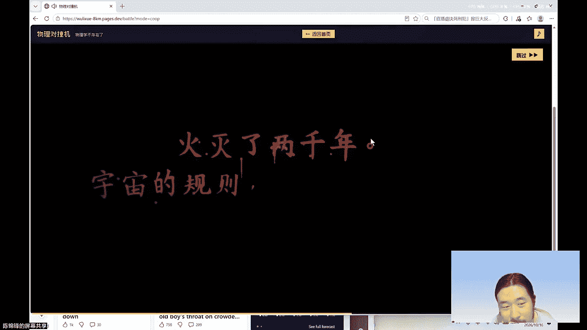
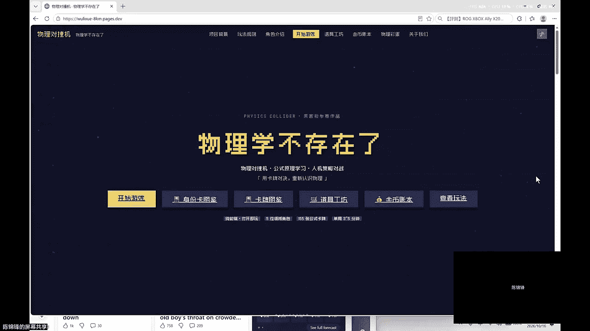

🃏物理公式卡牌游戏开发：01：项目介绍与背景


在本节教程中，我们将学习一款由大学新生团队开发的物理公式卡牌游戏。这个项目最初是为了参加 Datawhale AI+X 比赛而制作的。团队成员此前都没有接触过 AI 开发，是第一次尝试用人工智能技术做游戏。通过这篇教程，你可以了解他们从构思到完成整个开发过程，包括游戏模式、卡牌设计、塔爬机制、多人联机以及最后的部署上线。


创作背景与比赛主题


我们首先来看这个项目的创作背景。团队成员在看到比赛赛题后，发现要求选手做一些离谱的发明作品。他们想到身边很多人觉得物理学比较抽象，难以产生兴趣。于是他们萌生了一个想法，能不能用一种有趣的方式，让大家觉得物理学也很有意思。他们最近注意到卡牌游戏非常流行，队里有人在玩杀戮尖塔这类游戏。于是他们决定把物理学的相关知识放进卡牌里面。


以下是项目背景的关键点：

- 比赛赛题要求制作离谱发明。
- 团队希望让物理学不再枯燥。
- 参考火爆的卡牌游戏作为核心参考。


游戏模式概述


接下来介绍游戏目前支持的模式。比赛刚开始时，团队做了两个模式，一个是经典对战模式，另一个是塔爬模式。比赛结束后，他们又补充了一个双人打 Boss 的模式。这三种模式构成了游戏的主体内容。


以下是三种游戏模式的简介：

- 经典对战模式：玩家选择角色，进行单机对战。
- 塔爬模式：玩家逐层挑战，遇到各种事件。
- 双人 Boss 模式：两名玩家合作对抗同一个 Boss，目前还有一些 Bug 正在修复中。


卡牌系统与角色设计


本节我们继续看卡牌系统。团队一共设计了 5 个流派，还有 5 个人物角色。每个角色大约拥有两个流派，不同角色的卡牌完全不一样，没有一套通用的牌组。每个人物的名字跟它的被动技能有关联，设计时还考虑了人物与发明者或发现者的关系。除此之外，游戏里还设计了成就系统，用来记录玩家的挑战进度。


以下是角色与卡牌的设计要点：

- 流派数量：5 个。
- 人物数量：5 个。
- 每个角色大约拥有两个流派。
- 卡牌名称与发明者或发现者有关联。
- 每个角色的卡牌都是独立设计的，不是通用牌组。


身份牌与道具系统




除了普通卡牌，游戏还有身份牌和道具系统。身份牌属于卡牌途径的一部分，每个角色有不同的技能效果，玩家点击卡牌反面可以查看具体效果。道具方面，玩家不仅可以自己购买，还做了一个抽卡系统，可以通过抽卡获得道具。




以下是身份牌和道具的功能说明：

- 身份牌：每个角色对应不同的技能效果，点击反面查看。
- 道具购买：支持玩家自行购买。
- 抽卡系统：可以通过抽卡获得不同的道具。


塔爬模式与物理问答


塔爬模式里包含丰富的事件，比如锚点、问答事件、Boss 和精英怪。不同事件有不同的效果。其中问答事件是团队特别设计的一部分，主要出一些物理公式题目，相当于让玩家在游戏里进行简单的物理学习。如果答对公式，可以在流程中获得齿源，齿源可以用来购买不同的卡牌。


以下是塔爬模式中的事件类型：

- 锚点事件。
- 问答事件：出物理公式题目。
- Boss 事件。
- 精英事件。



问答奖励机制可以用下面的代码块简单表示：



```
答对物理公式 = 获得齿源
齿源 = 购买卡牌的货币
```




多人联机与界面展示


游戏还支持联机对战。玩家可以把房间码发给朋友，朋友输入这个码之后，两个人就可以互相对战了。界面方面，玩家可以查看增益效果，游戏主要使用能量来打出牌，不同角色的牌不一样。还有排队机制，玩家不能一直卡着同一张牌。比如电磁类特殊效果可以保留一张牌。


以下是联机对战的操作步骤：

1. 玩家生成房间码。
2. 把码发送给朋友。
3. 朋友输入码进入对战。
4. 双方选择角色后开始对战。


双人 Boss 模式与 CG 动画


团队最近做了一个双人对战 Boss 模式，不过目前还有一些 Bug，需要继续修复。这个模式配有入场 CG 动画，右下角标注了 AI 生成，制作还不算完全完整。团队还在持续改进中。


以下是双人 Boss 模式的现状：



- 模式名称：双人对战 Boss。
- 当前状态：存在 Bug，正在修复。
- 特色内容：有入场 CG 动画，部分内容由 AI 生成。


开发工具与部署过程


在开发工具方面，团队使用了豆包和积木这两个模型，没有使用特别牛逼的模型。部署是整个过程中比较棘手的一环。团队成员都是第一次接触 AI，也不懂怎么把网站部署到公共网域。一开始他们想买域名，比如去阿里云购买，但不太了解，而且时间比较紧张。后来他们尝试了很多办法，也向 AI 请教，最终使用 Cloudflare 完成了网站部署。


以下是部署过程中尝试过的方法：

- 去阿里云买域名。
- 咨询 AI 如何部署。
- 尝试多种部署方案。
- 最终使用 Cloudflare 部署网站。


团队组成与参赛感受


最后说说团队组成和参赛感受。团队成员都是大学新生，大一准大一阶段，在网上通过一个 AI 社团认识，彼此之前都不认识。黑客松比赛把一群有想法的陌生人聚集在一起，大家互相帮助解决问题。比如有人做不出来，别人会提供思路。在提交前半小时，他们还在为部署发愁，最后大家齐心协力搞定了。关于组队方式，大约有一半是预组队，另一半是选手自由组队，而且是纯线上的协作。


团队组成可以用下面的公式表示：

```
团队成员 = 大一新生 + AI 社团认识的朋友 + 初次合作的陌生人
```


参赛最大的意义在于能和志同道合的人一起解决问题，把以前不敢想的想法变成现实，做出一个能让大家玩的游戏，这种成就感非常强。如果你对 AI 比较感兴趣，建议多参加这种黑客松比赛。


本节教程中我们一起学习了物理公式卡牌游戏的项目背景、游戏模式、卡牌系统、塔爬机制、多人联机、部署方法以及团队参赛感受。希望通过这篇介绍，你能对这款游戏的开发过程有一个直观的了解。

