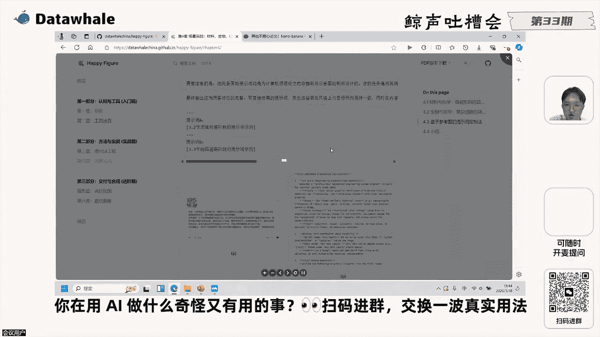
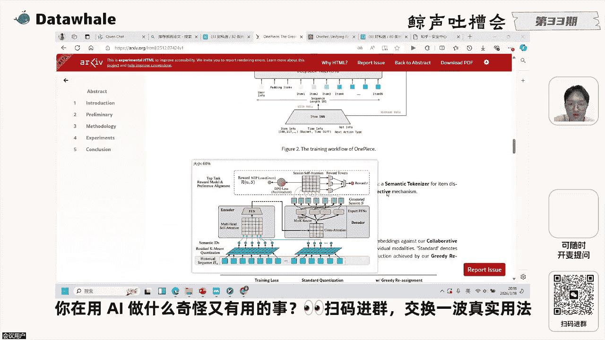
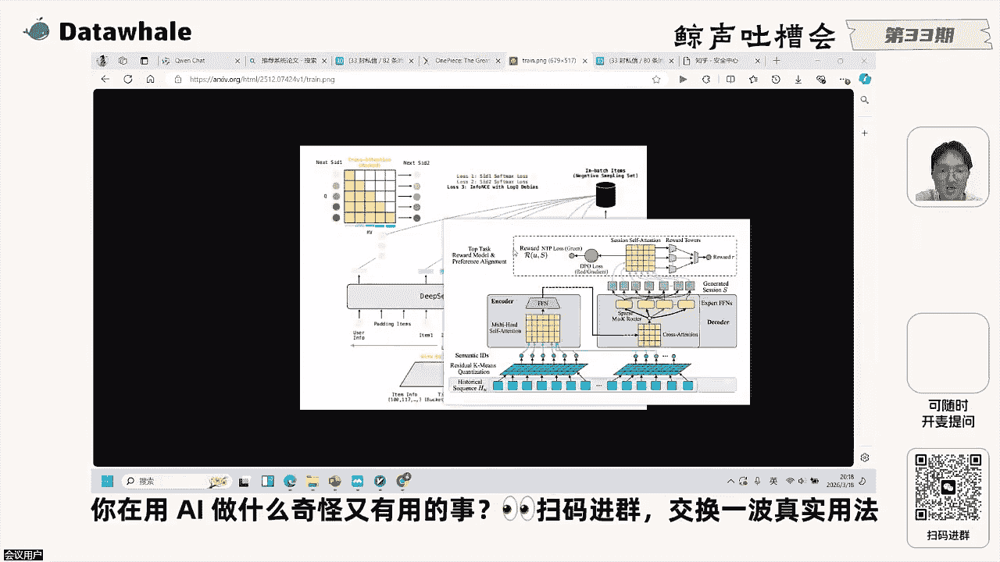
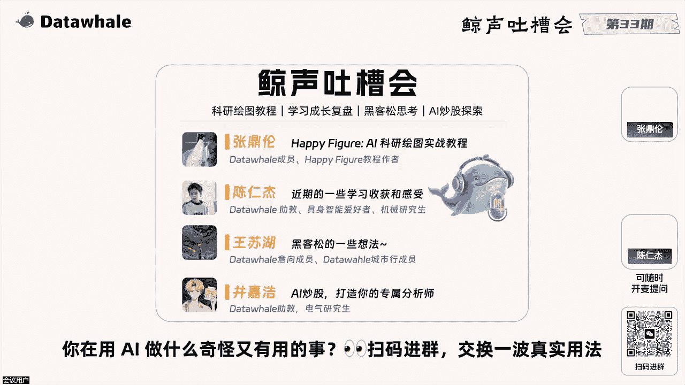
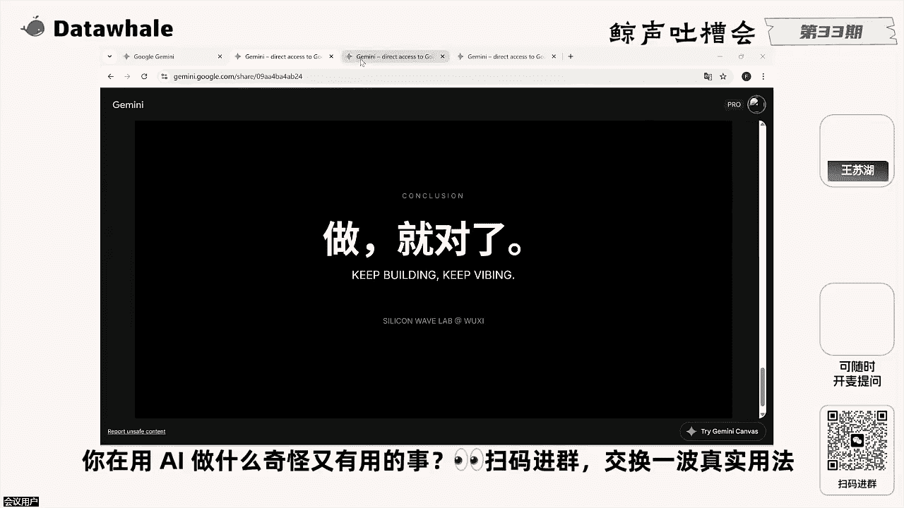
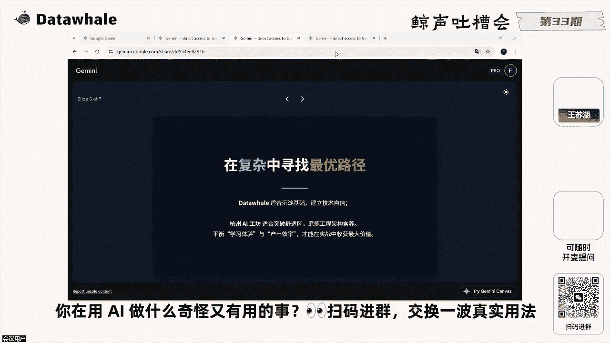
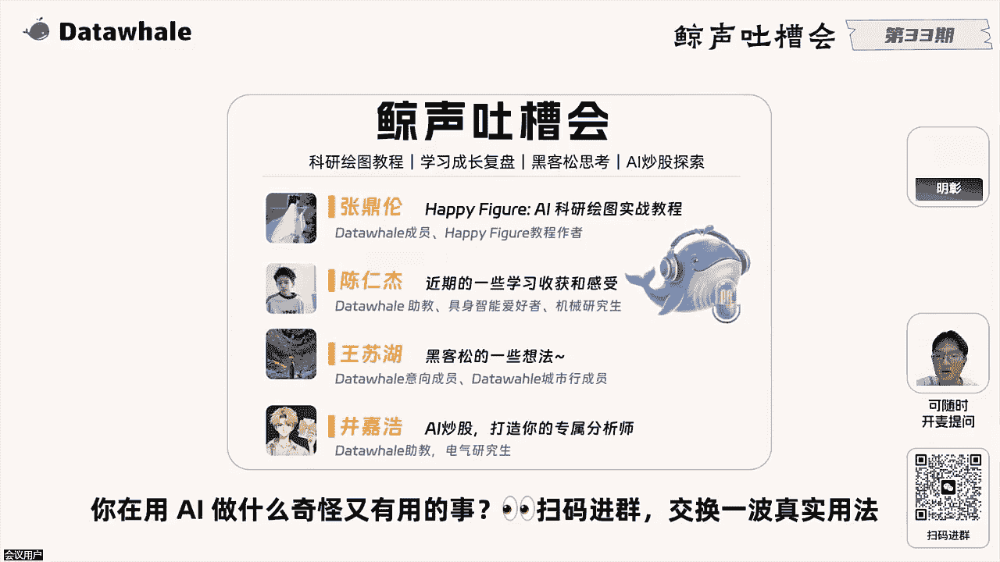

# Datawhale AI+X：01：吐槽会概述与嘉宾介绍🎤

在本节课中，我们将会学习 Datawhale AI+X 第 33 期鲸声吐槽会的全部内容。本期吐槽会始于 2025 年 12 月，至今已经持续了四个月，一共举办了三十三期。本次活动共有四位分享嘉宾，分别带来关于 AI 科研绘图教程、学习成长复盘、黑客松思考以及 AI 炒股探索的主题分享。我们将会依次了解每位嘉宾的核心观点和实践经验，帮助大家快速掌握这些前沿实践方法。

以下是本期吐槽会的四位分享嘉宾及其主题。

- 张定伦：DA 社区成员，Happy Figure 教程作者，分享 AI 科研绘图实战教程。
- 任杰：DA 社区助教，具身智能爱好者，机械专业研究生，分享本地部署大模型与 Open Cloud 接入飞书的经验。
- 搜狐：Data Out 意向成员和城市型成员，分享黑客松的想法与项目反思。
- 贾浩：DA 社区助教，电器专业研究生，分享 AI 炒股小工具开发与人工智能时代的思考。

# Datawhale AI+X：02：AI 科研绘图 Happy Figure 教程🖼️

上一节我们介绍了本期吐槽会的四位嘉宾，本节中我们来看看第一位嘉宾张定伦关于 AI 科研绘图的分享。



张定伦是 DA 社区的成员，也是 Happy Figure 教程的作者。这个教程专门针对 AI 科研绘图，目的是把时间还给逻辑，让研究人员用 AI 辅助完成科研故事的讲述。很多科研工作者在写论文时，会花费大量时间画插图。虽然插图看起来不起眼，但画起来很耗时，还有一定的上手难度。最近 AI 绘图模型的能力在逐渐提高，通过合适的方法，可以把模型用在科研绘图上，达到不错的效果，于是张定伦就把之前公众号文章的内容进一步丰富，整理成了一个系统性的教程，并开源给大家使用。

这个教程一共分为三大部分，包含六个章节。第一阶段是认知与工具。我们需要先明白什么样的图才是好的科研绘图，只有理解了图的样子，才能画好图。同时，还会介绍 AI 科研绘图的边界，也就是它能做到什么地步，以及哪些模型使用效果更好。教程里提供了多种模型的访问方式，包括 Nno Banana Pro、Nno Pro Nanono Banana Pro 2 等，也有国产模型千问 Image2 的使用方法。千问 Image2 是今年 2 月新发布的模型，通过教程的方法论和提示词，也能用它画出不错的科研绘图。

第二阶段是绘图方法。教程介绍了文生图和图生图两种方式。和普通 AI 绘画不同，科研插图对整体风格、空间布局、拓扑关系都有要求，这些都需要在提示词里写清楚。建议像写伪代码一样写提示词，还可以用参数控制颜色，比如在提示词里指定 HX 色码，Nano Banana Pro 这类模型能识别这些设置，输出精准颜色。教程里还提供了参考案例，比如把《Attention Is All You Need》这篇文章里的架构图复刻出来，同时介绍了引入手绘草图、风格迁移和对齐过程等图生图方法。

第三阶段是核心提示词。教程为计算机、生物医学、材料与化学等领域提供了专门的提示词。不同领域的科研绘图风格不同，所以提示词也要相应调整。如果现有的提示词不适合你的细分领域，可以用基于参考图的定制方法：先提供一张你觉得画得好的参考图，告诉 AI 领域名称，让 AI 生成适合该领域的文生图提示词，再把论文内容交给 AI，就能画出不错的图。张定伦曾以机械工程为例验证过这个方法，效果是可以的。

下面是核心提示词的写法建议，可以用伪代码形式描述。

```text
提示词 = 领域要求 + 论文内容 + 风格约束 + 参数控色
```

后处理部分也很重要。教程提供了辅助工具，包括前处理工具、配色提取工具和后处理工具。后处理里有一个关键概念是矢量化。原本的 PNG 是位图，放大后会模糊，矢量化后无论放多大都清晰。常见的矢量化工具有 Illustrator 和 PPT 等。更重要的是，AI 生成的图可能带有隐藏水印，单纯裁剪或高清放大无法去除，只有把图重新画成矢量格式，才能彻底去除水印。与此同时，图的版权也会归你个人所有，而不是 AI，这从学术道德和伦理角度来说，相当于对图进行了人工编辑和审核。

下面是后处理常用工具列表。

- 草图绘制工具
- 配色提取工具
- 去水印工具
- 高清放大工具
- 矢量化工具

在演示环节，张定伦对比了 Nano Banana 2、Nano Banana Pro 和 千问 Image 三种模型。结论是 Nano Banana Pro 效果最好，其次是 Nano Banana 2，千问 Image 适合简单图，复杂图效果较差。Nano Banana 2 的优点是文字清晰，尤其是英文，但整体美观度不如 Pro 版。项目已经开源在 Datawhale GitHub 上，名为 Happy Figure，目前处于内测阶段，欢迎大家 Star 并加入内测群交流。

# Datawhale AI+X：03：本地部署大模型与 Open Cloud 实践💻

上一节我们学习了 AI 科研绘图的教程内容，本节中我们来看看任杰关于本地部署大模型的经验分享。

任杰是 DA 社区的助教，也是具身智能爱好者，机械专业研究生。寒假期间他做了一个简单的机械臂，发现基础原理和逻辑与机电方向很相近，接入大模型后难度并没有想象中那么大。后来他转战 Open Cloud，并在飞书上完成了接入。在部署过程中，任杰发现网上的教程不能全信。有些教程说要装载 Note 点 GS，有些说可以跳过，跳过之后后面会报错。他最后通过反复卸载重装，才完成了 Open Cloud 的装载和飞书接入。

为了省钱，他起初想免费本地部署。他下载了 Ollama，尝试安装各种模型，从大模型降到 1G 的小模型，都发现电脑匹配度不够，跑不通。最后通过朋友的关系，在小红书上找到了一个比较方便的本地安装方式。

下面是他总结的本地部署小技巧。





- 直接安装 Ollama。
- 在 Ollama 网页端下载模型。
- 在 Open Cloud 终端的供应商选项里选择 Ollama，就可以安装。

接入飞书时，配对码不能直接接入终端。后来通过 Datawhale 社区助教的方法，使用豆包修改 Open Cloud 里的 GSON 文件，才最终实现接入。关于成本，任杰尝试了多种免费和低价方案。白山智算给新用户 350 元，可以用 MiniMax 2.5 模型；DeepSeek 有免费选项；智普和 MiniMax 比较便宜；其他一些平台性价比不高。对于学生来说，花钱虽然省时，但完全免费的方案通常更费事，需要花更多时间摸索。

本地部署的可行性取决于硬件配置，可以用下面这个简单公式理解。

```text
本地部署可行性 = 硬件配置 / 模型参数量
```

配置不够时，跑大模型会很吃力，建议使用云端模型。任杰现在也在控制台部署了多个云端模型，比如千问 3.5 的 9B 版本和 2B 本地版本，可以在控制台直接切换，不需要复杂配置。

# Datawhale AI+X：04：黑客松经验分享与项目反思🏆

上一节我们探讨了本地部署大模型的技术细节，本节中我们来看看搜狐关于黑客松的想法和经验。

搜狐是 Data Out 的意向成员和城市型成员，打过两场黑客松。第一场是 8 月份的 AAI 和 A2A2 黑客松，和空间计算有些关系，他做了一款 A2A2 应用，体验很好。在黑客松过程中，他观察到不同团队面对 Bug 的处理方式不同。有的团队选择硬修，越修越多，应用变得臃肿；有的团队直接重构，因为方向和文档已经定好，重构很快就能跑出新项目，效果还比之前更好。

下面是他总结的黑客松经验。

- 遇到 Bug 时，推倒重构的勇气比缝缝补补更重要。
- 黑客松是压力下的相亲，可以吸收队友的思维价值，协作愉快本身就是创业的预备。
- 路演环节可以了解评委视角，思考自己是否缺少评委视角下的资源。
- 黑客松也是营销自己的机会，可以寻找臭味相投的伙伴和识货的伯乐。

后来搜狐在校园内办了一场黑客松，最初想精简报名、海报、链接问卷等流程，让大家在一个地方高效完成。但找到队友后，产品越做越大，加了评委、参赛者、参赛队伍、队员提交作品等功能，项目变得很冗杂，他失去了维护信心。虽然在摩搭上部署成功，但没有验证是否有人买单，最后项目没有真正落地。他反思，AI 方向的效率工具不应该用互联网思维拼凑网站，感觉像拼凑的东西，不像正儿八经的产品。



Datawhale 的城市型社区活动比较保姆式，路径清晰，文档详细，全程配跑，低门槛，高获得感，以学习者为中心。而杭州爱公坊那边更偏向融资和真刀真枪的分布式协作，文档不那么详细，任务比较杂，感觉不够舒服。他建议在校学生办活动不要一开始就搞得太复杂，在复杂中寻找自己的优势路径。黑客松的收获可以用下面这个公式简单表达。

```text
收获 = 协作体验 + 评委反馈 + 行业人脉
```

# Datawhale AI+X：05：AI 炒股小工具开发与成本分析📈

上一节我们分享了黑客松的经验和反思，本节中我们来看看贾浩关于 AI 炒股的分享。

贾浩是 DA 社区的助教，电器专业研究生，毕业一年半。他的专业和人工智能差距较大，但 23 年快毕业时受 GPT 影响很大，从此对 AI 感兴趣，开始思考自己能做什么。在能源电力行业，资金重、技术密集，他平时用到的 AI 不多。但他想，未来的发展主线是人工智能，无论是电器、机械还是各个行业，都可以用 AI 工具为自己做些什么。他先跟着浩远学了垂直领域搜索工具，后来又做了 AI 炒股小工具。



他的工具主要解决监盘、收集信息、复盘这些固化流程。比如可以问今天大盘趋势、个股特点、今年的大盘走向是好是不好。工具支持一键部署，部署后可以在飞书和手机端使用，随时随地查看。配置部分包括股票偏好（短期、中期等）、数据库以及扩展玩法，还可以添加虚拟对象，把 AI 和炒股结合起来。这个思路也可以赋能到日常知识库、资料收集、行业研究分析等场景。



下面是工具的主要功能列表。

- 大盘趋势查询
- 个股特点分析
- 一键部署，支持飞书和手机端
- 股票偏好配置
- 虚拟对象添加

关于成本，他对比了多家厂商。百度千帆有尝鲜价，9.9 元一个月，大概一万多次请求，性价比很高。阿里和字节也有类似尝鲜价。智普和 MiniMax 比较便宜，其他一些平台比较贵。模型选择上，GPT-5.4 最好用，但普通人用 GPT-3.2 就足够了。对于 Agent 的使用，他有自己的想法。固定的流程可以用脚本做，热点监控可以用 Scales，只有需要全流程处理信息、框架优化时，才用 Agent，做到物尽其用。

AI 炒股月成本可以粗略估算。

```text
月成本 ≈ 9.9 元（百度千帆尝鲜价）
```

最后他提醒大家，炒股有风险，这个工具只是辅助决策，不能保证收益，大家要谨慎。理财本质是认知的变现，能不能赚钱是最直观的检验。

# Datawhale AI+X：06：课程总结与后续安排📚

前五节我们分别学习了 AI 科研绘图、本地部署大模型、黑客松经验和 AI 炒股工具，本节我们来总结本次吐槽会的全部内容。

本次吐槽会我们一起学习了四位嘉宾的分享。张定伦介绍了 Happy Figure AI 科研绘图教程，教大家如何用 AI 辅助画论文插图，把时间还给逻辑。任杰分享了本地部署 Open Cloud 和接入飞书的踩坑经验，提醒大家教程不能全信，免费方案费时费力。搜狐讲了黑客松的真实体验，强调重构比修补更重要，办活动不要一开始就太复杂。贾浩展示了 AI 炒股小工具，分享了模型成本和 Agent 使用策略，并提醒投资有风险。

如果你对这些话题感兴趣，可以在直播间评论区或社群里继续讨论。欢迎大家扫描右下角的二维码，加入精生吐槽会的群聊，后续系列活动会在群里预告，也可以在群里找到嘉宾并加微信深入交流。



本节课中我们一起学习了 Datawhale AI+X 第 33 期鲸声吐槽会的四个主题分享，希望对你有所帮助，大家早点休息，拜拜。

