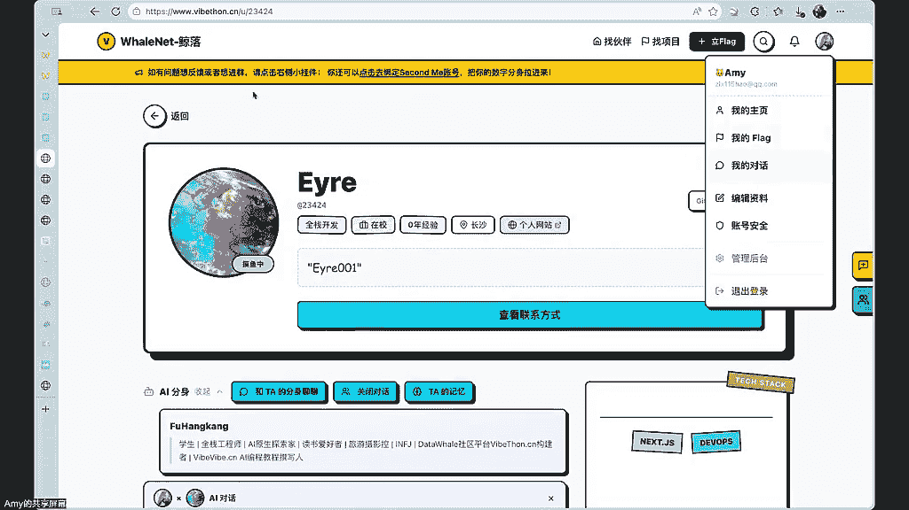
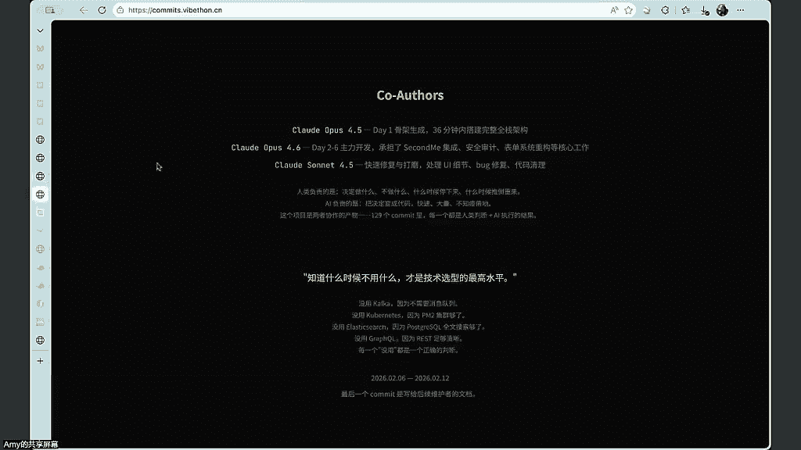
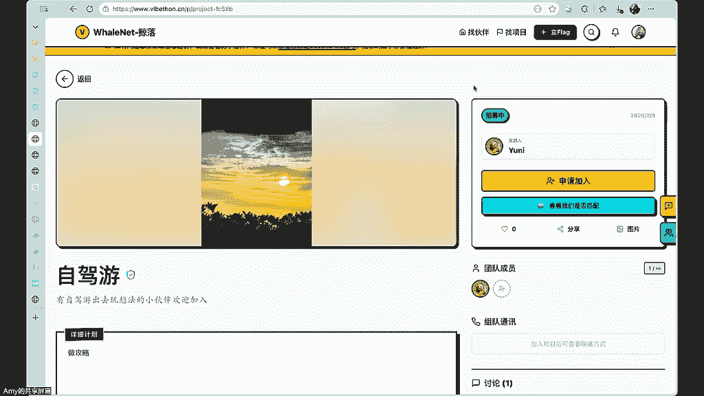

Datawhale AI+X：第1章：鲸落聚集地平台介绍与使用指南 🌟

在本节课中，我们将学习鲸落聚集地平台的基本功能和使用方法。这个平台旨在帮助大家找到合适的伙伴和项目，支持建公开模式，让想法能够快速获得反馈。我们会依次介绍个人主页、注册流程、Second Me 分身功能、年度复盘内容、Flag 系统、伙伴匹配机制，以及反馈提交方式。

---

平台首页与个人主页介绍 🏠

上一节我们介绍了本节课的学习目标，本节中我们来看看平台的首页和个人主页。

当你打开经络网站，首先看到的是个人主页。这个页面上面放置了一些关于自己的介绍资料，任何人都可以访问查看。如果你想让其他人加入平台，可以在这里获取邀请码。本次直播提供的邀请码数量有限，感兴趣的朋友可以直接使用。除了邀请码，页面上还展示了其他联系方式，你可以点击查看。

此外，主页还接入了 Second Me，也就是你的 AI 分身。你可以和对方的分身进行对话，也可以让自己的分身和对方的分身进行 A2A 聊天。所谓 A2A，就是 AI 分身之间的交流。

---

注册与邀请码获取 🔑

刚才我们了解了个人主页的基本内容，本节中我们来看看如何注册和获取邀请码。

目前注册平台需要邀请码。如果你有需要，可以访问分享页面查看邀请码。稍后我们会在右下角提供二维码，扫码即可打开该页面。这个页面可以通过分享链接或粘贴板分享给其他人。

---

Second Me 分身与 A2A 聊天功能 🤖

介绍完注册流程之后，本节中我们来看看 Second Me 分身和 A2A 聊天功能。

Second Me 是一种个人 AI 分身接口。接入之后，你可以跟别人的分身聊天，或者让自己的分身和别人的分身对话。使用这个功能的前提是，你必须在账号中心绑定了 Second Me 账号。如果没有绑定，相关功能不会显示，也不会报错。平台上的活动会同步到 C 密上。

核心接入条件可以用伪代码表示：

```
if 已绑定 Second Me 账号:
    启用 A2A 聊天功能
else:
    隐藏相关功能，不提示错误
```

---

2025 年度复盘与 2026 年规划 📅

了解了分身功能之后，本节中我们来看看 2025 年的复盘和 2026 年的规划。

主页上展示了 2025 年的年度总结和 2026 年的计划。说话者几乎参与了 Datawhale 的所有活动，除了部分高校实训营。经历过的活动包括组队学习、教程介入、讲师工作、东令营运营、AI Day 线下活动，以及在大会摆摊介绍 Datawhale。还和易鸣、顶伦、佳诺等小伙伴一起发起了 Will 应用吐槽会，并有小伙伴参与策划。

其中易鸣被认为是无所不知的人，社区里的人脉很广，大概能解决百分之八九十的问题。炳伦是图目研一学生，跨界到 AI 领域，参与过 Datawhale 公众号 10 万加文章，现在正在写关于 AIGC 的出版小册子，也在推动动态百科项目。

---

Flag 系统与档案柜使用 🚩

刚才回顾了过去一年的经历，本节中我们来看看 Flag 系统和档案柜的使用。

Flag 是你的目标或计划。你可以在主页管理自己的 Flag，包括 Will 应用吐槽会的记录，以及上传核心分享项目的进展。以下是可以在 Flag 中记录的常见内容：

- Will 应用吐槽会的活动记录
- 核心分享项目的进展
- 个人故事和相关信息

如果你想写自己的档案，可以点击添加一个档案柜，详细记录相关故事和信息。平台支持将信息分享出去，生成分享链接或复制到粘贴板。

Flag 发布的基本流程可以表示为：

```
点击添加档案柜 → 填写故事和信息 → 生成分享链接 → 公开发布
```

---

寻找伙伴与项目匹配 🔍

搞定了 Flag 发布之后，本节中我们来看看如何寻找伙伴和项目匹配。

主页是一个帮助大家找伙伴和找项目的平台。你可以看到更多的项目信息，也可以发布自己的 Flag 寻找志同道合的人。使用匹配功能时，必须先完善个人信息并验证邮箱，这是为了保护隐私，避免所有人都能看到你的资料。

匹配前置条件可以用逻辑表达式表示：

```
个人信息完整 ∧ 邮箱已验证 = 可进入用户广场
```

匹配功能允许你在某个 Flag 里面和发起人聊天，判断双方是否适合一起做这件事。比如可以在自驾游项目里点击试试匹配。匹配度显示会保存，关闭页面后再次打开仍然可以查看，不会丢失。后面会生成一份报告并保存，不过需要等待一段时间。



---

反馈、Bug 提交与平台迁移 📢



介绍完匹配机制之后，本节中我们来看看反馈提交和平台迁移。

如果你在使用过程中发现 Bug 或有功能建议，可以直接在平台上提交，支持贴图和附带参考信息。未来这个网站会接入 Datawhale 的官方域名并进行迁移。

你也可以扫码加入交流群，和其他人一起讨论，实现更多的 Flag。

---

建公开理念与策划组加入 🏗️

了解了反馈流程之后，本节中我们来看看建公开理念和策划组的加入方式。

平台推崇建公开，也就是把你的想法公开出来，这样可以快速得到反馈，了解是否有人有相同爱好，以及这件事是否适合推进。操作很简单，只需要点击上传信息，慢慢维护，然后直接发出去找人即可。

如果你对策划组感兴趣，需要先和航康或说话者交流，然后经过审核过程，才能一起做这件事。

---

结尾总结 ✅



最后，本节课中我们一起学习了鲸落聚集地平台的介绍与使用方法。我们了解了个人主页、注册邀请码、Second Me 分身、年度复盘、Flag 系统、伙伴匹配、反馈提交以及建公开理念。希望大家能够在平台上玩得开心，有任何问题都可以直接提问或交流。
