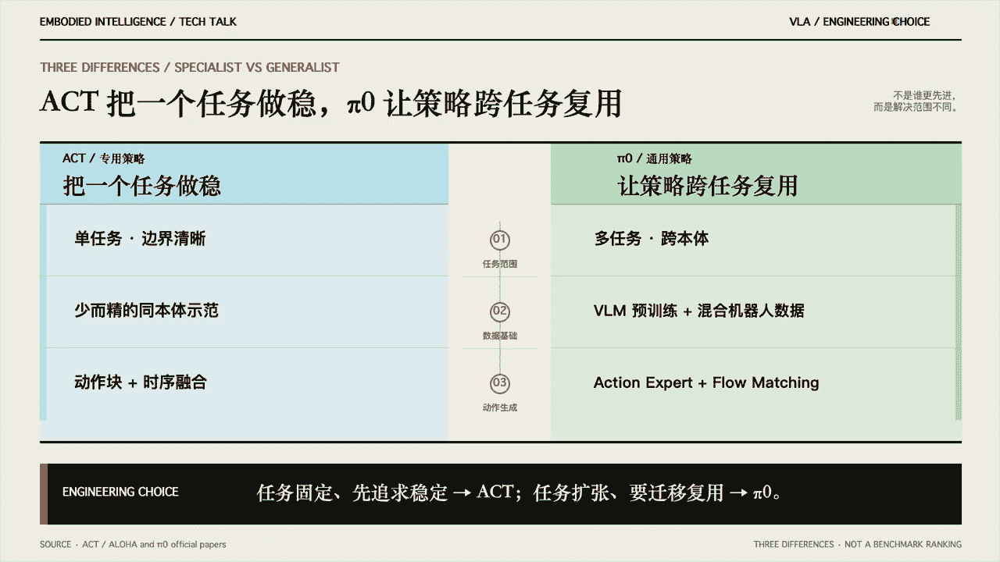

【Datawhale AI+X】：01：机械臂与具身智能基础教程 🤖


在本节课中我们将学习机械臂操作与具身智能的基础知识。具身智能是指人工智能不仅停留在文字或图像处理，而是能够通过机械臂、机器人等实体进入现实世界，真正影响我们的生活。本节内容会从社区背景入手，然后回顾机械臂操作的发展历史，接着拆解机械臂操作中遇到的核心难点，之后介绍数据采集方法，再讲解 ACT 算法和通用策略模型，最后说明实际部署时如何排查问题。通过这节课，初学者能够了解机械臂从无到有的完整训练流程，并明白在实际项目中应该关注哪些关键环节。


### 一、活动介绍与社区背景 🏢


上一节我们简单概述了本课的学习目标，本节中我们先来看看主办方的背景以及本次活动的基本安排。Datawhale 是国内成立较早的人工智能开源学习社区之一，成立于 2018 年，目前在全球开源社区排行榜中处于靠前位置。社区的使命是与学习者共同成长，强调自我驱动和信息驱动，而不是传统的老师带学生模式。社区发现市面上有很多培训课程价格昂贵，但知识容易过时，或者只教皮毛，因此提出了组队学习的概念，让志同道合的人一起学习，这样学习效果会更好。

社区经过多年发展，已经和 3500 多所高校建立合作关系，合作伙伴涵盖谷歌、微软、AMD、阿里、百度、腾讯、科大讯飞等国内外科技大厂。比如社区与 AMD 在上海大会上达成了战略合作，共建 AI 学习社区。学习者不仅能参加线下活动，还能跟着社区接触大厂的前沿 AI 产品和技术。到目前为止，社区已有近 200 万名学习者完成了 AI 相关学习，并在 GitHub 上开源了近 200 套高质量教程。


以下是社区目前比较火的两门课程。第一门是 Hello AI，侧重技术方向，带大家搭建 AI 相关项目，课程质量很高，部分内容已经被大厂面试官用作面试题目。第二门是 Ey Web，面向普通人和非技术背景的小白，教大家如何在 AI 的帮助下写代码、做网页和个人作品，门槛更低。如果你对 AI 开发感兴趣，可以关注这两门课程。

本次活动的主题是带大家玩机械臂，后续也会有机会让大家上手稍微操作一下，体验机械臂的实际效果。


### 二、机械臂操作的发展历史 📜

刚才我们介绍了社区背景和课程安排，本节中我们来看看机械臂操作是如何发展到今天的。机器人操作这件事情已经进行了 60 多年，可以分成几个明显的阶段。

1961 年，第一台工业机器人出现在通用汽车公司，主要用来搬重物。当时的机械臂是通过把指令直接写进机器里面，执行预先规划好的固定动作。优点是重复精度高，机器不怕累，缺点是灵活性差。如果在另一个产线位置重新实现同样的过程，整个流程都要重新来过。

到 1970 年代，机械臂开始引入视觉和触觉传感器。传感器让系统获得反馈数据，从而具备了一定的感知能力和自适应能力，不再是单纯的死板执行。

2016 年，谷歌在实验室里摆放了 14 台机械臂，摄像头安装在机械臂头部和手部，箱子里放着各种东西。机械臂不再需要人工指定轨迹，而是自己采集数据。系统定义成功样本和失败样本的规则，比如假爪是否闭合、手上是否抓到东西、放到另一个箱子后前后两帧图像是否发生变化。采集完成后，用成功的数据重新训练模型，让模型自己学会抓取过程。


2018 年，OpenAI 做过一个灵巧手翻转方块的任务。系统不再定义哪个手指怎么旋转，而是先在仿真环境里搭建灵巧手和方块，通过强化学习和奖励函数进行大量试错。转法越好、结果越理想，奖励数值越高。训练完成后，将成功率较高的模型迁移到真机上部署。这个过程不需要人工指定具体动作，完全靠 AI 自身探索学习。

2022 年，谷歌在机器人领域推出了一个将执行过程拆成两层的系统。第一层是大模型，可以理解为大脑，负责动作规划。比如告诉机器人去某张桌子上拿一杯水，大脑先规划走过去、伸手、夹住、再回来的流程。第二层是底层执行，负责把每一步规划转化为具体的动作。这个框架实现了基于大模型抽象思维的机器人控制。

2023 年，出现了更具代表性的通用策略工作，致力于让机器人或机械臂同时做很多事情，而不是只做单一任务。这就是我们常说的具身智能通用策略方向。


以下是发展历史的关键时间节点总结。

- 1961 年：固定指令，工业机器人搬重物。
- 1970 年代：加入视觉和触觉传感器，形成闭环反馈。
- 2016 年：多台机械臂自采数据，模型自学抓取。
- 2018 年：仿真环境强化学习，迁移到真机灵巧手。
- 2022 年：大模型负责规划，底层负责执行。
- 2023 年及以后：通用策略，一个模型处理多种任务。


### 三、机械臂操作的核心难点 🧩

回顾完发展历史，我们再重新回到当下，看看做一个机械臂操作到底难在哪里。整个链路比较长，每个环节都可能出现问题。

以下是机械臂操作的五个核心环节。

第一个环节是感知。机械臂需要知道工作台和环境的状态。比如顶部摄像头用于全局定位，手部摄像头用于看假爪是否夹到东西。感知比较难的地方在于光照变化、背景变化，以及摄像头在不同环境下表现不一致。

第二个环节是状态获取。机械臂各个关节的角度信号、舵机数据、温度等都属于状态。硬件长时间工作后，温度升高、零件磨损，都会导致指令执行不够准确，状态是动态变化的。

第三个环节是策略。策略就像大脑，是最终要训练的模型。它决定机械臂怎么走、怎么完成任务。这是模型控制角度下最重要的环节。

第四个环节是控制。策略给出要执行的动作和大概范围后，底层硬件设备需要真正把动作执行到位，并且通过闭环控制纠正偏差。

第五个环节是恢复。在执行过程中，有些动作会成功，有些会失败。失败之后，机械臂能否恢复，怎么恢复，也是一个关键问题。

以下是这五个环节的简单关系。

```
感知 -> 状态获取 -> 策略 -> 控制 -> 执行
                              |
                        失败则进入恢复环节
```

整个任务如果在任何一个环节出问题，都可能导致最终失败，这就是机械臂操作比较难的地方。


### 四、数据采集与摇操 📥

了解了核心难点，本节中我们来看看怎么为机械臂采集训练数据。数据采集通常通过摇操的方式进行。摇操是指人操作主臂，从臂跟随主臂完成任务，同时记录从臂的所有关节信号和摄像头信号。

主臂是供人操作的，从臂是最终要工作的那条臂。两者之间存在映射关系，人摇动主臂，从臂会做出相应动作。摇操过程中会保存每一帧图像以及对应时刻的各个关节信号，这些数据构成时序序列。


以下是摇操数据的基本结构。

```
时序数据 = [(图像_1, 关节信号_1), (图像_2, 关节信号_2), ..., (图像_n, 关节信号_n)]
```


在采集数据时，需要判断数据好坏。成功轨迹是指操作干脆利落，稳定完成任务的数据。但光有成功数据还不够，因为模仿学习的上限取决于人类摇操数据的复杂程度。如果只采集成功案例，模型在真实环境遇到失败情况时可能不知道如何恢复。

因此还需要采集恢复轨迹。恢复轨迹是指人为制造一些错误情况，然后再通过摇操把错误变成正确，让模型学习恢复能力。比如夹不稳掉下来了，怎么重新抓起来，这类数据都很有价值。

以下是数据质量判断的几个要点。


- 操作过程是否丝滑，没有顿挫和犹豫。
- 是否出现手抖或误夹等意外情况。
- 是否包含从失败状态恢复到成功状态的片段。
- 多个摄像头看到的内容是否符合人类预期。

数据采得好不好，直接影响模型的最终效果，数据若有误差会误导模型，造成偏差。


### 五、ACT 算法原理 ⚙️

数据采集完成后，本节中我们来看看怎么用这些数据训练模型。ACT 是一个比较经典的模仿学习模型，全称可以理解为动作块 Transformer。早期的模仿学习是根据当前状态预估下一个状态，一步一步预测。这种方式的问题是误差会不断累积，中间某一步出错，后面会越偏越远，很难恢复，也难以训练出好的效果。

ACT 的核心思想是一次预测未来一段时间的多个动作，而不是只预测下一步。比如一次预测接下来 100 步的动作。具体步数取决于机械臂的操作频率，可以看作超参数。

以下是 ACT 的核心公式。

```
动作块 = 模型(当前状态)
最终动作 = 加权融合(连续多个动作块)
```

把传统的一步一步累积误差的过程压缩到一个动作块里面，可以减少误差传播。ACT 还会对多个动作块之间做持续融合，降低抖动，让操作更丝滑。


不过 ACT 也有局限。一次预测 100 步后，下一次再预测 100 步，两次之间可能存在不一致，因为推理需要时间，观测状态也是间隔的。如果不做融合，两段动作拼接处可能会抖动。ACT 通过对多个动作块做加权融合，缓解了这个问题。


ACT 的上限取决于人类摇操数据的质量。如果想做训练样本之外的任务，基本上不行。因此后来出现了通用策略的思路。




### 六、通用策略与派林模型 🌐

介绍完 ACT，本节中我们来看看通用策略模型。通用策略的思路类似于大模型在自然语言处理中的统一，早期是单任务模型，后来一个大模型统一所有任务。机器人领域也在尝试同样的思路，训练时使用大量跨机器人、不同任务的数据，让模型学到通用的操作能力，之后只需少量数据微调，就能适应下游任务。

派林模型是比较经典的通用策略工作之一。它的底层是一个 VLM 模型，即视觉语言模型。VLM 在大量互联网图文数据上预训练过，包含丰富的常识性知识和推理能力。相比 ACT 纯粹依赖模仿学习数据，VLM 的数据更丰富多样。

以下是派林模型的结构简图。

```
互联网图文数据 -> VLM 预训练 -> 通用策略主干
                                 |
                      动作专家模块 (Action Expert)
                                 |
                         真实物理世界执行动作
```

动作专家模块借鉴了 ACT 的思想，一次预测一个动作块。派林的核心优势在于数据，它使用大量互联网图文数据，并且在训练时定义了很多样的任务，甚至在不同本体上定义任务，因此具备较强的通用性。

派林和 ACT 的对比如下。

- ACT：适合简单、单一的任务，操作很稳，比如插电池，但泛化能力较弱，数据多样性太高反而可能学到平均状态。
- 派林：目标不是每个任务都做得极稳，而是以极小代价在很多不同本体上做得很好。直接下载模型可能无法完成当前任务，但用少量数据微调后就能实现。


### 七、模型部署与问题排查 🛠️

模型训练好之后，本节中我们来看看怎么部署到机械臂上，以及出现问题怎么排查。ACT 模型体积较小，几百兆，可以部署在只带 CPU 的迷你 PC 上推理，成本较低。通用大模型如派林体积较大，通常需要 GPU，在小设备上难以部署。

在实际推理时，如果发现任务失败，需要像做算法工作一样分析错误原因。可以记录推理过程中的摄像头画面和关节状态，找到失败发生的位置。

以下是常见的排查步骤。

1. 查看两个摄像头的画面，是否符合人类预期，是否看不到夹爪或目标物体。
2. 查看关节信号波形，是否平滑，是否有跳变。
3. 判断失败是定位问题还是夹取问题。
4. 如果定位不准，调整摄像头角度，让感知更全面。
5. 如果夹不准，检查摄像头是否安装好，是否能看到夹爪边缘。
6. 如果恢复能力差，丰富失败恢复数据，或者优化模型训练。

硬件设备本身也会影响效果。比如舵机设定角度后会一直往那个方向打，而电机可以输出力并感知力的大小。主臂和从臂的参数、电源等也可能不同，实际工作时需要注意这些差异。


### 八、硬件演示与主臂从臂 🦾

部署和排查讲完之后，本节中我们来看看现场的机械臂硬件。当前这套舵机版机械臂成本大约在 2000 元左右，在家里也可以搭建。主臂用来人操作，分为带阻力和不带阻力两种情况。带阻力的主臂比较好操作，单手就能摇，不容易掉；不带阻力的太丝滑，摇操时需要另一只手扶着，否则容易晃动不稳。

从臂是最终要工作的臂，性能通常更好。电机和舵机有很大区别，电机输出力并可感知力度，舵机只是设定角度后一直往那个方向打。真实工作时，主臂和从臂的参数、硬件设备、电源都可能不同，摇操时需要留意。

以下是主臂和从臂的主要区别。

| 项目 | 主臂 | 从臂 |
|------|------|------|
| 用途 | 人操作采集数据 | 执行实际任务 |
| 性能 | 相对较低 | 相对较高 |
| 阻力 | 可选带阻力或不带阻力 | 通常为工作型 |
| 信号记录 | 记录人类操作信号 | 输出模型控制信号 |

现场可以让大家体验主臂的摇操感觉，感受带阻力和不带阻力的区别。摇操本身是一个需要熟练度的技能，操作不熟练时容易手抖或犹豫，这些都会被模型学到，因此采集数据时要尽量干脆利落。


### 九、运动控制与操作控制 🔄

硬件介绍完后，本节中我们来区分两个容易混淆的概念：运动控制和操作控制。运动控制侧重多个关节的协调，比如人形机器人怎么走、怎么跑，通常通过强化学习实现，不涉及具体操作。操作控制侧重手部或机械臂的灵活操作，比如怎么夹东西、怎么插电池，需要更高的精度。

对于未来的家用机器人，可能需要把这两部分结合起来。机器人先通过运动控制和导航走到灶台前，再通过操作控制完成炒菜、颠勺等精细动作。下层的运动控制通常不需要人类数据，而上层的操作控制通常需要专家数据来学习。

以下是两种技术路径的对比。

- 强化学习自探索：模型自己试错，夹对了给奖励，夹错了给惩罚，直到完成任务。
- 模仿学习专家数据：人摇操演示，模型学习人类怎么完成任务，然后模仿。

摇操数据就是模仿学习中需要的专家数据。在训练时，用一模一样的机械臂确保两边姿态一致，从臂跟着主臂动，记录专家如何夹取目标。实际部署时，只需要执行臂，不需要主臂。


### 十、总结与后续建议 📚

在本节课中我们一起学习了机械臂与具身智能的基础知识。内容包括 Datawhale 社区背景、机械臂操作的发展历史、五个核心难点、摇操数据采集方法、ACT 算法原理、通用策略模型、模型部署与问题排查、硬件主臂从臂区别，以及运动控制和操作控制的区别。

希望这节课能帮助初学者建立对具身智能的直观认识，明白数据采集、模型选型和问题排查的基本流程。如果你对机械臂操作感兴趣，可以尝试搭建低成本的舵机机械臂，采集少量数据，用 ACT 或通用模型进行微调，从简单任务开始逐步探索。

