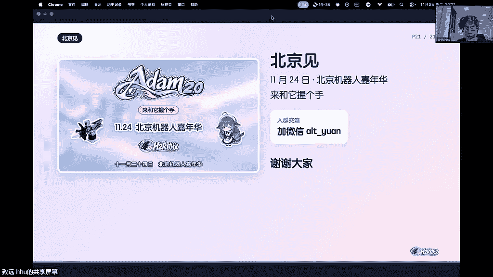

# Datawhale AI+X ADAM20 具身智能：教机械臂握手取零食：1：课程概述与背景介绍 🤖

在本节课中，我们将学习如何通过具身智能技术，让一台机械臂学会与人握手并抓取零食。我们会先回顾这个项目的诞生背景，再了解在黑客松活动中是如何快速开发出来的，最后梳理整个技术方案的核心思路。这篇教程适合零基础的初学者，所有概念都会用大白话来讲解，不需要你之前有机器人开发经验。

这个项目起源于2024年10月在上海举行的一场MONDdaoON黑客松活动。黑客松最初源于编程领域的马拉松式开发，后来逐渐演变为人工智能方向的快速原型制作活动。参与者需要在限定时间内，围绕一个具体主题完成从想法到演示的全过程。我们的团队当时有四位成员，只用了两天多一点的时间，就完成了一个可以在现场演示的机械臂智能体系统。整个过程虽然紧张，但也让我们看到了在极短时间内把AI和机器人结合起来的可能性。


在现场演示中，我们向评委和观众展示了机械臂的三个核心能力。以下是具体的演示内容：
- 握手任务：机械臂能够识别人的手，并向对方伸出手进行握手。
- 取零食任务：机械臂能够抓取薯片、脆脆面和饮料等零食物品。
- 抓娃娃任务：通过远程隔空控制尝试抓取玩具，但由于时间限制，这一项最终未能完全完成。

我们在现场使用了一块32寸大屏幕作为交互界面，左侧显示现场实况，右侧显示机械臂自身的视角。观众可以通过手势与机械臂建立连接，选择想要完成的任务，最后通过挥手结束交互。这就是整个项目的最直观面貌，也为后面的技术拆解打下了基础。

用一行伪代码来概括项目目标，可以写成这样：

```
项目目标 = 机械臂 + 智能体 = 握手能力 + 取零食能力
```

在下一节中，我们将进入理论部分，详细解释什么是具身智能，以及它为什么对机器人来说既重要又困难。

# Datawhale AI+X ADAM20 具身智能：教机械臂握手取零食：2：什么是具身智能 🧠


具身智能是一个听起来很高大上，但其实很好理解的概念。简单来说，就是让拥有智能的机器拥有一个身体，能够在真实世界里通过视觉、触觉和运动与人以及环境进行交互。不再只是在屏幕上聊天，而是真的能够动手去做事情。具身智能的核心在于让智能不再只存在于算法里，而是落到实实在在的物理动作上。


关于具身智能的最早讨论，可以追溯到1950年图灵发表的一篇著名论文。图灵在那篇文章里提出，可以让机器人去下棋，通过这种动作来体现智能。这其实是一个非常早期的具身智能雏形，只不过那时候的技术条件还远远不够，无法真正让机器人在物理世界中灵活行动。

在学术界，有一个非常著名的莫拉维克悖论，它很好地解释了具身智能的难点所在。以下是这个悖论的核心观点：
- 对人类来说很困难的任务，比如下棋或做复杂的数学计算，对机器来说反而相对容易。
- 对人类来说很简单的任务，比如拿起一包薯片或者倒一杯水，对机器来说却非常困难。

用大白话和伪代码来描述，就是这个意思：

如果 任务对人类简单 {
    机器执行难度 = 很高
} 否则 {
    机器执行难度 = 较低
}

近年来，大语言模型解决了机器“会说”的问题，让机器能够和人进行流畅的对话。但是，能说并不代表能做。具身智能要解决的，正是机器人“会做”的问题，也就是让机器在物理世界里完成具体动作。


这就是为什么我们今天选择从最简单的动作开始，教机械臂先学会握手。握手看起来简单，但对机器人来说需要视觉定位、力度控制和时序协调，是一个非常好的入门案例。

在下一节中，我们将介绍本项目的名称来源，以及ADAM2.0这个名字背后的故事。

# Datawhale AI+X ADAM20 具身智能：教机械臂握手取零食：3：ADAM2.0项目命名与含义 🎨

ADAM2.0这个名字并不是随便取的，它背后有一个很有意思的故事。名字的灵感来自于文艺复兴时期米开朗基罗创作的一幅著名名画《创造亚当》。在这幅画里，上帝伸出手指，将智慧和生命赋予了人类亚当。


我们的项目做的事情，在某种程度上和这幅画的意图很像。不同之处在于，我们不是把智慧赋予人类，而是把智慧赋予机械臂。让一台原本只是机械结构的设备，通过智能体的加入，拥有了感知环境和执行任务的能力。这样，机械臂就不再只是冰冷的金属手臂，而是一个能够和人协作的伙伴。

用伪代码来表达这个赋予过程，可以写成这样：

赋予(智慧, 机械臂) = ADAM2.0

这就是项目名称ADAM2.0的由来。2.0版本代表我们是在原有基础上进行的改进和迭代，希望通过更智能的交互方式，让机械臂获得更强的能力。

有了这个名字和愿景之后，接下来的问题是，如何具体地让机器人产生动作。我们需要选择合适的动作模型，并设计一个人机协作的协议。这就是下一节要讨论的内容。

# Datawhale AI+X ADAM20 具身智能：教机械臂握手取零食：4：人机协议设计：HRR与RTH 🤝


让机械臂和人进行有效协作，不能靠随便写几行代码就能完成，必须设计一套清晰的通信协议。我们在项目中设计的协议叫做HRR人机协议，其中包含一个子协议叫做RTH，也就是Robot to Human，机械到人的协议。这套协议的核心目标，就是让人和机械臂能够像正常人类沟通一样，建立连接、交换信息、结束交互。

这套协议的设计灵感来自于互联网通信协议，也就是我们平时说的HTTP协议。互联网协议通过三次握手建立连接，通过数据包传输信息，最后通过挥手断开连接。我们把同样的思路搬到了人和机械臂的交互当中。

以下是协议的三个核心步骤：
- 第一步，建立连接。人和机械臂进行三次握手，也就是真的握三下，标记为1、2、3，连接正式建立。
- 第二步，接入智能体。无论是豆包还是其他智能体，都可以通过协议接入机械臂系统。人可以说出需求，比如“帮我拿一包薯片”，智能体再选择对应的技能来执行。
- 第三步，断开连接。人对着大屏幕挥手，系统识别挥手动作，挥手四次之后连接关闭。


为了让这个过程更清晰，我们可以用伪代码来描述：

连接建立 = 握手动作 × 3
数据传输 = 智能体发送HTTP请求 → 控制臂接收 → 机械臂执行
连接断开 = 挥手动作 × 4

在安全方面，我们设定了两条铁律。第一，智能体只能从训练好的技能列表里选择，不能直接控制机械臂的关节。第二，每个动作在运行之前，都需要经过安全确认。这样可以避免机械臂在执行任务时伤到人或者损坏设备。

整个架构可以用虚实结合的方式理解。人站在虚拟的大屏幕前面，机械臂在现实世界中。人通过空中手势唤醒智能体，智能体再调用机械臂的接口来完成动作。这就是我们整个系统的交互逻辑。


有了协议设计之后，我们还需要决定用什么样的模型来驱动机械臂的动作，以及如何搭建整个系统的架构。接下来的内容将重点介绍动作模型的选择和系统架构。

# Datawhale AI+X ADAM20 具身智能：教机械臂握手取零食：5：动作模型选择与系统架构 🔧

驱动机械臂产生动作，需要选择合适的模型。在项目开始阶段，我们调研了三个主要的方案，最终根据现场条件做出了选择。不同的模型在数据需求、计算量和效果上都有差异，选对模型是项目能否快速跑通的关键。

以下是我们考虑的三个动作模型：
- ACT：斯坦福大学提出的模型，特点是只需要少量数据进行微调，就能达到不错的效果，适合数据采集时间不多的情况。
- VL/VLA：指视觉语言动作模型，我们使用的是最小的1个VRL模型，大小大约0.9B，实现了极简的功能，适合算力有限的设备。
- π0：也就是派0模型，效果很好，但因为黑客松现场条件简陋，只带了一台笔记本电脑，既没有足够的本地推理能力，也没有稳定的云算力支持，所以这个方案最后没有落地。

除了模型选择，我们也思考过机械臂本身缺少什么。第一，普通人不会直接使用机械臂，必须要通过编程才能控制。第二，智能体虽然聪明，但没有手，无法接触真实的物理世界。有了这两个认识之后，我们就需要设计一个人机协议，把人和机械臂连接起来。


系统架构方面，我们采用虚实结合的方式来接入智能体。每一个技能，比如挥手、握手，都被做成了一个HTTP接口。智能体发送一个请求，控制端收到之后，通过接口驱动机械臂执行动作。这个链路是可以扩展的，任何智能体只要会调用HTTP接口，就能控制这台机械臂。

用伪代码来表示这个调用关系，可以写成这样：

智能体 → 发送HTTP请求 → 控制端 → 虚拟接口 → 驱动机械臂


海报上写的豆包只是我们使用的一个例子，实际上可以换成其他智能体，效果是一样的。

在架构设计完成之后，我们进入了最艰难的开发阶段。接下来的内容将介绍我们在极度受限的条件下，是如何进行开发和数据采集的。

# Datawhale AI+X ADAM20 具身智能：教机械臂握手取零食：6：极限开发与数据采集 📊

说起来有点惨，但事实就是，我们在黑客松期间经历了非常极限的开发条件。现场只有一套高清的机械臂，是借用的，而且没有副臂。通常控制机械臂是通过主臂来控制副臂，而现在只能人工拖动机械臂来采集数据。这意味着每一条数据，都需要人工亲手把机械臂拖到目标位置，效率非常低。


硬件方面也很凑合。机械臂本身没有带摄像头，我们自己在淘宝上买了一个海康的普通家用摄像头，绑在机械臂上。这样一来，就构成了两路视角，用于后续的模型推理。训练的时候，我们只能用本地的一台AC Pro M1笔记本电脑进行推理，而模型训练则是用远程实验室的一张4080显卡。数据上传只能依赖手机热点，网络条件非常有限，有时候传一个模型文件都要等很久。

开发过程充满了意外。第一天，我们的一台电机被干爆了，协商之后换到了新的机械臂，直到第二天晚上才第一次成功跑通。第二天更换场地的时候，电脑重启导致系统升级，原来写在临时文件里的代码全部丢失，不得不从头开始重写。直到25号下午，我们才真正进入第二轮实验，开始补录各种数据，一直到凌晨才完成训练，第二天早上才匆匆完成前端界面。

数据采集是整个过程中最耗时的部分。我们需要完全手动地去采集和标定数据，没有自动化的捷径。以下是具体的数据采集流程：
- 第一步，把机械臂拖动到起始位置，设定为77.0度，每个关节都回到初始点。
- 第二步，绑定相机，找到画面中的四个参考点位，虽然后来发现这个步骤作用不大。
- 第三步，进入试教模式。在重力补偿的条件下，人工手动拖动机械臂采集数据。握手动作采集20秒，取物动作采集15秒，另一个取物动作采集10秒，时间确实比较短。
- 第四步，一边采集一边查看数据。如果采集的数据不符合要求，就立刻删除。我们专门写了一套脚本来检查数据标准，保证只有符合要求的数据才会被保留用于训练。

为了提高效率，我们把三台电脑连成了内部局域网，数据可以自动传输到实验室，自动放入模型开始训练。不过由于时间紧迫，我们只做了简单的微调，没有对模型结构进行大的优化。


用伪代码来描述数据集的构建，可以写成这样：

数据集 = 采集(动作, 画面, 关节角度) × 清洗(过滤异常数据) × 验证(符合训练标准)

有了数据之后，接下来就是模型的训练和部署工作了。下一节将详细介绍我们是如何训练模型，并部署到现场的。

# Datawhale AI+X ADAM20 具身智能：教机械臂握手取零食：7：模型训练、部署与实测 ⚙️


数据采集完成之后，我们开始训练两个主要的模型。第一个是ACT模型，它是基于Transformer架构的动作模型。这种模型可以理解为流式动画，根据当前的状态判断下一步应该做什么动作。ACT是从零开始训练的，使用两路画面和关节角度作为输入，我们采集了七组手部数据进行训练和评估。


在训练过程中，我们使用了一款自带的3D建模仿真软件。仿真完成之后，可以直接通过回放电机位置来查看动作是否流畅，如果仿真没问题，就可以部署到真实机械臂上。这一步很重要，因为如果不在仿真里先验证，直接上真机很容易造成损坏。

第二个模型是VLA，也就是视觉语言动作模型。它需要在一个基础模型的基础上进行微调，输入是模型动作加上人类的指令，具体的微调工作是用OppoS框架完成的。VLA模型的效果通常比ACT更好，但它的模型权重很大，对本地算力的要求也更高。

部署方面，ACT模型比较轻量，大小大约200M，在我们的电脑上可以跑到330帧，运行速度快，动作相对平滑。VLA模型大约0.9B的大小，虽然效果更好，但需要更强的本地算力支持，如果算力不足，运行起来就会有困难。我们还通过去样和重新插针的方式，努力让模型达到可用的帧数。

为了验证模型是否真的在“看”画面，我们做了一个控制变量实验。在关节位置不变的情况下，更换不同的画面。以下是实验结果：
- 正常画面时，平均误差是16%。
- 更换成四界画面时，误差是12%。
- 画面全黑时，误差上升到9度。


通过这个对比，可以看出当模型能够看到正确的画面时，它输出的动作会更准确。这证明了我们的模型确实有效，视觉输入对动作执行是有帮助的。

在现场实测中，我们完成了三个任务：握手任务、取零食任务（包括薯片、脆脆面、饮料），以及尝试了抓娃娃任务但未完成。测试结果表明，微调后的VLA模型精度更高，误差小于单独使用ACT模型的结果。最后在现场评审中，评委也通过手势触发智能体，让机械臂帮忙取东西。不过由于时间原因，隔空取物的完整流程没有录制出来，现场取物的准确率大约在50%左右。

有了模型和实测结果之后，我们需要回头总结在这个过程中犯过的错误，以及积累的经验。这就是下一节的内容。

# Datawhale AI+X ADAM20 具身智能：教机械臂握手取零食：8：开发经验总结与后续展望 🏁

回顾整个开发过程，我们犯了不少错误，也学到了很多宝贵的教训。最主要的问题在于，我们一开始没有建立一套完整的开发框架，而是采用了补丁加补丁的方式。先是写了九套前端，又写了五套后端，导致代码混乱，前后端很难互联。这给后续的维护和扩展带来了很大麻烦。


以下是我们总结的关键经验教训：
- 开发之前，一定要先确定一套完整的框架，明确使用哪些端口，哪些是前端，哪些是后端，避免端口之间发生冲突。
- 起始位置必须对标好，代码和设备名称绑定要准确，这些基础问题如果不解决，后面会出很多bug。
- 机械臂标定的时候，一定要做安全测试。否则很容易把电机拉爆，这是最严重的错误，也会导致后续无法继续开发。
- 数据采集是最有价值的部分。两天的时间做不了太深入的研究，但如果能采集到有效的数据，让模型进行预训练，已经是非常不错的成绩。

关于具体的模型训练和参数调优，我们建议感兴趣的同学可以专门去学习相关知识。我们后续也会整理一些模型和代码资料，方便大家参考。

如果你对具身智能感兴趣，可以加入我们的交流群，我们会在群里继续讨论相关话题。另外，上海张江有一个AI应用中心，那里有大量的机器人设备，感兴趣的同学可以去了解一下。




最后，关于下一步的计划，我们还没有做过小黄鸭项目。小黄鸭比较可爱，但需要七个电机，成本较高，而且主要是通过强化学习来调参，效果也很不错，我们会考虑在未来尝试。

用一行伪代码来总结开发成功的关键要素，可以写成这样：

开发成功 = 完整框架 + 有效数据 + 安全测试

在本节课中，我们一起学习了什么是具身智能，ADAM2.0项目的命名由来，人机协议HRR与RTH的设计思路，动作模型的选择与系统架构，极限开发下的数据采集流程，模型训练、部署与实测结果，以及开发过程中的经验总结。希望这些内容能对你有所帮助，祝你在具身智能的学习道路上取得进步。

