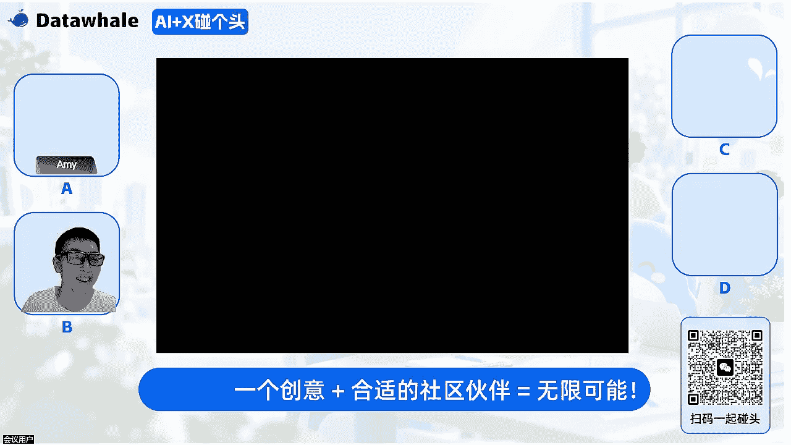
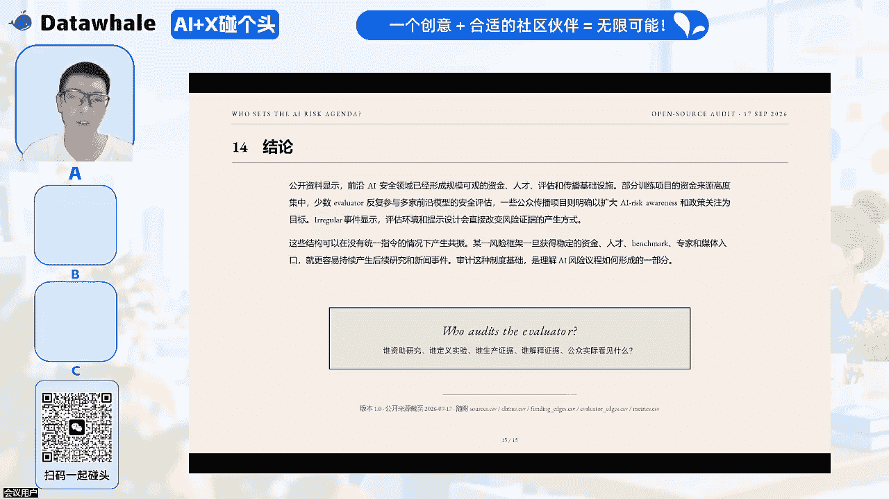
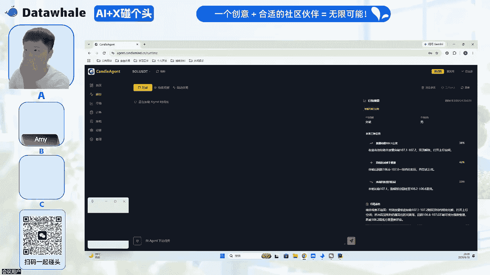

# Datawhale AI+X：01：AIX碰个头线上活动与六大分组主题详解 🌐

在本节课中我们将要学习Datawhale AI+X系列活动中的一次线上碰头会。本次活动的核心目的是让不同背景的学习者通过线上网页相遇，围绕AI相关的项目、想法与议题进行分组讨论。活动共设置了六个分组房间，每个房间对应一个不同的分享主题。主持人会先在主会场介绍全部六个房间的主题，随后学习者根据兴趣进入对应的分组讨论。每个房间都有房主负责简单介绍本房间将讨论的内容与议程。如果学习者不清楚如何进入某个分组，可以在聊天框告知主持人，由主持人协助移动到对应房间。以下是本次活动的总体安排与各分组主题的详细介绍。

## 一、活动总体流程与分组方式 📋

上一节我们介绍了活动的整体背景，本节中我们来看看具体的分组操作流程。本次活动采用线上会议形式，所有房间均在同一个腾讯会议主会场中启动，待主持人完成全部房间的主题介绍后，学习者即可根据自己的兴趣选择进入相应的讨论区。每个房间都有明确的房主与分享议程，房主会先进行简单介绍，再开放讨论环节。若学习者在进入分组时遇到困难，可以直接在聊天框告知主持人想要去几号房间，主持人会协助将其移动到对应的分组讨论区。

以下是进入分组的具体操作步骤：

1. 点击会议界面右下角的分组讨论按钮。
2. 在弹出的房间列表中选择感兴趣的房间编号。
3. 点击加入按钮，即可进入对应的分组讨论区。
4. 如需更换房间，可再次点击分组讨论按钮并选择新房间。

## 二、一号分组：AI加X灵感共创 🤖

上一节我们介绍了活动总体流程，本节中我们来看看一号分组的具体内容。一号分组的房主来自中国科技大学他人协会，房间名为AI加X灵感共创分组讨论，主要面向对AI前沿技术与落地应用感兴趣的学习者开放。

以下是该房间的主要讨论方向：

- 探讨AI技术的最新进展与前沿动态，分享行业观察。
- 讨论AI需求如何落地到实际场景中，避免空谈技术。
- 分享个人项目与想法，寻找志同道合的小伙伴共同创作。
- 开放讨论，欢迎随时提出自己的AI相关想法与合作意向。


该房间安排在晚上七点到八点半左右进行分享，分享者李阳将重点介绍AI技术前进进展，感兴趣的小伙伴可以进入一号房间参与讨论，也欢迎在讨论中提出自己的想法和打算。



## 三、二号分组：FDE平台共创 🏢

上一节我们介绍了AI加X灵感共创房间，本节中我们来看看二号分组的FDE平台共创主题。二号分组的房主是老顽童老师，他从事硬科技企业创投工作，并为投资孵化企业寻找AI赋能能力。该房间探讨如何为企业选对AI产品，而不是单纯销售某个厂商的AI工具。

FDE的核心逻辑可以用公式表示：

**企业AI选型 = f(企业IT资源, 软件系统, 业务流程, 全球AI工具生态)**

以下是该房间的讨论重点：

- 传统FDE模式是硅谷大厂派工程师到客户现场落地自家AI产品，本质上是产品推销。
- 本房间提倡站在企业角度，派AI工程师深入企业内部摸清IT资源、软件系统与业务流程。
- 目标是帮企业从全球AI工具生态中选出最合适的产品，让企业真正用好AI进行生产与经营。
- 欢迎有兴趣一起搭建共建平台、共创平台的小伙伴加入，共同探索企业AI赋能的新路径。

本次分组特别邀请了一位非IT出身但拥有真实业务场景的小伙伴分享经验，并向各位老师与大咖征求建议与指导，体现了从输出到输入的双向交流形式。

## 四、三号分组：AI时代人类的意义与独立思考 🧠

上一节我们介绍了FDE平台共创房间，本节中我们来看看三号分组的深度讨论主题。三号分组的房主是小邓一号，讨论内容跳出技术工具本身，追问当机器可以高效产出一切时，人类的意义在哪里。该房间适合关注AI哲学、社会影响与人类主体性的学习者。

人类独有价值可以用公式描述：

**人类意义 = 体验 + 共情 + 纠结与取舍 + 自主抉择**

以下是该房间将探讨的问题：

- 当决策越来越交给算法，人类如何守住独立思考与自我抉择的能力？
- AI的局限性体现在哪些方面，算力背后的社会不平等如何影响AI应用？
- 犹豫、遗憾与纠结是否构成人类独有的体验底色？
- 如何不被算法裹挟，在大模型普及时代保持清醒的判断力？

该房间强调立足现实，发问并思考我们如何在AI高效产出的背景下，依然为自己的人生赋予意义。

## 五、四号分组：应用吐槽会与AI安全分享 ⚠️

上一节我们介绍了人类意义与独立思考房间，本节中我们来看看四号分组的应用吐槽会。该房间之前已开展多期直播，邀请社区伙伴分享AI领域及其他想法与感受，本次借AI加X活动重启该板块，继续为社区提供一个开放交流的场域。

以下是本次四号分组的分享内容：

- AI加X安全相关议题，探讨当前AI安全领域的热点与争议。
- 自有工作流的开源项目与小伙伴招募，寻找志同道合的开发者。
- 金融Agent相关案例与经验分享，介绍实际落地场景。

分享者西伟还围绕AI安全展开专题讨论，核心观点包括：

AI安全本质属于工程问题，而非末日论题。

**AI风险 = 事故发生概率 × 事故影响程度**

他提到，最近出现的OpenAI手面事件、德国Agent攻击事件等，反映出某些评估公司在沙箱设置与提示词安全保护上的不足。同时，AI安全领域的资金与人才高度集中，部分资本机构通过资助研究机构与自媒体，放大AI毁灭人类的叙事，形成议程设置效应。他主张应通过工程手段提升产品本身安全性，在确保安全之前不轻易发布产品，而非依赖末日营销来制造恐慌。

## 六、五号分组：AI加X创造节学习者交流 📚

上一节我们介绍了四号分组应用吐槽会，本节中我们来看看五号分组的AI加X创造节学习者交流。该房间邀请了三位社区真实实践者，分别是超级Nancy老师、青年AIGC老师与安卓老师，他们将围绕真实工作场景中的AI实践进行分享。

以下是该房间的分享安排：

- 围绕真实工作场景中的AI实践进行分享，介绍落地经验。
- 展示优秀作品与实战成果，供学习者参考学习。
- 提供自由交流环节，供AI加X学习者互相探讨与交流。

适合希望了解AI落地案例、交流学习心得的学习者加入，共同探讨创造节的课程内容与实际应用。



## 七、六号分组：什么是AI硬件 🔧

上一节我们介绍了AI加X创造节学习者交流房间，本节中我们来看看六号分组的AI硬件讨论。六号分组的房主是韩寒与搭档尚启峰，他们将围绕AI硬件的定义与分类展开讨论，欢迎大家畅谈心目中的AI硬件样子。

以下是该房间的主要议题：

- 探讨到底什么才算作AI硬件，厘清概念边界。
- 分享参与过的开源教程经验，介绍开源项目的参与方式。
- 介绍当前正在制作的外接Codinging键盘教程，展示硬件开发流程。
- 欢迎学习者提出对AI硬件的看法，共同讨论硬件与AI的结合形态。

适合对硬件创新与AI设备感兴趣的学习者，了解从软件算法到硬件落地的完整过程。

## 八、额外精彩分享：金融Agent与决策交给机器 💰🤔

上一节我们介绍了六个正式分组房间，本节中我们来看看主会场中另外两位分享者带来的精彩内容。一位是Jacob，分享了金融Agent交易系统；另一位是大猫，分享了当决策交给机器时，人类何以为人。

Jacob的金融Agent系统采用多Agent协作架构，代码逻辑可表示为：

```
主Agent = 用户接入与任务规划
子Agent_行情 = 市场分析与行情摘要
子Agent_策略 = 交易策略生成与迭代
子Agent_订单 = 订单执行与复盘总结
```



系统支持三种交易模式：规划模式、持续观察模式、全自动交易模式。用户可以通过语音或文字操控Agent，完成市场分析、策略迭代与订单下单。后台支持24小时不间断运行，可将提醒推送到用户手机，实现不在电脑前也能及时交易。系统还计划引入基本面与消息面Agent，实时推送新闻信息，丰富Agent的决策依据。

大猫的分享则从哲学与技术角度探讨AI与人类的关系。他认为大语言模型本质是基于海量数据的模式复刻，不具备认知、体验与自我。当标准化技能被机器替代，人类与AI的差距在于体验、共情与自主决策。

AI与人类未来关系可概括为：

**AI与人类关系 = 共生关系 ≠ 单纯工具关系**

他还指出，算力正在成为新时代的关键生产资料，可能导致信息获取与决策能力的社会不平等。因此，人类应保留对充满不确定性与风险的想法的接触权，通过独立判断为生活赋予意义，而不是将所有决策完全交给AI筛选后的安全答案。

## 九、如何加入感兴趣的分组 🖱️

上一节我们介绍了额外的精彩分享内容，本节中我们来看看具体如何进入对应分组。所有六个分组房间的介绍已经结束，学习者可根据兴趣自由选择。每个房间都有明确的主题，适合不同方向的学习者参与。

以下是各分组房间对应的主题：

- 1号房间：AI加X灵感共创
- 2号房间：FDE平台共创
- 3号房间：AI时代人类意义与独立思考
- 4号房间：应用吐槽会与AI安全
- 5号房间：AI加X创造节学习者交流
- 6号房间：什么是AI硬件

加入方法与第一节中介绍的步骤一致，即点击右下角分组讨论按钮，选择对应房间编号后点击加入。若遇到困难，可在聊天框告知主持人，由其协助移动。主持人也会进入其中某个分组开展后续分享，学习者可根据实际情况灵活调整房间。

## 十、本节总结 📝

在本节课中我们一起学习了Datawhale AI+X AIX碰个头线上活动的总体安排，以及六个分组房间的具体主题与讨论内容。我们了解了AI加X灵感共创、FDE平台共创、AI时代人类意义、应用吐槽会、创造节学习者交流与AI硬件六个方向，同时也回顾了金融Agent与AI哲学等额外分享。希望每位学习者都能找到感兴趣的房间，积极参与讨论，与社区小伙伴共同探讨AI应用与未来发展。

