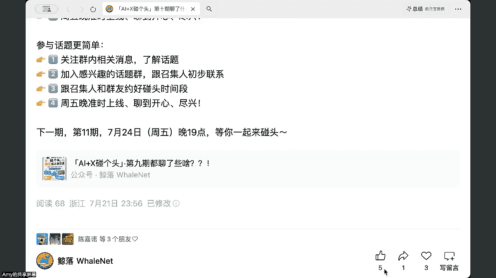

# Datawhare AI+X AIX碰个头：01：直播开场与整体流程

在本节课中我们将要学习本次AIX碰个头直播的基本情况，包括这是第几期、今晚一共有几个话题、主会场和分会场是如何安排的，以及普通学员应该如何参与进来。先别担心内容看起来比较多，我们会把每一个环节都拆解得非常直白，让完全没有基础的初学者也能听明白。

本次直播活动是Datawhare AI+X AIX碰个头系列活动的第11期。活动今晚一共安排了7个不同的话题，每个话题都有自己的分组房间，感兴趣的学员可以根据自己的意向进入对应的房间进行交流。

主会场的流程是这样安排的：首先由活动主持人确认大家能否正常听到声音，然后邀请各个话题的召集人依次上台，简单介绍自己负责的话题，说明为什么要发起这个话题，以及大家可以在里面讨论哪些内容。所有召集人介绍完毕之后，主会场的内容也就差不多结束了。

接下来就是大家最关心的分组讨论环节了。进入分组讨论之后，每个话题会独立成一个小房间，召集人和参与者可以在里面更深入地聊具体的技术细节、项目经验或者行业观察。整个直播预计持续到晚上7点半左右，期间会预留开放麦时间，任何人都可以开麦提出问题或者分享自己的想法。

下面是本期活动的一些基本信息汇总：

- 当前期数：第11期
- 话题总数：7个
- 主持形式：主会场介绍 + 分组房间讨论
- 开放麦时间：直播期间均可申请开麦
- 预计结束时间：晚上7点半左右

看完了整体流程之后，我们就清楚了今晚的大致节奏。下一节我们将逐一介绍这7个话题各自聊些什么，帮助你决定应该加入哪个分组。

# Datawhare AI+X AIX碰个头：02：本期七大话题详细介绍

上一节我们介绍了直播的整体流程，知道了今晚共有7个话题可以选择。本节我们将逐一拆解每个话题的具体内容，让你清楚每个分组房间里大约会聊些什么，从而决定自己想加入哪个房间。

今晚可供选择的话题编号范围可以用简单的集合表示：

$$话题编号 \in \{1, 2, 3, 4, 5, 6, 7\}$$

以下是本期7个话题及其核心内容：

1. AI加灵感共创
   这是由中国科技大学他人协会的小伙伴发起的话题。他们长期关注AI for science以及AI在产业端的落地应用。创建这个讨论间的初衷是收集大家的真实需求，一起探讨这些需求该如何落地。后来他们还把每周的技术前沿分享也放进这个讨论间一起开展。本周的直播间主要分享本周的AI技术前沿进展，由李宇阳老师主讲。学员可以通过海报上的二维码填写自己的需求，也可以直接在腾讯会议中开麦提问，或者抛出任何想讨论的话题。这个话题也得到了vivo的支持，欢迎大家进入灵感工厂直播间。

2. FDE团队共创平台
   由老顽童老师（袁军老师）发起，他是中国技术创业协会融何创新发展专委会的成员，主要从事硬科技企业孵化。在孵化过程中，他们觉得为被服务的企业提供AI能力非常重要。因此希望探讨如何把一个FDE团队转型成产品公司，转型的具体步骤是什么，也欢迎各位大咖前来指导。这是该话题的第8期，感兴趣的学员可以进入2号分组房间。

3. 李小猫的AIGC内容分享
   发起人是一位设计师出身的70后，平时喜欢研究web coding，和朋友一起参加黑客松比赛。他希望帮助身边的人和对这方面感兴趣的朋友一起进步。这个话题已经发起了6次，平时大家也会聊得非常尽兴。如果你对如何制作AIGC内容感兴趣，可以进入3号分组房间。

4. by research
   李志远学长今晚不在，由另一位同学代讲，这是第5期。内容分为三个主题：第一个主题回顾之前完成的输07和巴部分07，以用N做乳腺癌分类的实际案例为例，从数据到模型完整过一遍；第二个主题是08部分的详细界面介绍，把各个功能模块和操作讲清楚；第三个主题涉及09部分的细胞图像分类，虽然跑完了但文章还没写，今天暂不展开。此外还会更新一个新功能，即核调用，也就是通过外部调用，还可以通过飞书和Telegram连接相关系统，让系统可以远程使用。感兴趣的学员可以进入4号分组房间。

5. The agent / AI加web codinging游戏
   这是AI加web codinging游戏系列的第3期，由好好先生发起。本期将回到游戏设计的源头，通过充分的网络搜索和自身沉淀，总结出一套比较粗浅但好用的游戏设计方法论，帮助大家进一步进行游戏设计。感兴趣的同学可以进入对应的分组房间。

6. AI产业融合可以新生出哪些新岗位
   由福克发起，祥宇今晚在地铁上。话题探讨AI替代很多岗位之后，人们该如何转型到新的岗位，怎么去寻找技术、怎么去学习相关技术、怎么去商业化，以及如何找到更好的出路。感兴趣的学员可以进入7号房间进行交流。


本期的7个话题覆盖了AI前沿、团队共创、AIGC内容、科研工具、游戏开发、产业就业等多个方向。每个话题都有独立的分组房间，建议你根据自己的兴趣直接选择加入。下一节我们将说明具体如何操作进入这些分组房间。

# Datawhare AI+X AIX碰个头：03：分组讨论加入操作指引

了解了七个话题的具体内容之后，你可能已经心仪某个分组房间了。本节将详细说明如何进入腾讯会议，以及如何在会议中找到并加入对应的话题分组，确保你不会错过今晚的讨论。

进入分组讨论的操作步骤如下：

```
步骤 1：打开腾讯会议并成功入会
步骤 2：点击右下角的“分组讨论”按钮
步骤 3：在弹出的列表中找到想要参与的话题编号
步骤 4：点击该话题对应的序号，再点击“加入”
步骤 5：进入分组房间后即可开始交流
```

设备端的显示方式略有不同，请注意区分：
- 手机端：分组讨论按钮显示为三个正方形图标
- 电脑端：分组讨论按钮显示为三个六边形图标

如果你现在还没有加入今晚的腾讯会议，可以扫描直播间提供的会议二维码进行入会。入会之后，除了加入分组讨论，你还可以扫描碰碰头大群的二维码，进群以后可以查看往期的直播回放，并获取更多线上线下碰头活动的信息。

掌握了加入分组的方法之后，你就可以随时进入感兴趣的房间与召集人和其他学员交流了。接下来我们将回顾上一期（第十期）的主要内容，看看之前都讨论了哪些话题。

# Datawhare AI+X AIX碰个头：04：第十期话题回顾（一）：AI灵感共创与团队共创

刚才我们学习了如何加入本期的分组房间。接下来我们将开始回顾第十期直播的内容，第十期一共有10个话题，我们会逐个展示当时的讨论重点和海报，让新来的小伙伴快速了解这个系列活动通常聊些什么。

首先来看第一个话题，也是AI加灵感共创。这是该话题的第十次发起，一直与AI加X碰个头一起成长，持续开展中。上一期的内容是双周汇总形式，主要介绍了toexGDT5.6、图像编辑以及agent生态的最新进展。发起方是中国科学院爬山协会，这个组织会持续研究和交流AI for science的相关话题，探讨如何用AI把灵感真正实现落地。

上一期AI加灵感共创的主要讨论要点包括：

- GPT5.6以及codeex相关生态的更新内容
- 如何选择适合自己的模型
- 如何选购适合自己的coing plan或使用方法
- 不同任务应该选择什么样的模型，哪种性价比更高
- 图像与PPT生成的新范式，如何更高效、更有效率地生成成果
- 独立科学家需要具备哪些能力，如何在科研过程中确保安全性
- 如何与AI共创，以安全有效的方式使用AI完成科研工作
- 他山科研平台的介绍，平台拥有1500多个科研资源
- AIJC视频与游戏交互，包括之前年初的冬奥会项目，生成滑雪视频

感兴趣的学员可以在碰筹大群里查看对应的回放，了解更多关于AI加灵感共创第十期的讨论结论和后续探讨方向。这个话题也有专门的话题群，可以扫码加入，与召集人和其他发言人进一步交流。

接下来是上一期的第二个话题，即SD的团队共创注册平台，也就是我们常说的FDE团队共创。这是一个非常具有成长性的话题，上一期是第七次发起。召集人老顽童本身并不是特别了解AI，之前主要有科创孵化的经验，他想跟大家一起探讨如何建立APE或FDE团队，给更多企业赋能AI技术，让企业活得更好、产生更大价值。

这个话题已经连续聊了7周，一直在探讨FDE团队应该怎么建，有哪些坑，以及对应的案例是什么。上一期有一个FDE的新人提出了几个实际问题：如何持续获得订单，如何定价，以及如何介绍促成老客户。这些话题讨论得比较深入，也比较注重实践。

老顽童自己是委员会的委员，也在建设硬科技孵化平台，拥有很多资源。另一位召集人袁军是30年的创业老兵，两位都非常有经验，能给大家提供很多有价值的探讨机会。

上一期的主要讨论还涉及订单来源单一化该如何处理，定价体系缺失该如何建立，以及短介绍机制的设计。大家还交流了如何筛选用户，以及FDE岗位有哪些门槛，到底适不适合AI新手或处于初级阶段的同学去学习。这是该话题的第八周，目前在2号房间进行交流。

回顾完前两个话题之后，我们对上一期的侧重方向有了初步印象。下一节我们将继续回顾第三、四个话题，涉及AI协同黑客松和科研工具等内容。

# Datawhare AI+X AIX碰个头：05：第十期话题回顾（二）：AI协同与科研探索

在上一节中我们回顾了AI加灵感共创和FDE团队共创这两个话题，了解了它们在上一期的主要讨论内容。本节我们继续看上一期的第三和第四个话题，分别是关于黑客松中人机协作边界的讨论，以及ve research（clo science）相关的科研工具分享。

第三个话题是“当AI成为协同者：黑客松全流程中人机分工的边界在哪里”。这是一个已经发起5次的金牌话题。话题的主理人是一位从艺术设计转型到coding，再转型到使用AI进行创作的召集人。他在黑客松的全流程中梳理了如何进行人机分工，非常关注如何组织AI、如何把人和AI更好地组织起来，这是一个关于人机协同的哲学命题。

上一期发起这个话题之后，其实委托给了一些非常年轻的小伙伴主持，例如Jasper Lee，当时才12岁或13岁。因为一晨和他之前在外科现场一起待过，也进行过一些探讨。这两位小伙伴非常有意思，12岁或13岁就已经开始创办自己的外b网站和社区，并拆解AI的热点叙事。因此他们和一晨一起探讨，是否可以由这位年轻主持人来聊聊AI人生时代的原住民应该如何看待与AI的协作。

上一期积极发言的还有gersh和邹翔，大家聊得非常开心。主要讨论了黑客松应该如何组队，因为当时他们正在adventure现场，想提前在上面组队，所以提前交流组队偏好，包括对AI的理解。他们还讨论了组队选题、调研与分工、制作与验证等环节。因为AI生成的内容仍需要验证和评价，而且毕竟是比赛，肯定要有demo展示，因此demo时如何更好地表现、如何处理更多数据，他们也聊了很多。

这是一个偏哲学性的话题，如果你对如何组织AI与人协作感兴趣，可以扫码加入他们的话题群，与召集人和发言人进一步探讨。

第四个话题是ve research，在今天晚上的4号分组继续讨论。召集人是赵杰，上一期他现场演示了clo science的使用方法。如果你对clo science的操作和方式感兴趣，可以进入碰头大群获取回放，并与召集人交流。

这是一个AI加科研的话题，既会聊技术，也会聊科研方法论。赵杰自己写了一本clo science的绿皮书教程，希望把clo science的使用方法及其背后的科学理念分享给大家。

上一期积极发言的有杨祥宇和肾（音），他们就自己感兴趣的一些OE进行了探讨。主要聊了clo science的产品定位、核心理念，以及它的常见任务和自主运行能力究竟如何。在配置clo science时，有一些要点需要注意，比如Windows用户可能需要通过WSL虚拟机。此外还讨论了clo science可能新增的功能。

赵杰本身也在做research相关的工具，还有一个叫research o的开源项目，感兴趣的小伙伴可以搜索该项目进行探讨。如果你对上述结论有不同看法，或者想进一步交流，可以加入他们的话题群。

现在我们已经回顾了上一期的前四个话题，下一节将继续看第五个话题以及AIagent天方夜谈等内容。

# Datawhare AI+X AIX碰个头：06：第十期话题回顾（三）：游戏开发与Agent工程

前两节我们回顾了上一期的前四个话题，涵盖了AI灵感共创、团队共创、黑客松人机协作以及clo science科研工具。本节我们继续看上一期的第五个话题，即AI加游戏，以及紧接着的AIagent天方夜谈，看看它们分别都讨论了哪些内容。

第五个话题是AI加游戏，上一期在腾讯会议的6号房间。召集人是好好先生，也是银牌召集人。他分享了自己如何使用AI来辅助开发一些工具，以及如何独立运营许多游戏并上架到type平台。他总结了一套做游戏的方法论。

上一期积极发言的小伙伴有王妍莹unki、lucky cat、笑颜等，他们都对AI加游戏非常感兴趣，分享了自己使用的工具、做过的游戏项目，以及遇到的困惑。大家讨论的内容包括AI游戏的自行生成、we codinging的核心能力，以及好好先生为什么想做游戏，中间遇到的卡点和思考过程。

如果你对这个话题感兴趣，今晚也可以来到腾讯会议的6号分组房间，跟他一起探讨游戏项目、游戏制作方法以及AI游戏开发中的心路历程。

接下来是AIagent天方夜谈，上一期是在5号分组，晚上8点准时开始。召集人排on是SAP中国研究院的架构师。他会组织大家一起浏览GitHub本周热榜，以及与agt、memory相关的论文，进行讨论交流。内容会涉及他们的团队如何面向coding agent和harness engineering进行实践，主要探讨AI工程相关的议题。

上一期积极发言的有同舟、杨KK、dy等大师。他们本身在AI如何在团队中落地、如何在真正的工程化场景中应用方面有很多想法和困扰，也很希望能一起交流经验。

主要讨论内容包括行业形成内润度新架构、企业级实践、skiel治理等。如果你使用AI比较多，可能会遇到“很难用”或者“安装ki之后怎么用才能更好”的问题，这些思考大家都会有。因此他们也聊到了如何对一个agent、多个agent，乃至组织内所有的agent进行ski的治理。此外还讨论了如何选择优质的sll来为己所用，marry的研究前沿，通用agent与企业agent的区别和选择方式，以及agent如何进行安全防护。

这个话题主要面向agent工程相关的议题，内容比较硬核。喜欢技术、关注agent落地的学员应该会对这个话题非常感兴趣。今晚这也是5号分组的内容，召集人已经到场，8点准时开始，你还可以加入这个话题。

回顾完游戏开发和Agent工程两个话题之后，下一节我们将继续看上一期的剩余话题，包括will play学习陪伴系统、LLM可解释性研究、物理世界模型以及量化金融agent。

# Datawhare AI+X AIX碰个头：07：第十期话题回顾（四）：学习陪伴、可解释性与物理世界

前两节我们回顾了上一期的游戏开发和Agent工程相关话题。本节我们继续梳理剩余的几个话题，包括will play学习陪伴系统、LLM可解释性研究、物理世界模型（AIoffice），以及da world量化团队的金融agent。

will play是Data Will成员发起的话题，主讲人是一位非常厉害的讲师。他最近终于把will client推出来，进入了内测阶段。这个项目介绍了从agent到学习陪伴系统的情况。will client是一个兼具教程与工具属性的辅助学习AI系统，内置了很多Data Will的学习仓库、知识图谱和学习路径规划。

上一期积极发言的有百分教练、刘老师、d蓝天、戴鼠大侠等，他们针对这个开源项目进行了反馈。讨论的内容包括架构设计（借鉴了Kid）、垂直教学系统应有的功能。因为主讲人是高校教师，所以对学习者需要什么工具、什么功能比较有感觉，系统内置了文件操作、知识部、学习规划、美宾、浩布斯遗忘曲线等经典的复习提醒功能。

大家还讨论了学习数据的私密性问题，不太适合直接调用API，因此探讨了本地部署大模型的可行性。如果部署了大模型，这个系统是否可以更好地服务于高校、初中和高中，他们也进行了相应的想象和探讨。此外还讨论了课程内容生成路线，是完全依赖Data Will的课程图，还是让大模型直接生成内容。Data Will的课程图经过大量人工筛选、内测评价，更有可靠性。

Windows兼容性也是一个讨论点，因为主讲人自己用Mac开发，Windows端的适配可能还有问题，希望更多Windows用户提供反馈。另外还聊到了多林国等娱乐化竞赛机制，如何融入到学习陪伴产品中，让学习体验更好。

接下来是LLM可解释性研究。召集人目前还在读博或读研，方向是AEI和大模型，专注可解释性，以及如何在算力有限的情况下做好科研。他主要聚焦小模型方向。大家一起探讨了小模型如何做可解释性研究，并分享了如何复现Anthropic的可解释性研究思路，使用了千问三44比以下的一些小模型。

这个话题比较偏科研和小众，积极交流的有tenent90、加诺等。他们主要聊了科研命题的核心思路、项目核心思路、如何设置实验、空间概念、AI安全，以及这个命题本身的价值。如果你对这个话题感兴趣，可以加入碰碰头大群，联系管理员ammy，让她帮你对接召集人赵志进行进一步交流。

然后是物理世界模型话题，即AIoffice产品。目标是给agent一间物理办公室，让agent能进行更多空间智能操作。他们聚焦于如何用电脑端的agent突破更多数字边界，具备感知能力，去操控物理系统和物理空间，让更多一线参与者交流AI在传统行业落地中的现实困境。

召集人赵杰和任新辰是中国人民大学科技园空间智能孵化研究室的成员，致力于把agent从电脑端延伸到物理空间的更多操作系统级别。上一期积极发言的有使劲号、陈伟，还有一位工业机械行业的从业者和一位匿名从业者。他们探讨了物理agent的架构方案，分享了已经验证过的稳定场景案例，以及高确定性行业如何更好落地、有哪些瓶颈。因为想象中的AI办公室可能涉及工业场景，所以也探讨了AIoffice在工业领域的应用，比如让工厂里的机器机械语言统一，以便更好地接入AI。

最后一个话题是da world量化团队的金融agent。这是开放麦环节，没有特别长的组织交流。他们分享了自己自研的金融agent项目到底做了些什么，之前在南京的一个大会上做过展示，评价很高。讲了产品定位、护城河、个人交易的边界等内容。如果你感兴趣，也可以加入碰头大群，找am米帮你对接。

回顾完上一期的所有主要话题之后，下一节我们将介绍金牌话题、召集人招募，以及如何发起自己的新话题。

# Datawhare AI+X AIX碰个头：08：金牌话题、召集人招募与如何发起新话题

在前面几节中我们回顾了第十期的各个话题内容。本节我们将介绍平台上的金牌话题和银牌话题，说明什么样的人适合做召集人，以及如果你自己想发起一个话题，应该怎么操作。

外 research 已经晋级到了金牌话题，这个话题已经发起了5次。金牌话题通常是大家对内容和方向非常执着，想要真正落地的思考结果。如果你对这些话题感兴趣，可以多和召集人交流，加入他们的话题群。

页面上展示了往期的一些金牌召集人，他们都是非常优秀的小伙伴，列出了相关简介和所在机构。如果你对这些召集人、他们做的事情或者他们的话题感兴趣，可以随时在大群里联系管理员，让管理员帮你进行相应的对接，尝试看看有没有更多落地或碰撞的可能性。

下面是碰头大群的二维码。如果你想进一步和大家一起碰头，或者想看更多往期回放，可以加入大群。另外还有一个发起话题的二维码，如果你想发起自己的话题，可以扫码填写对应的话题介绍，大家就你想要落地的方向、想要交流合作的项目来进行探讨。

页面还展示了广西的一些优秀召集人，也就是金牌召集人，部分人给了反馈，说明什么样的人适合做“超级人”：一定要有开放的心态，真的想要创业或者非常主动，心态要强大一点，允许被治愈。如果你也是这样的画像，想要在Data Will和大家建立更多连接和碰撞，欢迎你来做召集人。

发起话题其实很简单：你有一个自己想做的事情，想要聊的话题，填表就可以了。建立话题群之后，大家就可以进入到你的话题群里，跟你更进一步、更方便地交流。你也可以自己做一些宣传，让更多真正对你话题感兴趣的人能够联系到你，进入你的话题群。

此外还要跟群友进行破冰，让他们真的愿意在这个时间段来到你的话题进行交流，然后跟他们约好时间。整个直播和腾讯会议是从晚上19点到22点开放的。你可以根据自己的情况选择30分钟、10分钟，甚至3个小时甚至更长的时间来碰头，具体哪些时间段碰头，可以跟群友商量好。活动是在每周五晚上举行。如果你有特殊需求，也可以在其他时间，先为你找到一个腾讯会议，让你能够进一步交流。

每周五晚上AI加X碰个头不见不散，只要你准时上线，就可以聊到开心，聊到尽心。如果你想看爱话题，也可以关注碰头大群或碰头小群，了解更多话题和召集人想聊什么。进入之后可以联系召集人，约好碰头时间，进一步交流，共创更多有趣的事情。

了解了如何发起话题和加入社群之后，下一节我们将对整个教程进行总结，并说明直播结束后的相关安排。

# Datawhare AI+X AIX碰个头：09：课程总结与社群加入

我们在前面几节中学习了本次直播的整体流程、七个话题的具体内容、如何加入分组讨论，以及第十期的详细话题回顾，还了解了金牌话题、召集人招募和如何发起新话题。本节是最后的总结，帮助你梳理所有内容，并知道课程结束后该怎么做。

本次AIX碰个头是第11期，今晚共有7个话题，包括AI加灵感共创、FDE团队共创平台、AIGC内容分享、by research、AI加web codinging游戏、AI产业融合新岗位，以及其他正在进行的讨论。主会场由召集人依次介绍话题，之后大家可以根据自己的兴趣进入对应的分组房间，每个房间都有独立的讨论空间。

进入分组讨论的方法是：打开腾讯会议，点击右下角的分组讨论按钮，手机端显示为三个正方形，电脑端显示为三个六边形，然后选择想要加入的话题编号并点击加入。如果你还没有入会，可以扫描直播间的腾讯会议二维码；如果你想获取往期回放和更多活动信息，可以扫描碰碰头大群的二维码加入社群。



直播将在24分左右结束。欢迎大家一起来交流，一起平投，祝大家今天晚上聊得愉快。我们期待下次相聚，也期待今晚大家聊得开心。拜拜。

以上就是本次教程的全部内容。希望通过这篇教程，你能对AIX碰个头的活动形式、话题设置和参与方式有清晰的认识，也欢迎你下周五准时加入，和大家一起碰头交流。

