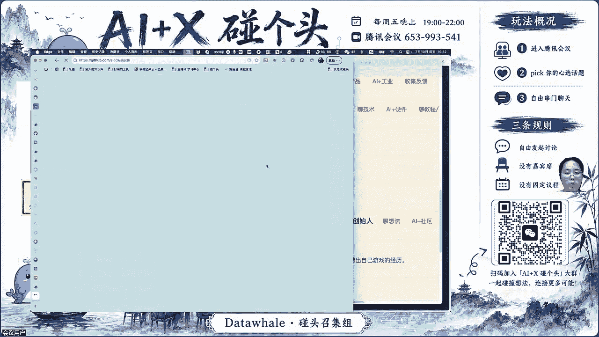

# Datawhale AI+X碰头会：第一章：活动概述与分组指引👋

在本节课中我们将要学习Datawhale AI+X碰头会的整体流程，以及今晚共有十三个话题的具体安排，还会学习如何进入对应的分组讨论房间。

Datawhale AI+X碰头会是一个每周五晚上定期举办的线上交流活动，活动在腾讯会议中进行。今晚的活动总共有十三个话题，主持人会先通过海报向大家展示话题总览，海报右上角还有一个二维码，扫描这个二维码可以加入各个话题的讨论群。

有些话题是之前已经开展多期的长期话题，有些话题是新引入的。每个话题的发起人会先花三十秒左右的时间简单介绍自己想聊什么，然后大家根据兴趣进入对应的分组进行深入交流。

以下是进入分组讨论的操作步骤：
- 在电脑端，点击右下角的三个六边形图标；
- 在手机端，点击右下角的三个正方形图标；
- 点击进入“分组讨论”后，选择自己感兴趣的房间，点击“加入”按钮即可进入对应的分组讨论。

如果你使用的是腾讯会议小程序，可能看不到这些按钮，建议切换到电脑客户端或手机客户端使用。有任何问题可以在活动中直接开麦提问。

上一节我们介绍了碰头会的基本流程和分组方式，本节中我们来看看前五个话题的具体内容。

# Datawhale AI+X碰头会：第二章：前五个话题介绍📢

本节详细介绍一号到五号话题，包括AI加灵感共创、FDE团队共创、AI加抑郁症康复与数字游民、AIQ探索讨论、AI加OPC商业化。

## 话题1：AI加灵感共创💡

以下是该话题的核心介绍：

AI加灵感共创是由中国黑客大学探山协会发起的话题，现在已经是第九期。这个话题的核心目标是把真实的需求通过AI技术落地，先做出原型，再不断迭代，最终产出可以实际使用的产品。

核心逻辑可以用下面的公式表示：

$$
落地产品 = 真实需求 \times AI 技术 \times 原型迭代
$$

每周五会分享AI技术前沿进展，也会探讨如果有真实需求进来，应该用哪些工具或技术方案把事情做成。本周主要关注正式需求的落地，会有三到四个需求拆解的直播分析。感兴趣的同学可以关注灵感共创的直播间，也可以在群聊中填写需求问卷，每周五统一时间进行讨论。

介绍完一号话题后，我们继续看看二号话题FDE团队共创。

## 话题2：FDE团队共创🏢

以下是该话题的核心介绍：

FDE团队共创由老顽童和袁军发起，旨在搭建一个企业赋能平台，为孵化的企业提供AI能力。FDE的核心观点是，AI已经进入改变一切的时代，各种规模的企业都有各自的痛点和问题，很多公司都在尝试如何拿到订单、如何实施、如何让客户满意。

可以用下面的公式简单概括：

$$
企业AI赋能 = AI 能力 + 企业痛点 + 落地方案
$$

这个话题希望给大家提供一个抒发己见的场所，同时也有具体的需求，希望通过平台找到合适的团队一起合作。FDE团队共创还会在七月中旬联合开展城市线下活动，以及相关的直播分享和课程交流。感兴趣的同学可以进入二号话题分组。

了解完企业侧的AI赋能之后，我们转向三号话题，聊聊与生活方式相关的内容。

## 话题3：AI加抑郁症康复与数字游民🌴

以下是该话题的核心介绍：

AI加抑郁症康复是一个已经开展了六期或七期的话题，由陈米和他的妻子Amanda发起。他们目前在台州的一个数字游民基地，想和大家聊聊脱离传统打工、两点一线格式化生活之后的另一种生活可能。

数字游民生活可以大致理解为：

$$
新生活方式 = 传统上班生活 - 固定办公地点 - 固定作息 + 自由安排时间
$$

他们会分享在台州以及之前在安吉、黄山等地数字游民基地的经历，还会朗读基地里游民们写在小本本上的感言，让大家感受这种生活方式下人们真实的内心想法。本周正好台风来袭，陈米刚刚把车处理好以防被淹。感兴趣的同学可以进入三号分组，聊聊如何在数字游民社区中解放心态和情绪。

说完生活方式，我们进入四号话题，重点探讨人与AI的协作问题。

## 话题4：AIQ探索讨论——与AI协作的盲点🤖

以下是该话题的核心介绍：

AIQ探索讨论由易晨发起，他做了一个早期的MVP评测表单工具，用来调研不同职业、不同处境下的人，AI能介入或加速哪些方面。易晨自己在过去两年跟着AI热度学习，发现单靠个人状态很难深入，于是广泛换深度，帮助身边不同职业的朋友使用AI。

AI协作盲点可以用下面的公式表达：

$$
AI 协作盲点 = 实际业务需求 - AI 当前可介入的部分
$$

易晨准备了一个工具库，但因为还存在一些幻觉问题需要纠正，所以今天主要分享已经整理好的资料。感兴趣的同学可以进入四号话题分组，讨论自己目前处境下AI介入和加速的部分有哪些。

讨论完AI协作盲点，我们来看看五号话题，聊聊OPC的商业化。

## 话题5：AI加OPC商业化💰

以下是该话题的核心介绍：

AI加OPC商业化由赵迪和杨悦介绍，背后是OPC实战派直播播客。每周五比碰头会早半小时开始，本周主题是“先进圈子在赚钱，如何打造可变现的生态”。邀请了两位嘉宾，一位是私源盲和AI社区主理人，一位是超越之路的合伙人，会聊聊生态观察，以及“AI是年轻人的事业”这个观点是否成立，周老登怎么办等问题。

OPC商业化可以简单概括为：

$$
可变现生态 = 圈子资源 \times 变现模式 \times 社区运营
$$

直播大约在七点多结束，嘉宾分享完后大家可以进入会场和嘉宾对话。这个话题已经开展了三期，内容准备得非常充分，感兴趣的同学可以进入五号分组与嘉宾交流。

前五个话题介绍完毕，接下来我们继续看看六号到十号话题。


# Datawhale AI+X碰头会：第三章：中间五个话题介绍📚

本节详细介绍六号到十号话题，包括AI加科研、AI读懂工程图纸、本地部署模型硬件选择、WAIC路演经验分享、AI生成课件。

## 话题6：AI加科研——Cloud Science绿皮书共读🔬

以下是该话题的核心介绍：

AI加科研话题由志远发起，已经是第三次分享。前两次主要讲如何通过Sence来实现科研助手，帮忙完成科研中的杂活。但后来发现不需要从零开始，因为已经有现成工具，比如在6月30日提出的Cloud Science工具。

本次分享主要是Cloud Science绿皮书共读，包括安装方法、使用体会，还会有直播演示安装。内容大致分为三部分：怎么安装、前面的使用体会、听取大家反馈。感兴趣的同学可以进入六号分组，一起探讨AI加科研怎么做。

科研工具使用流程可以用下面的伪代码表示：

```text
安装 Cloud Science 工具
运行科研助手
完成科研杂活
迭代优化使用体验
```

介绍完科研类话题后，我们来看看七号话题，聊聊AI如何读懂工程图纸。

## 话题7：AI读懂工程图纸📐

以下是该话题的核心介绍：

AI读懂工程图纸话题由佳怡负责，主要讨论AI怎么样去读懂工程图纸，以及图形模型的落地实践案例。相关团队已经研究图形模型五六年了。如果你对这个话题感兴趣，可以先加入他们的交流群，询问佳怡什么时候在线，再一起进行交流。

工程图纸AI读取的基本流程可以用下面的伪代码表示：

```text
输入工程图纸图像
图形模型识别图纸内容
输出结构化工程信息
验证模型落地效果
```

说完图纸识别，我们进入八号话题，聊聊本地部署模型的硬件选购问题。

## 话题8：如何合理选择本地部署模型的硬件产品🖥️

以下是该话题的核心介绍：

本地部署模型硬件选择话题由杨老师发起。他最近写了一篇文章，讲怎么给个人开发者和个人用户选购可以布置本地模型的AI算力设备。最近硬件涨价幅度高，很多人想买自己的算力设备时会感到迷茫。

本地模型部署的核心要素可以用下面的公式表示：

$$
本地模型 = 高显存显卡 + 模型权重文件 + 推理框架
$$

杨老师手里有六七台甚至七八台AI硬件，市面上大部分硬件他都用过，所以对选购AI硬件有很丰富的经验。感兴趣的同学可以进入八号分组，和杨老师进一步探讨，也可以扫描他话题群的二维码加入群聊。

硬件选购问题聊完之后，我们来看看九号话题，听听WAIC路演的经验分享。

## 话题9：WAIC路演与0到1 AI学习经验🚀

以下是该话题的核心介绍：

WAIC路演与个人成长分享由舒文发起。他下周要去世界人工智能大会（WAIC）做路演，想提前了解大家对什么内容感兴趣，或者能提供什么帮助。他今年五月份开始接触AI，第一个月就入围了WAIC，目前已经开源了六个项目。

个人AI成长路径可以简单概括为：

$$
个人成长 = 零基础起步 + AI 学习 + 开源项目 + 实战积累
$$

他今天主要介绍自己从0到1学习成长的经验，所有做过的项目，个人观点，以及踩过的坑。如果下周六有线下去会场的朋友，也欢迎大家过来捧场。感兴趣的同学可以进入九号分组，和舒文进一步探讨。

听完个人成长经验，我们来看看十号话题，聊聊如何用AI生成课件。

## 话题10：AI生成课件📊

以下是该话题的核心介绍：

AI生成课件话题由三三负责，她已经拉了一两百人的群，针对自己的产品进行简单描述，也就是如何使用AI去生成课件，特别是根据个人的人格特征和学习动机，生成能够让自己学得更好的对应课件。她希望找一些商课的同学去体验。

AI生成课件的逻辑可以用下面的伪代码表示：

```text
输入用户的人格特征
输入用户的学习动机
AI 生成对应课件内容
输出个性化学习材料
```

相关的GitHub仓库和话题信息可以在话题墙的右上角查看，感兴趣的同学可以去了解，也可以直接在三三的群里和她交流。


前十个话题都已经介绍完了，接下来我们看看最后三个话题，也就是十一号到十三号。


# Datawhale AI+X碰头会：第四章：最后三个话题与活动总结🎯

本节介绍十一号到十三号话题，包括AI agent千方夜谭、AI加社区OPC、AI加游戏，并说明开放麦环节和本次活动总结。

## 话题11：AI agent千方夜谭🌙

以下是该话题的核心介绍：

AI agent千方夜谭由批冷负责，晚上八点开始。他是一名架构师，做过非常多的研究，有一个CCL开源项目，目前来说也是比较好的项目。感兴趣的同学可以在八点的时候进入十一号话题小组，也可以先扫描群二维码进群找到他，聊聊具体的经验。



AI agent探索可以简单理解为：

$$
AI agent研究 = 架构设计 + 开源项目 + 实战经验分享
$$

介绍完AI agent话题后，我们继续看看十二号话题，聊聊社区OPC协作。

## 话题12：AI加社区OPC🌐

以下是该话题的核心介绍：

AI加社区OPC由大桃负责，主题是“单机太孤独，社区虚拟网络应该长什么样子？”。他们做了三年的数字游民社区，是国内比较早的平台之一，开发了“游牧岛”平台，面向数字游民、艺人公司、超级个体以及想走出职场探索的人。

社区OPC协作可以用下面的公式表示：

$$
社区 OPC 协作 = 人人协作 + 信任网络 + 社区节点
$$

他们希望提供更多支持系统，除了线下共居，还想搭建信任网络，共创联合做事情，找合伙人和搭子，也提供远程工作机会和线下社区的FDE探索。大桃自己也在做AI探索和自媒体，接数字营销需求。今天希望分享他们在做的事情和观察，讨论AI时代的OPC协作怎么发生，信任怎么建立，还有哪些机会没有被挖掘。感兴趣的同学可以进入十二号分组交流。

说完社区OPC，我们来看看最后一个十三号话题，聊聊AI加游戏。

## 话题13：AI加游戏🎮

以下是该话题的核心介绍：

AI加游戏由好好先生负责，他不是做游戏出身，也不是编程人员，纯粹从零开始，用了25天和AI一起搭建了一个独立的模拟类游戏，已经完整跑通了全部上架内容，并在t tap上架了。因为正式发行游戏需要版号和软著，比较困难，但这个游戏就是25天直接和AI一起做出来的。

25天独立游戏开发可以概括为：

$$
独立游戏 = 非专业开发者 + AI 工具 + 25天时间 + 完整上架流程
$$

他今天想分享在这个agent时代，大家怎么样更好地制作游戏，让以前很难入门的独立游戏制作者都能上手。感兴趣的同学可以进入十三号分组，和他聊聊游戏开发的经验。

所有十三个话题的介绍就结束了。

接下来的开放麦环节🎤

以下是开放麦的具体安排：

接下来大家可以加入自己感兴趣的话题分组。如果有自己想表达的话题，或者想分享的内容，也可以在开放麦时间提出。开放麦会持续到晚上八点钟，大家可以自由地去各个群里，邀请感兴趣的小伙伴一起加入讨论。如果有任何问题，可以直接开麦，主持人会进行解答。

总结：

本节课中我们一起学习了Datawhale AI+X碰头会的整体流程，学习了如何进入腾讯会议的分组讨论房间，还详细了解了十三个话题的具体内容。从AI加灵感共创、FDE团队共创，到数字游民生活方式、AIQ协作盲点、OPC商业化，再到AI加科研、工程图纸识别、本地部署硬件选购、WAIC路演经验、AI生成课件、AI agent研究、社区OPC协作，以及AI加游戏，每个话题都有对应的分组编号和交流方式。希望大家可以根据自己的兴趣，选择合适的分组进行深入交流。

