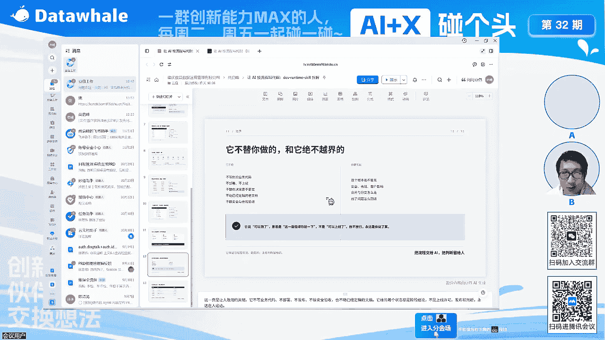
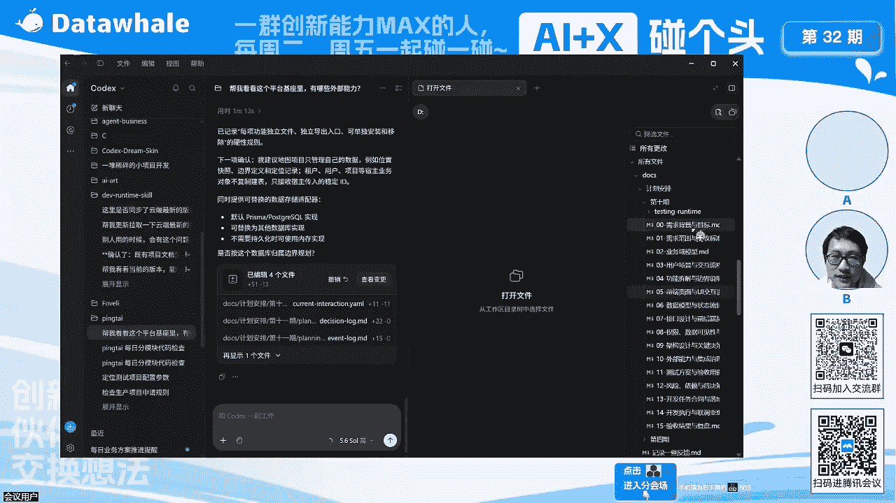
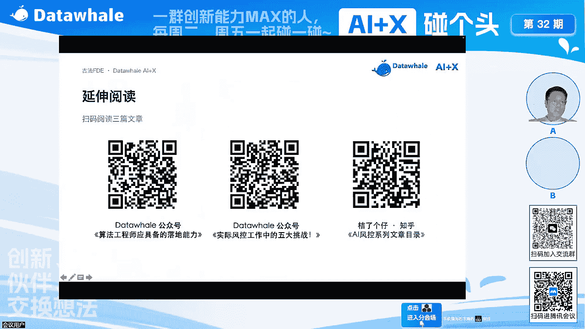
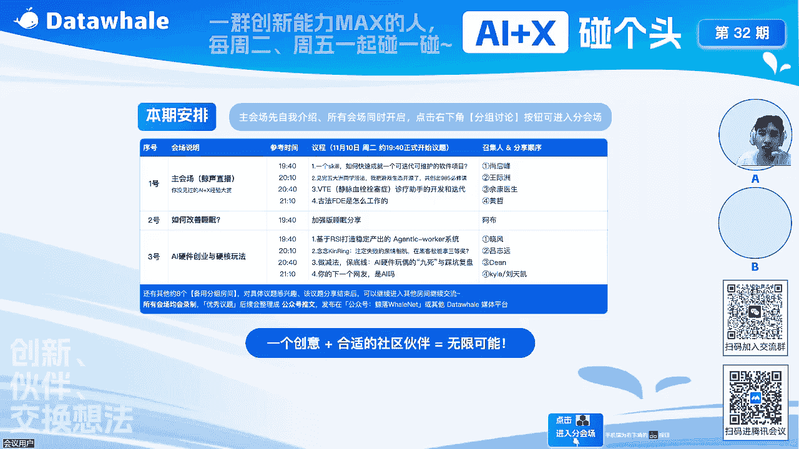

# 【AI+X碰头会实战教程】🚀：01：AI驱动的个人软件开发工作流

## 开篇概述

在本章节中，我们将学习如何利用AI技能包，让没有专业技术背景的人员也能独立完成软件的需求分析、代码编写、测试部署与后续维护。我们将重点拆解一套名为“sscalekill”的开源技能包，了解它如何解决“一个人开发软件”时遇到的三大核心难题，并学习如何在日常工作中应用这套方法。无论你是产品经理、设计师还是商科学生，都可以通过这套流程将自己的想法落地为可运行的软件系统。

## 核心痛点：为什么需要个人AI开发工作流

在传统的软件开发认知中，很多人认为做一个网页或软件服务，必须组建专业的技术团队来支持后续的运维与迭代。但实际上，随着AI能力的不断提升，单凭一个人是否就能完成一个软件的全生命周期？这就是本节要讨论的核心问题。很多非技术出身的创业者在做数字化转型时，常常面临同一个困扰：是否真的需要一个专业团队才能支撑软件的开发与上线？如果只有一个人，纯粹依赖AI，是否能避免各种疏漏，并在项目完成后进行复盘与下一环节的衔接？这套技能包就是为了回答这些问题而设计的。

## 技能包的核心设计：解决三大问题

这套技能包的设计初衷，是为了让非专业开发者也能掌控AI辅助开发的全过程。它主要解决以下三个问题：

第一，**目标明确问题**。很多AI项目失败的根源，在于最初的需求没有传递准确。通过与AI不断沟通、追问，将需求边界明确化，确保AI生成的结果与用户预期高度一致。

第二，**过程可控问题**。使用AI开发时，开发者常不知道AI运行到了哪一步，代码写成了什么样，缺乏掌控感。技能包通过量化的阶段性结果，让开发者随时了解当前进度，消除“AI在往前跑，但我不知道它跑到了哪里”的焦虑。

第三，**维护与迭代问题**。项目上线后，如果需要修改，AI往往需要重新阅读大量代码，成本高且耗时。技能包为每一次迭代生成明确的说明、记录与日志，让后续维护变得更简单、更高效。

## 四大阶段与实操话术

以下是这套技能包包含的四个核心阶段，每个阶段都有专门的指令话术：

1. **计划启动阶段（Plan）**：启动需求梳理，支持分期开发。例如第一期、第二期、第三期，AI会根据用户输入不断引导、提问，使需求逐步具体化。

2. **按此执行阶段**：当需求落地完毕，用户指令“就按这个做吧”，AI将严格按照既定需求运行完整开发流程，包括线上Bug修复。

3. **改动检查阶段**：指令“帮我看看这次改动有没有问题”，让AI对代码和执行流程进行审查，挖掘隐藏风险。

4. **测试阶段**：指令“接着测”，AI会主动列出测试节点，引导用户完成无脑化的测试操作，确保上线稳定性。

## 实战案例：第三期开发全流程

以某实际项目的第三期开发为例。用户启动后，AI基于第一、二期的经验与日志，快速进入需求梳理。在交互过程中，AI会询问功能细节、实现目标等，最终生成一份严谨的PRD文档。据分享者介绍，这一过程大约产出了0到15个标准化文档，共计16个左右，直接可用于工程落地。

在执行阶段，AI会将大需求拆解为多个细节任务，并可通过子代理并行加速。分享者表示，一个完整的开发板块基本能在两个小时内完成。这意味着非技术人员也能在极短时间内把一个完整功能模块从想法变成可运行的产品。

## 安装与版本控制

这套技能包已在GitHub开源，安装方式非常简单，只需一条指令即可完成部署：

```bash
pip install runtime-scalekill
```

它支持多端适配，核心运行在特定环境中，也可通过AI助手部署到其他所需环境。同时，技能包实行版本控制。用户可以提交PR，有价值的改动会被合并并迭代版本，新旧版本之间保持兼容，避免干扰已有用户。

## 设计理念：把专业留给技能包，把生活留给自己

这套技能包的本质初衷，是不要求用户掌握专业术语来与AI对话，而是使用最熟悉、最习惯的自然语言表达需求。专业领域的知识由技能包内部处理，用户则可以将更多精力投入到家庭、生活与主要工作中，而非被软件开发本身占据。只要按照既定流程推进，最终产出的基本上都是能够上线、并且能够稳定运行的应用。

---

# 【AI+X碰头会实战教程】🌐：02：开源生态与传统行业颠覆

## 过渡引言

上一节我们介绍了如何利用AI技能包实现个人软件开发。本节中，我们来看看另一种模式：如何通过开源精神，在传统行业中创造商业与社会双重价值。

## 开篇概述

在本章节中，我们将学习“重启人生”开源生态的创始经历，理解开源不仅仅是代码公开，更是商业模式重塑、生态协作与版权治理的综合实践。我们将探讨如何用开源方式颠覆传统行业，并实现公益与商业的双赢。无论你是做教育、公益还是企业服务，都能从中获得启发。

## 缘起：从“无限游戏”到开源选择

创始人在环游世界拜访五大洲同学后，深刻体会到“人生没有标准答案，规则边界可以打破”。这一“无限游戏”理念促使他将人生方法论转化为一款线下体验游戏。在商业模式选择时，他没有选择传统的卖盒子、卖账号的闭源模式，而是决定开源。

开源的核心原因在于：既然人生没有标准答案，就不应当用一个标准化产品去引导所有人；既然规则边界可以持续打破，就不能用品牌中心化运营固化所有规则。开源让更多人参与进来，因地制宜、因材施教地改变版本。

## 开源成果：从高校到企业的典型案例

以下是该生态通过开源共创产生的部分顶尖案例：

- **G端（政府与高校）**：某985大学将游戏版本改编为必修课，学生通过玩游戏结业，并撰写游戏感悟作为论文。这一做法被学习强国、央视网报道为教育创新，目前正在向更多学校复制。



- **B端（企业）**：国有四大行、全国总行等机构使用银行版进行内训，剧情包含“重生之我在某某行做柜员”；世界五百强及私企也有相应团建版本。

- **C端（个人与组织）**：北辰青年等组织使用不同版本开展联合创始人改变、家庭关系、亲子关系、相亲选合伙人等场景应用。

- **国产品牌弯道超车**：国际人生教练与生涯规划咨询机构，将自身理论以游戏插件形式插入开源底座，实现中国化落地与集体订单获取。

## 商业模式重塑：不卖盒子，卖IP授权


传统厂商依靠闭源与垄断盈利，一旦开源就等于“搬起石头砸自己的脚”。该生态则从底层重构了商业模式：

1. 不销售游戏盒子或账号，完全不靠卖产品赚钱。
2. 未来通过IP授权盈利。当生态壮大（如必修课、企业版、国际教练插件等）后，IP价值提升，通过长期授权盈利，类似迪士尼模式。
3. 付费改编版本。开源不等于完全免费，重大商业版本的改编授权需付费，这也是收入来源之一。



这种模式使平台利益与社区贡献者利益保持一致，鼓励大家不断开源与改变。

## 生态协作与版权治理

生态分为平台方与贡献者两个角色。为了吸引顶尖人才贡献专业版本，平台采取以下机制：

- **产权保障**：贡献者可以获得改编后的国家版权证书，拥有自主盈利权，获得社会尊重，形成“有恒产者有恒心”的激励。

- **开源作为入场券**：高校与企业采购标准化产品意义有限，只有能够改造、开源、出版自己的版本，才构成真正的教学或学术创新，因此开源成为必选条件。

- **结构化语言赋能**：底层理论作为可衍生的原规则，类似代码中的结构化语言，对AI模型友好，可拆分、可复制、可迁移、可量化，方便他人二次开发。

## 分层开源与能力赋能

为了避免一刀切导致混乱，生态采用分层次开源，匹配不同赋能与范式：

- **航母级（重度改编）**：如大学必修课，需最高能力与最重资源支持，产出可获国家版权证书。

- **驱逐舰级（中度改编）**：改造部分内容，在划定框架内进行开发。

- **轻量级改编**：普通用户即可参与，门槛较低。

- **官方主导衍生品**：如艺术展、影视作品、周边产品。

从上到下，用户主导程度由强到弱，资源与培训也相应递减。

## 公益与商业的飞轮

该生态将公益与商业清晰拆分：

- **公益部分**：10余万字理论完全免费公开，不做品牌与产品曝光，自费拍摄科幻公益片播放。

- **商业部分**：改编出的游戏及衍生品面向G端、B端、C端收费，部分付费授权。

两者相互关联：所有商业产品均由原生理论开源改编而来，公益奖项与媒体背书为衍生品提供了最好的敲门砖。

目前该生态只需半个全职员工及少量兼职，便能支撑十余万线下用户与几百名核心贡献者，核心在于通过开源将交付权限层层下放，官方不直接做交付与培训。

---

# 【AI+X碰头会实战教程】🏥：03：静脉血栓栓塞症知识库与AI辅助诊疗

## 过渡引言

上一节我们探讨了开源生态在传统行业中的应用。本节中，我们来看看AI知识库如何在临床医学领域，特别是静脉血栓栓塞症的防治中发挥作用。

## 开篇概述

在本章节中，我们将学习静脉血栓栓塞症（VTE）的临床痛点，理解如何基于AI知识库构建辅助决策工具，并掌握从知识库到智能体的演进路径，包括记忆系统、评价系统与多模态扩展等关键点。如果你对医疗AI或临床决策支持感兴趣，这一节将提供非常具体的实践参考。

## 临床背景：VTE为何是重点防治对象

VTE的核心公式可以表示为：

$$VTE = DVT + PE$$

其中DVT代表深静脉血栓形成，PE代表肺栓塞。这两种疾病均为临床中危急重症。血栓若脱落进入肺动脉，可引发广泛肺动脉血栓形成，甚至导致死亡。肺栓塞是猝死原因的第四位。

VTE发病率也很高，欧洲和美国每千人年发生1到2次，约有三分之一患者与住院相关。国家卫健委已连续6年将“提高VTE规范预防治疗率”列为十大医疗质量目标，目标设定为60%。但现实中，规范预防率仅约10.3%，存在巨大缺口。

## 临床痛点：为什么传统教学与会诊效率低

从血管外科医生的教学与临床观察来看，主要存在以下问题：

- **规培医生轮转时间短**：每个学生在血管外科的归培时间可能只有1个月，知识负荷重，离开科室后容易遗忘，教学效果差。

- **会诊不及时**：医院规定上午10点前的平会诊当天完成，10点后次日完成，过程中病人治疗存在延误。

- **指南庞杂**：静脉全栓等领域指南数量多且复杂，如某指南为800页英文文献，对学生和教师都是沉重负担。

- **传统灌输式教学效果差**：单纯知识点讲授难以持续更新，临床医生难以跟上最新共识。

## 知识库构建：基于免费AI工具搭建VTE知识库

2024年4月，团队使用免费AI工具搭建了VTE知识库，截至目前：

- 文档总量：2500篇
- 指南与高级别证据：1200篇（主要为Q类文献、荟萃分析等）
- 内容包括：少量PPT、指南、脱敏病例库，并纳入护士作为管理员
- 更新机制：所有内容持续更新

## 临床决策辅助：知识库在真实病例中的应用

知识库可直接辅助临床决策。以一个结肠癌肝转移患者为例：患者此前因术前发现肺栓塞未能手术，抗凝后出血进急诊输血，缓过来后再次想做手术。复查影像学未发现血栓，D-二聚体低，纤维蛋白原高，麻醉科请求全院MDT会诊。核心问题是：是否放置下腔静脉滤器防止血栓脱落？是否有其他措施降低围手术期致死率？

将脱敏后的病人信息输入AI知识库，输出的答案比临床会诊医生更详细、更长，并提供大量链接与文献支持。人类专家因时间限制，难以详细解释循证医学证据与病理生理原因，而AI能够综合给出更完整的辅助回答。

## 从知识库到智能体：三个版本的演进

### V1版：基础RAG知识库

直接将病例输入知识库，进行结构化输出，支持参考文献引用。但输出较为原始，部分药物建议可能脱离国际实际，例如推荐进口药而非国内集采药。

### V2版：引入自净化记忆系统

参考相关架构文章，在智能体工作前先搜索脑中记忆系统，看完病后更新记忆，实现自净化。核心包括通用推理、专业知识、调用工具的技能，并对记忆权重进行感知与蒸馏更新。

### V3版：教学推荐与评价系统

- **教学推荐**：根据用户身份（医生或学生）推荐不同学习资源，如最新文献或基础PPT。

- **遗忘因子**：针对用户薄弱记忆点（如儿科VTE问题），安排相应学习资源。

- **评价系统**：对数百份脱敏病例进行评价，判断哪个诊疗策略更接近指南，发现传统认知与最新共识的偏差，为科研提供切入点。

## 复杂工作流：脱敏、诊疗与MCP集成

团队还构建了完整工作流：

1. **脱敏**：将住院病历照片进行脱敏处理，支持大量图片（如50张）的文件夹读取，克服单次图片数量限制。

2. **诊疗流程流水线**：诊疗助手书写会诊意见。

3. **记忆系统改变**：分层推荐与评价。

4. **MCP集成**：通过workbench与MA等工具对接，可直接读取文件夹中的复杂病历，输出详细会诊意见。

该工作流运行时间较长，但能够完成非常复杂病例的诊疗工作。

## 知识库产品化与改进方向

目前AI知识库仍是非标准化产品，基于商业平台构建，迁移困难。近期工作重点包括：

- **工程化与产品化**：版本回滚、自动纳入文献、文献评价、管理员排查提醒。

- **数据边界问题**：若赋能医院HIS系统，如何获取数据边界。

- **可控多模态输出**：不仅输出HTML风格，还可直接提取文献中的图表、评分表等。

- **体量测试**：200个指南与5000篇文献加指南，哪种效果更好，需做消融实验。

- **更新与审核机制**：每天新文献数量多，如何巡检与决定入库内容。

- **评价benchmark**：缺乏优秀的AI知识库评价问题集与基准。

## 智能体的未来痛点

若要构建真正能指导诊疗的智能体，仍需解决以下问题：

1. **多模态问题**：VTE领域尚可，但血管外科许多领域高度依赖CTA等影像，数据量大。

2. **时序数据**：评分与诊疗策略需随化验单、症状变化动态调整，需要机器学习支持动态策略。

3. **大样本机器学习与外部验证**：预测能力虽优秀，但外部数据验证不足，性能可能下降。

4. **电子病历系统融合**：不同医院非标数据、脏数据多，生命体征与化验单趋势提取有困难，需医院信息中心配合。

5. **联邦学习**：多院共同训练但患者数据不出院，需要联邦学习技术。

6. **通用AI融合**：未来通用AI可能已包含这些能力，需探索专用系统的持续价值。

## 合规与落地

任何落地方案都需面临临床评价、责任归属、数据安全等合规问题，需要多方合作才能实现。

---

# 【AI+X碰头会实战教程】⚙️：04：古法FDE与大模型时代的AI交付演变

## 过渡引言

上一节我们讨论了医学领域的AI知识库与智能体。本节中，我们来看看在大模型出现之前，AI项目是如何交付的，即所谓的“古法FDE”，并对比现代AI交付方式的变化。

## 开篇概述

在本章节中，我们将学习FDE（Forward Deployed Engineer，前沿部署工程师）的定义，了解2017至2021年“古法FDE”在金融风控与反洗钱领域的实践流程，包括数据清洗、特征工程、模型训练与部署阶段，并通过两个实际案例理解其业务价值，最后对比古法与现代AI交付的差异。如果你对AI工程交付感兴趣，这一节能帮你理解大模型之前AI落地是如何一步步完成的。

## FDE定义与背景


FDE即前沿部署工程师，本质上仍是工程师，工作是将AI方案带到客户现场进行部署。演讲者从2017年开始从事AI工作，最初主要是机器学习与深度学习模型，2018至2021年在新加坡一家金融科技创业公司担任数据科学家，属于客户成功部门，与现代FDE定义基本一致。

## 古法FDE的工作流程

古法FDE遵循从客户需求出发，将通用能力改造为现场可用方案，并跟进上线的流程。但与现代不同的是，模型前后都有非常长且繁琐的手工工作：

1. **需求理解与数据盘点**：理解客户目标，盘点可用数据，做标签定义与样本切分。

2. **数据清洗**：核对组件与表关系，明确每行含义，检查重复、关联丢失、一对多关系，统一格式与业务口径（日期、时区、币种、单位、类别编码等）。处理缺失值与异常值，并将处理规则写成代码以便重复执行。

3. **探索性数据分析（EDA）**：对数据每一列进行分析，生成insight，了解分布与业务含义。

4. **非结构化转换**：将JSON、文档、扫描件、备注、地址等转化为机器学习可处理的数值。例如性别转为0/1，多类别使用编码方法。

5. **特征工程**：根据业务理解构建特征，如账户逾期金额、工作收入；在金融风控中将行为聚合为变量，文本转为TFIDF等输入。

6. **时间节点控制**：按时间切片训练与验证，避免数据泄露（Data Leak），不能用未来结果作为当前特征。

7. **模型训练与验证**：调整超参数，设置评判指标（精确率、召回率等），检查错误与人群差异。

部署阶段分为三步：

- **POC（概念验证）**：用限定范围数据验证业务可行性与价值。

- **SIT（系统集成）**：在客户环境中运行模型，与客户现有系统联调接口。

- **生产上线**：上线后设置监控、回滚机制，进行运维与客户培训，跟踪效果。

## 案例一：反洗钱（AML）

反洗钱主要解决三个问题：

- **交易监测**：识别异常交易频次、金额、模式与关系网络，但误判率高达90%。

- **姓名审查**：如“萨达姆”这类高危姓名匹配会触发告警，需调查员核实是否同名。

- **客户风险评分**：基于背景、地域、业务与交易行为进行风险分层，如来自伊朗且涉石油军事的客户属高危。

原有方案基于规则，误判率高。古法FDE方案基于机器学习，利用历史调查标签（安全标记0，可疑标记1）进行监督式学习，按优先级排序高风险交易，让合规人员先调查。与新加坡一家大银行合作后，交易误报减少50%，姓名审查误报减少70%，高优先类别命中率高达96%。

## 案例二：信贷风控

银行发放信用卡与贷款后，部分用户逾期。需解决“优先跟进哪些账户”问题。原有规则方法风险识别不准，人力调查覆盖有限。

古法FDE方案同样进行数据清洗与特征工程，构建风险分层与策略推荐，银行团队优先处理高风险账户。效果显示滚动账户率降低50%，两个上线地区月均估计损失挽回200万美元以上。

## 古法FDE vs 现代FDE

**古法FDE的困难**：数据清洗、特征工程、编码转换等全是手工“脏活累活”，耗时耗力，工程师需要长期泡在现场与数据打交道。

**现代FDE的变化**：有了大模型后，数据清洗与特征分析可以自动化，不再需要人工逐行处理。FDE可以把更多时间花在倾听客户需求、挖掘客户痛点、研究系统架构与新产品上，工作模式从“执行繁琐数据工作”转向“面向客户与架构设计”。

## 延伸阅读

演讲者推荐了两篇延伸阅读文章，包括一篇关于机器学习隐藏技术债的文章，可帮助理解FDE需要处理的数据验证、特征工程与监控等复杂工作。

---

# 总结

## 本节回顾



在本教程中，我们一起学习了四个主题：


第一，如何利用AI技能包让非技术人员独立完成软件开发全生命周期，解决目标明确、过程可控、维护迭代三大问题；


第二，如何通过开源精神在传统行业中重塑商业模式，实现公益与商业双赢，并建立分层开源生态；

第三，如何基于AI知识库构建静脉血栓栓塞症的辅助诊疗工具，并从知识库演进到具备记忆、评价与多模态能力的智能体；

第四，什么是古法FDE，大模型出现前后AI交付方式发生了哪些变化，以及数据清洗、特征工程与模型部署的实际案例。



希望这些内容能为你在AI应用与开发方面提供参考。如果你对某个章节感兴趣，欢迎查阅相关开源项目或延伸阅读资料，进一步实践与探索。

