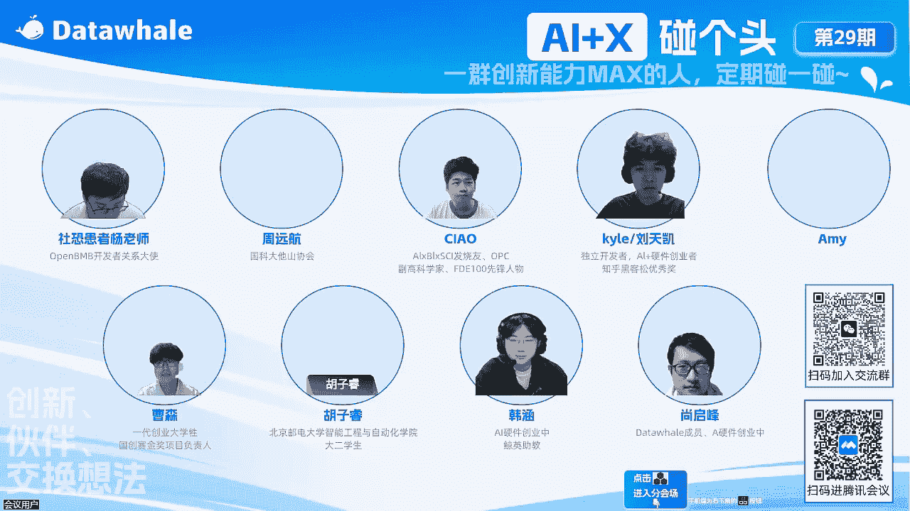
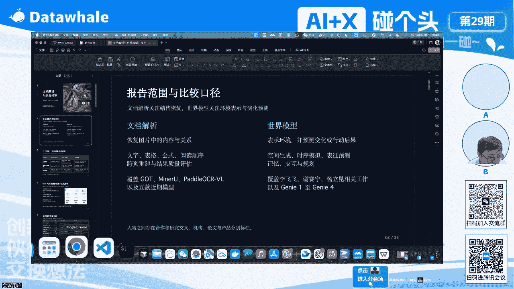
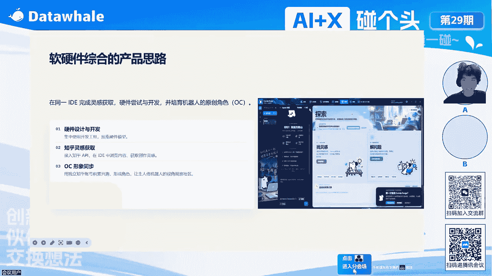
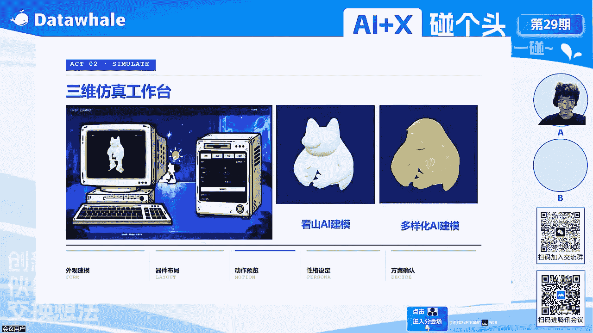
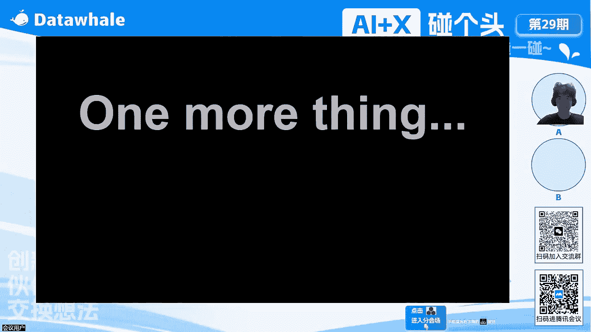
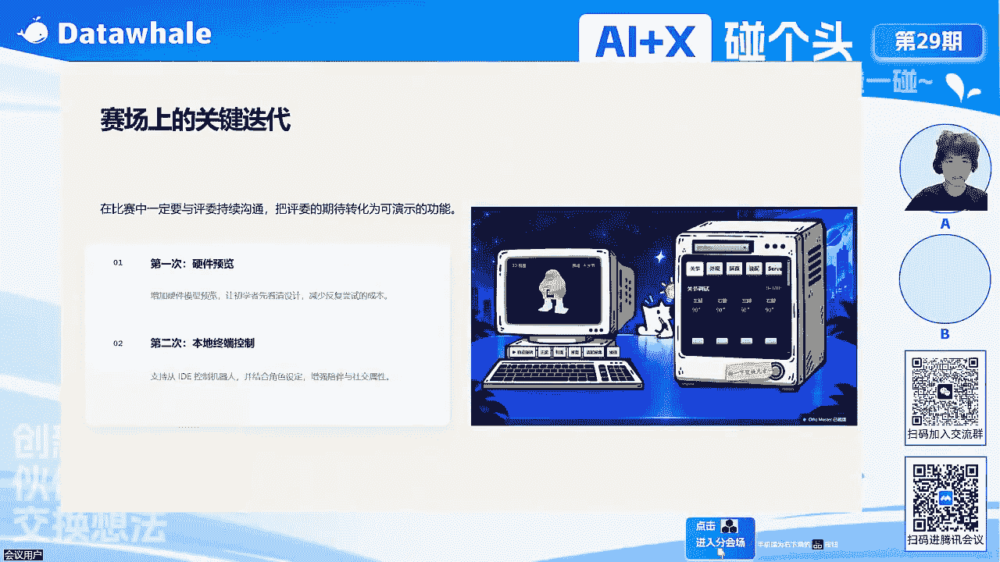
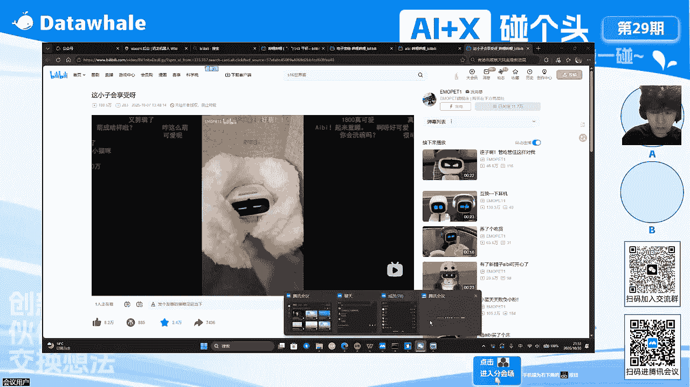

AI+X 碰个头：第 29 期：AI 实践与项目分享 🤖


在本节课中，我们将学习多个关于 AI 实践的主题。内容包括文档解析与 OCR 技术、世界模型的基本概念、AI 在科研工作中的应用、多项目管理方法、知乎黑客松参赛经验，以及大学生创业与产品落地的经验。每一部分都由不同的分享人进行讲解，适合对 AI 工程化和实际应用感兴趣的初学者。以下是本节课的主要安排。


## OCR 与文档解析 📄



上一节我们介绍了本课的总体安排，本节中我们来看看 OCR 与文档解析。



OCR 的中文全称是光学字符识别。它的核心作用是将图片中的文字提取出来。代码示例如下：

```text
输入：包含文字的图片
输出：提取后的纯文本
```

传统的 OCR 技术已经发展了十几年。早期的功能仅限于识别图片中的文字。例如，微信中的图片文字提取功能，就是将图片里的文字全部识别出来。但是从 2024 年开始，需求发生了变化。我们不仅需要恢复图片中的内容，还需要知道内容之间的关系。例如，财务报表中的表格，数字与年份、表头之间的对应关系非常重要。

如果只提取数字而丢失了对应关系，数字之间的意义就不存在了。例如，把调整前的数字看成调整后的数字，差别会很大。文档解析的目标是恢复文档的布局和结构化信息。公式表示如下：

文档解析 = 文字提取 + 布局恢复 + 结构化输出 (Markdown/HTML/JSON)

输出格式可以是 Markdown、HTML 或其他结构化格式。这样 AI 可以阅读，而不仅仅是人类。如果表头信息与表格内数字错位，会导致 AI 产生幻觉或错误结论。

以下是文档解析的主要技术路线。

- 统一编码路线：将所有信息进行统一编码后识别，代表模型有 OCR 和 Limit OCR。
- 两阶段路线：第一阶段识别布局，第二阶段分类处理。例如，先识别文档里是表格、图片还是文本框，再分别处理。
- 整体视觉信号路线：将整张图视为视觉信号进行整体解析和还原。
- 传统路线：不使用多模态模型作为基座，仅依赖 CPU 运行，基于 CNN 卷积思路，对表格、公章、文本分别解析后再做布局还原。


## 世界模型 🌐

上一节我们介绍了 OCR 与文档解析，本节中我们来看看世界模型。


世界模型是理解物理世界的重要模型。公式表示如下：

世界模型 = 历史动作观测 + 空间位置记忆 + 状态感知 + 环境感知

如果只提取文字或代码，无法解决物理世界中的物理规律。例如，让机器人拿取物体，如果不知道物体是易碎的，可能会因为用力过大而损坏物体。这种物理信息无法单纯靠文字或语言让模型学习。

世界模型是一套序列建模，包括表征和交互场景。它对于真实世界，特别是物理世界的影响非常重要。目前的发展方向是从 VLA（视觉感知行动）建模方式，转移到世界建模方式，用于机器人等领域。

以下是几款常见的 OCR 模型对比。

- 小参数模型：参数量只有几B，但性能强，可以打败数百B的通用模型。这是特定场景训练过的模型。
- Miss CPM OCR：1.3B 参数量，使用千文 3.5 语言基座，配备自演的 SLIP 视觉高效编码。
- Limit OCR 2.0：擅长长文档解析，改进了注意力机制，做了视觉编码压缩。
- OS OCR 3.0：基于千文 3.5 8B 语言模型，使用教师模型数据蒸馏和混合任务强化学习。

2B 模型的作用是给输出结果打分，表示置信度，不负责输出原因，只输出概率。这有助于人工审核校验，减少工作量。


## AI 在科研中的应用 🔬

上一节我们介绍了 OCR 与世界模型，本节中我们来看看 AI 在科研中的应用。

方超分享了他在华大基因做基因组科研项目的经验。AI 对生产力有巨大提升。以前手头上只能做几个项目，现在可以做很多项目。

以下是 AI 在科研中的角色分类。

- 托管型 Agent：运行后自动干活，适合长期任务。例如 Open Cloud。
- Coding 型 Agent：给出明确指示后执行，人负责决策。例如 CodeEx、Cloud Code、Work。

方超认为 Coding 型 Agent 对科研帮助更大，因为科研课题很多面对未知问题，需要人类做方向性决策。

以下是课题的两种类型。

- 目标导向型课题：最终要做成什么东西，或者克服哪个瓶颈，非常明确，通过结果倒推技术缺口。
- 基础探索型课题：像传统高校课题组，找到空白点或科学问题，提出假设，设计实验，采集数据，验证假设。周期不确定。

在实际工作中，方超管理了大约 100 个项目，其中真正的课题大约 40 到 50 个，其余交给 AI 托管。

以下是项目管理的工具栈。

- CodeEx：现在的 GPT 桌面端。
- Work：上手门槛较低的 Agent 工具。
- Cloud Science：之前使用，但封号痛苦，比重降低。


本地化管理非常重要。所有数据和资产应在自己手中，便于切换工具。公式表示如下：

OPC = One Person Company (一人公司)

OPC 意味着将公司所需职能部门用 AI 支撑，实现一人运转整个公司。


## 多项目管理与 Honey Workbench 🛠️

上一节我们介绍了 AI 在科研中的应用，本节中我们来看看多项目管理。




当项目增加到 10 个以上时，切换项目会变得困难。方超开发了 Honey Workbench 工具。

以下是 Honey Workbench 的主要功能。

- 将各 Agent 工具的项目列在左侧。
- 显示项目进度，哪些需要审批，哪些正在运行，哪些已完成未查看。
- 右侧可注册本地 Agent，包括 CodeEx 和 D Harness。
- 通过读取本地配置文件，实现项目状态的跳转和呈现，不读取绘画内容，只读取 Session 状态。

本地优先的优点如下。

- 数据在自己手里，切换工具成本低。
- 可以在不同服务器上运行适合的任务。
- 使用 Git 进行版本控制，方便同步。





对外汇报时，应去除 AI 痕迹，由人类作为最终负责人，对内容拥有解释权。


## 知乎黑客松与 AI 硬件 🏆

上一节我们介绍了多项目管理，本节中我们来看看知乎黑客松与 AI 硬件。



刘天凯分享了参加知乎黑客松的经历。黑客松是在 24 到 48 小时内完成具有明确主线的产品。知乎的黑客松有三个赛事主题：灵魂社交产、知识学习产、游戏赛道。

团队做了一款桌面陪伴机器人，名为奶瓜机器人。以下是产品设计路线。


1. 在软件开发 IDE 中获取灵感，接入知乎 API 搜索相关话题。
2. 在 IDE 中进行完整的硬件开发过程。
3. 完成后，搭建桌面端机器人的 OCO 形象。

选择 ESP32S3 芯片，因为它有联网功能。

团队协作建议如下。

- 三人队伍如果全是技术大牛，大概率做不下去，因为各执己见。
- 必须有一个负责设计展示宣传的人。
- 必须做好明确分工，避免任务落空。
- 团队中必须有一个负责最终拍板的人，确保方向一致性。

路演经验如下。

- 注意现场氛围，避免不加分的环节。
- 紧紧抓住主题，不要讲太多数据实现，要注重社交体验。
- 持续跟评委沟通，厚着脸皮表达想法，获得反馈并转化为现实。

评委反馈示例：初学者担心硬件做不出来，因此增加了预览功能，可以看到做出来的机器人是什么样子。


## 大学生创业与产品落地 🎓

上一节我们介绍了知乎黑客松与 AI 硬件，本节中我们来看看大学生创业与产品落地。

曹森分享了国创赛金奖后的创业经历。团队主要由本科生组成，场地在正大科技园和西安交通大学秦创园。



以下是创业过程中的经验。

大一时接触实验室，学习电控、视觉、机械等知识。做简单项目，如飞行器、小车。早期误区是认为做出软件或 Demo 就可以落地。实际上落地是最难的。纯软件产品在运营中会遇到维护问题。例如增强现实软件，虽然可以拉到投资，但实际运营遇到很多维护问题。

AI 做出的 Demo 容易，但落地工作量大。需要相关人员不断完善系统。目前策略转向教育和潮玩方向。与学校合作，借用场地和人员，生产产品，反哺知识和课程。

以下是产品思考要点。

- AI 加 X 需要一个载体，即交互形式。
- 需求分为必需需求（干需）和创造出来的需求。
- 用户思维中，习惯的力量很重要。观察用户使用习惯。
- 消费惯性：购买大产品后，倾向于购买相关小配件。
- 产品应有台阶化定价，满足不同用户理解和感知。
- 最好目标人群是对 AI 接受度高、容忍度高的人群。

产品不应只是噱头，应脚踏实地，不断迭代完善。


## 总结 📝

本节课中我们一起学习了 OCR 与文档解析的技术演进，世界模型的基本概念，AI 在科研中的应用及多项目管理方法，知乎黑客松的参赛经验，以及大学生创业与产品落地的经验。希望这些内容能帮助你更好地理解 AI 实践与项目落地。
