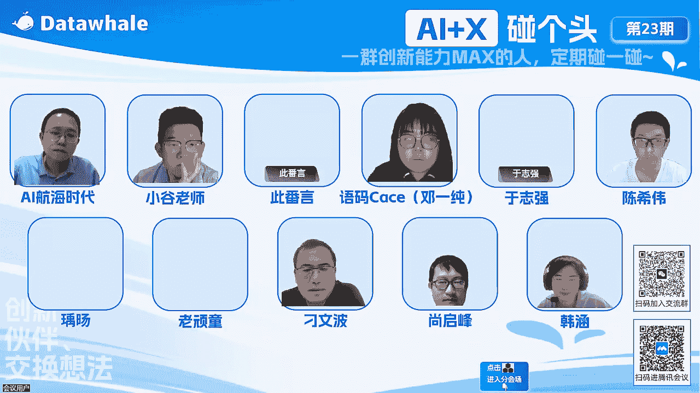
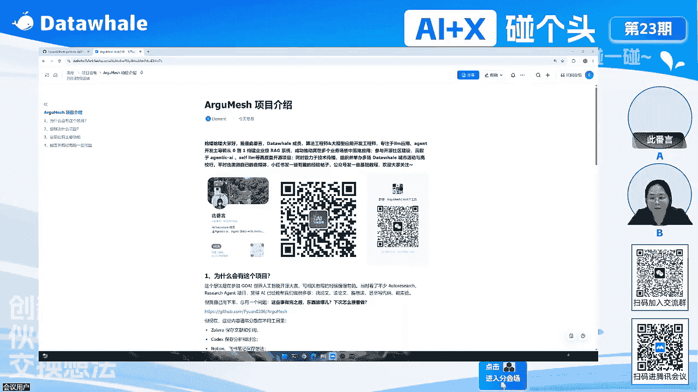

【Datawhale AI+X】AIX碰个头：第1章：活动概述与分会场安排 🎯

在本节课中我们将要学习AIX碰个头活动的基本情况，了解今晚共有多少个分会场，每个分会场分别讨论什么主题，以及作为参与者应该如何进入对应的分会场进行交流。

AIX碰个头是Datawhale社区定期发起的AI主题交流活动，每周二和每周五都会组织社区里的小伙伴报名分享自己关注的议题。本次活动是第23期，共有五个分会场，每个分会场都有不同的讨论重点，大家可以根据个人兴趣选择加入。主持人会先介绍整体安排，然后引导大家进入各自分会场，接下来我们依次查看每个分会场的具体内容。

首先我们来看看主会场的安排。

以下是主会场的议题列表。
- 普通人如何使用Cloud开发游戏
- AI组织下的个人进化
- 阿me相关议题

进入主会场的小伙伴可以直接在当前直播间收听分享，无需额外操作。

接下来是二号分会场的安排。

以下是二号分会场的议题列表。
- AI玩法与个人成长
- AI agent相关议题

由邓一纯、于志强和陈思伟进行分享，三位嘉宾分别从不同角度探讨AI在个人成长和智能体应用方面的实践。

接下来是三号分会场的安排。

以下是三号分会场的议题列表。
- AI加灵感共创

这个分会场侧重于AI与创意灵感的结合，适合对跨学科创作感兴趣的朋友。

接下来是四号分会场的安排。

以下是四号分会场的议题列表。
- 刁文波老师分享的FDE团队共创

这个分会场由刁文波老师主持，主要探讨企业业务流程治理和数字员工落地相关的话题。

接下来是五号分会场的安排。

以下是五号分会场的议题列表。
- 尚启峰和韩涵分享的AI硬件交流

这个分会场聚焦AI硬件和传感器相关话题，适合对硬件开发和场景应用感兴趣的小伙伴。

大家可以扫描右下角的二维码进入腾讯会议，或者查看聊天框中发布的进入分会场的步骤图，按照指引进入自己感兴趣的分会场。直播间的朋友如果想参与，也可以直接扫码加入。

本节我们了解了AIX碰个头活动的基本情况，以及五个分会场的具体议题和进入方法。

【Datawhale AI+X】AIX碰个头：第2章：AI时代个人进化论 🧠

在上一节我们介绍了活动的分会场安排，本节中我们来看看于伟分享的AI时代个人进化论，了解普通人如何在AI时代通过自我进化获得竞争力。

于伟是山东德州人，人生履历可以用九个字概括，就是闯关东、下江南、到深圳。他先在东北读大学，后来去新东方工作，又去江浙沪地区打工，最后来到深圳。在这个过程中，他发现打工很痛苦，正好赶上AI时代兴起，于是开始思考如何利用AI实现个人进化。他希望自己的经历能给大家带来一些参考，特别是对于正处于职业转折期的朋友。

他建议大家不要把AI当成终点，而应该把它当成跳板和一个时间节点。就像跑马拉松一样，每隔两公里设置一个目标，每个目标可以是一个产品、一项技能，或者一个时间差。半年后定一个目标，一年后再定一个目标，这样循序渐进地前进。大家可以把这个思路应用到自己的职业规划中，不必急于求成，而是一步一个脚印地积累。

他总结了个人进化的六个核心能力，大家不需要都精通所有六项，可以根据自身情况重点提升其中几项。

以下是这六个能力的介绍。
- AI原生能力：能不能调动多个AI模型，把任务拆解后交给不同的模型完成，从而提升个人能力边界。
- 判断力：判断越好，认知的高低就越高，也就是对事物的广度和深度掌握程度。
- 审美：不论男女，都要有自己的判断和审美，比如喜欢的品牌、手表、衣品等，这是独特的稀缺资源。
- 销售性能和曝光：未来需要有自己的作品或案例，让别人信任并愿意为之买单，可以通过自媒体或账号积累粉丝和信任度。
- 英语：英语是未来十年全球化的重要标准，建议大家重视英语学习，为未来的国际化机会做准备。
- 杠杆：通过个人定位、品牌、数据和资历，找到自己的支撑点，利用杠杆放大效应，让个人的影响力成倍增长。

关于这六个能力，可以用一个简单的公式来理解。

个人进化 = AI原生能力 + 判断力 + 审美 + 销售曝光 + 英语 + 杠杆

这个公式说明个人进化不是单一能力的提升，而是多个维度的综合提升。每个人可以根据自己的短板，有针对性地进行改进。

于伟还强调，AI不是来淘汰人，而是来净化人，逼着我们学习和进化。大家不要因为找不到工作就消极，而应该拥抱这个时代，拥抱这个机会。AI时代给每个人都带来了重新定义自己的机会，关键在于你愿不愿意折腾，愿不愿意深思熟虑地寻找自己的擅长领域。

本节我们学习了于伟分享的个人进化六个能力，以及在AI时代如何把AI当作跳板而非终点的思考。

【Datawhale AI+X】AIX碰个头：第3章：普通人如何用Cloud开发游戏 🎮

在上一节我们讨论了个人进化论，本节中我们来看看AI大航海时代分享的普通人如何使用Cloud开发游戏，了解没有游戏开发经验的人如何利用AI工具完成一款游戏。

AI大航海时代是一名游戏外行，从九月份开始接触游戏开发，十天前在B站发布了自己开发的游戏，获得了不错的播放量和收藏量。很多评论区的观众询问游戏是怎么做出来的，因此他决定分享一个没有经验的人如何开发出一款还不错的游戏。他的经历证明，即使没有专业背景，也可以借助AI工具实现自己的游戏开发想法。

他使用的模型是Cloud的Opus，这个模型自带文字和图片识别能力。在开发过程中，它可以使用无头浏览器实时查看游戏画面，进行测试和截图，还可以配合Whisper识别文字和语音。AI在开发过程中也很聪明，能够自己制造新工具，比如通过截图一格一格画线来量位置，或者使用FFmpeg等软件把视频切成一帧一帧来查看画面。这些功能大大降低了游戏开发的技术门槛。

但是AI也有不擅长的地方，这时候就需要人类介入。

以下是AI擅长和不擅长的方面。
- 擅长：文字识别、图片识别，短板很少，可以快速处理大量基础内容。
- 不擅长：识别声音里的情绪和节奏，不能理解完整的视频，无法判断游戏的手感和爽感。

因此在开发游戏时，人类的角色是补足AI没有的感官。人类需要发现游戏画面是否别扭、不自然，以及玩起来是否有爽感，然后给AI准确的反馈。反馈必须要准确，不能含糊，否则AI很难分辨用户的真实意图。这个过程就像是在教一个聪明但缺乏生活经验的助手，需要明确的指导。

游戏开发流程可以用一个简单的代码块表示。

游戏开发 = AI基础生成 + 人类感官反馈 + 准确指令迭代

在素材方面，他使用了一款名为Rodin的3D软件，可以通过一张图片生成立体模型，从而开发出人物出色的游戏。AI还会自己去网站查找参考图和实际画面，并进行猜测和匹配，进一步丰富游戏内容。

游戏验收和喊停依然需要人类判断。在开发过程中，他让AI统计自己的交互决策，很多时候决策更多基于审美方面。这意味着开发者要对自己的审美标准有清晰的认识，并在与AI协作时坚持自己的判断。

他还把游戏资产复制成skill，让AI自动开发其他游戏场景。第一个场景可能开发了十几个小时，提炼成skill后，AI开发后续章节可能只需要一小时。这种复用机制显著提高了开发效率。

本节我们学习了普通人如何利用Cloud和AI工具开发游戏，了解了AI在游戏开发中的优势与不足，以及人类在其中承担的感官反馈和决策角色。

【Datawhale AI+X】AIX碰个头：第4章：本地优先开源文献研究工作台 📚

在上一节我们介绍了AI游戏开发经验，本节中我们来看看此番言分享的本地优先开源文献研究工作台，了解研究者如何利用这个工具串联科研全流程。

此番言是算法工程师和大模型应用开发工程师，目前在香港金融公司做AI技术顾问。他参与GOAI世界人工智能开源大赛的research赛道教程写作，主要负责生命科学方向的论文搜集和研究缺陷分析。在这个过程中，他了解到让AI自动扫描论文、找到研究缺陷、再从缺陷中找新方向的流程，这与RSI概念类似。他的项目灵感源于对学术研究痛点的观察。

他发现现有的AI工具虽然能帮助找论文、读论文、提出idea、写代码跑实验，但这些工具没有串联起来。学术研究通常需要在多个工具之间切换，比如保存文献、管理引用、翻译、阅读论文、提取实验方法、讨论想法、写文档、保存代码、排版论文等。因此他决定开发一个平台，把整个科研流程串联起来，让研究者能够在一个地方完成从文献到论文的全过程。

这个项目是本地优先开源的，不需要登录，模型API可以自己填写，整个流程从文献到研究矩阵、研究脉络、实践、再到论文写作，形成一个完整的过程。本地部署可以保护研究数据的隐私，避免敏感信息上传到公共网络。

项目的主要功能包括以下几点。

以下是项目的功能模块列表。
- 全局搜索：搜索之前做过的项目文章或参考资料，快速定位历史内容。
- 任务中心：查看AI完成任务的进度条，掌握当前研究进度。
- 所有项目：新建项目并创建文件夹，组织不同的研究主题。
- 研究助手：基于agent管理实验和研究脉络，从文献中进行洞察，充当专属领域的研究老师。
- 文献管理平台：区分待读和未读文献，标记核心文献，方便后续检索。
- 拍card：从论文摘要、研究问题、方法、数据集、评价等生成草稿，方便快速查找文献。
- 阅读PDF：左右护栏翻译，方便对照阅读外文文献。
- 证据举证：对比多篇文档的论点，找到相关研究方向，支持论证过程。
- 研究脉络：把想法转换成研究问题，从模糊创新点走向明确研究课题。
- 实验管理：目前为待开发阶段，未来将管理实验数据和结果，避免文件夹混乱。
- 论文写作：初始化文件夹，进行论文排版，支持学术规范输出。

这个项目的技术底层基于派SDK，设计了多智能体系统和严格的提示词。AI只能给建议，不能代替人的思考，研究缺口和想法仍然需要人工确认。科研的核心创新仍然依赖于研究者的判断。

科研流程可以用一个简单的代码块表示。

科研流程 = 文献管理 → 读文献 → 提想法 → 讨论 → 做实验 → 写论文

这个流程图展示了项目试图覆盖的完整科研闭环，帮助研究者避免在多个零散工具之间来回切换。

项目目前已经有安装包可供下载，作者希望项目永远保持开源，不会因为用户变多或功能完善而收费。欢迎感兴趣的朋友加入交流群一起贡献代码，共同完善这个科研工具。

本节我们学习了本地优先开源文献研究工作台的设计思路、主要功能以及它如何帮助研究者串联科研全流程。

【Datawhale AI+X】AIX碰个头：第5章：课程总结 📝

在本节课中我们一起学习了AIX碰个头活动的概述、AI时代个人进化论、普通人如何用Cloud开发游戏、以及本地优先开源文献研究工作台四个主要内容。

通过本次教程，我们了解到AIX碰个头是Datawhale社区定期举办的AI交流活动，共有五个分会场，涵盖游戏开发、个人进化、AI agent、灵感共创、团队共创和AI硬件等多个方向。参与者可以通过扫描二维码进入腾讯会议，选择感兴趣的分会场进行交流，社区氛围活跃，适合不同背景的学习者。

在个人进化方面，于伟总结了六个核心能力，包括AI原生能力、判断力、审美、销售性能和曝光、英语、杠杆，并建议大家把AI当作跳板而非终点，拥抱时代机会。每个人可以根据自身短板，有针对性地提升其中几项能力，逐步构建个人竞争力。

在游戏开发方面，AI大航海时代分享了作为游戏外行如何利用Cloud Opus等AI工具开发游戏，强调人类需要补足AI在声音情绪、视频理解、手感判断等方面的不足，并给出准确反馈。没有专业背景也可以通过AI工具实现游戏开发想法。

在文献研究方面，此番言介绍了本地优先开源文献研究工作台，解决了现有AI工具无法串联科研流程的问题，涵盖文献管理、读文献、提想法、做实验、写论文等环节，并承诺永久开源。这个工具为研究者提供了一个集中管理科研全过程的平台。

希望大家能够结合自身情况，选择感兴趣的方向深入学习，在AI时代找到自己的进化路径。学习不仅仅是掌握工具，更是要建立自己的判断力和审美，利用AI放大个人的影响力。

以上就是本节课的全部内容，感谢大家的学习。

