【Datawhale AI+X】AIX碰个头：第1章：大模型前沿研究与可靠性探讨🤖

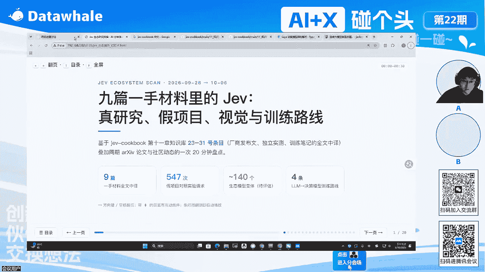

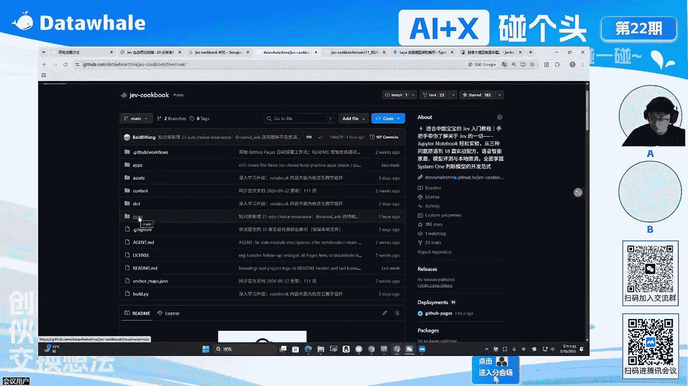

在本节课中我们将要学习易鸣分享的最新大模型研究进展。内容主要围绕J5类模型的可靠性、成本、视觉能力以及模型训练路径展开，帮助初学者理解当前AI模型的真实能力，避免被表面现象误导。

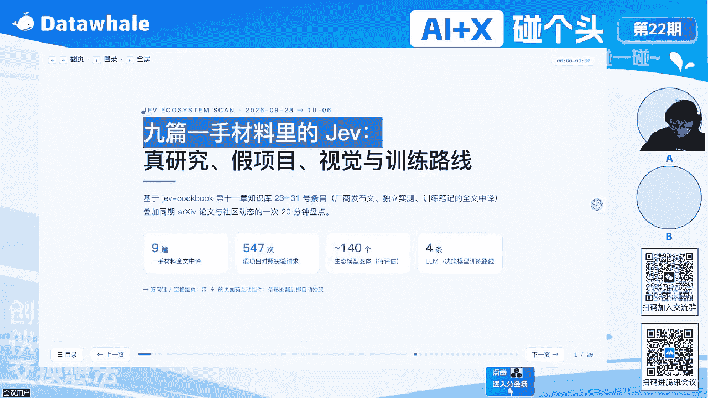

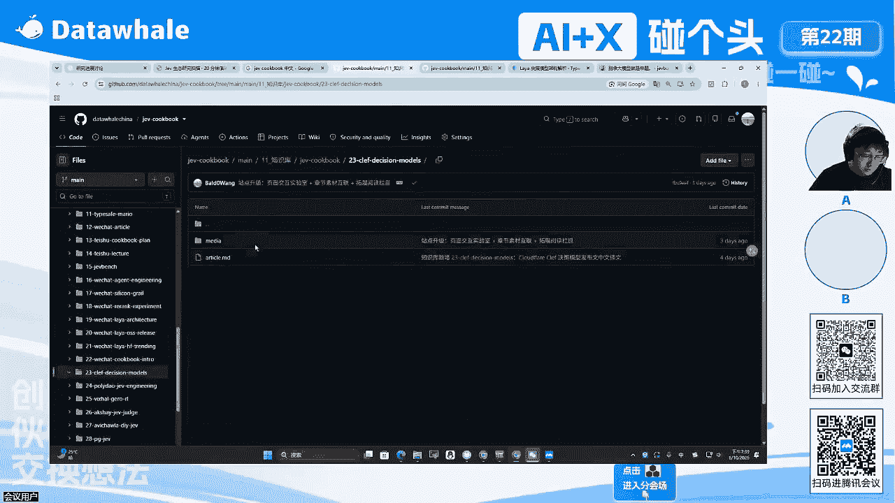

碰个头活动的整体玩法是在腾讯会议中开展分组并行讨论。目前主会场为一号会场，同时设有二号、三号、四号分会场，每个会场围绕不同议题展开讨论。如果你对某个话题感兴趣，可以进入对应的会场参与交流，也可以在聊天框申请移动到指定分组。

以下是本次分享涉及的主要议题方向：

- 模型前沿与个体月迁相关议题
- 技术落地与工程实践议题
- 分组讨论以外的补充议题交流

Gbook知识库中收录了大量最新材料，包括近期刚发布的英文文章以及开源模型相关内容。如果你感兴趣，可以直接在知识库中查阅，无需再去寻找原文。

关于大模型的研究，已经经历了从“怎么用”“怎么训”到“怎么做得更好”的演进过程。当前大家更关注如何将模型应用到实际项目中，以及模型到底贵不贵、好不好用。

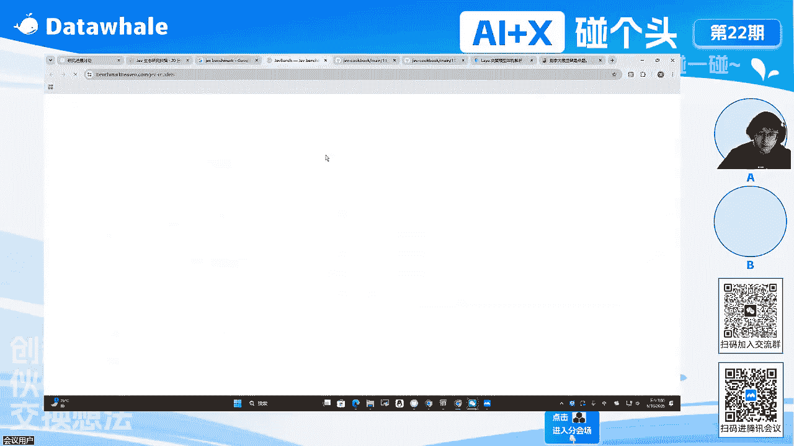

以下是当前研究中普遍关注的几个核心问题：

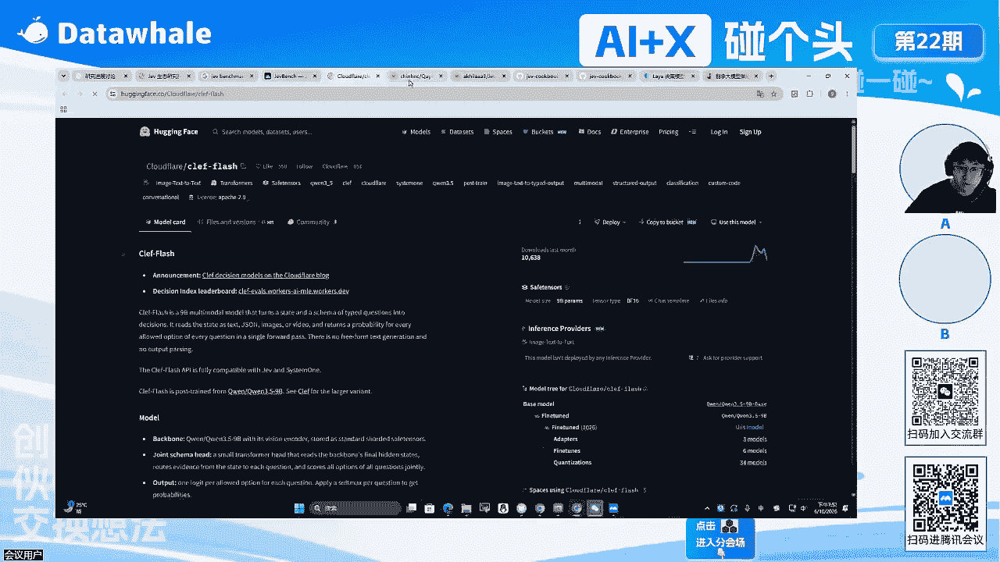

- 可靠性：模型是否可靠
- 成本：使用模型是否省钱
- 自然路线：微调与训练方案
- 实际应用：如何集成到应用系统中

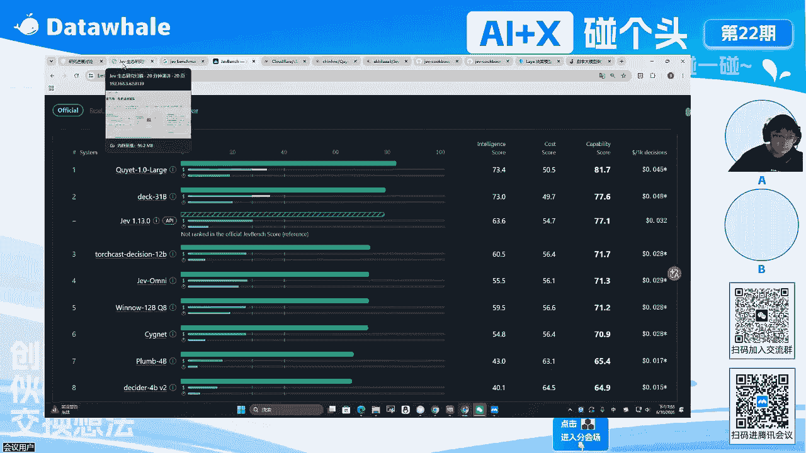

可靠性方面，J5类模型最开始主打的是相对可靠，但测评结果表明，它与大模型相比仍有很大的进步空间，并不是非常可靠的结果。在成本方面，虽然模型并行速度很快，但准确性不足，如果要平衡准确性，成本可能与大模型差不多。

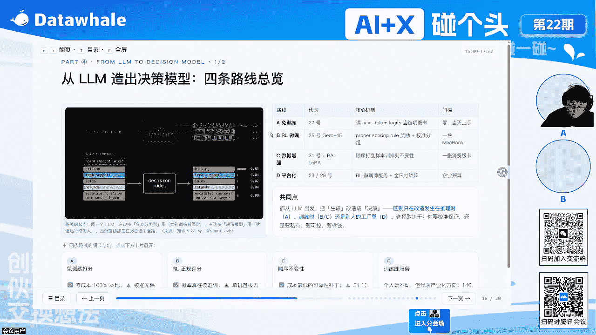

在概率计算方面，存在一个实际实验现象。以抛硬币为例，正面概率与反面概率加起来并不等于一，可以用如下公式表示：

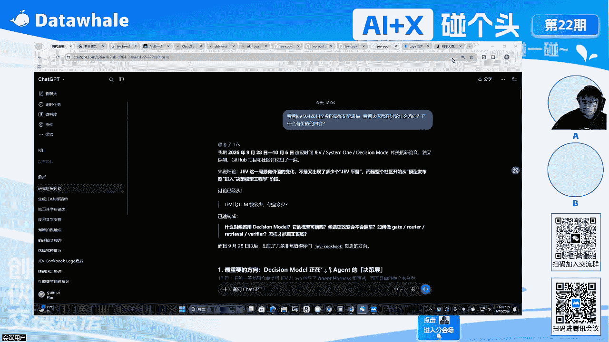

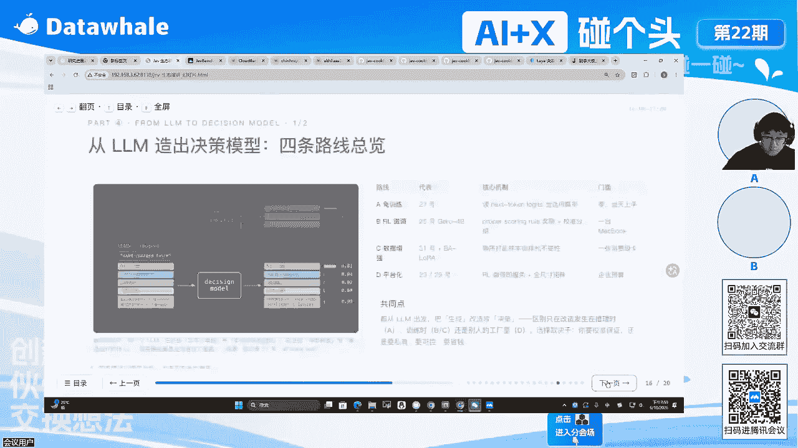

P(正面) + P(反面) ≠ 1

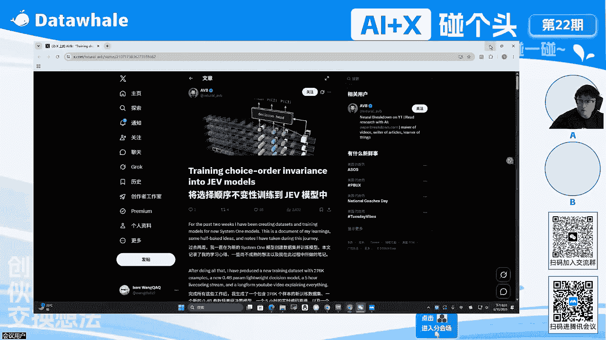

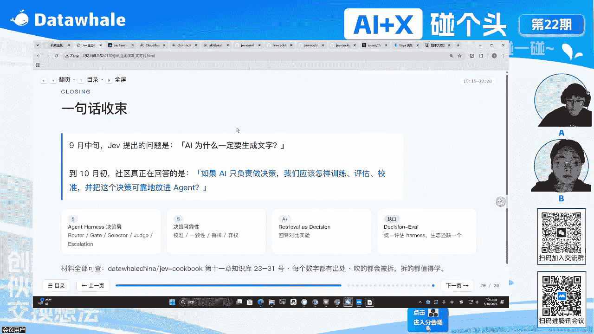

在互质问题中，概率之和也不是唯一的，可能是分数，也可能超过一或小于一。这说明模型在概率处理上仍有很大提升空间。

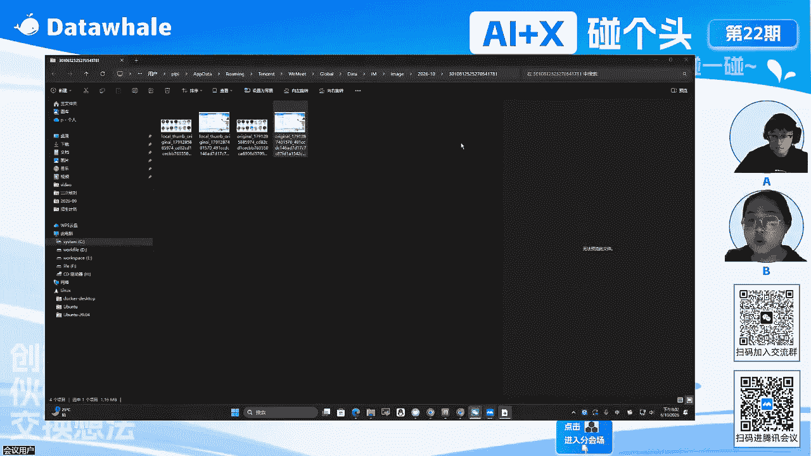

在指标打分方面，如果有14个指标让模型打分，有些指标可能完全用不到。这种情况下，需要对模型进行调整，否则打分无法符合真实的随机分布，模型的可靠性就会受到影响。

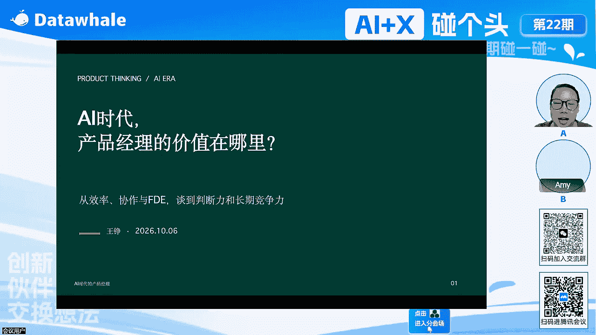

J5类模型也可以作为判别器或模块使用。例如在上下文处理时，传统做法是压缩上下文并可能丢弃有价值的内容，而使用模型打标可以从10条内容中保留3条高价值内容，比单纯保留最后三条更有效。

但是在复杂统计或多跳问题中，模型的成本有时会更高。此外，很多大家看到的视觉Demo其实能力有限，部分马里奥或Minecraft的演示其实是将指令预先输入模型，模型只需做简单判断，并未充分体现模型能力。

例如某个视觉模型声称能挑橙子，背后实际使用的是其他公司的12B模型，而非J5模型本身。这说明在看到Demo时，要思考具体价值体现在哪里，结果是否真实。

关于模型榜单，许多模型只是在其他大模型基础上微调，例如基于Google 431B模型微调，或者基于国内Qwen模型微调。有些模型还使用了RLHF等强化学习策略。因此调研模型时，要看训练方式和策略，不能只看排名。

如果想让模型具备视觉能力并处理数据，建议自己维护一套数据集，因为公共微调模型的数据通常有限。

模型训练路径包括免训练、强化学习微调（如PPO）、数据增强、LoRA以及手冻SFT等。如果你想为研究方向做专门模型，知识库中也提供了数据集构造方法，例如使用DeepSeek构造模拟数据集。

本章我们一起学习了大模型前沿研究的核心问题，包括可靠性、成本、概率异常、视觉能力误区以及模型训练路径，希望能帮助你更客观地看待当前AI模型的实际能力。

---

【Datawhale AI+X】AIX碰个头：第2章：AI时代产品经理的核心能力与护城河💼

在本节课中我们将要学习王真老师关于AI时代产品经理能力建设的分享。内容涵盖AI改变了什么、没有改变什么，C端与B端产品的区别，产品经理的定位与核心竞争力，以及如何建立个人护城河。

AI对产品经理工作的提效，主要集中在中间执行阶段，例如快速定义功能状态、生成PRD文档。但在需求定义阶段，特别是需求沟通，AI最多只能帮你整理信息，不能代替你去思考，因为沟通是边想边说的过程。后期的交付与验证，AI也比较难胜任，因为大模型不知道你实际上线了什么功能，也不知道最初的需求定义是什么。

以下是短期内很难交给AI的环节：

- 需求的理解、定义、取舍以及每一个功能的推敲过程
- 协作与沟通，包括钉钉上的讨论、突发会议、发言倾听等
- 交付与责任，包括对绩效、KPI、OKR的承担

需求理解需要结合丰富的上下文，这些上下文散落在企业的用户行为数据、老板的临时想法、竞品信息、客服咨询投诉等各个地方。在数据没有很好协同之前，数据收集者和决策人还是要靠产品经理自己。

会做和会判断中，会判断更加重要。AI已经把动手能力拉高，但作为产品经理，我们更多要思考为什么要做这个功能、在哪个系统上、怎么做、面对竞品该怎么做差异化，以及何时停止。这些价值判断虽然AI也能给出结论，但结论的采纳和后续责任仍然在人身上。

一个人不能等于一个团队。即使有AI，一个人一天也只有24小时，扣除睡眠和吃饭后大约16小时，AI也不能完全替代开发、设计、运营等所有角色。而且AI生成的代码或方案，如果你负责任，仍然需要大量修改。

因此不要认为AI来了一个人就能顶一个团队。AI越强，我们越要读懂业务和用户，因为AI的上下文并不准确，只能在点状方面提供协助，不能代替你收集信息、判断信息和思考。

AI原生团队最大的变化是每个人都能用AI做自己不擅长的事情。老板可以用AI写需求，研发可以用AI做产品，前后端界限模糊。在这种情况下，未来的产品经理需要让每个人做自己擅长的事情，减少重复劳动和内耗，对外确定功能边界，对内组织协作，有点像项目经理和HR的结合。

从0到1的产品经理，要关注深入一线、看数据、看流程、充分沟通、发现问题、识别假设并说服业务方进行低成本试错。从1到100的产品经理，要关注市场理解、团队稳定交付和高效交付。

不要做提示词搬运工。如果你只是收集上下文、搬运信息，很难形成独特贡献。在AI时代，难被替代的能力是在复杂条件下把所有问题解决好。

可以通过拥有多种MBTI属性，成为复合型人才。AI不能做的事情是推动沟通、连接和协作，如果你能做到这一点，就比AI更好用。

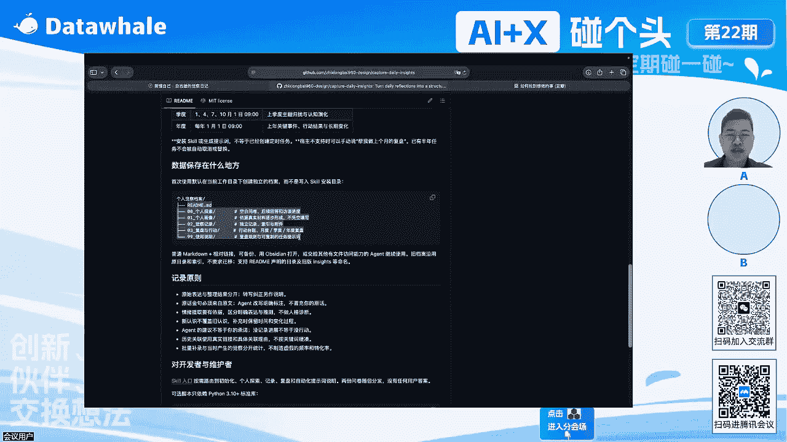

产品经理的护城河包括行业资产和靠谱的人。深入行业后可以从产品经理变成行业方解决专家；而靠谱的人是指有落地能力，能让甲方或老板产生深深的信任和依赖，证明在没有AI的情况下你也能把事情做好。

本章我们一起学习了AI时代产品经理的核心能力，包括AI提效的边界、不能交给AI的环节、判断力的重要性、团队协作方式、个人护城河的构建，希望能帮助你在AI时代找到自己的不可替代位置。

---

【Datawhale AI+X】AIX碰个头：第3章：用AI构建持续成长的个人记录系统📓

在本节课中我们将要学习志雄分享的“蒸馏自己，用AI构建持续成长的个人记录系统”。内容包括个人档案的构建、记录的四个直接作用、值得记录的时刻，以及长期价值。

“蒸馏自己”不是指蒸馏离职同事的工作方式，而是更充分地给AI交代上下文，从而得到一个真正懂你的个人助理或AI助手。

“持续成长”的核心在于两点：一是持续去做记录，二是记录本身会产生自我更新和迭代。这种更新由复盘产生，例如每周、每月或每年做一次复盘，从已经发生的事情中提取新内容，不断完善记忆系统。

个人记忆系统可以理解为个人档案或个人画像，它不仅记录你是谁、叫什么、做什么工作，还能展现一个成长的自己，包含基本信息、长期职业主线、现实困境和能力结构等，具有立体性和成长性。

以下是个人档案的四个直接作用：

- 自我介绍：基于个人档案，AI可以快速生成针对不同需求的自我介绍或简历，如讲师版简历和培训版简历
- 求职简历：根据应聘岗位要求，AI生成针对性的个人简历，突出相关优势
- 创作：为公众号、口播个人IP、直播等自媒体创作提供底稿，包含你的观点、情绪变化和行动改变
- 决策模型：为中高层管理人员提供基于历史决策的参考，遇到新问题时先让AI基于个人档案生成决策草案

长期作用是让AGI更了解你。未来如果人人都有类似钢铁侠贾维斯的AI管家，区别在于谁更了解你。从当下开始记录日志和人生日志，等到AGI时代到来时，你会拥有比别人更多的上下文，从而获得更好的交互体验。

志雄的个人经历是从程序员转行销售，发现表达能力是优势，之后开始重视记录。通过持续记录，不仅挖掘优势和擅长，还挖掘观点、情绪变化和价值观。

在个人记忆系统中，记录的方法类似产品经理的用户故事（User Story）。一个完整的事件记录应包含场景（时间、地点、人物）、预期、现实、反应（情绪或行动）。这可以还原真实场景，从中挖掘你是一个什么样的人，优势是什么，观点和情绪如何。

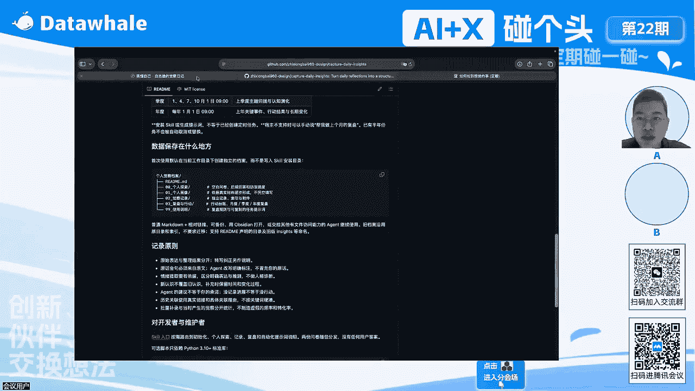

以下是值得记录的四个时刻：

- 情绪波动了，哭了或笑了，被触动的时刻
- 行动出现了变化，以前不愿意做的事情今天想去做了
- 观点形成，对某个问题有了自己的判断和批判性思维
- 有新的启发，旧事或新事带来了独特见解或灵光乍现

这些记录必须是你自己吸收、消化后反向输出的结果，而不是单纯收藏别人的文章或视频。因为行为不会骗人，所有行为都来自于内核，内核包括三观、优势、性格、MBTI等。通过行动还原内核，比只看你说了什么更深刻。

安装对应的skill后，大概会得到三个操作：直接记录、先梳理自己、定时复盘。先梳理自己包括填写问题清单，涉及热爱、擅长、价值观、人生关键事件等。填写完成后，AI会帮你构建初始版个人画像。

个人画像体现你的热爱、擅长和价值观，回答“你是一个什么样的人”。例如很多人答不上来“三观一致”中的三观具体是什么，也说不清自己的价值观，AI可以帮助梳理。

有一本书叫做《如何找到想做的事》，核心观念是：想做的事等于热爱 ∩ 擅长 ∩ 价值观。如果当前的事业、工作或生活正好命中这三者的交集，就很幸运。以前找这样的交集周期很长，现在有了AI，只需完成问题回答，AI就能帮你梳理。

记录时，要保留事情发生节点时你最真实的反馈，后续再补充发生了什么，通过修正或推翻完成复盘，让自己重新认识自己。这是一个持续完成的过程，可以反复记录、复盘、迭代，形成螺旋式前进。

本章我们一起学习了如何用AI构建持续成长的个人记录系统，包括个人档案的定义、四个直接作用、值得记录的时刻、记录方法以及长期价值，希望能帮助你建立属于自己的个人AI助手。

---

【Datawhale AI+X】AIX碰个头：第4章：高中生黑客松初体验与商业思考🏆

在本节课中我们将要学习天高分享的高中生黑客松初体验。内容包括港科大火鸟黑客松的参赛过程、团队合作、技术与商业的平衡，以及给新人的参赛建议。

港科大火鸟黑客松不是传统意义上的48小时或24小时极限比赛，而是给出命题，提供一两周创作时间，专家组筛选后进入线下Demo Day演示。天高是高二学生，人生中第一次参加黑客松。

本次命题来自东江集团，分为HR招聘端和法务风控端两个赛道。天高选择了更难的法务风控端，即做一个客户授信合同审核审批的Agent，与人工协作。由于对产业了解为零，他在群里找了两个队友：一位来自广州国企供应链的姐姐，熟悉授信展期等业务；另一位是腾讯的产品队友，从用户角度进行产品设计。

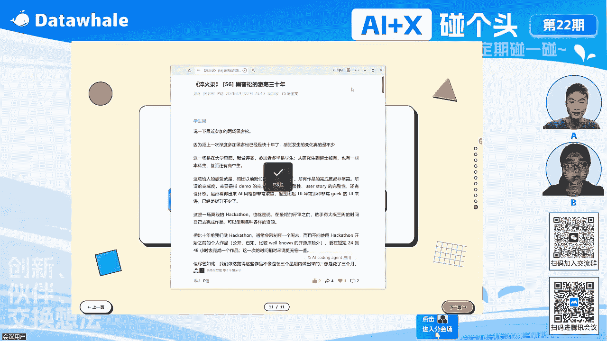

在AI时代，AI可以把流程梳理得很详细，但未必是最优方案。真实业务流程中有很多冗余步骤，你的思维不要被AI牵着走，要自己思考哪些东西要、哪些不要。做减法比做加法难得多。开头就要把整个框架大体拍板下来，不要被AI说的每一个功能都加进去，否则简单的东西会被复杂化。

黑客松中普遍缺少两种东西：真正的技术突破和真实的商业思考。技术突破不一定要创造新技术，可以是将现有技术整合、对叠并应用到真实场景。商业思考则要考虑Demo做出来后，路演时是否有人愿意买账，是否有持续发展的方向，不要开发没有用户和顾客角度的伪需求。

评委指导了两个方向：一是继续简化流程，企业内部不需要逐级领导审批，下级主管审批即可，要站在企业角度考虑问题；二是利用网上公开搜索到的材料和第三方评级，让AI自由搜索获得信息。

在展示作品时，应该先讲“为什么”，而不是先讲“做了什么”。站在你产生这个想法的角度，让别人了解你是怎么想的，为什么有这个需求，体现你对产品和整个比赛的透彻理解。

迭代过程要记录下来。不要闷头开发，想到哪做哪，要记录每次迭代为什么要开发这个功能、如何进一步开发、层级递进关系。这样评委老师能清晰看到产品是怎么一步一步改进的。

黑客松中大家用的技术差距不会太大，关键在于如何包装项目。思考你的突出亮点，与同类产品相比有什么优势，把亮点包装起来，成为路演答辩的突出点。

AI时代黑客松中，快速试错和通宵苦熬的价值已被大幅消解。可以不断快速试错找到新方向，但前期最好先想清楚要做什么、为什么做，可以深度反弹潜在用户，把商业计划先写出来，了解总潜在市场，避免最后做了很多无用功。

部署方面，前期就要建立验收标准，用全新环境把产品一步步搭起来，作为客户体验使用感受，考虑可迁移性，不要把部署问题拖到最后。

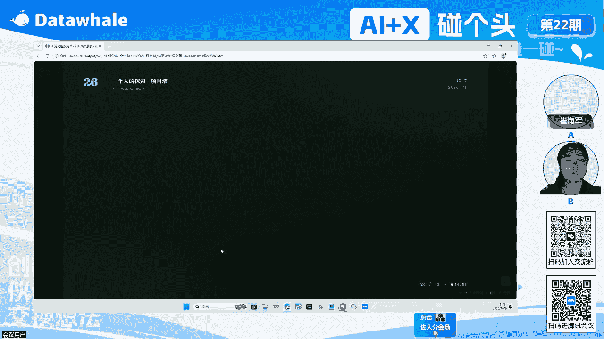

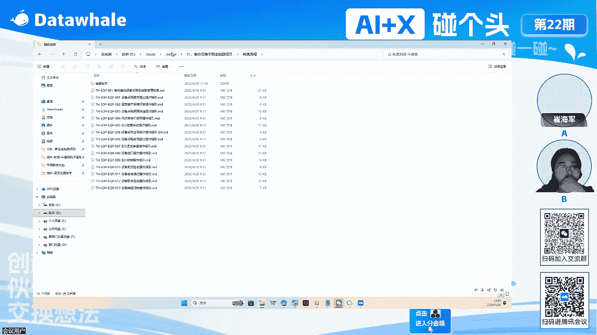

路演时要注意三点：从为什么讲起；完成度不等于价值，功能堆砌没有用，要体现背后的真实思考；形成共识，让在场所有人认可你的产品，而不是说自己多牛。

最大的收获不是作品本身，而是把你为什么要做这个东西说出来，并和别人达成共识，这才是打动评委的关键。

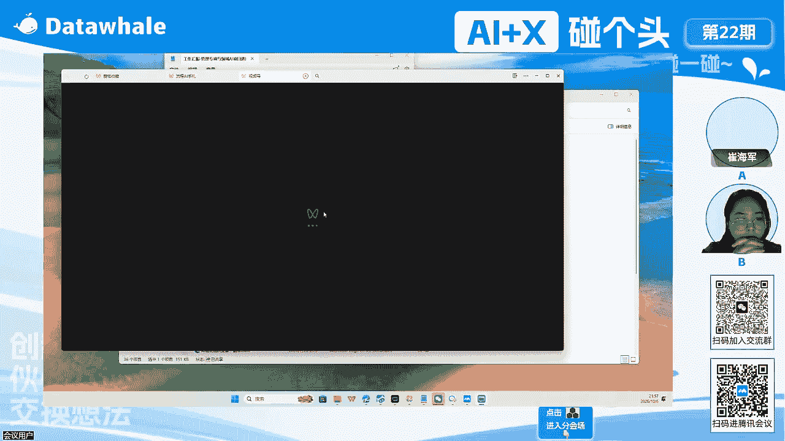

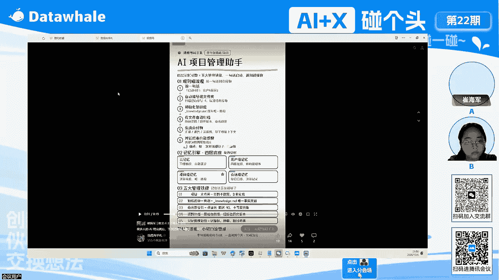

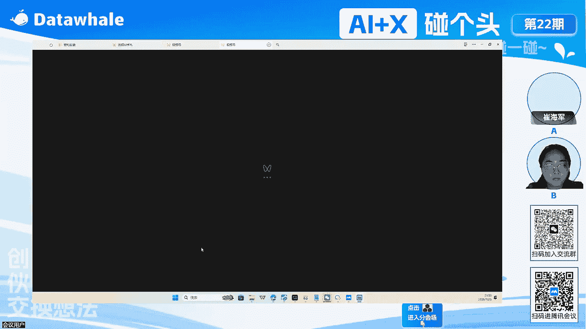

本章我们一起学习了高中生参加黑客松的全过程，包括团队组建、技术与商业的平衡、简化流程、展示技巧、迭代记录以及包装项目，希望能为初次参赛的新人提供参考。

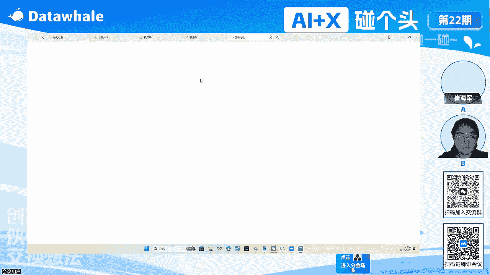

---

【Datawhale AI+X】AIX碰个头：第5章：企业内部AI推广与FDE实践🏢

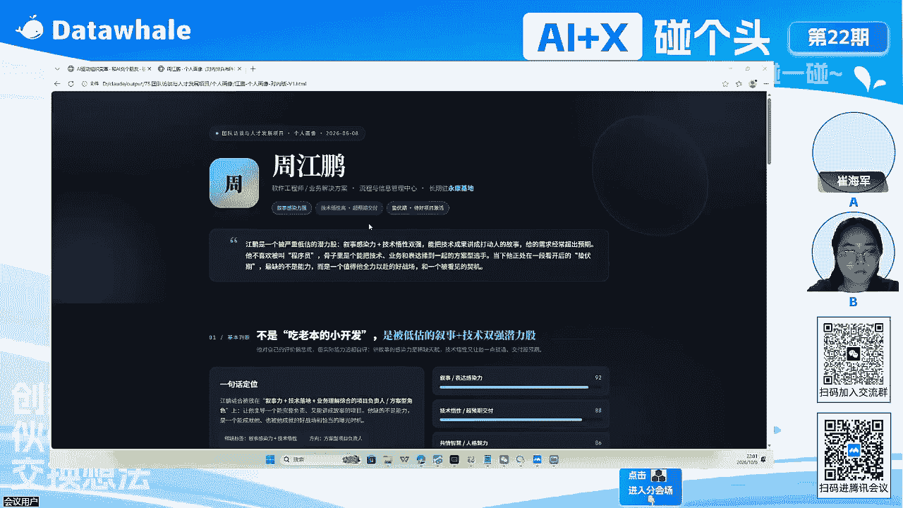

在本节课中我们将要学习崔海军关于企业内部AI推广与FDE（现场交付工程师）实践的分享。内容包括如何在企业推广AI、如何成为超级个体、业务团队如何参与AI开发，以及针对政府和医院场景的建议。

崔海军在一家保温杯头部企业工作，原本负责流程团队，现在负责全公司的AI推广与落地。企业推AI时首先面临的问题是大家担心被替代，自己也有焦虑。后来总裁深夜在群里询问小保温杯市场情况，崔海军用AI工具快速生成分析报告并发到群里，总裁很开心，并分享到产品委员会。一位负责人回复说，第一个行动的人才能第一个享受成果，这让他的焦虑感降低。

技术平权意味着即使以前不会开发，现在也能做内部项目管理系统等工具。传统需求传递存在信息衰减：业务提需求，产品经理能讲明白70%，交给开发后剩下40%，业务确认后可能不到30%。降低开发门槛后，可以让业务团队自己做小应用。

企业内部正在搭建新的流水线，鼓励业务团队单独开发围绕ERP周边的小应用和工具。流程团队转型为赋能者，教会别人如何用AI完成应用开发、测试和部署，从而成为新的FDE概念。

推AI时要强调AI能帮助个体变强大，个体强大后能对抗焦虑和技术冲击。个人能力提升、价值感增强、工作热情提高后，自然会沉淀为组织能力，整个组织变得更好。

过去推AI时，很多做法只是数据处理和工作流配置，前台是企业微信机器人，业务部门不关心是不是真正的AI，只关心工具能否降本增效、节省时间。

个人工作台中有很多零碎文件夹，计划将其整合到知识库中。视频号制作有多种方式：剪映图片+配音、skill提炼为一页图片、从他人视频萃取skill、workbody制作，以及自己录口播视频交给AI合成。

个人分身也是正在尝试的方向。职业规划访谈方面，会和团队小伙伴聊一小时，形成个人画像和职业规划，引导出每个人的天分，例如叙事感染力强的开发。会议纪要的逐字稿可以丢给AI生成各种报告。

FDE与产品经理的区别不大，还是面对一对一的用户，只不过用户可能是坐在你身边、对面或隔壁办公室的同事。人数不多，但每家公司业务不同，需要共情能力，充分了解同事的工作，现场复原他们的工作流程。

未来的产品经理既要懂产品，也要懂工程。懂产品就是能快速用AI能力定义产品、写文档；懂工程就是能帮大家摆正位置、安排流程、把产品做出来。两个能力都具备，就是团队中不可或缺的角色。

不会写代码也能做产品经理。AI拉平了很多人的短板，拉长了长板。真正的demo制作发生在执行阶段，但如果把精力放在价值判断上，不写代码也能协助公司做出更好的产品。

0到1和1到100的产品经理关注点不同。0到1要关注一线数据、流程、沟通、发现问题、识别假设、说服业务方低成本试错；1到100要关注市场理解、组织团队稳定高效交付。

不要做提示词搬运工，只收集上下文、搬运信息很难形成独特贡献。在AI时代，难被替代的能力是在复杂条件下解决好所有问题。

政府部门或卫健委推AI的建议包括：工具平台方面，企业微信、钉钉、飞书都有类似平台，选一个即可；先找场景，把工作拆解开，找一两个点突破；系统周边自动化，例如从邮箱拿PDF订单，转化成ERP需要的表格；独立小应用由业务部门自己开发，技术团队辅导。

部署维度包括本地处理数据、资料库小规模部署、服务器内网部署、服务器外网部署。外网需要更多信息安全检查和防护。电脑配置也很重要，如果跑不动AI工具，可能需要换更好的电脑，并准备token预算。

针对产品需求优先级，要在产品适应客户和客户适应产品之间平衡。甲方往往产品思维弱，有什么需求就做什么，效率很低。应该以客户痛点为优先，但要跟流水线碰，引导需求，比如告诉业务能搞定第四个且能节省时间，就不会对前三个提出更多需求。

内部用户不敏感，可以直接引导；面向终端客户的产品，策略会不同，要根据服务策略决定产品形状。

本章我们一起学习了企业内部AI推广的实践经验，包括技术平权、信息衰减、FDE转型、个人赋能组织、场景拆解方法、部署维度以及产品需求优先级，希望能为在企业推广AI提供参考。

