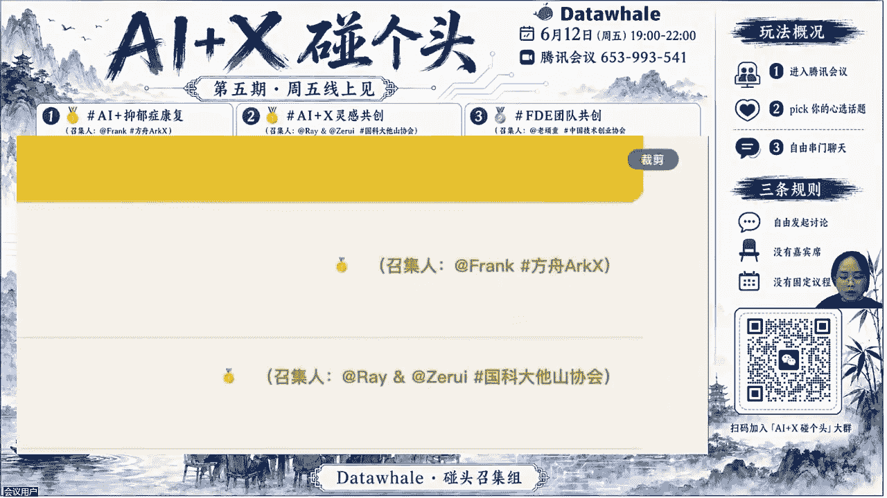

# Datawhale AI+X：01：AIX碰个头活动参与指南👋

在本节教程中，我们将学习如何参加Datawhale AI+X举办的AIX碰个头活动。你将了解活动的基本玩法，掌握进入不同话题分组的方法，并认识各个分组房间的主要讨论内容。无论你是初次参加的新手，还是希望寻找志同道合的搭子，这篇指南都能帮你快速上手。

## 一、活动概述与基本玩法

AIX碰个头是一种基于兴趣话题的线上交流形式。活动的核心理念是，每位召集人根据自己感兴趣的方向发起话题，邀请其他参与者一起围绕这些想法展开讨论。每一期活动都会包含大量话题，本次共有二十四个分组序号供大家选择。由于话题数量较多，召集人不会在主会场逐一进行详细阐述，只有少数召集人会来到主会场进行简短交流。七点半之后，活动将开放自由麦克风时间，每位有分享需求的参与者可以获得十分钟用于介绍自己的项目、应用或经验。


进入分组讨论的操作流程如下：

```
如果设备类型 == 电脑端:
    点击应用左侧的“分组讨论”按钮
如果设备类型 == 手机端:
    点击屏幕右下角的三个正方形按钮
进入分组列表后:
    根据序号选择感兴趣的话题
    点击该话题右侧的“加入”按钮
```

完成以上步骤后，你就会进入对应的话题小组房间，开始与其他成员进行讨论。

## 二、各分组话题详细介绍

以下是本次活动中主要话题房间的内容介绍，你可以根据自身兴趣决定加入哪个分组。

### 1. 20号房间：对话信息沉淀产品

这个分组围绕一款对话信息管理产品展开。召集人发现，很多重要信息并没有写在文档里面，而是分散在会议反馈、客户沟通、项目讨论等各种对话场景中。这些对话中蕴含着个人诉求、决策背后的判断，以及项目潜在的隐性风险，但这部分内容很容易流失。因此，该产品的目标不仅是生成简单的会议纪要，而是希望利用AI真正读懂对话，将每个人的沟通转化为可沉淀、可追问、可行动的认知资产。

该产品的核心逻辑可以表示为：

```
认知资产 = AI对话理解 ×（可沉淀 + 可追问 + 可行动）
```

目前，产品已经打通了腾讯会议、飞书、妙计、钉钉闪记等多个渠道，并支持相关硬件设备。使用者只需点击一次数据同步，系统就会将相关数据全部拉取过来。如果你对这个方向感兴趣，欢迎来到20号房间与召集人深入交流。

### 2. 12号房间：AI科研绘图实战

这个分组的主题是AI辅助科研绘图的实践。召集人希望探讨如何使用AI让科研绘图变得更可控、更美观。相关的教程项目已经开源，团队也开发了一个配套的skill，并且联合人民邮电出版社出版了一本相关书籍。欢迎感兴趣的参与者来到12号房间，一起讨论AI在科研绘图场景中的作用、常见的坑点，以及可行的实操思路。召集人也可以现场演示一些简单的操作步骤。

### 3. 9号房间：求职全流程项目

这个分组由一位来自传统行业的参与者发起。他从事品牌市场相关工作，属于零基础学习编程，接触coding大约一个多月。他完全基于个人需求，独立完成了一个求职全流程的开源项目，并已在GitHub上发布。项目上线后收到了不少正面反馈，包括有同学晒出首次运行成功的截图，也有同学在GitHub上提交bug修改申请，甚至收到了赛事邀请。目前该项目已经提交了三十多次修改，相对比较完整。

召集人希望借此次活动介绍项目的设计思路，并现场演示最新版本的更新内容。他表示自己带着问题前来，希望能与AI背景更深厚的参与者交流，实现双方共同成长。如果你对求职相关的AI应用感兴趣，可以加入9号房间。


### 4. 19号房间：AI文献阅读器

这个分组讨论的是一款AI文献阅读软件，兼具一定的社交属性。一位参与者表示自己也在做类似方向的项目，但目前完成度不高，尚未正式申报。他建议不要把auto science的切入点定得过大，整个科研领域非常广泛，更合适的切入点是文件阅读器。因为文件阅读器本质上是一个知识库，科研中的想法、方法和算法很多来源于文献。如果能高效组织文件，通过文献来定位文件，就相当于在阅读器基础上实现数据迭代，这将成为auto science的一个良好切入点。

欢迎对AI文献阅读器感兴趣的朋友进入19号房间，一起探讨这款软件应该长成什么样子，以及各自的想法和需求。



### 5. 7号房间：图形AI大模型

这个分组由一家已经成立的公司发起，拥有自研的图形AI大模型，希望将其应用于工业场景。召集人解释了图形模型的核心思路：人类认识世界是从三维世界出发，看到杯子时能直接理解它是杯子，而不需要先想“杯子”这两个字。相比之下，语言类AI通常会先处理文字，再去查找相似图片，这种方式难以真正进入真实的物理世界。

图形学模型的设计逻辑是先从三维世界开始，再理解图纸上的内容，从图纸出发输出二维图纸和文字信息。如果你从事工业相关工作，或者对图形AI大模型的底层技术感兴趣，可以进入7号房间与召集人交流。

### 6. FDE相关话题房间

以下是几个与FDE领域相关的分组，你可以根据需求选择加入。

- 3号房间：来自中国技术创业协会融合创新发展专业委员会的召集人发起，召集人并非典型开发者，而是带来了许多真实的需求和资源，适合希望了解行业实际痛点的参与者。
- 4号房间：围绕“从demo到agent落地，FDE到底解决了什么问题”展开，有直播分享，邀请有经验的人讨论Agent落地、FDE岗位职责，以及真实业务场景中的坑点。
- 16号房间：讨论FDE相关的认证考试，特别是cloode官方架构师认证。召集团队是FDE领域的创业公司，可以交流如何学习该认证，以及认证的实际价值，但目前国内暂时还没有相应的考试入口。
- 22号房间和24号房间：都与OPC相关，其中22号房间有线下活动场景，召集人是来自成都的OPC从业者，擅长长时间深入交流，通常是活动中最后结束的房间之一。

除了上述重点房间，还有关于抑郁症康复、一起开发青山村online等话题的分组。抑郁症康复话题自带温度感，召集人有相关个人经历，希望通过分享帮助更多人。青山村online则计划打造虚实结合的文旅游戏，通过游戏化设置连接村内外的人，数字化青山村社区，召集人已有项目想法和方案，正在寻找技术搭子和开发人员。

## 三、如何判断话题是否适合自己

在决定加入某个分组之前，你可以通过以下几种方式了解该话题是否匹配自己的需求。

1. 查看官方推文。活动方每次发布推文时，都会对各个话题进行介绍，说明召集人目前在做什么，以及他们在交流过程中希望达成什么目标。
2. 扫描海报进入话题群。每个话题都有对应的海报和二维码，进入群组后可以直接向群主或召集人询问，这个话题是否适合自己。
3. 阅读话题介绍链接。每个话题群里都有对应的介绍链接，链接中会清楚地说明召集人想聊什么内容，适合什么样的人参与，以及计划重点回答哪些问题。

根据话题的起步阶段，可以大致分为几种类型。有些话题只是召集人有一个初步想法，打上“表想法”标签，可能本身还没有想清楚最终要做成什么样子，这种情况非常适合希望早期入场、参与共创的人。有些话题侧重于聊经验和聊经历，比如抑郁症康复，本身带有温度感，适合愿意分享个人故事的人。有些话题会注明召集人的机构或组织背景，帮助参与者做出可信度判断。还有一些话题，比如青山村online，召集人已经有项目方案，明确寻找技术搭子，适合具备开发能力的人加入。

## 四、开放麦环节与参与者讨论

活动设有开放麦克风环节，任何人都可以直接开麦提出问题或分享项目。在之前的交流中，几位参与者提出了一些具有代表性的困惑，以下是整理后的内容。

### 1. 技术能力与项目匹配问题

一位参与者提到，每个人对人工智能技术的掌握程度不同，从普通用户只会使用豆包等工具提问，到能够独立编写代码、进行创造性开发的进阶用户，差距较大。他希望了解哪些项目适合新手，哪些项目已经进阶，以及整个社区目前的整体状况。

对此，活动方建议通过推文、海报和话题群中的介绍链接，提前了解各个项目对参与者能力的要求，并在进入群组后直接询问召集人。

### 2. 如何让自己的想法具有差异化

另一位参与者发现，自己的AI运维Agent想法与他人高度相似，但别人开发得更快、更完善。由于AI降低了开发成本，很多想法容易被他人快速实现，他希望知道如何让自己的特点更显著，如何让自己的想法在同类产品中更稳定地脱颖而出。

活动方给出的建议是，一款产品不可能通吃所有人，不同人群对产品有不同偏好，试图打赢所有类似项目本身就是一个不切实际的命题。世界很大，个人的精力和时间有限，必须进行取舍，不能期望瞬间抹除他人三到五年的积累。带着“必须打赢”的心态往往难以向前走。

更现实的做法是，选定一个方向后，依靠长期投入积累的信任和资源，在该领域站稳脚跟。同时，时代和用户需求在不断变化，尤其是AI领域，半个月甚至一周就可能出现新概念，如果跟不上变化很快会被淘汰。你需要积累的，是所在领域的直觉，以及相应的信任和商业化闭环。只要能接到单子、在某个方面跑通商业化，就足够了。

如果发现他人的想法与你不同，没有必要强行融合，可以坚持做自己的思路，也可以与相似项目联合，共同探讨生态繁荣和共赢的可能性，而不是一家独大。

关于如何展示自身特点，核心在于挖掘自己的优势点、资源优势和亮点，拼的是对这件事情的理解程度。要不断优化细节，但要注意，细节决定成败指的是关键细节，而不是无限制地打磨每一个小细节。你必须抓住大头和核心价值点，如果核心价值无法说服用户或达成共识，那么再多细节也只是一个空壳。因此，建议尽可能抓住重点。

可以用下面的公式来辅助理解：

```
差异化竞争力 = 核心价值点 × 长期信任积累 × 领域直觉
```

## 五、注意事项

参加活动时，请注意以下几点，以免造成不必要的困扰。

1. 召集人的上线时间不统一。整体活动从十九点开始，但每个召集人有自己的风格和时间安排，有些召集人可能要在八点半左右才能到场，如果需要等待，可以稍微等一下。
2. 同一时间只能加入一个房间。如果想切换房间，可以继续点击“分组讨论”进入其他房间，除非你使用多个账号。
3. 每个房间的交流内容都会录制，并会在碰头活动的大群中分享，建议关注自己是否已经加入对应的交流大群。
4. 手机端如果使用小程序登录，可能看不到分组讨论按钮，此时无法由主持人强行拉入，建议下载腾讯会议客户端。
5. 直播将在八点整结束，但之后你可以在主会场或各个分组讨论中自由交流，时间不限制。

## 六、总结

在本节教程中，我们一起学习了Datawhale AI+X AIX碰个头活动的整体玩法，掌握了在电脑端和手机端进入分组讨论的具体操作步骤，详细了解了20号、12号、9号、19号、7号等主要话题房间的内容，以及FDE相关分组的基本情况。我们还学习了如何通过推文、海报和话题群判断话题是否适合自己，并在开放麦环节中梳理了关于技术能力匹配和差异化竞争的常见问题与建议。希望这篇指南能帮助你顺利找到感兴趣的话题，在活动中收获有意义的交流。

