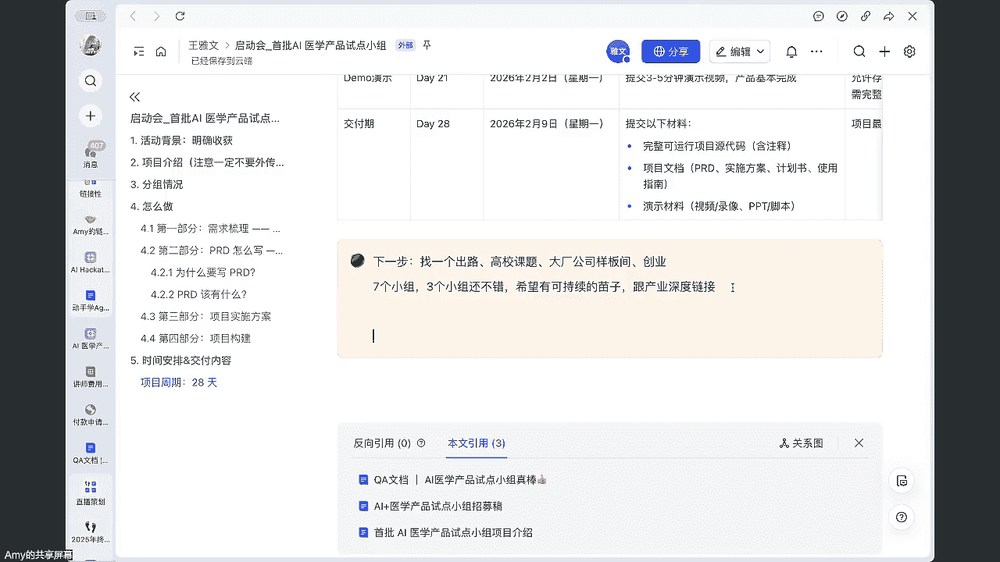

## 🏥 AI医学产品试点：01：课程概述与核心目标


在本节课中，我们将一起学习Datawhale AI+X AI医学产品试点小组的整体背景与设计初衷。这个小组成立的目的，是希望每位参与者能够获得三方面的核心能力，分别是需求翻译能力、编码能力，以及项目实施方案的制定能力。接下来我们将依次展开说明这些目标，帮助你理解参加这个试点小组究竟能收获什么。

## 📋 AI医学产品试点：02：第一核心能力——需求翻译能力

在上一节我们介绍了课程的整体目标，本节中我们来看看第一个核心能力，也就是需求翻译能力。这是小组最初设定的三个目标之一，也是我们把它放在第一位的原因。

现在编写代码已经不再是一件特别困难的事情，即使你之前没有写过代码，也可以通过学习快速上手。真正的难点在于，你能否把业务需求搞清楚，理解背后的本质是什么，并且知道这个业务应该如何落地。你需要写出程序员能够看懂、听懂的文档，同时也要让医生或者其他医疗从业者明白你的文档中表达的业务需求是什么。也就是说，你必须先了解实际场景中的需求到底是什么，你要解决的问题是什么，这是非常关键的一点。


需求翻译可以用下面的公式来描述：


```text
需求翻译 = 业务场景理解 → 程序员可理解的技术文档 → 医生或医疗从业者可理解的业务文档
```


以下是需求翻译的核心要点：


- 理解实际业务场景中的真实需求。
- 明确你要解决的具体问题。
- 撰写程序员能够理解的技术文档。
- 撰写医生和医疗从业者也能看懂的业务文档。

## 💻 AI医学产品试点：03：第二核心能力——编码能力与PRD编写

在上一节我们讨论了需求翻译能力，本节中我们来看看第二个核心能力，即编码能力与PRD的编写。这部分内容是在启动会上介绍过的，也可以看作是对大家的一次基础培训，讲清楚为什么要做这件事情，以及该如何去做。

在不同的场域中，你需要知道谁来负责这件事情，并不断地分析，去发掘对方隐藏的真实需求。在编写PRD之前，我们先要定义为什么要写PRD，因为现在AI的发散性非常强，而作为人类，你需要对它进行收敛，做降噪处理，把一些泛泛的想法变成可以被国标规则约束的东西。


PRD的编写逻辑可以简化为下面的公式：


```text
PRD = 为什么要写 + 要写什么内容 + 需要被谁阅读理解
```


以下是编写PRD时需要注意的内容：


- 明确为什么要编写PRD。
- 了解PRD大概应该包含哪些部分。
- 将AI的发散性想法收敛为可落地的需求。
- 将泛泛的想法转化为可被规则约束的具体内容。


## 🗺️ AI医学产品试点：04：第三核心能力——项目实施方案


在上一节我们讲解了编码能力与PRD编写，本节中我们来看看第三个核心内容，也就是项目实施方案。这个方案是我们在与峰哥讨论后决定让大家掌握的规范内容，目的是帮助你拥有项目的宏观视角。

无论你是没有项目经验的小白，还是已经在职场工作的打工人，很容易只关注自己负责的某个环节，就像流水线上的一个工序，对整个项目的全局缺乏宏观了解。项目实施方案可以帮助大家梳理项目从开始到结束的完整过程，包括最初的需求是什么，最终要做成什么样子，数据库如何设计，开发过程中有哪些任务，这些任务如何拆解，从而给你一个整体的全貌。即使未来你要成立一个人的公司，独立完成一个项目，你也知道自己需要做哪些事情。


项目全貌可以用下面的公式来概括：

```text
项目全貌 = 需求定义 + 最终目标形态 + 数据库设计 + 开发任务列表 + 任务拆解方式
```

以下是项目实施方案应当包含的主要部分：

- 项目初期的需求定义。
- 项目最终要实现的形态。
- 数据库的设计方案。
- 开发过程中需要完成的任务列表。
- 任务的拆解方式与执行顺序。

## 📅 AI医学产品试点：05：第四核心能力——项目构建与28天排期

在上一节我们介绍了项目实施方案，本节中我们来看看第四个核心内容，即项目构建与28天的排期计划。这一部分相对直接，核心就是开始动手做，并且在规定的时间内交付成果。


我们之所以定下28天的排期，是经过考虑得出的。原本估计一周大约需要花费8个小时，28天正好是4周，总共大约32个小时。对于正常上班的职场人来说，除去吃喝拉撒等时间，一周工作40小时，那么30多个小时的工作量相当于一周的高负荷工作。在一个星期的工作时间内，你能够交付什么样的东西，这也是我们希望培养的学习习惯和执行习惯。你不能给自己一个没有边界的计划，比如不知道什么时候干完，什么时候算完成，这样是不好的。尤其是现在技术发展迅速，大模型不断迭代，各大模型厂商都在竞相发布新模型，为了在市场上保持声量，让大家知道自己在持续更新。

因此我们大约估计，你在一个星期内需要做出1个MVP版本。目的不是让你一步到位把事情做得特别完美，而是要学会约束范围，先交付一个1.0版本，并且让同事清楚下一次迭代时还需要继续做什么。一次性的项目交付并不难，难的是你每个星期都要有一点创新，从之前的模型迭代节奏来看，从半年卷一次，到现在三个月一次，预计未来每个月都会有小的模型更新。

28天排期的核心逻辑可以用下面的公式表示：


```text
28天排期 = 4周 × 每周8~30小时工作量
MVP版本 = 约束范围后的第一个可交付版本
```

以下是28天排期计划的核心逻辑：

- 总时长：28天，等于4周。
- 每周工作量：大约8到30小时，相当于一周的高负荷工作。
- 交付目标：每周交付一个MVP版本。
- 核心原则：约束范围，先交付1.0版本，再规划后续迭代。

## 📊 AI医学产品试点：06：项目价值与简历竞争力

在上一节我们讲解了项目构建与排期计划，本节中我们来看看参与这个试点小组的实际意义，尤其是它对你简历的提升作用。这是我们希望通过这个产品试点小组传达的重要价值之一。

如果你能在有限的时间内集中精力，把一个点做扎实，而不是只是空有许多想法却没有任何一点落地，那么这28天的坚持经历在你的简历上，会比你仅仅学习某个证书更有分量。我们之前与峰哥评估过某些课程，发现这个试点小组的要求更高，难度也更大。如果你能把这件事情坚持下来，在简历上会显得更加亮眼，但付出的努力也会更多。


简历竞争力可以用下面的公式来概括：


```text
简历竞争力 = 完整项目经历 + 限时交付能力 + 高难度要求 + 持续创新表现
```


以下是该项目对简历的具体价值：

- 拥有一个完整的项目经历。
- 证明你在有限时间内能够交付成果。
- 难度高于普通课程，竞争力更强。
- 展示持续创新与执行能力。

## 🚀 AI医学产品试点：07：真实业务需求与落地路径

在上一节我们讨论了项目的简历价值，本节中我们来看看第二大收获，也就是我们真正希望通过这个小组实现的业务落地目标。我们希望这个小组的需求真正来源于实际的业务场景，并且后续能够产生真正的价值。

这些需求可能来自高效的课题，也可能来自某些老师的小范围试点想法，或者是可以与某些大公司产品化相结合的方向。不管来源如何，我们都会帮助每个项目找到一个出路。如果某个项目做得非常好，甚至可以拿去创业，我们也希望能在这个过程中发挥大家好的创意。

以下是落地路径的可能方向：

- 来源于真实业务场景的需求。
- 与高效课题相结合。
- 与某些老师的小范围试点想法相结合。
- 与大公司产品化方向相结合。
- 优秀项目可作为创业项目进一步发展。

## 🔮 AI医学产品试点：08：选拔情况与后续发展计划


在上一节我们介绍了落地路径，本节中我们来看看第一期的实际选拔情况，以及今年接下来的发展计划。第一期报名人数将近50人，经过筛选后剩下一半人，分成了7个小组，目前看交付质量还不错，大约有3个小组表现较为出色。

按照这样的漏斗比例来看，结果还是可以接受的。我们希望观察这三个小组后续的持续率，哪怕只能培育出一个优秀的项目，我们也觉得很不错，后续可以为这些小组提供更多与产业相关的链接资源。

今年我们想做的第一件事情就是建立AI医学学习中心，让那些即使参照现有项目做得不太好的人，仍然有机会参加其他项目，找到更多可以练手的平台。以下是后续发展的主要安排：

- 第一期共7个小组，约3个表现优秀。
- 观察优秀小组的持续率，提供产业链接。
- 建立AI医学学习中心，提供更多练手机会。
- 争取开展第二批、第三批甚至更多期次的试点小组。



在本节课中，我们一起学习了AI医学产品试点小组的整体目标，包括需求翻译能力、编码能力、项目实施方案、项目构建与排期计划，以及项目的简历价值、真实业务落地路径和后续发展计划。希望这些内容能帮助你更好地理解参加这个试点小组的意义，并为你的项目实践提供清晰的指导。

