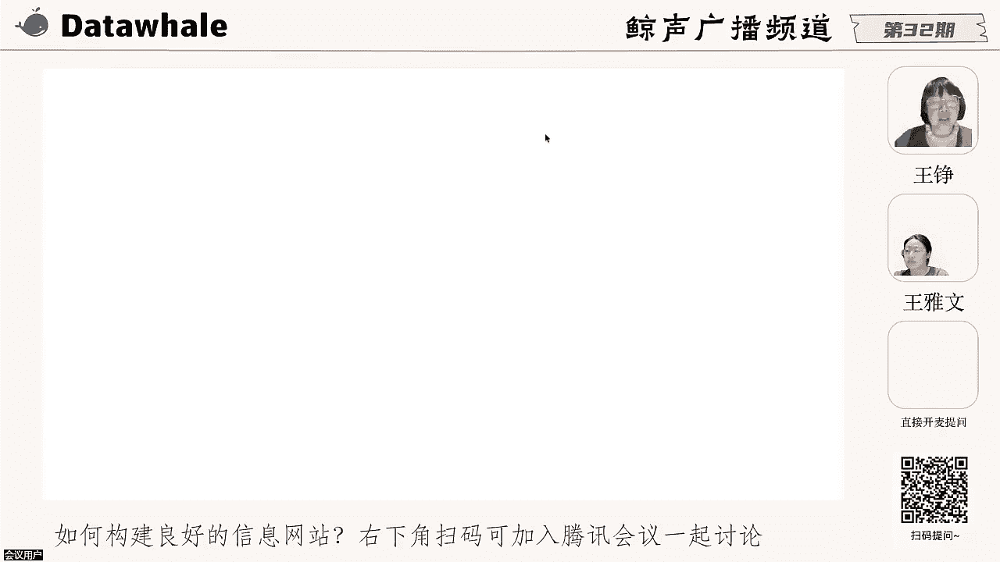
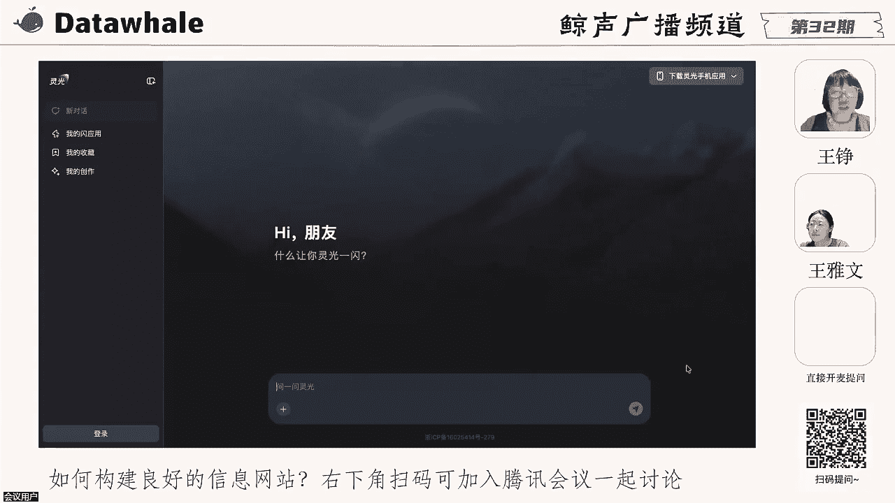
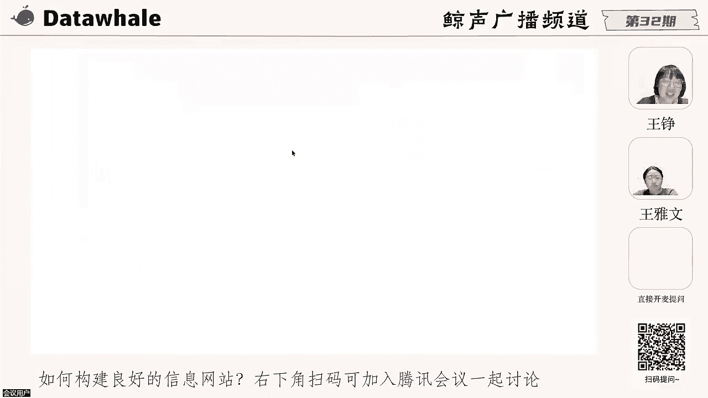
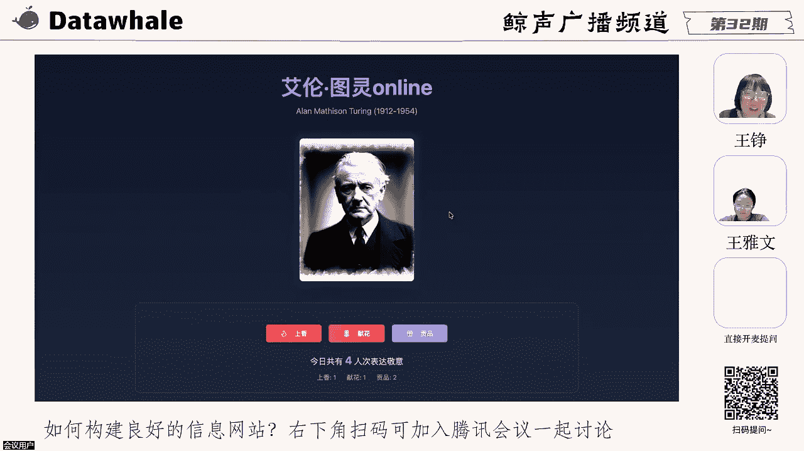
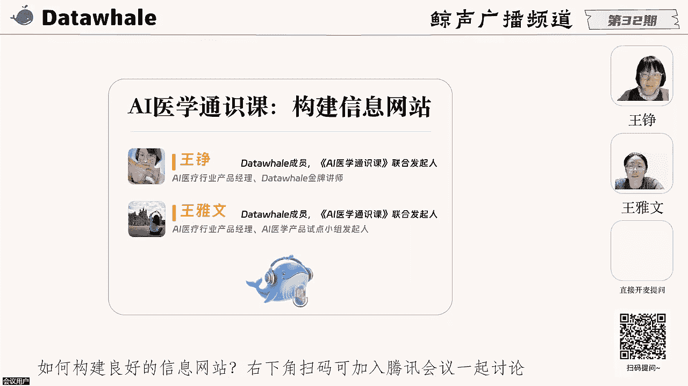

【Datawhale AI+X】AI医学通识课：01：零代码构建信息网站 🌐

在本节课中，我们将要学习如何不写代码地搭建一个信息网站。本节课的内容适合没有编程背景的朋友，也适合想要快速把想法变成线上产品的产品经理或医疗工作者。我们会先聊聊为什么需要信息网站，再介绍几款零代码工具，最后通过几个真实案例演示从零开始建站的完整流程。









为什么我们需要信息网站？在过去，如果我们想要发布内容或者分享知识，通常会选择知乎或者微信公众号这样的平台。这些平台更多是文字型的编辑，也就是写写文章，其实不能有太多的交互。而现在，如果信息经过结构化表现，大家会更容易理解和获取。这个需求不仅存在于罕见病患者群体，其实各个学科，不论是医学、文学还是历史，都有这种内容发布和内容分发的需求。

以下是罕见病患者的具体需求场景。有一群罕见病患者，他们希望通过AI技术或者相关产品，跟大家科普一些罕见病的医学知识。他们需要一个信息归总型的工具，也需要一些帮助进行宣传和展示的工具。使用第三方工具来完成这些需求，有助于他们自己或者罕见病社群进行宣传和沟通。

上一节我们介绍了信息网站的应用场景，本节中我们来看看非技术背景的人如何打破做产品的偏见。在现在的时代，不论你会不会编程，不论你会不会写代码，或者是不是技术背景，实际上有很多AI工具能够帮助你把idea变成线上的产品。这个产品可能是平台型的，也可能是工具型的。在AIhon tour全球高校黑客松中，很多非计算机学院的学生，比如社会学院的学生，都能组队做出非常惊艳的作品。做产品不是程序员专属的事情，做网站也不一定要会写代码。

以下是几款常用的零代码工具。对话式AI工具包括豆包、deepseek等，适合日常交互。编程辅助工具包括cursor、figma等，适合有一定技术基础的人使用。无代码应用搭建平台包括秒达、扣子、minus、灵光AI等，这些工具的界面跟对话型工具差不多，但是不需要编程技能，可以直接通过对话来搭建网站。大家可以根据自己的情况选择使用。

上一节我们介绍了零代码工具，本节中我们来看看具体的建站案例。第一个案例是艾伦图灵纪念网站。这是一个纪念型网站，架构上跟信息网站很像。网站里可以上香、献花，还可以点击上供。另外还有一个图灵智能体，可以帮助解答关于AI失业等疑惑。这个网站看起来很简单，但交互很有趣，整个过程不需要写一行代码。

第二个案例是大开门猫小游戏。这个游戏灵感来自一只出名的猫，猫会根据主人的行动猜萝卜和纸巾。我把这个机制做成了一个小游戏，让大家去猜物品并获得奖励。这个游戏大约用了半个小时就完成了，完全没有一行代码，只需要用语言跟AI对话。

第三个案例是糖尿病护理教育指南网站。原来有一个大约170页的PDF文档，内容比较多，但信息是死的，不能实时更新。后来我们把这个PDF上传到秒达工具，说一句话：基于我上传的文件做出一个可视化的网站。工具就能阅读文件，把内容部署成为网站上线。如果内容有更新，比如讲师变了或者课程变了，只需要在网站上改一改，别人打开链接就能看到最新内容。

上一节我们看了三个建站案例，本节中我们来看看具体的操作流程。首先，如果你想让AI做出网站，下命令是不够的，你需要自己在心中构建网站的功能和流程，然后清晰地告诉AI。其次，处理大文档时建议先做数据切片，按照章节或者大类切分，再批量上传。这样AI对知识的吸收率和读取率会更好。第三，明确目标用户、核心功能、是否需要用户互动、是否需要登录。比如糖尿病网站的目标群体是糖尿病患者及家属，核心功能包括指南内容浏览、可视化展示、知识和关键词搜索，暂时不需要用户互动和登录功能。

以下是需求表达的示例。你可以告诉AI：我想做一个小游戏，玩家当做一只猫站在画面中间，猫咪面前放数量不等的盒子，盒子里装着萝卜、纸巾、耳机、苹果、可乐等物品。画外音会叫出某个物体名称，玩家要选出对应的盒子。选中则胜利，出现胜利结算画面。如果没有选中，则反复列出目标物品名称直到选中为止。整个游戏用中文，猫咪形象参考上传的照片，用游戏像素风格设计界面，名称叫萝卜止巾。


```text
上传资料文件
    ↓
向AI描述需求（目标用户、核心功能、视觉风格等）
    ↓
AI生成需求文档
    ↓
人工审查并修改需求文档
    ↓
点击生成应用
    ↓
AI编写代码并部署网站
    ↓
根据效果反复沟通修改bug
    ↓
网站上线并持续迭代
```

上一节我们介绍了建站流程，本节中我们来看看工具的边界和进阶选择。零代码工具门槛非常低，只需要说话就可以，适合做快速应用和个人小工具。但是，零代码工具不代表能做成熟的工程化产品。成熟的工程化产品需要完善的前端后端，还要管理数据。如果你想做企业级产品或者给客户交付，建议使用AI的IDE工具，比如cursor或者cloud code。这些工具会有一点点门槛，主要是网络门槛和费用门槛，而不是使用门槛。使用起来依然很简单，就像对话一样。

上一节我们介绍了进阶工具，本节中我们来聊聊学习心态。在AI时代，不求甚解是非常重要的习惯。你不需要把概念背下来，用的过程中自然就会理解。干中学，学中干，这是AI时代最重要的习惯。当你不确定要做什么的时候，可以把问题全抛给AI，一起共创。你只需要知道自己的需求是什么，不需要知道怎么写代码。如果你想不清楚要干什么，AI也不知道给你干什么。所以花更多时间想清楚希望AI帮你做什么，至于AI会不会干，你大胆试试就行了。

以下是学习建议。先把AI当做老师或者学长，补足自己需要的知识。比如你可以问AI，成为产品经理需要了解哪些基础知识，结合理论和丰富的案例来讲解。AI的知识非常纯正，可能比一些公众号或者付费课程更有效。在迷茫不知道用AI做什么的时候，先去把AI知识库里面的知识搬到自己脑袋里面，把方法论、框架都先装进去。接下来你就会有更多知识、更多需求、更多能力去更好地问AI。

上一节我们介绍了学习心态，本节中我们来看看如何从简单开始练习。建议先从一个简单的展示网站开始，比如做一个科室的展示网站或者学科介绍网站。接下来做一个类似于年会抽奖的网站。再接下来做一个可以管理数据或者日程的工具。慢慢从简单工具做起，做到复杂工具。在这个练习和进阶的过程中，你会慢慢知道怎么用AI去做产品。



本节课中我们一起学习了零代码构建信息网站的完整流程。我们了解了为什么需要信息网站，认识了秒达、扣子、minus、灵光AI等零代码工具，通过艾伦图灵纪念网站、大开门猫游戏和糖尿病指南网站三个案例，掌握了从上传资料到生成应用再到迭代修改的操作方法。我们还明确了零代码工具的适用边界，知道什么时候该用零代码平台，什么时候该用Cursor等AI IDE工具。最后，我们建立了不求甚解、干中学的学习心态，鼓励大家大胆把想法说出来，用AI快速实现自己的产品构思。
