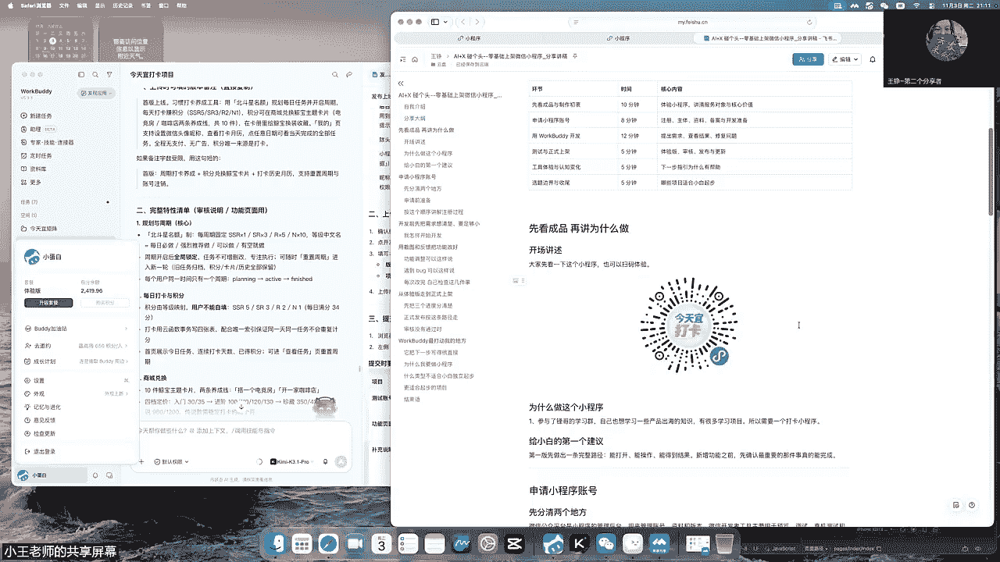

# AI时间管理工具：01：零代码开发微信打卡小程序🤖

在本节教程中，我们将学习如何不写任何代码，借助AI编程助手快速开发并上线一个微信打卡小程序。本节内容专门面向完全没有编程基础的初学者。你只需要会打字、截图和复制粘贴，就能把自己的想法变成真正能够运行的小程序。我们会先从为什么要做这个工具开始，逐步讲解注册账号、功能设计、代码开发、Bug修复、上线审核的全部流程，最后给出适合新手的产品设计建议。

很多朋友平时觉得自己的时间很容易变得混乱，明明想完成很多事情，却缺乏外部驱动，容易拖延或遗漏。作者自己就是一个典型的P人，如果没有计划管理，很难让自己按部就班地完成每日任务。因此他需要一个简单的打卡工具，帮助自己把每天的行为变得更有规律、更有计划。这个工具最初是为自己设计的，后来也想提供给学习社群的成员使用，让大家一起打卡、互相监督，共同养成好的学习习惯。

这个打卡小程序的功能非常完整，涵盖了日常时间管理的主要场景。以下是小程序支持的核心功能：
- 建立打卡任务，并按优先级分为四个等级：每日必做、强烈推荐、可以做、有空就做。例如给猫咪铲屎属于每日必做，给猫咪喂罐头属于强烈推荐。
- 开启打卡周期，系统会自动带入周期数据，比如设定7天周期后，用户每天可以完成一次打卡。
- 打卡完成后，每天的行为会变得更加有规律，更加有计划。
- 拥有可爱的吉祥物小金宝，打卡可以获得分数，分数可以在兑换商城里为小金宝兑换道具，不同道具所需的分数不同。
- 支持修改昵称、查看打卡记录、生成分享卡片、保存图片以及分享到朋友圈。

了解完小程序能做什么之后，我们来看看如何把它从零开始搭建出来。开发一个微信小程序，第一步并不是直接写代码，而是先在微信公众平台完成账号注册。以下是注册前需要准备的材料和具体步骤：

你需要一个尚未在微信公众平台注册过的邮箱，以及你的身份证。进入微信公众平台首页，可以看到公众号、小程序、企业开发者等各种申请入口，按照页面流程完成注册即可。注册完成后，微信会清晰地展示小程序的开发与发布流程。接下来你需要填写小程序的基本信息，包括名称、头像、类目等。这一步和注册公众号非常类似，先给小程序取个名字，想好你到底要做什么，再设计一个头像上传。

类目是小程序的分类，不同的类目对应不同的功能范围。比如你的小程序有日历功能，就选日历类目；有记账功能，就选记账类目。如果功能超出所选类目的范围，发布时可能会被审核驳回。个人开发者可以选择个人资质，如果涉及特殊领域或需要更多人使用，则需要企业资质。作者个人只做工具类小程序，因此使用个人资质注册即可。注册时还需要添加开发者，如果有其他人需要协作开发，可以在此处添加。

完成账号注册和基础信息设置后，正式进入代码开发与调试阶段。这是整个过程中最关键的部分，也是AI发挥最大作用的地方。以下是零代码开发的具体流程：

好消息是，这一步你完全不需要写代码。作者从头到尾一行代码都没有亲手敲过，全部由AI完成。与AI沟通时，建议遵循以下顺序。首先明确你要开发什么样的小程序，核心功能包括什么。例如作者最初跟AI说：我想开发一个打卡小程序，核心功能包括任务管理、周期打卡、积分兑换等。第一版功能可能与最终实现有差异，这很正常，不需要一开始就追求完美。

更重要的是，你需要让AI深度理解小程序的架构。建议直接发送以下要求：请说明该小程序的任务模块划分、数据模式设计以及关键交互流程的实现思路。这样AI会在上下文中把整个小程序的分层结构“记下来”，后续出错的概率会更小。哪怕这些架构内容你暂时看不懂，也没关系，AI给出的内容在大多数情况下是相对正确的，你可以先保留，后续根据需要进行调整。

在开始具体开发前，有必要先厘清小程序的输入和输出。这是一个前置技能，能帮助AI更准确地生成代码。以下是输入输出的定义示例：
- 输入：用户点击“打卡”按钮。
- 输出：打卡记录写入数据库，用户积分增加，任务状态更新。

你需要提前规定用户点击打卡后，会影响哪些数据、触发哪些行为。定义清楚这些前置条件，后续开发会顺畅很多，AI也能更好地理解你的需求。

有了需求和架构之后，你需要下载微信开发者工具。这本质上是一款软件，安装完成后，AI会一步步指导你如何创建项目、配置接口、上传代码。作者自己什么都不懂，直接问AI：“微信开发工具是什么？”AI会耐心解释，并教你下载、安装、使用。

在与AI对话时，可能会遇到“控制台”、“APPID”、“环境ID”等陌生词汇。控制台指的是微信云开发控制台，APPID和环境ID则在注册和开通云环境后获取。AI会告诉你在哪里找到这些值，以及个人和企业资质的区别。你只需要把AI告诉你的值复制粘贴到对应位置，或者直接告诉AI这些值，让它帮你自动填好，无需手动操作复杂的后台设置。

开发过程中，难免会出现各种问题。处理Bug的方法非常简单，不需要你懂代码。当运行小程序出现异常时，开发者工具下半部分会显示日志，日志颜色分为白色、黄色和红色。黄色可能表示轻微异常，红色表示严重异常。如果你发现红色日志，直接截图发给AI，说明运行时出现了什么问题，AI会帮你检查并修改代码。

如果你看不懂界面上的内容，也可以截图发给AI，让它用大白话解释。比如上半部分是小程序主体代码，下半部分是运行日志，AI会帮你拆解每一行的含义。在编译一段时间后，你还可以让AI暂停，回顾上下文，总结当前功能做得怎么样，发现哪里还可以改进。

AI提供多种模型，有免费的，也有付费的，有些还需要排队。为了节省成本，建议区分任务难度。当你需要检查代码质量或做汇总任务时，可以使用最先进的付费模型，比如Kimi K1.5或DeepSeek Vpro。当你只需要做普通编码时，可以使用便宜或免费的模型，因为编码逻辑标准度高，目前大部分AI对简单功能都不会出错。

作者完成整个小程序开发，消耗的Token不到1000个，而且目前大部分仍是免费的。这是一个控制成本的小技巧，适合预算有限的初学者。

功能开发完成后，进入上线发布阶段。在开发者工具中，你开发的是本地代码。完成后点击“上传”，将代码上传到腾讯小程序的审核流程中。接下来点击“审核和发布”。如果你不熟悉具体操作，直接告诉AI，它会提供完整的上线发布清单，包括每个文件右键怎么操作、数据库怎么配置、上传时要填哪些内容等。

提交审核时，各种表单AI也会帮你准备好内容，你只需要复制粘贴即可。如果审核未通过，把审核失败的截图发给AI，它会解释原因并告诉你接下来该怎么做。因为AI对腾讯系产品的规则比较熟悉，比其他AI更懂微信小程序的审核要求，能更快帮你通过审核。

完成一个小程序并不难，但做好产品需要更多思考。作者建议初学者不要一开始就想做一个庞大完善的系统。如何判断一个工具是“大”还是“小”？有一个简单的标准：完成这件事时，是你一个人点点点就能操作，还是需要多个人分工协作？

比如做一个改作业系统，看起来很简单：学生写作业提交，老师批改查看分数，家长也能看到分数。但实际上，学生、老师、家长看到的界面完全不同，涉及三个角色的数据流转，对初学者来说太复杂，不建议尝试。

最好从个人需求出发，做简单的个人工具。比如计算器、个人记录、清单工具、日记工具等。这些工具只有你自己能用，或者别人只能看不能改，结构简单，出错容易恢复。遵循以下原则：第一场景最好是你自己想要的东西；功能要少；出错容易恢复；一个版本只做一个核心功能；其他想法先记下来，不要一直改，否则容易顾此失彼，把原本成熟的模块改坏。

本节教程中，我们一起学习了如何零代码开发微信打卡小程序。我们介绍了打卡任务分级、周期打卡、积分兑换等核心功能；讲解了在微信公众平台注册小程序账号、填写基本信息和选择类目的方法；展示了如何借助AI完成架构设计、输入输出定义、代码生成与Bug修复；说明了如何使用微信开发者工具进行上传、审核和发布；最后给出了从个人小工具开始做产品的建议。

只要你愿意追着AI问问题，愿意截图和复制粘贴，就算不懂代码，也能在几小时内把小程序做出来并上线。希望这篇教程对你有所帮助，祝你开发顺利。

