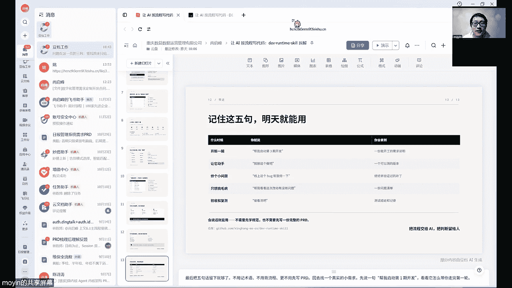
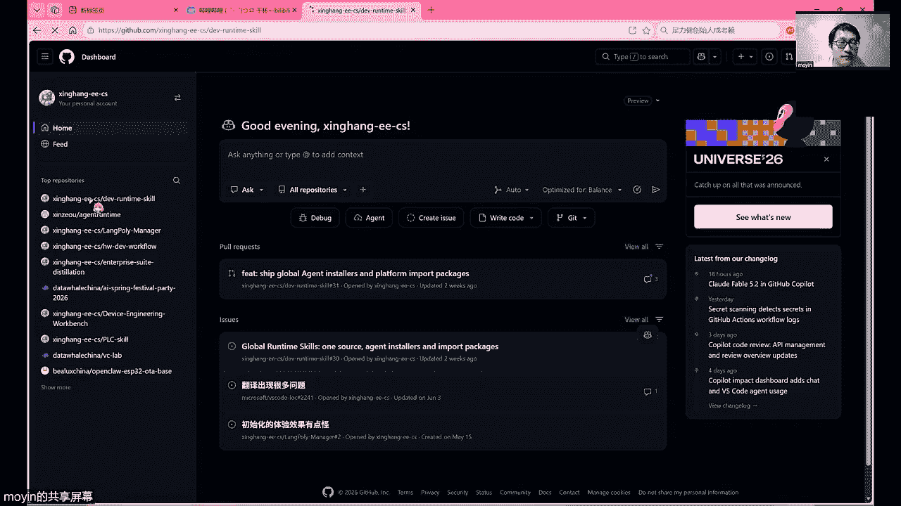
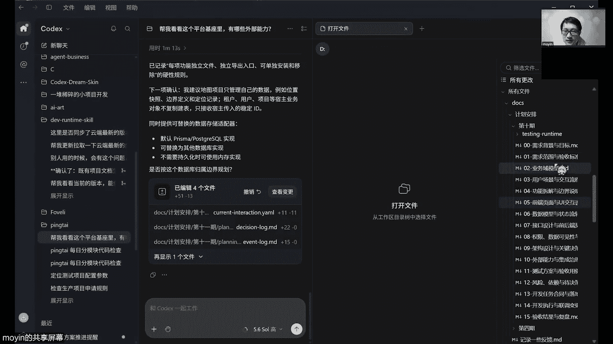

# 🤖 AI编程实战教程：01：Skill工具概述与三大核心痛点

在本节课中，我们将学习一个专门用于辅助AI编程的Skill工具。这个工具的核心目标，是帮助非专业开发者解决在使用AI进行软件开发时最容易遇到的问题。无论你是否有编程基础，只要你想通过AI来构建一个完整的软件项目，这节课的内容都能给你提供清晰的思路。

这个Skill工具最初是为企业内部使用而设计的，后来作者决定将其开源，供所有人免费安装和使用。它的设计初衷很简单：一个人往往需要同时承担需求梳理、代码执行、测试验证以及部署上线等多个环节的工作，如果完全依赖一个纯粹的AI模型，很容易出现疏漏，项目完成后也难以复盘，更无法顺利衔接下一个开发环节。

为了解决这些困难，作者专门开发了这个scalell Skill。它的核心作用，就是攻克AI编程过程中最容易导致失败的三个问题。

以下是这三个核心痛点的具体说明：

第一个问题是目标不准。很多用户并不了解什么是专业的PRD文档，也不需要去学习复杂的需求写作规范。这个Skill允许用户通过与AI不断对话的方式来完善需求，即使你和AI不太熟悉，也可以让AI反向追问你，帮助你把模糊的想法变成清晰的边界，并明确需求的具体范围。

第二个问题是过程不可控。当你使用AI写代码时，你可能不知道AI到底运行到了哪一步，它写出来的代码长什么样子，整个开发过程对你来说像一个黑盒。这个Skill通过在每个开发阶段都提供明确、清晰且可量化的结果，让你始终知道当前处于哪个阶段，重新获得对开发过程的掌控感。

第三个问题是维护和迭代成本高。项目上线后，如果需要修改或迭代，AI往往需要花费大量时间重新阅读旧代码，这既浪费时间又降低效率。这个Skill要求每一次迭代和落地都必须留下明确的说明、记录、日志以及验证结果，这样后续维护时就能花更少的精力，让软件朝着你想要的方向稳步进步。

用公式来描述这个Skill要解决的核心矛盾，可以表示为：

```
开发失败风险 = 需求不准确 + 过程不可控 + 迭代无记录
```

通过消除这三项，项目成功的概率就会显著提升。


# 🛠️ AI编程实战教程：02：安装方式与文件结构

上一节我们介绍了Skill工具要解决的三个核心问题，本节中我们来看看如何安装这个工具，以及安装完成后会生成哪些文件。

这个Skill已经在GitHub上开源，任何人都可以随时下载安装。安装过程非常简单，只需要一条命令即可完成。如果你已经知道仓库地址，甚至可以直接告诉AI：“帮我安装这个timescale”，AI就能为你完成安装操作。工具还支持多端适配，主要在Colex环境中使用，但也可以部署到Clopilot等其他AI Agent环境中，具体怎么部署，你可以直接让AI帮你处理。

安装完成后，Skill会生成几个关键文件夹，其中最主要的是runtime skill文件夹。这个文件夹包含与Skill运行相关的所有内容。此外，它还内置了一套类似于Open Cloud人格设定的机制，可以记录你的表达习惯和偏好。也就是说，随着你不断使用这个Skill进行软件开发，它会逐渐了解你说话的方式和工作习惯。在需求分析阶段，它就能根据你的习惯提供更贴合的支持和建议。

以下是安装后生成的主要文件及其作用：

- runtime skill：存放Skill运行所需的所有核心内容。
- 用户习惯文件：记录你的表达偏好，相当于给AI设定了一个人格。
- 核心话术文件：包含Skill经常使用的五类指令模板。

目前这个版本还没有提供现成的参考代码或项目模板，重点在于提供一套操作规范和开发流程。如果你后续有需要，作者也可以补充相关的代码模板。


# 📋 AI编程实战教程：03：五个核心指令与开发阶段

上一节我们介绍了安装方式和文件结构，本节中我们来看看这个Skill实际使用时的五个核心指令，以及它们分别对应的开发阶段。

Skill内部预设了五种常用话题，每种话题对应开发流程中的不同环节。通过这些指令，你可以用最熟悉的语言与AI沟通，而不需要掌握任何专业术语。

以下是这五个核心指令的详细说明：

第一个指令是启动Plan计划。它用于需求阶段。启动后，如果你分期开发，可以分为第一期、第二期、第三期。假设你正在做第一期，把需求告诉AI之后，AI会不断地梳理和引导，向你提问，确认它的理解是否正确。在这个交互过程中，你的需求会变得越来越具体，AI的理解也会逐渐贴近你的真实想法。当这个环节完全落地后，AI最终能交付的产品，与你最初设想的会非常接近。

第二个指令是“按这个做吧”。当你觉得需求阶段已经落实得差不多，AI已经理解你的意思并具备执行能力时，就可以下达这个指令。AI会按照你之前规定的需求内容，自动运行完整的执行流程，把项目做出来。

第三个指令是“帮我看看这次改动有没有问题”。AI在开发过程中，表面上可能看起来没有风险，但潜在问题可能隐藏在代码深处。使用这个指令，可以让AI对自己的代码和执行流程进行一次审查，挑出隐蔽的问题，然后加以解决，从而降低整个代码库或网页的风险。

第四个指令是“接着测”。它用于测试阶段。开发流程通常分为需求、代码执行、测试三个部分。除了需求阶段，测试阶段同样重要，尤其是使用AI开发时。下达这个指令后，AI会主动列出需要测试的节点，比如哪个页面、哪个功能需要验证。如果需要你手动点击操作，它会告诉你完整流程，你只需无脑操作一遍即可；如果是AI能自行处理的部分，它会自动完成，无需你关心。

第五个指令是专门用于修复线上Bug。当线上网站出现紧急问题，非专业开发者往往感到头疼，因为既要赶时间，又要修复Bug。这个Skill利用已有的计划和需求记录，能快速定位Bug位置，修复后提交上线，让新版本尽快上线，减少损失。

用代码形式表示开发流程的阶段划分，如下所示：

```
开发流程 = 需求梳理 → 代码执行 → 测试验证 → 部署上线
```


# 🚀 AI编程实战教程：04：真实场景演示与执行细节

上一节我们介绍了五个核心指令，本节中我们来看看一个真实的使用场景，以及Skill在执行过程中的具体细节。

假设你要启动第三期开发。你只需要告诉AI：“帮我启动一下第三期的开发。” AI会基于第一期和第二期的经验进行回顾，因为之前的成果和日志已经保存，回顾时消耗的Token会更少。它会查看相关文档，了解当前进度，然后询问你本期需要什么样的需求。在这个过程中，AI会不断与你交互，问你有哪些功能，每个功能要做到什么程度，你只需如实回答即可。

比如，你可能需要做一个运营相关的报表处理功能。AI会询问这个功能要实现到什么样的情况，你告诉它之后，它会把需求整理成非常严谨的文档。整个过程会生成0到15个，也就是大约16个文档，把你的需求一步步转化为标准、严格的PRD流程，最终落到可以直接开工的环节。

你最终拿到的不是一些零散的提问记录，而是一个能够直接开发的说明或列表。后续复查时，也能很清晰地知道哪里出了问题，非常方便。

在需求到执行的环节，你可以告诉AI继续进行下一步。AI会把大的需求拆成很多个小细节，安排先做哪件事、后做哪件事。如果AI本身支持子代理机制，它还可以驱动子代理并行工作，加速整个执行流程。基本上，对于一个大的完整开发需求，AI的执行时间大约在两个小时左右就能完成，速度非常快。

此外，整个开发主线涵盖了十个使用场景，从需求开始，经过整个开发，再到测试，最后上线，这是完整的网页开发流程。在这个主流程中，会穿插很多细节化的检查，比如架构是否需要审核，内容是否需要整体检查，就像给项目做体检，或者给某个模块做体检。这样可以在主流程推进的同时，更好地把控风险，降低AI写出的代码被人类无法理解而导致的未知风险。


# 🐛 AI编程实战教程：05：Bug修复流程、版本控制与规范检查

上一节我们演示了真实场景和执行细节，本节中我们来看看Bug修复的特殊流程，版本控制机制，以及代码规范检查的重要性。

在使用AI开发时，存在一个平衡问题。一方面，我们需要严格按照流程化的方式开发，以保证代码质量足够高；另一方面，走完完整流程会导致开发时间成本过高。为了解决这个问题，Skill专门设计了一个修Bug的例外流程。

修Bug时，不需要把所有流程再走一遍，而是使用一个单独的小单，快速解决Bug并尽快上线，从而不影响整个上线进度。这个例外流程专门用于紧急Bug修复场景。

关于版本控制，Skill希望能够持续更新，兼容不同用户的需求和使用情况。但是，新旧版本之间可能会产生冲突，生成的内容也会有变化。为了确保用户安装到的始终是可用的一套组合，Skill采用版本控制的方式。新版本进来时，也能对旧版本的文档和格式化流程进行适配。这样，整个Skill就会随着用户一起成长，不断把流程跑通。

用代码形式表示版本兼容的逻辑，如下所示：





```
版本兼容 = 新版本适配旧版文档 + 确保可用组合稳定
```

关于规范检查，Skill会让AI通过一套标准的规范或范式来生成代码。后续如果需要复查，查看整个代码时，不会出现AI生成后那种海量代码让人望而却步的情况，反而会有条理、有结构、有规范。即便是人工来核查，体验也会非常好。


# 🎨 AI编程实战教程：06：前端集成与设计初衷

上一节我们介绍了Bug修复流程、版本控制与规范检查，本节中我们来看看Skill的前端集成能力，以及它的设计初衷。

Skill不仅支持后端开发流程，还集成了前端设计功能。如果你要做一个完整的页面网站，你可以直接在网站里询问AI，根据文档内容帮你生成UI设计和UX交互设计的原型。然后，你可以把这些原型喂给支持生图的AI模型，生成直观的图片。你查看这些图片是否符合需求，如果符合，就可以反馈给AI，AI会把生成的图片和交互逻辑图全部保存下来。后续开发时，AI会严格按照这个前端布局来实现功能，可控性大幅提升。


Skill还会根据你的专业程度，提供不同程度的专业术语和表达方式，让不同水平的用户都能更好地掌控AI的开发流程。

关于设计初衷，作者并不希望用户必须掌握专业术语才能和AI对话。相反，Skill希望你用最熟悉、最习惯的语言表达，把专业的事情留给Skill本身。这个工具本质上是为那些不懂AI、不懂代码、没有精力自己写网站的伙伴们准备的。由AI或这套Skill来控制整个开发流程，让你把更多精力留在日常生活、家庭和主要工作上，而不是把全部注意力聚焦在开发本身。



在使用过程中，Skill设有严格的边界。它不会主动写不存在的业务代码，也不会主动进行部署或上线操作，除非你明确要求。每个环节都有检查点，如果第一个环节检查没通过，AI不会跳到第二个环节。这样可以避免跳过环节而产生技术债，确保最终产出的应用能够稳定运行。

用公式表示技术债的形成逻辑，如下所示：

```
技术债 = 跳过环节 × 环节数量
```

只要按照既定流程推进，基本上就能产出一个能够上线并且稳定运行的应用。


本节课中，我们一起学习了AI编程Skill工具的核心内容。首先，我们了解了它要解决的三个核心痛点：需求不准确、开发过程不可控、以及迭代维护成本高。其次，我们学习了如何安装这个开源工具，以及安装后生成的主要文件结构。接着，我们详细介绍了五个核心指令，分别对应需求启动、按需求执行、代码审查、测试验证和紧急Bug修复。我们还通过一个第三期开发的真实场景，演示了如何把模糊需求转化为严谨的PRD文档，以及AI如何拆解任务并快速执行。最后，我们了解了修Bug的例外流程、版本控制机制、规范检查的重要性，以及前端UI/UX集成功能。希望这篇教程能帮助你更好地使用AI进行编程，让开发变得更简单、更可控。

