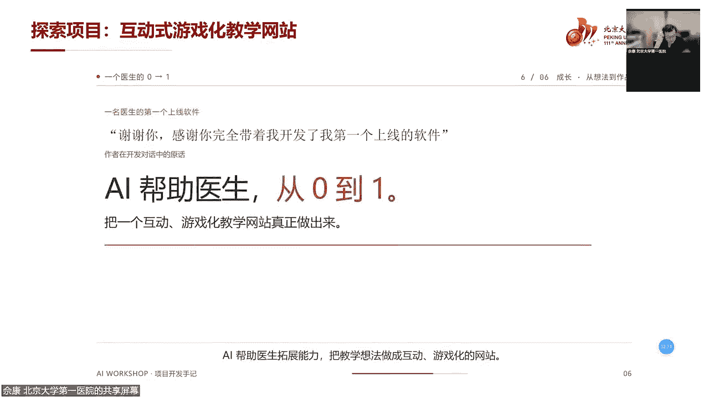
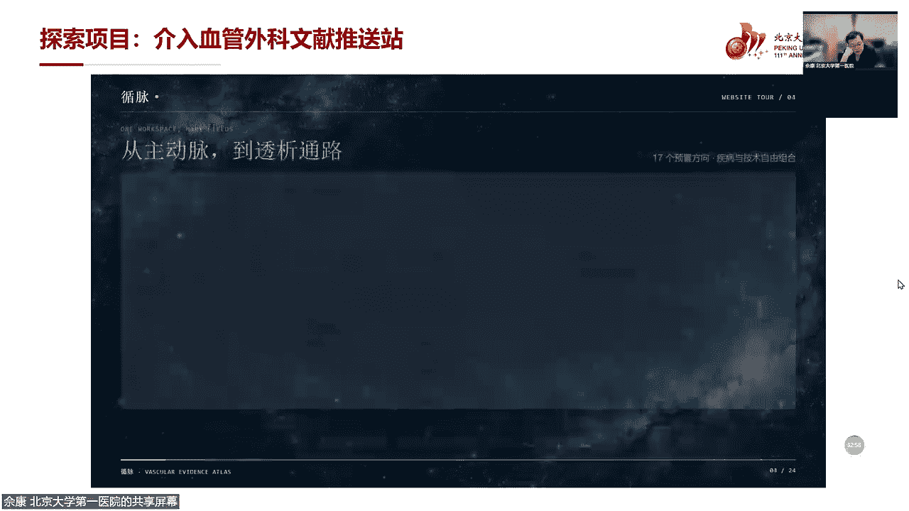
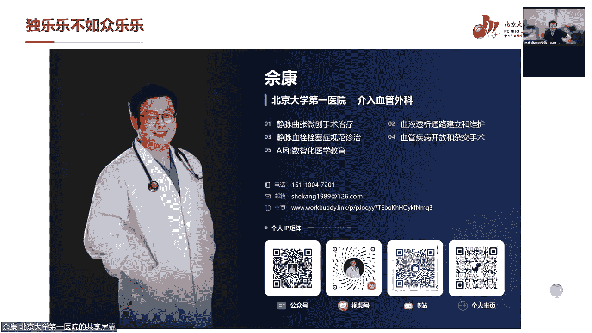

# 医疗AI知识库与智能体构建：01：为什么需要AI医疗知识库🏥

在本节课中我们将学习如何从零开始构建一个面向临床的AI知识库，以及基于知识库演进出的智能体助手。我们会先聊聊静脉血栓栓塞症在临床中的重要性，再看看传统教学和会诊遇到的真实困难，最后引出为什么AI知识库能够帮助医生缓解这些压力。

静脉血栓栓塞症是一个比较严重的疾病群体，它主要包含两个部分。第一个部分是深静脉血栓形成，第二个部分是肺栓塞。这两种疾病在临床中都属于比较危急的情况。如果深静脉里的血栓脱落，可能会随着血流进入肺动脉，从而引起肺动脉堵塞，进而导致广泛的肺动脉血栓形成，这种情况有致死的风险。肺栓塞本身属于猝死性疾病，在猝死原因中排名第四位。除此之外，这种疾病的发病率也很高。以欧洲和美国为例，每千人每年大约发生1到2例。大约有3分之一的患者与住院治疗有关。在这么大的发病背景下，国家卫生健康委员会连续6年将提高静脉血栓栓塞症规范预防治疗率列入国家十大医疗质量目标。国家制定的目标是60%。但是根据现有研究，实际的规范预防治疗率远低于目标。比如2019年的一些研究显示，适宜的预防率只有10.3%左右。这意味着临床中存在巨大的缺口。

$$ VTE = 深静脉血栓形成 + 肺栓塞 $$

$$ 规范预防率目标 = 60\% $$

$$ 实际规范预防率 \approx 10.3\% $$

以下是传统临床教学中常见的几个痛点：
- 规培医生在血管外科轮转的时间很短，有时只有一个月，而且这个月可能出现在轮转开始或结束，教学时间碎片化。
- 静脉血栓栓塞症是必讲知识点，但医生离开科室后，由于临床知识负荷重，容易忘记所学内容，教学效果不佳。
- 其他科室和护理人员在遇到相关问题时，往往通过私人关系咨询血管外科医生，而医生本身还要兼顾门诊和手术，平会诊响应不够及时。
- 医院对平会诊有明确时限要求，上午10点前发出的会诊当天完成，10点后发出的次日完成，这会导致患者治疗出现一定延误。
- 该领域的临床指南非常多且内容庞杂，随手一搜可能出现两百多篇指南，比如某些高级别指南长达800页英文，传统教学难以覆盖所有更新内容。

在本节课的后面部分，我们会介绍AI工具如何介入这些场景。

# 医疗AI知识库与智能体构建：02：静脉血栓栓塞症的临床背景与知识需求📚

上一节我们介绍了为什么需要构建AI医疗知识库，以及传统教学和会诊中的主要痛点。本节中我们将深入了解静脉血栓栓塞症本身的临床特点，以及医生在面对海量指南时的学习压力。

静脉血栓栓塞症分为两个疾病，一个是深静脉血栓形成，另一个是肺栓塞。这两种疾病都是临床中比较危急的疾病。深静脉血栓形成在急性期如果血栓脱落，会进入肺动脉，引起肺动脉堵塞，导致广泛的肺动脉血栓形成，甚至致死。肺栓塞属于猝死性疾病，是第四大猝死原因。发病率也很高，欧洲和美国每千人每年发生1到2例，三分之一的患者与住院有关。国家卫生健康委员会连续6年将提高规范预防治疗率列入十大医疗质量目标，目标是60%。但实际上，规范预防率只有10.3%左右，差距非常大。

以下是医生在面对该领域知识时遇到的具体困难：
- 指南数量极多，涉及产科、骨科、肿瘤科等多个专科，随手一搜可能出现200多篇指南。
- 某些高级别指南篇幅庞大，比如一份英文指南长达800页，需要分多期在杂志上发表才能完成。
- 对学生来说，学习负担很重；对老师来说，如果不专门做血管外科方向，也很难跟上所有指南的更新。
- 传统的课堂灌输方式教学效果较差，难以让学员在离开科室后长期保留知识。

AI时代的到来为这些问题提供了新的解决思路。借助方便的AI工具，我们可以把知识库作为数据底座，相对容易地建立一个AI知识库，并且输出效果也比较好。

# 医疗AI知识库与智能体构建：03：AI知识库的搭建与内容结构🗄️

上一节我们了解了静脉血栓栓塞症的临床背景以及医生面对海量指南时的困难。本节中我们将介绍如何搭建一个实用的AI知识库，以及知识库内部应该包含什么样的内容。

从去年4月份开始，我们使用了一个免费的AI工具来搭建知识库。这个工具功能性很好，适合作为数据底座。知识库建立以来，目前已经放入了2500多份文档。其中大约1200份是静脉血栓栓塞症的指南或高级别证据文献，包括Q文献和荟萃分析等。最早期的知识库里放了少量的PPT，但绝大部分内容是指南和病例库。我们还把护士纳入知识库的管理员角色，所有内容都在持续更新。

以下是知识库的核心结构组成：
```json
{
  "知识库结构": {
    "PPT教学课件": "少量",
    "临床指南": "大量",
    "高级别证据文献": "约1200份",
    "护理和临床病例库": "包含在内"
  }
}
```

因为我们觉得这个知识库对工作帮助很大，所以也把它作为案例，给其他专业的老师进行介绍和演示。在智能体时代来临后，基于这个输出效果良好的知识库，我们开发了多个版本的静脉血栓栓塞症诊疗助手。

# 医疗AI知识库与智能体构建：04：基于知识库的临床决策辅助（Ski V1）🩺

上一节我们介绍了AI知识库的搭建方法和内容结构。本节中我们将看看第一代基于知识库的诊疗助手，也就是Ski V1，是如何在实际临床中辅助决策的。

Ski V1支持文字输入和图片输入。如果用户上传的是图片，系统会先进行OCR识别，提取文字信息。然后系统会提示用户补充患者缺失的基本资料，比如身高和体重。这些信息很重要，因为不知道身高体重就无法计算BMI，也就无法进行某些风险评分；不知道体重又很难确定抗凝药物的剂量。信息补全之后，系统会在知识库中进行多轮查询，命中相关内容后，给出结构化的输出结果。这种结构化输出的会诊意见会附带参考文献，完全依据知识库中的内容生成。

$$ BMI = \frac{体重}{身高^2} $$

以下是Ski V1的主要功能步骤：
```python
# Ski V1 基本处理流程
def ski_v1_process(input_data):
    if input_data.type == "image":
        text = ocr_recognize(input_data)
    else:
        text = input_data.text
    
    missing_info = check_patient_info(text)
    if missing_info:
        return prompt_user(missing_info)
    
    results = knowledge_base.query(text, rounds=multiple)
    return generate_structured_advice(results, with_references=True)
```

后来我们还给这个助手增加了同步血气分析等功能。在实际运行早期，专家发现系统在某些地区会脱离现实。例如，国际指南中推荐使用某种进口药物，但国内可能已经全部集采，医院买不到进口药。第一版系统没有考虑到这一点。后来我们增加了一些规则和学习内容，系统就逐渐了解这些实际情况。

# 医疗AI知识库与智能体构建：05：智能体进化：分层记忆与自我更新（Ski V2）🧠

上一节我们介绍了Ski V1的基本功能和早期应用情况。本节中我们将介绍Ski是如何进化到V2版本的，主要变化在于引入了分层记忆系统和自我更新机制。

这个进化思路借鉴了一篇关于智能体像人类一样终身学习的文章，其中带有一点经济学习的思想。Ski V2的核心架构在每次工作时，都会先检索智能体脑子里的记忆系统。看完病之后，系统会强制对本次对话进行蒸馏，然后改变记忆的权重，从而更新原始权重，实现自净化的目的。

$$ W_{new} = W_{old} + \text{Distill}(Dialogue) $$

以下是Ski V2的分层记忆系统包含的部分：
- 通用推理知识层，用于处理一般性医疗逻辑。
- 静脉血栓栓塞症专科知识层，用于存储专业领域的深度内容。
- 调用工具的技能层，用于让智能体知道如何使用外部工具。

系统还会感知记忆的权重，并在每次诊疗结束后，对对话进行蒸馏，修改权重，最终改变原始的权重设置。这样一来，智能体就能在不断实践中自我优化。

# 医疗AI知识库与智能体构建：06：教学辅助与个性化学习资源推荐🎓

上一节我们介绍了Ski V2的分层记忆和自我更新机制。本节中我们将看看如何让智能体不仅帮助诊疗，还能辅助医生的学习和教学。

除了在诊疗过程中帮助智能体本身，我们还希望这个系统能帮助医生。具体做法是，在智能体工作时，读取用户的长期记忆，然后根据用户情况推荐相应的学习资源。这些资源来自于我们的知识库。比如，如果资深医生提问，系统可能会推荐最新的文献；如果是学生提问，系统可能会推荐比较基础的PPT。同时，我们引入了一个遗忘因子，用来捕捉用户记忆中比较薄弱的知识点。比如有些医生每次都会在儿科静脉血栓问题上出错，系统就能识别出这个薄弱环节，并推送相应的学习材料。

$$ 学习资源 = f(\text{用户长期记忆}, \text{遗忘因子}, \text{知识库内容}) $$

以下是个性化推荐的几种场景：
- 资深医生查询时，推荐最新的临床研究和指南更新。
- 医学生查询时，推荐基础教学PPT和入门资料。
- 根据遗忘因子，针对用户反复出错的知识点，提供专项复习资源。

在这个系统加入之后，智能体在工作时不仅蒸馏对话内容，还会主动推荐学习资源，实现了诊疗与教学的结合。

# 医疗AI知识库与智能体构建：07：病例评价系统与工作流构建🔄

上一节我们介绍了教学辅助和个性化资源推荐功能。本节中我们将介绍如何对已有的脱敏病例进行评价，以及如何构建完整的诊疗工作流。

早期我们向知识库中放入了很多脱敏病例，但起初不太确定这些病例该如何使用。最初的想法是拿来查找病例或生成虚拟病例，但后来我们意识到，这些病例大部分来自门诊，不一定都是最贴近指南的策略。为了解决这个问题，我们做了一个评价系统，把几百份病例集中起来进行评价，看看哪些方案更接近指南要求。这个评价任务不是随时触发的，而是作为一个独立的模块，帮助我们发现传统上认为正确的做法，其实可能并不完全符合最新的诊疗共识。这些发现也可以成为未来临床研究的切入点。

以下是工作流的主要步骤：
- 对住院病历照片进行脱敏处理。
- 将脱敏后的病例输入诊疗助手，生成会诊意见。
- 将会诊意见与知识库中的指南进行对比评价。
- 根据评价结果优化记忆系统和推荐策略。

在工具链方面，我们经历了一些平台的迁移。早期使用Cloud Code开发安装文件，后来变成了一些可执行程序，再迁移到CodeEx或WorkBox等环境进行适配。我们觉得WorkBox在这方面的执行效果可能更好一些。整体运行状态就是，拍摄住院病例照片，进行脱敏，然后交付大量脱敏病例，诊疗助手据此书写会诊意见。这个流程运行得还不错。

# 医疗AI知识库与智能体构建：08：智能体的痛点与改进方向🛠️

上一节我们介绍了病例评价系统和完整的诊疗工作流。本节中我们将讨论当前AI知识库和智能体还存在哪些不足，以及未来可以向哪些方向改进。

从AI知识库的角度来看，目前的产品更多是借助商业平台搭建的，并不是标准化的工程化产品，迁移起来比较困难，也没有完善的版本回滚和自动文献纳入机制。我们近期的工作是将其真正工程化和产品化，使其能够更好地回滚版本，自动纳入大量文献，并评价这些文献，或者提醒管理员进行内容排查。另外，有些脱敏病例可能不需要全部保留，可以根据实际情况去除。

以下是知识库产品化需要解决的问题：
- 缺乏工程化标准，迁移和部署困难。
- 没有自动纳入和评价新文献的机制。
- 缺乏完善的更新、审核和版本管理机制。
- 缺少专门的问题集和Benchmark来评价知识库效果。
- 不清楚在不同专科建立标准知识路径的通用操作方法。
- 付费和合作模式尚未明确。

从智能体的角度来看，也有几个主要痛点。第一个是多模态问题。虽然静脉血栓栓塞症领域相对较好，但血管外科很多领域高度依赖多模态数据，比如影像，尤其是CTA，数据量很大。第二个是持续数据问题。病情评分和诊疗策略可能会随着住院期间多次检查、化验单变化和症状变化而调整，理想的智能体应该能够处理持续数据，产生动态策略。第三个是在大样本数据集下完成机器学习和预测，但外部数据验证不足，能力可能会下降。第四个是与电子病历系统的融合，不同医院的非标数据和脏数据很多，从电子病历中提取生命体征和化验趋势都有困难。第五个是联邦学习问题，不同医院不希望患者数据离开医院，要实现多中心共同训练，需要联邦学习技术。最后一个是通用AI融合问题，未来通用AI可能已经把专用智能体的功能包含进去，这时候专用智能体是否还有价值，也需要探索。

以下是具体的临床改进目标：
- 融入多模态数据，包括影像、超声、病理和基因信息。
- 处理纵向数据，比如随着肌酐清除率下降调整抗凝剂量，复发后如何再治疗，维护期如何停药和重启，妊娠期如何选择药物，长期随访如何评价。
- 构建更准确的学习系统，使用更结构化的训练数据，通过多个端和多个中心进行训练和蒸馏。
- 与电子病历系统和企业合作，尝试L2级别的提醒式、事件触发式辅助系统。




无论做哪一步，都需要面临合规问题，包括临床评价、责任归属和数据安全等，这些都需要多方合作才能达成。




# 医疗AI知识库与智能体构建：09：个人实践经验与未来展望🚀

上一节我们讨论了智能体的痛点和改进方向。本节是最后一节，我们将分享一些个人在AI与医疗交叉领域的实践经验，并展望未来的发展方向。

我自己大约用了两年的时间在这个方向上摸索。早期在CodeEx里做过一个游戏化教学的小项目，想让学生在四小时内听完讲解，后来在香港大学参加了一个活动，觉得效果不错，就想自己做一个类似的项目。那个项目相当于完全从零开始，我提供了一些想法和真实操作的验证问题，算是一次初体验。后来卡边儿上线了一款可以在课堂上使用的工具。此外，我还做了一个网站，把自己学习文献的经验整理进去，最初是给科室学生使用，希望他们能看书、读文献，不同的人有不同的兴趣点。这个网站融入了我自己读文献的技巧和一些工作流。后来把这个不太成熟的Demo给了一家医学教育公司，让他们发展成更广泛的框架。

以下是我参与的一些具体项目示例：
- 基于CodeEx的游戏化教学Demo。
- 医学教育公司的文献学习网站框架。
- 评价医学生PPT和AI互动记录的独立评价平台，支持外部专家评审、金标准对照、差异条目聚焦等功能。

除了血管外科的临床工作，我还在医院里承担一些教学和教学研究工作。未来感兴趣的方向包括：面向医学生和医生的AI素养培训教学团队建设、医学教育评价智能体、对临床操作视频进行评价、静脉血栓栓塞症知识库的测评级建设、以及临床数据、多读学数据、手术视频和标注的数据平台建设。这些方面目前还处于探索阶段，尚不成熟。

# 医疗AI知识库与智能体构建：10：课程总结📝

本节课中我们一起学习了为什么需要构建面向临床的AI知识库，重点围绕静脉血栓栓塞症展开，介绍了知识库的搭建方法、内容结构，以及基于知识库演化出的Ski V1和Ski V2智能体。我们还讨论了教学辅助、个性化学习资源推荐、病例评价系统和完整工作流的构建，最后分析了当前的痛点与未来改进方向，并分享了一些个人实践经验。

以下是本节课的核心要点：
- 静脉血栓栓塞症包含深静脉血栓形成和肺栓塞，发病率高且规范预防率存在较大缺口。
- 传统教学和会诊存在时间碎片化、知识负荷重、指南庞杂等问题。
- AI知识库可以将指南、高级别证据和病例库作为数据底座，输出结构化的会诊意见。
- Ski V1支持多模态输入和OCR识别，能够补全患者基础资料并给出带参考文献的建议。
- Ski V2引入了分层记忆系统和自我蒸馏机制，实现知识的自净化和权重更新。
- 智能体还可以根据用户长期记忆推荐个性化学习资源，并引入遗忘因子弥补知识薄弱环节。
- 未来需要解决多模态融合、持续数据处理、电子病历对接、联邦学习和合规等问题。




希望这篇教程能帮助你理解如何从临床痛点出发，构建一个真正可用的医疗AI知识库和智能体系统。如果你对相关内容感兴趣，欢迎继续探索和实践。

